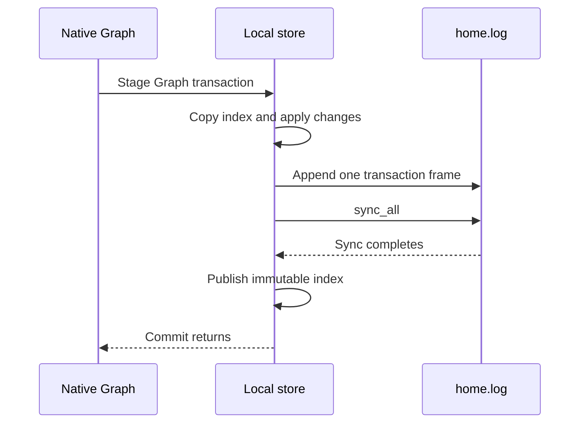

# Causal package Graph scenario comparison

This proof of concept (PoC) runs the existing causal package against current
DuckDB GraphStore, redb, Fjall, and a local append-only store. It measures the package's dependent Graph
traversal and staged changes through one durable commit. The production store
and the incident test stay unchanged.

An additional mode compares SurrealKV with redb and Fjall through the same
native Graph algorithm. It uses the same eight package cycles and assertions.

## Intended end state

Compare the actual Graph work in
`discovery::packages::required::incident::incremental::follows_incremental_sources`.
Use the same package code, source fixtures, read semantics, and durability for
all engines. The complete production target remains receipt to notification
creation below 100 milliseconds and a 100-fold gain. This PoC does not measure
that complete path.

## Implementation review flow

[Incident::index_input](incident.rs) supplies resolved Arrow inputs for one incident increment.
  -> [Engine::capture](main.rs) captures one Graph view for that input cut.
  -> [package::evaluate](package.rs) checks the real Causal descriptor and binds the example host.
  -> [Causal::compute](../../../araphor-analysis-builtins/src/causal/mod.rs) calls the existing index export.
  -> [Edits::frontier](../../../araphor-analysis-builtins/src/causal/state.rs) repeatedly requests neighbors in both directions.
  -> [Host::read](package.rs) reads the selected keys and applies the native Journal overlay.
  -> [Index::compute](../../../araphor-analysis-builtins/src/causal/index.rs) clears affected owners and stages node and edge changes.
  -> [Incident::detect_input](incident.rs) supplies records and audits selected by the returned frontier.
  -> [Detect::compute](../../../araphor-analysis-builtins/src/causal/detect.rs) checks the causal chain and stages actual FindingMember values.
  -> [Step::new](fixture.rs) exposes the actual package journals to the measured store path.
  -> [Duck::apply](duck.rs) prepares and applies the production GraphStore layers.
  -> [Native::apply](native.rs) applies the same native Graph record algorithm on redb, Fjall, SurrealKV, or the local store.
  -> [Database::write](kv.rs) durably commits Graph, head, state, progress marker, and change references together.

[main](main.rs) completes the measured package cycle.
  -> [Oracle::check](main.rs) compares exact member identities, endpoints, versions, and Arrow values.
  -> [Reference](main.rs) compares exact traversal key sequences, returned counts, frontiers, and finding values across engines.
  -> [verify_metadata](native.rs) checks exact writer heads and parent/captured commit records outside timing.
  -> [Engine::inspect](main.rs) checks all earlier views after the later commits.
  -> [Engine::apply](main.rs) stages revision 88 and rolls the transaction back.
  -> [Engine::close](main.rs) waits for explicit SurrealKV shutdown when that backend is selected.
  -> [Engine::open](main.rs) reopens the database and restores the property cache.
  -> [Oracle::check](main.rs) checks retained history and rollback state again.
  -> [TempDir](main.rs) removes that round's database files after close and size measurement.

The example owns its test database and transaction. Production Data ownership
does not change. Generic Graph receives opaque relations and identities. The
package owns the traversal and detector rules. The PoC calls the same
`Causal::compute` implementation as the builtin component. It uses SDK input
and output validation and the actual `Journal` preparation and overlay.

## Incident and Graph operations

The fixture follows the incident test's credential-pivot scenario. Four
streams on two nodes provide six linked actions for each episode:

1. An actor attempts credential access and is denied.
2. The actor obtains credentials from an IMDS response.
3. The actor uses those credentials to request a different Kubernetes token.
4. That token authorizes a privileged pod with a writable host-root mount.
5. A scheduling record places the pod on the other node.
6. A runtime record confirms the corresponding container admission there.

The denial is supplemental evidence. The successful credential, token, pod,
scheduling, and admission chain supplies the finding. The fixture uses the
existing public audit, proof, observation, context, and finding types.

The first increment supplies five actions and must produce no finding.
The next increment supplies the missing admission and must produce one
confirmed finding. Coverage-only increments revisit the retained Graph and
update the finding. Two later episodes must produce two and three findings.
Each finding must contain six evidence records from four streams and two
nodes. The raw background events are outside this Graph-storage measurement.
Their coverage advances appear as the corresponding resolved inputs.

The package connects source, record, actor, credential, request, pod, and
binding nodes. Links retain their actual audit record, context version,
revision, and restriction properties. A traversal follows outgoing and
incoming adjacency. Each returned edge supplies endpoint keys for the next
frontier. The package's source-label rule prevents traversal back through a
source origin. The benchmark does not copy this algorithm.

| Publication | Captured input | Frontier records | Neighbor rounds | Keys in each round | Returned rows in each round |
| --- | --- | ---: | ---: | --- | --- |
| 26 | 24 | 5 | 0 | Initial reset | Initial reset |
| 29 | 27 | 6 | 3 | 9, 6, 3 | 9, 18, 7 |
| 44 | 36 | 6 | 4 | 4, 6, 5, 3 | 6, 16, 21, 7 |
| 46 | 44 | 6 | 4 | 4, 6, 5, 3 | 6, 16, 21, 7 |
| 62 | 48 | 6 | 4 | 4, 6, 5, 3 | 6, 16, 21, 7 |
| 64 | 62 | 12 | 4 | 18, 6, 5, 3 | 6, 16, 21, 7 |
| 85 | 71 | 12 | 4 | 4, 12, 10, 6 | 12, 32, 42, 14 |
| 87 | 85 | 18 | 4 | 18, 12, 10, 6 | 12, 32, 42, 14 |

These are observed package requests. They are not configured limits. One
edge can occur in multiple rounds. The complete eight-step run inserts 194
versions, closes eight versions, and retains 186 live contributions. Both
writer heads advance at every commit, including empty writer journals.
The first index and detect calls use the production reset path.

## Storage and timing

DuckDB uses the production GraphStore, GraphReadView, presence checks, layer
preparation, dictionaries, properties, member storage, endpoint validation,
and native cache publication. The example supplies small metadata tables for
state, progress, commits, and change references. DuckDB uses two threads and
the production unlimited memory setting.

redb, Fjall, SurrealKV, and the local store share one native record algorithm through [Database](kv.rs).
Binary dictionaries map identities to stable numeric references. Historical
member intervals and relation, entity, owner, outgoing, incoming, and label
indexes select members. The read view holds one physical snapshot while the
package runs. Native reads use the selected indexes and construct Arrow
batches before the package consumes them. Presence checks use the actual
captured writer, owner, entity, and revision.

The replay implements this package's clear-before-Add journals. A scope or
owner clear closes only that writer's actual contributions. The replay is
not a general production Journal executor. Arbitrary edit sequences,
branching, retention, and fragmentation are outside this fixture.

Native writes encode the actual property batches as Arrow IPC inside the
measured write work. Live reads share retained Arrow values. Reopen decodes
the durable chunks and restores the cache. Current GraphStore also retains
native Arrow values. Application revision keys retain logical history;
internal engine snapshot history is not the retained Graph history.

`scenario_s` is one uninterrupted interval:

```text
Capture the Graph view
  -> Run actual index traversal, owner clears, presence checks, and staging
  -> Resolve detect inputs from the actual returned frontier
  -> Run actual detection and finding staging
  -> Normalize the package journals
  -> Prepare and durably commit Graph and synthetic metadata
  -> Publish native property caches
```

Shared source Arrow for the index is prepared before timing. Frontier-driven
detect input construction stays inside timing and has its own `resolve_s`
field. The fixture supplies resolved inputs; native DataFusion source-query
execution is outside this PoC. The post-commit all-member verification read,
result comparisons, Oracle work, and metadata-only checks are outside the
primary scenario interval. Their read times are recorded separately.

Each sample records capture, index, resolver, detect, normalization, write,
and total scenario intervals. It also records each explicit Graph read and presence probe's
operation, relation, key count, returned rows, and elapsed time. Clear and
stage calls stay in the package interval but have no separate call record. Exact key
vectors remain in memory for comparison. Traversal time is nested inside
index time. Component medians are not additive.

redb uses `Durability::Immediate`. Fjall uses transaction
`PersistMode::SyncAll`. DuckDB uses durable on-disk `COMMIT`. The local store
uses one transaction frame and `sync_all` per commit. The existing engines
keep their default cache and compression settings. Eight rounds balance each
engine position and each ordered predecessor pair twice. Each engine has 64
measured package cycles and 64 commits. The summarizer computes paired ratios
from complete round totals. Eight samples per revision do not establish a
tail bound. The older three-engine results below use six rounds.

## SurrealKV comparison

[Surreal::open](surreal.rs) creates one Tokio runtime and opens the native tree.
  -> [Surreal::read](surreal.rs) captures one native read-only transaction.
  -> [Transaction](surreal.rs) uses native get, bounded prefix iteration, and reverse iteration for revision-floor reads.

[Surreal::write](surreal.rs) starts one native read/write transaction.
  -> [Transaction](surreal.rs) reads its own writes and stages native set and delete calls.
  -> [Surreal::write](surreal.rs) selects `Durability::Immediate` and waits for commit through the runtime.
  -> [Surreal::write](surreal.rs) rolls back without commit when the caller aborts.

[Engine::close](main.rs) closes the candidate before drop and reopen.
  -> [Native::shutdown](native.rs) forwards close to the physical owner.
  -> [Surreal::close](surreal.rs) waits for native tree shutdown and returns close errors.

The candidate uses released SurrealKV 1.2.0. Synchronous reads do not cross
the runtime. Commit bridging stays inside measured commit work. The native
Graph layout, Arrow properties, revision keys, and synthetic metadata stay
the same across the three compared engines. SurrealKV engine versioning is
disabled. The existing application keys already retain the required Graph
history; this comparison does not add a second history policy to one engine.
It does not measure SurrealKV `get_at` or `history` features.

The `surrealkv` mode uses all six orders of redb, Fjall, and SurrealKV. Each
engine has 48 measured package cycles in six fresh databases. Default cache,
compression, and maintenance settings stay active. All original finding,
frontier, traversal, Graph delta, metadata, history, rollback, and reopen
assertions stay active. The original four-engine mode keeps its eight orders.
The candidate comparison adds no SlateDB or production storage path.

```sh
rtk proxy env CARGO_INCREMENTAL=0 CARGO_BUILD_JOBS=6 POC_SOURCE_REVISION=f4717056d \
  cargo build --release -p araphor-graph --example storage_poc --features store \
  --config /tmp/araphor-storage-release-override.toml --message-format=short
rtk proxy target/release/examples/storage_poc /tmp/araphor-surrealkv-poc/release.json surrealkv
rtk proxy python3 -B crates/araphor-graph/examples/storage_poc/summarize.py \
  /tmp/araphor-surrealkv-poc/release.json
```

[native_transactions_and_reopen](surreal.rs) checks read-your-writes, an
older snapshot across a later commit, deletion, empty values, ordered prefix
reads, floor reads at zero and `u64::MAX`, rollback, explicit close, and reopen.
This test passes in release. The focused release test command passes all five
example tests. The [environment record](results/surrealkv-2026-11-05/environment.json)
contains that command in `unit_command`.
The measured comparison is recorded below. Native temporal-feature and
sustained-compaction qualification remain **Not done**.

## Local append-only store

[Home::open](home.rs) opens `home.log` and acquires an exclusive file lock.
  -> [Home::open](home.rs) checks the version header and each complete transaction frame.
  -> [Home::open](home.rs) replays the final put and delete for each key into an ordered in-memory index.
  -> [Home::open](home.rs) truncates an incomplete final header or payload and syncs the truncation.
  -> [Home::open](home.rs) rejects a complete frame with an invalid checksum or payload.

[Home::read](home.rs) clones the immutable index root for one read scope.
  -> [Index](home.rs) serves exact keys, ordered prefixes, and revision-floor reads.

[Home::write](home.rs) copies the index into one private transaction.
  -> [Transaction](home.rs) applies staged changes and records the final put or delete for each changed key.
  -> [Home::write](home.rs) encodes that delta with the existing MessagePack codec.
  -> [Home::write](home.rs) appends one length-delimited frame with header and payload CRC32C checksums.
  -> [Home::write](home.rs) syncs the file before it publishes the new immutable index root.

[Home::write](home.rs) aborts before append.
  -> [Transaction](home.rs) drops the private index and changes without file writes.

[Home::write](home.rs) receives an append or sync error.
  -> [State::check](home.rs) refuses new read scopes and writes until reopen.

This backend is an ordered in-memory key/value index with a durable transaction
log. It has no embedded database dependency. Keys and values use shared byte
buffers. A write copies all index entries once. The copy, delta recording,
encoding, checksums, append, sync, and publication stay inside the measured
scenario. CRC32C checks file integrity; it does not detect source changes.
The generic Graph record layout still owns revision history and change records.
Physical log offsets do not replace application input positions.

The file starts with the eight-byte version header `ARPHKV01`. Each frame has
a little-endian `u64` payload length, a little-endian `u32` payload CRC32C,
and a little-endian `u32` CRC32C of the first 12 header bytes. The payload
is a MessagePack map from binary keys to optional binary values. A null value
deletes a key. An empty binary value retains a key with an empty value.



The store keeps all current physical keys and values in memory. These keys
include retained Graph history. Write copy cost grows with the full index.
The log has no compaction, reclamation, or checkpoint. Reopen replays the full
log before the native Graph owner restores Arrow property chunks. This small
experiment does not qualify large Graphs or power-loss recovery. An incomplete
tail check is not a power-loss test. No DataFusion operator or production path
changes.

[transactions_and_snapshots](home.rs) checks read-your-writes, an older active
snapshot across a later commit, key deletion, empty values, ordered prefix and
floor reads, exclusive open, abort without append, and reopen.
[incomplete_tail_and_corruption](home.rs) checks every byte cut in the final
frame, a commit after recovery, and complete header or payload corruption.
[failed_append_requires_reopen](home.rs) uses a read-only file handle to check
the failed-append state. These checks are outside scenario timing.

## Commands

Run from the repository root. Use the same local on-disk parent directory for
all engines. The executable creates and removes temporary databases beside
the output file. A value or traversal mismatch fails the process. There is no
latency pass limit. After build, one eight-round run takes less than two minutes
on the recorded host.

```sh
rtk proxy env CARGO_INCREMENTAL=0 CARGO_BUILD_JOBS=6 POC_SOURCE_REVISION=1a367e567 \
  cargo build --release -p araphor-graph --example storage_poc --features store
rtk proxy target/release/examples/storage_poc /tmp/araphor-causal-poc/release.json
rtk proxy python3 crates/araphor-graph/examples/storage_poc/summarize.py \
  /tmp/araphor-causal-poc/release.json
```

Build the bundled DuckDB dependency in release. A release Rust executable
linked to the old cached `-O0` DuckDB archive is a mixed-profile result.
The recorded optimized comparison excludes that mixed diagnostic.

## Qualification boundary

### Sustained compaction check

[compaction::run](compaction.rs) opens one growing Fjall database.
  -> [Incident::shift](incident.rs) advances the same source and context revisions for each repeat.
  -> [compaction::pass](compaction.rs) repeats the same eight package steps and retains historical Graph keys.
  -> [Trace](compaction.rs) records native compaction choices and successful physical merges on one monotonic clock.
  -> [compaction::pass](compaction.rs) completes two background merges, finishes the current repeat, and runs one more repeat.
  -> [compaction::run](compaction.rs) gives redb the same number of repeats in two paired engine orders.

[compaction::pass](compaction.rs) completes the sustained writes.
  -> [Oracle::check](main.rs) checks all eight cuts in the first, middle, and last repeat after later writes.
  -> [compaction::pass](compaction.rs) checks rollback and the same retained cuts after reopen.
  -> [Reference](main.rs) compares exact member values, traversal keys, and frontiers across engines at those cuts.
  -> [compaction_summary.py](compaction_summary.py) reports cycles that overlap installed physical merges and the matching redb revisions.

This mode repeats the same identities and rebuilds the current Graph at each
repeat. The first repeat has 194 additions and eight closures. Each later
repeat has 194 additions and 194 closures. The final live Graph still has 186
contributions. Physical history grows throughout the run. This is a repeated
update and rebuild workload, not a set of new independent incidents.

Fjall keeps its default 64 MiB memtable and leveled compaction strategy with
an L0 threshold of four runs. The driver does not rotate memory tables or
call major compaction. Its native completed-compaction counter includes
no-op strategy checks. The exact `Compaction successful` trace message comes
after a real merge installs its output manifest. The driver retains those
messages, their choices, warnings, and errors. Trace dispatch stays enabled
for both engines. No input subscription uses this diagnostic logger.

Each package cycle has timestamps on the same clock as the merge events.
Maintenance samples record memory-buffer bytes, queued flushes, sealed memory
tables, L0 tables, total tables, journal count, and native attempt counters.
These samples and correctness checks are outside the primary scenario time.
The summarizer separates cycles that overlap merges from other cycles.
Its paired redb rows use the same revisions and history age. An overlap can
also include normal history-scan cost; the result does not isolate a causal
compaction penalty. Existing stable-key history scans can grow with history.

The first Fjall run selects the repeat count from observed merges. The second
Fjall run uses that same fixed count and reports the merges it actually sees.
The engine order is Fjall/redb, then redb/Fjall. The four passes use the same
package, input increments, durability, and retained-history policy.

```sh
rtk proxy target/release/examples/storage_poc /tmp/araphor-compaction-poc/release.json compaction
rtk proxy python3 -B crates/araphor-graph/examples/storage_poc/compaction_summary.py \
  /tmp/araphor-compaction-poc/release.json
```

[repeated_package_history](compaction.rs) runs two repeats on each engine.
It checks 388 additions, 202 closures, original finding evidence, retained
history, exact cross-engine rows and calls, rollback, and reopen. The short
test does not assert that compaction occurs. Sustained compaction measurement
and production notification acceptance remain **Not done** until the longer
run completes.

The [compaction pilot record](results/compaction-pilot-2026-11-05/pilot.json)
covers source `644ab7540`. The last logged milestone is 288 repeats and one
successful physical merge on the first Fjall pass. All cycle checks pass
through that milestone. The agent interrupts the run to prioritize the
user's later SurrealKV benchmark request. The interrupted process does not
write its in-memory samples or events to the output JSON. Final historical
cuts, rollback, reopen, and matched redb passes do not complete. The retained
record proves no compaction latency distribution or engine comparison.
The sustained comparison remains **Not done**.

### Other boundaries

The debug run at source `65d655ec8` passes all 18 engine runs. It proves exact
cross-engine frontiers, traversal requests and counts, finding values,
Graph deltas, state and captured-revision markers, history, rollback, and
clean reopen for this scenario. Formatting passes. The debug build has one
existing unused-import warning in production causal `io.rs`.

A gain against current GraphStore includes the native Graph owner rewrite
and the physical engine. redb, Fjall, SurrealKV, and the local store share the same Graph record
algorithm. The PoC does not run Control intake, raw ingestion, native
DataFusion input queries, full Data authority/evidence checks, finding
projection publication, or notification creation. It also does not qualify
large data, steady compaction, cache pressure, backup, retention, or power loss.

The earlier generic storage screen remains in
[its result directory](results/2026-11-05/environment.json) at source
`dcf84a041`. Those figures are not the package scenario's result.

## Recorded scenario result: 2026-11-05

Actual package scenario implementation and comparison: **Done**.
Production replacement and complete incident latency qualification: **Not done**.
The measured Rust source is `65d655ec8`. The
[environment record](results/causal-2026-11-05/environment.json) identifies
the host, commands, versions, and optimized archive. The
[compiler samples](results/causal-2026-11-05/cpp-release-provenance.json)
show `-O3` and `NDEBUG` for the bundled DuckDB dependency. No C++ compiler or
IDE Cargo check was active at the process check before this run. The host
remains shared.

All table values are milliseconds. Each value is the median of six complete
round totals. A round contains eight package cycles and 27 dependent neighbor
reads. Traversal time is part of the complete scenario. Write time includes
preparation, mutation, durable commit, and native publication. The separate
component medians are not additive.

| Measured interval | Current GraphStore | Native Graph on redb | Native Graph on Fjall |
| --- | ---: | ---: | ---: |
| Complete eight-cycle scenario | 448.29 | 35.92 | 35.39 |
| 27 neighbor reads | 2.32 | 2.87 | 3.88 |
| Eight view captures | 10.20 | 0.062 | 0.069 |
| Eight writes | 421.59 | 17.57 | 14.96 |
| Index package work, including traversal | 7.41 | 7.79 | 9.09 |
| Frontier-driven detect input construction | 1.32 | 1.29 | 1.37 |
| Detect package work and finding staging | 7.73 | 8.01 | 8.63 |

Median paired complete-scenario gains over current GraphStore are 12.54
times for redb and 12.73 times for Fjall. The complete-scenario ranges are
416.51 to 558.67 milliseconds for GraphStore, 32.21 to 45.06 for redb, and
30.02 to 38.99 for Fjall. Paired ratios use complete totals from the same
round. They differ from a ratio of separate medians.

The measured traversal is faster in the current GraphStore. Its native
member cache already serves this small Graph from memory. The native KV
replay fetches member metadata through its indexes and retains Arrow
properties in memory. The main observed gain comes from mutation and view
capture. This result does not support a claim that KV storage alone makes
Graph traversal faster.

Fjall has lower write totals in all six rounds. Its median paired write
advantage over redb is 1.20 times. The complete-scenario comparison is much
closer: a median paired ratio of 1.047, a range of 0.911 to 1.346, and four
of six rounds with a lower Fjall total. This run does not establish a
meaningful overall performance winner between redb and Fjall.

The final cycle at revision 87 takes a median of 67.36 milliseconds on
GraphStore, 6.75 on redb, and 6.54 on Fjall. That interval ends at the Graph
commit. It does not include notification creation.

[Raw optimized results](results/causal-2026-11-05/release.json) contain all
144 measured package cycles and the recorded read/probe counts. The
[summary](results/causal-2026-11-05/summary.json) reproduces with
`summarize.py`. The
[final debug run](results/causal-2026-11-05/debug.json) is separate evidence.
The executable checks exact traversal key vectors in memory. Raw JSON
retains their counts, returned row counts, and frontier indices. It does
not retain those complete key vectors or finding payloads.

All 18 optimized engine runs pass the runtime exact-key, frontier, finding
value, original evidence, delta, history, rollback, and reopen checks.
Each round has 194 additions, eight closures, 27 neighbor reads, and 15
presence probes. Independent review reproduces the summary and confirms
the retained counts and timing sums. Formatting and guide-link checks pass.

The focused command below stops on six existing Graph library lint errors
before it checks the example. The errors concern type complexity and map
iteration in `src/layers/prepared.rs`, type complexity in `src/layers.rs`,
and argument count and `unwrap` use in `src/read.rs`.

```sh
rtk proxy env CARGO_INCREMENTAL=0 CARGO_BUILD_JOBS=6 \
  cargo clippy -p araphor-graph --example storage_poc --features store \
  --config /tmp/araphor-native55-duckdb-override.toml -- -D warnings
```

Full workspace CI does not run, as the user requests. The production
incident test does not run again because the PoC changes no production
path. The complete 100-fold and sub-100-millisecond notification targets
remain unproven.

## Local store scenario result: 2026-11-05

Local store implementation and bounded comparison: **Done**.
Production replacement and complete incident latency qualification: **Not done**.
The measured source is `1a367e567`. The
[environment record](results/home-2026-11-05/environment.json) gives the exact
commands, eight engine orders, and archive hash. This run reuses the previous
verified `-O3` DuckDB archive through a Cargo links override. The Rust executable
uses the release profile. No compiler process is active at the process check
immediately before this run. The host remains shared.

Each table value is the median of eight round totals in milliseconds. Each
round has eight package cycles and 27 dependent neighbor reads. Traversal and
write times are parts of the complete scenario. Reopen is outside that interval.
Reopen includes the local log replay and native Arrow property-cache restore.

| Measured interval | Current GraphStore | Native on redb | Native on Fjall | Native on local log |
| --- | ---: | ---: | ---: | ---: |
| Complete eight-cycle scenario | 410.11 | 32.61 | 30.47 | 29.77 |
| 27 neighbor reads | 2.047 | 2.573 | 3.369 | 2.189 |
| Eight writes | 386.94 | 16.35 | 13.21 | 13.58 |
| Reopen | 79.53 | 3.25 | 8.61 | 4.07 |

The median paired complete-scenario gain over current GraphStore is 14.00
times for the local log. This comparison includes the native Graph rewrite.
The local log and Fjall complete-scenario totals are close. Their paired
ratio has a median of 1.023 and a range of 0.860 to 1.069. The local log has
a slightly higher write median than Fjall. This run does not establish a
meaningful overall performance winner between these two backends. Current
GraphStore's retained member cache still has a lower traversal median.

The final package cycle has a median of 60.30 milliseconds on GraphStore,
6.41 on redb, 6.00 on Fjall, and 5.59 on the local log. This interval ends
at the Graph commit. It does not measure notification creation.

After close, logical file sizes are 9,973,760 bytes for GraphStore,
2,109,440 for redb, 412,832 for Fjall, and 1,030,813 for the local log.
The local log is one file. These sizes cover this small scenario only.
Fjall retains its default compression; the local log has no compression.
The local log retains the full key/value index in memory, copies that index
for each write, and replays all log bytes on reopen. No compaction or
reclamation runs. This result does not qualify storage growth or memory use.

All 32 optimized engine runs pass the unchanged runtime traversal-key,
frontier, finding-value, evidence, delta, metadata, history, rollback, and
reopen checks. The three committed local storage tests pass in release.
The [raw results](results/home-2026-11-05/release.json) retain all 256 package
cycles. The [summary](results/home-2026-11-05/summary.json) reproduces with
`summarize.py`. Independent review confirms the counts, engine-order balance,
timing sums, and reported medians. Formatting and source-link checks pass.

No production Rust source changes. Full workspace CI and the production
incident test do not run for this example-only comparison. Power-loss,
large-Graph, memory-pressure, and complete notification qualification remain
outside this result. The complete 100-fold target remains unproven.

## SurrealKV scenario result: 2026-11-05

SurrealKV integration and bounded comparison: **Done**.
Production replacement and complete incident latency qualification: **Not done**.
The measured source is `f4717056d`. The
[environment record](results/surrealkv-2026-11-05/environment.json) gives the
exact build, test, and run commands. No compiler process is active at the
host process check immediately before the measured run. The host remains
shared. All three engines use the same native Graph record algorithm and
actual package code. No SlateDB backend is added or tested.

Each table value is a median of six complete round totals in milliseconds.
A round has eight package cycles, 27 dependent neighbor reads, and 15
presence probes. Traversal and write times are parts of the complete
scenario. Separate component medians are not additive. Reopen is outside
the primary interval and includes native Arrow property-cache restore.

| Measured interval | Native on redb | Native on Fjall | Native on SurrealKV |
| --- | ---: | ---: | ---: |
| Complete eight-cycle scenario | 28.70 | 26.91 | 27.27 |
| Eight writes | 14.54 | 11.75 | 13.24 |
| 27 neighbor reads | 2.293 | 2.921 | 2.313 |
| Reopen | 2.70 | 7.39 | 4.90 |

Fjall has lower write totals than SurrealKV in all six paired rounds.
SurrealKV has lower traversal and reopen totals than Fjall in all six.
The paired Fjall-to-SurrealKV complete-scenario ratio has a median of
0.9964 and a range of 0.9438 to 1.0033. The complete totals are close;
this run does not establish a meaningful overall performance winner.
SurrealKV's median paired complete-scenario advantage over redb is 1.057
times. This small difference does not establish a general engine advantage.

The final package cycle has a median of 5.76 milliseconds on redb, 5.40
on Fjall, and 5.49 on SurrealKV. This interval ends at the Graph commit.
Notification creation is outside the interval. After explicit close and
reopen checks, logical file sizes are 2,109,440 bytes for redb, 412,832
for Fjall, and 1,002,625 for SurrealKV. These sizes cover this small fixture
under default cache, compression, and maintenance settings.

All 18 measured runs pass exact runtime traversal-key, returned-row,
frontier, finding-value, evidence, Graph delta, metadata, retained-history,
rollback, close, and reopen checks. The
[raw results](results/surrealkv-2026-11-05/release.json) retain all 144 measured
cycles. The [summary](results/surrealkv-2026-11-05/summary.json) reproduces
with `summarize.py`. Independent review confirms the counts, engine orders,
timing sums, and reported values. All five focused release tests pass.
The unchanged [four-engine qualification](results/surrealkv-2026-11-05/qualification-normal.json)
also passes all 32 runs. That qualification overlaps an IDE Cargo check;
its timings are excluded from the measured comparison. Formatting and
source-link checks pass.

SurrealKV uses `Durability::Immediate`. Engine versioning is disabled;
the shared application Graph revision keys retain history. Native `get_at`,
native history retention, large Graphs, steady compaction, memory pressure,
and power loss remain unqualified. No production Rust path changes. Full
workspace CI does not run, as the user requests. Production DataFusion source
queries, notification creation, and the complete 100-fold target remain
outside this result.
