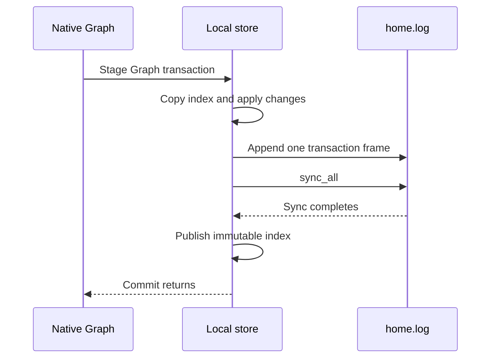
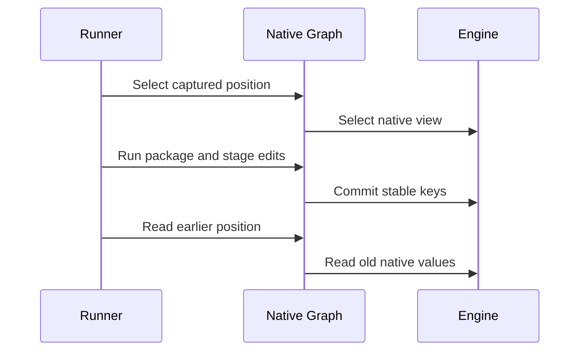
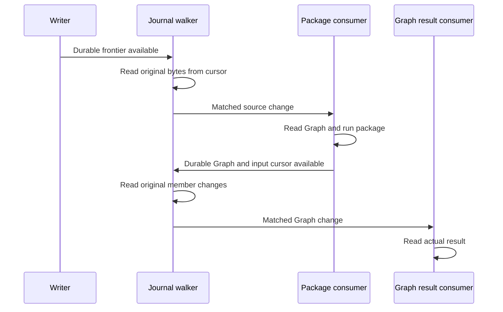

# Causal package Graph scenario comparison

Restoration, 2026-11-12: The storage PoC sources, Causal package/component, and
`follows_incremental_sources` are restored. The incident test has an explicit
`#[ignore]`. Its workload, assertions, and timeouts are unchanged. The collector
helper is available only to tests and the existing `test-fixtures` feature.
Default Causal installation and its default Definition remain disabled.
The ignored body still requires a default instance. It needs deliberate test
setup and valid collector inputs before execution. Earlier measurements below
use synthetic inputs and do not prove physical incident detection.

The current versioned Fjall branch condition uses the shared
`araphor_graph::native` owner. See the
[2026-11-09 qualification](results/native-graph-2026-11-09/README.md) for its
source, correctness results, and measured slowdown. Earlier native-adapter
measurements describe the prior handwritten PoC. Production Data still uses
DuckDB. The incident performance targets remain not done.

The native branch condition now also uses Data's revision coordinator and
published metadata view for all source, output, and checkpoint writes.
Physical context versions replace its separate state records. See the
[native Data qualification](results/native-data-2026-11-09/README.md).
The small mixed timing differences establish no repeatable performance gain.
Production Data remains unchanged.

This proof of concept (PoC) runs the existing causal package against current
DuckDB GraphStore, redb, Fjall, and a local append-only store. It measures the package's dependent Graph
traversal and staged changes through one durable commit. The production store
and the incident test stay unchanged.

An additional mode compares SurrealKV with redb and Fjall through the same
native Graph algorithm. It uses the same eight package cycles and assertions.

## Intended end state

Compare the actual Graph work in
`discovery::packages::required::incident::incremental::follows_incremental_sources`.
Use the same package code, source fixtures, read semantics, and durability for
all engines. The complete production target remains receipt to notification
creation below 100 milliseconds and a 100-fold gain. This PoC does not measure
that complete path.

## Implementation review flow

[Incident::index_input](incident.rs) supplies resolved Arrow inputs for one incident increment.
  -> [Engine::capture](main.rs) captures one Graph view for that input cut.
  -> [package::evaluate](package.rs) checks the real Causal descriptor and binds the example host.
  -> [Causal::compute](../../../araphor-analysis-builtins/src/causal/mod.rs) calls the existing index export.
  -> [Edits::frontier](../../../araphor-analysis-builtins/src/causal/state.rs) repeatedly requests neighbors in both directions.
  -> [Host::read](package.rs) reads the selected keys and applies the native Journal overlay.
  -> [Index::compute](../../../araphor-analysis-builtins/src/causal/index.rs) clears affected owners and stages node and edge changes.
  -> [Incident::detect_input](incident.rs) supplies records and audits selected by the returned frontier.
  -> [Detect::compute](../../../araphor-analysis-builtins/src/causal/detect.rs) checks the causal chain and stages actual FindingMember values.
  -> [Step::new](fixture.rs) exposes the actual package journals to the measured store path.
  -> [Duck::apply](duck.rs) prepares and applies the production GraphStore layers.
  -> [Native::apply](native.rs) applies the same native Graph record algorithm on redb, Fjall, SurrealKV, or the local store.
  -> [Database::write](kv.rs) durably commits Graph, head, state, progress marker, and change references together.

[main](main.rs) completes the measured package cycle.
  -> [Oracle::check](main.rs) compares exact member identities, endpoints, versions, and Arrow values.
  -> [Reference](main.rs) compares exact traversal key sequences, returned counts, frontiers, and finding values across engines.
  -> [verify_metadata](native.rs) checks exact writer heads and parent/captured commit records outside timing.
  -> [Engine::inspect](main.rs) checks all earlier views after the later commits.
  -> [Engine::apply](main.rs) stages revision 88 and rolls the transaction back.
  -> [Engine::close](main.rs) waits for explicit SurrealKV shutdown when that backend is selected.
  -> [Engine::open](main.rs) reopens the database and restores the property cache.
  -> [Oracle::check](main.rs) checks retained history and rollback state again.
  -> [TempDir](main.rs) removes that round's database files after close and size measurement.

The example owns its test database and transaction. Production Data ownership
does not change. Generic Graph receives opaque relations and identities. The
package owns the traversal and detector rules. The PoC calls the same
`Causal::compute` implementation as the builtin component. It uses SDK input
and output validation and the actual `Journal` preparation and overlay.

## Incident and Graph operations

The fixture follows the incident test's credential-pivot scenario. Four
streams on two nodes provide six linked actions for each episode:

1. An actor attempts credential access and is denied.
2. The actor obtains credentials from an IMDS response.
3. The actor uses those credentials to request a different Kubernetes token.
4. That token authorizes a privileged pod with a writable host-root mount.
5. A scheduling record places the pod on the other node.
6. A runtime record confirms the corresponding container admission there.

The denial is supplemental evidence. The successful credential, token, pod,
scheduling, and admission chain supplies the finding. The fixture uses the
existing public audit, proof, observation, context, and finding types.

The first increment supplies five actions and must produce no finding.
The next increment supplies the missing admission and must produce one
confirmed finding. Coverage-only increments revisit the retained Graph and
update the finding. Two later episodes must produce two and three findings.
Each finding must contain six evidence records from four streams and two
nodes. The raw background events are outside this Graph-storage measurement.
Their coverage advances appear as the corresponding resolved inputs.

The package connects source, record, actor, credential, request, pod, and
binding nodes. Links retain their actual audit record, context version,
revision, and restriction properties. A traversal follows outgoing and
incoming adjacency. Each returned edge supplies endpoint keys for the next
frontier. The package's source-label rule prevents traversal back through a
source origin. The benchmark does not copy this algorithm.

| Publication | Captured input | Frontier records | Neighbor rounds | Keys in each round | Returned rows in each round |
| --- | --- | ---: | ---: | --- | --- |
| 26 | 24 | 5 | 0 | Initial reset | Initial reset |
| 29 | 27 | 6 | 3 | 9, 6, 3 | 9, 18, 7 |
| 44 | 36 | 6 | 4 | 4, 6, 5, 3 | 6, 16, 21, 7 |
| 46 | 44 | 6 | 4 | 4, 6, 5, 3 | 6, 16, 21, 7 |
| 62 | 48 | 6 | 4 | 4, 6, 5, 3 | 6, 16, 21, 7 |
| 64 | 62 | 12 | 4 | 18, 6, 5, 3 | 6, 16, 21, 7 |
| 85 | 71 | 12 | 4 | 4, 12, 10, 6 | 12, 32, 42, 14 |
| 87 | 85 | 18 | 4 | 18, 12, 10, 6 | 12, 32, 42, 14 |

These are observed package requests. They are not configured limits. One
edge can occur in multiple rounds. The complete eight-step run inserts 194
versions, closes eight versions, and retains 186 live contributions. Both
writer heads advance at every commit, including empty writer journals.
The first index and detect calls use the production reset path.

## Storage and timing

DuckDB uses the production GraphStore, GraphReadView, presence checks, layer
preparation, dictionaries, properties, member storage, endpoint validation,
and native cache publication. The example supplies small metadata tables for
state, progress, commits, and change references. DuckDB uses two threads and
the production unlimited memory setting.

redb, Fjall, SurrealKV, and the local store share one native record algorithm through [Database](kv.rs).
Binary dictionaries map identities to stable numeric references. Historical
member intervals and relation, entity, owner, outgoing, incoming, and label
indexes select members. The read view holds one physical snapshot while the
package runs. Native reads use the selected indexes and construct Arrow
batches before the package consumes them. Presence checks use the actual
captured writer, owner, entity, and revision.

The replay implements this package's clear-before-Add journals. A scope or
owner clear closes only that writer's actual contributions. The replay is
not a general production Journal executor. Arbitrary edit sequences,
branching, retention, and fragmentation are outside this fixture.

Native writes encode the actual property batches as Arrow IPC inside the
measured write work. Live reads share retained Arrow values. Reopen decodes
the durable chunks and restores the cache. Current GraphStore also retains
native Arrow values. Application revision keys retain logical history;
internal engine snapshot history is not the retained Graph history.

`scenario_s` is one uninterrupted interval:

```text
Capture the Graph view
  -> Run actual index traversal, owner clears, presence checks, and staging
  -> Resolve detect inputs from the actual returned frontier
  -> Run actual detection and finding staging
  -> Normalize the package journals
  -> Prepare and durably commit Graph and synthetic metadata
  -> Publish native property caches
```

Shared source Arrow for the index is prepared before timing. Frontier-driven
detect input construction stays inside timing and has its own `resolve_s`
field. The fixture supplies resolved inputs; native DataFusion source-query
execution is outside this PoC. The post-commit all-member verification read,
result comparisons, Oracle work, and metadata-only checks are outside the
primary scenario interval. Their read times are recorded separately.

Each sample records capture, index, resolver, detect, normalization, write,
and total scenario intervals. It also records each explicit Graph read and presence probe's
operation, relation, key count, returned rows, and elapsed time. Clear and
stage calls stay in the package interval but have no separate call record. Exact key
vectors remain in memory for comparison. Traversal time is nested inside
index time. Component medians are not additive.

redb uses `Durability::Immediate`. Fjall uses transaction
`PersistMode::SyncAll`. DuckDB uses durable on-disk `COMMIT`. The local store
uses one transaction frame and `sync_all` per commit. The existing engines
keep their default cache and compression settings. Eight rounds balance each
engine position and each ordered predecessor pair twice. Each engine has 64
measured package cycles and 64 commits. The summarizer computes paired ratios
from complete round totals. Eight samples per revision do not establish a
tail bound. The older three-engine results below use six rounds.

## SurrealKV comparison

[Surreal::open](surreal.rs) creates one Tokio runtime and opens the native tree.
  -> [Surreal::read](surreal.rs) captures one native read-only transaction.
  -> [Transaction](surreal.rs) uses native get, bounded prefix iteration, and reverse iteration for revision-floor reads.

[Surreal::write_at](surreal.rs) starts one native read/write transaction.
  -> [Transaction](surreal.rs) reads its own writes and stages native set and delete calls.
  -> [Surreal::write_at](surreal.rs) selects `Durability::Immediate` and waits for commit through the runtime.
  -> [Surreal::write_at](surreal.rs) rolls back without commit when the caller aborts.

[Engine::close](main.rs) closes the candidate before drop and reopen.
  -> [Native::shutdown](native.rs) forwards close to the physical owner.
  -> [Surreal::close](surreal.rs) waits for native tree shutdown and returns close errors.

The candidate uses released SurrealKV 1.2.0. Synchronous reads do not cross
the runtime. Commit bridging stays inside measured commit work. The native
Graph layout, Arrow properties, revision keys, and synthetic metadata stay
the same across the three compared engines. SurrealKV engine versioning is
disabled. The existing application keys already retain the required Graph
history; this comparison does not add a second history policy to one engine.
It does not measure SurrealKV `get_at` or `history` features.

The `surrealkv` mode uses all six orders of redb, Fjall, and SurrealKV. Each
engine has 48 measured package cycles in six fresh databases. Default cache,
compression, and maintenance settings stay active. All original finding,
frontier, traversal, Graph delta, metadata, history, rollback, and reopen
assertions stay active. The original four-engine mode keeps its eight orders.
The candidate comparison adds no SlateDB or production storage path.

```sh
rtk proxy env CARGO_INCREMENTAL=0 CARGO_BUILD_JOBS=6 POC_SOURCE_REVISION=f4717056d \
  cargo build --release -p araphor-graph --example storage_poc --features store \
  --config /tmp/araphor-storage-release-override.toml --message-format=short
rtk proxy target/release/examples/storage_poc /tmp/araphor-surrealkv-poc/release.json surrealkv
rtk proxy python3 -B crates/araphor-graph/examples/storage_poc/summarize.py \
  /tmp/araphor-surrealkv-poc/release.json
```

[native_transactions_and_reopen](surreal.rs) checks read-your-writes, an
older snapshot across a later commit, deletion, empty values, ordered prefix
reads, floor reads at zero and `u64::MAX`, rollback, explicit close, and reopen.
This test passes in release. The focused release test command passes all five
example tests. The [environment record](results/surrealkv-2026-11-05/environment.json)
contains that command in `unit_command`.
The measured comparison is recorded below. Native temporal-feature and
sustained-compaction qualification remain **Not done**.

## Local append-only store

[Home::open](home.rs) opens `home.log` and acquires an exclusive file lock.
  -> [Home::open](home.rs) checks the version header and each complete transaction frame.
  -> [Home::open](home.rs) replays the final put and delete for each key into an ordered in-memory index.
  -> [Home::open](home.rs) truncates an incomplete final header or payload and syncs the truncation.
  -> [Home::open](home.rs) rejects a complete frame with an invalid checksum or payload.

[Home::read](home.rs) clones the immutable index root for one read scope.
  -> [Index](home.rs) serves exact keys, ordered prefixes, and revision-floor reads.

[Home::write](home.rs) copies the index into one private transaction.
  -> [Transaction](home.rs) applies staged changes and records the final put or delete for each changed key.
  -> [Home::write](home.rs) encodes that delta with the existing MessagePack codec.
  -> [Home::write](home.rs) appends one length-delimited frame with header and payload CRC32C checksums.
  -> [Home::write](home.rs) syncs the file before it publishes the new immutable index root.

[Home::write](home.rs) aborts before append.
  -> [Transaction](home.rs) drops the private index and changes without file writes.

[Home::write](home.rs) receives an append or sync error.
  -> [State::check](home.rs) refuses new read scopes and writes until reopen.

This backend is an ordered in-memory key/value index with a durable transaction
log. It has no embedded database dependency. Keys and values use shared byte
buffers. A write copies all index entries once. The copy, delta recording,
encoding, checksums, append, sync, and publication stay inside the measured
scenario. CRC32C checks file integrity; it does not detect source changes.
The generic Graph record layout still owns revision history and change records.
Physical log offsets do not replace application input positions.

The file starts with the eight-byte version header `ARPHKV01`. Each frame has
a little-endian `u64` payload length, a little-endian `u32` payload CRC32C,
and a little-endian `u32` CRC32C of the first 12 header bytes. The payload
is a MessagePack map from binary keys to optional binary values. A null value
deletes a key. An empty binary value retains a key with an empty value.



The store keeps all current physical keys and values in memory. These keys
include retained Graph history. Write copy cost grows with the full index.
The log has no compaction, reclamation, or checkpoint. Reopen replays the full
log before the native Graph owner restores Arrow property chunks. This small
experiment does not qualify large Graphs or power-loss recovery. An incomplete
tail check is not a power-loss test. No DataFusion operator or production path
changes.

[transactions_and_snapshots](home.rs) checks read-your-writes, an older active
snapshot across a later commit, key deletion, empty values, ordered prefix and
floor reads, exclusive open, abort without append, and reopen.
[incomplete_tail_and_corruption](home.rs) checks every byte cut in the final
frame, a commit after recovery, and complete header or payload corruption.
[failed_append_requires_reopen](home.rs) uses a read-only file handle to check
the failed-append state. These checks are outside scenario timing.

## Commands

Run from the repository root. Use the same local on-disk parent directory for
all engines. The executable creates and removes temporary databases beside
the output file. A value or traversal mismatch fails the process. There is no
latency pass limit. After build, one eight-round run takes less than two minutes
on the recorded host.

```sh
rtk proxy env CARGO_INCREMENTAL=0 CARGO_BUILD_JOBS=6 POC_SOURCE_REVISION=1a367e567 \
  cargo build --release -p araphor-graph --example storage_poc --features store
rtk proxy target/release/examples/storage_poc /tmp/araphor-causal-poc/release.json
rtk proxy python3 crates/araphor-graph/examples/storage_poc/summarize.py \
  /tmp/araphor-causal-poc/release.json
```

Build the bundled DuckDB dependency in release. A release Rust executable
linked to the old cached `-O0` DuckDB archive is a mixed-profile result.
The recorded optimized comparison excludes that mixed diagnostic.

## Qualification boundary

### Sustained compaction check

[compaction::run](compaction.rs) opens one growing Fjall database.
  -> [Incident::shift](incident.rs) advances the same source and context revisions for each repeat.
  -> [compaction::pass](compaction.rs) repeats the same eight package steps and retains historical Graph keys.
  -> [Trace](compaction.rs) records native compaction choices and successful physical merges on one monotonic clock.
  -> [compaction::pass](compaction.rs) completes two background merges, finishes the current repeat, and runs one more repeat.
  -> [compaction::run](compaction.rs) gives redb the same number of repeats in two paired engine orders.

[compaction::pass](compaction.rs) completes the sustained writes.
  -> [Oracle::check](main.rs) checks all eight cuts in the first, middle, and last repeat after later writes.
  -> [compaction::pass](compaction.rs) checks rollback and the same retained cuts after reopen.
  -> [Reference](main.rs) compares exact member values, traversal keys, and frontiers across engines at those cuts.
  -> [compaction_summary.py](compaction_summary.py) reports cycles that overlap installed physical merges and the matching redb revisions.

This mode repeats the same identities and rebuilds the current Graph at each
repeat. The first repeat has 194 additions and eight closures. Each later
repeat has 194 additions and 194 closures. The final live Graph still has 186
contributions. Physical history grows throughout the run. This is a repeated
update and rebuild workload, not a set of new independent incidents.

Fjall keeps its default 64 MiB memtable and leveled compaction strategy with
an L0 threshold of four runs. The driver does not rotate memory tables or
call major compaction. Its native completed-compaction counter includes
no-op strategy checks. The exact `Compaction successful` trace message comes
after a real merge installs its output manifest. The driver retains those
messages, their choices, warnings, and errors. Trace dispatch stays enabled
for both engines. No input subscription uses this diagnostic logger.

Each package cycle has timestamps on the same clock as the merge events.
Maintenance samples record memory-buffer bytes, queued flushes, sealed memory
tables, L0 tables, total tables, journal count, and native attempt counters.
These samples and correctness checks are outside the primary scenario time.
The summarizer separates cycles that overlap merges from other cycles.
Its paired redb rows use the same revisions and history age. An overlap can
also include normal history-scan cost; the result does not isolate a causal
compaction penalty. Existing stable-key history scans can grow with history.

The first Fjall run selects the repeat count from observed merges. The second
Fjall run uses that same fixed count and reports the merges it actually sees.
The engine order is Fjall/redb, then redb/Fjall. The four passes use the same
package, input increments, durability, and retained-history policy.

```sh
rtk proxy target/release/examples/storage_poc /tmp/araphor-compaction-poc/release.json compaction
rtk proxy python3 -B crates/araphor-graph/examples/storage_poc/compaction_summary.py \
  /tmp/araphor-compaction-poc/release.json
```

[repeated_package_history](compaction.rs) runs two repeats on each engine.
It checks 388 additions, 202 closures, original finding evidence, retained
history, exact cross-engine rows and calls, rollback, and reopen. The short
test does not assert that compaction occurs. Sustained compaction measurement
and production notification acceptance remain **Not done** until the longer
run completes.

The [compaction pilot record](results/compaction-pilot-2026-11-05/pilot.json)
covers source `644ab7540`. The last logged milestone is 288 repeats and one
successful physical merge on the first Fjall pass. All cycle checks pass
through that milestone. The agent interrupts the run to prioritize the
user's later SurrealKV benchmark request. The interrupted process does not
write its in-memory samples or events to the output JSON. Final historical
cuts, rollback, reopen, and matched redb passes do not complete. The retained
record proves no compaction latency distribution or engine comparison.
The sustained comparison remains **Not done**.

### Other boundaries

The debug run at source `65d655ec8` passes all 18 engine runs. It proves exact
cross-engine frontiers, traversal requests and counts, finding values,
Graph deltas, state and captured-revision markers, history, rollback, and
clean reopen for this scenario. Formatting passes. The debug build has one
existing unused-import warning in production causal `io.rs`.

A gain against current GraphStore includes the native Graph owner rewrite
and the physical engine. redb, Fjall, SurrealKV, and the local store share the same Graph record
algorithm. The PoC does not run Control intake, raw ingestion, native
DataFusion input queries, full Data authority/evidence checks, finding
projection publication, or notification creation. It also does not qualify
large data, steady compaction, cache pressure, backup, retention, or power loss.

The earlier generic storage screen remains in
[its result directory](results/2026-11-05/environment.json) at source
`dcf84a041`. Those figures are not the package scenario's result.

## Recorded scenario result: 2026-11-05

Actual package scenario implementation and comparison: **Done**.
Production replacement and complete incident latency qualification: **Not done**.
The measured Rust source is `65d655ec8`. The
[environment record](results/causal-2026-11-05/environment.json) identifies
the host, commands, versions, and optimized archive. The
[compiler samples](results/causal-2026-11-05/cpp-release-provenance.json)
show `-O3` and `NDEBUG` for the bundled DuckDB dependency. No C++ compiler or
IDE Cargo check was active at the process check before this run. The host
remains shared.

All table values are milliseconds. Each value is the median of six complete
round totals. A round contains eight package cycles and 27 dependent neighbor
reads. Traversal time is part of the complete scenario. Write time includes
preparation, mutation, durable commit, and native publication. The separate
component medians are not additive.

| Measured interval | Current GraphStore | Native Graph on redb | Native Graph on Fjall |
| --- | ---: | ---: | ---: |
| Complete eight-cycle scenario | 448.29 | 35.92 | 35.39 |
| 27 neighbor reads | 2.32 | 2.87 | 3.88 |
| Eight view captures | 10.20 | 0.062 | 0.069 |
| Eight writes | 421.59 | 17.57 | 14.96 |
| Index package work, including traversal | 7.41 | 7.79 | 9.09 |
| Frontier-driven detect input construction | 1.32 | 1.29 | 1.37 |
| Detect package work and finding staging | 7.73 | 8.01 | 8.63 |

Median paired complete-scenario gains over current GraphStore are 12.54
times for redb and 12.73 times for Fjall. The complete-scenario ranges are
416.51 to 558.67 milliseconds for GraphStore, 32.21 to 45.06 for redb, and
30.02 to 38.99 for Fjall. Paired ratios use complete totals from the same
round. They differ from a ratio of separate medians.

The measured traversal is faster in the current GraphStore. Its native
member cache already serves this small Graph from memory. The native KV
replay fetches member metadata through its indexes and retains Arrow
properties in memory. The main observed gain comes from mutation and view
capture. This result does not support a claim that KV storage alone makes
Graph traversal faster.

Fjall has lower write totals in all six rounds. Its median paired write
advantage over redb is 1.20 times. The complete-scenario comparison is much
closer: a median paired ratio of 1.047, a range of 0.911 to 1.346, and four
of six rounds with a lower Fjall total. This run does not establish a
meaningful overall performance winner between redb and Fjall.

The final cycle at revision 87 takes a median of 67.36 milliseconds on
GraphStore, 6.75 on redb, and 6.54 on Fjall. That interval ends at the Graph
commit. It does not include notification creation.

[Raw optimized results](results/causal-2026-11-05/release.json) contain all
144 measured package cycles and the recorded read/probe counts. The
[summary](results/causal-2026-11-05/summary.json) reproduces with
`summarize.py`. The
[final debug run](results/causal-2026-11-05/debug.json) is separate evidence.
The executable checks exact traversal key vectors in memory. Raw JSON
retains their counts, returned row counts, and frontier indices. It does
not retain those complete key vectors or finding payloads.

All 18 optimized engine runs pass the runtime exact-key, frontier, finding
value, original evidence, delta, history, rollback, and reopen checks.
Each round has 194 additions, eight closures, 27 neighbor reads, and 15
presence probes. Independent review reproduces the summary and confirms
the retained counts and timing sums. Formatting and guide-link checks pass.

The focused command below stops on six existing Graph library lint errors
before it checks the example. The errors concern type complexity and map
iteration in `src/layers/prepared.rs`, type complexity in `src/layers.rs`,
and argument count and `unwrap` use in `src/read.rs`.

```sh
rtk proxy env CARGO_INCREMENTAL=0 CARGO_BUILD_JOBS=6 \
  cargo clippy -p araphor-graph --example storage_poc --features store \
  --config /tmp/araphor-native55-duckdb-override.toml -- -D warnings
```

Full workspace CI does not run, as the user requests. The production
incident test does not run again because the PoC changes no production
path. The complete 100-fold and sub-100-millisecond notification targets
remain unproven.

## Local store scenario result: 2026-11-05

Local store implementation and bounded comparison: **Done**.
Production replacement and complete incident latency qualification: **Not done**.
The measured source is `1a367e567`. The
[environment record](results/home-2026-11-05/environment.json) gives the exact
commands, eight engine orders, and archive hash. This run reuses the previous
verified `-O3` DuckDB archive through a Cargo links override. The Rust executable
uses the release profile. No compiler process is active at the process check
immediately before this run. The host remains shared.

Each table value is the median of eight round totals in milliseconds. Each
round has eight package cycles and 27 dependent neighbor reads. Traversal and
write times are parts of the complete scenario. Reopen is outside that interval.
Reopen includes the local log replay and native Arrow property-cache restore.

| Measured interval | Current GraphStore | Native on redb | Native on Fjall | Native on local log |
| --- | ---: | ---: | ---: | ---: |
| Complete eight-cycle scenario | 410.11 | 32.61 | 30.47 | 29.77 |
| 27 neighbor reads | 2.047 | 2.573 | 3.369 | 2.189 |
| Eight writes | 386.94 | 16.35 | 13.21 | 13.58 |
| Reopen | 79.53 | 3.25 | 8.61 | 4.07 |

The median paired complete-scenario gain over current GraphStore is 14.00
times for the local log. This comparison includes the native Graph rewrite.
The local log and Fjall complete-scenario totals are close. Their paired
ratio has a median of 1.023 and a range of 0.860 to 1.069. The local log has
a slightly higher write median than Fjall. This run does not establish a
meaningful overall performance winner between these two backends. Current
GraphStore's retained member cache still has a lower traversal median.

The final package cycle has a median of 60.30 milliseconds on GraphStore,
6.41 on redb, 6.00 on Fjall, and 5.59 on the local log. This interval ends
at the Graph commit. It does not measure notification creation.

After close, logical file sizes are 9,973,760 bytes for GraphStore,
2,109,440 for redb, 412,832 for Fjall, and 1,030,813 for the local log.
The local log is one file. These sizes cover this small scenario only.
Fjall retains its default compression; the local log has no compression.
The local log retains the full key/value index in memory, copies that index
for each write, and replays all log bytes on reopen. No compaction or
reclamation runs. This result does not qualify storage growth or memory use.

All 32 optimized engine runs pass the unchanged runtime traversal-key,
frontier, finding-value, evidence, delta, metadata, history, rollback, and
reopen checks. The three committed local storage tests pass in release.
The [raw results](results/home-2026-11-05/release.json) retain all 256 package
cycles. The [summary](results/home-2026-11-05/summary.json) reproduces with
`summarize.py`. Independent review confirms the counts, engine-order balance,
timing sums, and reported medians. Formatting and source-link checks pass.

No production Rust source changes. Full workspace CI and the production
incident test do not run for this example-only comparison. Power-loss,
large-Graph, memory-pressure, and complete notification qualification remain
outside this result. The complete 100-fold target remains unproven.

## SurrealKV scenario result: 2026-11-05

SurrealKV integration and bounded comparison: **Done**.
Production replacement and complete incident latency qualification: **Not done**.
The measured source is `f4717056d`. The
[environment record](results/surrealkv-2026-11-05/environment.json) gives the
exact build, test, and run commands. No compiler process is active at the
host process check immediately before the measured run. The host remains
shared. All three engines use the same native Graph record algorithm and
actual package code. No SlateDB backend is added or tested.

Each table value is a median of six complete round totals in milliseconds.
A round has eight package cycles, 27 dependent neighbor reads, and 15
presence probes. Traversal and write times are parts of the complete
scenario. Separate component medians are not additive. Reopen is outside
the primary interval and includes native Arrow property-cache restore.

| Measured interval | Native on redb | Native on Fjall | Native on SurrealKV |
| --- | ---: | ---: | ---: |
| Complete eight-cycle scenario | 28.70 | 26.91 | 27.27 |
| Eight writes | 14.54 | 11.75 | 13.24 |
| 27 neighbor reads | 2.293 | 2.921 | 2.313 |
| Reopen | 2.70 | 7.39 | 4.90 |

Fjall has lower write totals than SurrealKV in all six paired rounds.
SurrealKV has lower traversal and reopen totals than Fjall in all six.
The paired Fjall-to-SurrealKV complete-scenario ratio has a median of
0.9964 and a range of 0.9438 to 1.0033. The complete totals are close;
this run does not establish a meaningful overall performance winner.
SurrealKV's median paired complete-scenario advantage over redb is 1.057
times. This small difference does not establish a general engine advantage.

The final package cycle has a median of 5.76 milliseconds on redb, 5.40
on Fjall, and 5.49 on SurrealKV. This interval ends at the Graph commit.
Notification creation is outside the interval. After explicit close and
reopen checks, logical file sizes are 2,109,440 bytes for redb, 412,832
for Fjall, and 1,002,625 for SurrealKV. These sizes cover this small fixture
under default cache, compression, and maintenance settings.

All 18 measured runs pass exact runtime traversal-key, returned-row,
frontier, finding-value, evidence, Graph delta, metadata, retained-history,
rollback, close, and reopen checks. The
[raw results](results/surrealkv-2026-11-05/release.json) retain all 144 measured
cycles. The [summary](results/surrealkv-2026-11-05/summary.json) reproduces
with `summarize.py`. Independent review confirms the counts, engine orders,
timing sums, and reported values. All five focused release tests pass.
The unchanged [four-engine qualification](results/surrealkv-2026-11-05/qualification-normal.json)
also passes all 32 runs. That qualification overlaps an IDE Cargo check;
its timings are excluded from the measured comparison. Formatting and
source-link checks pass.

SurrealKV uses `Durability::Immediate`. Engine versioning is disabled;
the shared application Graph revision keys retain history. Native `get_at`,
native history retention, large Graphs, steady compaction, memory pressure,
and power loss remain unqualified. No production Rust path changes. Full
workspace CI does not run, as the user requests. Production DataFusion source
queries, notification creation, and the complete 100-fold target remain
outside this result.


## Neon layers and Graph revision benchmark

Implementation and reviewer direction: **Done**.
Build and focused runtime qualification: **Done**.
Measured comparison: **Done**. The retained result is below.

The user requests the cloned Neon crates and Graph revision reads for all
engines. The benchmark keeps the same eight Causal package commits. It adds
read-only package evaluations at each original captured Graph cut after all
writes and after reopen. Each stage visits the cuts backward, then forward.
The benchmark compares exact staged Arrow commands, clear sequences,
traversal keys, returned counts, and frontiers with the original evaluation.
It checks that the current head remains 87 and aborted revision 88 is absent.

[History::remember](history.rs) retains each original package evaluation.
  -> [History::replay](history.rs) captures an earlier Graph cut.
  -> [package::evaluate](package.rs) executes the unchanged package and resolved inputs.
  -> [Reference::check](history.rs) compares staged values, calls, and frontier.
  -> [Engine::verify_metadata](main.rs) checks the unchanged current commit.

The versioned mode includes DuckDB, redb, Fjall, the local store, SurrealKV,
and SurrealKV native history. The isolated Neon build adds `neon-layers`.
Balanced engine orders put each engine in each position twice and each
ordered predecessor pair twice. Each engine round has 32 historical package
evaluations: eight cuts, two directions, and two lifecycle stages. These
reads do not commit their staged commands. No workload event changes.

[Surreal::open_versioned](surreal.rs) enables native history without a retention limit.
  -> [Surreal::write_at](surreal.rs) stamps each set and soft tombstone with the Graph revision.
  -> [Transaction::get](surreal.rs) uses native `get_at` for a historical capture.
  -> [Transaction::history](surreal.rs) iterates native history through that revision and selects the newest version of each key.
  -> [Transaction::floor](surreal.rs) selects the last live key from that historical range.

SurrealKV 1.2.0 ordinary range reads do not accept a timestamp. The historical
adapter uses `history_with_options` with tombstones and a timestamp range.
The first eligible tombstone hides the key. Hard deletes are not used in
this variant because hard deletes remove earlier history. The original
application-history variant stays separate. Both variants retain the shared
Graph intervals and revision keys. This comparison therefore includes the
cost of native history in addition to that shared Graph layout.

[Neon::open](neon.rs) opens an exclusive physical owner and restores key and publication metadata.
  -> [Neon::write_at](neon.rs) stages Graph records and new key identities.
  -> [DeltaLayerWriter](../../../../neon/pageserver/src/tenant/storage_layer/delta_layer.rs) writes actual native image values and their disk index.
  -> [Neon::write_at](neon.rs) waits for native layer sync, renames the layer, and syncs the directory.
  -> [Neon::write_at](neon.rs) publishes the catalog and committed layer together in memory.

[Neon::read_at](neon.rs) captures a committed layer list and Graph revision.
  -> [Snapshot::read](neon.rs) selects each key's latest native publication at or before the requested revision.
  -> [Snapshot::read](neon.rs) groups selected keys by their native layer.
  -> [DeltaLayer::images_for_bench](../../../../neon/pageserver/src/tenant/storage_layer/delta_layer.rs) reads each group through the actual Neon disk B-tree and blob reader.
  -> [Snapshot::prefix](neon.rs) returns live values in original key order.
  -> [Neon::close](neon.rs) closes the gate, drops layers, and releases the exclusive owner.

Neon keys have a fixed 18-byte representation. The adapter assigns stable
numeric keys to the original variable-length keys. New key mappings are
immutable native image records in the same layer as changed values. A value
has a one-byte presence marker so a deletion differs from an empty value.
Reopen rebuilds key identities and native publication positions from layer
indexes. Only dictionary blobs are loaded during that rebuild. Each requested
key/value record is read through Neon. The adapter does not
cache complete key/value records. The shared native Graph owner retains its
decoded Arrow property cache, as it does for the other candidates.
Catalog copies, envelopes, native encoding, native writes, syncs, and
publication stay inside the measured transaction. Aborted writes publish no
layer. A transaction I/O error requires reopen before new reads or writes.

The isolated [Cargo project](neon-bench/Cargo.toml) uses the cloned pageserver,
API, utility, and value crates. Normal workspace builds do not require the
clone. The clone is excluded from the parent Cargo workspace. The upstream
`benchmarking` feature exposes three narrow layer wrappers. One visibility
change makes the scheduler return type match its existing crate-visible
trait on the current compiler. The tracked patch and pinned source record
must accompany results.

This candidate flushes one native delta layer per durable transaction.
Production Neon batches layer flushes behind replicated WAL. This adapter
has no Safekeeper quorum, object store, native branch creation, or background
compaction. Its result measures the named local layer adapter. It does not
measure production Neon commit performance. The native global page cache
uses its configured size. The file adapter uses buffered native filesystem
I/O with sync enabled.


The [Neon patch](neon-bench/neon.patch) applies to source
`fa504217c61bbcaf5c512d75830564541f917f8f`. Apply the patch only once. The
benchmark uses the current application compiler. PostgreSQL header generation
builds no database server. The configuration disables optional libraries that are not required
by the generated bindings.

```sh
rtk proxy git -C neon apply --unidiff-zero --check ../crates/araphor-graph/examples/storage_poc/neon-bench/neon.patch
rtk proxy git -C neon apply --unidiff-zero ../crates/araphor-graph/examples/storage_poc/neon-bench/neon.patch
rtk proxy git -C neon submodule update --init --depth 1 --jobs 4 \
  vendor/postgres-v14 vendor/postgres-v15 vendor/postgres-v16 vendor/postgres-v17
rtk proxy make -C neon -j6 postgres-headers BUILD_TYPE=release \
  'PG_CONFIGURE_OPTS=--without-readline --without-icu --without-zlib'
rtk proxy env CARGO_TARGET_DIR="$PWD/target" CARGO_INCREMENTAL=0 CARGO_BUILD_JOBS=6 \
  POSTGRES_INSTALL_DIR="$PWD/neon/pg_install" \
  cargo test --release --manifest-path crates/araphor-graph/examples/storage_poc/neon-bench/Cargo.toml \
  --config /tmp/araphor-storage-release-override.toml --locked
rtk proxy env CARGO_TARGET_DIR="$PWD/target" CARGO_INCREMENTAL=0 CARGO_BUILD_JOBS=6 \
  POSTGRES_INSTALL_DIR="$PWD/neon/pg_install" \
  cargo build --release --manifest-path crates/araphor-graph/examples/storage_poc/neon-bench/Cargo.toml \
  --config /tmp/araphor-storage-release-override.toml --locked
rtk proxy target/release/storage_poc /tmp/araphor-versioned-poc/release.json versioned
rtk proxy python3 -B crates/araphor-graph/examples/storage_poc/summarize.py \
  /tmp/araphor-versioned-poc/release.json
```

The retained environment record supplies the cached DuckDB archive override.
Use a normal bundled build when that archive is absent. Its C++ objects must
also be optimized for a release comparison. Root-workspace and isolated
lockfiles are separate; the isolated lock records the resolved dependency
versions for this candidate build.

After-reopen package reads run after property-cache restore and finite
historical verification reads. These reads prove retained Graph history
after restart. They do not measure cold-cache traversal.


## Versioned Graph result: 2026-11-05

The bounded Neon layer comparison and Graph revision benchmark are **Done**.
The measured application source is `3b6a3c51d`. The cloned Neon source is
`fa504217c61bbcaf5c512d75830564541f917f8f` with the retained benchmark patch.
The [environment record](results/versioned-2026-11-05/environment.json)
records the exact source, resolved dependency lock, patch hashes, commands,
durability, filesystem, and limits. The host process check returns no active
compiler immediately before this run. The host remains shared.

All values below are median round totals in milliseconds across 14 rounds.
The normal scenario contains eight package cycles and durable commits.
Each historical stage contains 16 package evaluations: the eight original
captured cuts backward and forward. Historical evaluations stage commands
for comparison and do not commit. Reopen time is separate from these totals.

| Engine | Eight normal cycles | Eight writes | Historical 16 after writes | Historical 16 after reopen |
| --- | ---: | ---: | ---: | ---: |
| Current GraphStore on DuckDB | 350.67 | 332.64 | 35.98 | 34.53 |
| Native Graph on redb | 25.75 | 14.21 | 23.01 | 21.90 |
| Native Graph on Fjall | 24.30 | 12.02 | 24.26 | 23.94 |
| Native Graph on local append-only store | 21.84 | 10.94 | 21.13 | 20.51 |
| Native Graph on SurrealKV, application history | 23.90 | 12.73 | 22.92 | 28.75 |
| Native Graph on SurrealKV, native history | 30.08 | 13.36 | 32.99 | 43.50 |
| Native Graph on Neon layers | 76.25 | 21.61 | 117.29 | 116.67 |

The Neon layer adapter has a median paired complete-scenario cost of 3.13
times Fjall. Its historical package replay after reopen costs 4.86 times
Fjall in the median paired round. Its 27 normal neighbor reads take 43.28
milliseconds per round, compared with 2.67 for Fjall. This traversal cost
includes the key catalog, search through eligible layers, runtime bridge,
and actual native disk-index and blob reads. This result applies to this
adapter. Production Neon WAL commits and batched layer flushes are outside
the result.

Native SurrealKV history passes the same Graph revision contract. In this
shared Graph layout, its median paired complete-scenario cost is 1.26 times
the application-history variant. Historical replay after reopen costs 1.52
times that variant. The native variant retains explicit Graph history as
well as engine history. Native range reconstruction uses a timestamp-filtered
history iterator. This result does not compare a specialized Graph layout
that uses only native temporal records.

redb has lower historical replay totals than Fjall in 13 of 14 paired rounds
after writes and in all 14 after reopen. Fjall has lower write totals than
redb in all 14 paired rounds. The local
append-only prototype is fast on this small fixture, but it has no checkpoint,
compaction, or reclamation. These results do not establish one engine as the
fastest for every workload.

All 98 runs pass. The [raw report](results/versioned-2026-11-05/release.json)
contains 784 primary cycles and 3,136 historical evaluations. Every primary
run adds 194 versions, closes eight, and retains 186 live contributions.
It performs 27 neighbor reads and 15 presence probes. The actual package
findings still contain six evidence records from four streams and two nodes.
Historical replay checks exact staged Arrow commands, clear sequences,
traversal key vectors, returned counts, and frontiers at runtime. The timing
JSON retains counts and frontiers; it does not retain exact key bytes or
Arrow values. Metadata, retained member history, rollback, close, and reopen
checks also pass. All eight focused release tests pass.

The [summary](results/versioned-2026-11-05/summary.json) reproduces with
`summarize.py`. Independent review confirms engine order balance, sample
counts, captured cuts, timing sums, summary reproduction, and paired ratios.
Formatting, source identity, patch identity, and local source-link checks
pass. The [build log](results/versioned-2026-11-05/build.log) retains existing
Neon and production causal warnings.

After-reopen replay includes warm native caches and follows finite history
verification. This result does not qualify cold-cache latency, power loss,
steady compaction, large Graphs, memory pressure, native branching, or
retention deletion. No production storage owner changes. Full workspace CI
and the complete incident test do not run. Complete DataFusion source
execution, notification latency, and the complete 100-fold target remain
**Not done**.

## Original-journal CDC qualification

The earlier versioned benchmark does not walk storage journals. The separate
[CDC runner](cdc.rs) tests that requirement with the original eight Causal
package cycles. It supports the provided Fjall clone with an opt-in patch and
the local append-only prototype. It changes no production storage owner.

Read [cdc::scenario](cdc.rs), [Walker::start](cdc.rs),
[Native::apply_checkpoint](native.rs), then the retained
[Fjall patch](cdc-bench/fjall.patch). The isolated
[Cargo project](cdc-bench/Cargo.toml) pins the shared package dependencies.
No eBPF or ABI boundary changes.

```text
The fixture commits input/frontier with its original captured input position
  -> The storage engine syncs the original transaction journal.
  -> The engine signals that a durable log boundary is available.
  -> Walker reads the original bytes from its previous physical cursor.
  -> Walker selects the input/frontier mutation and wakes the source consumer.
  -> The consumer runs the existing Causal package with prepared fixture Arrow.
  -> Native commits Graph edits and cursor/package in one transaction.
  -> Walker reads that original journal batch.
  -> Walker selects actual member mutations and wakes the Graph consumer.
  -> The consumer saves cursor/graph in a later transaction.
  -> Fjall can release history below the minimum saved consumer cursor.

A transaction rolls back, or changes only an unrelated key
  -> Walker sends no matching source or Graph event.

The fifth source frontier commits while Walker is stopped
  -> Fjall flushes, rotates its native journal, and completes major compaction.
  -> The runner closes and reopens the database.
  -> Walker resumes after the saved minimum physical cursor.
  -> The pending source frontier produces exactly one source event.
```

The input frontier is synthetic source metadata. The runner does not store
package input or output archives. It does not execute event capture or the
DataFusion source query. The two watches share one journal walker. A writer
signals only generic log availability. All matching subscription events come
from decoded original journal records. There is no polling, hash comparison,
or second logical change table. The five-second receive timeout detects a
failed qualification; it does not drive change detection.

Fjall uses its existing journal writer, batch decoder, sequence numbers,
snapshots, flush, and compaction. The patch forces `SyncAll` in CDC mode,
publishes a complete batch cursor after native state publication, prevents
collection below the saved cursor, and wakes readers on native poison paths.
The read-only decoder cannot repair or truncate a journal. Retained replay
skips a clear that is already in a persisted keyspace. Feature-off recovery
behavior stays unchanged. Reopen restores the durable head from actual batches.

Retention uses one caller-managed, monotone floor. Feed creation does not pin
history. The caller must durably save the minimum cursor of all watches before
advancing that floor. A new consumer cannot request already released history.
Fjall bulk ingestion and keyspace catalog changes are outside this CDC contract.
The local prototype has no rotation, compaction, or reclamation.

| Candidate | Original-journal CDC result |
| --- | --- |
| Provided Fjall with retained patch | Qualification runner available |
| Local append-only prototype | Qualification runner available |
| Stock Fjall | No public retained journal feed or wake API |
| redb | Copy-on-write pages; no original WAL feed |
| DuckDB | No supported retained original-WAL CDC API |
| SurrealKV 1.2 | Private WAL reader; value-log references also need retention |
| Existing Neon layer adapter | Writes native layers; produces no PostgreSQL WAL |

The unsupported rows have no CDC timing result. A layer scan or an application
change table does not establish original-log CDC.

The runner checks exact added and closed counts, Arrow rows, traversal requests,
frontiers, findings, writer metadata, historical views before and after reopen,
and an aborted Graph publication with an unchanged package cursor. It checks
that only eight source and eight Graph events occur in each run. Fjall must
complete a physical compaction and retain the unread native batch.

The patch applies to Fjall source
`87006048139bfe1b072bbc29a5a92bf1f97628e3`. Apply it once. The
[engine-test lock](cdc-bench/fjall-tests.lock) records the separate focused
Fjall test dependencies.

```sh
rtk proxy git -C fjall apply --unidiff-zero --check ../crates/araphor-graph/examples/storage_poc/cdc-bench/fjall.patch
rtk proxy git -C fjall apply --unidiff-zero ../crates/araphor-graph/examples/storage_poc/cdc-bench/fjall.patch
rtk proxy cp crates/araphor-graph/examples/storage_poc/cdc-bench/fjall-tests.lock fjall/Cargo.lock
rtk proxy env CARGO_TARGET_DIR="$PWD/target" CARGO_INCREMENTAL=0 CARGO_BUILD_JOBS=4 \
  cargo test --manifest-path fjall/Cargo.toml --features journal-cdc --lib cdc::tests --locked
rtk proxy env CARGO_TARGET_DIR="$PWD/target" CARGO_INCREMENTAL=0 CARGO_BUILD_JOBS=4 \
  cargo test --manifest-path fjall/Cargo.toml --test keyspace_clear --test recover_flushed_journal --locked
rtk proxy env CARGO_TARGET_DIR="$PWD/target" CARGO_INCREMENTAL=0 CARGO_BUILD_JOBS=4 \
  cargo test --release --manifest-path crates/araphor-graph/examples/storage_poc/cdc-bench/Cargo.toml \
  --config /tmp/araphor-storage-release-override.toml --locked
rtk proxy env CARGO_TARGET_DIR="$PWD/target" CARGO_INCREMENTAL=0 CARGO_BUILD_JOBS=4 \
  POC_SOURCE_REVISION="$(git rev-parse HEAD)" \
  cargo build --release --manifest-path crates/araphor-graph/examples/storage_poc/cdc-bench/Cargo.toml \
  --config /tmp/araphor-storage-release-override.toml --locked
rtk proxy target/release/storage_cdc /tmp/araphor-cdc-poc/release.json cdc
rtk proxy python3 -B crates/araphor-graph/examples/storage_poc/summarize_cdc.py /tmp/araphor-cdc-poc/release.json
```

The cached optimized DuckDB archive override is the same as the earlier
versioned benchmark. Use a normal optimized bundled build if it is absent.
Timing starts before the source commit and ends when the Graph consumer
receives its event. Source and output wake intervals each include their durable
commit and native log read. Result validation and Graph-consumer acknowledgement
are outside that interval. The summary separates the fifth sample because its
timer includes explicit maintenance, shutdown, and reopen. This maintenance
proves correctness; it does not measure sustained background compaction.

Production DataFusion input, package admission, notification creation and
delivery, large retained history, power loss, dynamic consumer registration,
native branches, and the complete incident latency target remain **Not done**.

## Original-journal CDC result: 2026-11-08

The bounded CDC qualification is **Done** at application source `5066c4679`.
The [environment record](results/cdc-2026-11-08/environment.json) records the
Fjall source, retained patch and lock hashes, optimized build, durability,
commands, and limits. The host process check finds no active compiler before
the measured run. The host remains shared.

All eight engine runs pass: four patched Fjall runs and four local-store runs.
The [raw report](results/cdc-2026-11-08/release.json) contains 64 original package
cycles, 64 matched source events, 64 matched Graph events, and 128 historical
view checks. Each Fjall run completes one physical compaction. Each run
resumes the unread fifth input after reopen. Exact Graph rows, traversal
requests, frontiers, findings, current and historical metadata, rollback,
and unrelated-write checks pass. These values are asserted at runtime;
the timing JSON does not retain the Arrow values or exact traversal keys.

The values below are milliseconds across 28 ordinary samples per engine.
Each source or Graph wake interval includes its durable commit and native
journal read. The complete interval ends when the Graph consumer receives
its event. Component medians are not additive.

| Engine | Source commit start to source event, median | Package, median | Graph commit start to Graph event, median | Complete interval, median | Complete interval, maximum |
| --- | ---: | ---: | ---: | ---: | ---: |
| Provided Fjall with CDC patch | 0.61 | 1.88 | 1.68 | 3.95 | 7.88 |
| Local append-only prototype | 0.62 | 1.23 | 1.39 | 3.24 | 6.32 |

Four additional samples per engine include explicit maintenance, shutdown,
and reopen before the pending source event is consumed. Fjall takes
14.95 to 16.59 milliseconds for those complete intervals. The local prototype
takes 4.19 to 4.31 milliseconds. It performs no compaction or rotation.
The [summary](results/cdc-2026-11-08/summary.json) separates these samples.

Five Fjall journal tests pass. Six original Fjall recovery tests pass with
CDC disabled. Seven shared release tests pass. The retained logs include
the existing upstream and Causal warnings. Formatting, patch reverse-apply,
and local source-link checks pass. The patch also applies to pristine pinned
Fjall source and reproduces the measured files. Independent review confirms
the report counts, cursor order, events, compactions, source identity, and
exact summary reproduction.

This result establishes native journal-driven wakes for this small PoC.
Stock engines without an exposed retained original-log feed have no CDC
timing result. The local prototype still copies its full index on each write
and has no reclamation. The result does not establish production notification
latency, sustained compaction, power-loss behavior, native branches, or the
complete 100-fold improvement. Full workspace CI and the production incident
test do not run. Production integration remains **Not done**.

## Stable keys and native history

The original Graph layout includes the opened revision in member and
adjacency keys. It does this for Fjall and the Neon adapter. The CDC patch
retains original journals but does not change those Graph keys.

The separate [stable runner](stable.rs) compares that control with a layout
that has no revision suffix on mutable keys. It uses the original eight
Causal package cycles. Source Arrow stays prepared in memory. This driver
does not start journal subscriptions. The earlier CDC proof and this native
history proof remain separate.

### Intended end state

Use stable Graph coordinates for members, adjacency, writer heads, package
state, and commit metadata. Use the engine's selected view to read earlier
values. Preserve exact Graph results and package behavior. State an unsupported
history operation when the engine cannot restore it.

[stable::scenario](stable.rs) selects one original captured Graph position.
  -> [Native::capture](native.rs) selects a native read view.
  -> [package::evaluate](package.rs) runs the original Causal index and detect exports.
  -> [Native::stage](native.rs) overwrites stable member and adjacency keys.
  -> [Native::close](native.rs) deletes closed members and their adjacency keys.
  -> [Database::write_at](kv.rs) commits Graph, state, and metadata together.
  -> [Oracle::check](main.rs) checks exact rows, changes, and state.
  -> [History::remember](history.rs) checks exact commands, traversal requests, and frontiers.

[stable::scenario](stable.rs) completes later Graph writes.
  -> [History::replay](history.rs) runs the same package backward and forward at earlier cuts.
  -> [stable::flush](stable.rs) flushes Fjall and completes physical compaction.
  -> [History::replay](history.rs) checks the earlier package results again.
  -> [Engine::close](main.rs) closes the owner before the runner drops it.
  -> [Engine::open](main.rs) restores the database and property cache.
  -> [Neon::read_at](neon.rs) reads earlier values by native layer LSN.
  -> Partial [Native::read_at](native.rs): Fjall has no earlier open snapshot handle after reopen.



The stable layout stores members by writer, owner, relation, and entity.
Relation and endpoint indexes use the same stable coordinates. A close removes
the current member and indexes. There is no application interval filter in
this mode. The opened revision remains a value field because exact Graph
results require it. Dictionary IDs and immutable Arrow property chunk IDs
remain identities. They contain no encoded application revision.

Writer head, state, and captured-input keys contain only the writer ID.
The commit key and current change-vector key are singletons. Native versions
retain their earlier values. The current change vector is the existing
fixture's Graph metadata; it does not drive subscription wakes. All these
key lengths and record counts are asserted. Result checks remain outside
the primary timing interval.

Fjall uses public `read_tx()` snapshot handles. `Native` retains a handle for
each committed Graph position, including the initial head. The map exists
only in memory. A captured cut selects the preceding handle. Rollback adds
no handle. The handles retain native versions during flush and compaction.
Dropping `Native` drops the handles. Reopen can capture the current head but
cannot restore an earlier handle through this API. The runner rejects 15
earlier requests per run, including overlapping captured and publication
cuts. It verifies the current Graph after reopen and compaction. This proves
an API limit; it does not prove that every old physical byte is absent.

Neon maps each stable Graph key to the same native numeric `Key` at each
write. `Lsn` is a separate version coordinate. Reads select eligible native
layers and use their disk index. Reopen restores the key catalog and reads
earlier layers again. This local adapter still has one durable layer per
transaction, no PostgreSQL WAL feed, no background compaction, and no native
branch qualification.

The [isolated project](neon-bench/Cargo.toml) now uses the provided Fjall
clone and the retained CDC patch as well as the provided Neon clone. Normal
workspace builds do not require either clone. The new mode uses four balanced
orders of four conditions: revision-key Fjall, stable-key Fjall, revision-key
Neon, and stable-key Neon. Each run uses eight primary cycles. Historical
package replay checks 16 evaluations per available stage. The stable Fjall
condition has no historical replay after reopen; that contract is unsupported.

```sh
rtk proxy env CARGO_TARGET_DIR="$PWD/target" CARGO_INCREMENTAL=0 CARGO_BUILD_JOBS=4 \
  POSTGRES_INSTALL_DIR="$PWD/neon/pg_install" \
  cargo test --release --manifest-path crates/araphor-graph/examples/storage_poc/neon-bench/Cargo.toml \
  --config /tmp/araphor-storage-release-override.toml --locked
rtk proxy env CARGO_TARGET_DIR="$PWD/target" CARGO_INCREMENTAL=0 CARGO_BUILD_JOBS=4 \
  POSTGRES_INSTALL_DIR="$PWD/neon/pg_install" POC_SOURCE_REVISION="$(rtk proxy git rev-parse HEAD)" \
  cargo build --release --manifest-path crates/araphor-graph/examples/storage_poc/neon-bench/Cargo.toml \
  --config /tmp/araphor-storage-release-override.toml --locked
rtk proxy target/release/storage_poc /tmp/araphor-stable-poc/release.json stable
rtk proxy python3 -B crates/araphor-graph/examples/storage_poc/summarize_stable.py /tmp/araphor-stable-poc/release.json
rtk proxy target/release/storage_poc /tmp/araphor-stable-poc/cdc-regression.json cdc
```

The earlier clone patch and PostgreSQL header commands still apply. The
cached optimized DuckDB override is optional when an equivalent optimized
bundled build is available. There is no production owner, BPF, or ABI change.
Large-history retention, property reclamation, sustained compaction, power
loss, native branches, production notifications, and combined stable-key
native-history plus journal-subscription qualification remain **Not done**.

## Stable-key result: 2026-11-08

The bounded comparison is **Done** at source `b7df5c3b4`. The
[environment record](results/stable-2026-11-08/environment.json) records both
clone sources, retained patches, dependency lock, optimized binary, commands,
durability, and limits. The host process check finds no active compiler before
the run. The host remains shared.

All 128 primary cycles pass across four conditions and four balanced rounds.
These include 64 stable-key cycles and 64 revision-key control cycles.
The [report](results/stable-2026-11-08/release.json) contains 576 historical
package evaluations and 288 finite historical view checks. Exact Arrow rows,
commands, changes, traversal requests, frontiers, finding evidence, metadata,
and rollback checks pass. Each run still adds 194 members and closes eight.
The control retains 194 explicit member-version keys. The stable layout has
186 current member keys, each 33 bytes long, with no revision suffix.

| Layout | Old Graph and package reads after writes | After physical compaction | Old Graph and package reads after reopen |
| --- | --- | --- | --- |
| Fjall, explicit revision keys | Pass | Pass | Pass |
| Fjall, stable keys and held snapshots | Pass | Pass while snapshots are held | Unsupported by this snapshot-handle API |
| Neon layers, explicit revision keys | Pass | Not qualified | Pass |
| Neon layers, stable keys and native LSN | Pass | Not qualified | Pass |

Stable Fjall checks 15 rejected earlier requests after each reopen. The
requests cover 12 distinct cuts because captured and publication cuts overlap.
There are 60 rejected requests across four runs. The current Graph is correct
after reopen and compaction. No historical snapshot is reconstructed. The
result does not establish that all old physical values are absent, or that
Fjall cannot support a different retained-history extension.

The following values are median round totals in milliseconds. A normal round
has eight package cycles and durable Graph commits. A historical stage has
16 package evaluations, backward then forward, without a commit. Explicit
compaction and reopen are outside these intervals.

| Layout | Eight normal cycles | Historical 16 after writes | Historical 16 after compaction | Historical 16 after reopen |
| --- | ---: | ---: | ---: | ---: |
| Fjall, explicit revision keys | 27.04 | 32.86 | 31.35 | 31.31 |
| Fjall, stable keys | 25.63 | 27.26 | 27.04 | Unsupported |
| Neon layers, explicit revision keys | 71.30 | 114.54 | Not qualified | 113.56 |
| Neon layers, stable keys | 72.75 | 112.18 | Not qualified | 113.17 |

The [summary](results/stable-2026-11-08/summary.json) reproduces with
`summarize_stable.py`. Four balanced rounds are a bounded comparison. Small
timing differences do not establish a general performance gain. These are
package and Graph timings, not source-event or notification latency.

Eight focused release tests pass. The separate
[CDC regression](results/stable-2026-11-08/cdc-regression.json) also passes
eight runs and 64 package cycles. That mode still uses revision-bearing Graph
keys. It does not combine stable-key native history with subscription wakes.
The retained build and test logs include the existing upstream and Causal
warnings. Formatting checks parse shared files as Rust 2021 and use their
existing Rust 2024 style.

Stable mutable application keys with durable native history are verified for
the local Neon layer adapter. Durable native Fjall history through this API,
combined stable-key history and original-log CDC, production integration,
native branches, sustained compaction, power loss, and the complete incident
latency target remain **Not done**. Full workspace CI does not run.

## Combined fixed-key Graph and CDC benchmark

The separate Graph-history and journal tests do not measure the user's full
storage workload together. The `combined` mode now measures fixed application
keys, package Graph reads and writes, original-journal subscription wakes,
result reads, saved-cursor resume, and later appends in one run. The existing
revision-key layout supplies the control. The original eight Causal cycles
and exact semantic checks stay the same.

### Intended end state

Measure the complete storage flow with no revision suffix in the target's
mutable keys. Record Graph read calls, write work, durable commit time,
journal reads, subscription wake time, resume boundaries, and continued reads.
Compare exact Graph data and package behavior with the control.

[cdc::scenario](cdc.rs) commits the next source frontier.
  -> [Walker::start](cdc.rs) reads original journal batches after its scan cursor.
  -> [Walker::start](cdc.rs) matches the source mutation and wakes the package consumer.
  -> [Native::capture](native.rs) opens the Graph view for that source cut.
  -> [package::evaluate](package.rs) runs actual Graph reads and the Causal package.
  -> [Native::apply_checkpoint](native.rs) commits fixed-key Graph writes and the consumed source cursor together.
  -> [Walker::start](cdc.rs) reads the committed member mutations and wakes the output consumer.
  -> [Native::inspect](native.rs) reads the actual Graph result.
  -> [Oracle::check](main.rs) checks exact data outside the complete timing interval.

[cdc::scenario](cdc.rs) stops a caught-up walker and commits the fifth source frontier.
  -> [cdc::maintain](cdc.rs) flushes, rotates the native journal, and completes compaction.
  -> [Native::open](native.rs) restores the store after close and reopen.
  -> [Walker::start](cdc.rs) resumes after the minimum saved source and output cursor.
  -> [Resume](cdc.rs) records the first decoded batch, first matching source, and caught-up boundary.
  -> [cdc::scenario](cdc.rs) processes the pending fifth input through the same read/write path.
  -> [cdc::scenario](cdc.rs) appends three new inputs and checks continued source and output events.



The writer signals only durable journal availability. Both consumer events
come from decoded original journal records. A rollback or an unrelated write
produces no matching consumer event. The package cannot commit its transaction.
The benchmark owner commits its Graph edits and source cursor atomically.

The complete interval starts before the source write and ends after the result
read. Graph SDK calls record operation, key counts, rows, and elapsed time. Package
capture, index, input resolution, detection, normalization, write staging,
native durable commit, and result read have separate fields. Native commit
time includes sync and native publication; it is not an isolated fsync syscall.
Graph SDK time is inside package time. Component medians are not additive.

Per-event CDC read time is the duration of the complete `Feed::read` call that
returned that event. More than one event can share a call. `Walk::read_s`
records total journal work. Do not add per-event durations to that total.
The native API returns a vector of decoded batches. `first_decoded` marks the
first walker dispatch after that read completes, not the first byte decoded.

Resume keeps three boundaries separate. The scan starts after the older saved
source cursor. The first decoded batch is the already-consumed Graph commit.
It produces no duplicate output event. The third batch contains the pending
source frontier and produces the first new source event. Its physical cursor
is also the caught-up boundary. Later appends must have larger cursors.
The report includes the three backlog batches, bytes, items, read time, feed
open time, first dispatch, first match, and caught-up time. The complete fifth
cycle also includes maintenance and reopen, and is reported separately.

Fixed keys can coalesce a close and add into one native member write. The
semantic checks still require 194 additions and eight closures. The control
has 202 physical member writes; the target has 194. Each native batch's exact
member coordinates are compared with independent Oracle changes through
[Native::assert_member_keys](native.rs). No semantic change is discarded.
[Native::assert_stable_keys](native.rs) checks the target's mutable key shapes.

The fixed-key target retains native snapshot handles while open. After the
middle reopen, current Graph head 46 supplies the pending captured cut 48
because the fixture has no Graph publication between them. This proves this
forward continuation. It does not restore arbitrary historical snapshots.
The target explicitly reports three unavailable old views after continuation
and seven after the final reopen. Six available views are still checked.
The control retains all 16 historical checks. These limitations do not change
the exact eight primary read/write and package behavior checks.

The benchmark uses provided Fjall with the existing retained `journal-cdc`
patch. It adds no new storage-engine patch. The present Neon layer adapter has
no original-WAL CDC feed. It has no result for this combined contract. Native
layer enumeration is not used as a substitute. Source Arrow remains prepared;
the source-frontier record is metadata. Production DataFusion source execution,
notification delivery, sustained load, native branches, and power loss remain
outside this bounded benchmark. No production owner, BPF, or ABI changes.

```sh
rtk proxy env CARGO_TARGET_DIR="$PWD/target" CARGO_INCREMENTAL=0 CARGO_BUILD_JOBS=4 \
  cargo test --release --manifest-path crates/araphor-graph/examples/storage_poc/cdc-bench/Cargo.toml \
  --config /tmp/araphor-storage-release-override.toml --locked
rtk proxy env CARGO_TARGET_DIR="$PWD/target" CARGO_INCREMENTAL=0 CARGO_BUILD_JOBS=4 \
  POC_SOURCE_REVISION="$(rtk proxy git rev-parse HEAD)" \
  cargo build --release --manifest-path crates/araphor-graph/examples/storage_poc/cdc-bench/Cargo.toml \
  --config /tmp/araphor-storage-release-override.toml --locked
rtk proxy target/release/storage_cdc /tmp/araphor-combined-poc/release.json combined
rtk proxy python3 -B crates/araphor-graph/examples/storage_poc/summarize_cdc.py /tmp/araphor-combined-poc/release.json
```

Four balanced target/control pairs use the unchanged eight-cycle fixture.
The summary separates 28 ordinary samples and 12 later-append samples per
layout from four maintenance/restart samples. It checks the actual positions,
read calls, data counts, and timing fields before printing the benchmark.

### Combined result, 2026-11-08

The optimized binary uses frozen source `beea72d9d08acaf16a6c5df26a930c1e6eb29519`.
The [raw report](results/combined-2026-11-08/release.json),
[summary](results/combined-2026-11-08/summary.json), and
[environment](results/combined-2026-11-08/environment.json) retain the result.
Four balanced pairs complete 64 primary package cycles, 64 source events,
64 Graph events, and 216 decoded batches including replay. Each eight-cycle
run makes 42 actual Graph SDK calls with 376 key requests and 442 returned
rows. All exact primary data, findings, traversal, metadata, rollback, and
unrelated-write checks pass.

The table uses milliseconds. Ordinary samples exclude the fifth cycle, which
includes forced maintenance and reopen. The 12 later-append samples per layout
are a subset of the 28 ordinary samples. Source wake starts before the source
write. Output wake starts before Graph write staging. These intervals include
their writes. Nested timings and component medians are not additive.

| Operation | Revision-key control median | Fixed-key target median | Fixed-key target maximum |
| --- | ---: | ---: | ---: |
| Durable source write | 0.556 | 0.551 | 0.624 |
| Source CDC containing read call | 0.020 | 0.021 | 0.040 |
| Source write through package subscription wake | 0.587 | 0.582 | 0.655 |
| Graph SDK reads inside package | 0.763 | 0.745 | 1.511 |
| Package execution including Graph reads | 2.029 | 2.033 | 3.784 |
| Graph write staging | 0.538 | 0.500 | 1.373 |
| Native Graph durable commit | 0.858 | 0.804 | 1.160 |
| Complete Graph write | 1.372 | 1.304 | 2.510 |
| Output CDC containing read call | 0.447 | 0.399 | 0.872 |
| Graph write through output subscription wake | 1.773 | 1.742 | 3.379 |
| Actual Graph result read after wake | 0.379 | 0.404 | 1.089 |
| Complete source write through result read | 4.530 | 4.370 | 8.717 |

After reopen, each fixed-key run reads three retained batches with 19 items
and 18,203 original journal bytes. Median native read time is 0.182 milliseconds.
Median time from feed-open start to the first matching pending source is
0.250 milliseconds. Catch-up takes 0.252 milliseconds in the median and
0.277 milliseconds at maximum. The first dispatch is the already-consumed
Graph batch; it does not produce a duplicate output event. The control reads
18,434 bytes and catches up in 0.347 milliseconds in the median.

Three fresh source inputs then continue after catch-up in each run. Across
12 such fixed-key cycles, source wake takes 0.590 milliseconds in the median.
The complete read/write/wake/result path takes 6.951 milliseconds in the median
and 8.717 milliseconds at maximum. These cycles process the larger final
fixture graphs. The four fixed-key fifth-cycle totals, including forced
maintenance, reopen, and pending-input processing, range from 16.051 to
16.957 milliseconds.

Per eight-cycle run, the fixed-key walker decodes 329,812 bytes in 27 batches.
The control decodes 429,961 bytes in 27 batches. Median total native journal
read time per run is 3.869 milliseconds for fixed keys and 4.490 milliseconds
for the control. These byte counts include the original member records and
other native writes, plus replay. They are not separate logical change-table
records.

The fixed-key target checks 24 available historical views across four runs.
It explicitly records 40 unsupported old-view requests after reopen. The
control checks 64 historical views. The combined flow passes; durable arbitrary
old Fjall snapshots after reopen remain **Not done**. The current Neon layer
adapter remains unsupported for original-WAL CDC.

Seven focused release tests pass. The same frozen optimized binary also
completes the separate [64-cycle CDC regression](results/combined-2026-11-08/cdc-regression.json).
The retained logs contain existing upstream warnings. Formatting, scoped
whitespace checks, source identity, and local links pass. Four pairs on a
shared host do not establish a small general speed gain. Production input
execution, notification delivery, sustained compaction, and the complete
incident test's 100-fold target remain **Not done**. Full workspace CI does
not run under the user's focused-iteration constraint.

## Native Neon adapter read optimization

The adapter replaces repeated layer probes for each Graph key. This change
uses native key and LSN publication metadata to route requests to the correct
layer. It retains the same Graph workload, native values, and durability.

### Intended end state

Reduce Graph read work and measure the remaining difference from Fjall. Keep
the original eight primary cycles and all historical package checks. The
fixed-key target keeps its keys and native LSN history through reopen.

[Snapshot::read](neon.rs) receives exact logical keys from a point or prefix request.
  -> [Entry](neon.rs) supplies the stable numeric ID and native publication positions.
  -> [Snapshot::read](neon.rs) selects the last position at or before the captured cut.
  -> [Snapshot::read](neon.rs) groups requests by the selected layer.
  -> [DeltaLayer::images_for_bench](../../../../neon/pageserver/src/tenant/storage_layer/delta_layer.rs) loads each native reader once and reads the group's values through its disk index and blob reader.
  -> [Snapshot::read](neon.rs) suppresses deletions and restores logical key order.

The catalog contains identities and positions, not Graph values. Every
requested value still uses Neon. A selected deletion does not search an
older layer. Point, prefix, and floor reads share the same version selection.
One synchronous runtime entry serves a complete point or prefix request.
The batch helper uses native point lookups within each group. It does not
replace the native index or implement a new file format.

[Neon::write_at](neon.rs) stages changed values and new dictionary records.
  -> [DeltaLayerWriter::finish](../../../../neon/pageserver/src/tenant/storage_layer/delta_layer.rs) writes and syncs the native layer.
  -> [Neon::write_at](neon.rs) renames the file and syncs the directory.
  -> [Neon::write_at](neon.rs) publishes the layer and catalog positions together.

The temporary transaction snapshot is released before publication. The
catalog uses `Arc::make_mut` after durability. A held reader retains its prior
catalog and layer list. An abort publishes no metadata. An I/O failure leaves
the owner unavailable until reopen. Commit timing includes durable layer
creation and catalog publication; it is not an isolated sync syscall.

[Neon::open](neon.rs) restores the catalog after reopen.
  -> [DeltaLayer::keys_for_bench](../../../../neon/pageserver/src/tenant/storage_layer/delta_layer.rs) reads actual native index keys.
  -> [Neon::open](neon.rs) reads dictionary blobs and rebuilds publication positions.
  -> [Snapshot::read](neon.rs) reads Graph values from their native layers on demand.

The existing `transactions_history_and_reopen` test checks point, prefix,
floor, deletion, empty values, abort, and historical reads after reopen.
The new `batched_history_and_overlay` test checks mixed-layer prefix order,
held snapshot isolation, transaction overlays, rollback, and historical
prefix reads after reopen. The unchanged [stable runner](stable.rs) checks
the actual Causal package, exact Graph states, native historical views,
staged Arrow values, traversal calls, and frontiers.

[compare_neon.py](compare_neon.py) checks both release reports with the existing
summary assertions. It also compares before/after change counts, property
byte counts, traversal call shapes, frontiers, cuts, and lifecycle stages.
It prints read, write, complete-cycle, historical, and reopen timings. It
reports Neon/Fjall ratios within each round to show host timing differences.
The reports contain four balanced rounds per condition. Source Arrow stays
prepared. No production DataFusion query, notification owner, BPF, or ABI
changes. Native Neon CDC, branches, compaction, garbage collection, and
large retained-history routing memory remain unqualified.

### Adapter comparison result, 2026-11-08

The retained implementation is `d339ed08f6a5c82afd9b1a1e70aac60fe38020a0`.
The baseline is `8a3f8e99bf797750587c00b27ad2c72a54990b21`.
The [comparison](results/neon-opt-2026-11-08/comparison.json),
[baseline](results/neon-opt-2026-11-08/baseline.json),
[frozen repeat](results/neon-opt-2026-11-08/release.json), and
[environment](results/neon-opt-2026-11-08/environment.json) retain the source,
binary, locks, engine patches, commands, samples, and limits.

Each pass completes 16 balanced runs, 128 primary package cycles, 576
historical package evaluations, and 288 historical views. Exact rows,
findings, staged values, traversal calls, frontiers, metadata, rollback, and
reopen checks pass. Nine focused release tests pass on the frozen source.
The driver, package, fixtures, Graph code, and history checks do not change.
Fixed mutable keys still have no application revision suffix.

The table shows milliseconds for eight package and Graph-write cycles.
The ratio is computed within each round, then summarized by its median.
It is not the ratio of the two displayed medians.

| Fixed-key pass | Fjall median | Neon median | Median round Neon/Fjall ratio |
| --- | ---: | ---: | ---: |
| Baseline | 35.611 | 92.974 | 2.569 |
| First frozen pass, variable control | 74.090 | 130.291 | 1.737 |
| Same frozen binary, repeat | 26.985 | 52.007 | 1.927 |

The [first frozen pass](results/neon-opt-2026-11-08/experiments/variable-release.json)
passes all checks. Its Fjall round totals vary from 44.901 to 80.167
milliseconds. The cause is not established. The repeat uses the identical
binary with no intervening source or build change. Its Fjall round totals
range from 26.715 to 27.398 milliseconds. Both passes remain in the evidence.
The repeat observes a smaller relative gap. Do not attribute the full raw
92.974 to 52.007 millisecond change to code. Before and after are separate
passes on a shared host. A precise causal percentage needs an alternating
old/new adapter experiment.

The detailed table uses the fixed-key baseline and frozen repeat. Component
medians are not additive. Graph SDK time is inside package time. Write commit
time includes native layer creation, sync, rename, directory sync, and catalog
publication. Primary cycle timing ends after the Graph write. Result
verification reads and historical package evaluations run separately.

| Work in eight cycles, milliseconds | Fjall baseline | Neon baseline | Fjall repeat | Neon repeat |
| --- | ---: | ---: | ---: | ---: |
| Package Graph SDK reads | 7.363 | 51.902 | 5.649 | 23.188 |
| Write work before commit | 6.589 | 8.959 | 4.819 | 5.219 |
| Write commit and publication | 8.807 | 16.326 | 7.073 | 14.080 |
| Complete Graph writes | 15.312 | 25.701 | 11.950 | 19.306 |
| Package and write cycles | 35.611 | 92.974 | 26.985 | 52.007 |

Sixteen fixed-key historical package evaluations after writes take 143.955
milliseconds for baseline Neon and 63.481 for the repeat. Fjall takes 38.631
and 29.669 respectively. After reopen, the same 16 Neon evaluations take
144.673 and 63.129 milliseconds. Fixed-key Fjall still cannot restore those
old snapshot handles. This capability difference remains explicit.

The original revision-key controls also pass. Their median round Neon/Fjall
ratio changes from 2.338 to 1.828 in the repeat. No durability operation is
removed. Every requested Graph value still uses native storage.

The [routing pilot](results/neon-opt-2026-11-08/experiments/pilot.json) uses a
working-tree source tag. A second experiment replaces native cached point
blob reads with Neon's native vectored planner. Its
[report](results/neon-opt-2026-11-08/experiments/vectored.json) passes the same
checks and ten release tests. Fixed Neon rises from 65.178 milliseconds in
the routing pilot to 89.406 in the vectored experiment. All four vectored
rounds exceed all four routing-pilot rounds. Fjall changes from 36.737 to
37.782 milliseconds with overlapping round ranges. Independent review
confirms the regression. The vectored change is removed. Its
[source diff](results/neon-opt-2026-11-08/experiments/vectored-experiment.patch)
and native patch remain as rejected experiment evidence.

To reproduce the baseline, use its source revision and the retained
`baseline-neon.patch` in an isolated checkout. To reproduce the retained
adapter, use its source revision and `neon-bench/neon.patch`. Both patches
apply to the pinned Neon source with `git apply --unidiff-zero`.
Build with the existing isolated release command. Run `storage_poc` in
`stable` mode, then compare the two reports:

```sh
rtk proxy python3 -B crates/araphor-graph/examples/storage_poc/compare_neon.py \
  crates/araphor-graph/examples/storage_poc/results/neon-opt-2026-11-08/baseline.json \
  crates/araphor-graph/examples/storage_poc/results/neon-opt-2026-11-08/release.json
```

This bounded adapter comparison is **Done**. Timing parity with Fjall remains
**Not done**. Full workspace CI, the production incident test, and production
event-to-notification timing do not run. Native Neon original-WAL CDC,
branches, compaction, garbage collection, and large-history scaling remain
unqualified.

## Versioned Fjall candidate

The `cdc-poc` build now selects the local versioned Fjall fork for
`fjall-stable`. It creates a records branch and retains future history before
the initial application write. Graph publications save their exact native
commit revision in the caller's opaque reference map. Source and acknowledgement
writes do not change that map. The drivers carry only these references across
close and reopen; historical values come from the native indexes.

The existing `combined` and `stable` commands, workload order, application keys,
durability, and timing calculations remain. Native maintenance includes the
private catalogue. CDC matches the permanent branch ID. Earlier unavailable
candidate history requests now require the same exact Graph and package results
after compaction and reopen. The summary scripts retain the old control checks
and select the stronger candidate checks from `versioned_fjall`.

The [first candidate evidence](results/versioned-engine-2026-11-08/before-scan.json)
records the source patch, native commits, binary hash, dependency lock, and
existing raw reports. Both complete drivers pass. Performance parity is
**Not done**. The [storage plan](../../../../docs/plans/fjall-versioned-storage.md)
owns the remaining engine work and final qualification.
