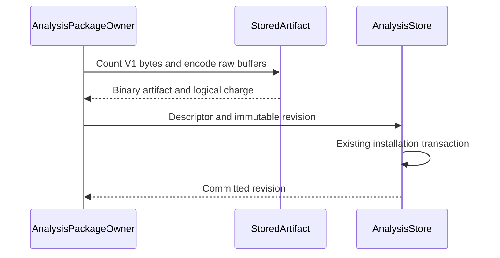

# Araphor Binary Package Storage Review

This guide covers binary package storage and the approved local OCI transport.
The retained evidence below covers `cffde410`. The OCI and admission changes
are committed through `ab6b5da3` and pass focused tests and final CI. Refreshed
native Data and the exact E2E retry pass. E2E reproducibility remains **Not done**.
The [approved plan](../plans/araphor-production-dataflow-simplification.md)
defines the package storage scope.

## Intended end state

Keep one descriptor and raw executable buffers in the existing package revision
row. Use OCI manifest identity for local transport and trust pins. Preserve
logical quotas, native Application Binary Interface (ABI)
validation, and the existing durable owner.

## Implementation review flow

[PackageBundleV1](../../crates/araphor-data/src/package/bundle.rs) The external package admission validates the current local OCI artifact
  -> [StoredArtifact](../../crates/araphor-data/src/package/storage.rs) the package owner separates one descriptor, implementation metadata, and raw executable bytes
  -> [AnalysisStore::install_package](../../crates/araphor-data/src/analysis/packages/revisions.rs) the store writes the complete immutable revision in one transaction
  -> [PackageRevisionV1::decode_artifact](../../crates/araphor-data/src/analysis/packages/model.rs) loading parses one descriptor and the remaining metadata
  -> [StoredArtifact::decode](../../crates/araphor-data/src/package/storage.rs) loading reads binary fields directly into the owned executable buffers
  -> [AnalysisPackageOwner::load_bundle](../../crates/araphor-data/src/package/lifecycle/revisions.rs) existing bundle validation, authority, and runtime admission remain

[AnalysisStore::open_leased](../../crates/araphor-data/src/analysis/mod.rs) A database opens
  -> [AnalysisStore::open_leased](../../crates/araphor-data/src/analysis/mod.rs) the store requires its current schema version
  -> [AnalysisStore::validate_state](../../crates/araphor-data/src/analysis/schema.rs) the store validates current rows, references, and charges
  -> [StoredArtifact::validate](../../crates/araphor-data/src/package/storage.rs) the store validates each current binary frame and content-derived size

## Owners and representation

`AnalysisPackageOwner` prepares the revision. `AnalysisStore` owns its database
row, revision notice, retention, and transaction. `StoredArtifact` has no
runtime state, cache, filesystem handle, or service lifetime.

The `descriptor` column contains the only descriptor copy. The `artifact`
column contains a CBOR array: version 1, logical byte count,
JSON metadata, and an array of binary buffers. Metadata contains
implementations and fixtures.
Executable fields in metadata are empty. Buffer order follows implementation
order, then each native implementation's dependency order. Decode rejects
unsupported versions, count differences, nonempty placeholders, truncation,
trailing bytes, and differences from the `encoded_bytes` column.

The codec counts the existing V1 encoding with empty executable arrays. It
then counts each raw byte's decimal digits and array commas. It does not
reconstruct decimal code arrays for this check. Recovery verifies this
canonical count against the frame and the `encoded_bytes` column. There is no
migration adjustment or legacy JSON decoder.

The [schema](../../crates/araphor-data/src/analysis/packages/schema.rs) charges
the canonical V1 artifact size. The external 32 MiB bundle bound and internal
64 MiB revision bound retain their encoded units. Smaller physical storage does
not increase these limits. Fixtures still use their existing JSON and Arrow
Interprocess Communication (IPC) encoding.
Runtime bundle and input leases still charge owned decoded buffers. The logical
encoding charge does not replace runtime memory accounting. DuckDB owns the
physical database pages; the smaller binary artifact is not a quota increase.

Installation retries compare the decoded artifact with the candidate. The
candidate byte bound is checked before a saved decode error. Collection
removes the existing row through its current retention rules. It does not
manage a second blob table or filesystem owner.

## Recovery and backup

The development store uses schema 21. The package codec accepts its current
binary frame. There is no legacy
JSON conversion, schema migration, or compatibility reader.

[Backup and restore](../../crates/araphor-data/src/analysis/backup.rs) accept only
current schema-21 manifests and databases. Current restore retains store
identity and commit revision. Restore advances the recovery epoch through its
existing owner. There are no deployed older stores to convert or preserve.

The [native loader](../../crates/araphor-data/src/package/native/mod.rs) still
validates code identity, dependency bytes, platform, and ABI. Storage does not
interpret native binaries or replace hashing with a saved digest. The following
section records the separately approved local OCI transport change.

## Local OCI transport and admission

[PackageBundleV1::read](../../crates/araphor-data/src/package/bundle.rs) The author or client supplies an OCI directory or layout archive
  -> [Content](../../crates/araphor-analysis-sdk/src/oci.rs) the SDK verifies descriptor sizes, SHA-256 hashes, media types, and the canonical Araphor manifest and config
  -> [PackageOci::decode](../../crates/araphor-data/src/package/oci.rs) Data fills ordered empty metadata slots from typed raw layers and checks reconstructed identity
  -> [PackageRequestV1::encode](../../crates/araphor-data/src/package/model/request.rs) the client encodes request metadata and the OCI archive as separate CBOR byte strings
  -> [ClientGrpcOwner](../../crates/mithril-control/src/client_grpc/packages.rs) Control decodes the bounded binary request from the existing gRPC bytes field
  -> [PackageTrustPinV1](../../crates/mithril-control/src/client_auth/packages.rs) Control requires the selected tenant's exact `sha256:` manifest pin and current grant
  -> [AnalysisPackageOwner::admit_artifact](../../crates/araphor-data/src/package/execution.rs) the package owner admits each shared executable once and retains each export's SQL and binding checks
  -> [AnalysisStore::install_package](../../crates/araphor-data/src/analysis/packages/revisions.rs) the existing store commits the immutable package revision

The SDK owns OCI representation and content checks. Data owns package meaning,
raw-slot order, and bundle validation. Control remains the trust and grant
authority. A content digest does not authorize installation or execution.

The artifact uses an OCI Image Manifest with schema version 2, a fixed Araphor
artifact type, and a typed config. The config has package metadata and ordered
blob descriptors. Wasm, native code, native dependencies, Python artifacts,
and fixture Arrow IPC remain raw typed layers. Their metadata slots are empty.
This canonical Araphor subset permits reconstruction of the same manifest
identity after durable loading. OCI itself does not define canonical JSON.
The digest is SHA-256 of exact manifest bytes, written as `sha256:` followed
by 64 lowercase hexadecimal characters. Bare hexadecimal trust pins are invalid.

The request is a three-field CBOR array: version 1, metadata JSON bytes, and
OCI archive bytes. Install and update metadata exclude the bundle. Other
operations require an empty archive. The request rejects trailing bytes and
retains its existing 32 MiB plus 64 KiB total bound. The package archive retains
the 32 MiB bound, including tar headers and padding. The internal revision
retains its separate 64 MiB logical encoding bound.

Directory reads retain file descriptors and open each component without
following symbolic links. They require bounded regular files. Archive reads
do not extract content. They reject duplicate paths, links, special entries,
unsafe names, missing or changed referenced blobs, and nonzero trailing data.
Unreferenced layout content does not become admitted package content.

The current transport requires fresh development packages and stores. There
is no JSON bundle fallback or older-format reader. The existing
[OCI design](../plans/mithril-hugging-face-intrusion-prevention/phase-7-mithril-control-and-detection-packages/extensible-security-packages-design.md)
points to the deferred registry and trust owner. This local format adds no
network client, registry credentials, publisher verification, cache, or GC owner.

Read [SDK OCI tests](../../crates/araphor-analysis-sdk/src/oci/tests.rs),
[package OCI tests](../../crates/araphor-data/src/package/oci/tests.rs),
[request tests](../../crates/araphor-data/src/package/model/request/tests.rs), and
[trust-pin tests](../../crates/mithril-control/src/client_auth/packages/tests.rs).
They cover byte bounds, descriptor identity, raw-layer order, malformed input,
directory links, request framing, changed-content denial, and authority locking.
These are the source test routes covered by the current qualification below.

### Current qualification at `ab6b5da3`

Source implementation, focused qualification, and final Rust CI are **Done**.
Focused checks pass for 43 Data cases, five SDK OCI cases, six builder cases,
six Control cases, one CLI case, and the complete existing package E2E case.
The final procedure exits 0 in 1,848.31 seconds. All 90 outer harnesses finish
with 2,138 passed, zero failed, and 568 existing ignored cases. Data has 632
passes and 19 ignored cases in 921.16 seconds. Covered source hashes remain
unchanged. The capture starts at HEAD `cee3ecc9`; this same tested source was
committed through `ab6b5da3` during the run.

Read `/tmp/araphor-oci-deliverable-commits.json`,
`/tmp/araphor-oci-final-ci-source.json`, `/tmp/araphor-oci-final-ci-report.json`,
and `/tmp/araphor-oci-final-ci.log`. The
[current plan record](../plans/araphor-production-dataflow-simplification.md#current-verification-record)
contains focused logs, counts, source commits, and earlier corrected attempts.
No quota, deadline, or workload was reduced.

Six refreshed native libraries build in 29.11 seconds on Linux x86_64 GNU
with glibc 2.39. Their hashes match the first build. Read
`/tmp/araphor-oci-native-build2.json` and `/tmp/araphor-oci-native-build2.log`.
All 12 native Data cases pass with zero failures and zero ignored cases in
254.19 seconds. The native detector E2E case fails in 368.16 seconds with
`automatic source replacement did not finish`: count revision 31 has
`stale=false`, while repeated revision 24 has `stale=true`. The case uses an
empty `PATH` and target `x86_64-unknown-linux-gnu`. The record and log
are `/tmp/araphor-oci-native-qualification.json` and
`/tmp/araphor-oci-native-qualification.log`. Source, binaries, and artifacts
remain stable; the record has `qualified=false`. The failure cause is not
established. Full Rust CI remains passed.

The exact native E2E retry passes with one passed, zero failed, and zero
ignored in 281.10 seconds; runner time is 281.12 seconds. Source `ab6b5da3`,
the binary, artifacts, and empty `PATH` are unchanged. The retry record confirms
source stability; its binary hash matches the first run. Read
`/tmp/araphor-oci-native-e2e-retry1.json` and
`/tmp/araphor-oci-native-e2e-retry1.log`. The first failure is retained.
The retry establishes no root cause or reproducibility fix.

**Done** for refreshed native Data and exact E2E retry qualification.
**Not done** for the unresolved E2E reproducibility issue. The Data target below
ten minutes is not met. Ordinary functional times do not establish a causal
speed improvement or regression. No runtime saving is measured.

## Retained verification at `cffde410`

[Codec tests](../../crates/araphor-data/src/package/storage/tests.rs) check
mixed implementation order, native dependencies, exact external bytes and
digests, malformed frames, exact logical charges, and byte bounds.
[Store schema tests](../../crates/araphor-data/src/analysis/mod.rs) check
current schema integrity and filesystem permissions.
[Backup tests](../../crates/araphor-data/src/analysis/backup.rs) check current
restore and malformed input.
[Revision tests](../../crates/araphor-data/src/package/lifecycle/revisions.rs)
retain immutable retry and candidate error precedence cases.
[Graph recovery tests](../../crates/araphor-data/src/analysis/graph_rows/tests/recovery.rs)
retain current graph history, backup, and corruption checks.

The implemented source is HEAD `cffde410`. Commit `6b6d5ebb` contains the
package storage change. The focused run uses a fresh development store and
the current binary frame. No old-store conversion or compatibility proof is
part of this result.

The retained 71-case Data run reported 70 passed and one failed in 233.43
seconds. All three current codec tests and all three revision retry tests
passed. Package installation, activation, closure retention, reopen,
backup/restore, and package commit crash cases passed. The sole failure was
`query::model::operation::tests::sql_operation_matches_standalone_inputs_and_output`.
After its test-only correction, that exact case passed. The same final focused
record reports 66 SDK tests passed and unchanged source hashes.

Read the [Data focused log](/tmp/araphor-production-fresh-focused-araphor_data.log)
and [final focused record](/tmp/araphor-production-final-focused.json) for
the commands, binary hashes, source hashes, and terminal results. The records
precede the commits that retain this implementation.

The first final CI run at `78f80579` reported 616 Data tests passed, three
failed, and 19 ignored. The failures are now corrected. Commit `9f1f4ffa`
corrects the retained-snapshot fixture. Raw decoding allocates tighter code
buffers, so two bundles can fit within the old fixed 8 MiB test capacity.
The test now sets capacity to twice the raw runtime artifact length. The test
retains rejection of a second charged snapshot, release before replacement
loading, and reservation of the complete capacity after cleanup. Production
quotas and release behavior are unchanged by this fixture correction.

All seven targeted cases passed in 214.15 seconds. These cases include
`package::installed::read::tests::retained::reusing::reuse_releases_before_loading`.
The targeted record confirms unchanged source hashes. Read the
[targeted record](/tmp/araphor-production-targeted-fixes.json) and
[targeted log](/tmp/araphor-production-targeted-fixes-tests.log) for the exact
source cut, commands, binary hash, and results.

The final Rust procedure passed at `cffde410` with exit 0. Formatting,
workspace checking, strict clippy, and all 90 parent harnesses passed.
The harnesses reported 2,121 passed, 0 failed, and 568 existing ignored tests.
Data reported 620 passed and 19 ignored in 889.53 seconds. The complete
procedure took 1,666.48 seconds. Covered source hashes remained unchanged.
Read the [source record](/tmp/araphor-production-final-ci-source.json),
[CI log](/tmp/araphor-production-final-ci.log), and
[harness report](/tmp/araphor-production-final-ci-report.json).

The separate native runtime qualification passed at `cffde410` on Linux
x86_64 GNU with glibc 2.39. Six Rust libraries built from the current SDK in
30.79 seconds to `/tmp/araphor-production-native-current`. All 12 selected
cases passed, with 0 failed and 0 ignored, in 255.98 seconds. The runner took
256.00 seconds. Covered source hashes remained unchanged.

Eight package cases execute stored native ELF artifacts. They check lifecycle,
checkpoints, reopen, errors, unsupported caps, cancellation, revocation, expiry,
declared backend changes, and restart after a host fault. Two Discovery cases
and two graph cases check native output parity, including large graph input.
Read the [native qualification record](/tmp/araphor-production-native-qualification.json),
[build log](/tmp/araphor-production-native-qualification-build.log), and
[test log](/tmp/araphor-production-native-qualification-tests.log) for the exact
commands, selected cases, source hashes, executable hash, and library hashes.

**Done** for current-format storage implementation, focused functional
qualification, ordinary final CI, and native runtime qualification on this
platform. Ordinary CI does not run the separate artifact-qualified cases.
The codec tests prove opaque native buffer and identity preservation; the
separate native cases prove execution through current binary storage.
Other platforms are not qualified by this result. No measured runtime saving
is established for this storage change.
