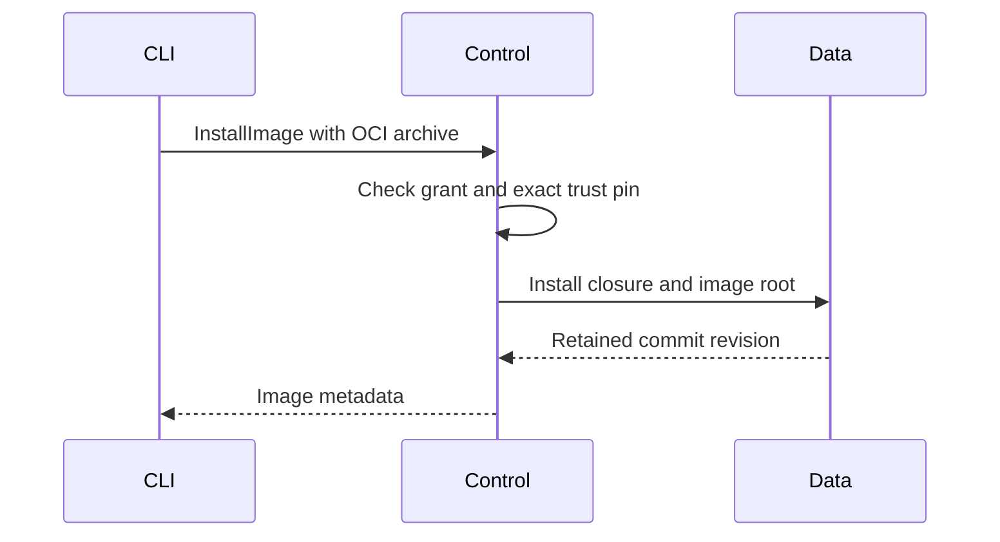

# Araphor Binary Package Storage Review

Use the [approved plan](../plans/araphor-production-dataflow-simplification.md)
for scope and the [current review](araphor-performance-simplification-review.md)
for the shared execution flow. This guide owns the storage and OCI contracts.

The current work removes the former Analysis execution crate. Links to that
owner use the fixed source revision
`6a25ba1b34dbaa0a553b1883058938683ce7aaab`. Its activation routes below are
historical. Current image installation uses Data without starting execution.
Read the [definition and finite execution guide](araphor-discovery-definition-review.md)
for current Query and Package Runtime owners. Qualification of the current
deletion is in progress.

## Intended end state

Keep immutable package revisions in the existing row. Use the existing OCI
codec for retained artifacts and local transport. Keep executable and fixture
buffers in raw layers. The package owner prepares a revision. AnalysisStore
owns its transaction, revision notice, retention, recovery, and usage charges.
OCI manifest identity remains the local transport and trust-pin identity.

## Implementation review flow

The following flow records the removed package activation path.

[PackageBundleV1](../../crates/araphor-package/src/bundle.rs) External package admission validates the complete local OCI bundle
  -> [AnalysisPackageOwner::install_revision](https://github.com/Ereborlabs/erebor-runtime/blob/6a25ba1b34dbaa0a553b1883058938683ce7aaab/crates/araphor-analysis_back/src/package/lifecycle/revisions.rs) the package owner builds revision metadata or reuses the same immutable revision
  -> [PackageArtifactV1::encode](../../crates/araphor-package/src/bundle.rs) the artifact uses the shared PackageOci metadata and raw-layer codec
  -> [PackageOci::artifact_layout](../../crates/araphor-package/src/oci.rs) the existing SDK Layout encodes one artifact as an OCI archive
  -> [AnalysisStore::install_package](../../crates/araphor-data/src/analysis/packages/revisions.rs) the store decodes the artifact, checks descriptor agreement, and writes the complete revision in one transaction
  -> [PackageRevisionV1::decode_artifact](../../crates/araphor-data/src/analysis/packages/model.rs) loading parses the separate descriptor and calls the shared artifact decoder
  -> [PackageArtifactV1::from_bytes](../../crates/araphor-package/src/bundle.rs) the SDK Content decoder and PackageOci fill the raw payload slots and check canonical identity
  -> [PackageRevisionV1::decode_artifact](../../crates/araphor-data/src/analysis/packages/model.rs) loading requires the two descriptors to agree
  -> [AnalysisPackageOwner::load_bundle](https://github.com/Ereborlabs/erebor-runtime/blob/6a25ba1b34dbaa0a553b1883058938683ce7aaab/crates/araphor-analysis_back/src/package/lifecycle/revisions.rs) the package owner loads dependencies and validates the complete bundle before runtime admission

## Image installation without execution

[ClientGrpcOwner::image_request](../../crates/mithril-control/src/client_grpc/packages.rs) An operator installs an image
  -> [PackageBundleV1::metadata](../../crates/araphor-package/src/metadata.rs) the image owner validates the bundle and returns declarations without executable buffers
  -> [ClientAuth](../../crates/mithril-control/src/client_auth/packages.rs) Control checks the current grant and exact image trust pin
  -> [AnalysisStore::install_package_image](../../crates/araphor-data/src/analysis/packages/image.rs) Data commits the complete revision closure and its image root in one transaction
  -> [AnalysisStore::collect_package_rows](../../crates/araphor-data/src/analysis/packages/collection.rs) the image root and dependency references retain the code during collection

[ClientGrpcOwner::image_request](../../crates/mithril-control/src/client_grpc/packages.rs) An operator inspects an image
  -> [AnalysisStore::package_image](../../crates/araphor-data/src/analysis/packages/image.rs) Data loads the exact requested revision or the last installed image for that tenant
  -> [AnalysisStore::package_image_from](../../crates/araphor-data/src/analysis/packages/image.rs) Data reconstructs the locked closure and checks the saved manifest digest
  -> [PackageBundleV1::metadata](../../crates/araphor-package/src/metadata.rs) the response contains descriptors, targets, artifact identities, and fixture names

The [image namespace](../../crates/araphor-cli/src/cli/araphor/packages.rs)
provides install and inspect operations. Image installation does not create an
activation, result, checkpoint, or Discovery subscription. The former package
activation namespace is removed. Definitions select exact installed images.

```sh
araphor image digest ./package
araphor --profile ./profile.json image install ./package
araphor --profile ./profile.json image inspect example --revision 1
```

The image stores the existing SDK input and output schemas, parameters,
reasons, evidence declarations, and optional checkpoint version and datasets.
Mutable instance state is not part of the installed image. Installation does
not load code, plan its SQL, or run its fixtures. The call owner checks runtime
compatibility and validates returned data when execution is implemented.



The current authority lock covers the Data commit. The final callback checks
grant expiry and cancellation before commit. A failure rolls back both the
image root and new revision rows. An exact retry keeps the first install
revision. Image reads use one retained snapshot. Collection preserves each
image root and its dependency closure.

[AnalysisStore::open_leased](../../crates/araphor-data/src/analysis/mod.rs) A database opens
  -> [AnalysisStore::open_leased](../../crates/araphor-data/src/analysis/mod.rs) the store requires its current schema version
  -> [AnalysisStore::validate_state](../../crates/araphor-data/src/analysis/schema.rs) the store validates current rows, references, and charges
  -> [AnalysisStore::validate_package_contracts](../../crates/araphor-data/src/analysis/packages/recovery.rs) the store checks retained artifacts, descriptor agreement, same-tenant dependencies, and each reconstructed image digest

## Owners and representation

The development store uses schema 25. The descriptor column retains JSON for
metadata reads. The artifact column contains an OCI archive for one
PackageArtifactV1. Its config contains another descriptor copy. Install,
retained decode, and recovery require the two descriptors to agree.

[PackageOci](../../crates/araphor-package/src/oci.rs) owns metadata and raw
slot order for both complete bundles and retained artifacts. The
[SDK OCI codec](../../crates/araphor-analysis-sdk/src/oci.rs) owns the layout,
archive, descriptor sizes, SHA-256 checks, and canonical config and manifest.
Raw layers follow implementation order, native dependency order, then fixture
input, prior checkpoint, expected output, reason, and next checkpoint order.
Metadata payload slots are empty. Decode rejects a missing or extra layer,
wrong media type, nonempty slot, changed content, or noncanonical identity.
Standalone artifact decode permits external dependency references. Complete
bundle validation checks their closure after the package owner loads them.

The image crate owns formats, static admission, native metadata, and local
OCI transport. The crate has no Data or Query dependency. Data retains grant
contracts, context references, and persistence. The package_images table stores
each image root and manifest digest independently of export activations.

The store charges actual descriptor and artifact lengths. There is no separate
encoded byte count. Recovery reconstructs the same charges. Runtime bundle and
input leases charge owned buffers separately. DuckDB owns physical pages. The
current development format has no old CBOR artifact reader or migration.

Install and recovery now decode owned raw layers through the existing SDK
Content owner. The old validation-only path borrowed executable bytes. The
shared path checks layer hashes and hashes the layers again when it reconstructs
canonical identity. Repeated references to one blob produce one owned buffer
per ordered slot. This change removes a codec owner; it does not establish less
allocation, lower peak memory, or faster validation.

Legacy admission compares the saved artifact before encoding the candidate.
An image retry validates the same closure and preserves the original install
revision. Inspection with no revision selects the last installed image.
An admitted immutable bundle retains its OCI digest and executable identities.
Current trust and grant checks remain at admission and commit. Content identity
does not supply authority.

## Recovery and backup

[Backup and restore](../../crates/araphor-data/src/analysis/backup.rs) accept the
current schema, validate rows and references, retain store identity and commit
revision, and advance the recovery epoch through the existing owner. A failed
restore cannot publish a partial store.

The [native loader](../../crates/araphor-package-runtime/src/native/loading.rs) checks
code identity, dependency bytes, platform, and ABI. Storage keeps raw executable
bytes; it does not interpret them. Collection uses the existing revision
retention path. There is no second blob store.

## Local OCI transport and admission

This flow records the former package admission and activation entry. The
current image-only entry is described above. It performs static image checks
and storage admission. Finite execution admits executable code separately.

[PackageBundleV1::read](../../crates/araphor-package/src/bundle.rs) The author or client supplies an OCI directory or layout archive
  -> [Content](../../crates/araphor-analysis-sdk/src/oci.rs) the SDK verifies descriptor sizes, SHA-256 hashes, media types, and the canonical Araphor manifest and config
  -> [PackageOci::decode](../../crates/araphor-package/src/oci.rs) the image owner fills ordered empty metadata slots from typed raw layers and checks reconstructed identity
  -> [PackageRequestV1::encode](../../crates/araphor-data/src/package/model/request.rs) the client encodes request metadata and the OCI archive as separate CBOR byte strings
  -> [ClientGrpcOwner](../../crates/mithril-control/src/client_grpc/packages.rs) Control decodes the binary request from the existing gRPC bytes field
  -> [PackageTrustPinV1](../../crates/mithril-control/src/client_auth/packages.rs) Control requires the selected tenant's exact `sha256:` manifest pin and current grant
  -> [AnalysisPackageOwner::admit_artifact](https://github.com/Ereborlabs/erebor-runtime/blob/6a25ba1b34dbaa0a553b1883058938683ce7aaab/crates/araphor-analysis_back/src/package/execution.rs) the package owner admits each shared executable once and retains each export's SQL and binding checks
  -> [AnalysisStore::install_package](../../crates/araphor-data/src/analysis/packages/revisions.rs) the existing store commits the immutable package revision

The SDK owns OCI representation and content checks. The image crate owns
raw-slot order and bundle validation. Data owns persistence and retention.
Control remains the trust and grant authority. A content digest does not
authorize installation or execution.

The artifact uses an OCI Image Manifest with schema version 2, a fixed Araphor
artifact type, and a typed config. The config has package metadata and ordered
blob descriptors. Wasm, native code, native dependencies, Python artifacts,
and fixture Arrow IPC remain raw typed layers. Their metadata slots are empty.
This canonical Araphor subset permits reconstruction of the same manifest
identity after durable loading. OCI itself does not define canonical JSON.
The digest is SHA-256 of exact manifest bytes, written as `sha256:` followed
by 64 lowercase hexadecimal characters. Bare hexadecimal trust pins are invalid.

The request is a three-field CBOR array: version 1, metadata JSON bytes, and
OCI archive bytes. Image install, legacy install, and update metadata exclude
the bundle. Other operations require an empty archive. The request rejects trailing bytes and
has no separate aggregate size cap. The user also removed the descriptor-only
1 MiB cap, OCI package 32 MiB cap, and stored revision 64 MiB cap. Package gRPC
clients and the server remove the aggregate message cap for package transport.
OCI exact descriptor sizes, digests, format checks, runtime data limits, and
store usage accounting remain.

Directory reads retain file descriptors and open each component without
following symbolic links. They require regular files. Archive reads
do not extract content. They reject duplicate paths, links, special entries,
unsafe names, missing or changed referenced blobs, and nonzero trailing data.
Unreferenced layout content does not become admitted package content.

The current transport requires fresh development packages and stores. There
is no JSON bundle fallback or older-format reader. The existing
[OCI design](../plans/mithril-hugging-face-intrusion-prevention/phase-7-mithril-control-and-detection-packages/extensible-security-packages-design.md)
points to the deferred registry and trust owner. This local format adds no
network client, registry credentials, publisher verification, cache, or GC owner.

Read [SDK OCI tests](../../crates/araphor-analysis-sdk/src/oci/tests.rs),
[package OCI tests](../../crates/araphor-package/src/oci/tests.rs),
[request tests](../../crates/araphor-data/src/package/model/request/tests.rs), and
[trust-pin tests](../../crates/mithril-control/src/client_auth/packages/tests.rs).
They cover descriptor identity, raw-layer order, malformed input,
directory links, request framing, changed-content denial, and authority locking.
These are source test routes. Read the
[current verification](../plans/araphor-performance-simplification-todo.md)
before treating them as passed for this source.

### Explicit input declarations

[InputPort](../../crates/araphor-analysis-sdk/src/model.rs) Each input declares its port and source
  -> [Package::validate](../../crates/araphor-analysis-sdk/src/descriptor.rs) the SDK checks source and mode combinations and exact local output references
  -> [PackageBundleV1::validate](../../crates/araphor-package/src/admission.rs) the image owner checks the dependency closure from output references
  -> [Inputs::execute](../../crates/araphor-query/src/inputs/physical.rs) the query owner resolves table and query inputs

`InputMode::Provided` accepts table sources. The caller supplies all datasets;
output references still retain dependency edges. `Resolved` accepts table and
query sources. A table names a built-in relation or an exact package output.
Zero-input models also declare the mode. `Model::new` defaults to `Provided`.
There is no separate package dependency
list, SQL binding map, or missing-key fallback. Computation ports and the native
and Wasm evaluation ABI remain unchanged.

## Verification

The removed owner's test links below identify historical source. Earlier
verification records do not qualify the current deletion.

[Artifact OCI tests](../../crates/araphor-package/src/oci/tests/artifact.rs)
retain mixed implementations, native dependency order, exact bytes, malformed
archives and payload slots, every fixture payload slot, and standalone external
dependencies. [Bundle OCI tests](../../crates/araphor-package/src/oci/tests.rs)
retain a fixed prechange manifest digest and archive length.
[Descriptor agreement tests](../../crates/araphor-data/src/analysis/packages/tests.rs)
check the decode error, install rollback, and rejection after reopen.
[Revision tests](https://github.com/Ereborlabs/erebor-runtime/blob/6a25ba1b34dbaa0a553b1883058938683ce7aaab/crates/araphor-analysis_back/src/package/lifecycle/revisions.rs)
retain immutable retry, changed-content rejection, reopen, and a 33 MiB artifact.
[Package quota tests](../../crates/araphor-data/src/analysis/packages/tests.rs)
retain charges from actual stored descriptor and artifact lengths.
[Backup tests](../../crates/araphor-data/src/analysis/backup.rs) retain restore
and malformed-input checks. [Graph recovery tests](https://github.com/Ereborlabs/erebor-runtime/blob/6a25ba1b34dbaa0a553b1883058938683ce7aaab/crates/araphor-analysis_back/src/graph/tests/storage_recovery.rs)
retain history, backup, and corruption checks. Native execution needs separate
artifact-qualified tests; opaque buffer round trips do not prove execution.

[Image contract tests](../../crates/araphor-package/src/tests.rs) retain typed
inputs and outputs, parameters, checkpoint declarations, reasons, native
dependencies, and fixture buffers. [Image storage tests](../../crates/araphor-data/src/analysis/packages/tests/image.rs)
cover atomic installation, exact retries, collection, tenants, revision reads,
reopen, and digest rejection. [Control image tests](../../crates/mithril-control/src/client_grpc/tests/packages.rs)
cover the authenticated image request and inspection path. These links name
source tests. The
[TLS image case](../../crates/mithril-e2e/src/discovery/packages/images.rs)
uses the production client, authentication, listener, and Data owner. The case
installs a Wasm image, checks that no activation appears, repeats installation,
reopens Control, and inspects the same code and digest. The case starts no
package worker.

Image content and installation qualification: **Done**. The source parent is
`41815177`. The affected library test build passes. Strict Clippy with
`--all-targets -- -D warnings` passes for `araphor-package`, Data, Query, both
Analysis crates, Discovery effects, Control, E2E, and CLI. Formatting passes.
The focused runs pass 93 distinct tests across the image, storage, request,
CLI, Analysis, and Control owners. These runs include all 11 image crate tests.
The legacy storage run passes 51 cases and fails one witness-expiry case.
That test used disabled retention defaults. The fixture now sets an explicit
expiry policy. The exact case passes with all original assertions retained.
Production retention code is unchanged.

The records are `/tmp/araphor-image-verification1.json`,
`/tmp/araphor-image-tests1.log`, `/tmp/araphor-image-expiry-fixed.log`,
`/tmp/araphor-image-focused-tests1.json`,
`/tmp/araphor-image-focused-tests2.json`, and
`/tmp/araphor-image-clippy2.log`. The first focused record preserves the failed
storage attempt. Full workspace CI, benchmarks, and physical Kubernetes
qualification are not run. These checks do not qualify native execution on
another platform or prove faster execution.

Earlier receipts and failed attempts remain in
`7b7b407adf347d389984553a4d212bfce37b75b5:docs/guides/araphor-binary-package-storage-review.md`.
They apply only to their captured source. The earlier exact native E2E retry
passes on Linux x86_64 GNU with glibc 2.39; its first failure remains unexplained.
It does not qualify later source or another platform. The Data test target below
ten minutes and a causal runtime speed improvement remain unproven.
