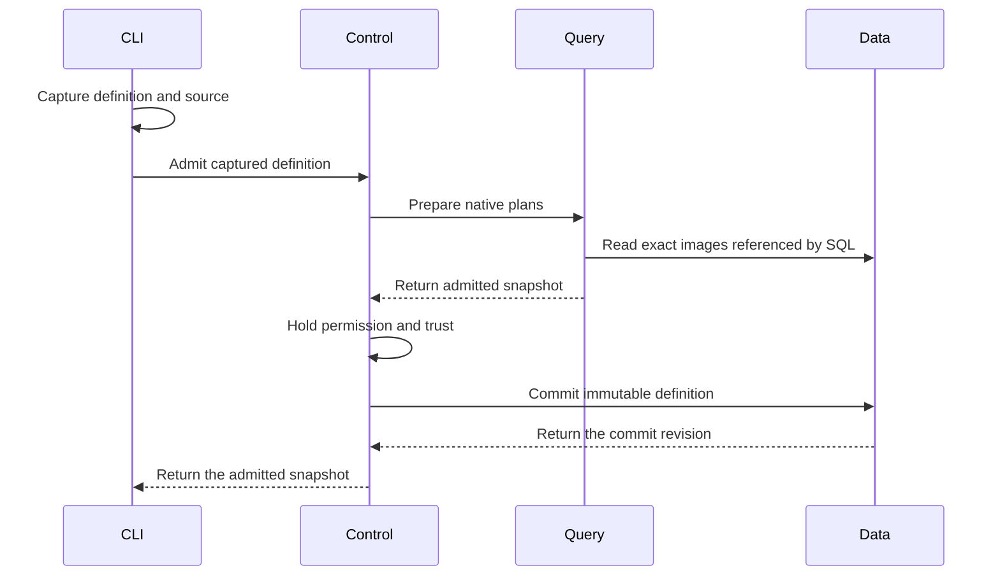

# Discovery Definition Review

This guide covers the Discovery definition file and its admission route. The
definition selects reusable code and inputs. Admission starts no Discovery.

## Intended end state

A YAML definition contains metadata and exactly one SQL, PRQL, or package-call
form. The package-call form produces a native SQL relation. Every program uses
the native DataFusion pipeline. A separate running instance owns permission,
progress, saved state, and subscription lifetime.

## Review flow

```text
An operator admits a definition file
  -> the file owner captures source files and converts a YAML call to SQL
  -> the CLI sends metadata and captured SQL or PRQL
  -> Control checks the current tenant and manager permission
  -> Query admits SQL or compiled PRQL and resolves package calls in that SQL
  -> Control holds permission and image trust through the final write
  -> Data retains one immutable definition revision
  -> no Discovery starts

Admission fails or permission expires
  -> the request returns a typed error
  -> Data commits no new definition
  -> a retry checks current permission again
```

[DefinitionArgs](../../crates/araphor-cli/src/cli/araphor/packages.rs)
accepts `araphor definition admit FILE` and
`araphor definition inspect NAME --revision REVISION`.

-> [Definition::read](../../crates/araphor-discovery-definition/src/definition.rs)
delegates YAML parsing to
[YamlDefinition::read](../../crates/araphor-discovery-definition/src/file.rs).
The file owner checks metadata and the single program selection. It resolves
relative paths from the YAML directory and captures UTF-8 source text once.
The native YAML parser rejects duplicate keys and unknown fields. No owner
watches or polls the files.

-> [Call::sql](../../crates/araphor-discovery-definition/src/file.rs)
converts the structured call to native SQL. The existing SQL parser checks
each input query. Native syntax-tree values quote names and literal
parameters. This owner does not evaluate parameter strings as SQL. The
result uses the existing `Program::Sql` type. SQL and PRQL text use the
existing source types. The JSON request and saved snapshot formats do not
change.

-> [ClientGrpcOwner::definition_request](../../crates/mithril-control/src/client_grpc/packages.rs)
accepts captured definitions only. The server does not open client paths.
Admission requires current manager permission. Inspection requires current
tenant read permission. File metadata grants no permission.

-> [Engine::prepare_definition](../../crates/araphor-query/src/definition.rs)
uses native SQL parsing, logical planning, and optimization. SQL and generated
PRQL SQL use the same route. Query loads each exact installed image referenced
by a package function. Admission executes no input query or package.

-> [Packages](../../crates/araphor-query/src/definition/package.rs)
extends native relation planning for installed package functions. Native
subquery arguments supply input plans. Native scalar expressions supply
parameters. Exact image content supplies the declared interface and locked
dependencies. A call with several output relations requires an output name
as its first string argument. SQL package output, checkpoint, evidence, and
reason queries retain their schema checks. Native analysis and optimization
check every SQL body plan, including plans that contain other package calls.

Package calls use DataFusion's `RelationPlanner` extension. They are not
registered scalar user-defined functions (UDFs) or `TableFunctionImpl`
functions. The native table-function interface accepts scalar expressions.
A package input accepts a complete relation. The relation planner gives
DataFusion each input subquery in its caller scope. DataFusion plans scalar
parameters through its existing expression planner.

The relation hook returns ordinary table references to DataFusion unchanged.
[SourceProvider](../../crates/araphor-query/src/sources/mod.rs) implements
native `TableProvider` for Araphor tables. Package input and output relations
use native `ViewTable`. The table scope returns those providers through
`provider_as_source`; the relation hook does not implement table scans.

One admission shares one native catalog and source-provider map. The package
planner parses each default input query once. Native `transform_up_with_subqueries` binds each
declared dependency to its resolved plan. Native `recompute_schema` updates
the parent schemas in that same traversal. Native `ViewTable` and
`LogicalPlanBuilder::scan` preserve the input name and projection. Binding
occurs before optimization; an unexpected scan filter or fetch is an error.
`DataFrame::with_column` adds the zero-based index with native `row_number`.
This operation generates no SQL. Existing configured Query quotas still
apply to indexed and bound plans. The package planner retains each distinct
native plan once for analysis, optimization, and physical validation.

The native SQL body planner needs a separate table scope for each call.
[Scope](../../crates/araphor-query/src/definition/package/scope.rs) supplies
the actual input, parameter, output, and prior-state tables through
DataFusion's `ContextProvider`. It delegates function, type, configuration,
and other metadata to the native provider. A package body cannot inherit
undeclared tables from its caller. Caller subqueries and common table
expressions are planned by DataFusion before this body scope is used.
DataFusion's native session context provider is private. This adapter supplies
the required package table scope to the native SQL planner.

-> [PackageCall](../../crates/araphor-query/src/definition/call.rs)
retains the exact image, export, selected output, and SDK descriptor. Its
logical children are the actual input plans and the native parameter plan.
Its schema is the selected SDK output schema.
One identity key supplies equality, ordering, and hashing for native plan
operations. The key includes the root image digest and the selected export.
The node preserves the package execution contract for typed output, saved
state, and evidence. A scalar UDF does not supply that contract.
Partial: the node has no physical executor. Native physical planning returns
an explicit unsupported error for a package-call execution attempt.

The former Discovery function resolver and its crate are removed. Native
[SQL view declarations](../../crates/araphor-analysis-builtins/src/discovery/sql.rs)
define the derived relations. Query registers native `ViewTable` providers
through [Engine::register_views](../../crates/araphor-query/src/execution.rs).
The SQL query uses `FROM discovery.observed_effects` without call arguments.
The Query planner contains no Discovery-name dispatch. Package calls still
use the generic relation planner described above.

[Discovery image assembly](../../crates/araphor-analysis/src/package/builtin.rs)
retains the complete live SQL program in the existing package format. Native
SQL CTE scopes bind its input relations. Image assembly adds no executor,
subscription, or source reader.

-> [ClientAuth::commit_definition](../../crates/mithril-control/src/client_auth/packages.rs)
holds the current permission lock through the Data write. This owner checks
permission even when a SQL or PRQL definition has no image pins. A package
call also requires current trust in its exact image digest.

-> [AnalysisStore::admit_definition](../../crates/araphor-data/src/analysis/definitions.rs)
checks exact retained image references and saves captured text, generated
SQL, metadata, and pins. The SHA-256 content revision includes every saved
field. An exact retry returns the original commit revision. Changed content
creates another immutable revision. A retry of an older revision does not
change the latest selection.

-> [AnalysisStore::validate_definitions](../../crates/araphor-data/src/analysis/definitions.rs)
checks saved identities, content digests, store revisions, and exact image
pins during store open. Inspection checks content and image pins again.

Not implemented: starting, inspecting, or stopping a managed instance.
Not implemented: physical package-call execution, instance saved state,
progress, and restart recovery. Definition recovery restores definitions only.



Queries with no package calls require no image lookup. Data commits no
activation or result.

## File schema

All three forms use YAML metadata. `name` is required. `description` and
`labels` are optional. Select exactly one top-level `sql`, `prql`, or `call`.
A raw SQL or PRQL file is source for a definition, not a complete definition.
Unknown fields, explicit null program forms, duplicate keys, merge keys, and
multiple YAML documents are invalid. Metadata and call names require strings.
Quote a numeric image revision, for example `revision: "1"`.

SQL supports the full native query:

```yaml
name: event-counts
description: Count retained events.
labels:
  team: security
sql: |
  SELECT count(*) FROM events
```

For a separate source file, use `sql: {file: queries/counts.sql}`. PRQL has
the same inline and file forms:

```yaml
name: selected-events
description: Select event cursors.
labels:
  team: security
prql:
  file: queries/selected-events.prql
```

The referenced file contains:

```prql
from events
select {value = source_cursor}
```

The
[compiler](../../crates/araphor-discovery-definition/src/compile.rs) uses
`prqlc` 0.13.13 with the Generic SQL target. DataFusion admits the generated
SQL. This route does not promise every PRQL expression is compatible.

Put package calls in SQL when the definition needs query composition:

```sql
SELECT *
FROM "fixture"."r1".count(
  source => (
    SELECT source_cursor AS value
    FROM events
    WHERE received_at >= now() - INTERVAL '5 minutes'
  ),
  increment => 2
)
```

The function name identifies the image, exact revision, and export. The
example uses the Query test image. Install the selected image before
admission. Its interface must declare the supplied inputs and parameters.
For an export with several outputs, use an explicit first string argument,
such as `count('result', source => (SELECT ...), increment => 2)`.

Inputs are native subqueries. Filters, joins, grouping, and windows stay in
those queries. Scalar arguments use the declared parameter names and types.
Calls can
appear in joins, nested inputs, or queries that use common table expressions.

For one direct package call, use the structured YAML form:

```yaml
name: selected-event-counts
description: Count selected event cursors.
labels:
  team: security
call:
  package: fixture
  revision: r1
  export: count
  inputs:
    source: |
      SELECT source_cursor AS value FROM events
  parameters:
    increment: 2
```

The file owner converts this form to the SQL relation above without the
time filter. Inputs accept inline SQL or `{file: queries/input.sql}`. Optional
`output` selects a named output. Query checks the exact installed image,
declared bindings, parameter types, defaults, and selected output. There is
no second parameter evaluator or YAML window language. Put filters and
windows in input SQL.

Parameters use literal strings, numbers, booleans, nulls, lists, or objects.
The reader rejects nonfinite numbers, unsupported scalar tags, and integers
outside the existing signed 64-bit or unsigned 64-bit representation. It
preserves `18446744073709551615` exactly. The reader adds no resource quota.
Parser budgets and alias quotas are disabled. Existing Query and Data limits
still apply.

SQL and PRQL source text is retained exactly. A YAML call retains metadata
and normalized SQL. It does not retain the original YAML mapping, formatting,
or source paths. JSON remains the request and saved snapshot encoding.

PRQL uses its existing SQL relation syntax and then compiles to native SQL:

```prql
from s"""SELECT * FROM "fixture"."r1".count(
  source => (SELECT source_cursor AS value FROM events), increment => 2
)"""
filter value >= 2
```

## Ownership and verification

The definition crate owns portable file and snapshot types. Data owns durable
storage. Query owns planning. Control owns current permission and transport.
CLI owns command parsing and output. No new owner depends on
`araphor-analysis_back`. The old package route remains available separately.

Read the [definition tests](../../crates/araphor-discovery-definition/src/tests.rs),
[YAML tests](../../crates/araphor-discovery-definition/src/file/tests.rs),
[Query tests](../../crates/araphor-query/src/definition/tests.rs),
[Data tests](../../crates/araphor-data/src/analysis/definitions/tests.rs),
[authority tests](../../crates/mithril-control/src/client_auth/packages/tests.rs),
and [RPC tests](../../crates/mithril-control/src/client_grpc/tests/packages.rs).
The tests cover source capture, strict forms, native planning, typed calls,
permission revocation, exact pins, immutable retries, and definition recovery.
The [TLS case](../../crates/mithril-e2e/src/discovery/packages/definitions.rs)
uses the real client to admit and inspect all three YAML forms. Its native
package calls also check the locked SQL dependency and unchanged activation
state. The Query YAML case checks exact unsigned parameter values through
the native parameter plan and rejects expression strings as numeric values.
`native_package_bound_inputs` checks dependent inputs in both declaration
orders. The test uses native physical execution to check the result and row
index. It also checks a compatible Arrow string representation and an
explicit projection quota. The default quota remains disabled.

[Dataset::normalize_batch](../../crates/araphor-analysis-sdk/src/batch.rs)
retains the explicit Arrow row count when a valid SDK input has no columns.
The [SDK batch tests](../../crates/araphor-analysis-sdk/src/batch/tests.rs)
check empty and nonempty zero-column batches. The Query case checks native
zero-column input, output, and saved-state planning and a three-row scan.
[Session::indexed_schema](../../crates/araphor-query/src/execution/tables.rs)
accepts the same empty schema and retains metadata. The
[index tests](../../crates/araphor-query/src/execution/tables/tests.rs) check
continuous row indices across empty and nonempty zero-column batches.
The changes retain the existing column and schema checks.

The previous native-call replacement passes 50 distinct focused tests. The
YAML authoring delivery passes 60. Native admission simplification passes 61:

| Owner | Native-call replacement | YAML authoring | Native admission |
| --- | --- | --- | --- |
| Definition format and PRQL | 12 | 21 | 21 |
| Query definitions and package calls | 20 | 21 | 22 |
| Data definitions and request encoding | 9 | 9 | 9 |
| Control permission and RPC admission | 5 | 5 | 5 |
| CLI admission, inspection, and output | 3 | 3 | 3 |
| TLS client admission and inspection | 1 | 1 | 1 |

Formatting and affected-crate Clippy with warnings denied passed. The
verification record is `/tmp/araphor-sql-call-verification1.json`.
The tests also reject an invalid constant cast in a body that contains a
nested package call. They accept the corrected body. Native analysis and
optimization apply before the physical-execution boundary.

The SDK batch and Query index owners are unchanged from `318a3259`. Their
earlier checks above are not repeated. The focused Query zero-column case
runs again in this delivery.

The replacement adds 165 production Rust code lines from `318a3259`:
327 additions and 162 deletions by file size. Tests, comments, documents,
blank lines, and moves do not count as reduction. The count record is
`/tmp/araphor-sql-call-count1.json`. The complete reduction target remains
**Not done**.
Complete package execution and running-instance acceptance remain open.
Full workspace CI, benchmarks, and physical Kubernetes checks did not run.

YAML implementation and selected functional qualification: **Done**. The
new tests reject null maps, duplicate keys, and integer rounding. The Query
case executes the native parameter plan and checks the exact unsigned value.
The TLS case admits SQL, PRQL, and a direct YAML call through the real client.
The source and command record is `/tmp/araphor-yaml-verification1.json`.
Formatting and affected-crate Clippy with warnings denied pass.

The YAML delivery adds 261 production Rust code lines from `d49e6bd5`:
282 additions and 21 deletions by file size. The complete redesign adds
6,180 from `7b7b407a`; another 12,180 must be removed for the 6,000-line
reduction target. The count excludes tests, comments, documents, blank lines,
and moves. The record is `/tmp/araphor-yaml-count1.json`. The complete
reduction remains **Not done**. No speed result is claimed.

Native admission simplification and selected qualification: **Done**. The
review covers the change from `b637c05a`. All 61 distinct focused tests pass.
Formatting and affected-crate Clippy with warnings denied pass. The source
and command record is `/tmp/araphor-native-simplify-verification1.json`.
The change removes 27 production Rust code lines: 15 additions and 42
deletions by file size. The count excludes tests, comments, documents, blank
lines, and moves. The record is `/tmp/araphor-native-simplify-count1.json`.
Full workspace CI, benchmarks, and physical Kubernetes checks did not run.
At this revision, physical package execution, built-in consolidation,
running instances, and the complete reduction target remained **Not done**.

Discovery effects crate removal and selected qualification: **Done**. The
complete crate, dependency entries, and function resolver are removed. Native
view declarations belong to the existing built-in package. The existing
Analysis Package owner constructs the immutable image. All 354 distinct
focused tests pass, including 36 SQL cases and 268 Query cases. Scoped
formatting and affected-crate Clippy with warnings denied pass. The source and
command record is `/tmp/araphor-native-views-verification1.json`. The change
removes 157 production Rust code lines from `5c9e2fb7`; tests, comments,
documents, blank lines, and moves are excluded. Read the
[crate-removal result](../plans/araphor-package-jobs.md#native-derived-relations-and-crate-removal)
for the count record and remaining work. Full workspace CI, benchmarks, and
physical Kubernetes checks did not run.
