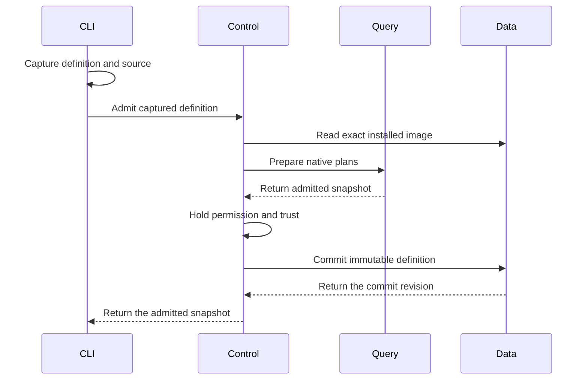

# Discovery Definition Review

This guide covers the Discovery definition file and its admission route. The
definition selects reusable code and inputs. Admission starts no Discovery.

## Intended end state

A definition contains metadata and one SQL, PRQL, or package-call program.
Every program uses the native DataFusion pipeline. A separate running
instance owns permission, progress, saved state, and subscription lifetime.

## Review flow

```text
An operator admits a definition file
  -> the CLI captures the definition and referenced source files
  -> Control checks the current tenant and manager permission
  -> Query admits SQL, compiled PRQL, or an exact package call
  -> Control holds permission and image trust through the final write
  -> Data retains one immutable definition revision
  -> no Discovery starts

Admission fails or permission expires
  -> the request returns a typed error
  -> Data commits no new definition
  -> a retry checks current permission again
```

[DefinitionArgs](../../crates/araphor-cli/src/cli/araphor/packages.rs)
accepts `araphor definition admit FILE` and
`araphor definition inspect NAME --revision REVISION`.

-> [Definition::read](../../crates/araphor-discovery-definition/src/definition.rs)
reads the JSON definition and resolves relative source files from its
directory. The owner replaces each file reference with captured UTF-8 text.
No owner watches or polls the files.

-> [ClientGrpcOwner::definition_request](../../crates/mithril-control/src/client_grpc/packages.rs)
accepts captured definitions only. The server does not open client paths.
Admission requires current manager permission. Inspection requires current
tenant read permission. File metadata grants no permission.

-> [Engine::prepare_definition](../../crates/araphor-query/src/definition.rs)
uses native SQL parsing, logical planning, and optimization. SQL and generated
PRQL SQL also pass native physical planning. Admission executes no data query.

-> [PackagePlanner](../../crates/araphor-query/src/definition/package.rs)
binds exact installed image content, the export, input plans, typed
parameters, output selection, and declared dependency contracts. A call with
several output relations requires an explicit output name. SQL package
output, checkpoint, evidence, and reason queries retain their schema checks.

-> [PackageCall](../../crates/araphor-query/src/definition/call.rs)
uses the native relation-planning extension. Its logical children are the
actual admitted input plans. Its schema is the selected SDK output schema.
Partial: the node has no physical executor. Native physical planning returns
an explicit unsupported error for a package-call execution attempt.

-> [ClientAuth::commit_definition](../../crates/mithril-control/src/client_auth/packages.rs)
holds the current permission lock through the Data write. This owner checks
permission even when a SQL or PRQL definition has no image pins. A package
call also requires current trust in its exact image digest.

-> [AnalysisStore::admit_definition](../../crates/araphor-data/src/analysis/definitions.rs)
checks exact retained image references and saves captured text, generated
SQL, metadata, and pins. The SHA-256 content revision includes every saved
field. An exact retry returns the original commit revision. Changed content
creates another immutable revision. A retry of an older revision does not
change the latest selection.

-> [AnalysisStore::validate_definitions](../../crates/araphor-data/src/analysis/definitions.rs)
checks saved identities, content digests, store revisions, and exact image
pins during store open. Inspection checks content and image pins again.

Not implemented: starting, inspecting, or stopping a managed instance.
Not implemented: physical package-call execution, instance saved state,
progress, and restart recovery. Definition recovery restores definitions only.



SQL and PRQL require no image lookup. Data commits no activation or result.

## File schema

The file uses JSON. Unknown fields, duplicate program forms, and combined
inline/file source objects are invalid. No definition-specific size quota is
added. The existing optional Query and Data limits still apply.

```json
{
  "name": "event-counts",
  "description": "Count retained events.",
  "labels": {"team": "security"},
  "program": {
    "kind": "sql",
    "source": {"file": "queries/counts.sql"}
  }
}
```

Replace `source` with `{"inline":"SELECT count(*) FROM events"}` for inline
SQL. Use `kind: "prql"` with the same source forms for PRQL. The
[compiler](../../crates/araphor-discovery-definition/src/compile.rs) uses
`prqlc` 0.13.13 with the Generic SQL target. DataFusion admits the generated
SQL. This route does not promise every PRQL expression is compatible.

```json
{
  "name": "selected-detector",
  "program": {
    "kind": "package",
    "call": {
      "image": {"package_id": "example.detectors", "revision": "1"},
      "export": "detect",
      "output": "findings",
      "inputs": {"events": "SELECT source_cursor AS value FROM events"},
      "parameters": {},
      "window": "received_at >= now() - INTERVAL '60 seconds'"
    }
  }
}
```

Each input binding is native SQL. The optional window is a native SQL
predicate. Query binds the predicate to the input. A native source-time
predicate can precede the final input projection. This position keeps the
source timestamp available when the SDK input does not contain that column.
Query does not move the predicate through aggregation or a limit. Put such
source filters in the binding SQL. Query validates clock-dependent predicates
against its existing window rules. The definition adds no scheduling language
or timer.
The example package must already be installed with that exact revision and
must declare compatible inputs, parameters, and output.

## Ownership and verification

The definition crate owns portable file and snapshot types. Data owns durable
storage. Query owns planning. Control owns current permission and transport.
CLI owns command parsing and output. No new owner depends on
`araphor-analysis_back`. The old package route remains available separately.

Read the [definition tests](../../crates/araphor-discovery-definition/src/tests.rs),
[Query tests](../../crates/araphor-query/src/definition/tests.rs),
[Data tests](../../crates/araphor-data/src/analysis/definitions/tests.rs),
[authority tests](../../crates/mithril-control/src/client_auth/packages/tests.rs),
and [RPC tests](../../crates/mithril-control/src/client_grpc/tests/packages.rs).
The tests cover source capture, strict forms, native planning, typed calls,
permission revocation, exact pins, immutable retries, and definition recovery.
The [TLS case](../../crates/mithril-e2e/src/discovery/packages/definitions.rs)
uses the real client to admit and inspect all three forms. The case also
checks the locked SQL dependency and unchanged activation state.

[Dataset::normalize_batch](../../crates/araphor-analysis-sdk/src/batch.rs)
retains the explicit Arrow row count when a valid SDK input has no columns.
The [SDK batch tests](../../crates/araphor-analysis-sdk/src/batch/tests.rs)
check empty and nonempty zero-column batches. The Query case checks native
zero-column input, output, and saved-state planning and a three-row scan.
[Session::indexed_schema](../../crates/araphor-query/src/execution/tables.rs)
accepts the same empty schema and retains metadata. The
[index tests](../../crates/araphor-query/src/execution/tables/tests.rs) check
continuous row indices across empty and nonempty zero-column batches.
The changes retain the existing column and schema checks.

This guide covers the working tree after `a03e5daa`. The following 73 distinct
focused tests passed:

| Owner | Passed cases |
| --- | --- |
| Definition format and PRQL | 10 |
| Query definitions, indexing, and inputs | 38 |
| Data definitions and request encoding | 9 |
| Control permission and RPC admission | 5 |
| CLI admission, inspection, and output | 3 |
| SDK batch normalization | 7 |
| TLS client admission and inspection | 1 |

Formatting and affected-crate Clippy with warnings denied passed. The
verification record is `/tmp/araphor-definition-verification1.json`.
Complete package execution and running-instance acceptance remain open.
Full workspace CI, benchmarks, and physical Kubernetes checks did not run.
