# Discovery Definition Review

Current immutable image ownership is in [One immutable package content owner](#one-immutable-package-content-owner).

Current retained aggregate execution is in [Native integral aggregation](#native-integral-aggregation).

Current package provenance is in [One package provenance contract](#one-package-provenance-contract).

Current Data execution ownership is in [One Data execution owner](#one-data-execution-owner).

Current capture boundary proof is in [Native capture boundary proof](#native-capture-boundary-proof).

Current native lifecycle proof is in [Native lifecycle proof transfer](#native-lifecycle-proof-transfer).

Current subscription source ownership is in [One native subscription source](#one-native-subscription-source).

Current saved-input ownership is in [Native saved-input retirement](#native-saved-input-retirement).

Current Query input ownership is in [Query input runner retirement](#query-input-runner-retirement).
Earlier InputSet and InputOperation routes retain their recorded source state.

This guide covers Discovery definition admission, native OCI execution, and
the shared Instance owner. The definition selects reusable code and inputs.
Admission starts no Discovery. Focused finite and live checks pass. The final
Rust gate and complete migration remain **Not done**.

## Intended end state

A YAML definition contains metadata and one SQL or PRQL program. Package calls
are relations in that program. Source code can be inline or in a file captured
once at admission. Every program uses the native DataFusion pipeline. A separate
running instance owns permission,
progress, saved state, and subscription lifetime.

## Review flow

```text
An operator admits a definition file
  -> the file owner captures the SQL or PRQL source once
  -> the CLI sends metadata and captured SQL or PRQL
  -> Control checks the current tenant and manager permission
  -> Query admits SQL or compiled PRQL and resolves package calls in that SQL
  -> Control holds permission and image trust through the final write
  -> Data retains one immutable definition revision
  -> no Discovery starts

Admission fails or permission expires
  -> the request returns a typed error
  -> Data commits no new definition
  -> a retry checks current permission again
```

[DefinitionArgs](../../crates/araphor-cli/src/cli/araphor/packages.rs)
accepts `araphor definition admit FILE` and
`araphor definition inspect NAME --revision REVISION`.

-> [Definition::read](../../crates/araphor-discovery-definition/src/definition.rs)
delegates YAML parsing to
[YamlDefinition::read](../../crates/araphor-discovery-definition/src/file.rs).
The file owner checks metadata and the single program selection. It resolves
relative paths from the YAML directory and captures UTF-8 source text once.
The native YAML parser rejects duplicate keys and unknown fields. No owner
watches or polls the files.

-> [Call::sql](../../crates/araphor-discovery-definition/src/file.rs)
converts the structured call to native SQL. The existing SQL parser checks
each input query. Native syntax-tree values quote names and literal
parameters. This owner does not evaluate parameter strings as SQL. The
result uses the existing `Program::Sql` type. SQL and PRQL text use the
existing source types. The JSON request and saved snapshot formats do not
change.

-> [ClientGrpcOwner::definition_request](../../crates/mithril-control/src/client_grpc/packages.rs)
accepts captured definitions only. The server does not open client paths.
Admission requires current manager permission. Inspection requires current
tenant read permission. File metadata grants no permission.

-> [Engine::prepare_definition](../../crates/araphor-query/src/definition.rs)
uses native SQL parsing, logical planning, and optimization. SQL and generated
PRQL SQL use the same route. Query loads each exact installed image referenced
by a package function. Admission executes no input query or package.

-> [Packages](../../crates/araphor-query/src/definition/package.rs)
extends native relation planning for installed package functions. Native
subquery arguments supply input plans. Native scalar expressions supply
parameters. Exact image content supplies the declared interface and locked
dependencies. A call with several output relations requires an output name
as its first string argument. SQL package output, checkpoint, evidence, and
reason queries retain their schema checks. Native analysis and optimization
check every SQL body plan, including plans that contain other package calls.

Package calls use DataFusion's `RelationPlanner` extension. They are not
registered scalar user-defined functions (UDFs) or `TableFunctionImpl`
functions. The native table-function interface accepts scalar expressions.
A package input accepts a complete relation. The relation planner gives
DataFusion each input subquery in its caller scope. DataFusion plans scalar
parameters through its existing expression planner.

The relation hook returns ordinary table references to DataFusion unchanged.
[SourceProvider](../../crates/araphor-query/src/sources/mod.rs) implements
native `TableProvider` for Araphor tables. Package input and output relations
use native `ViewTable`. The table scope returns those providers through
`provider_as_source`; the relation hook does not implement table scans.

One admission shares one native catalog and source-provider map. The package
planner parses each default input query once. Native `transform_up_with_subqueries` binds each
declared dependency to its resolved plan. Native `recompute_schema` updates
the parent schemas in that same traversal. Native `ViewTable` and
`LogicalPlanBuilder::scan` preserve the input name and projection. Binding
occurs before optimization; an unexpected scan filter or fetch is an error.
`DataFrame::with_column` adds the zero-based index with native `row_number`.
This operation generates no SQL. Existing configured Query quotas still
apply to indexed and bound plans. Every surviving package body is a child of
its native PackageCall. The root optimizer and physical planner check these
children. No separate registry repeats those passes. Native SQL can discard
an unused common table expression. Its admitted image pin and source capture
remain part of the definition contract.

The native SQL body planner needs a separate table scope for each call.
[Scope](../../crates/araphor-query/src/definition/package/scope.rs) supplies
the actual input, parameter, output, and prior-state tables through
DataFusion's `ContextProvider`. It delegates function, type, configuration,
and other metadata to the native provider. A package body cannot inherit
undeclared tables from its caller. Caller subqueries and common table
expressions are planned by DataFusion before this body scope is used.
DataFusion's native session context provider is private. This adapter supplies
the required package table scope to the native SQL planner.

-> [PackageCall](../../crates/araphor-query/src/definition/call.rs)
retains the exact image, export, selected output, and SDK descriptor. Its
logical children are the actual input plans, native parameter plan, and SQL
output, checkpoint, evidence, and reason plans when the export uses SQL.
Its schema is the selected SDK output schema.
The identity key includes the root image digest, selected export, and local
call ID. An admission token prevents native optimization or the result cache
from combining separate admissions. The token does not enter the stable plan
hash. Cursor bindings thus remain stable after the same definition is admitted
again. Separate call sites keep separate state after optimization.
The node preserves the package execution contract for typed output, saved
state, and evidence. A scalar UDF does not supply that contract.
[PackageExec](../../crates/araphor-query/src/definition/physical.rs) implements
the native physical extension. Read the finite execution route below.

The former Discovery function resolver and its crate are removed. Native
[SQL view declarations](../../crates/araphor-analysis-builtins/src/discovery/sql.rs)
define the derived relations. Query registers native `ViewTable` providers
through [Engine::register_views](../../crates/araphor-query/src/execution.rs).
The SQL query uses `FROM discovery.observed_effects` without call arguments.
The Query planner contains no Discovery-name dispatch. Package calls still
use the generic relation planner described above.

[Discovery image assembly](../../crates/araphor-analysis/src/package/builtin.rs)
retains the complete live SQL program in the existing package format. Native
SQL CTE scopes bind its input relations. Image assembly adds no executor,
subscription, or source reader.

[Package::subscribe](../../crates/araphor-analysis/src/package.rs) uses
[Program::call](../../crates/araphor-discovery-definition/src/file.rs) to
construct the same native call as the YAML form. Package retains one admitted
definition and root call in a Tokio OnceCell. Source subscriptions reuse that
admission. Query plans the declared input relations and executes each update
through PackageExec. Analysis does not extract SQL bodies or interpret input
schemas. The installed image revision and digest must match the retained
package. Package construction no longer installs an image.
The cached call creates no durable definition or Data revision. Explicit
definition admission remains a separate operation.

[DiscoveryOwner::derive](../../crates/araphor-analysis/src/discovery/mod.rs)
admits a lazy source subscription before it registers the processor. Data
registration preserves an existing required processor and rejects retirement.
The subscription receives its first poll after registration. Package execution
does not need an initial evaluation only to register the processor.

[DiscoveryOwner::publish](../../crates/araphor-analysis/src/discovery/mod.rs)
checks the actual root return against that admission before publication.
Complete typed returns remain in Update.calls. This profile publisher cannot
commit package checkpoints, reasons, or evidence. Admission rejects reachable
checkpoint contracts; publication rejects auxiliary returns even when the
selected query rows do not change. The finite Instance owner below supplies
a separate atomic state and auxiliary publication path. The profile publisher
does not use that path. Authority changes drop
the private producer and join its workers before the subscription returns
Denied. Discovery stop and source removal call `Subscription::cancel_and_join`.
Ordinary Drop cancels the operation; Drop cannot wait for async cleanup.

-> [ClientAuth::commit_definition](../../crates/mithril-control/src/client_auth/packages.rs)
holds the current permission lock through the Data write. This owner checks
permission even when a SQL or PRQL definition has no image pins. A package
call also requires current trust in its exact image digest.

-> [AnalysisStore::admit_definition](../../crates/araphor-data/src/analysis/definitions.rs)
checks exact retained image references and saves captured text, generated
SQL, metadata, and pins. The SHA-256 content revision includes every saved
field. An exact retry returns the original commit revision. Changed content
creates another immutable revision. A retry of an older revision does not
change the latest selection.

-> [AnalysisStore::validate_definitions](../../crates/araphor-data/src/analysis/definitions.rs)
checks saved identities, content digests, store revisions, and exact image
pins during store open. Inspection checks content and image pins again.

Definition recovery restores immutable definitions. Caller-owned finite
execution returns proposed state without a write. The shared Instance owner
connects saved state, progress, and recovery checks. Read the
[shared lifecycle route](#shared-lifecycle-and-retained-output-qualification)
for managed start, inspection, stop, and retained running-instance restoration.
Complete source recovery remains open.

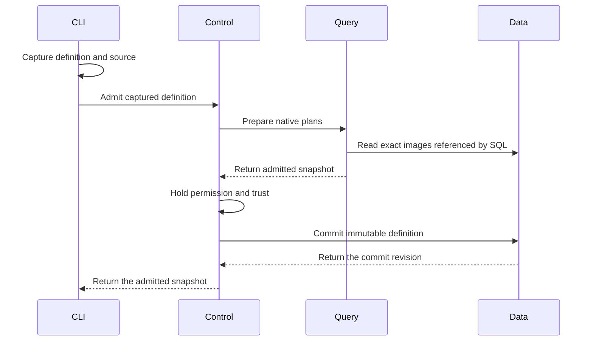

Queries with no package calls require no image lookup. Data commits no
activation or result.

## Finite execution

[Session::execute_definition](../../crates/araphor-query/src/definition.rs) accepts an admitted definition and caller invocation state
  -> [Session::capture_definition](../../crates/araphor-query/src/definition.rs) checks admitted call children before optimization or source capture
  -> [Session::capture_plan](../../crates/araphor-query/src/execution.rs) uses fixed execution time for native optimization and physical planning
  -> [SubscriptionPlanner](../../crates/araphor-query/src/planner/subscription.rs) uses the native physical planner extension for PackageCall
  -> [Session::capture_physical](../../crates/araphor-query/src/execution.rs) captures declared sources once and retains the physical plan, permit, and source view
  -> [CapturedExecution::execute](../../crates/araphor-query/src/definition.rs) starts that captured physical plan once
  -> [PackageExec](../../crates/araphor-query/src/definition/physical.rs) collects complete Arrow inputs and parameters under one operation permit
  -> [SQL execution](../../crates/araphor-query/src/definition/physical/sql.rs) uses native physical children, or [Runtime::evaluate_reserved](../../crates/araphor-package-runtime/src/lib.rs) invokes the selected guest backend
  -> [CheckedEvaluation](../../crates/araphor-analysis-sdk/src/validation.rs) validates all outputs, proposed state, reasons, and evidence
  -> [DefinitionOutput](../../crates/araphor-query/src/definition.rs) returns selected query batches, the captured receipt, and complete call results

[Session::execute_definition](../../crates/araphor-query/src/definition.rs) receives an error or cancellation
  -> [AnalysisReadControl::operation](../../crates/araphor-data/src/analysis/read.rs) stops the separate invocation control
  -> [CallContext::finish](../../crates/araphor-query/src/definition/physical.rs) closes call registration and waits for the native task tracker
  -> Data receives no automatic result, state, or progress write

The finite caller creates the invocation identity, seed, and
prior checkpoint map. An invocation has separate cancellation state. Query
forwards parent cancellation and waits for active work. An ordinary invocation
error does not cancel the parent Session. The map uses admitted call identities.
Unknown checkpoint identities and state for a stateless export are rejected
before source capture. A call identity is not a durable instance identity. Admission retains unoptimized plans so
execution clocks are not folded at admission. Native optimization and physical
planning use the fixed session time during execution.

[Engine::new](../../crates/araphor-query/src/execution.rs) disables native
leaf-expression pushdown for DataFusion 53.1. That rule can leave a stale
join schema and make projection optimization fail. The
[upstream issue](https://github.com/apache/datafusion/issues/22895) records
the native configuration workaround. The other native optimizer rules remain
active. The struct-join regression checks selected rows, checkpoint, evidence,
and reason details. Enable this option only after an engine upgrade passes
that regression and the Discovery integration tests.

Cold Wasm preparation occurs in the native physical extension planner. It
uses the parent request control before the evaluation timeout starts. The
physical node retains an opaque prepared-code pin for the exact Runtime,
image object, package, and export. Execution cannot substitute code from
another runtime or image. Definition admission performs structural validation
without compilation. Ordinary SQL retains its existing planning timeout.

The preparation worker holds the existing evaluation permit and call tracker
token. Explicit cancellation waits for that worker. Dropping an execution
future cancels its control; the worker retains its permit until it exits.
An active synchronous Wasmtime compilation cannot be interrupted. This
boundary does not provide a compiler process memory quota.

[Subscription](../../crates/araphor-query/src/follow/mod.rs) owns a shared
Tokio task tracker. Session carries its handle through each native execution.
Native logical optimization runs in the existing tracked blocking worker.
Query then calls the native QueryPlanner for asynchronous physical planning.
This is the same order as SessionState::create_physical_plan. Cancellation
joins the optimizer worker and cold preparation. Physical planning does not
hold a blocking worker while it waits for a compiler worker. No second planner
or runtime is added.
The guest exchange, cold preparation, and source-read closures retain parent
tokens until their actual workers exit. Per-call trackers still join each
finite evaluation. Blocking workers transfer their result through a native
oneshot channel before they release their lease. If the receiver is dropped,
the worker drops the result before it releases the token. Completed returns
and captured snapshots contain no parent
token. A caller can retain a delivered Update while subscription shutdown
completes.

PackageCall retains one shared copy of its admitted native children after
DataFusion binds parameters and reconstructs schemas. Public
stream and subscription entries reject changed input or SQL body plans before
optimization. Native TableScan equality excludes its provider. The admission
check also compares the original provider identities. This check includes
native view bodies. Internal optimized plans
are not compared with the original children. DataFusion can change aliases and
share equivalent expressions. The check prevents a caller from changing image
code or inputs while retaining a cached admitted call identity.

PackageExec owns the complete typed evaluation and result. It executes once
for one admitted call, across all input batches and physical partitions.
Readers share that result. Separate call sites retain separate state. The
cache holds weak handles to running work and strong handles to complete
results. Dropping a reader does not create a cache cycle. Cancellation does
not retry an abandoned call.

[Inputs](../../crates/araphor-query/src/inputs/mod.rs) retains the admitted
source scopes before optimization. Empty relations and unused common table
expressions retain their source revision contract. Native source providers
supply Arrow buffers from the captured view. SQL output and prior-state
relations bind temporary port slots in that same view. Package SQL opens no
second live read and uses no synchronous Query bridge.

[AnalysisStore::dependency_revision_for](../../crates/araphor-data/src/analysis/dependencies.rs)
accepts the admitted table requests. Data resolves its projected tables to
storage relations. Query passes those requests through the existing revision
read. Query does not select Discovery storage dependencies.

[Memory](../../crates/araphor-query/src/memory.rs) retains input, output,
checkpoint, and reason buffers through their actual Arrow lifetimes. A
retained result keeps its metadata reservations. Plans with PackageExec do
not prepay a second public output budget before the complete call result is
retained. Actual configured capacity checks remain active.

The runtime crate owns executable loading and invocation. It has no Query or
Analysis dependency. Compatible backend code came from the
[earlier execution owner](https://github.com/Ereborlabs/erebor-runtime/blob/6a25ba1b34dbaa0a553b1883058938683ce7aaab/crates/araphor-analysis_back/src/package/execution.rs).
The backup crate is restored as reference until compatible migration is complete.
Runtime retains its own backend code.
[NativeLibrary](../../crates/araphor-package-runtime/src/native/loading.rs)
keeps file and code pins through invocation, output copy, and producer release.
Native calls run inside the process. Native cancellation remains cooperative;
a native guest that ignores cancellation can delay completion.

[WasmExecution](../../crates/araphor-package-runtime/src/wasm.rs) creates its
engine on demand. The new runtime compiles with native Wasmtime inside the
process. Production execution has no compiler child.
[EpochWatch](../../crates/araphor-package-runtime/src/wasm/execution.rs)
waits for cancellation, deadline, or completion events. It has no periodic
ticker. The runtime uses the existing TaskTracker for worker teardown.
Runtime quotas default to disabled. An explicit compiler address-space quota
returns Unsupported because compilation runs inside the process. Active
compilation must finish before cancellation can join its worker. Explicit
cancellation through execute_definition joins active work. Dropping the whole
async future cannot wait for cleanup in Drop; worker tokens retain code and
operation resources through teardown.

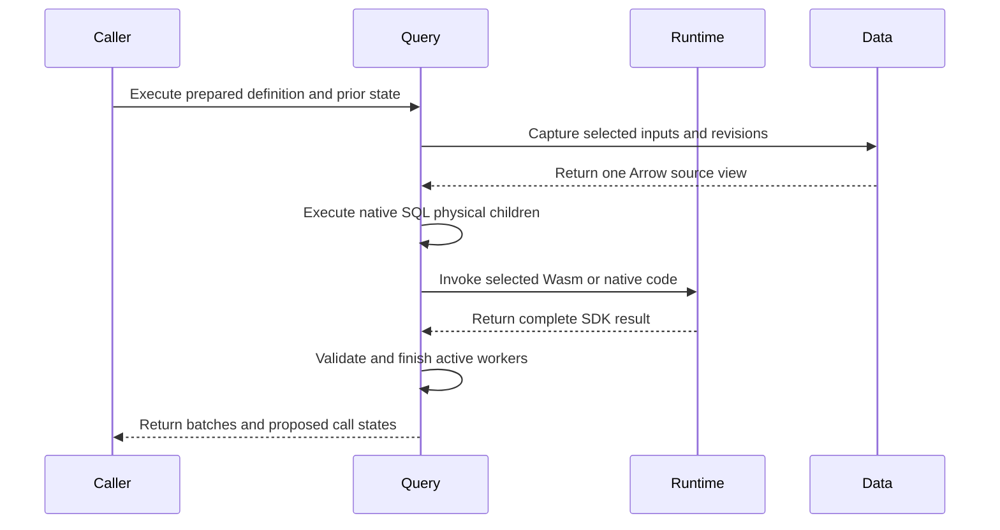

This API does not authorize a durable commit. The caller retains responsibility
for current authority and domain checks. The Instance owner adds the authority
and Data transaction route. The shared Host owns managed lifecycle operations.
Complete producer recovery remains in TODO 16. Package-issued internal SQL requires
a future SDK capability; the current guest ABI supplies no database handle.

Qualification is in progress for the current worktree. The physical execution
cases are in [definition tests](../../crates/araphor-query/src/definition/tests/execution.rs).
Entered-guest cancellation, worker drop, and capacity cases are in
[runtime tests](../../crates/araphor-package-runtime/src/wasm/tests/runtime.rs).

During recovery, backup removal was withdrawn. All 208 backup files and 34
deleted Control and E2E reference files were restored. Compatible migration requires a complete
source and test map before deletion. The finite call path does not establish
graph publication, Discovery replay, durable commit, or permission-supervision
parity. At that point, no deletion commit or push was made. That workspace
build stopped when the host disk filled; it did not pass.

The earlier finite retirement removed 29 duplicate reference leaves. Its final
Rust gate passes in `migration-final-ci42` at commit `95e9bb4d`. That record does
not qualify the later managed source. The additional finite retirement removes
exactly four mapped leaves: Graph contract source and tests, model input, and
model operation. Eight more Wasm leaves and 15 finite Graph, SQL, Discovery,
test, and asset leaves are retired. Eight more executor, component, atom,
pager, and pure test leaves are removed after 50 focused replacement checks
pass. Fifteen more retained-query, authority, Wasm, and finite notification
test leaves are removed after 89 focused checks pass. Two more complete
image/fixture leaves retire after exact replacement checks pass. The remaining
127 files keep their baseline content.
The recovery archive retains all 208 recovered files. Read the
[retirement records](../plans/araphor-analysis-migration.md#retired-finite-reference-files)
and the [four-file record](../../recovery/araphor-analysis-managed-retirement-20261019.json)
and [Wasm record](../../recovery/araphor-analysis-wasm-retirement-20261020.json),
[Graph record](../../recovery/araphor-analysis-graph-retirement-20261020.json),
the [output record](../../recovery/araphor-analysis-output-retirement-20261020.json),
the [native helper record](../../recovery/araphor-analysis-native-retirement-20261020.json),
the [retained-result record](../../recovery/araphor-analysis-retained-retirement-20261020.json),
and [image/fixture record](../../recovery/araphor-analysis-image-fixture-retirement-20261020.json)
for the exact scope. The current final Rust gate and complete migration remain
**Not done**.

## Finite Graph reads and output validation

[Data Graph reads](../../crates/araphor-data/src/analysis/graph/findings.rs)
check the tenant, supplied identifiers, positive page size, and typed revision
before they acquire a reader. Data owns the read snapshot and native current
or historical result selection. Pagination retains the caller's row and byte
bounds. A Graph reader facade and a second worker mutex are unnecessary.

[Graph::apply](../../crates/araphor-analysis/src/graph/mod.rs) consumes a sealed
native call result. Query and Package Runtime validate the complete SDK return
before they construct that result. Graph then checks the exact admission,
image, export, tenant, and canonical inputs. Its
[output validator](../../crates/araphor-analysis/src/graph/output.rs) checks
selected records, facts, subjects, evidence, reasons, and checkpoint rows.
[Graph::finish](../../crates/araphor-analysis/src/graph/finish.rs) assembles the
snapshot and calls the existing Data snapshot validator.

These finite owners do not implement Graph production, historical replay,
expiry scheduling, or restart recovery. Those reference files must remain.
Data's snapshot validator still has collection limits. This replacement does
not prove that all Graph quotas are disabled. The 31 Analysis Graph tests,
27 Data Graph tests, and 21 notification caller tests pass. Their exact
retirement scope is in the records above. Final Rust qualification is
**Not done**.

## Graph publication guards

[AnalysisStore::commit_graph_snapshot](../../crates/araphor-data/src/analysis/progress.rs)
consumes the existing canonical graph pair and a final caller check.
  -> The existing transaction checks manifest, scope, witnesses, and progress.
  -> A fresh result compares its exact prior window head in that transaction.
  -> Row insertion and the existing commit hook complete before the final check.
  -> Data commits only when the final check succeeds.

An exact immutable retry returns its original receipt and still requires the
final check. It does not compare a historical result against a newer window
head. [mark_graph_notice](../../crates/araphor-data/src/analysis/progress/notices.rs)
uses its existing supersession check, commit hook, and final authority check.
The generic result entry rejects Graph writes. There is no new transaction,
reader, schema table, or execution owner.

The [guard tests](../../crates/araphor-data/src/analysis/graph_rows/tests/guards.rs)
check actual rollback, exact retry, missing and stale heads, superseded notice,
and generic-entry rejection. All 39 connected Data cases pass. Notification
qualification covers 13 original passing cases and eight corrected replacement
fixtures. The fixture now supplies the actual prior result. All original
notification assertions remain. The
[migration record](../plans/araphor-analysis-migration.md#reactive-admission-and-guarded-graph-publication)
records exact commands and corrections. This does not qualify the complete
native Graph producer.

## Finite native helper replacement

[PackageExec](../../crates/araphor-query/src/definition/physical.rs) receives
captured native input relations.
  -> [Guest execution](../../crates/araphor-query/src/definition/physical/guest.rs) reserves retained inputs and encoding scratch before Runtime entry.
  -> [Native SQL execution](../../crates/araphor-query/src/definition/physical/sql.rs) keeps declared output, checkpoint, and reason order.
  -> [Query memory](../../crates/araphor-query/src/memory.rs) keeps retained arrays charged until the last alias is dropped.

[Recorded SQL](../../crates/araphor-analysis-builtins/src/discovery/sql/recorded_snapshot.sql)
receives the complete selected relations.
  -> [Native operators](../../crates/araphor-analysis-builtins/src/discovery/sql/recorded_snapshot.sql) aggregate all Arrow partitions without an Analysis pager.
  -> [DiscoveryOwner::recorded_result](../../crates/araphor-analysis/src/discovery/output.rs) checks the exact call and complete result.
  -> [Data validation](../../crates/araphor-data/src/discovery/validation/recorded.rs) checks source attribution, accounting, coverage, and lifecycle.

[Conversion preflight](../../crates/araphor-query/src/definition/tests/execution/contract/pressure.rs)
fails under configured output pressure.
  -> [The physical executor](../../crates/araphor-query/src/definition/physical.rs) returns the typed limit error before conversion.
  -> [The collection owner](../../crates/araphor-query/src/definition/physical.rs) drops the producer without a later poll.
  -> [The failure checks](../../crates/araphor-query/src/definition/tests/execution/contract/pressure.rs) prove unchanged Data and released reservations.

The [pressure cases](../../crates/araphor-query/src/definition/tests/execution/contract/pressure.rs)
also check nested encoding scratch, zero-row schema metadata, valid saved-state
exchange, and the actual Runtime SDK encoder failure. The
[record projection cases](../../crates/araphor-analysis/src/discovery/output/tests/native.rs)
check every typed event field, original bytes, source witnesses, stream
completion, and content-derived input revisions. The
[boundary cases](../../crates/araphor-analysis/src/discovery/output/tests/baseline.rs)
keep duplicate accounting and lifecycle references across the old 128-group
boundary. The [native SQL cases](../../crates/araphor-analysis/src/package/tests/sql/recorded.rs)
keep sparse declared counts, empty ranges, orphan rejection, and complete
partition results.

All 50 mapped focused checks pass before the eight reference leaves are
removed. The record pins the owner source and test binaries. No production
code is added for this removal. The long-running lifecycle and complete final
Rust gate remain **Not done**.

## Retained result inspection

[Instance::read_result](../../crates/araphor-analysis/src/instance/read.rs)
accepts a current reader grant and exact instance/result IDs.
  -> [Instance::inspect](../../crates/araphor-analysis/src/instance/read.rs) checks Inspect before the read and watches current authority events.
  -> [Instance::retained](../../crates/araphor-analysis/src/instance/read.rs) checks stored selection coverage for the reader tenant.
  -> [AnalysisStore::managed_result](../../crates/araphor-data/src/analysis/managed/read.rs) validates the retained call, receipt, descriptor, output, and exact instance binding.
  -> [Instance::inspect](../../crates/araphor-analysis/src/instance/read.rs) checks current reader authority and expiry before disclosure.

[Instance::query_result](../../crates/araphor-analysis/src/instance/read.rs)
accepts an exact result ID or no result ID under the same fresh Inspect guard.
  -> [AnalysisStore::managed_query_output](../../crates/araphor-data/src/analysis/managed/read.rs) resolves the current generation's successful selected receipt when no ID is supplied. It checks scope, instance, attempt, generation, and commit revision in one read transaction before Arrow decoding.
  -> [Session::query_local](../../crates/araphor-query/src/execution/local.rs) registers only the retained output datasets in a private native catalog.
  -> [Session indexing](../../crates/araphor-query/src/execution/tables.rs) adds original row indices before filtering across Arrow batches.
  -> [Planner](../../crates/araphor-query/src/planner/mod.rs) uses the existing native SQL parser and logical planner.
  -> [Session::stream_local](../../crates/araphor-query/src/execution.rs) uses the native optimizer, physical planner, execution permit, and output bounds.
  -> [LocalOutput](../../crates/araphor-query/src/execution/local.rs) retains the selected dataset and its metadata reservation.

The catalog contains no inherited view, external catalog, undeclared local
table, or durable source. Native admission rejects DDL, DML, multiple
statements, and unused undeclared CTEs. A retained SELECT executes no historical
package export and captures no current evidence source. Native SQL selects
rows. The native Session retains its configured shared resource bounds. Data
checks the retained descriptor schema. No second descriptor read or
current image execution trust check is required.

Current Inspect authority is independent of the original writer principal,
Run authority, and image execution trust. Authority loss cancels and drains the
child operation. The parent request control remains usable. Complete results,
state, reasons, evidence, and historical receipt revision survive newer writes.
The [historical tests](../../crates/araphor-analysis/src/instance/tests/history.rs)
check those rules. The [native local tests](../../crates/araphor-query/src/execution/tests/local.rs)
also check catalog exclusion, original indices, empty metadata, native interval
output, explicit limits, and last-alias memory release.

[Control package reads](../../crates/mithril-control/src/service/packages.rs)
and [CLI package reads](../../crates/araphor-cli/src/cli/araphor/packages.rs)
pass the optional result ID to these owners. `query INSTANCE SQL` selects the
current successful root. `query INSTANCE RESULT SQL` selects an exact retained
result. Rollback selects the new current receipt. Removal keeps history.
Recreation starts with no current result. A failed later step keeps the last
successful result. An invalid current receipt cannot select an older result.

All 35 mapped inspection cases pass on source321. The source322 compile,
format, and strict Clippy checks also pass. Two post-removal inspection cases
pass on unchanged active source. The
[retirement record](../../recovery/araphor-inspect-retirement-20261023.json)
retains exact selectors, source identities, binary hashes, and the verified
checkpoint. The complete old `package/inspect.rs` file is removed. Other mixed
reference files, complete lifecycle migration, and the final shared Rust
procedure remain **Not done**.

## Finite managed execution

[Instance::admit](../../crates/araphor-analysis/src/instance/mod.rs) accepts an
explicit Run grant, an instance ID, and an exact retained definition. It checks
permission even for SQL with no image calls. It checks every image digest and
trust decision, prepares the definition through Query, and saves immutable
instance metadata through
[AnalysisStore::admit_managed](../../crates/araphor-data/src/analysis/managed/read.rs).
It starts no subscription or guest.

Read these owners in order:

1. [Instance::manifest](../../crates/araphor-analysis/src/instance/manifest.rs)
   records each admitted call ID, image, package, export, target, artifact,
   native argument text, and dependency IDs. The manifest has a format and
   planner version. It stores no displayed or serialized logical plan.
2. [Instance::run](../../crates/araphor-analysis/src/instance/mod.rs) checks
   current generation and the exact attempt request before capture. It clones
   the admitted SELECT and uses native `LogicalPlanBuilder::insert_into` to
   add one private publication target.
3. [Session::capture_managed](../../crates/araphor-query/src/definition.rs)
   prepares one native physical plan and captures source rows and guarded
   prior state through the same Data read connection. It returns before
   execution. It rejects a different tenant, selection, definition, or supplied
   caller input or checkpoint state.
4. [CapturedExecution::blocking](../../crates/araphor-query/src/definition.rs)
   holds the captured permit and worker token while Data registers the attempt.
   [register_managed_attempt](../../crates/araphor-data/src/analysis/managed/commit.rs)
   fixes the source receipt, prior heads, logical time, seed, and rebuild flag
   before the native plan starts.
5. [PackageExec](../../crates/araphor-query/src/definition/physical.rs) selects
   captured prior state after it collects effective inputs and parameters.
   [ManagedPrior::checkpoint](../../crates/araphor-data/src/analysis/managed/model.rs)
   requires matching input revisions, coverage, parameter values and schema,
   checkpoint version, and named state dataset schemas. Rebuild or a mismatch
   resets state. Separate call sites retain separate state.
6. [Publication::write_all](../../crates/araphor-analysis/src/instance/sink.rs)
   retains selected Arrow batches and all complete call returns. It checks
   each return against the admitted call. Native optimization can remove a
   call; the sink publishes only calls that actually executed.
7. [AnalysisStore::commit_managed](../../crates/araphor-data/src/analysis/managed/commit.rs)
   checks the captured contract, current source and dependency revisions,
   witnesses, generation, and prior heads. One transaction publishes selected
   rows, actual call outputs, evidence, reasons, state, and progress. A failed
   step leaves those heads unchanged. Its pending attempt can remain retained.
8. [validate_managed](../../crates/araphor-data/src/analysis/managed/schema.rs)
   checks retained definitions, call pins, result packets, heads, and reference
   integrity during open. The storage API retains exact results and selected
   Arrow data; it does not supply a public authorized history command.

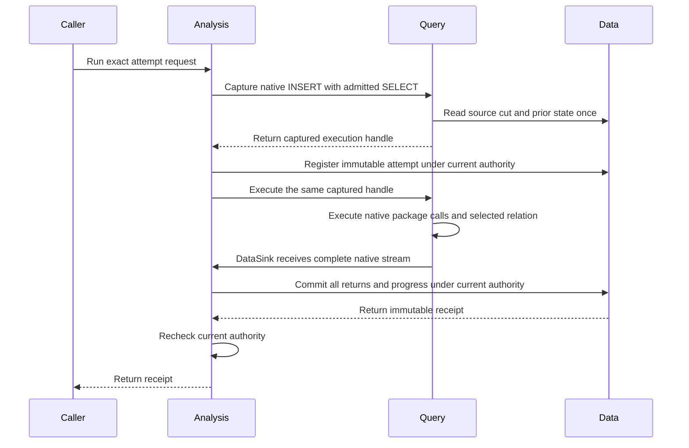

The publication target implements native `TableProvider::insert_into` and
`DataSink`; its scan is Unsupported. DataFusion's `DataSinkExec` invokes the
sink and emits the single UInt64 count result. Analysis `Publication::write_all`
drains the native stream, checks selected row and byte limits, and retains the
selected Arrow batches. Query checks the measured count array against its
output limits and reserves its buffer before execution, before the sink can
commit. This adds no parser, planner, or custom physical writer.
Ordinary source reads still use SourceProvider. Package relation arguments
still use the generic RelationPlanner described above.

Run observes authority changes before execution and applies the grant expiry
to its operation control. Cancellation signals that operation and waits for
the same captured work and workers. The final write holds `commit_many` for
the explicit grant and every exact image. Its final Data callback checks only
control; it opens no second reader while the writer is held. Current authority
is checked again before a receipt is returned. A denied acknowledgement leaves
a successful Data commit retained.

An exact completed retry returns its original receipt without another capture
or execution. A changed request conflicts. A pending retry returns Incomplete;
it cannot substitute a newer source cut after restart. Instance admission
retains immutable metadata, and each attempt retains its capture contract.
[Managed storage](../../crates/araphor-data/src/analysis/managed/schema.rs)
retains binary Arrow packets and result references. Removal, pin release, and
historical replay remain outside this finite API.

[Query limits](../../crates/araphor-query/src/execution.rs) use `input_bytes`
for the complete evaluation inputs, parameters, and prior state. The sink
checks `output_rows` and `output_bytes` against the complete selected relation.
`input_capacity`, `output_capacity`, and `execution_capacity` configure shared
pools. Evaluation and stream counts are optional global and tenant limits.
Bulk bounds default to the numeric maximum; optional limits default to None.
These defaults do not preallocate that maximum.

[SDK models](../../crates/araphor-analysis-sdk/src/model.rs) define schemas,
inputs, outputs, parameters, reasons, and saved state. Models and invocation
contexts contain no row, batch, byte, or checkpoint quota. Native SQL selects
rows. External time windows remain. Contract version identifiers stay
unchanged during development.
[Data extraction](../../crates/araphor-data/src/analysis/extraction.rs) and
[native storage limits](../../crates/araphor-data/src/analysis/capacity.rs)
retain their own configured bounds. `native_memory_bytes` and
`native_temp_bytes` are optional and disabled by default.

Query Memory retains captured prior buffers, package returns, and selected
Arrow buffers for their actual use. The writer retains those leases until it
exits. Data owns Arrow IPC serialization and transaction allocations; those
allocations are not all charged to Query Memory. Configured Query and SDK
limits are not a bound on all Rust heap allocation. The selected relation uses
native Arrow schemas, including Map, dictionary, and zero-column batches.
The remaining resource-boundary audit is **Not done**.

Focused finite qualification passes: 8 SQL contract cases, 11 Data managed
cases, 10 ordinary Instance cases, all 7 captured-execution cases, and both
Graph contract cases. Read the
[Instance tests](../../crates/araphor-analysis/src/instance/tests.rs),
[managed capture tests](../../crates/araphor-query/src/definition/tests/managed.rs),
and [Data transaction tests](../../crates/araphor-data/src/analysis/managed/tests.rs).
These tests check state reuse/reset, atomic failure, exact retry, authority
loss, configured pressure, crash, and recovery.

Separate source-built native runs pass 4 Query and 4 Analysis cases, including
the native Instance case. Their six artifacts have complete recorded source
provenance. Strict workspace Clippy passes after the test-only corrections.
The native57 provenance refresh passes in 31.395 seconds. All 116 recorded artifact inputs
are hashed, and its six artifacts match build54 byte for byte on
`x86_64-unknown-linux-gnu`. Exact records and run times are in the
[finite qualification table](../plans/araphor-analysis-migration.md#finite-managed-source-focused-qualification).

The required final Rust gate `migration-final-ci58` stopped during test compilation because the host disk was full. Formatting, workspace check, and strict Clippy passed. Gate59 passes these checks, 145 ordinary Analysis cases, and 333 ordinary Data cases. It stops at an OCI fixture that inherited changed SDK defaults. The corrected fixture supplies explicit limits and retains its golden digest. All 15 Package cases pass in `migration-oci-package60`. All eight source-built native Query and Analysis cases pass in the two native60 runs. The complete result is **Not done**. Long-running reactive supervision, per-port windows, public
start/inspect/stop, authorized history, CLI/Control managed operations,
historical replay, Data coordination polling, and remaining quota work stay
open. Native input scope still needs declaration-only local-port origins and
precise disjoint capture ranges. The old input executor remains until its
finite and live assertions have current owners. The complete migration remains
**Not done**.

This finite API creates no long-running job. Subscription supervision, window
completion, start/stop/resume/update/removal, current inspection, authorized
history, and CLI/Control managed operations remain **Not done**.
`Instance::admitted` returns immutable admission metadata; it is not a current
status or history API.

## Shared admitted image ownership

[Packages::new](https://github.com/Ereborlabs/erebor-runtime/blob/bd2c4bc776b851e6cf51feff6a7477044c2edaad/crates/araphor-query/src/definition/package.rs) sorts exact
image keys and rejects duplicates before native planning.
  -> [PackageBundleV1::allocated_bytes](https://github.com/Ereborlabs/erebor-runtime/blob/bd2c4bc776b851e6cf51feff6a7477044c2edaad/crates/araphor-package/src/memory.rs) measures defined image payload and buffer capacities after Data decode.
  -> [Packages::new](https://github.com/Ereborlabs/erebor-runtime/blob/bd2c4bc776b851e6cf51feff6a7477044c2edaad/crates/araphor-query/src/definition/package.rs) reserves shared input capacity before image validation, digest construction, and planning.
  -> [PackageCall](../../crates/araphor-query/src/definition/call.rs) borrows the descriptor from its immutable image and shares the image reservation.
  -> [PreparedDefinition::images](../../crates/araphor-query/src/definition.rs) exposes borrowed image references for Instance authority and manifest checks.
  -> [PackageExec::new](../../crates/araphor-query/src/definition/physical.rs) retains the image charge through cold preparation and result delivery.
  -> [Exchange](../../crates/araphor-query/src/definition/physical/guest.rs) retains the image charge until the entered guest exits.

Instance removes its extra Data image load and decoded image set. Data still
validates stored image pins in its final managed transaction. This ownership
change does not account for pre-decode allocation, every native planner
allocation, or opaque allocator overhead. The retained metadata owner below
supplies spec and manifest accounting. That image delivery retires no
additional reference file.

The [capacity tests](../../crates/araphor-query/src/definition/tests/capacity.rs)
check shared ownership, exact image identity, failed cold preparation, no
guest entry after rejection, and full release after joined cancellation.
The [Instance tests](../../crates/araphor-analysis/src/instance/tests.rs)
check shared image identity and trust before preparation. All 35 Instance
cases and four source-built native Query cases pass. The two corrected Query
fixtures pass without changes to production budgets. The
[migration result](../plans/araphor-analysis-migration.md#shared-admitted-images-and-error-origins)
records exact commands and source counts.

## Retained metadata and current status

[DefinitionAdmission](../../crates/araphor-query/src/definition.rs) owns resolved
metadata, source requests, image handles, and their native reservation.
  -> [PreparedDefinition::resolved](../../crates/araphor-query/src/definition.rs) exposes borrowed metadata. Definition clones share the same owner.
  -> [Instance::manifest](../../crates/araphor-analysis/src/instance/manifest.rs) retains native extension Arc values instead of deep package-call copies.
  -> [Instance::admit](../../crates/araphor-analysis/src/instance/mod.rs) charges the exact moved spec and manifest before Data admission.

The reservations outlive their retained buffers. This scope covers defined
metadata capacity. It does not claim the complete native planner or allocator
heap. Host projected keys and the managed source-request copy remain open.

[Instance::read_status](../../crates/araphor-analysis/src/instance/read.rs)
accepts a fresh Inspect grant and an instance key.
  -> [Instance::inspect](../../crates/araphor-analysis/src/instance/read.rs) checks reader scope, authority, and expiry around the joined read.
  -> [AnalysisStore::managed_status](../../crates/araphor-data/src/analysis/managed/status.rs) reads current metadata and rejects unknown pending work.
  -> [Failure](../../crates/araphor-data/src/analysis/managed/status.rs) binds the current failure code to observed successful progress and its durable revision.

Idle suspension and eligible attempt failure write that fact in their existing
transactions. A late old lifecycle cannot replace the current fact. Stop and
start preserve it. New successful progress makes it inactive. Status reads no
image or Arrow payload and requires no current writer Run permission.

[Instance::execute](../../crates/araphor-analysis/src/instance/mod.rs) waits for
captured execution to join before it records a known prepublication failure.
  -> [Step](../../crates/araphor-analysis/src/instance/sink.rs) records actual publication entry before final authority and commit.
  -> [AnalysisStore::finish_managed](../../crates/araphor-data/src/analysis/managed/terminal.rs) records the original known failed attempt with its exact fences.

Busy, cancellation, and uncertain publication stay pending. A successful Data
commit with a lost acknowledgement retains its receipt. The
[finite tests](../../crates/araphor-analysis/src/instance/tests/finite.rs)
exercise real traps, native SQL failure, writer failure, and shared pressure.
The [status tests](../../crates/araphor-data/src/analysis/managed/tests/status.rs)
cover rollback, stale lifecycles, successful progress, reopen, backup, and
corrupt metadata. The
[qualification record](../plans/araphor-analysis-migration.md#retained-metadata-and-durable-failure-status)
states the exact checks, corrected fixtures, and remaining boundaries.

## Native package input capture

[Packages::inputs](../../crates/araphor-query/src/definition/package.rs) binds each declared input or explicit relation argument.
  -> [SourceDemand](../../crates/araphor-query/src/planner/mod.rs) retains admitted source origins before native optimization removes unused scans.
  -> [Inputs::bind_ports](../../crates/araphor-query/src/inputs/mod.rs) resolves caller ports inside nested admitted calls without changing the optimizer's admission guards.
  -> [SourceScan](../../crates/araphor-query/src/sources/mod.rs) visits the native physical tree once to collect columns and per-input time envelopes.
  -> [SourceSnapshot::read](../../crates/araphor-query/src/sources/rows.rs) captures the exact union of independent input windows and retains the original source receipts.

[PackageExec::sql](../../crates/araphor-query/src/definition/physical/sql.rs) binds a parent SDK input to its private native port.
  -> [SourceSnapshot::bind_port](../../crates/araphor-query/src/sources/rows.rs) charges defined metadata before cloning it beside the existing Arrow rows.
  -> [Inputs::input_for](../../crates/araphor-query/src/inputs/receipt.rs) borrows that port metadata and the same captured receipt.
  -> [Inputs::input](../../crates/araphor-query/src/inputs/receipt.rs) combines inherited revisions and coverage through the existing input identity algorithm.

Private port identities distinguish nested model inputs and SQL body bindings.
These identities are not persisted or included in the stable native plan hash.
Nested bodies receive parent rows through explicit relation arguments. The
isolated default-input scope stays unchanged. No second source read, executor,
clock, or codec is added. The metadata charge excludes opaque allocator headers.

The [native contract tests](../../crates/araphor-query/src/definition/tests/execution/contract.rs),
[nested origin tests](../../crates/araphor-query/src/definition/tests/execution/contract/origins.rs),
and [body-port tests](../../crates/araphor-query/src/definition/tests/execution/contract/body_ports.rs)
keep exact rows, source cuts, witnesses, coverage, revisions, checkpoints, and
readmission identity. The [binding pressure test](../../crates/araphor-query/src/sources/rows/package.rs)
proves rejection before insertion and complete resource release. All 259
connected Query cases pass. The [result](../plans/araphor-analysis-migration.md#native-input-capture-and-projected-membership)
records the exact source and qualification limits.

## Native managed subscriptions

[Instance::subscribe](../../crates/araphor-analysis/src/instance/subscription.rs)
accepts one current running lifecycle and one operation control.
  -> [AnalysisStore::managed_resume](../../crates/araphor-data/src/analysis/managed/read.rs) reads instance metadata, its native frontier, and the latest completion revision in one snapshot. An unknown unfinished attempt returns Incomplete.
  -> [Run::session](../../crates/araphor-query/src/stream/mod.rs) checks the full invocation scope before it selects the SQL window.
  -> [Runtime::evaluate](../../crates/araphor-query/src/stream/physical/runtime.rs) captures the physical plan once. An unchanged resumed cut waits for source or window events.
  -> [CapturedPhysical::reserve_complete](../../crates/araphor-query/src/execution.rs) reserves native count delivery before attempt registration.
  -> [ManagedPublication::admit](../../crates/araphor-analysis/src/instance/subscription.rs) registers the exact captured attempt before native child execution.
  -> [Publication::write_all](../../crates/araphor-analysis/src/instance/sink.rs) commits complete call returns, selected rows, saved state, and the native frontier through Data.
  -> [Step](../../crates/araphor-analysis/src/instance/sink.rs) records the completion revision. Another stream cannot combine a newer completion with its older selected cursor.

[Subscription::cancel_and_join](../../crates/araphor-analysis/src/instance/subscription.rs)
cancels the Query subscription and joins its actual workers. Data changes to
the running state use an exact lifecycle comparison. Installation and
admission remain inert. Analysis has no source clock or polling task.

The focused Query selection passes 97 cases. All 27 selected Analysis cases
pass, including the two source-built native cases. The native artifacts keep
the same 116 source inputs and six artifact hashes as native57. The progress
regression first fails on an actual duplicate commit: progress changes from
10 to 12. With the progress check, this regression preserves metadata,
frontier, results, saved state, and progress.

Known failure handling passes focused qualification.
[Subscription::cancel_and_join](../../crates/araphor-analysis/src/instance/subscription.rs)
joins Query before it uses the separate diagnostic control to record an outcome.
  -> [AnalysisStore::finish_managed](../../crates/araphor-data/src/analysis/managed/terminal.rs) accepts only the original live pending claim for a new terminal outcome. Loaded pending work remains unavailable.
  -> [AnalysisStore::check_managed_claim](../../crates/araphor-data/src/analysis/managed/commit.rs) compares the existing watch channel identity. A stale original claim cannot publish or finish after a clean reopen.
  -> [AnalysisStore::managed_resume](../../crates/araphor-data/src/analysis/managed/read.rs) selects the exact failed native offer for an unambiguous nonpressure failure. Successful state and progress stay unchanged.
  -> [Runtime::evaluate](../../crates/araphor-query/src/stream/physical/runtime.rs) waits at this native cut until its source or window changes. Cancelled offers remain unconsumed.

The [terminal tests](../../crates/araphor-data/src/analysis/managed/tests/terminal.rs)
check original claim lifetime, current caller checks, retained success, and
recovery. The [readiness tests](../../crates/araphor-data/src/analysis/managed/tests/readiness.rs)
check completion races at capture, registration, and publication. Native
[subscription tests](../../crates/araphor-analysis/src/instance/subscription/tests.rs)
hold real guests across cancellation and permission notices. They also check
the exact stored request on retry. All 83 connected behavior cases pass.
Strict Clippy and formatting pass. The
[migration result](../plans/araphor-analysis-migration.md#known-terminal-outcomes-and-failed-offers)
records the exact commands, source count, and remaining scope.

## Reactive instance host

[InstanceHost::serve](../../crates/araphor-analysis/src/instance/host.rs)
starts one driver and retains its store lease until every member drains.
  -> [InstanceHost::drive](../../crates/araphor-analysis/src/instance/host.rs) subscribes to lifecycle notices before it reads retained running instances.
  -> [InstanceHost::reconcile](../../crates/araphor-analysis/src/instance/host.rs) adds members to FuturesUnordered and cancels only replaced or stopped lifecycles.
  -> [InstanceHost::member](../../crates/araphor-analysis/src/instance/host.rs) checks current authority, admits the exact saved definition, and consumes its Query subscription.
  -> [Subscription::poll_next](../../crates/araphor-analysis/src/instance/subscription.rs) delivers receipts only after its tracked final authority callback.
  -> [Subscription::cancel_and_join](../../crates/araphor-analysis/src/instance/subscription.rs) drains pending delivery and actual Query workers before Data records a terminal outcome.

FuturesUnordered is the sole member registry. A metadata read uses a tracked
blocking worker. An older metadata snapshot cannot cancel a newer member.
The exact old member drains before its replacement starts. A held authority
callback or guest does not stop another subscription. Caller Drop cancels
the driver; its task retains the store lease through actual worker exit.

[Prepared::acquire_evaluation](../../crates/araphor-package-runtime/src/lib.rs)
uses the existing native semaphore for managed component admission.
  -> [PackageExec::guest](../../crates/araphor-query/src/definition/physical/guest.rs) waits before exchange allocation and guest launch. The captured request remains unchanged.
  -> [CallContext::finish](../../crates/araphor-query/src/definition/physical.rs) closes registration, drains its existing running shared futures, and then waits for actual workers.

A native operator can retain a pending future after cancellation drops the
output stream. Draining that same future lets its cancellation complete.
The shared future executes only once. The original error remains the result.
This path does not reset native plans, duplicate a package call, or change
the maintained native aggregate state. Component admission is unbounded by
default. Configured finite admission retains typed Busy behavior.

The [host tests](../../crates/araphor-analysis/src/instance/host/tests.rs)
cover lifecycle replacement, idle denial, real source denial, failure isolation,
unknown pending work, held callbacks, held guests, stop, and Drop. The
[capacity tests](../../crates/araphor-analysis/src/instance/subscription/tests/capacity.rs)
cover exact request retention, healthy work, cancellation, actual joins, and
full configured pool release with two blocking workers.

All 54 Instance cases and 130 selected Query cases pass across the ordinary
and corrected native commands. The
[migration record](../plans/araphor-analysis-migration.md#reactive-host-joined-delivery-and-component-admission)
identifies the source, commands, launch correction, and retired error leaf.
General pressure retry, renewal, public lifecycle,
producer supervision, and the final complete Rust gate remain **Not done**.
Unknown pending work and ambiguous Limit or Incomplete failures remain
unavailable. The mixed reference supervision files remain.

The [projected Data reader](../../crates/araphor-data/src/analysis/managed/read.rs)
returns only tenant, ID, generation, and lifecycle for recurring membership.
The member loads and fences its full row once. It releases the unused manifest
before admission. The existing member and future share one charged key.
Reconciliation cancels stale owners before metadata admission. Its wait selects
both scoped capacity release and lifecycle notices. Stop therefore remains
reactive when a previous owner fills the pool. The actual worker joins before
replacement admission. A corrupt full spec parks its member while healthy
members continue. A corrupt projected key fails the host and drains its lease.

[Run::sources](../../crates/araphor-query/src/stream/mod.rs) borrows the retained
managed definition's source map. The native managed sink test checks that exact
map identity. All 66 connected Instance cases and 44 managed Data cases pass
across the original and corrected commands. These checks qualify the complete
[memory and stream retirement](../../recovery/araphor-analysis-memory-retirement-20261020.json).
At that retirement, the 122 remaining reference files are unchanged. Initial admission pressure
retry, producer and public integration, and the final Rust gate remain open.

### Admission pressure

[InstanceHost::open_member](../../crates/araphor-analysis/src/instance/host.rs)
uses one existing Query memory scope for each member opening.
  -> It loads the exact current instance and checks generation and lifecycle.
  -> [Instance::admit_on](../../crates/araphor-analysis/src/instance/mod.rs) passes that scope to native Session preparation.
  -> A known reader or shared-memory failure drops failed admission metadata.
  -> The host waits on the existing capacity event, authority notice, expiry, or stop.
  -> It reloads the exact lifecycle before it retries.

The scope excludes its own releases from its capacity epoch. Unknown pending
work, Runtime Busy, evaluation pressure, and fixed bounds are not admission
capacity waits. Subscription assembly retries a reader failure only before a
stream or attempt exists. Stop joins actual admission and stream workers.

[StorageLimitsV1](../../crates/araphor-data/src/analysis/capacity.rs) owns the
optional reader_admissions value. None creates no semaphore. Some(0) returns
the fixed reader-admission quota error. A positive value uses native permits.
[ReadPermit](../../crates/araphor-data/src/analysis/connection.rs) releases its
actual token before it sends the existing capacity notice. The two native
connections stay unchanged. All 25 host and nine Query capacity cases pass.
The native lock and interrupt polling in Data remain open.

### Admitted source or capacity recovery

[InstanceHost::member](../../crates/araphor-analysis/src/instance/host.rs)
retains the original typed capacity error and failed completion after the
attempt joins. It opens the ordinary Query subscription at that failed
frontier. The same member select waits for the stream or the existing resource
event. Query owns source changes and captured window deadlines.

A source receipt clears the old resource cause. A resource event cancels and
joins the open stream before a fresh capture. `Instance::subscribe_on` permits
that capture only while the exact failed completion is still current. A newer
finite result prevents duplicate execution. Cancellation of a newer attempt
retains the prior committed frontier, so its newer source cut can still run.
The native sink uses the Instance Session memory scope. Its own cleanup cannot
act as an external capacity release.

The [capacity case](../../crates/araphor-analysis/src/instance/host/tests/admission.rs)
checks resource release, source-first recovery while pressure remains held,
a newer finite result, and cancellation of a newly started source attempt.
All 54 connected Host, delivery, and joined-state cases pass in
`host318`. Strict Clippy and formatting also pass. Read the
[source and command record](../../recovery/araphor-reactive-capacity-recovery-20261023.json).
Pre-attempt capture recovery, compiler and cache capacity forwarding, complete
supervision retirement, and the final shared Rust procedure remain **Not done**.

### Native compiler and cache capacity

Intended result: a known component capacity failure waits for the actual
resource. Cancellation and grant expiry end that wait. The current bridge
implements this result without a new capacity owner.

[PackageExec::new](../../crates/araphor-query/src/definition/physical.rs) prepares the selected component before source capture and attempt admission.
  -> [PackageRuntimeError](../../crates/araphor-query/src/lib.rs) exposes the original Runtime error through Query. The error type, resource and requested count stay unchanged.
  -> [InstanceHost::open_resource](../../crates/araphor-analysis/src/instance/host.rs) recognizes typed `component compiler` and `component cache capacity` errors.
  -> [InstanceHost::wait_open](../../crates/araphor-analysis/src/instance/host.rs) applies the existing operation control and selects the resource wait.
  -> [Engine::wait_package_capacity](../../crates/araphor-query/src/execution.rs) forwards the exact resource and requested count.
  -> [Runtime::wait_capacity](../../crates/araphor-package-runtime/src/lib.rs) calls the existing Wasm owner.
  -> [WasmExecution::wait_capacity](../../crates/araphor-package-runtime/src/wasm.rs) subscribes to the native capacity watch, checks the actual resource, and waits while that resource is full.

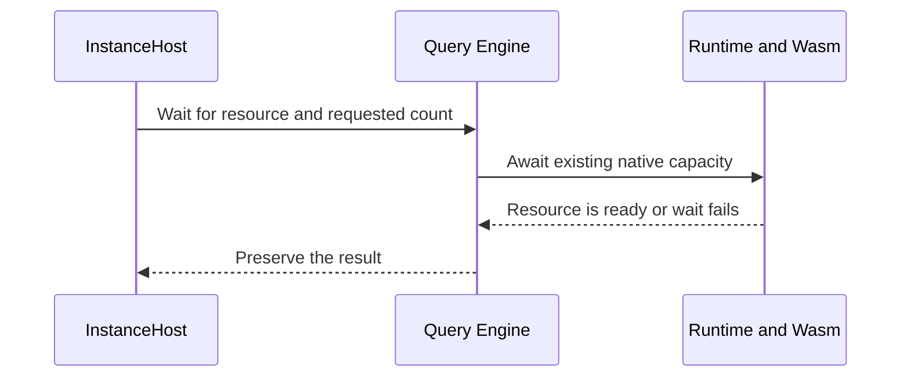

[CodeCache::available](../../crates/araphor-package-runtime/src/wasm/cache.rs)
checks the requested bytes and actual component pins. Compiler release and
component pin release send the existing native capacity notice. An unrelated
notice does not make a full resource ready. The Host joins the failed execution
before this wait. A cancelled wait starts no worker. Reader and shared-memory
waits keep their existing owners. Unknown Busy is not a resource retry trigger.
Query re-exports the original error; Analysis adds no Runtime dependency or
error adapter.

The source321 manifest build passes. The three Runtime cases pass in 6.582
seconds. The three Analysis cases pass in 28.080 seconds. Each run reports
unchanged source.

| Exact test | Required assertion |
|---|---|
| [instance::host::tests::admission::opening_waits_component_cache](../../crates/araphor-analysis/src/instance/host/tests/admission.rs) | A real guest pins the only cache entry. A different valid component returns typed Busy and requested bytes. The wait stays Pending, cancellation works, actual join permits release, and a fresh call returns `[7]`. |
| [instance::host::tests::admission::opening_keeps_unknown_busy](../../crates/araphor-analysis/src/instance/host/tests/admission.rs) | Unknown Busy and fixed bounds do not enter a resource wait or change Data. |
| [instance::host::tests::admission::admitted_busy_retries_capacity](../../crates/araphor-analysis/src/instance/host/tests/admission.rs) | Resource release, source-first recovery, a newer finite result, and a cancelled fresh source attempt preserve exact completion and progress fences. |
| [wasm::tests::wait_checks_resource](../../crates/araphor-package-runtime/src/wasm/tests.rs) | The public Runtime wait stays Pending under the actual compiler mutex, ignores an unrelated notice, and returns after release. |
| [wasm::tests::evaluation_capacity_recovers](../../crates/araphor-package-runtime/src/wasm/tests.rs) | Actual evaluation permits become available after release. |
| [wasm::tests::runtime::prepared::prepared_handle_keeps_binding](../../crates/araphor-package-runtime/src/wasm/tests/runtime/prepared.rs) | An uncached compile returns typed compiler Busy while the real mutex is held. A prepared handle retains its exact binding. |

The cache case tests the shared Host wait method. This result does not claim a
complete Host compiler-contention run. Pre-attempt source recovery and the final
shared Rust procedure remain **Not done**. The source321 result closes the
earlier compiler and cache capacity forwarding limit only.

### Fixed input clocks in native execution

[Runtime::evaluate](../../crates/araphor-query/src/stream/physical/runtime.rs) retains each active input range from the captured Query snapshot.
  -> [CallContext::bind_window_clocks](../../crates/araphor-query/src/definition/physical.rs) uses DataFusion's native expression simplifier at each input's retained SQL time. Nested calls keep their own scopes.
  -> [Session::physical](../../crates/araphor-query/src/execution.rs) analyzes the complete execution clone once and optimizes it once. Executions without retained windows use `SessionState::optimize` directly.
  -> [SourceSnapshot::bounds](../../crates/araphor-query/src/sources/mod.rs) uses the same scoped time for range metadata.
  -> [Inputs::input_for](../../crates/araphor-query/src/inputs/receipt.rs) retains the captured range for the exact call and input slot.

The call context and SDK time keep the actual evaluation time. A late close
uses the retained fixed interval for input SQL. It does not change other input
windows or the root SQL clock. Five fixed-window and six connected clock cases
pass on source322. This result does not qualify durable interval recovery,
older occupied intervals, or failed close recovery.

## Native operation validation

Read [PackageExec::collect](../../crates/araphor-query/src/definition/physical.rs)
for batch collection under the captured execution. Native child streams supply
Arrow batches. Normalization uses the declared SDK schema. Actual shared
buffers retain their existing memory claims. A configured input bound returns
the existing typed SDK Limit error; a shared pool failure returns Busy. Output
limits keep their existing classification. No second executor is present.

The [operation tests](../../crates/araphor-query/src/definition/tests/execution/contract/operation.rs)
check full input metadata, qualified table names, exact declared scope, stable
revisions, quoted aliases, input order, child deadlines, and capacity cleanup.
The former output quota test is removed under the user's 2026-10-23
instruction. Current output validation retains schemas and evidence references.
All 67 connected execution and guest cases and seven finite Analysis failure
and pressure cases pass. These checks qualify the
[operation test retirement](../../recovery/araphor-analysis-operation-retirement-20261020.json).
The 121 remaining reference files and recovery archive are unchanged. Other
model rules, complete producer integration, public lifecycle, and the final
Rust gate remain open.

## Native model boundary

Read [PackageExec](../../crates/araphor-query/src/definition/physical.rs) and
[its SQL implementation](../../crates/araphor-query/src/definition/physical/sql.rs)
for the existing physical execution path. The admitted package plan binds
inputs, parameters, prior state, outputs, evidence, and reasons. The native
optimizer and physical planner remain in use. Immutable call receipts retain
the complete SDK return and actual buffer claims.

The [model cases](../../crates/araphor-query/src/definition/tests/execution/contract/model.rs)
check output and checkpoint order, full evidence links, prior versus new state,
exact scalar values, quoted names, input revisions, buffer aliases, deadlines,
and body time. The existing ordered-output scenario also runs on multithread
and blocking-worker paths. The blocking case uses the existing Engine bridge
and preserves the original assertion result.

The [follow model case](../../crates/araphor-query/src/follow/tests/model.rs)
consumes actual notification deadlines from Query. It adds no model clock.
All 50 exact mapped cases pass. The
[retirement record](../../recovery/araphor-analysis-model-retirement-20261020.json)
covers 16 old methods, 12 old tests, and five whole removed files. Active
production code, ABI, and storage format do not change. All 116 remaining
reference files and the archive are unchanged. Mixed-window subscriptions,
installed supervision, producers, public lifecycle, and the final Rust gate
remain open.

## Public receipt reads and native input windows

[Instance::read_history](../../crates/araphor-analysis/src/instance/read.rs) A reader requests original receipts or exact retained output.
  -> [Instance::inspect](../../crates/araphor-analysis/src/instance/read.rs) checks fresh Inspect authority and watches current permission.
  -> [Data retained reads](../../crates/araphor-data/src/analysis/managed/mod.rs) validate the requested binding and return original receipts or the complete SDK wire packet.
  -> [ClientGrpcOwner::package_request](../../crates/mithril-control/src/client_grpc/packages.rs) joins binary serialization, then checks authority, expiry and client access.
  -> [Output::package](../../crates/araphor-cli/src/cli/araphor/output/packages.rs) decodes native Arrow only for presentation.

[Window::from_plan](../../crates/araphor-query/src/follow/window.rs) An admitted package input has a SQL window.
  -> [SourceSnapshot::capture](../../crates/araphor-query/src/sources/mod.rs) retains each native scan range and its exact expiry.
  -> [Progress::captured](../../crates/araphor-query/src/stream/progress.rs) keeps one deadline across metadata-only notices.
  -> [Runtime](../../crates/araphor-query/src/stream/physical/runtime.rs) executes through the existing native physical pipeline.

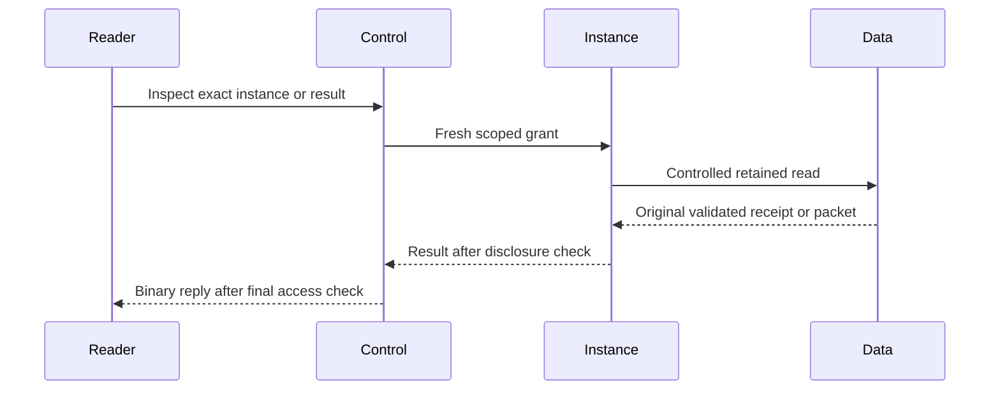

The wire reply is one PackageResponseV1 enum. The installed MessagePack codec
uses named fields and binary vectors. The decoder rejects trailing bytes.
The public result header excludes saved grants and principals. The raw reader
uses the existing retained validator and does not encode IPC again. This read
still decodes retained IPC for validation; it does not claim complete temporary
heap accounting. Historical reads need current Inspect permission, not current
Run permission or image execution trust. Cancellation joins the existing worker.

[AnalysisStore::managed_history](../../crates/araphor-data/src/analysis/managed/history.rs) lists original successful receipts in completion order.
[AnalysisStore::managed_output](../../crates/araphor-data/src/analysis/managed/read.rs) returns the validated original packet. Valid pending
or terminal attempts do not fabricate success. Corrupt bindings reject the read.
This list does not maintain the old per-window head index. Current-result
selection and selected SQL/PRQL reads now pass the focused checks in
[Retained result inspection](#retained-result-inspection). Complete per-window
and cross-generation history qualification remain open.

Package inputs retain independent windows through native child plans. Native
SQL already expands views before clock admission. Exact native timestamp bound
coercion stays valid; unsupported clocks stay rejected. The source snapshot
owns the next expiry. Query Progress owns its event. No Analysis clock or polling
owner exists in this path.

The [SDK wire test](../../crates/araphor-analysis-sdk/src/wire/tests/output.rs)
preserves the complete old wire matrix. The [raw Control test](../../crates/mithril-control/src/client_grpc/tests/packages/instance.rs)
checks every auxiliary output through actual package execution and the binary
reply. The [window tests](../../crates/araphor-query/src/definition/tests/subscription/windows.rs)
and native view tests cover the per-input expiry rules. The
[retirement record](../../recovery/araphor-analysis-package-output-retirement-20261020.json)
identifies the exact unchanged source, focused checks, and three removed files.
The current source descends from 111c575e. All 113 remaining Back files match
the baseline. The full Rust gate, larger inspection owner, input runner and
producer integration remain **Not done**. No benchmark is run.

## Metadata-first resume and checkpoint retries

[SubscribeExec::open](../../crates/araphor-query/src/stream/physical.rs) A managed instance opens its saved subscription.
  -> [Progress::new](../../crates/araphor-query/src/stream/progress.rs) opens the existing source watch before the probe.
  -> [Run::session](../../crates/araphor-query/src/stream/mod.rs) checks full authority and the selected managed head.
  -> [Run::dependencies](../../crates/araphor-query/src/stream/mod.rs) starts the tracked metadata worker and retains its actual evaluation permit.
  -> [AnalysisStore::managed_dependency_revision](../../crates/araphor-data/src/analysis/dependencies.rs) checks the exact head, pending work, completion and source notices in one read transaction.
  -> [SubscribeExec::open](../../crates/araphor-query/src/stream/physical.rs) checks the saved cursor and deadline, finishes empty calls and releases the idle permit.
  -> [Progress::next](../../crates/araphor-query/src/stream/progress.rs) waits on the same source or deadline event.
  -> [Runtime::evaluate](../../crates/araphor-query/src/stream/physical/runtime.rs) uses the existing capture and native physical execution when work is due.

The probe reads no prior IPC or source payload. It adds no bulk input pool
reservation. This statement does not claim complete temporary heap accounting.
No global relation change is ignored as an own-commit exception. A dependency
on analysis_results stays conservatively dirty. Explicit rebuild bypasses both
idle checks. Cancellation retains worker tokens and permits through actual exit.
Data registration and commit keep their existing guards.

[The Data cases](../../crates/araphor-data/src/analysis/managed/tests/metadata.rs)
prove header fences and no prior decode. The
[Query cases](../../crates/araphor-query/src/definition/tests/captured/managed.rs)
prove idle pressure, cancellation, notices, deadlines and explicit rebuild.
The [real Instance restart](../../crates/araphor-analysis/src/instance/tests/restart.rs)
preserves a committed checkpoint under full input pressure. The
[checkpoint cases](../../crates/araphor-analysis/src/instance/tests/checkpoint.rs)
use actual Wasm and source-built native implementations for retry, clean reopen,
older-output immutability, overflow and slot release. The
[finite input cases](../../crates/araphor-query/src/definition/tests/execution/contract/inputs.rs)
preserve the additional native input assertions.

All 84 connected cases, connected compilation, strict Clippy and formatting
pass on the recorded source based on 3be60374. The
[retirement record](../../recovery/araphor-analysis-checkpoint-retry-retirement-20261020.json)
identifies the exact commands, 30 checkpoint assertion groups and two removed
test files. All 111 remaining reference files and the archive are unchanged.
Retained dependency expiry, pressure retry, general scalar clock events,
producer and lifecycle integration, and the final full Rust gate remain open.

## Graph and retained-result resource defaults

[GraphReplayInputV1 and GraphSnapshotV1](../../crates/araphor-data/src/graph/model.rs)
validate typed records, source identity, proof, ordering and references without
default resource ceilings. The
[Graph domain tests](../../crates/araphor-analysis/src/graph/tests/defaults.rs)
keep the existing 300-second BOOTTIME join rule and require that exactly 256
records add no false resource-failure reason. These tests use the existing
Builtins implementations; they do not qualify a native Graph producer.

[GraphRows](../../crates/araphor-data/src/analysis/graph_rows/mod.rs)
retains the native storage owner. Its
[header](../../crates/araphor-data/src/analysis/graph_rows/header.rs)
checks u32 counts and canonical byte length before encoding. Row appends check
u32 ordinals before writing. The
[Data tests](../../crates/araphor-data/src/analysis/graph_rows/tests/defaults.rs)
cover the former row, body, metadata, context and witness boundaries, exact
retry, reopen, backup/restore and configured storage rollback.

[GraphTraversalV1](../../crates/araphor-data/src/graph/traversal.rs)
keeps the default one-hop query shape. Explicit subject and relationship
failure limits remain active. The existing native recursive SQL uses checked
BIGINT or NULL for its early-stop LIMIT. The
[result owner](../../crates/araphor-data/src/analysis/progress.rs)
and [recovery checks](../../crates/araphor-data/src/analysis/schema.rs) accept
the same expanded result range. Fixed batch/cache geometry can select a
single-item fallback; it is not a payload rejection ceiling.

All 159 connected cases, formatting and strict Clippy pass on the unchanged
recorded source based on d6c055d4. The
[qualification record](../../recovery/araphor-graph-resource-defaults-20261020.json)
identifies exact commands, source hashes and custody. The large metadata case
exceeds 16 MiB; it does not claim an executed fallback beyond 32 MiB. No
additional Back file retires from this change. The complete quota audit and
final Rust gate remain open.

## Storage window assertions

[The transferred cases](../../crates/araphor-analysis/src/graph/tests/windows.rs)
call the existing Data registration, intake, coverage, commit and read owners.
They retain all three original test bodies and 40 test/helper assertion sites.
Existing Graph test derivation constructs the expected domain snapshots.
Header reads skip corrupt unselected payloads; selected corruption and damaged
headers fail. Wide and short replacements retain immutable historical versions
and the unchanged processor head.

All 39 connected cases, formatting and strict Clippy pass on the recorded
source based on 070a88f7. The
[retirement record](../../recovery/araphor-analysis-window-test-retirement-20261020.json)
proves the exact original file against Git and both archive layers. Only the
storage-window test file retires; all 110 remaining Back files are unchanged.
This changes no production code. Producer, advancement, lifecycle, recovery and
the final full Rust gate remain open.

## In-process Wasm ownership

[WasmExecution::compiled](../../crates/araphor-package-runtime/src/wasm/cache.rs)
uses safe native `Component::new`. Its cache reservation is declared before the
compiled component. A failure drops compiled code before its retained byte
charge. Prepared handles and trap sources keep their existing code pins.
No compiler process or request/reply codec remains in the active path.

All 46 Runtime cases pass in `migration-runtime61`. The 15 relevant Query cases
pass in `migration-wasm-query61`. The tests keep exact source bounds, cache
release, preparation order, identity, cancellation, and joined worker assertions.
Strict workspace Clippy passes in `migration-wasm-clippy62`.
Configured compiler working-memory limits return Unsupported. Native synchronous
compilation cannot be preempted. Cancellation joins its worker before it returns.
These checks qualify the eight-file Wasm retirement. They do not qualify managed
lifecycle or a complete final Rust gate.

## Migration boundaries

The [migration record](../plans/araphor-analysis-migration.md) maps each
reference source file and its required tests. The reference crate remains
available while qualification is incomplete.

- [CallResult::belongs_to](../../crates/araphor-query/src/definition/physical.rs)
  checks an immutable admission token, tenant, image pin, package/export,
  and call identity.
  Domain adapters must use this check before they attribute a return to a
  package. A call ID alone is not sufficient across separate admissions.
  CallResult keeps evaluation and output private. Read-only accessors prevent
  caller changes from retaining the private execution attribution.
- [Subscription updates](../../crates/araphor-query/src/follow/mod.rs) retain
  complete call returns for each evaluated step. Unchanged selected rows do
  not suppress proposed package state, reasons, or evidence.
  [Delivery](../../crates/araphor-query/src/follow/delivery.rs) releases those
  returns after it encodes the checkpoint. A retained receipt does not hold
  buffers for the next step. An initial execution failure keeps the captured
  snapshot for error delivery. Delivery checks current read authority before
  it emits the error frame and terminal status. This path creates no checkpoint.
- [Guest exchange](../../crates/araphor-query/src/definition/physical/guest.rs)
  reserves configured transfer capacity before guest execution. The blocking
  worker owns the existing evaluation permit and memory lease until it exits.
  Native decoding uses one combined SDK byte budget, including saved state.
  Wasmtime uses the acquired copy budget as host-call fuel before it lifts
  guest output into host buffers. Input revision hashing reserves SDK encoding
  scratch before it starts the Arrow IPC writer.
  Disabled capacities reserve no maximum-sized temporary buffer.
- [Fixture qualification](../../crates/araphor-analysis/src/qualification/mod.rs)
  selects an exact installed image and checks Test authority and trust. Its
  inputs and parameters use native table providers. A supplied input revision
  or coverage value is accepted only for a declared local input whose schema
  and complete rows match native execution. Durable input provenance cannot
  be replaced through this path.
- [Graph](../../crates/araphor-analysis/src/graph/mod.rs) validates detector
  input binding, proof, and output attribution. It has no reader, scheduler,
  activation registry, or execution engine. Data retains the graph transaction.
- [Context](../../crates/araphor-analysis/src/context/selection.rs) captures
  retained document revisions once, then uses a native relational plan for
  selection, ordering, conflicts, and omissions. Finite capture uses a stream;
  it does not create a temporary subscription that cancels its caller.
- [Notification consumption](../../crates/araphor-analysis/src/notification/reactive.rs)
  uses native eligibility SQL and the existing finite router methods. Data
  publishes exact retry and grant-expiry deadlines from the captured route
  and attempt history. Query owns the waits. This API does not start a service
  or implement managed instance recovery.

Configured Wasm allocation limits remain separate from output contract
limits. A transfer reservation is not a process memory or isolation guarantee.
Native cancellation remains cooperative. The new disabled-default limits and
finite managed transaction source require qualification. Complete reactive
producers, public lifecycle operations, and automatic restart remain open in
the migration record.
Current-source qualification is **Not done** until the recorded commands pass.

## File schema

All three forms use YAML metadata. `name` is required. `description` and
`labels` are optional. Select exactly one top-level `sql`, `prql`, or `call`.
A raw SQL or PRQL file is source for a definition, not a complete definition.
Unknown fields, explicit null program forms, duplicate keys, merge keys, and
multiple YAML documents are invalid. Metadata and call names require strings.
Quote a numeric image revision, for example `revision: "1"`.

SQL supports the full native query:

```yaml
name: event-counts
description: Count retained events.
labels:
  team: security
sql: |
  SELECT count(*) FROM events
```

For a separate source file, use `sql: {file: queries/counts.sql}`. PRQL has
the same inline and file forms:

```yaml
name: selected-events
description: Select event cursors.
labels:
  team: security
prql:
  file: queries/selected-events.prql
```

The referenced file contains:

```prql
from events
select {value = source_cursor}
```

The
[compiler](../../crates/araphor-discovery-definition/src/compile.rs) uses
`prqlc` 0.13.13 with the Generic SQL target. DataFusion admits the generated
SQL. This route does not promise every PRQL expression is compatible.

Put package calls in SQL when the definition needs query composition:

```sql
SELECT *
FROM "fixture"."r1".count(
  source => (
    SELECT source_cursor AS value
    FROM events
    WHERE received_at >= now() - INTERVAL '5 minutes'
  ),
  increment => 2
)
```

The function name identifies the image, exact revision, and export. The
example uses the Query test image. Install the selected image before
admission. Its interface must declare the supplied inputs and parameters.
For an export with several outputs, use an explicit first string argument,
such as `count('result', source => (SELECT ...), increment => 2)`.

Inputs are native subqueries. Filters, joins, grouping, and windows stay in
those queries. Scalar arguments use the declared parameter names and types.
Calls can
appear in joins, nested inputs, or queries that use common table expressions.

For one direct package call, use the structured YAML form:

```yaml
name: selected-event-counts
description: Count selected event cursors.
labels:
  team: security
call:
  package: fixture
  revision: r1
  export: count
  inputs:
    source: |
      SELECT source_cursor AS value FROM events
  parameters:
    increment: 2
```

The file owner converts this form to the SQL relation above without the
time filter. Inputs accept inline SQL or `{file: queries/input.sql}`. Optional
`output` selects a named output. Query checks the exact installed image,
declared bindings, parameter types, defaults, and selected output. There is
no second parameter evaluator or YAML window language. Put filters and
windows in input SQL.

Parameters use literal strings, numbers, booleans, nulls, lists, or objects.
The reader rejects nonfinite numbers, unsupported scalar tags, and integers
outside the existing signed 64-bit or unsigned 64-bit representation. It
preserves `18446744073709551615` exactly. The reader adds no resource quota.
Parser budgets and alias quotas are disabled. Existing Query and Data limits
still apply.

SQL and PRQL source text is retained exactly. A YAML call retains metadata
and normalized SQL. It does not retain the original YAML mapping, formatting,
or source paths. JSON remains the request and saved snapshot encoding.

PRQL uses its existing SQL relation syntax and then compiles to native SQL:

```prql
from s"""SELECT * FROM "fixture"."r1".count(
  source => (SELECT source_cursor AS value FROM events), increment => 2
)"""
filter value >= 2
```

## Ownership and verification

The definition crate owns portable file and snapshot types. Data owns durable
storage. Query owns planning and finite execution. Package Runtime owns native
and Wasm invocation. Control owns current permission and transport. CLI owns
command parsing and output. The stopped draft disconnected `araphor-analysis_back`,
its package lifecycle commands, and its polling execution owners. Historical
source links use the fixed revision `6a25ba1b34dbaa0a553b1883058938683ce7aaab`.

[NotificationRouter](../../crates/araphor-analysis/src/notification/mod.rs)
retains the compatible notification operations in current Analysis.
[route_finding](../../crates/araphor-analysis/src/notification/routing.rs)
accepts one exact changed finding reference.
[deliver_obligation](../../crates/araphor-analysis/src/notification/delivery.rs)
accepts one obligation key. These operations retain current authorization,
durable attempts, human acknowledgement, and historical finding references.
[ControlNotificationOwner](../../crates/mithril-control/src/notification.rs)
delegates those finite requests. Neither owner scans all tenants or schedules
a polling clock. Automatic graph production and notification subscriptions
remain **Not done**. Data retains graph history, traversal, and notification
records. The current work does not replace the removed graph scheduler with
another scheduler.

Qualification of the current deletion and migrated operations is in progress.
The verification counts below describe earlier source states.

Read the [definition tests](../../crates/araphor-discovery-definition/src/tests.rs),
[YAML tests](../../crates/araphor-discovery-definition/src/file/tests.rs),
[Query tests](../../crates/araphor-query/src/definition/tests.rs),
[Data tests](../../crates/araphor-data/src/analysis/definitions/tests.rs),
[authority tests](../../crates/mithril-control/src/client_auth/packages/tests.rs),
and [RPC tests](../../crates/mithril-control/src/client_grpc/tests/packages.rs).
The tests cover source capture, strict forms, native planning, typed calls,
permission revocation, exact pins, immutable retries, and definition recovery.
The [TLS case](../../crates/mithril-e2e/src/discovery/packages/definitions.rs)
uses the real client to admit and inspect all three YAML forms. Its native
package calls also check the locked SQL dependency and unchanged activation
state. The Query YAML case checks exact unsigned parameter values through
the native parameter plan and rejects expression strings as numeric values.
`native_package_bound_inputs` checks dependent inputs in both declaration
orders. The test uses native physical execution to check the result and row
index. It also checks a compatible Arrow string representation and an
explicit projection quota. The default quota remains disabled.

[Dataset::normalize_batch](../../crates/araphor-analysis-sdk/src/batch.rs)
retains the explicit Arrow row count when a valid SDK input has no columns.
The [SDK batch tests](../../crates/araphor-analysis-sdk/src/batch/tests.rs)
check empty and nonempty zero-column batches. The Query case checks native
zero-column input, output, and saved-state planning and a three-row scan.
[Session::indexed_schema](../../crates/araphor-query/src/execution/tables.rs)
accepts the same empty schema and retains metadata. The
[index tests](../../crates/araphor-query/src/execution/tables/tests.rs) check
continuous row indices across empty and nonempty zero-column batches.
The changes retain the existing column and schema checks.

The previous native-call replacement passes 50 distinct focused tests. The
YAML authoring delivery passes 60. Native admission simplification passes 61:

| Owner | Native-call replacement | YAML authoring | Native admission |
| --- | --- | --- | --- |
| Definition format and PRQL | 12 | 21 | 21 |
| Query definitions and package calls | 20 | 21 | 22 |
| Data definitions and request encoding | 9 | 9 | 9 |
| Control permission and RPC admission | 5 | 5 | 5 |
| CLI admission, inspection, and output | 3 | 3 | 3 |
| TLS client admission and inspection | 1 | 1 | 1 |

Formatting and affected-crate Clippy with warnings denied passed. The
verification record is `/tmp/araphor-sql-call-verification1.json`.
The tests also reject an invalid constant cast in a body that contains a
nested package call. They accept the corrected body. Native analysis and
optimization apply before the physical-execution boundary.

The SDK batch and Query index owners are unchanged from `318a3259`. Their
earlier checks above are not repeated. The focused Query zero-column case
runs again in this delivery.

The replacement adds 165 production Rust code lines from `318a3259`:
327 additions and 162 deletions by file size. Tests, comments, documents,
blank lines, and moves do not count as reduction. The count record is
`/tmp/araphor-sql-call-count1.json`. The complete reduction target remains
**Not done**.
Complete package execution and running-instance acceptance remain open.
Full workspace CI, benchmarks, and physical Kubernetes checks did not run.

YAML implementation and selected functional qualification: **Done**. The
new tests reject null maps, duplicate keys, and integer rounding. The Query
case executes the native parameter plan and checks the exact unsigned value.
The TLS case admits SQL, PRQL, and a direct YAML call through the real client.
The source and command record is `/tmp/araphor-yaml-verification1.json`.
Formatting and affected-crate Clippy with warnings denied pass.

The YAML delivery adds 261 production Rust code lines from `d49e6bd5`:
282 additions and 21 deletions by file size. The complete redesign adds
6,180 from `7b7b407a`; another 12,180 must be removed for the 6,000-line
reduction target. The count excludes tests, comments, documents, blank lines,
and moves. The record is `/tmp/araphor-yaml-count1.json`. The complete
reduction remains **Not done**. No speed result is claimed.

Native admission simplification and selected qualification: **Done**. The
review covers the change from `b637c05a`. All 61 distinct focused tests pass.
Formatting and affected-crate Clippy with warnings denied pass. The source
and command record is `/tmp/araphor-native-simplify-verification1.json`.
The change removes 27 production Rust code lines: 15 additions and 42
deletions by file size. The count excludes tests, comments, documents, blank
lines, and moves. The record is `/tmp/araphor-native-simplify-count1.json`.
Full workspace CI, benchmarks, and physical Kubernetes checks did not run.
At this revision, physical package execution, built-in consolidation,
running instances, and the complete reduction target remained **Not done**.

Discovery effects crate removal and selected qualification: **Done**. The
complete crate, dependency entries, and function resolver are removed. Native
view declarations belong to the existing built-in package. The existing
Analysis Package owner constructs the immutable image. All 354 distinct
focused tests pass, including 36 SQL cases and 268 Query cases. Scoped
formatting and affected-crate Clippy with warnings denied pass. The source and
command record is `/tmp/araphor-native-views-verification1.json`. The change
removes 157 production Rust code lines from `5c9e2fb7`; tests, comments,
documents, blank lines, and moves are excluded. Read the
[crate-removal result](../plans/araphor-package-jobs.md#native-derived-relations-and-crate-removal)
for the count record and remaining work. Full workspace CI, benchmarks, and
physical Kubernetes checks did not run.

## Native Graph adapter qualification

All 42 ordinary Graph cases and both explicit source-built native cases pass.
The six adapter cases use native Query preparation and execution. Wasm and
native calls run the actual detectors. SQL returns known complete values to
check transport and Graph validation. It does not implement the SQL detector.
The cases keep typed output, complete reasons and evidence, saved state,
configured pressure, exact replay and resource release assertions. Connected
test compilation, workspace formatting and strict connected Clippy pass.

No Back file retires. The old `graph/derive/adapter/mod.rs` also constructs
production Graph inputs and their source revision, window, time and coverage.
The current factories exist only in tests. Native transport does not replace
that responsibility. Keep the complete old file until a production owner and
its tests cover those rules. There are still 98 retired files and 110 unchanged
reference files. This delivery changes no production code. Read the
[qualification record](../../recovery/araphor-graph-adapter-qualification-20261020.json)
for exact source hashes, native artifacts and passing commands. The complete
migration and final Rust gate remain **Not done**.

## Extracted provenance count defaults

The native Data extraction owner no longer rejects more than 64 retained
results, 8192 witnesses or 256 contexts by default. Existing configured byte
and selected-key limits still apply. Exact revisions, tenant checks, origin
union and earliest witness expiry stay unchanged. The change removes 13
production lines and adds no owner. All 24 ordinary extraction cases and six
native Query input cases pass. The existing release history scan stays ignored.
Connected compilation, formatting and strict Clippy pass. Read the
[qualification record](../../recovery/araphor-extracted-provenance-20261020.json).

No Back file retires. All 110 remaining files match the baseline. The separate
legacy helper ceilings, complete migration and final Rust gate remain
**Not done**. The complete production count is +13,536 from the original
baseline. The required net reduction remains **Not done**.

## Public image fixture execution

`araphor image test PACKAGE --revision REVISION` tests all root-image fixtures.
Add `--fixture NAME` to test one fixture. Control checks current Test authority
and image trust. The existing Qualification owner executes the native Query
plan. Replies use the existing binary codec and preserve each fixture name and
pass result. Installation and testing start no Discovery. Testing changes no
managed output, state or progress.

The authority watch now spans reply encoding. A deterministic endpoint test
first returns success after late trust revocation. The corrected route returns
PermissionDenied. Both fixed five-minute request defaults are removed. Existing
configured Query timeouts, grant expiry and cancellation remain active.

All 53 distinct focused cases pass across the recorded runs. The cancellation
fixture first fails because its explicit 2 MiB input pool cannot hold the
current 2.04 MiB Wasm component. Its pool is now 4 MiB; all original assertions
stay unchanged and pass. The reader-exhaustion fixture now has an explicit
16-reader limit. Connected compilation, formatting and strict Clippy pass.
Read the [source and test record](../../recovery/araphor-public-fixture-execution-20261020.json).

This delivery adds 53 production lines and retires no Back file. All 110
remaining files match the baseline. Dependency-artifact fixture selection,
negative fixture time, complete migration and the final Rust gate remain
**Not done**.

## Native Graph baseline retirement

All 12 saved snapshots now pass through 36 actual native package calls and
production Graph validation. All three ordinary baseline cases also pass.
The complete golden files stay unchanged. The shared test normalizer changes
only the removed resource limits and checks the unchanged 300-second horizon.
Connected compilation, formatting and strict Clippy pass.

Only the old baseline test and three duplicate JSON files retire. This removes
no production code. There are now 102 retired files and 106 unchanged reference
files. The full archive retains all 208 originals. Read the
[retirement record](../../recovery/araphor-native-graph-baseline-retirement-20261020.json).
Keep the production adapter until its input and source-metadata replacement
passes qualification. Complete migration and the final Rust gate remain
**Not done**.

## Exact saved datasets in native input plans

[Session::register_retained](../../crates/araphor-query/src/execution.rs)
The caller supplies a table alias, producer instance, exact result reference
and dataset name.
  -> [AnalysisStore::managed_input](../../crates/araphor-data/src/analysis/managed/input.rs) reads the stored header and schema without Arrow IPC and creates an opaque reference.
  -> [SourceProvider::retained](../../crates/araphor-query/src/sources/mod.rs) owns that reference, the native schema and its metadata reservation.
  -> [Native admission](../../crates/araphor-query/src/definition.rs) seals declared source bindings, including an unused native CTE.
  -> [Source capture](../../crates/araphor-data/src/analysis/extraction/package.rs) checks the exact producer head and original source proof in the existing Data transaction.
  -> [Retained decode](../../crates/araphor-data/src/analysis/managed/input.rs) bounds encoded and decoded bytes, then uses the existing complete SDK validator.
  -> [Captured tables](../../crates/araphor-query/src/sources/rows.rs) retain original metadata and real shared Arrow buffer claims.
  -> [Input receipts](../../crates/araphor-query/src/inputs/receipt.rs) preserve full identity projections and derive revisions for other SQL results.

The physical operator remains the existing native source scan. The change adds
no executor, parser, codec, scheduler or polling task. Data owns the opaque
reference. Query owns native admission and buffer lifetime. Equal references
and schemas decode once. Each alias pays for its retained metadata and each
logical input pays the configured model byte cost. These charges do not claim
a bound on the complete process heap.

[Analysis alias tests](../../crates/araphor-analysis/src/instance/tests/retained.rs)
produce real durable results and execute real native definitions. The tests
check exact refs, stale heads, stored scope, late trace revocation, eliminated
CTEs, shared buffers, configured pressure and complete resource release.
[Revision tests](../../crates/araphor-analysis/src/instance/tests/retained/revisions.rs)
check registration-order independence and changed source identity.
[Projection tests](../../crates/araphor-analysis/src/instance/tests/retained/projections.rs)
check narrowed, reordered and full identity projections.
[Data tests](../../crates/araphor-data/src/analysis/managed/tests/input.rs)
prove that metadata reads skip corrupt IPC while complete capture reaches the
existing SDK validation failure. The original witness-expiry test keeps its
commit and rollback assertions and adds before, at and after expiry reads.

All 234 distinct focused cases pass, including four source-built native cases.
Connected compilation, formatting and strict Clippy pass. Read the
[qualification record](../../recovery/araphor-retained-input-qualification-20261020.json).
The saved alias is finite and caller-owned. It is not a durable definition
field. Managed publication and follow reject it before capture. Expired
witnesses remain Incomplete; readable Unknown inputs and witness deadlines are
not implemented. No Back file retires. All 106 remaining files and the full
archive are unchanged. The complete migration and final Rust procedure remain
**Not done**.

## Native image closure reuse

[Query reuse tests](../../crates/araphor-query/src/definition/tests/execution/reusing.rs)
prepare and execute real native definitions. They select one, two, one and
zero images through explicit SQL. An unused installed image stays inert.
Cloned definitions share their admission, image and charge owners. Independent
definitions, engines and tenants retain separate owners. Exact new dependency
revisions change the returned value; the old definition still returns its
original value. The final owner releases its actual pools and permits.

[Instance reuse test](../../crates/araphor-analysis/src/instance/tests/reusing.rs)
executes saved state twice. It then denies a new attempt and a completed
receipt after grant revocation. Image trust loss denies another new attempt.
Neither denial writes output, state or progress. Restored authority executes
the same retained definition and continues the original checkpoint.

These tests use the existing admission, execution, authority and Data owners.
They add no production code. The initial draft calls an absent output getter.
The corrected test reserves and drops the whole configured output pool.
This proves release without a new production API.

The four new cases and 27 mapped owner cases pass. Connected compilation,
formatting and strict Clippy pass after the reference deletion. Only the old
reuse test leaf retires. There are now 103 retired files and 105 unchanged
reference files. The complete archive retains the deleted file. Read the
[retirement record](../../recovery/araphor-native-reuse-retirement-20261020.json).
The old package activation generation becomes an immutable image revision;
these tests do not prove a managed Instance generation change. Freshness,
snapshot, lifecycle, complete migration and final Rust qualification remain
**Not done**.

## Discarded source declarations and saved revisions

[Input admission](../../crates/araphor-query/src/inputs/mod.rs) preserves a saved
revision only when its exact saved source is the sole declared origin. Native
DataFusion can remove an unused CTE from execution. Query still keeps the
admitted origin and uses its existing complete derived-input hash.

The [actual native regression](../../crates/araphor-analysis/src/instance/tests/retained/origins.rs)
first fails. After correction, a changed declared context and a changed second
saved result both change the derived revision while selected rows remain 7.
The direct right input keeps its original revision. Exact source refs, context
refs, unchanged Data and full resource release are checked. All 45 focused cases
and connected checks pass. Read the
[qualification record](../../recovery/araphor-retained-origin-qualification-20261020.json).
No reference file retires. The complete migration and final Rust procedure
remain **Not done**.


## Finite native Graph source and publication

This section records the former finite execution route. Its results apply to
the source recorded below. The direct executor is retired. Read the
[current route](#one-managed-graph-execution-route) for the replacement.

This production route replaces the earlier test-only Graph input boundary.
It covers one `GraphPublication::refresh`; it does not advance the processor
cursor or establish automatic producer recovery. Read these owners in order:

1. [GraphPublication](https://github.com/Ereborlabs/erebor-runtime/blob/cbc21f76103ccaf37bd85df337b83e1d4b3ebdc8/crates/araphor-analysis/src/graph/native.rs) checks
   the Run grant, complete source scope, exact image set, and current image
   trust. It rejects foreign call admissions before execution. Canonical
   coverage comes from the Engine rather than a caller table with the same name.
2. [SourcePort](../../crates/araphor-query/src/sources/port.rs) retains native
   child plans and a private typed binding identity.
   [PortExec](../../crates/araphor-analysis/src/graph/native/node.rs) enters the
   shared [capture](../../crates/araphor-analysis/src/graph/native/capture.rs).
   It consumes the six actual child streams once and derives the three complete
   SDK inputs from one cut. Canonical record checks use that same captured
   source. Ordinary tables remain TableProviders; the existing package relation
   planner resolves OCI computations without a second SQL parser.
3. [Captured Control context](../../crates/mithril-control/src/store/graph/retained.rs)
   and [Control facts](../../crates/mithril-control/src/store/graph.rs) use the
   captured arrays and original per-row revisions. Consulted references retain
   the candidate and ACK versions that produced each policy fact. Complete ACK
   histories remain available. An unrelated profile does not add a reference.
4. [PackageExec and ExecutionReceipt](../../crates/araphor-query/src/definition/physical.rs)
   execute the native plan and retain complete SQL, Wasm, or native returns.
   Private admission identity binds each `CallResult` to its actual call.
   Metadata passes through only for one exact identity origin. Cleanup drains
   already-started shared futures and joins their workers; it does not rerun calls.
5. The [Graph sink](https://github.com/Ereborlabs/erebor-runtime/blob/cbc21f76103ccaf37bd85df337b83e1d4b3ebdc8/crates/araphor-analysis/src/graph/native/sink.rs) wraps
   the selected native plan through insert-only DML. Native `DataSinkExec` owns
   invocation and the one-row count. The Graph sink drains selected batches,
   checks configured row and byte totals, requires all three actual returns,
   and applies their complete SDK output through `Graph::apply` and `finish`.
6. [Data graph publication](../../crates/araphor-data/src/analysis/progress.rs)
   checks the fresh source cut, exact window head, witnesses, context versions,
   and package references in one transaction. The final authority and control
   callback runs after the commit hook and before commit. Failure rolls back.
   This finite call uses `advance = false`.

[SourceSnapshot::blocking](../../crates/araphor-query/src/sources/rows.rs) keeps
actual capture, permit, control, and worker ownership through the joined writer.
The existing Query input pool charges retained arrays, frame copies, and capture
metadata. Complete call results retain their actual buffer reservations. The
native count is checked and reserved before the writer runs. These bounds do
not cover every temporary Rust allocation or Data writer serialization buffer.

The Run grant, admitted images, witness deadline, outer Session control, and
native operation control are checked at the final write boundary. A benign
authority notice requires a current check and keeps the same capture. Denial
cancels and joins execution. An exact immutable retry returns the original
receipt only for the same request and references, with current authority.
A fresh semantic no-op first checks the current cut and head, then returns the
prior graph result. A later query or disclosure error can follow a successful
commit; no new public Graph recovery API for a lost acknowledgement is added.

[Discovery return validation](../../crates/araphor-analysis/src/discovery/output.rs)
uses sealed native call results and existing Data provenance guards. The
[actual Wasm/native comparisons](../../crates/araphor-analysis/src/discovery/output/tests/native/targets.rs)
cover all four exports and complete returned contracts. Query owns invocation
identity and evaluation time; this route adds no custom Graph or Discovery clock.

Read the [capture and identity cases](../../crates/araphor-analysis/src/graph/native/tests.rs),
[complete payload and 258-report history cases](../../crates/araphor-analysis/src/graph/native/tests/gates.rs),
[Data atomic publication cases](../../crates/araphor-data/src/analysis/graph_rows/tests/atomic.rs),
and [captured Control proof cases](../../crates/mithril-control/src/store/graph/tests/retained.rs).
SQL fixture cases test known returns and boundary checks; actual detector
algorithm qualification uses Wasm and source-built native artifacts.
The [retirement record](../../recovery/araphor-native-graph-source-retirement-20261021.json)
records the passing gates and five retired leaves. Automatic Graph advancement,
producer recovery, complete migration, required net reduction, and the final
shared Rust procedure remain **Not done**.


## Native Notification eligibility and delivery

This route computes one complete eligible set and consumes it through the
existing finite Router. Read the owners in this order:

1. [Data Notification rows](../../crates/araphor-data/src/analysis/extraction/tables/notification.rs)
   project primary and escalation IDs and revisions, current grant expiry,
   retry time, and current-finding ACK state from the captured cut. The Boolean
   ACK test compares its saved finding revision with the obligation's current
   finding revision. Query receives the exact next change time.
2. [Native eligibility SQL](../../crates/araphor-analysis/src/notification/reactive.sql)
   selects the latest finding and route revisions. Same-revision action uses
   null-safe equality. Priority ranks are info, warning, high, critical;
   sensitivity ranks are public, tenant, host_restricted. Equal or lower values
   remain quiet. Exact primary and escalation reference changes remain visible.
   Each of the seven DISTINCT predicates has its own parentheses so the pinned
   native parser does not consume a following AND or OR in the right operand.
3. [The shared Host](../../crates/araphor-analysis/src/instance/host/notification.rs)
   admits the exact canonical SQL definition and a tenant-only grant. Admission
   starts no work. Its running subscription uses native INSERT planning and
   the existing publication TableProvider. The definition contains no images
   or package calls.
4. [The publication sink](../../crates/araphor-analysis/src/instance/sink.rs)
   uses native DataSinkExec. It collects the complete bounded candidate set
   before the first effect. DataFusion's native schema comparison accepts
   equivalent Utf8View fields; changed names, types, and counts still fail.
   The captured tenant must match the admitted grant. The sink calls
   [NotificationRouter::consume_rows](../../crates/araphor-analysis/src/notification/reactive.rs).
   The explicit finite consume API checks the same exhausted, untruncated
   Query update. Both paths decode finding refs and obligation IDs. One item
   error does not stop a later item. A job guard error stops delivery. Query
   owns source subscriptions and deadline wakes; neither consumer adds a clock
   or polling loop.
5. [Routing](../../crates/araphor-analysis/src/notification/routing.rs) checks the
   current finding reference and actual route authority.
   [Obligation updates](../../crates/araphor-analysis/src/notification/obligation.rs)
   preserve action identity and monotonic priority and sensitivity.
   [Concern refresh](../../crates/araphor-analysis/src/notification/concern.rs)
   updates the saved primary and escalation references through an authorized
   current primary. Missing or expired primary approval does not refresh early.
   Escalation metadata can be retained before final send authorization.
6. [Delivery](../../crates/araphor-analysis/src/notification/delivery.rs) returns
   early for an ACK of the current finding revision. A stale ACK does not block
   concern refresh. [Attempts](../../crates/araphor-analysis/src/notification/attempt.rs)
   retain the captured finding, route, sequence, and deadline; they check actual
   current authorization before the sink. Route refresh does not reset attempts
   or the original ACK deadline. Accepted delivery does not create a human ACK.

[StorageLimitsV1](../../crates/araphor-data/src/analysis/capacity.rs) owns
notification_routes and notification_states. Both are optional and default to
None. The [Router store](../../crates/araphor-analysis/src/notification/store.rs)
uses these counts and the existing Data context_max_bytes persistence limit.
Configured excesses still fail. Context decoding keeps identity and type checks;
removing a default resource ceiling does not remove those guards.

[Control package startup](../../crates/mithril-control/src/service/packages.rs)
uses the shared Host for retained Notification instances. Graph is not required
to restore a retained running Notification. Disabled Notification configuration
creates no job or task. Control grant and route count limits are optional and
default to None. The finite
[Control Notification methods](../../crates/mithril-control/src/notification.rs)
remain available.

A pending attempt is durable before the actual effect checks current job
authority and lifecycle. Cancellation preserves it. Reopen retains its exact
subject, route, sequence, and original ACK deadline. A completed accepted
attempt is not sent again. Notification lifecycle does not create package
attempts, package progress, or package receipts. Read the
[bounded result](../plans/araphor-analysis-migration.md#shared-notification-execution-and-capacity-release)
for the 15 passing Analysis and Control checks and the separate capacity proof.
Complete source-failure recovery, complete migration, required net reduction,
and the final shared Rust procedure remain **Not done**.


### Complete native Graph adapter proof

The [native adapter tests](../../crates/araphor-analysis/src/graph/tests/execution.rs)
execute all three detectors for each of six selected and gapped inputs through
actual native and Wasm calls. Each full return passes the existing Fixture
checks and production Graph application before complete snapshots are compared.
Replay retains the original oracle; explicit output pressure retains the exact
resource error and buffer-release checks. The [retirement record](../../recovery/araphor-graph-adapter-test-retirement-20261021.json)
names the three replaced test leaves. It does not qualify automatic advancement.


### Native traversal proof

The [traversal tests](../../crates/araphor-analysis/src/graph/tests/traversal.rs)
retain all 56 original assertions across nine cases. Their local fixture uses
current Data commits and native Query reads. Data owns traversal; the fixture
adds no traversal implementation. The [retirement record](../../recovery/araphor-native-traversal-test-retirement-20261021.json)
records exact source, commands, custody and the separate remaining Graph work.


### Native package descriptor and composition proof

The [cycle tests](../../crates/araphor-query/src/definition/tests/execution/contract/cycles.rs)
check actual image admission and internal native SQL composition. The
[descriptor test](../../crates/araphor-query/src/definition/tests/execution/descriptors.rs)
executes a Wasm root and SQL auxiliary from one immutable image. It checks the
complete descriptor, retained Arrow buffer bytes, pressure and exact replay.
The [retirement record](../../recovery/araphor-package-test-leaf-retirement-20261021.json)
records the two complete replaced leaves and the mixed metadata file that stays.


### Native Graph storage contract proof

The [storage tests](../../crates/araphor-analysis/src/graph/native/tests/storage.rs)
use actual Wasm calls and the native Graph sink. Complete image contexts remain
readable when Graph rows are corrupt. Invalid context commits preserve all
metadata and leave no result. Exact retry retains the original receipt and body.
The [retirement record](../../recovery/araphor-native-graph-storage-test-retirement-20261021.json)
records the replaced leaf and the distinct remaining production work.


### Wasm stop and revocation proof

Read the [joined stop and revocation tests](../../crates/araphor-analysis/src/instance/subscription/tests.rs),
the [entered-guest Host stop test](../../crates/araphor-analysis/src/instance/host/tests.rs),
and the [warmed Runtime cancellation test](../../crates/araphor-package-runtime/src/wasm/tests/runtime.rs).
The native evaluation permit remains held until the actual worker exits.
Cancellation remains distinct from denial. The [Data terminal test](../../crates/araphor-data/src/analysis/managed/tests/terminal.rs)
compares complete saved checkpoints and selected output through failure and
reopen. The [retirement record](../../recovery/araphor-wasm-interruption-test-retirement-20261021.json)
names the nine passing cases and the shared reference files that stay.

### Managed Wasm slot and exchange lifetime

[PackageExec::guest](../../crates/araphor-query/src/definition/physical/guest.rs)
receives a managed package call
  -> [Prepared::acquire_evaluation](../../crates/araphor-package-runtime/src/lib.rs) waits for the configured Wasm slot through the call control
  -> [EvaluationPermit::retain](../../crates/araphor-package-runtime/src/wasm.rs) creates a lifetime lease without another execution permit
  -> [Runtime::evaluate_reserved](../../crates/araphor-package-runtime/src/lib.rs) consumes the unique permit and keeps a separate lease until the worker releases its exchange memory
  -> [PackageExec::evaluate](../../crates/araphor-query/src/definition/physical.rs) keeps the Query lease until Arrow output is retained and the exchange reservation is resized

[Runtime cancellation](../../crates/araphor-package-runtime/src/lib.rs) receives a stop or deadline event
  -> the Runtime joins its blocking worker before it returns
  -> the worker releases exchange memory before its slot lease
  -> Query releases local output before its slot lease on failure or drop

EvaluationPermit has no Clone implementation. EvaluationLease has private
fields and cannot authorize execution. The Runtime and Query leases prevent a
waiting call from taking the slot while the previous exchange still uses its
full output reservation. Unconfigured quotas still create no slot semaphore.
The native and unmanaged admission paths retain their existing behavior.

The [admission regression](../../crates/araphor-package-runtime/src/wasm/tests/runtime/admission.rs)
observes the sole slot inside the worker lease destructor. The expected count
is zero during destruction and one after joined completion. The new assertion
fails before the fix. The [managed capacity cases](../../crates/araphor-analysis/src/instance/subscription/tests/capacity.rs)
retain their 8 MiB output pool, two-step progress check, healthy SQL work,
cancelled waiter and complete release assertions. These cases and the final
shared Rust procedure pass. Read the [failure and source record](../../recovery/araphor-wasm-exchange-lifetime-20261021.json).

### Native version and fault recovery

Read [InstanceHost::update](../../crates/araphor-analysis/src/instance/host/version.rs)
and [managed version admission](../../crates/araphor-data/src/analysis/managed/version.rs).
The candidate generation uses the same finite Query subscription and native
publication path. Data changes the current generation only after successful
publication. A failed candidate cannot replace the current instance or its
saved output and state.

The [version cases](../../crates/araphor-analysis/src/instance/tests/version.rs)
check actual Native execution, Wasm update, rollback, clean reopen, removal,
and complete historical packets. The [fault case](../../crates/araphor-analysis/src/instance/tests/checkpoint.rs)
calls the public update owner in a panic child and an abort child. After
reopen, the current generation can execute. The unfinished candidate remains
blocked by its pending attempt. The child processes supply test faults only.
Production Native execution remains in process.

These three cases, workspace library compilation, strict Clippy, and formatting
pass in the [bounded retirement record](../../recovery/araphor-native-lifecycle-restart-retirement-20261023.json).
That record does not qualify an unknown pending attempt in the current
generation or the complete migration. The final shared Rust procedure remains
**Not done** for the current source.

### Built-in image installation proof

The [traversal fixture](../../crates/araphor-analysis/src/graph/tests/traversal/fixtures.rs)
constructs the four original images from the public built-in descriptors and
component bytes. Existing PackageArtifactV1 and PackageBundleV1 types retain
the complete descriptor, exports, executable bytes and saved-state declaration.
The fixture checks the retained image, digest, original retry receipt and
unchanged Data metadata. Installation creates no activation or running instance.
The [recovery case](../../crates/araphor-analysis/src/graph/tests/traversal/recovery.rs)
also checks all four revisions after reopen and backup restore.

The [Wasm Graph case](../../crates/araphor-analysis/src/graph/tests/execution.rs)
executes Process, Credentials and Kubernetes components through native Query
plans. The [Discovery corpus cases](../../crates/araphor-analysis/src/discovery/output/tests/baseline.rs)
execute the original atoms, merge, groups and compare exports. The
[Data image cases](../../crates/araphor-data/src/analysis/packages/tests/image.rs)
check complete closure, rollback, authority, exact revisions and tenant isolation.
The [public install case](../../crates/mithril-control/src/client_grpc/tests/packages.rs)
checks authenticated image installation without execution.

These nine cases pass before `package/required.rs` is removed. The generic OCI
owners replace the old fixed scope and implicit activation facade. No production
catalogue or package registry is added. The reference `required/testing.rs`
stays with its remaining callers. The final shared Rust procedure passes on
the same source after reference removal. Read the [declaration record](../../recovery/araphor-builtin-image-retirement-20261021.json).

The [final verification record](../../recovery/araphor-analysis-retirement-final-20261021.json)
identifies base `cd843f23`, exact working source hashes, commands and results.
All 95 workspace test targets pass after the last covered edit. The run has
2,779 passing cases and 564 ignored cases. Ignored native artifact, release-only
and physical-environment cases remain outside this qualification. The archive
and all 80 remaining reference files have unchanged bytes. Complete migration,
producer lifecycle, historical replay, grant renewal and the required net
reduction remain **Not done**.

### Stopped authority renewal and fresh Graph execution

Read [Instance::renew](../../crates/araphor-analysis/src/instance/lifecycle.rs),
then [AnalysisStore::renew_managed](../../crates/araphor-data/src/analysis/managed/lifecycle.rs).
The caller stops and joins the original execution before renewal. Data compares
the complete expected instance, rejects running or unresolved work, and checks
the new authority before commit. The program, generation, progress, saved state,
and readiness do not change. A changed grant increments the lifecycle fence.
An exact retry still checks authority and writes nothing.

[ManagedInstance](../../crates/araphor-data/src/analysis/managed/model.rs) owns
current authority. Each saved capture keeps its original grant. A later renewal
cannot change the principal, revision, or context attributed to an earlier
result. Restart continues saved state. Only an explicit rebuild starts fresh
state. The [Data renewal cases](../../crates/araphor-data/src/analysis/managed/tests/renewal.rs)
and [Instance renewal cases](../../crates/araphor-analysis/src/instance/tests/renewal.rs)
check these rules, rollback, stale owners, current revocation, and reopen.

[Session::set_context_init](../../crates/araphor-query/src/execution.rs) installs
fresh execution state in the native DataFusion task context. Graph ports and
the native sink share one GraphRun for that execution. They do not retain a
consumed capture in the admitted plan. DataFusion's default plan reset clones
the sink object, so it cannot supply this shared state. The
[native Graph cases](../../crates/araphor-analysis/src/graph/native/tests.rs)
check repeated changed cuts, exact retries, current denial, and retained memory.

[Instance::run](../../crates/araphor-analysis/src/instance/mod.rs) uses the same
finite Query subscription and publication path as live execution. It joins the
workers before return. [DiscoveryOwner::profile](../../crates/araphor-analysis/src/discovery/mod.rs)
checks current authority before and after its source-scoped read. The finite progress case checks unchanged metadata on a no-op,
cumulative counts after intake, source denial, and released resources.

The [checkpoint record](../../recovery/araphor-renewal-retirement-20261022.json)
names the focused checks and the replaced reference test. The result for this
bounded change is **Done**. Complete lifecycle replacement, saved input replay,
automatic Graph publication, Discovery window completion, the required net
reduction, and the final shared Rust procedure remain **Not done**.


### One execution owner for Control and source subscriptions

This route covers the working tree after `manifest254`. Later version, Graph
feed, and SQL membership changes are under qualification. The complete native
producer migration remains **Not done**.

[ControlPlane::analysis_packages](../../crates/mithril-control/src/service/packages.rs) Control opens the Analysis owners
  -> [ControlPackages](../../crates/mithril-control/src/service/packages.rs) Control retains one Query engine and one shared InstanceHost
  -> [ControlConfig::into_parts](../../crates/mithril-control/src/config.rs) configuration supplies that Host to the existing startup task
  -> [main](../../crates/mithril-control/src/main.rs) the startup task serves the Host before the source feed

[DiscoveryOwner::feed](../../crates/araphor-analysis/src/discovery/feed.rs) A native source subscription returns membership
  -> [DiscoveryOwner::derive](../../crates/araphor-analysis/src/discovery/feed.rs) the feed admits a source instance and changes running intent
  -> [InstanceHost::drive](../../crates/araphor-analysis/src/instance/host.rs) the sole execution collection owns the running instance
  -> [Instance::subscribe](../../crates/araphor-analysis/src/instance/subscription.rs) Query receives the exact definition, current grant, and saved frontier
  -> [Publication](../../crates/araphor-analysis/src/instance/sink.rs) the native sink checks typed returns and selects one Data commit
  -> [AnalysisStore](../../crates/araphor-data/src/analysis/managed/commit.rs) Data commits outputs, state, progress, history, and evidence atomically

[InstanceHost::stop](../../crates/araphor-analysis/src/instance/host/lifecycle.rs) A caller stops an instance
  -> [PauseLease](../../crates/araphor-analysis/src/instance/host/lifecycle.rs) the Host cancels and joins its exact worker before the lifecycle write
  -> [AnalysisStore::stop_managed](../../crates/araphor-data/src/analysis/managed/lifecycle.rs) Data compares the expected lifecycle and stores stopped intent
  -> [InstanceHost::drive](../../crates/araphor-analysis/src/instance/host.rs) the same collection removes or replaces the joined worker

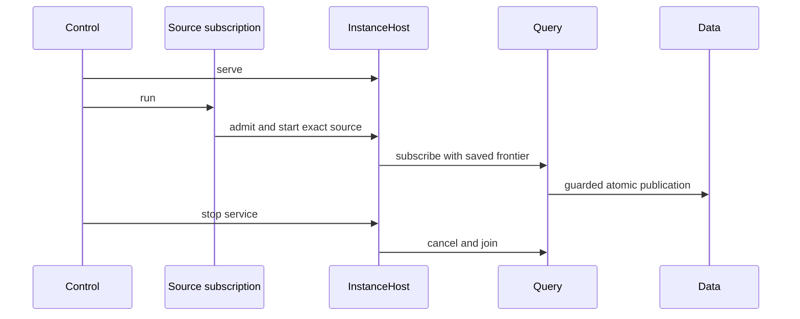

The Host owns one Data lease and one `FuturesUnordered` member collection.
The source feed owns membership and its source streams. The feed does not own
package execution streams. The prepared-instance handoff uses the existing
pause channel and waits for collection acceptance. Recovery without a retained
prepared owner uses native admission again. Installation and definition
admission start no worker. Service shutdown joins workers and preserves running
intent for restart. An explicit instance stop stores stopped intent.

Read the [Host lifecycle cases](../../crates/araphor-analysis/src/instance/host/tests/lifecycle.rs),
then the [Control shutdown case](../../crates/mithril-control/src/client_grpc/tests/packages/instance.rs).
`handoff255` passes all seven Host lifecycle cases. `fixture-owner255` passes
all 11 fixture cases, including actual source-built native calls. Control, Data,
and CLI fixture selection checks also pass. The exact [retirement record](../../recovery/araphor-input-fixture-retirement-20261022.json)
retains the commands, hashes, limits, and source archives. Source-isolation and
live Profile execution still have failed checks. The final shared Rust
procedure does not cover the current source.

### Current shared-owner qualification

The later frozen source in `manifest268` passes the focused shared-owner
checks. `ownership270` passes 12 lifecycle, slot-wait, source-denial, and caller
abort cases. `discovery-owner272` passes six constructor, context, source
membership, and finite-publication cases. `query-owner272` passes both native
clock cases. `joined270` passes saved-state capture after the old worker joins.
`live270` passes successive Profile publication, idle behavior, and shutdown
with the existing pool limits and deadlines.

[Shutdown::join](../../crates/araphor-analysis/src/instance/host.rs) retains the
source owner in a task that drains admission workers after cancellation.
Both feed-abort cases hold a real admission worker and verify that registration
or Graph interest stays held until that worker finishes. The feed still owns
no package execution collection.

[SourceSnapshot::read](../../crates/araphor-query/src/sources/rows.rs) treats an
explicit metadata read separately from a full source capture. It applies the
configured per-read byte bound and charges actual retained metadata. It does
not reserve all free input memory while it waits for Data. This prevents a
concurrent metadata read from rejecting a small Profile publication. Full
Snapshot, Page, and Changes reads keep their existing prepayment. The exact
metadata limit, full-pool rejection, release, recovery, and remaining-capacity
cases pass. A bound on all transient writer allocations is not established.

[Data lock guards](../../crates/araphor-data/src/analysis/read/locks.rs) release
the native lock before they notify waiters. A waiter registers for unlock and
cancellation before it tries the lock. A blocked synchronous caller waits for
those events or its exact deadline. The native lock still owns exclusion and
poison state. All 19 Data read and lock cases pass. The Data deadline monitor
still repeats a native interrupt after expiry; that remaining loop is not
qualified as an event-driven replacement.

[GraphOwner](../../crates/araphor-analysis/src/graph/feed.rs) derives source
membership from native Query streams and uses the same Host for Evaluate and
Expire instances. The scoped Data lease registers interest in future intake.
It does not remove durable Required progress when the feed stops. Six source
feed cases pass. [Control Graph startup](../../crates/mithril-control/src/service/packages/graph.rs)
now has an explicit, independent `graph_enabled` flag, disabled by default.
Its ordinary SQL program calls installed detector images. That restored
startup route and the complete Graph notice and expiry cases are still under
qualification.

The [owner retirement record](../../recovery/araphor-discovery-owner-retirement-20261022.json)
maps every declaration and method in the removed reference Discovery owner.
Its original bytes and exact test records are archived. There are 76 remaining
reference files. Complete retirement and the final shared Rust procedure are
**Not done**.

### Saved SQL and PRQL result reads

This route covers source state 293. The result is **Done** for exact saved
root-result reads and local queries. Public lifecycle, latest selection,
complete retirement, and final shared Rust CI remain **Not done**.

[Instance::manifest](../../crates/araphor-analysis/src/instance/manifest.rs) Native admission produces the root Arrow schema
  -> [ManagedManifest](../../crates/araphor-data/src/analysis/managed/model.rs) the immutable generation retains that schema with its call declarations
  -> [AnalysisStore::prepare_managed](../../crates/araphor-data/src/analysis/managed/commit.rs) publication checks the schema before it writes the root packet

[Control instance route](../../crates/mithril-control/src/client_grpc/packages.rs) An Inspect caller supplies an exact saved result ID
  -> [Instance::inspect](../../crates/araphor-analysis/src/instance/read.rs) Analysis checks fresh Inspect authority
  -> [AnalysisStore::managed_output](../../crates/araphor-data/src/analysis/managed/read.rs) Data selects a package-call result or a selected root result
  -> [AnalysisStore::validate_selected_header](../../crates/araphor-data/src/analysis/managed/selected.rs) Data checks the saved attempt, receipt, generation, scope, dependencies, and call bindings
  -> [AnalysisStore::managed_output](../../crates/araphor-data/src/analysis/managed/read.rs) Data checks the captured selection before it loads the selected Arrow payload
  -> [AnalysisStore::decode_selected_record](../../crates/araphor-data/src/analysis/managed/selected.rs) Data checks the decoded row count and exact saved schema
  -> [Instance::read_output](../../crates/araphor-analysis/src/instance/read.rs) Analysis returns the original packet through the existing Output or Result reply
  -> [Instance::inspect](../../crates/araphor-analysis/src/instance/read.rs) Analysis checks current Inspect authority before disclosure

[Instance::query_result](../../crates/araphor-analysis/src/instance/read.rs) A caller queries the exact saved result
  -> [AnalysisStore::managed_output](../../crates/araphor-data/src/analysis/managed/read.rs) Data supplies the same guarded read and decoded arrays
  -> [Instance::query_result](../../crates/araphor-analysis/src/instance/read.rs) Analysis releases the unused wire packet before query execution
  -> [Session::query_local](../../crates/araphor-query/src/execution/local.rs) Query uses the decoded datasets as native local tables

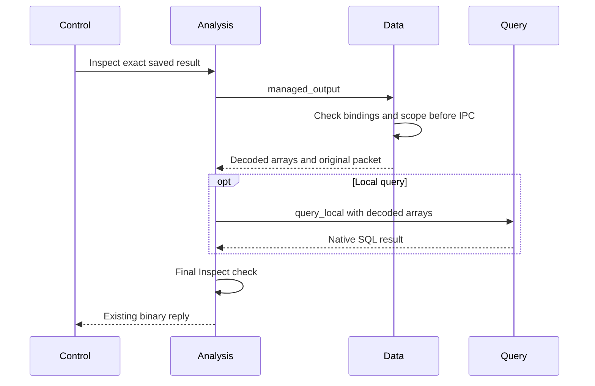

ManagedOutput is an internal typed result. It adds no wire variant or output
store. Each Data result read uses one reader transaction and one Arrow
Interprocess Communication (IPC) decode. The existing outer Instance metadata
lookup remains separate. A read does not execute the producer or require its
current Run permission. Call results retain their complete metadata and model
limits. Selected results use the existing Query configuration and native SQL.

The shared selected-header validator also serves recovery. A result reference
must match its stored call ID, attempt, instance, revision, and saved manifest
declaration. Membership in the set of declared call IDs is insufficient.
The [swapped-call check](../../crates/araphor-data/src/analysis/managed/tests/output.rs)
exchanges two valid IDs without changing dependency references. The reader
rejects that corruption before it decodes selected IPC.

The retained manifest now requires selected_schema. No decoder for an older
manifest format is added. Native storage keeps dictionary, map, zero-column,
and scalar Arrow checks. The public local-query route keeps its existing SDK
type-validation boundary.

Read the [Data output checks](../../crates/araphor-data/src/analysis/managed/tests/output.rs),
the [Analysis selected-result checks](../../crates/araphor-analysis/src/instance/tests/history/selected.rs),
and the [Control binary route check](../../crates/mithril-control/src/client_grpc/tests/packages/instance.rs).
The source-state-293 groups pass 95 Data, 22 Analysis, nine Query, and seven
Control checks. They include actual SQL, empty SQL, PRQL compilation, historical
schemas, scope before corrupt payload, final disclosure, and native replay.
These focused results do not replace the final shared Rust procedure.


### Earlier verification limit

The earlier unchanged-source run is `final-ci324`. Formatting, workspace
checking, and strict Clippy pass. The root agent interrupts the test stage
before the preparation contract decision. Full Rust CI remains **Not done**.
`preflight324` separately confirms the input-error precedence failure and the
passing compile-before-Query-timeout contract. The implementation and tests
for that conflict remain unchanged. The 56 remaining reference files stay intact.
Running execution must continue to derive from Query subscription streams.


## Package contract without quotas

The 2026-10-23 working tree removes package-specific size and count policies.
Current focused qualification passes. Read the owners in execution order:

[Model](../../crates/araphor-analysis-sdk/src/model.rs) defines the typed package export.
  -> [EvaluationContext](../../crates/araphor-analysis-sdk/src/evaluation.rs) carries identity, time, and seed.
  -> [PackageExec](../../crates/araphor-query/src/definition/physical.rs) consumes native Arrow streams and retains shared buffer leases.
  -> [SQL children](../../crates/araphor-query/src/definition/physical/sql.rs) use the native physical execution plans.
  -> [Runtime](../../crates/araphor-package-runtime/src/lib.rs) invokes Wasm or the in-process native accessor.
  -> [CheckedEvaluation](../../crates/araphor-analysis-sdk/src/validation.rs) validates schema, state, and row references.
  -> [Data](../../crates/araphor-data/src/analysis/managed/commit.rs) retains atomic publication authority.

The SDK native producer exports `araphor_analysis_get_api_v1`. The C header
and Rust context have the same current layout. The Wasm interface stays
`araphor:analysis@1.0.0`. Development changes do not increase version numbers.
Rebuild native and Wasm artifacts after the context fields change.
The host copy allowance describes an existing shared memory reservation.
The allowance is not a field in package metadata or an invocation policy.

The local SQL tests check native `LIMIT` selection and unrestricted batches.
Schema, catalog exclusion, original indices, empty metadata, cancellation,
state, provenance, and final buffer release checks remain. No polling task or
new execution owner is added. All 143 focused checks, strict Clippy, formatting,
and library test compilation pass. The
[qualification record](../../recovery/araphor-package-quota-removal-20261023.json)
contains commands, source identities, binary hashes, and exact results. The user
requires relevant tests only. The full workspace test suite is not run.


## Native replacement for preparation and installed execution

The 2026-10-23 working tree retires the old preparation and installed execution
owners after focused qualification. Read the current owners in this order:

[Instance::run](../../crates/araphor-analysis/src/instance/mod.rs) requests one managed step.
  -> [Session::run_managed](../../crates/araphor-query/src/execution/admission.rs) opens the same Query subscription used by continuous execution.
  -> [Runtime::evaluate](../../crates/araphor-query/src/stream/physical/runtime.rs) captures the native source view and saved state.
  -> [PackageExec](../../crates/araphor-query/src/definition/physical.rs) consumes native Arrow children and checks the complete return.
  -> [Publication](../../crates/araphor-analysis/src/instance/sink.rs) checks current authority and returned call identity.
  -> [Data](../../crates/araphor-data/src/analysis/managed/commit.rs) commits outputs, state, and progress together.

[The restart test](../../crates/araphor-analysis/src/instance/tests/restart.rs)
keeps shared input capacity occupied through a relevant source change. It
checks idle reuse, the typed capacity failure, unchanged saved state, joined
cancellation, and successful restart after release.
[The guest tests](../../crates/araphor-query/src/definition/tests/guest.rs)
check actual invocation bytes before guest execution and shared output
reservation before transfer. The
[physical exchange](../../crates/araphor-query/src/definition/physical/guest.rs)
uses the existing engine output setting; it does not restore SDK quotas.
[The slot tests](../../crates/araphor-analysis/src/instance/subscription/tests/capacity.rs)
keep the original captured offer while another guest occupies its execution
slot. Unrelated SQL can complete, and cancellation joins the original worker.

[managed_subscription](../../crates/araphor-analysis/src/instance/tests.rs)
checks actual Wasm and Native results through public inspection. A source
addition makes the retained result noncurrent before the next stream step.
The complete packet, prior receipt, progress, and Data revision stay unchanged.
The source hashes, exact selectors, retained failures, and removal archive are
in the [qualification record](../../recovery/araphor-preparation-execution-retirement-20261023.json).
The 61 focused checks, formatting, strict Clippy, and test compilation pass.
The full workspace suite is not run. Complete retirement remains **Not done**.


## Shared lifecycle and retained-output qualification

Read [Host request dispatch](../../crates/araphor-analysis/src/instance/host/request.rs),
then [Host lifecycle](../../crates/araphor-analysis/src/instance/host/lifecycle.rs),
then [Instance publication](../../crates/araphor-analysis/src/instance/sink.rs).
The caller grant authorizes the requested control operation. The saved execution
grant remains the execution identity until explicit stopped renewal. Data checks
both authorities before publication.

[Public control tests](../../crates/araphor-analysis/src/instance/tests/control.rs)
check shared control and caller revocation.
[Renewal tests](../../crates/araphor-analysis/src/instance/tests/renewal.rs) check
exact pins and canonical image bytes, saved state, prior output, and restart.
Cold Host renewal uses the common admission constructor; it does not reuse an
allocation owned by a separate Instance.

The [qualification record](../../recovery/araphor-package-tests-retirement-20261023.json)
contains the old-to-current assertion map, 83 passing selectors, and verified
archive hashes for eleven removed reference test files.

For current capture recovery, read [SourceRecovery::changed](../../crates/araphor-query/src/stream/recovery.rs)
after the Host joins the failed subscription. It keeps attached Query Progress
deadlines and scoped dependency checks. The reduction removes 24 net nonblank
production lines, and all five existing recovery checks pass on source state
350. The old deadline tests first capture successfully. They do not require a
deadline after a first failed capture. The
[latest retirement record](../../recovery/araphor-qualified-leaves-retirement-20261023.json)
records 189 retired files and 19 unchanged reference files, with the archive
hash and exact proof. Pre-admission stale-source recovery, Graph feed
qualification, and native Discovery SQL and managed-window qualification
remain **Not done**.


## Known rollback after joined execution

Read [Instance::execute_step](../../crates/araphor-analysis/src/instance/mod.rs)
and [Subscription::cancel_and_join](../../crates/araphor-analysis/src/instance/subscription.rs).
Both paths use [Data::finish_managed](../../crates/araphor-data/src/analysis/managed/terminal.rs)
after Query joins the native work. Data checks the original live claim, capture,
and registration before it saves a terminal result. A loaded pending claim
cannot finish that execution. The removed `Step.publishing` flag does not supply
a second publication-state decision.

The [Data writer](../../crates/araphor-data/src/analysis/connection.rs) rejects
writes after an uncertain commit. Existing recovery must check durable state
before writes resume. Terminal cleanup does not replace a saved success receipt
or infer rollback from an uncertain commit.

[Finite rollback](../../crates/araphor-analysis/src/instance/tests/finite.rs)
checks terminal `Failed(Invalid)`, no selected output, zero progress, exact
request rejection after termination, and a new successful request on the same
Instance. [Pending-claim checks](../../crates/araphor-analysis/src/instance/host/tests.rs)
keep the cancelled claim unresolved. [Follow checks](../../crates/araphor-analysis/src/instance/subscription/tests.rs)
retain failed-writer cleanup and the saved receipt after a notice error.
[Data claim checks](../../crates/araphor-data/src/analysis/managed/tests/terminal.rs),
[commit checks](../../crates/araphor-data/src/analysis/connection.rs), and
[crash checks](../../crates/araphor-data/src/analysis/managed/tests.rs) retain the
existing uncertainty and all-or-none commit guarantees.

The four Analysis checks and three Data checks pass on source state 359.
The [bounded result](../plans/araphor-analysis-migration.md#joined-cleanup-after-known-rollback)
records the commands and evidence locations. Discovery historical repair still
fails later with `Elapsed`; Graph failed-feed recovery still fails at cursor
258. No reference file retires. The totals stay at 189 retired and 19 unchanged
files. These results do not establish complete retirement or overall reduction.


## Native managed publication continuation

The source-state-360 correction keeps execution inside the existing native
subscription stream. Read the owners in this order:

[Publication::write_all](../../crates/araphor-analysis/src/instance/sink.rs) Native DataFusion sends the complete selected relation to the publication sink.
  -> [Data::commit_managed_projection](../../crates/araphor-data/src/analysis/managed/commit.rs) Data commits output, call state, the domain projection, and the receipt atomically.
  -> [ExecutionReceipt::acknowledge](../../crates/araphor-query/src/definition/physical.rs) The sink acknowledges the committed revision when its domain cut is complete.
  -> [Runtime::evaluate](../../crates/araphor-query/src/stream/physical/runtime.rs) Query returns the physical result and keeps `exhausted` false while managed work remains.
  -> [Runtime::next_event](../../crates/araphor-query/src/stream/physical/runtime.rs) The next stream poll continues without another source notice.
  -> [Run::session](../../crates/araphor-query/src/stream/mod.rs) The next evaluation begins with fresh managed state and the existing authoritative capture.

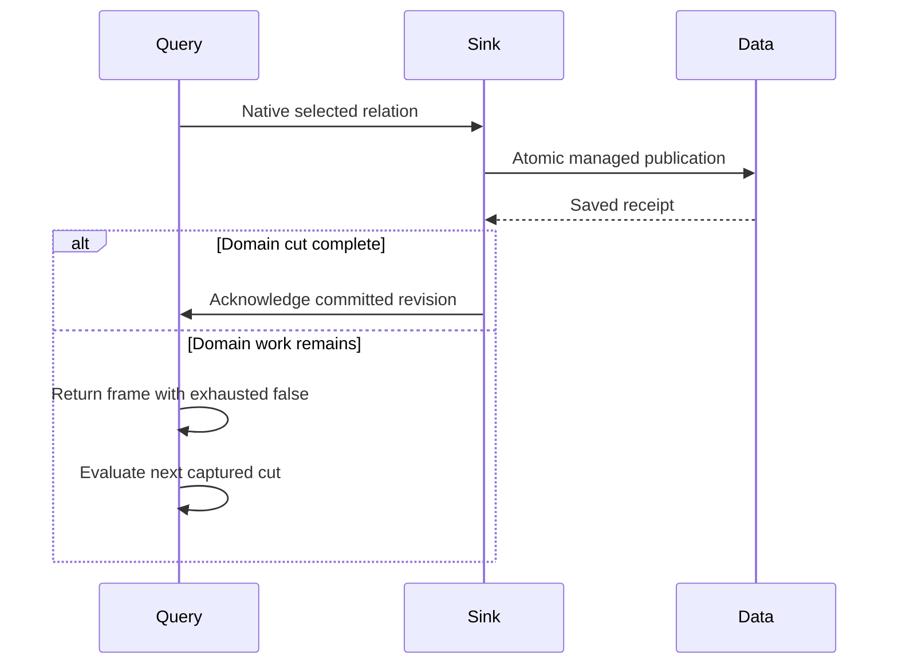

`CallContext` owns the acknowledgement for one evaluation. The acknowledgement
starts at zero. The sink stores the saved receipt before it acknowledges a
completed cut. A pending cut returns its receipt without that acknowledgement.
The existing Data claim, source, prior-state, producer, and authority checks
remain in force. `Event.completed` still describes physical output delivery;
it does not describe completion of all domain work.

[Subscription::managed_once](../../crates/araphor-query/src/follow/managed.rs)
consumes one frame and joins. The continuous runtime uses the same execution
path for later frames. The correction adds no persistent continuation token,
execution owner, clock, or API.

[replace_drains_pending_publications](../../crates/araphor-query/src/definition/tests/captured/managed.rs)
checks two pending frames, one completed frame, exact native admission and
commit counts, unchanged Data metadata, and idle completion. All 15 checks in
`definition::tests::captured::managed` pass.
[failed_feed_recovers_source](../../crates/araphor-analysis/src/graph/native/tests/feed.rs)
checks the actual shared Host with Wasm, sibling progress during failure,
same-frontier recovery, immutable prior output, repaired context at cursor
258, joined shutdown, and released input memory. That check also passes.

The [retirement record](../../recovery/araphor-graph-package-retirement-20261023.json)
identifies the ten retired Graph and package files and their exact prior
assertion maps. The totals become 199 retired and nine unchanged files.
Discovery historical repair still fails in `discovery-repair360`; its fixture
grant selects no context keys. That case and complete retirement remain
**Not done**. These focused results do not establish a passing full workspace
suite or the required overall production reduction.


## Saved native continuation and current proof

The source-state results above are historical. The current source-state-367
checkpoint covers 48 files. Read the existing
[Instance sink](../../crates/araphor-analysis/src/instance/sink.rs),
[Data receipt](../../crates/araphor-data/src/analysis/managed/commit.rs), then
[Query resume](../../crates/araphor-query/src/stream/physical.rs).
Data saves `ManagedFrontier.pending` with the output, state, progress and domain
projection. The receipt keeps the exact offered cursor and deadline. Successful
resume returns that receipt frontier; failed cuts keep the offered frontier.
Query continues known pending work before waiting for a source notice. Saved
fixed window bounds and completed-window filtering stay in the same path.
The [shared execution boundary](../../crates/araphor-query/src/execution.rs)
uses the existing `Parser::stack` guard for native polls.

Both [Discovery managed checks](../../crates/araphor-analysis/src/discovery/tests/managed.rs)
pass in 237.34 seconds with the default execution stack and unchanged
observers. Historical repair preserves the current head, saved body, source
cursor and producer through cancellation, reopen and replay. The window check
closes its saved interval without new intake. Compilation and formatting pass.
Strict Clippy passes for Analysis, Query and Data. Profile conversion failure
and supplied-input-before-compilation checks pass. Query's 16 checks and Data's
11 checks from source state 366 remain valid: all 453 owner and shared
dependency source hashes match source state 367.

Graph's current group has five individual passes and one failure. The existing
30-second same-frontier observer expires in `failed_feed_recovers_source`.
A debugger sample shows OCI validation through `context_retry` during
publication; it is not a passing recovery check or proof of the sole cause.
The [source checkpoint](../../recovery/araphor-analysis-source-checkpoint-20261023.json)
records the exact commands, sources, binaries, passes and failure. There are
199 retired files and nine unchanged reference files. Keep those nine files.
Current Graph recovery, final archive custody and complete retirement remain
**Not done**. These results do not establish a passing full workspace suite or
overall production reduction.


## Exact context retries

[Data context writes](../../crates/araphor-data/src/analysis/context/write.rs)
validate the input before the exact retry check, in the same writer transaction.
The context-local row reader keeps structural decoding and nonzero revision
checks. An equal stored value reuses that input validation. A different stored
value receives full package validation before Conflict.
[Checked reads](../../crates/araphor-data/src/analysis/context/reads.rs) still
validate the current OCI artifact bytes. No saved digest replaces that check.

All 16 focused Data checks pass, including exact retries, stored corruption,
artifact corruption and atomic publication. The Graph unchanged-source retry
passes its original observer. The same test later fails at repaired cursor 258.
Read the [consolidation record](../../recovery/araphor-context-retry-consolidation-20261023.json).
Complete Graph recovery and the final nine-file removal remain **Not done**.


## Fresh native Layout validation

[PackageBundleV1::checked_layout](../../crates/araphor-package/src/admission.rs)
builds one fresh native OCI Layout from the actual closure and artifact bytes.
A matching digest runs the complete structure, dependency and order checks.
[NativePackageContext::validate](../../crates/araphor-data/src/package/provenance.rs)
then checks the exact selected output. The
[context reader](../../crates/araphor-data/src/analysis/context/provenance.rs)
parses the context once and keeps its actual artifact reads. This replaces two
fresh Layout constructions and duplicate context parsing on that path. Public
bundle and context validation retain their complete checks. A saved digest
does not replace artifact validation.

Compilation and formatting pass on source state 369. All four Package checks
and 17 Data checks pass, including corruption, dependency artifact pins,
exact retries and atomic publication. The complete Graph recovery check passes
in 180.11 seconds with its original observers. Read the
[consolidation record](../../recovery/araphor-native-layout-validation-20261023.json)
for source, command, binary and log hashes. The final nine reference files
remain. Final reference removal is **Not done**.


## Complete reference retirement

Result: **Done** for removal of `araphor-analysis_back`. All 208 original
files are retired; zero remain. The final 42 focused checks, affected library
compilation, formatting and strict Clippy pass. These checks include pending
continuation, windows, cancellation, atomic publication, artifact corruption,
Graph repair, Discovery repair, restart and replay. The original recovery
observers remain unchanged.

The [final record](../../recovery/araphor-analysis-back-retirement-20261023.json)
identifies the source, method map, commands, binaries, logs and deletion cut.
The [verified archive](../../recovery/araphor-final-checkpoint-20261023.tar.gz)
contains all 208 original files, 56 selected current source files, and 124
proof files. Its member hashes and original Git bytes were verified before
the final nine files were removed. No active Back dependency remains.

Execution stays in native Query subscriptions, the shared Instance Host and
Data transactions. Complete migration, `DataReadMonitor` removal, and the
required 6,000-line net production reduction remain **Not done**. This result
claims no full-workspace pass or whole-migration production total.

## Scoped native interruption

This section covers the TODO 12 working-tree changes based on `d596f463`.
DataFusion retains parsing, planning, optimization and query execution. Data
retains DuckDB transactions. The pinned DuckDB driver lacks an interrupt scope;
its statement reset can erase a cancellation sent before a statement starts.
The local driver patch supplies that scope at the native storage boundary.
Read the [source and patch record](../../vendor/README.md).

### Intended end state

Data and Wasm wait for cancellation, completion or an explicit deadline.
Neither owner sends periodic interrupts. Cancelled work releases its resources
and cannot return a successful result. A later operation can reuse the reader.

[AnalysisReadControl::native_run](../../crates/araphor-data/src/analysis/read.rs) Data registers a read and its native interrupt scope
  -> [ReadMonitor::enter](../../crates/araphor-data/src/analysis/read.rs) Data registers the optional exact deadline
  -> [ReadMonitor::run](../../crates/araphor-data/src/analysis/read.rs) the deadline worker sends one interrupt at expiry
  -> [native interrupt patch](../../vendor/libduckdb-sys/interrupt_scope.rs) DuckDB retains cancellation across statement resets

[AnalysisReadControl::cancel](../../crates/araphor-data/src/analysis/read.rs) A caller cancels the read
  -> [InterruptHandle](../../vendor/duckdb/src/inner_connection.rs) the existing handle interrupts the active native scope
  -> [AnalysisReadControl::native_run](../../crates/araphor-data/src/analysis/read.rs) Data stops both interrupt sources and releases the scope
  -> [AnalysisReadControl::run](../../crates/araphor-data/src/analysis/read.rs) Data rolls back the snapshot and rejects cancelled output

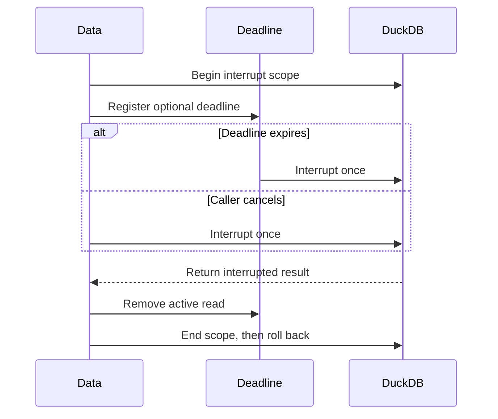

`ReadMonitor` owns one active deadline and reuses its worker. An expired read
keeps its reservation until `ReadStage` drops. The worker disarms the deadline
after one interrupt and waits on `Notify`. A default read starts no worker.
[Data lock waits](../../crates/araphor-data/src/analysis/read/locks.rs) already
use unlock notifications, cancellation and exact deadlines; they are unchanged.

The native scope has one atomic state: inactive, active or cancelled. A failed
nested scope leaves the outer state unchanged. Every native interrupt reset
preserves a cancelled scope. Data removes the deadline registration and the
cancellation handle before the Rust guard ends the scope. Rollback then uses
ordinary DuckDB behavior. The guard also permits safe drop after connection
close. No new query planner, executor, result decoder or contract is added.

[Wasm EpochWatch](../../crates/araphor-package-runtime/src/wasm/execution.rs)
already waits on completion, cancellation and an exact deadline. It sends the
native Wasmtime epoch interrupt for that event. Its implementation is unchanged.

### Focused proof

The 17 [Data read checks](../../crates/araphor-data/src/analysis/read.rs) and
four [lock checks](../../crates/araphor-data/src/analysis/read/locks/tests.rs)
pass. New checks prove cancellation before native startup, between statements,
prepared execution, nested-scope rejection, closed-connection guard drop and
reuse after expiry. Existing checks retain active-query interruption, rollback,
reader replacement and repeated connection reuse. Cancellation helpers send
one event; they no longer repeat cancellation in a loop.

Six [Query execution checks](../../crates/araphor-query/src/execution/tests.rs)
pass: `blocking_cancel_joins_worker`, `blocking_drop_orders_cleanup`,
`blocking_deadline_keeps_parent`, `cancellation_stops_native_producers`,
`local_producer_cancel` and `planning_cancel_joins_worker`.
Six [Wasm Runtime checks](../../crates/araphor-package-runtime/src/wasm/tests/runtime.rs)
pass: `component_control_interrupts_runs`,
`runtime_cancellation_joins_guest_and_releases_capacity`,
`dropped_runtime_future_retains_worker_until_completion`,
`runtime_deadline_joins_queued_worker`,
[`explicit_timeout_interrupts_component`](../../crates/araphor-package-runtime/src/wasm/tests/runtime/quotas.rs)
and [`admission_cancellation_and_zero`](../../crates/araphor-package-runtime/src/wasm/tests/runtime/admission.rs).
The current binaries are `araphor_query-d0b4984f12e9417d` and
`araphor_package_runtime-0a4627c47c1a8174` under `target/debug/deps`. Each runs
the six listed names as positional filters with `--test-threads=2`.

The bundled cc backend is tested on this Linux host. Strict Clippy passes for
Data, Query and Package Runtime, including their test targets. The CMake
backend and other platforms are not executed. No
full-workspace CI or performance result is claimed.

## Traversal requests select saved graph versions

This delivery covers the working-tree changes based on `98df70280`.
DataFusion retains query parsing, planning, optimization and physical execution.
Data resolves the permitted graph versions inside the existing captured read.
That delivery leaves the SDK completeness metadata part of TODO 3 **Not done**.
The later [metadata delivery](#captured-graph-coverage-in-sdk-inputs) closes it.

### Intended end state

A traversal that requests old result R1 reads R1 after R2 replaces the current
head. The requested ID cannot widen the caller's tenant, source or binding
permission. An empty ID list retains the current-head selection.

[AnalysisStore::resolve_selection](../../crates/araphor-data/src/analysis/extraction.rs) Data receives a permitted selection and a traversal request
  -> [AnalysisStore::resolve_selection](../../crates/araphor-data/src/analysis/extraction.rs) Data checks requested IDs against an explicit graph selection
  -> [AnalysisStore::resolve_selection](../../crates/araphor-data/src/analysis/extraction.rs) Data resolves nonempty request IDs before current-head expansion
  -> [GraphRows](../../crates/araphor-data/src/analysis/graph_rows/mod.rs) the existing reader loads those exact retained versions
  -> [AnalysisStore::traversal_scope](../../crates/araphor-data/src/analysis/extraction/graph/traversal/versions.rs) Data checks source and binding permission in the same snapshot

The resolver checks the input selection and the normalized selection with the
existing optional key and byte budgets. It adds no limit, selection owner,
codec or read transaction. Missing versions retain the existing read-denied
result. The prior borrowed fast path cannot bypass the requested-ID check.

The [Data history check](../../crates/araphor-data/src/analysis/extraction.rs)
passes for current heads, old pins under `All`, explicit allowed subsets,
denied subsets and configured allocation accounting. The
[native traversal history check](../../crates/araphor-analysis/src/graph/tests/traversal/recovery.rs)
now requests old and absent IDs without a second selection workaround. It also
checks a requested version with no permitted source. Both focused checks and
formatting pass. Strict Clippy for the complete TODO 3 delivery passes with the
metadata delivery below.
The correction adds 18 nonblank production Rust lines, excluding comments.
The overall production reduction target remains open. No full-workspace CI or
performance result is claimed.

## Captured graph coverage in SDK inputs

This delivery covers the working-tree changes based on `8b8a119b7`.
Result: **Done** for TODO 3. DataFusion retains parsing, logical planning,
optimization, physical planning and execution. No query language, graph row
codec, planner, executor or subscription owner is added.

### Read in this order

1. [Data extraction](../../crates/araphor-data/src/analysis/extraction.rs)
   owns the permitted read snapshot, graph-version selection and allocation
   accounting. Its read-only `graph_coverage` lookup exposes captured metadata.
2. [Graph capture](../../crates/araphor-data/src/analysis/extraction/graph.rs)
   converts the already loaded typed manifest to SDK coverage. The
   [traversal header path](../../crates/araphor-data/src/analysis/extraction/graph/traversal/versions.rs)
   does this before it skips empty graph rows. It adds no store read.
3. [Capture completion](../../crates/araphor-data/src/analysis/extraction/tables/mod.rs)
   sorts the captured graph IDs once. The lookup uses binary search. Existing
   Data budgets charge the vector, IDs and reason strings.
4. [Query receipts](../../crates/araphor-query/src/inputs/receipt.rs) combine
   coverage only for the selected graph result references. A missing captured
   entry returns the existing incomplete-input error. The existing receipt
   hash still owns the input revision.
5. [SDK coverage](../../crates/araphor-analysis-sdk/src/evaluation.rs) owns one
   heap-size count for coverage strings. SDK Memory and Data capture reuse it.
   The SDK contract, wire format and versions do not change.
6. [Installed Wasm checks](../../crates/araphor-analysis/src/graph/tests/traversal/metadata.rs)
   execute the existing `echo-inputs` component through native Query. They
   compare returned rows, schemas, revisions and coverage with the captured
   inputs.

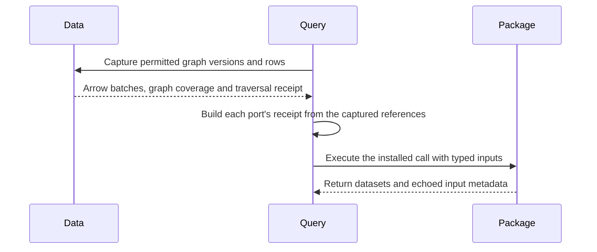

Graph inputs use the selected saved versions' coverage. They do not decode
current source coverage and then discard it. Within graph coverage, a known
gap takes precedence over an unknown range. Missing ranges add
`GRAPH_INPUT_GAPS`. Reason strings are unique and sorted. No selected graph
version returns `Unknown` with `NO_SELECTED_GRAPH_VERSION`. A traversal
boundary adds `GRAPH_HOP_BOUNDARY` and returns `Unknown`, unless a known gap
already requires `Gapped`. Event and local-only inputs receive no graph reason.
Mixed and inherited inputs retain the existing general coverage combination.

Empty graphs retain coverage even when SQL does not project `graph_manifest`.
Their Arrow schemas remain present. Existing input reservations retain their
buffers until the final reference drops. The fixture replacement helper now
reads the current window head once before it replaces that window. Production
still rejects a replacement that names a stale parent.

### Focused proof

All 55 distinct focused cases pass: 15 SDK checks, 21 Data checks, eight Query
checks and 11 Analysis traversal checks. The checks cover exact old versions,
tenant/source/binding permission, complete and unknown coverage, known gaps,
empty graphs, hop boundaries, buffer lifetime, configured allocation limits
and native Arrow offset overflow. The overflow check supplies lengths to the
existing native table builder; it makes no large allocation. The seven old
graph SDK assertion groups remain covered by these connected checks.

Build the affected test targets with this command:

```sh
env CARGO_INCREMENTAL=0 CARGO_PROFILE_DEV_DEBUG=1 CARGO_PROFILE_TEST_DEBUG=1 \
  cargo test --locked --offline -p araphor-analysis-sdk -p araphor-data -p araphor-query -p araphor-analysis --lib --no-run --message-format=short
```

The final passing binaries under `target/debug/deps` use these selections.
Each command ends with `--test-threads=2`:

```sh
araphor_analysis_sdk-bf0f6cb2d84c047e memory::tests:: tests::graph:: wire::tests::buffers:: --test-threads=2
araphor_data-1ac346e6fdbeb57b analysis::extraction::tables::tests:: analysis::extraction::tests::analysis_exact_graph_history --test-threads=2
araphor_query-efab3e35827cb2fd ports_keep_cursor_union dependent_ports_share_indices materialized_name_is_not_durable port_receipts_stay_scoped disjoint_ports_exclude_gap_witness function_does_not_inherit_table registration_reuses_input_claims buffers_outlive_producer_permits --test-threads=2
araphor_analysis-4841a56580799f87 graph::tests::traversal:: --test-threads=2
```

The final fixture correction is built with the same environment and
`cargo test --locked --offline -p araphor-analysis --lib --no-run --message-format=short`.
The other three binaries cover unchanged final source. Scoped formatting and
strict Clippy pass. Clippy includes all four affected owners and their tests:

```sh
env CARGO_INCREMENTAL=0 CARGO_PROFILE_DEV_DEBUG=1 CARGO_PROFILE_TEST_DEBUG=1 \
  cargo clippy --locked --offline -p araphor-analysis-sdk -p araphor-data -p araphor-query -p araphor-analysis --lib --tests --message-format=short -- -D warnings
```

This metadata delivery adds 174 and removes 29 nonblank production Rust lines,
excluding comments: net **+145**. Together with the history correction, TODO 3
adds **163** such lines. Tests and documents are excluded. The overall
6,000-line reduction target remains open. Qualification covers this Linux
host and the installed Wasm component. Full-workspace CI, other platforms and
benchmarks do not run for this delivery.


## Discovery continuation across expired input

This review covers the working-tree changes based on `a2f6cf800`.
Result: **Done** for TODO 8. All 58 focused checks pass.

A permitted Discovery instance processes retained records and records each proven
expired range. One native package evaluation covers all selected retained ranges.
Data publishes the profile, gaps and progress in the existing managed transaction.

### Review flow

[Instance::subscribe](../../crates/araphor-analysis/src/instance/subscription.rs) the managed instance opens its native Query subscription
  -> [Runtime::evaluate](../../crates/araphor-query/src/stream/physical/runtime.rs) Query captures the selected Arrow inputs and source metadata
  -> [Capture::input_unbounded](../../crates/araphor-data/src/analysis/extraction/tables/mod.rs) Data records the time, cursor and physical event-range scope
  -> [LIVE_STATE_SQL](../../crates/araphor-analysis/src/package/builtin.rs) native SQL selects the endpoint for that captured scope
  -> [Discovery live SQL](../../crates/araphor-analysis-builtins/src/discovery/sql/live.sql) native SQL matches expiry proofs, checks the full cursor interval and derives one profile
  -> [PackageExec::collect](../../crates/araphor-query/src/definition/physical.rs) Query normalizes each native batch to the declared SDK schema
  -> [DiscoveryOwner::convert_profile](../../crates/araphor-analysis/src/discovery/publication/managed.rs) Analysis converts the actual returned profile and captured state
  -> [AnalysisStore::progress_rows](../../crates/araphor-data/src/analysis/progress.rs) Data checks the expected position, current head and exact expiry proof
  -> [AnalysisStore::commit_managed_projection](../../crates/araphor-data/src/analysis/managed/commit.rs) Data commits the profile, processor gaps, progress and managed result atomically

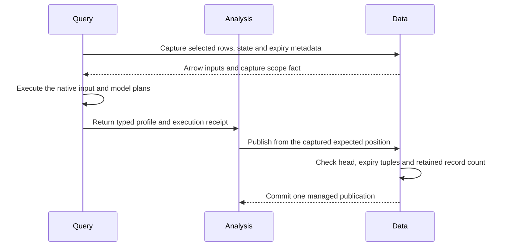

### Scope and proof rules

`input_unbounded` is a captured scope fact. Data sets this field only when the
time and cursor ranges cover the full domain and the physical event ranges are
absent or exactly `[(0, u64::MAX)]`. Empty, bounded and split event ranges do not
qualify. The field grants no permission and starts no execution.

The endpoint includes the captured frontier and the maximum selected event
cursor. Only an unbounded capture can also include the maximum matching expiry
endpoint. This rule permits an expired tail after an already processed record.
A bounded cursor cut or empty time window cannot advance from expiry metadata
outside that cut.

Live SQL matches `kind = expired`, the full source identity and CPU ID. It clips
each proof to `(frontier, endpoint]`. Distinct appended records plus proven
expired cursors must cover that interval exactly. A retained row excluded by an
SQL filter is not an expiry proof. Missing or unknown coverage grants no skip.
An unexplained hole still fails the input frontier check.

The profile keeps cumulative counts, input bytes and prior gaps for an open
interval. A new interval after a sealed profile starts fresh counts. An
expiry-only interval can contain zero records and still report `incomplete`.
Retained records keep their coverage; expired records do not become accepted
records or fabricated Arrow rows.

Native SQL produces UInt64 `first_cursor`, `last_cursor` and `commit_revision`
fields. DataFusion `named_struct` marks these children nullable. Native
`arrow_cast` expressions widen the prior gaps before `UNION` and the saved
gap list before the final `CASE`. They do not narrow native SQL nullability.
The existing [Dataset::normalize_batch](../../crates/araphor-analysis-sdk/src/batch.rs)
enforces the declared strict schema at admission and physical collection.
The SDK schema and validation rules are unchanged. No separate gap decoder,
coercer or result format is added.

Data accepts new expiry gaps only for optional Discovery. The existing expected
position and current-head checks reject a stale capture. Data matches every gap
against its retained expiry row, source key and expiry revision. The checked
retained-record count plus proven gaps must equal the claimed cursor advance.
The profile validator also rejects invalid or overlapping gap ranges.

[progress_rows](../../crates/araphor-data/src/analysis/progress.rs) inserts the
proven gaps and advances the processor in the profile transaction.
[commit_managed_profile](../../crates/araphor-data/src/analysis/progress/profile.rs)
uses the existing managed publication transaction and final control check.
Instance publication retains its separate authorization checks.
A failed guard leaves no partial profile, gap or progress change. Each gap keeps
its actual expiry commit revision. The later profile and managed publication
have their own commit revision. The two revisions are not interchangeable.
The standalone optional-resume API keeps its existing revision behavior and
shares the processor-gap insertion with this path.

### Focused proof

The four [connected retention checks](../../crates/araphor-analysis/src/discovery/tests/managed/retention.rs)
pass. They cover real prefix, interior and multiple gaps; exact gap tuples;
counts, coverage and bytes; bootstrap, reopen and later subscription updates;
open and sealed expired tails; and bounded cursor and time cuts. Public backup
seals the small raw segments. The normal retention owner removes those segments.
The checks use the existing managed Instance and Query subscription APIs.

The [Data gap checks](../../crates/araphor-data/src/analysis/progress/profile/tests/gaps.rs)
cover atomic rollback, expiry revision identity, stale progress, wrong proof,
required-processor rejection and clipped ranges. All 39 distinct focused Data checks
and 19 focused Analysis checks pass. The existing
[missing-input and supplied-gap checks](../../crates/araphor-analysis/src/package/tests/sql/recorded/live.rs)
retain the distinction between an unexplained hole and a proven expiry.
The 14 compatibility cases pass. No production source changes follow these
passing checks.

Build both affected test binaries with the existing dependency lock and debug
settings:

```sh
env CARGO_INCREMENTAL=0 CARGO_PROFILE_DEV_DEBUG=1 CARGO_PROFILE_TEST_DEBUG=1 \
  cargo test --locked --offline -p araphor-data -p araphor-analysis --lib --no-run --message-format=short
```

The final Analysis binary passes the following 19 distinct checks. The
connected retention group has four cases, the exact SQL case has one, and the
last selection has 14. They take 327.60, 83.71 and 700.43 seconds, respectively.
Each group passes after the final SQL correction.

```sh
target/debug/deps/araphor_analysis-3d191244da43d744 discovery::tests::managed::retention:: --nocapture --test-threads=2
target/debug/deps/araphor_analysis-3d191244da43d744 package::tests::sql::recorded::live::live_proves_expired_ranges --exact --nocapture
target/debug/deps/araphor_analysis-3d191244da43d744 discovery::tests::managed:: package::tests::sql::recorded::live:: --skip discovery::tests::managed::retention:: --skip live_proves_expired_ranges --nocapture --test-threads=2
```

The Data proof covers 21 extraction-table checks, 13 profile checks and five
existing progress checks. The initial extraction/profile selection passes 33
cases and rejects the old discovery-state schema hash. After the expected
hash is updated, `schema_contract` passes. The final binary also passes that
case and the renamed `input_scope_is_unbounded` case. Other Data production
source is unchanged between these checks. These are 39 distinct passes;
they are not a new 39-case combined run.

```sh
target/debug/deps/araphor_data-5d0b7652ddd1723a analysis::progress::tests:: --test-threads=2
target/debug/deps/araphor_data-5d0b7652ddd1723a input_scope_is_unbounded schema_contract --test-threads=2
```

The initial Data binary uses the filters
`analysis::extraction::tables::tests:: analysis::progress::profile::tests::`.
The final build above includes all Data test targets. Scoped Rust formatting
passes with edition 2021 and `skip_children=true`. Strict Clippy passes for
all affected owners and their test targets:

```sh
env CARGO_INCREMENTAL=0 CARGO_PROFILE_DEV_DEBUG=1 CARGO_PROFILE_TEST_DEBUG=1 \
  cargo clippy --locked --offline -p araphor-analysis-builtins -p araphor-data -p araphor-analysis --lib --tests --message-format=short -- -D warnings
```

Production Rust adds 137 and removes 33 nonblank lines, excluding comments:
net **+104**. Builtin SQL adds 33 and removes 12: net **+21**, counted
separately. Tests and documents are excluded. The overall 6,000-line production
Rust reduction target remains open. Qualification covers this Linux host.
Full-workspace CI, other platforms and benchmarks do not run for this delivery.


## Recorded policy preview through Query

This result covers TODO 7 in the changes based on `64f4a9d9c`.

### Intended end state

A caller supplies a recorded manifest, a candidate policy and the result of an
installed package call through Query. Control returns the behavior snapshot
and static simulations. Control starts no new package execution.

[Query Session](../../crates/araphor-query/src/definition.rs) executes the selected installed package through native DataFusion planning.
  -> [DiscoveryStaticPreviewV1::recorded](../../crates/mithril-control/src/discovery/preview.rs) receives the manifest, candidate, opaque call and result.
  -> [DiscoveryOwner::recorded_result](../../crates/araphor-analysis/src/discovery/output.rs) checks the result binding, tenant, source identities and typed output.
  -> [PolicyCompiler and PolicySimulator](../../crates/mithril-control/src/discovery/preview.rs) compute the candidate decisions for distinct recorded static keys.

[Recorded preview](../../crates/mithril-control/src/discovery/preview.rs) rejects an invalid result, unsupported effect family or consuming exception.
  -> [Recorded preview](../../crates/mithril-control/src/discovery/preview.rs) returns no partial preview.
  -> [Query Session](../../crates/araphor-query/src/definition.rs) retains its existing execution lifetime and cleanup.

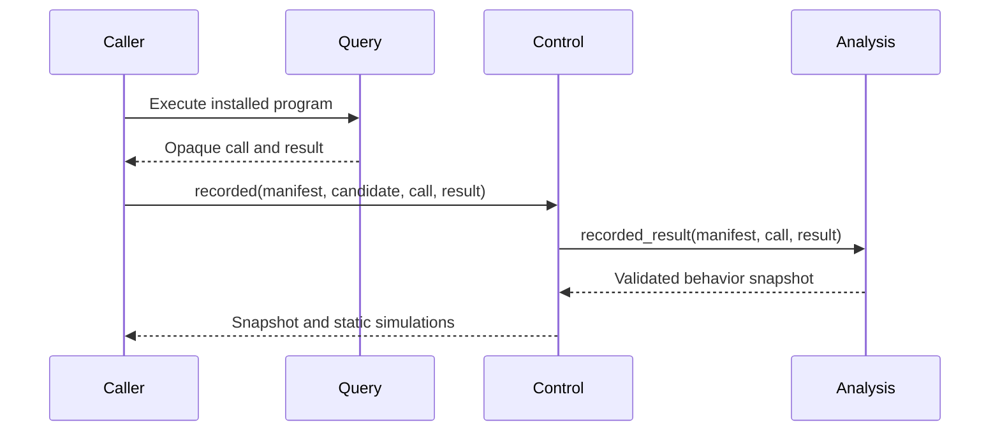

The public constructor is the library consumer. No existing active RPC or
production caller was found. This change adds no service, execution owner,
snapshot reader or polling loop. The result type replaces the unused marker
owner. Native Query and the installed package retain computation ownership.
The caller uses the existing Query definition result as follows:

```rust
let preview = mithril_control::DiscoveryStaticPreviewV1::recorded(
    &manifest,
    &candidate,
    &call,
    &result,
)?;
```

The compiler retains policy meaning. Preview supports exact File and Exec
keys. A consuming exception requires runtime authority and is rejected here.
Every returned simulation has physical result `NotAttempted`.

The [five preview checks](../../crates/mithril-control/src/discovery/preview/tests.rs)
execute the installed Discovery Wasm component through Query. They retain the
three previous compiler, family and lowering assertions. They also reject a
wrong call result, tenant, record source identity and dynamic exception. The
counts adapter obtains the source-revision label from the manifest. These
checks do not prove independent rejection of that label.

All 29 distinct focused checks pass. The 24-case compatibility selection
checks context cutoffs, permission,
conflicts, omissions, grouping and baseline comparison through the existing
Analysis owners. No test-only derivation replaces the installed computation.

```sh
env CARGO_INCREMENTAL=0 CARGO_PROFILE_DEV_DEBUG=1 CARGO_PROFILE_TEST_DEBUG=1 \
  cargo test --locked --offline -p mithril-control --lib discovery::preview::tests:: -- --test-threads=2
target/debug/deps/araphor_analysis-d09ee11c321a85a9 context::tests:: discovery::output::tests::baseline:: --nocapture --test-threads=2
```

Scoped formatting and whitespace checks pass. Strict Clippy passes for the
Control library and test targets in this affected-owner selection:

```sh
env CARGO_INCREMENTAL=0 CARGO_PROFILE_DEV_DEBUG=1 CARGO_PROFILE_TEST_DEBUG=1 \
  cargo clippy --locked --offline -p araphor-analysis-builtins -p araphor-data -p araphor-query -p araphor-analysis -p mithril-control --lib --tests --message-format=short -- -D warnings
```

Production Rust adds 10 and removes six nonblank lines, excluding comments:
net **+4**. The moved and extended tests do not count as production reduction.
Full-workspace CI, physical qualification and benchmarks were not run for
this delivery.


## Optional evidence admission

This result covers Control evidence admission under TODO 13.

### Intended end state

Omitted total and per-node quotas create no admission gate. Configured quotas
use the existing native semaphore owner. Disabling a quota grants no Node
authority.

[EvidenceAdmissionLimits](../../crates/mithril-control/src/config.rs) validates each optional count.
  -> [EvidenceAdmission::new](../../crates/mithril-control/src/evidence/admission.rs) retains allowed-node membership and creates only configured semaphores.
  -> [EvidenceAdmission::acquire](../../crates/mithril-control/src/evidence/admission.rs) checks membership and waits for node capacity before total capacity.
  -> [EvidencePermit](../../crates/mithril-control/src/evidence/admission.rs) holds native owned permits for the existing intake lifetime.

[EvidenceAdmission::acquire](../../crates/mithril-control/src/evidence/admission.rs) rejects an unknown node.
  -> [EvidencePermit](../../crates/mithril-control/src/evidence/admission.rs) drops acquired permits when the operation ends or is cancelled.

`None` is disabled. `Some(0)` is invalid. The largest accepted count is the
native `Semaphore::MAX_PERMITS`. Configured gates retain native FIFO and
cancellation behavior. The owner creates no custom queue or polling task.
Control retains its existing constructor-reuse check.

All four focused checks pass. The configuration cases cover omitted and null
values, zero and native count bounds, and runtime construction. Admission
cases cover total-only, node-only and disabled gates, more than the previous
default per-node capacity, unknown nodes, FIFO waiting and cancellation.

```sh
target/debug/deps/mithril_control-743ac2164588e878 config::tests:: evidence::admission::tests:: --nocapture --test-threads=2
```

Scoped formatting, whitespace checks and the strict affected-owner Clippy
command in the preceding result pass. Production Rust adds 33 and removes 26
nonblank lines, excluding comments: net **+7**. Other TODO 13 boundaries remain
open. Full-workspace CI, physical qualification and benchmarks were not run.


## Trace selection without hidden count quotas

### Intended end state

Data admits and reads every permitted trace when no quota is configured.
Configured storage and extraction quotas retain their existing owners.

[AnalysisStore::accept_trace](../../crates/araphor-data/src/analysis/trace.rs) uses existing storage admission without fixed request-count gates.
  -> [Trace receipt recovery](../../crates/araphor-data/src/analysis/schema.rs) accepts valid receipts without a total-count ceiling.
  -> [Trace selection](../../crates/araphor-data/src/analysis/extraction.rs) reads tenant requests without the former SQL limit of 257.
  -> [Trace selection](../../crates/araphor-data/src/analysis/extraction.rs) applies node and binding filters before adding trace IDs to the configured key quota.

[AnalysisStore::check_trace_reads](../../crates/araphor-data/src/analysis/trace.rs) checks each requested identity with current revocation state.
  -> [AnalysisReadControl](../../crates/araphor-data/src/analysis/read.rs) stops cancelled work.

The connected test uses 1,025 public admissions and a real store reopen. It
projects the request ID column explicitly. `requests["traces"] = None` retains
a dependency without materializing that table. `Some(empty set)` is a different
native projection that supports row-count queries. The existing key quota
counts the resolved selection, including explicit binding IDs and selected
trace IDs. The test checks a permitted match after the former selection
boundary. A rejected key quota changes no stored state. Tenant, nil, missing, cancellation and revocation
checks remain effective. The existing optional diagnostic-source test retains
finite global and tenant quota proof.

```sh
target/debug/deps/araphor_data-4ab55c29d8526b42 analysis::trace::tests::trace_selection_default_unbounded --exact --nocapture
target/debug/deps/araphor_data-4ab55c29d8526b42 analysis::trace::tests::diagnostic_sources_are_optional --exact --nocapture
```

Both distinct checks pass. The final connected case takes 89.69 seconds.
Strict affected-owner Clippy, scoped formatting and whitespace checks pass.
Production Rust adds three and removes 13 nonblank lines, excluding comments:
net **-10**. Other TODO 13 boundaries remain open. Full-workspace CI, physical
qualification and benchmarks were not run.


## Retained package quotas and collection

### Intended end state

Data retains valid package contracts without hidden count or byte ceilings.
The existing storage owner enforces configured quotas. Collection retains every
live pin and releases unused artifacts in one atomic sweep.

[Package admission](../../crates/araphor-data/src/analysis/packages/revisions.rs) validates typed revisions without a fixed closure ceiling.
  -> [Package commit](https://github.com/Ereborlabs/erebor-runtime/blob/4e6b4af668cba0270408ed809275482b83930a23/crates/araphor-data/src/analysis/packages/commit.rs) retains contract and checkpoint data with the existing final guard and storage charges.
  -> [Completed input](https://github.com/Ereborlabs/erebor-runtime/blob/4e6b4af668cba0270408ed809275482b83930a23/crates/araphor-data/src/analysis/packages/input.rs) fetches contract, body and window through one fully fenced query.
  -> [Package recovery](https://github.com/Ereborlabs/erebor-runtime/blob/4e6b4af668cba0270408ed809275482b83930a23/crates/araphor-data/src/analysis/packages/recovery.rs) checks stored contracts without the removed admission ceilings.

[AnalysisStore::collect_package_admissions](https://github.com/Ereborlabs/erebor-runtime/blob/4e6b4af668cba0270408ed809275482b83930a23/crates/araphor-data/src/analysis/packages/collection.rs) validates all stored dependency records once.
  -> [release_package_rows](https://github.com/Ereborlabs/erebor-runtime/blob/4e6b4af668cba0270408ed809275482b83930a23/crates/araphor-data/src/analysis/packages/collection.rs) deletes one complete unreferenced layer with native SQL.
  -> [Image cleanup](https://github.com/Ereborlabs/erebor-runtime/blob/4e6b4af668cba0270408ed809275482b83930a23/crates/araphor-data/src/analysis/packages/collection.rs) deletes only the exact returned uninstalled image keys.
  -> [Collection commit](https://github.com/Ereborlabs/erebor-runtime/blob/4e6b4af668cba0270408ed809275482b83930a23/crates/araphor-data/src/analysis/packages/collection.rs) checks affected tenant charges and publishes one revision notice.

[Package commit](https://github.com/Ereborlabs/erebor-runtime/blob/4e6b4af668cba0270408ed809275482b83930a23/crates/araphor-data/src/analysis/packages/commit.rs) fails its final guard or a configured storage quota.
  -> [Data transaction](https://github.com/Ereborlabs/erebor-runtime/blob/4e6b4af668cba0270408ed809275482b83930a23/crates/araphor-data/src/analysis/packages/commit.rs) commits no partial result or checkpoint.

The old global collector pages artifact keys and repeats the full retention
query per artifact. The current collector uses the same predicates for a whole
layer. It repeats only when that DELETE returns actual removed rows. This
finite dependency traversal uses no clock. Installed images, definition pins,
activation roots, results, native contexts, installed context references and
incoming dependency edges keep their original tenant-scoped checks. A no-op
sweep rolls back its empty transaction and sends no notice. Per-key collection
shares the deletion predicate and keeps its existing recursive traversal.

The completed-input query retains its original expected position, current
head, scope, revision and freshness conditions. Removing the size probe does
not permit a weaker second read. The query returns no completed input when a
fence no longer matches. Typed decoding and exact receipt checks remain.

Eleven distinct checks pass in separate selections. The large closure fixture
keeps 1,025 revisions and more than 1 MiB of dependency JSON. Its 1,025 installed
references use exports on the existing short-revision dependency. This avoids
adding unrelated exports to the root model graph. Every retention, backup,
digest and reopen assertion remains. The final case takes 431.82 seconds.
That runtime remains an open simplification concern; this result is not a
benchmark or a performance comparison.

To repeat the focused checks:

```sh
target/debug/deps/araphor_data-4ab55c29d8526b42 analysis::packages::tests::context::native::package_context_retains_closure --exact --nocapture
target/debug/deps/araphor_data-4ab55c29d8526b42 packages_preserve_native_references packages_large_contract_roundtrip package_context_tenant_scope completion_requires_actual_commit --nocapture --test-threads=2
target/debug/deps/araphor_data-4ab55c29d8526b42 packages_release_unused_dependencies packages_retain_activation_root package_context_pins_dependency_artifact package_image_retains_closure definitions_retain_uninstalled_images uninstall_guard_keeps_closure --nocapture --test-threads=2
```

The checks retain large result and metadata round trips, final-guard rollback,
exact retry, finite configured storage quotas, actual deletion, no-op notice
behavior and the listed pin families. Strict affected-owner Clippy, scoped formatting
and whitespace checks pass. Production Rust adds 177 and removes 219 nonblank
lines, excluding comments: net **-42**. Tests, copied code and documents do not
count as production reduction. Other TODO 13 boundaries remain open.
Full-workspace CI, physical qualification and benchmarks were not run.


## Native source and Discovery cardinality

### Intended end state

Valid source text, selectors and Discovery records use the existing native
owners without separate count or byte ceilings at these entry points.

[SourceInput::read](../../crates/araphor-cli/src/cli/araphor/args.rs) reads one complete file, standard input or inline source.
  -> [AraphorCommand::prepare](../../crates/araphor-cli/src/cli/araphor/args.rs) keeps exclusive inputs, UTF-8, nonempty text, NUL and standard-input conflict checks.
  -> [ClientGrpcOwner::selection_shape](../../crates/mithril-control/src/client_grpc/selection.rs) checks control characters, valid Node IDs and uniqueness.
  -> [ClientGrpcOwner::select](../../crates/mithril-control/src/client_grpc/selection.rs) resolves the existing locator against current tenant inventory.

[Discovery::evaluate](../../crates/araphor-analysis-builtins/src/discovery/mod.rs) uses the existing guest derivation.
  -> [Atoms::record](../../crates/araphor-analysis-builtins/src/discovery/atoms.rs) retains distinct atoms and increments the checked included count.
  -> [Discovery lifecycle merge](../../crates/araphor-analysis-builtins/src/discovery/ranges.rs) keeps sorted unique record IDs and rejects state conflicts.

[Discovery live SQL](../../crates/araphor-analysis-builtins/src/discovery/sql/live.sql) aggregates all selected lifecycle record IDs with native DataFusion.
  -> [Lifecycle state checks](../../crates/araphor-analysis-builtins/src/discovery/sql/live.sql) retain their relational error.
  -> [Snapshot merge SQL](../../crates/araphor-analysis-builtins/src/discovery/sql/merge_snapshot.sql) keeps conflict and arithmetic checks without the former 64-record error.

The CLI has no separate 16 KiB SQL, 1 MiB traversal JSON or 64 KiB trace-source
ceiling. The selector routes have no 64/1024-node or full-string length ceiling.
Locator component grammar and Node identity rules still apply. A long Pod
locator uses valid DNS labels; a long single DNS label is still invalid.

The guest accepts 50,001 distinct atoms and 65 lifecycle record IDs. Native SQL
live and merge checks each process 65 IDs. The live case registers the typed
lifecycle input before native planning, so the case reaches the removed SQL
guard. Its invalid-state control still fails. Representative sample size eight
is a result-summary rule and remains unchanged.

Exact focused selectors for reproduction:

- CLI `cli::araphor::args::tests::` selects seven argument checks.
- Control `client_grpc::selection::tests::observability_grpc_locator`.
- Builtins `discovery::tests::guest_derivation_unbounded`.
- Analysis `package::tests::sql::recorded::live::live_lifecycle_unbounded` and `package::tests::sql::recorded::merge::merge_lifecycle_unbounded`.
- Analysis `merge_rejects_conflicts` and `merge_checks_counter_overflow`.

The three builtin invariants ran with:

```sh
target/debug/deps/araphor_analysis_builtins-7d0b03c751ea1918 sdk_derivation_fixture sdk_conflicting_record record_pages_keep_proof --nocapture --test-threads=2
```

All 16 distinct checks pass. The guest case takes 19.08 seconds, builtin
invariants take 0.10 seconds and merge conflict/overflow takes 7.34 seconds.
Strict Clippy passes for the five affected owners and the separate CLI target.
The CLI Clippy check takes 5 minutes 35 seconds. Production Rust is net **-20**;
builtin SQL is net **-2**. Counts exclude tests, comments and blank lines.
Full-workspace CI, physical qualification and benchmarks were not run.
Other TODO 13 boundaries and the overall reduction goal remain open.


## Notification policy counts and retained attempts

### Intended end state

Notification policy and history retain valid entries without separate fixed
count ceilings. Configured policy retries and current authority still apply.

[NotificationRouter::configure](../../crates/araphor-analysis/src/notification/routing.rs) accepts an authorized route policy.
  -> [NotificationPolicyV1::validate](../../crates/araphor-data/src/notification/model/route.rs) requires package identities, sorted unique IDs and a positive u16 retry count.
  -> [NotificationRouter::deliver_obligation](../../crates/araphor-analysis/src/notification/delivery.rs) loads the current obligation and checks acknowledgement state.
  -> [NotificationRouter::retry_ready](../../crates/araphor-analysis/src/notification/attempt.rs) applies the policy retry count and delay.
  -> [NotificationRouter::append_attempt](../../crates/araphor-analysis/src/notification/attempt.rs) checks the sequence increment and records the attempt without the former 48-entry ceiling.
  -> [NotificationRouter::save](../../crates/araphor-analysis/src/notification/store.rs) validates and commits the state through the existing Data context owner.

[NotificationRouter::submit_concern](../../crates/araphor-analysis/src/notification/concern.rs) accepts an agent concern for an approved route.
  -> [UnconfirmedNotificationConcernV1::validate](../../crates/araphor-data/src/notification/model/subject.rs) keeps tenant, ordering, identity and duplicate checks for all context keys.
  -> [NotificationRouter::submit_concern](../../crates/araphor-analysis/src/notification/concern.rs) checks exact retained context versions, sensitivity and exact retry identity before save.

[NotificationObligationV1::validate](../../crates/araphor-data/src/notification/model/obligation.rs) reads retained state without a separate history-count ceiling.
  -> [NotificationRouter::deliver_state](../../crates/araphor-analysis/src/notification/delivery.rs) retains the original acknowledgement deadline and existing escalation rules.

Removing the history ceiling does not disable the approved retry policy. The
existing schedule counts attempts against that policy. Sequence arithmetic
still rejects overflow. The obligation key, finding revision, original
deadline, pending attempts and sink results keep their existing meaning.

The two new connected selectors are in [limits tests](../../crates/araphor-analysis/src/notification/tests/limits.rs):

- `notification::tests::limits::notification_retries_keep_history` retains 50 failed Finding attempts, reopens, delivers successfully and acknowledges the same obligation.
- `notification::tests::limits::notification_contexts_are_unbounded` retains 17 real context keys and rejects foreign, absent-version and duplicate keys without a write.

The separate compatibility selection ran with:

```sh
target/debug/deps/araphor_analysis-d09ee11c321a85a9 notification::tests::limits:: notification::tests::delivery:: notification::tests::access:: notification::tests::concern:: notification::tests::lifecycle:: --skip notification_retries_keep_history --skip notification_contexts_are_unbounded --nocapture --test-threads=2
```

The 17 compatibility checks pass in 229.73 seconds. Both new checks also pass:
19 distinct passes. Strict affected-owner Clippy, scoped formatting and
whitespace checks pass. Production Rust is net **-3** lines. Tests, comments and
blank lines are excluded. Verification covers these focused runs and strict
Clippy. Full-workspace CI, physical checks and benchmarks did not run.
TODO 13 and the overall reduction goal remain open.


## Optional delivery and live input deadlines

### Intended end state

An omitted output-idle or input-stage quota adds no fixed deadline. Explicit
deadlines use the current control and native stream owners.

[ClientGrpcConfig](../../crates/mithril-control/src/client_grpc.rs) defaults output_timeout to None.
  -> [ClientGrpcOwner::new](../../crates/mithril-control/src/client_grpc.rs) accepts a positive representable timeout without the former ten-second upper bound.
  -> [ClientGrpcOwner::query](../../crates/mithril-control/src/client_grpc/query.rs) passes the configured value into existing Query delivery.
  -> [Delivery::new](../../crates/araphor-query/src/follow/delivery.rs) validates the optional timeout and retains authority and request deadlines.
  -> [Delivery stream](../../crates/araphor-query/src/follow/delivery.rs) records an idle deadline after a yielded item only when the timeout is configured.

[Inputs::watch](https://github.com/Ereborlabs/erebor-runtime/blob/6ded52863152b691c5948e890833afcf3cc09996/crates/araphor-query/src/inputs/live.rs) creates the existing live input operation.
  -> [InputOperation::stage](https://github.com/Ereborlabs/erebor-runtime/blob/6ded52863152b691c5948e890833afcf3cc09996/crates/araphor-query/src/inputs/live.rs) derives the stage duration from the grant expiry, or None when no expiry exists.
  -> [AnalysisReadControl::stage](../../crates/araphor-data/src/analysis/read.rs) creates the renewable deadline with the existing shared cancellation and interrupt state.
  -> [InputOperation::changed](https://github.com/Ereborlabs/erebor-runtime/blob/6ded52863152b691c5948e890833afcf3cc09996/crates/araphor-query/src/inputs/live.rs) waits on native source progress and the existing exact deadline.

`stage(None)` clears the previous stage deadline. `stage(Some(duration))`
uses that new duration. This is the renewable-stage API. Parent cancellation
still stops the child. An expired grant fails before capture. The separate
`within` API keeps the enclosing deadline: None preserves that deadline and
Some selects the earlier deadline. The two APIs retain different purposes.

Delivery's optional timeout measures consumer delay after an item. It does
not measure a native producer wait after the next poll starts. Completion,
failed conversion and authority denial keep their current capacity cleanup.
The code adds no periodic wake. The Data monitor retains its existing native
events and exact deadline. The added Tokio test-util feature is test configuration.

Exact focused selectors for reproduction:

- Query `inputs::live::tests::` selects 23 live-input checks.
- Query `follow::delivery::tests::` selects ten delivery checks.
- Query `execution::tests::blocking_deadline_keeps_parent`.
- Data `analysis::read::tests::query_input_native_cancel`.
- Control `client_grpc::tests::client_timeout_is_optional` and `client_grpc::tests::observability_grpc_trace_timeout`.

The [live-input tests](https://github.com/Ereborlabs/erebor-runtime/blob/6ded52863152b691c5948e890833afcf3cc09996/crates/araphor-query/src/inputs/live/tests.rs) cover no grant deadline, expiry beyond 30 seconds, stage replacement and shared cancellation.
The [delivery tests](../../crates/araphor-query/src/follow/delivery/tests.rs) use paused time beyond ten seconds, reject zero and unrepresentable timeouts, and retain explicit idle, authority and capacity checks.
The [blocking-parent check](../../crates/araphor-query/src/execution/tests.rs) proves that a stage deadline joins its worker and leaves the parent usable.
The [Data control check](../../crates/araphor-data/src/analysis/read.rs) retains native query interruption and tests None, zero and clock-range bounds.

All 37 distinct checks pass: Query 34 in 16.16 seconds, Data one in 0.04 seconds
and Control two in 1.11 seconds. Strict affected-owner Clippy, scoped formatting
and whitespace checks pass. Production Rust is net **+11** lines after tests,
comments, blank lines and cfg-only instrumentation are excluded. The existing
unconditional unused Graph test-hook boolean is removed. Verification covers
these focused runs and strict Clippy. Full-workspace CI, physical checks and
benchmarks did not run. TODO 13 and the overall reduction goal remain open.


## Evidence transport and diagnostic operational quotas

Result: **Done** for this bounded evidence transport and diagnostic quota
replacement. All 128 distinct focused checks pass. The eight-library build
and strict affected-owner Clippy pass. TODO 13 remains **Not done** at the
native host qualification gate. Physical qualification has not run.

### Intended end state

Valid evidence and diagnostic output pass through the current durable owners.
Optional operator quotas govern admission. Native format, current authority and
exact acknowledgement rules remain required.

### Evidence from capture to acknowledgement

[EvidenceConfig](../../crates/mithril-node/src/config.rs) has optional record, retained-byte, retained-count and reader-queue quotas.
  -> [EffectObservationStore::ingestion_queue](../../crates/mithril-node/src/observation.rs) selects native channel for None or sync_channel for a positive capacity.
  -> [EffectObservationIngress::record_bytes](../../crates/mithril-node/src/observation.rs) preserves pending and loss counters; a full configured queue retains the durable coverage-gap path.
  -> [EvidenceWal](../../crates/mithril-node/src/observation/wal.rs) uses the shared [EvidenceRecord encoder](../../crates/araphor-data/src/evidence.rs), validates source coordinates and writes the exact CRC frame.
  -> [NodeControlConnector](../../crates/mithril-node/src/control.rs) sends retained batches through the existing authenticated stream.
  -> [ControlPlane evidence stream](../../crates/mithril-control/src/service.rs) flushes on the byte target, tail or existing deadline.
  -> [EvidenceIntakeOwner::receive_group](../../crates/mithril-control/src/evidence.rs) validates each batch and commits through the existing [Data raw journal](../../crates/araphor-data/src/analysis/raw.rs) before ACK.
  -> [EvidenceWal::acknowledge](../../crates/mithril-node/src/observation/wal.rs) removes only the acknowledged retained prefix.

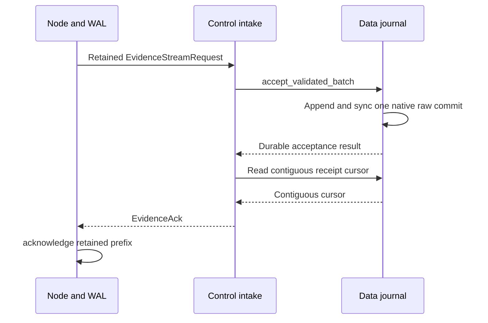

The diagram shows a new contiguous group. A durable pending range receives
no ACK until its earlier gap closes. The stream can flush at its byte target,
tail or existing deadline. New frames in the accepted group use one native raw
commit. Exact retries reuse the existing durable receipt.

The shared encoder writes Prost bytes into the final framed buffer after
checking the u32 payload length and usize total. The Node WAL delegates to that
encoder. The correction removes the separate payload allocation and keeps the
same prefix, CRC and frame bytes.

The record quota applies to each new record. Block can deny admission at the
configured retained-byte or retained-count bound. Retain bypasses those two
admission gates; its finite values do not bound future unacknowledged growth. Recovery validates format and identity without
applying new admission quotas to retained bytes. The 16 MiB segment size and sender byte
sizes are targets. A valid larger first item can form one segment or batch.
[SegmentFile](../../crates/araphor-data/src/analysis/segment_file.rs) checks the actual file extent and uses fallible native allocation before reading.
[Raw commit compaction](../../crates/araphor-data/src/analysis/raw.rs) checks the next native u32 offset before copying a selected frame.
[Backup](../../crates/araphor-data/src/analysis/backup.rs) keeps exact segment identity, digest and configured storage checks.

An EvidenceConfig with only its required identities uses disabled quota defaults:

```json
{
  "tenant_id": "00000000-0000-0000-0000-000000000001",
  "source_id": "00000000-0000-0000-0000-000000000002"
}
```

Omission or null disables each optional evidence quota. Some(0) is invalid.
The positive batch-record and control-delay fields retain scheduling defaults.
Paired [Node clients](../../crates/mithril-node/src/control.rs), [Control servers](../../crates/mithril-control/src/server.rs) and [Araphor client](../../crates/erebor-runtime-client/src/araphor.rs) select Tonic native message sizes. Native u32 framing still applies. NodePolicy and generic Runtime transport settings are unchanged.

### Diagnostic acceptance, storage and output

[ClientGrpcOwner::submit](../../crates/mithril-control/src/client_grpc/trace.rs) retains one pinned resolution future while it waits for replies or current-authority changes.
  -> [ControlPlane::resolve_trace_targets](../../crates/mithril-control/src/service.rs) uses the remaining authority deadline; the existing map entry has one matching cleanup guard.
  -> [TraceOwner::accept](../../crates/araphor-observability/src/owner.rs) retains the actual grant expiry in the accepted intent; an exact retry cannot extend that stored lease.
  -> [NodeTraceOwner](../../crates/araphor-observability/src/capture.rs) checks current target lifetime, optional admission quotas and source size before a durable intent.
  -> [DiagnosticBackend](../../crates/erebor-interceptor/src/diagnostic.rs) applies its optional source, frame, output, frame-count, queue and preparation settings.
  -> [TraceSpool::allocate](../../crates/araphor-observability/src/capture.rs) returns before locking or statvfs when the existing extent covers the write; new allocation preserves the evidence floor plus optional extra reserve.
  -> [TraceSpool::append](../../crates/araphor-observability/src/capture.rs) synchronizes the exact prefix before publication; configured spool exhaustion is OutputLimit and an allocation or write failure is StorageFailure.
  -> [Data trace receipts](../../crates/araphor-data/src/analysis/trace.rs) retain native sequence, terminal, identity and exact replay checks through reopen.

[Node::poll_diagnostics](../../crates/mithril-node/src/node.rs) sends retained output after local spool sync.
  -> [ControlPlane::exchange_trace](../../crates/mithril-control/src/service.rs) checks the enrolled session and current trust.
  -> [TraceOwner::append_at](../../crates/araphor-observability/src/owner.rs) checks the authenticated target and execution identity.
  -> [AnalysisStore::append_trace](../../crates/araphor-data/src/analysis/raw.rs) commits the trace batch and returns its output receipt.

Configured output-byte or frame-count exhaustion maps to OutputLimit. The final
worker drain also applies the encoded-spool quota. An allocation, reserve,
write or sync failure maps to StorageFailure. A failed append does not advance
the committed prefix. Cancellation and draining still join the child. The
terminal uses the last accepted sequence and byte count.

In an existing qualified diagnostic configuration, `backend: {}` and omitted
active, retained and spool_bytes fields add no host quota. Each supplied quota
uses its value. Zero active or retained capacity denies new admission. A zero
backend queue uses native synchronous-channel rendezvous semantics. A zero
preparation timeout expires immediately. Zero extra reserve adds no bytes.

`Evidence.maximum_retained_bytes = Some(bytes)` protects that full finite
allowance even with Retain. None contributes zero to this calculation. The
owner adds `diagnostics.storage_reserve_bytes.unwrap_or(0)` with checked
arithmetic. An unbounded WAL does not receive an infinite filesystem reserve.
Diagnostics still require Evidence. Terminal allocation stays available when
output allocation fails. [Recovery](../../crates/araphor-observability/src/capture.rs)
reads the complete validated output prefix and synchronizes that file before
it writes the NodeRestarted terminal. Recovery starts no child. A complete
recovered frame is not proof that the same frame was synchronized before the crash.

[Trace watch](../../crates/mithril-control/src/client_grpc/trace.rs) keeps the native Query subscription over trace_output, its frozen Arrow metadata and existing DataFusion projection. Delivery retains current authority, output memory accounting, positions and terminal identity. Node spool and Data page sizes are continuation targets; a larger first frame can advance alone. Data frames cannot use u64::MAX because terminal cursor arithmetic needs the next position.

### Focused proof and remaining native gate

All 128 distinct focused cases pass. The table names source reading routes and
representative exact selectors; the table does not enumerate every case.

| Owner | Distinct passes | Focused source selectors |
| --- | ---: | --- |
| Data | 36; final run 59.29 s | [Receipt validation](../../crates/araphor-data/src/analysis/raw.rs): `analysis::raw::tests::observability_receipt_cursor`; [large segment backup](../../crates/araphor-data/src/analysis/backup.rs): `analysis::backup::tests::large_segment_backup_restores`. |
| Node | 22; final run 1.37 s | [WAL/context](../../crates/mithril-node/src/policy/discovery.rs): `policy::discovery::tests::discovery_catalog_exact_coordinates`; [queues](../../crates/mithril-node/src/observation.rs): `observation::tests::default_reader_queue_keeps_arrivals` and `observation::tests::reader_queue_overflow_is_a_durable_coverage_gap`. |
| Control evidence | 8; final run 4.92 s | [Intake](../../crates/mithril-control/src/evidence.rs): `evidence::tests::intake_bounds_group_records` and `evidence::tests::coverage_large_report_reopens`. |
| Control diagnostics | 3; 2.95 s | [Session and pending RPC](../../crates/mithril-control/src/service.rs): `service::tests::observability_recovery_session_dispatch_ack_and_revocation`; [client retry](../../crates/mithril-control/src/client_grpc/tests.rs): `client_grpc::tests::observability_grpc_trace_retry`. |
| Interceptor | 23; 16.56 s | [Native supervision](../../crates/erebor-interceptor/src/diagnostic.rs): `diagnostic::tests::observability_backend_`. |
| Observability | 15; 10.41 s | [Spool](../../crates/araphor-observability/src/capture.rs): `capture::tests::observability_spool_allocation_failure` and `capture::tests::observability_recovery_uploads_only_the_synced_prefix`; [signed retry](../../crates/araphor-observability/src/owner.rs): `owner::tests::observability_renewed_retry`. |
| CLI | 7; 0.02 s | [Arguments](../../crates/araphor-cli/src/cli/araphor/args.rs): `cli::araphor::args::tests::`, from the library harness. |
| Lightweight E2E | 14 distinct | [Context/WAL/TLS/ACK/reopen](../../crates/mithril-e2e/src/discovery/data_store.rs): `discovery::data_store::tests::data_context_bounds`; [coverage](../../crates/mithril-e2e/src/control_tls/coverage.rs): `control_tls::coverage::coverage_upload_keeps_truth`; [retained WAL](../../crates/mithril-e2e/src/control_tls/retained.rs): `control_tls::retained::retained_wal_survives_restart`; [owned output](../../crates/mithril-e2e/src/observability.rs): `observability::tests::observability_owned_upload`. |

The final four changed E2E cases pass in 36.16 seconds. They include a context
above 17 MiB through real WAL, TLS, ACK and reopen. The coverage report exceeds
4 MiB with 100,001 historical intervals and one current interval. The 14-case total deduplicates those reruns.
The two lint-affected Observability tests also pass again and add no new cases.

The coverage fixture checks the original history prefix plus intervals closed
by restart. The upload fixture records grant issuance and passes actual current
time to admission. It checks issuance <= acceptance <= admission < expiry and
the exact five-second lease from issuance. These corrections retain restart,
expiry, storage-fault and exact receipt assertions.

The Interceptor ignored child helper runs through its parent case. An
Observability ignored child helper also runs through its parent. The privileged
tmpfs case remains unrun. Ignored physical cases and benchmarks are not counted.

The final fixed eight-library no-run build passes in 3 minutes 08 seconds.
Strict Clippy passes in 1 minute 39 seconds with no warning. Reproduce these
checks with the same eight owners. Then use their produced library harnesses
with the source selectors above. These commands are for reproduction:

```sh
rtk proxy env CARGO_INCREMENTAL=0 CARGO_PROFILE_DEV_DEBUG=1 CARGO_PROFILE_TEST_DEBUG=1 \
  cargo test --locked --offline \
  -p araphor-data -p erebor-interceptor -p araphor-observability \
  -p mithril-node -p mithril-control -p mithril-e2e \
  -p erebor-runtime-client -p araphor-cli --lib --no-run
rtk proxy env CARGO_INCREMENTAL=0 CARGO_PROFILE_DEV_DEBUG=1 CARGO_PROFILE_TEST_DEBUG=1 \
  cargo clippy --locked --offline \
  -p araphor-data -p erebor-interceptor -p araphor-observability \
  -p mithril-node -p mithril-control -p mithril-e2e \
  -p erebor-runtime-client -p araphor-cli --lib --tests -- -D warnings
```

Production Rust adds 952 and removes 803 nonblank, noncomment lines: net +149.
The count excludes test files, E2E fixtures and complete cfg-only support spans.
It keeps production after early test constants and modules. The first seven
changes are net -53; the task cumulative result is net +96.

The five forced BPFTRACE values, both builtin source bytes and hashes,
StaticResources role checks and maximum_map_keys metadata remain unchanged.
Read [DiagnosticBackend::command and StaticResources](../../crates/erebor-interceptor/src/diagnostic.rs),
[builtin source pins](../../crates/araphor-data/src/trace/recipe.rs) and the
[metadata projection](../../crates/araphor-data/src/analysis/extraction/tables/metadata.rs).
Removing that native policy requires separately authorized host qualification.
Local fixtures cannot qualify changed native source bytes. Native diagnostic
worker polling is unchanged; this work adds no new polling loop.

TODO 13, full migration and the 6,000-line reduction goal remain **Not done**.
Full-workspace CI, physical qualification and benchmarks were not run. No
production speed or native-host qualification claim follows from these checks.

Read-only readiness checks on 2026-10-24 found the recorded VM
`mithril-runtime-qualification-20261002163710` absent from the local inventory.
The current host did not permit `sudo -n true`. The next
[existing qualification](../plans/araphor-observability/phase-2-owned-capture.md)
through [Host::qualify_diagnostics](../../crates/mithril-e2e/src/platform/host.rs)
and [owned.sh](../../crates/mithril-e2e/harness/observability/owned.sh) requires an
explicitly authorized privileged host. No alternate VM was started. No BPF
program was attached.


## Replacement qualification host

Result: **Done** for the user-authorized host replacement on 2026-10-24.
Four stopped qualification VM definitions referred to missing disks. The
replacement removed those four definitions and 742 inactive test storage-pool
definitions whose directories were absent. No disk file, shared pool, default
network or base-image cache was deleted.

The existing [libvirt provider](../../crates/mithril-e2e/harness/vm/providers/libvirt.sh)
and [cloud-init template](../../crates/mithril-e2e/harness/vm/cloud-init-v1.yaml)
create and prepare the new guest. No provider code changed. The guest has no
host source mount. The provider copies the captured test inputs to
`/var/tmp/araphor-tests`.

| Field | Verified value |
| --- | --- |
| Domain | `mithril-runtime-qualification-20261024125417` |
| UUID | `b5ceac78-e8cc-402e-a609-eb05a6bdce9a` |
| Address at readiness | `192.168.122.204` |
| Resources | 2 virtual CPUs, 4 GiB memory, 20 GiB disk |
| Kernel | `6.8.0-147-generic` |
| Backend | bpftrace 0.20.2, SHA-256 `d2846f3400bb129b1a569aae64adf548de99ff41f247823ff8caf1fbde40ff1e` |
| Runtime BTF SHA-256 | `8c10e7e174e89c92f1d2708f12bb5268dc381e57e867397534c4e145348622e0` |
| Provider state | `/home/navid/mithril-test-hosts/mithril-vm-test.lasz6v07/libvirt-domain-owner` |
| Host record | `/home/navid/mithril-test-hosts/qualification-host.json` |

The VM disk and UUID ownership record are outside `target` and `/tmp`.
`cargo clean` does not remove this guest's disk. The new private image cache
passes the provider's published checksum check. Existing directory permissions
remain unchanged. Use the provider `address` command after a DHCP change.

SSH, passwordless sudo, BTF, BPF LSM, cgroup v2, bpffs and tracefs checks pass.
The guest runs the copied Rust test binary. Its binary, fixture archive and
harness digests match the captured host inputs. Native BPF inventory commands
and both executable loader checks pass. These readiness checks do not qualify
new native policy or establish a performance result. Full-workspace CI and native-policy qualification have not run for this host
replacement.


## Native backend defaults

Result: **Done** for forced native policy and unsupported metadata removal.
Performance qualification: **Not done**. Read the
[ten-leg result](../plans/araphor-observability/phase-2-owned-capture.md#native-backend-defaults-on-2026-10-24)
for the unchanged failed latency gate and physical correctness evidence.

[DiagnosticBackend::command](../../crates/erebor-interceptor/src/diagnostic.rs) starts the pinned backend with the four existing environment entries.
  -> [Native bpftrace source](../../crates/mithril-e2e/fixtures/observability/failed-opens.bt) uses the upstream native defaults without five host-imposed limits.
  -> [StaticResources::map_role](../../crates/erebor-interceptor/src/diagnostic.rs) checks the measured exact native ring layout of 262,144 bytes.

[ResourceSnapshot::failed_opens](../../crates/mithril-e2e/src/observability.rs) independently checks the physical graph and cleanup in qualification.

[PlainCapture::command](../../crates/mithril-e2e/src/observability/plain.rs) uses the same four environment values in the comparison. Both owners still clear inherited environment. No Rust option layer or default-value mirror is added. Source and backend hashes stay unchanged. The role matrix rejects the old ring size; other identity and layout checks remain.

[TraceRecipeV1::manifest](../../crates/araphor-data/src/trace/recipe.rs) no longer claims a map capacity for an unspecified Node backend.
  -> [Native recipe fields](../../crates/araphor-data/src/analysis/extraction/tables/metadata.rs) remove the unsupported `maximum_map_keys` column through the existing Arrow field declaration.
  -> [The existing metadata check](../../crates/araphor-data/src/analysis/extraction/tables/tests/native.rs) requires column absence and retains source, measurements, selection and witness checks.

Thirty distinct focused checks pass: four Data, 23 Interceptor and three plain
capture cases. One ignored subprocess helper runs through its parent case.
The two existing lightweight upload and TLS-repair cases pass in the guest.
Post-format Data checking and strict eight-owner Clippy pass. The final guest
binary is byte-identical after formatting. Scoped formatting and whitespace
checks pass. This change removes eight nonblank, noncomment production Rust
lines. Qualification and test code are counted separately.

The [remaining quota item](../plans/araphor-feature-parity-todo.md#13-configurable-quotas-disabled-by-default)
keeps the Node ACK ceiling and failed performance qualification open. Diagnostic
worker polling and the complete production reduction goal remain open. No
full-workspace CI or before/after speed claim follows from this change.

## Diagnostic acknowledgement sequences

Result: **Done** for removal of the fixed 4,096-sequence ceiling. This section
covers the Node and TLS fixture changes after `4838ce133`. Separate managed
input changes remain outside this deliverable.

### Intended end state

Node accepts a valid durable acknowledgement at any native sequence value.
Configured capture quotas keep their existing behavior.

[NodeChassis::poll_diagnostics](../../crates/mithril-node/src/node.rs) sends the retained output prefix.
  -> [ControlPlane::exchange_trace](../../crates/mithril-control/src/service.rs) checks the enrolled session and current trust.
  -> [TraceOwner::append_at](../../crates/araphor-observability/src/owner.rs) checks the trace identity and appends through Data.
  -> [AnalysisStore::append_trace](../../crates/araphor-data/src/analysis/raw.rs) returns the durable receipt.
  -> [NodeChassis::poll_diagnostics](../../crates/mithril-node/src/node.rs) checks the execution identity and sent prefix.
  -> [NodeTraceOwner::acknowledge](../../crates/araphor-observability/src/capture.rs) requires the exact terminal before it retires the spool.
  -> [NodeChassis::poll_diagnostics](../../crates/mithril-node/src/node.rs) advances the cursor after the acknowledgement checks succeed.

```mermaid
sequenceDiagram
    participant N as Node
    participant C as Control
    participant D as Data
    N->>C: Retained output prefix
    C->>D: Append output
    D-->>C: Durable receipt
    C-->>N: Acknowledgement
    N->>N: Validate receipt and terminal; advance cursor
```

Only the fixed comparison is removed. Execution identity, prefix order and
terminal checks stay at their existing owners. No new quota or transport
owner is added.

The [Node regression](../../crates/mithril-node/src/node/diagnostic_test.rs),
`node::diagnostic_test::diagnostic_ack_above_4096`, calls the private production
method over real TLS. The old predicate rejects durable sequence 4,097 after
cursor 4,000. The corrected case passes in 33.44 seconds. It checks the
configured 4,096-frame limit, the unlimited 4,097-frame capture, exact output,
terminal validation and Node and Control reopen. The two existing
`AdmissionFixture` cases also pass.

The existing [certificate fixture](../../crates/mithril-e2e/src/control_fixture/tls.rs)
has one source copy. Node includes that source only in its tests. The existing
[stream flush case](../../crates/mithril-e2e/src/control_tls.rs) uses the
Kubernetes certificate constructor and verifies `mithril-control.test.svc`
over real TLS. That case and the three existing certificate rejection cases
pass. No Kubernetes cluster is required for these checks.

All seven affected checks pass. Scoped formatting and strict ten-owner Clippy
pass; Clippy takes 97 seconds. The build includes separate managed-input work
in the worktree. The Data trace receipt path is unchanged. This is not a full
committed-tree CI result. Production Rust removes one nonblank, noncomment
line. Tests and fixture moves give no production reduction credit. Physical
qualification is not repeated; its failed latency gate remains open.


## Query input runner retirement

This section covers the applied Query retirement in the working tree based on
`6ded52863152b691c5948e890833afcf3cc09996`. It supersedes the old
Inputs::admit/read/watch routes and the InputOperation stage route in
[Optional delivery and live input deadlines](#optional-delivery-and-live-input-deadlines).
The finite and managed execution routes above keep their native owners.
Result: **Done** for the Query runner retirement and finite expiry transfer.
The [migration result](../plans/araphor-analysis-migration.md#query-input-runner-retirement)
records the selected checks and their source limits. The
[master record](../plans/araphor-component-redesign.md#query-input-runner-retirement)
states the independently checked retained-source count.

[Session::prepare_definition](../../crates/araphor-query/src/definition.rs) admits a native program.
  -> [Packages](../../crates/araphor-query/src/definition/package.rs) binds package calls to native child plans.
  -> [Inputs::from_plans](../../crates/araphor-query/src/inputs/mod.rs) retains declared ports, native plans, source origins, and windows.
  -> [Scope](../../crates/araphor-query/src/definition/package/scope.rs) restricts each SQL body to its declared input, parameter, output, and prior-state tables.

[Session::capture_definition](../../crates/araphor-query/src/definition.rs) captures the admitted execution.
  -> [SourceSnapshot::read](../../crates/araphor-query/src/sources/rows.rs) retains the selected rows and original source receipt.
  -> [Inputs::input_for](../../crates/araphor-query/src/inputs/receipt.rs) derives each input revision and coverage from its selected origins.
  -> [PackageExec::evaluate](../../crates/araphor-query/src/definition/physical.rs) checks supplied inputs and applies the existing coverage fold within that call.
  -> [PackageExec::sql](../../crates/araphor-query/src/definition/physical/sql.rs) executes native SQL children, or [PackageExec::guest](../../crates/araphor-query/src/definition/physical/guest.rs) uses the retained guest preparation.

Inputs remains a native metadata and receipt owner. It has no separate
admission, input reader, or watch loop. Scope remains because DataFusion's
session ContextProvider is private and a package body needs an isolated table
scope. The adapter uses the native planner and adds no runtime.
[InputCapture](../../crates/araphor-query/src/sources/mod.rs) remains the retained
alias binding. [Definition admission](../../crates/araphor-query/src/definition.rs)
keeps its pins and reservations. SourceSnapshot retains the original witnesses
and Arrow buffers. Receipt hashes and memory charges keep their existing owners.

[Data freshness](../../crates/araphor-data/src/analysis/managed/read.rs) distinguishes current input, expired original evidence, and changed input.
  -> [Finite saved-input decoding](../../crates/araphor-data/src/analysis/managed/input.rs) accepts readable exact saved rows when only the original witness time expired.
  -> [ResultContext::coverage](../../crates/araphor-data/src/package/model.rs) adds Unknown coverage with the existing `source evidence retention expired` reason.
  -> [PackageExec::evaluate](../../crates/araphor-query/src/definition/physical.rs) folds that reason through only the affected call's inputs before its memory checks.

Evidence expiry does not skip later context, dependency, authority, scope, or
corruption checks. Changed input or a typed error still rejects the read.
Original witness times stay unchanged. Missing data or code does not become
readable through this rule. Current status, registration, publication, and
managed progress checks still require current input.

For configured Wasm evaluation capacity, [finite execution](../../crates/araphor-package-runtime/src/wasm/execution.rs)
uses immediate admission and returns Busy when the slot is occupied.
[Managed execution](../../crates/araphor-query/src/definition/physical/guest.rs)
awaits the existing permit with the captured offer and actual operation control.
No finite wait queue or renewed temporary stage is added. Explicit parent and
grant deadlines stay binding. Native SQL windows and source changes schedule
work; bare NOW or elapsed time alone does not schedule another evaluation.

Read the [retained expiry tests](../../crates/araphor-analysis/src/instance/tests/retained/expiry.rs)
for original rows and witnesses, call isolation, and later context failure.
Read the [Managed capacity tests](../../crates/araphor-analysis/src/instance/subscription/tests/capacity.rs)
for captured offers, slot waits, cancellation, and joins. The
[native input contract tests](../../crates/araphor-query/src/definition/tests/execution/contract/inputs.rs),
[window tests](../../crates/araphor-query/src/definition/tests/subscription/windows.rs),
and [native view tests](../../crates/araphor-query/src/execution/tests/views.rs)
define the input, deadline, and catalog assertions covered by the selected
qualification. The migration result separates the original selection from the
two final test-only corrections.

Data's package APIs, codecs, store paths, and tests remain. The
[separate Data proof gate](../plans/araphor-analysis-migration.md#query-input-runner-retirement)
records the assertions required before their removal. No BPF or wire contract
changes in this retirement. The complete migration remains **Not done**.


## Native saved-input retirement

This section covers the applied source change after
`6edd86f9c2864261abb72d5b108688008b9123b7`. Result: **Done** for this
saved-input decoder retirement and canonical capture ownership. The
[migration result](../plans/araphor-analysis-migration.md#native-saved-input-retirement)
records the selected split runs. The
[master count](../plans/araphor-component-redesign.md#native-saved-input-retirement)
records the independently checked retained-source total.
It supersedes the saved-input codec gate in the earlier Query retirement
record. Other legacy package operations keep their existing owners.

[AnalysisStore::managed_input](../../crates/araphor-data/src/analysis/managed/input.rs) resolves an exact saved call result and its declared output.
  -> [SourceProvider::retained](../../crates/araphor-query/src/sources/mod.rs) retains the opaque reference, native schema, and metadata reservation.
  -> [Definition admission](../../crates/araphor-query/src/definition.rs) keeps one canonical RetainedSource Arc slice and its native memory reservation.
  -> [SourceSnapshot::read](../../crates/araphor-query/src/sources/rows.rs) derives direct reference/schema pairs and keeps the original AnalysisInputTables.authorized selection.
  -> [AnalysisStore::extract_packages](../../crates/araphor-data/src/analysis/extraction/package.rs) checks metadata or reads the native managed output within the same Data snapshot.
  -> [Capture::package_batches and package_alias](../../crates/araphor-data/src/analysis/extraction/tables/mod.rs) retain native Arrow batches and share equal saved aliases.
  -> [Inputs::input_for](../../crates/araphor-query/src/inputs/receipt.rs) builds the input receipt from the original captured rows and origins.

AnalysisInputTables now accepts Arc<ManagedInputRef> directly. The old
AnalysisInputSource::Package alternative and SDK wire-dataset decoder
Capture::package are removed. InstalledContext, ClockDependency, and the
obsolete input scope field are removed with that route. Metadata keeps
current-binding and source-state checks. Admission and full hydration also
validate retained-record identity. Stopped finite results remain readable
under the existing binding and scope checks.

InputCapture retains one source slice and one native MemoryReservation.
The duplicate binding vector and fixed empty or true fields are removed.
A Query source slot is separate from a Data output index.
[package_indices](../../crates/araphor-query/src/sources/rows/package.rs)
keeps that mapping. The explicit empty event-range fallback, raw zero witness
timestamp, original witness expiry order, Data read leases, and Arrow charges
retain their current behavior. Scope and the native receipt owner remain.

Read the [native test map](../plans/araphor-analysis-migration.md#native-saved-input-retirement)
for snapshot isolation, storage guards, historical scope, preflight,
cancellation, and origin unions. Read
[retained_revisions_ignore_slots](../../crates/araphor-analysis/src/instance/tests/retained/revisions.rs)
for stable input identity after registration order changes. The migration
result states the exact final checks and the later test-only correction.

This change removes only the old saved-input extraction route. Legacy
activation, commit, status, read/history, recovery, schema, and provenance
operations remain. Their APIs and persisted data are not retired here.

## One native subscription source

[SubscribeExec::open](../../crates/araphor-query/src/stream/physical.rs) opens the admitted subscription.
  -> [Subscribe::runtime](../../crates/araphor-query/src/planner/subscription.rs) records maintenance eligibility before native constant folding.
  -> [Session::physical](../../crates/araphor-query/src/execution.rs) uses native analysis, optimization, and physical planning.
  -> [SubscribeExec](../../crates/araphor-query/src/stream/physical.rs) compiles the actual SQL child and recompiles each native replacement child.
  -> [SourceData::supports_changes](../../crates/araphor-query/src/sources/mod.rs) checks the actual origin, fetch, and complete projected schema.
  -> [Runtime::new](../../crates/araphor-query/src/stream/physical/runtime.rs) creates capture from the actual source and task context for eligible COUNT plans.
  -> [Changes::capture](../../crates/araphor-query/src/sources/journal.rs) returns before and after Arrow batches with witnesses and a complete frontier.

JournalExec is removed. SubscribeExec retains one native SQL child. Changes
keeps retained batches, keys, a frontier, and a memory reservation. The returned
ArrowSnapshot carries witnesses and the captured receipt. Native
RecordBatchStream yields RecordBatch items. It has no typed before/after-change
item with a commit receipt. Changes supplies that item inside the physical
execution owner. Both native Arrow execution and
committed output execution use the same Runtime. The existing native COUNT
accumulators and general snapshot execution remain. Only eligible global
nondistinct COUNT over one events source uses Changes.

[Native subscription tests](../../crates/araphor-query/src/follow/tests.rs)
check real source replacement, exact counts and witnesses, cooperative capture,
permits, frontiers, cancellation, and native Arrow execution.
[Eligibility tests](../../crates/araphor-query/src/stream/physical/kernel/tests.rs)
check fetch disablement and restoration of the original eligibility.
[Clock tests](../../crates/araphor-query/src/follow/tests/clock.rs) check NOW
across two real commits and keep bare clock changes as metadata-only events.
[Schema tests](../../crates/araphor-query/src/sources/journal.rs) require exact
schema metadata. Malformed schemas return an error. Sources that do not support
maintenance keep the existing snapshot route.

## Native lifecycle proof transfer

This record covers native Data proof. It does not claim legacy-owner removal.

[recovery_reconciles_running](../../crates/araphor-data/src/analysis/managed/tests/lifecycle.rs) applies a native lifecycle transaction with an unknown commit result.
  -> [AnalysisStore::recover](../../crates/araphor-data/src/analysis/connection.rs) restores the connections and reads durable native state.
  -> [Lifecycle assertions](../../crates/araphor-data/src/analysis/managed/tests/lifecycle.rs) check exact membership, revision, write readiness, and notices.

[managed_commit_crashes](../../crates/araphor-data/src/analysis/managed/tests.rs)
uses the existing before/after crash points for ordinary and prepared-version
publication. Read the active instance, per-call heads, receipt, checkpoint,
Arrow roles, and original history assertions together. A prepared version and
a pending attempt can exist before publication; those rows are not a partial
active result.

[Stored edge tests](../../crates/araphor-data/src/analysis/managed/tests/output.rs)
use two published steps. A replacement dependency is a valid stored
ID and revision from the same call. The test thus checks the selected manifest
against the ledger, as well as ordinary missing and wrong-revision cases.

[Retained provenance](../../crates/araphor-data/src/analysis/managed/tests/retention.rs)
keeps the real generic result producer before native capture and publication.
The shared reference and evidence helpers receive one vector with 65 repeated
IDs. References keep their order; evidence is deduplicated. The existing
retention owner removes the physical records after witness expiry. Removal
of an instance does not remove its immutable historical evidence.

[Storage proofs](../../crates/araphor-data/src/analysis/managed/tests/storage.rs)
read actual stored buffers for independent logical-byte sums. The 256-byte
row allowance is logical accounting, not physical disk usage. Authority and
quota failures preserve heads, pending contracts, progress, receipts, and IPC.
The native completed retry checks the exact captured contract, request, and
authority callback before it returns the saved receipt. Output and recovery
checks validate physical payload bindings.

[Inert admission assertions](../../crates/araphor-data/src/analysis/mod.rs)
count nine execution relations at the test boundary. The
[image tests](../../crates/araphor-data/src/analysis/packages/tests/image.rs) and
[definition tests](../../crates/araphor-data/src/analysis/definitions/tests.rs)
use this assertion and retain their artifact, tenant, digest, retry, and
recovery checks. No production inspection API is added.

## Native capture boundary proof

This proof covers the native capture and publication boundaries after
`d7228d66`. Production lifecycle ownership is unchanged.

[Native source tests](../../crates/araphor-data/src/analysis/managed/tests/input/current.rs) capture real source and trace state.
  -> For a new attempt, [register_managed_attempt](../../crates/araphor-data/src/analysis/managed/commit.rs) validates the immutable captured contract and current source state.
  -> [commit_managed](../../crates/araphor-data/src/analysis/managed/commit.rs) checks current state and the live claim before atomic publication.
  -> [Native assertions](../../crates/araphor-data/src/analysis/managed/tests/input/current.rs) compare heads, pending contracts, output bytes, progress, receipts, and history after rejection.

The source-change case checks stale publication. The trace case checks both
stale registration and publication. Broad trace selection omits revoked
traces. [Explicit trace reads](../../crates/araphor-query/src/definition/tests/execution/contract/inputs.rs) retain typed denial.
The raw-read case saves the real segment bytes, truncates that file, and
restores and syncs the bytes before checking the returned failures.

[Store identity tests](../../crates/araphor-data/src/analysis/managed/tests/guards.rs) reject foreign captures and old restored-epoch registration.
The restore copies a real pending row. Publication against the restored owner
also crosses the foreign live-claim boundary. Fresh source and restored work
remain valid. Private capture fields stay private.

[Nested SQL tests](../../crates/araphor-analysis/src/instance/tests.rs) use two real calls and a dependency.
The second invocation changes the input revision. The native prior-state
contract then resets the outer checkpoint. Selected output changes from 10
to 20; the original result bytes, reference revision, and history remain.

Reader-capacity assertions now also live beside their
[connection owner](../../crates/araphor-data/src/analysis/connection.rs) and
[read-control owner](../../crates/araphor-data/src/analysis/read.rs).
All 16 original assertions remain. The old copies stay until the old module
retires. No reader wrapper or production inspection API is added.

The [migration result](../plans/araphor-analysis-migration.md#native-capture-boundary-proof)
records the focused proof and its limits. Whole legacy lifecycle removal is
**Not done**.

## One Data execution owner

This review follows the native boundary proof at `4e6b4af6`. The old Data
package lifecycle retires as one model. Shared artifact and evidence behavior
remain. Query and the native Managed owner retain execution responsibility.

[Image installation](../../crates/araphor-data/src/analysis/packages/image.rs) retains code and an exact dependency closure.
  -> [Definition admission](../../crates/araphor-data/src/analysis/definitions.rs) retains the admitted program and exact image pins without execution.

[Instance subscriptions](../../crates/araphor-analysis/src/instance/subscription.rs) consume work from the Query stream.
  -> [Native Data reads](../../crates/araphor-data/src/analysis/extraction.rs) capture source inputs and [prior state](../../crates/araphor-data/src/analysis/managed/capture.rs) in one snapshot.
  -> For a new attempt, [subscription admission](../../crates/araphor-analysis/src/instance/subscription.rs) authorizes work and [register_managed_attempt](../../crates/araphor-data/src/analysis/managed/commit.rs) registers immutable work.
  -> [Native package physical execution](../../crates/araphor-query/src/definition/physical.rs) evaluates the captured Arrow inputs.
  -> [The Instance sink](../../crates/araphor-analysis/src/instance/sink.rs) checks authority and selects the existing destination commit.
  -> [Native Data publication](../../crates/araphor-data/src/analysis/managed/commit.rs) commits output, checkpoints, heads, progress, and the receipt atomically.

[Data recovery](../../crates/araphor-data/src/analysis/connection.rs) restores the durable store.
  -> [Artifact validation](../../crates/araphor-data/src/analysis/packages/recovery.rs) checks descriptors, dependency closure, and exact image digests.
  -> [Native execution validation](../../crates/araphor-data/src/analysis/managed/schema.rs) checks retained native state and output.
  -> [Lifecycle recovery](../../crates/araphor-data/src/analysis/connection.rs) emits the existing notice only when the recovered revision changes.

[Revision reads](../../crates/araphor-data/src/analysis/packages/revisions.rs)
and [source-current checks](../../crates/araphor-data/src/analysis/dependencies.rs)
keep their implementations. The old execution reader is removed.
[Evidence reads](../../crates/araphor-data/src/analysis/packages/witnesses.rs)
read the existing native or generic request metadata directly. The old
package result join and codec are removed.

[Collection](../../crates/araphor-data/src/analysis/packages/collection.rs)
keeps installed-image, definition, context, and dependency roots.
[Shared context tests](../../crates/araphor-data/src/analysis/packages/tests/context.rs)
retain tenant, closure, corruption, reopen, and restore assertions through
direct artifact setup. The
[migration result](../plans/araphor-analysis-migration.md#one-data-execution-owner)
records the proof and current completion status.

## One package provenance contract

This flow covers retained package content after `dc46e193d`. The old
InstalledRefV1 body and its separate descriptor closure retire. Native
execution and current authority keep their existing owners.

[Image reads](../../crates/araphor-data/src/analysis/packages/image.rs) select an exact retained root and expected digest.
  -> [The shared artifact traversal](../../crates/araphor-data/src/analysis/packages/image.rs) loads that root and its retained dependencies.
  -> [PackageRevisionV1::decode_artifact](../../crates/araphor-data/src/analysis/packages/model.rs) checks stored identity, descriptor, OCI content, and exact dependency keys.
  -> [PackageBundleV1::checked_layout](../../crates/araphor-package/src/admission.rs) checks the canonical bundle and expected digest.

[Native context validation](../../crates/araphor-data/src/analysis/context/provenance.rs) reads a current native provenance body.
  -> [The shared artifact traversal](../../crates/araphor-data/src/analysis/packages/image.rs) loads the closure without requiring an installed-image row.
  -> [NativePackageContext::validate](../../crates/araphor-data/src/package/provenance.rs) checks the canonical digest and exact package, export, and output.

[Recovery](../../crates/araphor-data/src/analysis/packages/recovery.rs) reuses the same retained-row guard.
  -> [Stored package checks](../../crates/araphor-data/src/analysis/packages/recovery.rs) retain missing-dependency and image pin checks.
  -> [Context recovery and reads](../../crates/araphor-data/src/analysis/context/reads.rs) still validate retained native context content.

[StoredArtifact](../../crates/araphor-data/src/error.rs) distinguishes invalid retained content from bad caller content.
  -> [Stored context reads](../../crates/araphor-data/src/analysis/context/reads.rs) preserve the typed cause under IllegalState and NonRetryable.
  -> [New context admission](../../crates/araphor-data/src/analysis/context/write.rs) keeps canonical Missing/NotFound for an absent supplied root.
  -> [Discovery replay](../../crates/araphor-analysis/src/discovery/replay.rs) reads one StoredArtifact cause for its existing known-Missing decision.

[Collection](../../crates/araphor-data/src/analysis/packages/collection.rs)
keeps installed images, definition pins, native package-context roots, and
recursive dependency roots. It stops interpreting the retired installed-list
body. Generic context storage and Graph fact validation remain.

[Native context tests](../../crates/araphor-data/src/analysis/packages/tests/context.rs)
check current provenance and retained code. The
[migration result](../plans/araphor-analysis-migration.md#one-package-provenance-contract)
records the exact test transfer and current completion status. No BPF or
backend ABI changes in this consolidation.

## Native integral aggregation

This route extends the existing physical maintained-query path. It uses the
installed DataFusion 53.1.0 aggregate implementation. The Query owner receives
ordinary SQL and retains one operator state for the admitted subscription.

[Logical subscription policy](../../crates/araphor-query/src/planner/subscription.rs) checks the original source and immutable expressions.
  -> [SubscribeExec::compile](../../crates/araphor-query/src/stream/physical.rs) checks the optimized native aggregate, result types, and supported physical input shape.
  -> [Kernel::new](../../crates/araphor-query/src/stream/physical/kernel.rs) calls native create_sliding_accumulator for every admitted expression.

[Committed source changes](../../crates/araphor-query/src/sources/journal.rs) provide the exact before and after Arrow rows and frontier.
  -> [Kernel::apply](../../crates/araphor-query/src/stream/physical/kernel.rs) runs the existing native filter and projection plans on those rows.
  -> [Kernel::update](../../crates/araphor-query/src/stream/physical/kernel.rs) calls native retract_batch or update_batch.
  -> [Native finalization](../../crates/araphor-query/src/stream/physical/kernel.rs) returns the original aggregate schema.
  -> [Runtime](../../crates/araphor-query/src/stream/physical/runtime.rs) preserves the existing source checks, output progress, and delivery sequence.

The supported aggregates are native nondistinct COUNT and native global SUM
with Int64 or UInt64 results. Every expression must qualify. Native integral
SUM subtracts the supplied removed values and tracks non-null count. Floating
sums depend on update order. Native sliding extrema use FIFO removal. The
physical check therefore does not treat supports_retract_batch as a general
arbitrary-removal capability.

[SUM cases](../../crates/araphor-query/src/stream/physical/kernel/tests/sum.rs)
compare each retained cut with fresh native execution. A failed cut terminates
its stream. The partial ephemeral Kernel state is discarded without output
or frontier advancement. The
[existing Kernel tests](../../crates/araphor-query/src/stream/physical/kernel/tests.rs)
retain cancellation and resource checks. [Stream tests](../../crates/araphor-query/src/stream/tests.rs)
check default optimized selection and unsupported fallback.
[Follow tests](../../crates/araphor-query/src/follow/tests.rs) check real source
commits, removal, evidence, progress, and capacity release.
[Runtime follow tests](../../crates/araphor-query/src/follow/tests/runtime.rs)
check unchanged results, memory scope, and both integral and floating SUM.
The [qualification record](../plans/araphor-analysis-migration.md#native-integral-aggregation)
separates this supported boundary from general maintained SQL. BPF and the
native/Wasm SDK ABI are outside this change.

## One immutable package content owner

The pure Package owner retains immutable content. It does not retain a tenant,
grant, SQL plan, runtime, or execution state.

[PackageBundle](../../crates/araphor-package/src/admission.rs) admits raw V1 content through TryFrom or checked.
  -> [Native OCI layout](../../crates/araphor-package/src/admission.rs) supplies the canonical digest with each factory's required check order.
  -> [Metadata](../../crates/araphor-package/src/metadata.rs) projects the retained content and digest.
  -> [Footprint](../../crates/araphor-package/src/admission.rs) counts the owner header, raw heap, and digest capacity.

[Data image reads](../../crates/araphor-data/src/analysis/packages/image.rs) select the exact current installed or retained record.
  -> [Row decoding](../../crates/araphor-data/src/analysis/packages/model.rs) checks stored identity, descriptor, artifact, and dependency keys.
  -> [Checked admission](../../crates/araphor-package/src/admission.rs) validates that reconstructed content against the stored digest.
  -> [Query Packages](../../crates/araphor-query/src/definition/package.rs) retains one owner Arc and the existing image reservation.
  -> [PackageCall](../../crates/araphor-query/src/definition/call.rs) shares that owner with its admitted native input/body plans.
  -> [Runtime Prepared](../../crates/araphor-package-runtime/src/lib.rs) keeps the exact runtime, content, package, export, and component identity.
  -> The call and worker lease keep the image reservation.
  -> [evaluate_reserved](../../crates/araphor-package-runtime/src/lib.rs) checks the separate worker permit.

[Data contexts](../../crates/araphor-data/src/package/provenance.rs) construct the existing native provenance body from the owner.
  -> [Current context validation](../../crates/araphor-data/src/analysis/context/provenance.rs) still reads and checks current stored artifacts.
  -> [Managed image checks](../../crates/araphor-data/src/analysis/managed/read.rs) still compare saved call, target, artifact, and pin values.

[Control discovery setup](../../crates/mithril-control/src/service/packages.rs) admits its built-in content before the tenant loop.
  -> [Manual Package](../../crates/araphor-analysis/src/package.rs) holds that admitted Arc and current authority.
  -> First lazy preparation still loads an installed image and checks the original pin.
  -> [Graph setup](../../crates/mithril-control/src/service/packages/graph.rs), [Instance](../../crates/araphor-analysis/src/instance/mod.rs), and [publication](../../crates/araphor-analysis/src/discovery/publication/managed.rs) borrow actual prepared owners for existing authority and context operations.

[RPC installation](../../crates/mithril-control/src/client_grpc/packages.rs)
admits content after the raw transport handoff. The same owner supplies
metadata, current authority, and Data installation. Installation starts no
Discovery. Raw transport and metadata response shapes remain unchanged.

[Admission tests](../../crates/araphor-package/src/tests.rs) check retained allocations, metadata, and factory error order.
[Memory tests](../../crates/araphor-package/src/memory/tests.rs) check the complete owner charge.
[Prepared identity tests](../../crates/araphor-package-runtime/src/wasm/tests/runtime/prepared.rs) reject a separate equal-content owner and a foreign runtime.
[Subscription tests](../../crates/araphor-analysis/src/package/tests/subscriptions.rs) check real cold uninstall/reinstall for SQL and Wasm, trust denial, valid retry, and current revocation.

The [migration result](../plans/araphor-analysis-migration.md#one-immutable-package-content-owner)
records the 158 distinct passing cases, source hashes, and retained initial
Graph startup failure. The historical E2E context fixture is outside
the module graph and is unchanged. BPF and the native/Wasm ABI do not change.

## Shared authority notices

This route reviews the shared notice prerequisite after `3b395fc82`.
The direct Graph publication owner is still present. Query owns native stream
work and its existing TaskTracker. Analysis owns the complete policy check.
Data owns the atomic publication guards.

[Instance::subscribe_on](../../crates/araphor-analysis/src/instance/subscription.rs) binds the current grant and prepared definition to the notice callback.
  -> [Subscription::until_checked](../../crates/araphor-query/src/follow/mod.rs) waits for an actual watch notice.
  -> [AnalysisReadControl::operation](../../crates/araphor-data/src/analysis/read.rs) supplies independent cancellation state with the existing deadline and monitor.
  -> [Engine::blocking](../../crates/araphor-query/src/execution.rs) holds the tracker token acquired before spawn while the full callback runs and its captures are destroyed.
  -> [Instance::check_prepared](../../crates/araphor-analysis/src/instance/mod.rs) checks grant lifetime, Run authority, and every prepared image.
  -> [Subscription::until_checked](../../crates/araphor-query/src/follow/mod.rs) retains the same native execution and capture after a valid check.

[Subscription::until_error](../../crates/araphor-query/src/follow/mod.rs) observes source EOF or a failed condition.
  -> [Subscription::until_error](../../crates/araphor-query/src/follow/mod.rs) drops TakeUntil and its pending condition before closing the tracker.
  -> [PendingRead::drop](../../crates/araphor-query/src/execution.rs) cancels only the independent check operation.
  -> [Subscription::until_error](../../crates/araphor-query/src/follow/mod.rs) waits for worker cleanup before returning EOF or the condition's error.

Normal EOF does not cancel the session control before Subscription Drop.
Explicit cancel_and_join cancels and joins the existing worker group.
Nonblocking Drop does not promise a synchronous join; the blocking closure
keeps its callback resources and tracker token until cleanup ends.

[Instance::authorized_on](../../crates/araphor-analysis/src/instance/mod.rs)
keeps finite execution and the authority checker in one cancellation boundary.
A benign notice keeps work. Rejection and parent cancellation drain it. The
[Instance sink](../../crates/araphor-analysis/src/instance/sink.rs) and
[Managed commit](../../crates/araphor-data/src/analysis/managed/commit.rs) retain
final authority and atomic publication. A stored receipt remains stored when
a caller cancels during a later check. Current receipt delivery still checks
authority.

Subscription::blocking creates one operation future before the stream moves.
An external notice loop cannot rearm that method after Query owns the stream.
until_checked keeps repeated worker leases inside the existing Subscription
owner. It exports no worker owner and adds no runner. The native parser,
optimizer, capture, package execution, and Data commit flow stay in place.

Read the [Query policy tests](../../crates/araphor-query/src/follow/tests/policy.rs)
for notice mapping and held callback cleanup. The test gates hold a real input
reservation during the callback and during destruction of its captures.
The [Analysis notice tests](../../crates/araphor-analysis/src/graph/native/tests/managed/notices.rs)
check capture retention, complete authority, cancellation, and committed
receipt retention. The adapted [benign-notice fixture](../../crates/araphor-analysis/src/instance/subscription/tests.rs)
observes the full valid notice check before explicit cancellation. Its original
lifecycle and rollback assertions remain, and the exact adapted case passes.

Read both [expiry cases](../../crates/araphor-analysis/src/graph/native/tests/managed/expiry.rs).
expiry_query_clock checks deadline selection through native Query SQL with a
fake clock and no domain write. managed_expiry_subscription_recovers checks
actual Managed publication after a real retained-floor change, followed by
recovery. Together they preserve the deadline and publication boundary. They
do not prove virtual-clock Managed publication or finite Managed publication
at the future wall-time deadline.

The [qualification record](../plans/araphor-analysis-migration.md#shared-authority-notices)
records ten new and 53 existing passing tests for this prerequisite, separate
source records, initial failures, and exact repairs and retries. Result:
**Done** for the shared notice prerequisite. Direct Graph retirement and the
complete redesign remain **Not done**. This record makes no BPF, backend ABI,
performance, physical-qualification, or full workspace CI claim.


## Interrupted native execution recovery

Read [exclusive store open](../../crates/araphor-data/src/analysis/mod.rs),
[startup terminal settlement](../../crates/araphor-data/src/analysis/managed/terminal.rs),
and [validated backup restore](../../crates/araphor-data/src/analysis/backup.rs)
first. Public open runs settlement after construction and segment recovery.
Restore runs it after exact manifest/catalog validation and the recovery-epoch
commit, before it removes the pending marker. The raw constructor, live
recovery, and source-backup reopening do not settle native attempts.

The startup query selects unfinished current-generation attempts. It skips
requests without a native frontier. The existing row writer records Cancelled
terminals in one transaction; per-tenant quota checks precede commit and the
final revision notice. It does not mutate committed Instance or domain state.

Then read [resume selection](../../crates/araphor-data/src/analysis/managed/read.rs)
and [Host restoration](../../crates/araphor-analysis/src/instance/host.rs).
Cancelled selects the committed frontier. The existing Host checks current
authority, image admission, and lifecycle before it opens the native Query
subscription. Data retains the atomic publication boundary. DataFusion does
not own these durable attempt and exclusive store-lease rules. Native package
libraries remain in process.

The [Data frontier tests](../../crates/araphor-data/src/analysis/managed/tests/frontier.rs)
and [terminal tests](../../crates/araphor-data/src/analysis/managed/tests/terminal.rs)
cover startup selection, live claims, committed state, generations, logical
quota rollback, and restore ordering. The [Graph restart tests](../../crates/araphor-analysis/src/graph/native/tests/managed/restart.rs)
cover an actual interrupted Host and atomic publication. The [Native abort test](../../crates/araphor-analysis/src/instance/tests/checkpoint.rs)
uses the source-built in-process library and proves reopened checkpoint state.
The [qualification record](../plans/araphor-analysis-migration.md#interrupted-native-execution-recovery)
records 28 distinct cases, 32 successful case executions, and the final
build, Clippy, and formatting passes. A test definition is not a pass. This
bounded correction is **Done**. Direct Graph retirement and the complete
redesign remain **Not done**.


## One managed Graph execution route

Result: **Done** for the required native replacement. Graph execution and expiry use the
existing Instance and Query owners. The direct Graph sink, receipt delivery,
and subscription protocol are removed. Data remains the transaction owner.

[GraphOwner](../../crates/araphor-analysis/src/graph/feed.rs) receives source membership from a Query subscription.
  -> [InstanceHost](../../crates/araphor-analysis/src/instance/host.rs) admits the selected managed program.
  -> [GraphPublication](../../crates/araphor-analysis/src/graph/native/managed.rs) prepares exact images and the source program.
  -> [InstanceHost](../../crates/araphor-analysis/src/instance/host.rs) drives the running Instance through its future collection.
  -> [Query](../../crates/araphor-query/src/definition.rs) uses native parsing, logical planning, optimization, physical planning, and execution.
  -> [Publication](../../crates/araphor-analysis/src/instance/sink.rs) drains the native stream and obtains its captured receipt.
  -> [Graph conversion](../../crates/araphor-analysis/src/graph/native/commit.rs) checks the complete detector returns and proof bindings.
  -> [Data](../../crates/araphor-data/src/analysis/progress/graph.rs) commits Graph rows, outputs, state, references, and progress together.

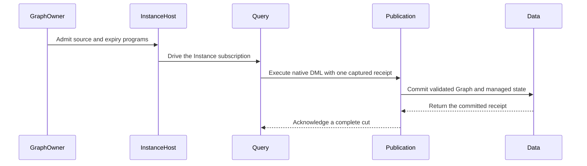

Instance retains current authority checks. Graph preparation retains scope,
image, and trust checks. Conversion retains the previous result ID. Expiry
retains the captured result ID and revision check. Expiry changes the window
head without advancing the processor pointer. Historical readers use window
heads and exact IDs; they do not select replacement history through that
advancing pointer.

The old direct APIs are removed after their assertion duties pass at the
remaining owners. The shared test Clock stays for native Query timing. A
historical Data fixture proves expiry with no advancing head. Other fixtures
use actual retained-floor expiry. They keep the production wall-time guards.

[AnalysisReadControl](../../crates/araphor-data/src/analysis/read.rs) uses the existing Tokio cancellation token.
Stage controls share cancellation. An operation gets a child token and its own
native interrupt slot. [Engine::blocking](../../crates/araphor-query/src/execution.rs)
forwards cancellation to that slot before it joins the worker.

[Package Runtime](../../crates/araphor-package-runtime/src/wasm/cache.rs) uses
Wasmtime parallel compilation. Compilation finishes all jobs before return.
The existing compiler mutex and leases stay held. Shared Rayon threads can
remain for the process lifetime. This change adds no compiler process.

The [final qualification list](/home/navid/mithril-test-hosts/graph-direct-publication-retirement-verification/graph-final-qualification.json)
contains 21 existing cases, including the actual native detector libraries.
The final result and source pins are recorded in the
[migration result](../plans/araphor-analysis-migration.md#one-managed-graph-execution-route).
Full CI, benchmarks, physical diagnostics, and additional hosts are not checked.


## Public client Instance lifecycle

This qualification uses an OCI SQL package through the supported client.
Its intended end state is explicit start, reactive execution, retained atomic
state, joined stop, and receipt retry after reopen. The full package and
physical qualification matrix remains open.

[Fixture::configured](../../crates/mithril-e2e/src/discovery/packages/fixture.rs) obtains and serves the shared Host through public ControlConfig::into_parts.
  -> [public_instance_reacts](../../crates/mithril-e2e/src/discovery/packages/lifecycle.rs) installs the Denials image and admits its YAML SQL definition.
  -> [Package RPC](../../crates/mithril-control/src/client_grpc.rs) forwards authenticated package operations to the existing owners.
  -> [InstanceHost](../../crates/araphor-analysis/src/instance/host.rs) admits the Instance without starting execution.

[public_instance_reacts](../../crates/mithril-e2e/src/discovery/packages/lifecycle.rs) explicitly starts the admitted Instance.
  -> [Instance](../../crates/araphor-analysis/src/instance/mod.rs) opens the Query subscription under current authority.
  -> [Query](../../crates/araphor-query/src/definition.rs) uses DataFusion parsing, logical planning, optimization, physical planning, and execution.
  -> [PackageExec](../../crates/araphor-query/src/definition/physical.rs) executes the two named, typed package calls against captured Arrow input.
  -> [Publication](../../crates/araphor-analysis/src/instance/sink.rs) passes the complete captured receipt to Data.
  -> [Data](../../crates/araphor-data/src/analysis/managed/commit.rs) commits results, checkpoint, references, and progress atomically.

[input](../../crates/mithril-e2e/src/discovery/packages/lifecycle.rs) commits a changed external context snapshot through public Data APIs.
  -> [Query follow](../../crates/araphor-query/src/follow/mod.rs) captures the relevant change and runs the existing physical plan.
  -> [ManagedPrior::checkpoint](../../crates/araphor-data/src/analysis/managed/model.rs) resets prior state when input revision or coverage changes.
  -> [public_instance_reacts](../../crates/mithril-e2e/src/discovery/packages/lifecycle.rs) checks the new count and reset state, then reads the intact earlier result.

[public_instance_reacts](../../crates/mithril-e2e/src/discovery/packages/lifecycle.rs) stops the Instance and shuts down both fixture services.
  -> [InstanceHost](../../crates/araphor-analysis/src/instance/host.rs) joins execution before stop returns.
  -> [public_instance_reacts](../../crates/mithril-e2e/src/discovery/packages/lifecycle.rs) reopens the store and checks stopped intent, complete history, output, and checkpoint.

[public_receipt_reopens](../../crates/mithril-e2e/src/discovery/packages/lifecycle.rs) repeats the same finite execution request before and after reopen.
  -> [Instance](../../crates/araphor-analysis/src/instance/mod.rs) returns the existing receipt under current authority.
  -> [public_receipt_reopens](../../crates/mithril-e2e/src/discovery/packages/lifecycle.rs) checks identical references and an unchanged metadata revision.

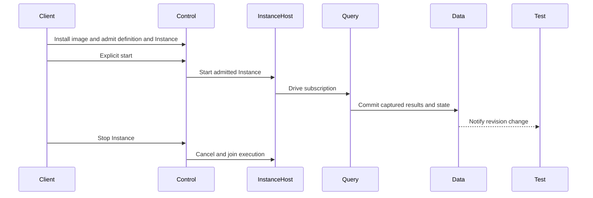

The fixture owns transport and Host task handles. It does not reconstruct an
execution owner. The progress helper subscribes before its first read and
awaits Data revision changes. Its 30-second timeout is a test watchdog.
Shutdown signals and joins both services, including returned error paths.
The fixture Drop signals Host shutdown when a test panics.

The initial test expected the changed-input checkpoint counter to advance.
That expectation conflicted with the existing reset contract. The corrected
case checks changed input revisions, reset state, and retained earlier state.
The initial failure and lint failure remain in the evidence directory. No
production behavior changed to make either check pass.

The [qualification result](../plans/mithril-hugging-face-intrusion-prevention/phase-7-mithril-control-and-detection-packages/phase-7-5-graphs-findings-and-notifications/phase-7-5-7-package-qualification.md#public-client-instance-qualification)
records the exact tests, source manifests, binary hashes, and checks. This
result covers SQL packages through the public client. It does not extend
native or Wasm artifact qualification, BPF or ABI proof, or physical proof.


## Kernel coverage counter boundary

The consumer must classify the final assigned sequence of a complete interval
correctly. Its intended end state is consistent SQL and Data classification,
with all existing loss and accounting guards.

[Kernel effect emission](../../bpf/erebor-interceptor/programs/identity_effects.bpf.h) increments the counter and assigns it to one effect.
  -> [Node coverage](../../crates/mithril-node/src/observation/coverage.rs) retains the sampled counters and observed interval.
  -> [ControlConnection::send_coverage_report](../../crates/mithril-node/src/control.rs) sends those counters through the authenticated coverage protocol.
  -> [Coverage SQL](../../crates/araphor-analysis-builtins/src/discovery/sql/coverage_ranges.sql) uses native DataFusion operators to accept the inclusive closing sequence after all other guards pass.
  -> [Graph::proof](../../crates/araphor-analysis/src/graph/proof.rs) uses the selected coverage range when it derives evidence quality.

[CoverageInterval::is_complete](../../crates/araphor-data/src/discovery/profile.rs) applies the same counter boundary to the portable interval value.
  -> [coverage_includes_assigned_tail](../../crates/araphor-analysis/src/package/tests/sql/coverage.rs) compares its result with native SQL output.

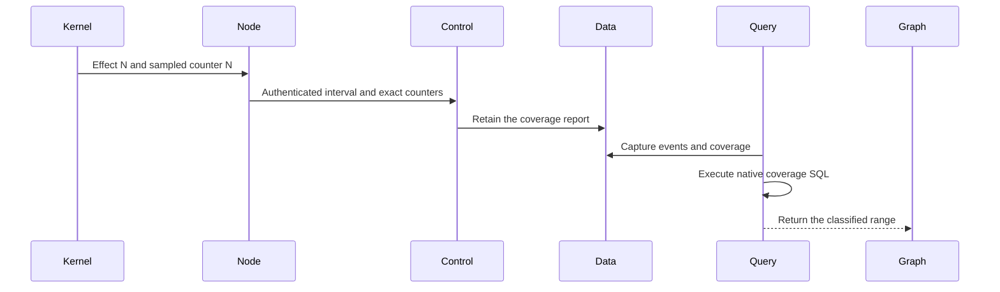

The greater-than check required another sequence after the final event. The
inclusive check follows the existing producer contract. It adds no conversion
at the protocol boundary. It keeps unknown state, missing counters, stale
counters, loss, regression, and invalid accounting unqualified.

The test uses valid opening counters at last-1 and closing counters at last.
It checks exact, stale, and invalid-accounting variants for HEALTHY and CLOSED
at 10 and u64::MAX. The existing overflow case still rejects invalid sums.
The earlier closing-counter negative keeps its rejection with a counter that
is lower than the interval end. No timeout or assertion is removed.

The [qualification record](../plans/mithril-hugging-face-intrusion-prevention/phase-7-mithril-control-and-detection-packages/phase-7-5-graphs-findings-and-notifications/phase-7-5-7-package-qualification.md#kernel-coverage-counter-boundary)
retains the red result, eight passing coverage cases, exact source and binary
hashes, build, Clippy, and formatting. The BPF map, counter layout, Node code,
and wire format are unchanged. These checks do not qualify physical enforcement
or close the pending required-detector and complete package matrix duties.


## Required Graph failure status

The intended result is one failure status derived from the managed Instance.
Health must preserve a failed sibling until that Instance succeeds or is
removed. The query subscription and execution pipeline do not change.

[finish_managed](../../crates/araphor-data/src/analysis/managed/terminal.rs) records a failed attempt.
  -> [managed status](../../crates/araphor-data/src/analysis/managed/status.rs) retains and validates the failure at the Instance progress revision.
  -> [managed_graph_failed](../../crates/araphor-data/src/analysis/managed/status.rs) joins each failed Instance to its current version in the same health snapshot.
  -> [processor_health](../../crates/araphor-data/src/analysis/health.rs) reports ProcessingFailed and incomplete input for a matching source.

[commit_managed](../../crates/araphor-data/src/analysis/managed/commit.rs) completes a successful attempt.
  -> [commit_managed](../../crates/araphor-data/src/analysis/managed/commit.rs) clears that Instance failure in the atomic commit.
  -> [processor_health](../../crates/araphor-data/src/analysis/health.rs) preserves any other matching failed Instance.

Data remains the only durable owner. The read includes Evaluate and Expire,
custom names, and finite Instances. It excludes removed Instances, other
sources, other tenants, and noncurrent versions. It materializes candidate
rows before nested validation queries. It uses existing row, Instance, and
failure validation. It adds no schema, index, cache, or background work.
The old graph_set_health context and memory channel has no live caller and is
removed. Stored historical contexts are not deleted.

The [Data tests](../../crates/araphor-data/src/analysis/managed/tests/health.rs)
check exact destination and source matching, nonrunning failures, reopen, and
removal of failed siblings. The [conversion test](../../crates/araphor-analysis/src/graph/native/tests/managed.rs)
checks an actual conversion failure, independent successful work, the existing
terminated retry rejection, and repair of the same Instance.

The [qualification result](../plans/mithril-hugging-face-intrusion-prevention/phase-7-mithril-control-and-detection-packages/phase-7-5-graphs-findings-and-notifications/phase-7-5-7-package-qualification.md#required-graph-failure-status)
records exact red and green source boundaries, binary hashes, and checks.
The pending integrated case fails at retained Graph call attestation. The
health proof does not qualify that path or physical enforcement. BPF, the ABI,
package artifacts, resource defaults, and the execution pipeline do not change.


## Required detector recovery and retained call history

The intended result is reactive required detection with retained input and
state across a failed execution. The current lightweight case proves that
result. Physical enforcement remains outside this result.

[required_detector_recovers](../../crates/mithril-e2e/src/discovery/packages/required.rs) opens the production Control parts with optional Discovery disabled.
  -> [Fixture::configured](../../crates/mithril-e2e/src/discovery/packages/fixture.rs) starts the returned shared Host and Graph tasks.
  -> [upload](../../crates/mithril-e2e/src/discovery/packages/required/input.rs) supplies external Node WAL and coverage through the authenticated connection.
  -> [Instance subscription](../../crates/araphor-analysis/src/instance/subscription.rs) derives execution from Query input.
  -> [Saved::initial](../../crates/mithril-e2e/src/discovery/packages/required/observed.rs) reads the committed Graph, three package outputs, state, artifact metadata, and notification obligation.

[required_detector_recovers](../../crates/mithril-e2e/src/discovery/packages/required.rs) joins the owners and reopens with an explicit fuel limit.
  -> [Saved::failed](../../crates/mithril-e2e/src/discovery/packages/required/observed.rs) observes the Limit failure, protected progress, and incomplete health.
  -> [EvidenceRetentionOwner](../../crates/araphor-data/src/analysis/retention.rs) runs one explicit retention step.
  -> [Saved::retained](../../crates/mithril-e2e/src/discovery/packages/required/observed.rs) checks both raw frames and the original notification deadline after that step.

[required_detector_recovers](../../crates/mithril-e2e/src/discovery/packages/required.rs) joins the owners and removes both fuel and artificial age constraints before repair.
  -> [upload](../../crates/mithril-e2e/src/discovery/packages/required/input.rs) supplies event three.
  -> [Saved::recovered](../../crates/mithril-e2e/src/discovery/packages/required/observed.rs) checks the atomic three-event result, checkpoint, Current progress, prior outputs, and unchanged deadline.

The test keeps all start, upload, retention, configuration, and join actions
visible. Input helpers supply external protocol data. Observation helpers only
read, wait for revisions, and assert results. Saved contains values; it holds
no Data or Query owner across exclusive reopen. Both shutdown attempts run
before a stage error returns. The final OIDC service also joins. The 90-second
observation limits and 15-second protocol limits are test watchdogs.

[empty_gate_keeps_history](../../crates/araphor-analysis/src/graph/native/tests/managed/history.rs) adds a fourth input to a native SQL COUNT gate.
  -> [retained_call_from](../../crates/araphor-data/src/analysis/managed/read.rs) validates the latest receipt and selected header plus the earlier call header.
  -> [managed_source_freshness](../../crates/araphor-data/src/analysis/managed/read.rs) uses the original capture when the valid latest receipt omits that call.
  -> [empty_gate_keeps_history](../../crates/araphor-analysis/src/graph/native/tests/managed/history.rs) checks exact stored context, output, and commit values with current=false.

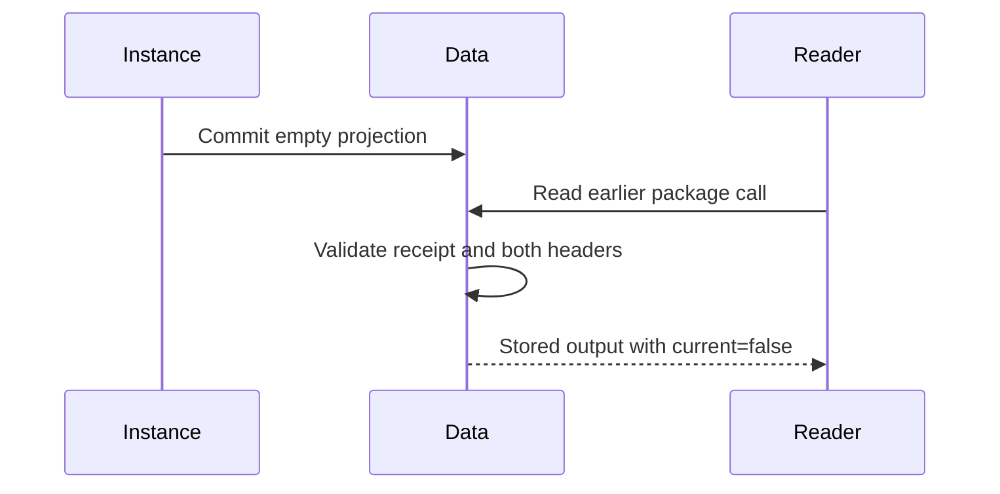

The same snapshot already identifies the current call reference. A different
reference in the latest receipt is invalid. An omitted call can be valid.
The reader permits that omission only after existing validators pass. The
regression then damages the latest selected header and requires an error.
No current claim, default quota, execution owner, or query stage is added.

The [qualification result](../plans/mithril-hugging-face-intrusion-prevention/phase-7-mithril-control-and-detection-packages/phase-7-5-graphs-findings-and-notifications/phase-7-5-7-package-qualification.md#required-detector-recovery-and-retained-call-history)
records exact passing and failed sources. The earlier age-budget failure is
correct admission behavior. The repaired test removes that artificial limit;
it does not bypass admission or retry with polling. The new proof uses Wasm
detector packages through native Query. It does not qualify a physical actor,
new native artifact, Python runtime, or performance target.


## Acceptance proof reconciliation

The [qualification assignments](../plans/mithril-hugging-face-intrusion-prevention/phase-7-mithril-control-and-detection-packages/phase-7-5-graphs-findings-and-notifications/phase-7-5-7-package-qualification.md#acceptance-proof-reconciliation)
identify the current component checks and retained source limits. The 31 new
executions pass without a source change. This result adds no production code.
Read the mapped test beside its owner before using a result. Native Graph
observation semantics, native SQL planning, native ABI execution, and native
loader linkage are separate boundaries. The paired current physical incident
remains Not done.


## Reactive incident subscription proof

The intended result is the same complete decision from the lightweight input
and the physical file-read case. The lightweight input now passes. The current
physical result remains Not done.

[follows_cpu_streams](../../crates/mithril-e2e/src/discovery/packages/required/incident/lightweight.rs) starts the existing configured owners and acknowledges the exact policy through the public Node connection.
  -> [signed_catalog](../../crates/mithril-e2e/src/discovery/roundtrip.rs) uses that policy owner and verifies its actual signer key.
  -> [upload_on](../../crates/mithril-e2e/src/discovery/packages/required/input.rs) retains the same authenticated session for evidence and coverage ACKs.
  -> [Incident::subscribe](../../crates/mithril-e2e/src/discovery/packages/required/incident.rs) opens the events, graph_manifest, and notifications Query Follow streams.
  -> [Incident::wait](../../crates/mithril-e2e/src/discovery/packages/required/incident.rs) clears each replacement and waits for completed checkpoints.
  -> [Incident::result](../../crates/mithril-e2e/src/discovery/packages/required/incident.rs) validates both source cuts, healthy coverage, exact policy, all-current benign exclusion, one denied finding, and its notification.

The [input fixture](../../crates/mithril-e2e/src/discovery/packages/required/incident/input.rs)
uses checked key and seal files with production configuration validation.
The event query binds ABI enum values. JSON columns keep their Arrow Binary
representation. The three streams only observe production results. They do
not drive another execution owner. All network and Host shutdown attempts
complete before a stage error returns.

The [qualification result](../plans/mithril-hugging-face-intrusion-prevention/phase-7-mithril-control-and-detection-packages/phase-7-5-graphs-findings-and-notifications/phase-7-5-7-package-qualification.md#reactive-incident-subscription-proof)
records seven passing executions, exact source and binary hashes, the full
decision report, earlier failures, and the remaining physical boundary.
The [outlined DataStore tests](../../crates/mithril-e2e/src/discovery/data_store/tests.rs)
keep their module name, selectors, and assertions. BPF, the package ABI,
production auth, resource defaults, and native DataFusion execution do not
change in this deliverable.


## Deployment image build inputs

Read [the production Docker recipe](../../packaging/mithril/Dockerfile) and
[its input filter](../../packaging/mithril/Dockerfile.dockerignore) together.
The recipe copies vendor because Cargo uses the local DuckDB patch. The input
filter must admit that directory. Rust 1.97.1 meets the locked dependency
compiler requirement. wasm32-unknown-unknown supports the existing component
build. Node and Control retain their existing runtime stages and commands.

The existing VM harness builds both production image targets. No second image
builder or runtime loader was added. In the qualification evidence directory,
vm-preparation.json retains the failed missing-vendor build.
vm-preparation-retry.json records the successful cold build on
image-build-source.json. image-load-checks.json records ldd, --help, and binary
hash checks for both resulting images. vm-artifacts.json binds imported guest
image IDs and the archive hash. These records prove build and load inputs;
they do not prove the current physical incident. See the
[qualification result](../plans/mithril-hugging-face-intrusion-prevention/phase-7-mithril-control-and-detection-packages/phase-7-5-graphs-findings-and-notifications/phase-7-5-7-package-qualification.md#deployment-image-build-inputs)
for the source limits and the open incident duty.


## Capture scope and reactive source changes

A capture must guard selected inputs, including an empty selected relation.
The intended result is rejection of stale work with preserved durable state.

[Query source capture](../../crates/araphor-query/src/sources/rows.rs) applies Query pruning before the Data read.
  -> [AnalysisStore::read_tables_inner](../../crates/araphor-data/src/analysis/extraction.rs) retains the incoming scope and resolves the row scope.
  -> [ManagedCapture::seal](../../crates/araphor-data/src/analysis/managed/capture.rs) derives relation guards from the incoming scope at both capture exits.
  -> [AnalysisStore::check_managed_capture](../../crates/araphor-data/src/analysis/managed/commit.rs) checks owner state, prior calls, source revisions, and trace access.
  -> [AnalysisSourceChanged](../../crates/araphor-data/src/error.rs) identifies a changed source after owner checks pass and trace reads remain valid.
  -> [Query capture recovery](../../crates/araphor-query/src/stream/physical/runtime.rs) preserves the captured source cut after rejected registration.
  -> [Subscription::failed](../../crates/araphor-analysis/src/instance/subscription.rs) maps this typed cause through Query and DataFusion wrappers to Cancelled.
  -> [Subscription::cancel_and_join](../../crates/araphor-analysis/src/instance/subscription.rs) joins execution before [AnalysisStore::finish_managed](../../crates/araphor-data/src/analysis/managed/terminal.rs) records a registered terminal attempt.

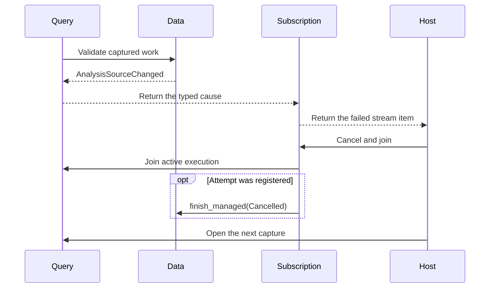

Owner or state conflicts retain AnalysisConflict. Trace revocation also retains AnalysisConflict.
AnalysisSourceChanged retains AlreadyExists status and the NonRetryable hint.
Reactive cancellation records no admission failure.
[Finite execution](../../crates/araphor-analysis/src/instance/mod.rs) still stores Failed(Conflict).
Other package failures retain their codes. Authority revocation keeps Denied settlement.
Cancellation preserves the earlier Instance failure, output, checkpoint, and progress.
Resume excludes the cancelled attempt's frontier. The terminal completion revision can advance.
An empty selected Graph read retains its guards. A later Graph invalidates that capture.
A capture with the Graph relation pruned has no Graph relation guard. Resolved rows retain authorization,
exact references, witnesses, and input-limit accounting.

[empty_graph_keeps_capture, source_change_keeps_commit, and trace_revocation_keeps_commit](../../crates/araphor-data/src/analysis/managed/tests/input/current.rs) check preserved state and rejected stale writes.
[cancelled_frontier_is_unconsumed](../../crates/araphor-data/src/analysis/managed/tests/readiness.rs) checks frontier selection and exclusive reopen.
[stale_admission_keeps_capture_cut](../../crates/araphor-query/src/definition/tests/captured/managed.rs) checks captured recovery.
[source_invalidation_is_reactive](../../crates/araphor-analysis/src/instance/subscription/tests.rs) and [failed_publication_rolls_back](../../crates/araphor-analysis/src/instance/tests/finite.rs) check reactive and finite classification.

[capture-final-tests.json](/home/navid/mithril-test-hosts/araphor-package-qualification-verification/capture-final-tests.json) records 23 passes and the original controlled 30-second failure.
Its capture-final-source.json SHA-256 is db61ac21a562959d142efe32c1c66cf8d6c4117ad8d91be82b56c4d645fa3170.
[capture-lint-final-test.json](/home/navid/mithril-test-hosts/araphor-package-qualification-verification/capture-lint-final-test.json) records the normal controlled pass in 66.718 seconds.
Its capture-lint-final-source.json SHA-256 is 48e54ce2ce06b4c483105a03f6ddfc9b99b65a2faa40cca5725477c272c22409.
Only private [feed.rs](../../crates/araphor-analysis/src/graph/native/tests/feed.rs) and [feed/arrivals.rs](../../crates/araphor-analysis/src/graph/native/tests/feed/arrivals.rs) differ between those manifests; all production bytes match.
The new six-subscription case uses 90 seconds and keeps exact Graph cuts, Current health, and current Expire frontiers with future deadlines. Existing observe callers keep 30 seconds.
[late-observation-test.json](/home/navid/mithril-test-hosts/araphor-package-qualification-verification/late-observation-test.json) retains the diagnostic that reaches the same strict predicate at 49.166 seconds without new inputs and preserves its original failed outcome.
[arrival-final-clippy.json](/home/navid/mithril-test-hosts/araphor-package-qualification-verification/arrival-final-clippy.json) retains the earlier expect lint failure.
[capture-lint-final-clippy.json](/home/navid/mithril-test-hosts/araphor-package-qualification-verification/capture-lint-final-clippy.json) records passing affected-crate Clippy with warnings denied in 22.410 seconds.
[capture-lint-final-fmt.json](/home/navid/mithril-test-hosts/araphor-package-qualification-verification/capture-lint-final-fmt.json) records passing scoped formatting in 0.665 seconds.
Both checks cover capture-lint-final-source.json. These elapsed times establish no performance result.
Existing Data transactions, Query, native DataFusion execution, and Host owners remain in use.
No scheduler, store, polling path, quota, or package version is added.
The complete matrix and current physical incident remain Not done.


## Current paired incident reading route

The intended result is one complete decision from the shared lightweight
consumer and the physical read case. Current physical proof remains Not done.

[follows_wal_backlog](../../crates/mithril-e2e/src/discovery/packages/required/incident/backlog.rs) uses [WAL input helpers](../../crates/mithril-e2e/src/discovery/packages/required/incident/input.rs) for contiguous CPU 1 input and exact selected frames.
  -> [Incident::subscribe and Incident::wait](../../crates/mithril-e2e/src/discovery/packages/required/incident.rs) observe events, Graphs, and notifications through complete Query checkpoints.
  -> [protected_read_package](../../crates/mithril-e2e/src/discovery/packages/required/incident/physical.rs) reuses that consumer through [Platform::client_operation](../../crates/mithril-e2e/src/platform.rs).
  -> [Kubernetes::run_client](../../crates/mithril-e2e/src/platform/kubernetes/client.rs) obtains the query profile and emits actual Node/Control Pod UIDs and resolved image identities.
  -> [input::checked_client](../../crates/mithril-e2e/src/discovery/packages/required/incident/physical/input.rs) checks rejection of an unissued token and another tenant.
  -> [protected_read_package](../../crates/mithril-e2e/src/discovery/packages/required/incident/physical.rs) requires protected EACCES with zero bytes and a benign read with the exact file length.
  -> [Observed::check_physical](../../crates/mithril-e2e/src/discovery/packages/required/incident/physical/observed.rs) checks a complete observation against the actor and Node snapshot.
  -> [Observed::identity](../../crates/mithril-e2e/src/discovery/packages/required/incident/identity.rs) reads installed image/definition bindings, targets, call results, and atomic receipts.
  -> [physical cleanup](../../crates/mithril-e2e/src/discovery/packages/required/incident/physical.rs) stops the actor and Node before [platform teardown](../../crates/mithril-e2e/src/platform/kubernetes.rs) removes owned resources.

The 15 E2E paths add no executor, store, framework, polling path, or runtime correction.
The same-source fixture preserves defaults and the 90-second observation bound.
Its bounded groups do not reproduce physical 100 ms cadence, continuous traffic, or real Node coverage scheduling.

[backlog-same-source.json](/home/navid/mithril-test-hosts/araphor-package-qualification-verification/backlog-same-source.json) passes in 56.497 seconds; [backlog-multi-source.json](/home/navid/mithril-test-hosts/araphor-package-qualification-verification/backlog-multi-source.json) passes in 116.787 seconds.
Each normal case reports one pass, zero failures, and zero ignored cases.
The backlog-current-source.json SHA-256 is 2b8c31af3ba75c967bcfd1d8363943a9905f90fa968bd8724ea2b5d8eab6d03b.
The actual executable SHA-256 is bba1ca71062957d1642f6a2c1cf6634de6b42c66eef4a7ad2fac64cfcab5fa31.
The [same-source report](/home/navid/mithril-test-hosts/araphor-package-qualification-verification/backlog-current-report.json) SHA-256 is 327b846efb89aa4de68df5a5bf07c332a213eba21671bfc517ce390c3b716dda.
The [multi-source report](/home/navid/mithril-test-hosts/araphor-package-qualification-verification/incident-lightweight-backlog.json) SHA-256 is 7f1b6fd67ebbb5b16bc68f1067a8feabe2d82eb6edb05389e7ac4b478112f1db.
[backlog-clippy.json](/home/navid/mithril-test-hosts/araphor-package-qualification-verification/backlog-clippy.json) passes in 17.633 seconds; [backlog-fmt.json](/home/navid/mithril-test-hosts/araphor-package-qualification-verification/backlog-fmt.json) passes for the final three paths in 0.038 seconds.
Other Rust bytes retain the prior 13-path [formatting proof](/home/navid/mithril-test-hosts/araphor-package-qualification-verification/e2e-core-fmt.json); the unchanged OIDC fixture retains its [syntax proof](/home/navid/mithril-test-hosts/araphor-package-qualification-verification/e2e-core-python-syntax.json).

[physical-core-incident.json](/home/navid/mithril-test-hosts/araphor-package-qualification-verification/physical-core-incident.json) retains exit 101 after both guarded reads pass and the observer times out.
Its older source/executable boundary remains separate from these two current lightweight passes.
The valid two-role Pod marker does not prove completion of Graph processing.
Selected CPU 1 records are at 941/950. The cached CPU 0 Graph is at 139; notifications are empty.
Producer versus Follow cause remains unproved. The unrelated missing ACK is not a diagnosed cause.
The [verifier stop](/home/navid/mithril-test-hosts/araphor-package-qualification-verification/image-core-reuse-stop.json) and [manifest/config diagnosis](/home/navid/mithril-test-hosts/araphor-package-qualification-verification/image-core-identity-diagnosis.json) remain recorded; no reimport occurs.
[Owned-resource absence](/home/navid/mithril-test-hosts/araphor-package-qualification-verification/physical-core-failure-collection.json) is verified. The VM remains retained and no physical PASS result exists.
The complete matrix and current physical incident remain Not done. Prior failures and source limits remain.
No performance, full-incident, Python package execution, or successful external-delivery result is claimed.


## Shared public failure diagnostics

The intended result is bounded producer evidence before incident cleanup. A failed incident must retain its original error.
[Incident::wait](../../crates/mithril-e2e/src/discovery/packages/required/incident.rs) starts collection only after its existing wait fails, while the authenticated client and Control remain alive.
  -> [Incident::progress](../../crates/mithril-e2e/src/discovery/packages/required/incident/identity.rs) deduplicates exact selected sources and writes each completed projection into an outer vector under one five-second timeout.
  -> The public Query API reads six graph_state fields through the existing [Data source provider](../../crates/araphor-data/src/analysis/extraction/tables/graph_state.rs), with the binary source key bound as a parameter.
  -> The existing package encode/decode helper reads Evaluate and Expire status and the latest three successful history receipts independently. One read error does not skip later reads.
The projected diagnostic metadata retains partial results. SQL NULL, missing values, limited rows, errors, checkpoint, EOF, and terminal Completed remain distinct.
Status omits the definition revision. History omits the frontier. Status progress and receipt revisions are store commits, not source cursors; pending and cancelled attempts are not exposed.
The three wait callers share this collector. The direct-store progress helper and two failure wrappers are removed. The successful path sends no diagnostic RPC.
No event payload, package specification, or grant is added to the diagnostic output. No polling, retry, API, executor, scheduler, or store is added.
The [qualification result](../plans/mithril-hugging-face-intrusion-prevention/phase-7-mithril-control-and-detection-packages/phase-7-5-graphs-findings-and-notifications/phase-7-5-7-package-qualification.md#shared-public-failure-diagnostics) records the passing normal case, static checks, source hashes, and retained physical failure.
The physical collector finishes with one producer marker and nine projected records. The native finite source read is nonlimited and terminal Completed at revision 169.
The cached actor Graph reaches cursor 745 for selected records 721/730, but notifications are empty. Its first eight printed findings concern unrelated records 100–107.
Evaluate inspection is Unavailable; its successful history and Expire status/history remain recorded independently. Separate snapshots cannot date head replacement relative to the wait deadline.
Exact selected-input membership, matching coverage, and the selected finding's policy remain unproved. The physical incident, complete matrix, and cause remain open; this deliverable changes no production owner.
