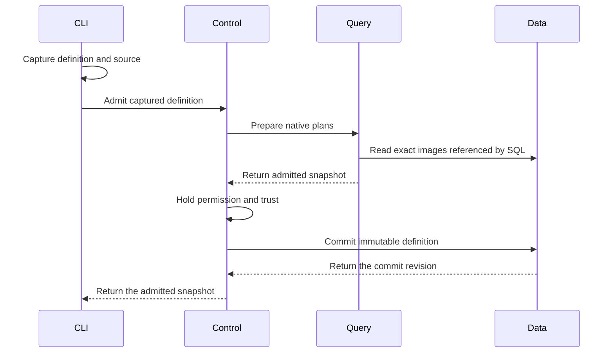
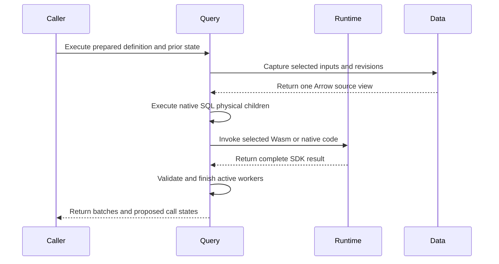
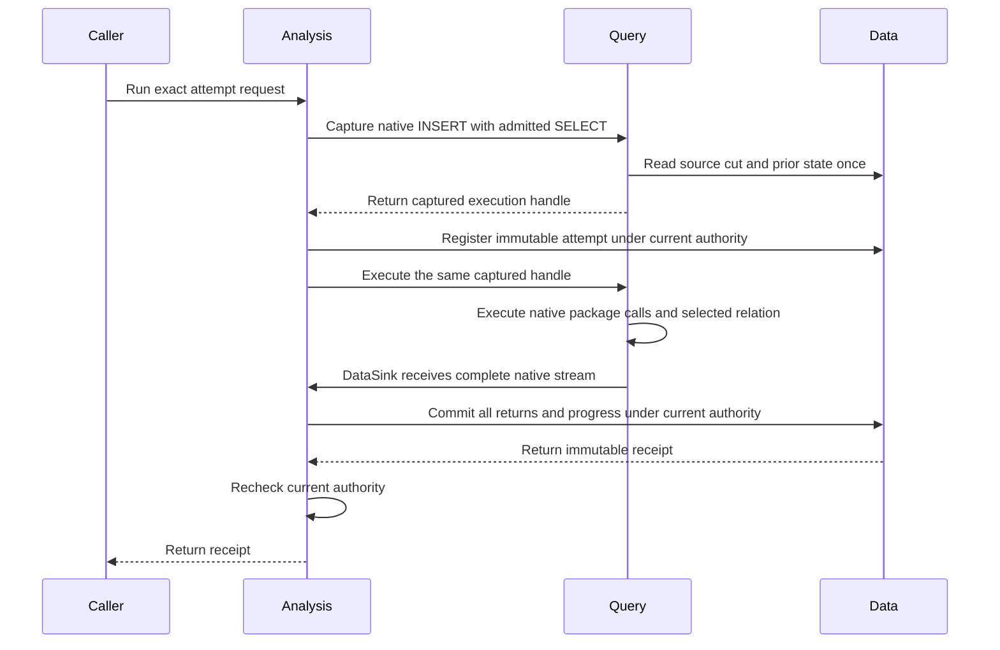
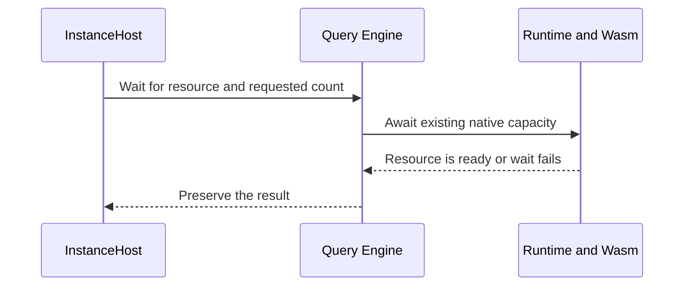
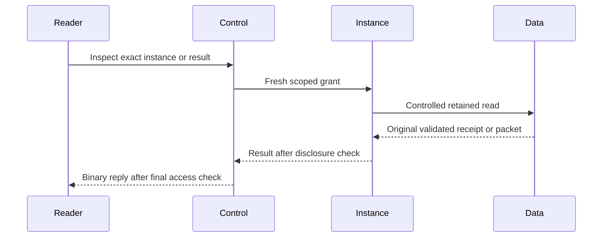
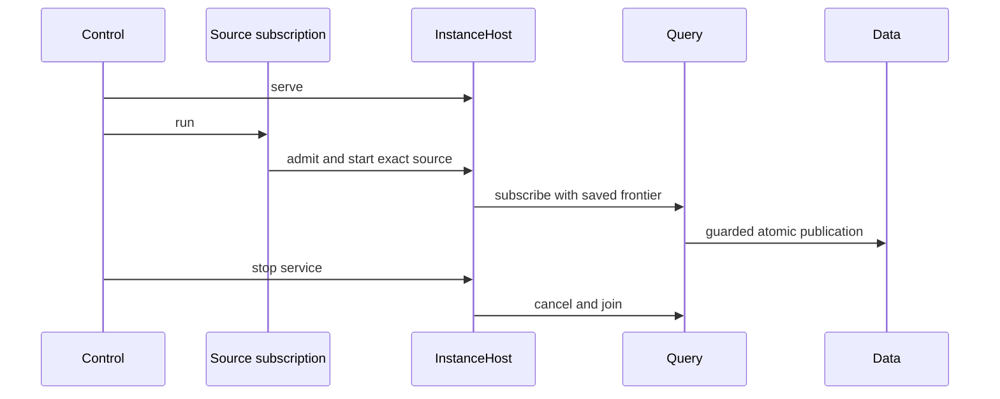
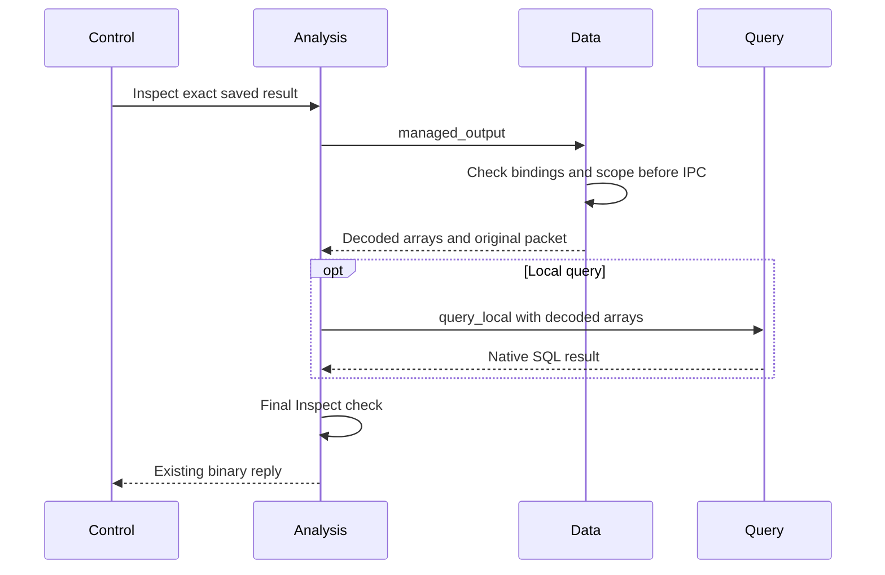
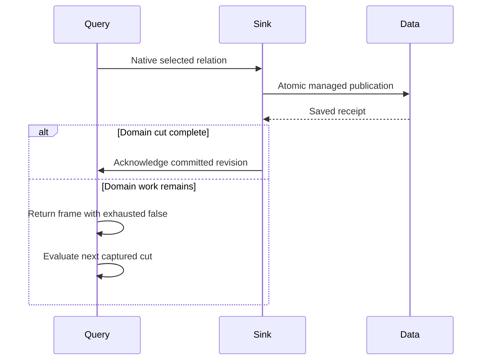
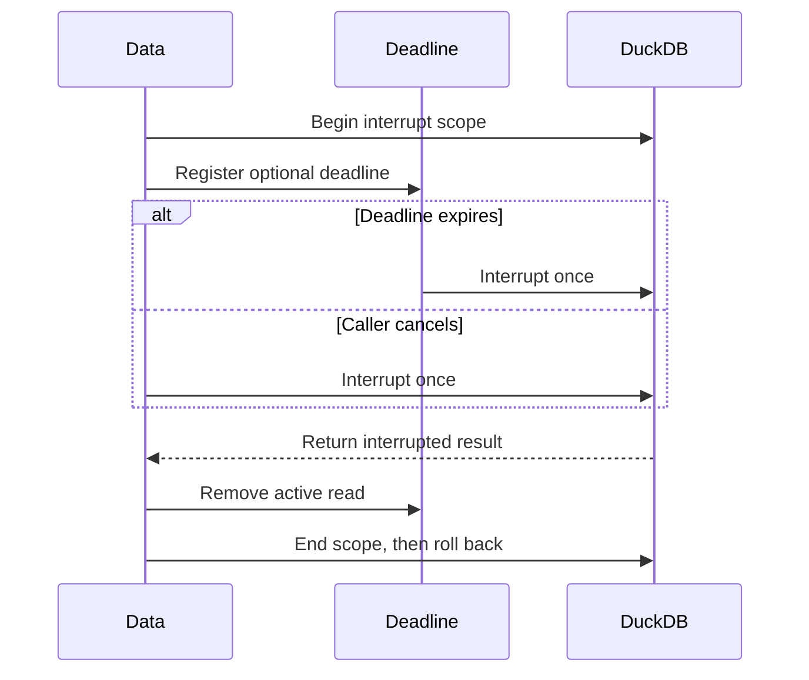

# Discovery Definition Review

This guide covers Discovery definition admission, native OCI execution, and
the shared Instance owner. The definition selects reusable code and inputs.
Admission starts no Discovery. Focused finite and live checks pass. The final
Rust gate and complete migration remain **Not done**.

## Intended end state

A YAML definition contains metadata and one SQL or PRQL program. Package calls
are relations in that program. Source code can be inline or in a file captured
once at admission. Every program uses the native DataFusion pipeline. A separate
running instance owns permission,
progress, saved state, and subscription lifetime.

## Review flow

```text
An operator admits a definition file
  -> the file owner captures the SQL or PRQL source once
  -> the CLI sends metadata and captured SQL or PRQL
  -> Control checks the current tenant and manager permission
  -> Query admits SQL or compiled PRQL and resolves package calls in that SQL
  -> Control holds permission and image trust through the final write
  -> Data retains one immutable definition revision
  -> no Discovery starts

Admission fails or permission expires
  -> the request returns a typed error
  -> Data commits no new definition
  -> a retry checks current permission again
```

[DefinitionArgs](../../crates/araphor-cli/src/cli/araphor/packages.rs)
accepts `araphor definition admit FILE` and
`araphor definition inspect NAME --revision REVISION`.

-> [Definition::read](../../crates/araphor-discovery-definition/src/definition.rs)
delegates YAML parsing to
[YamlDefinition::read](../../crates/araphor-discovery-definition/src/file.rs).
The file owner checks metadata and the single program selection. It resolves
relative paths from the YAML directory and captures UTF-8 source text once.
The native YAML parser rejects duplicate keys and unknown fields. No owner
watches or polls the files.

-> [Call::sql](../../crates/araphor-discovery-definition/src/file.rs)
converts the structured call to native SQL. The existing SQL parser checks
each input query. Native syntax-tree values quote names and literal
parameters. This owner does not evaluate parameter strings as SQL. The
result uses the existing `Program::Sql` type. SQL and PRQL text use the
existing source types. The JSON request and saved snapshot formats do not
change.

-> [ClientGrpcOwner::definition_request](../../crates/mithril-control/src/client_grpc/packages.rs)
accepts captured definitions only. The server does not open client paths.
Admission requires current manager permission. Inspection requires current
tenant read permission. File metadata grants no permission.

-> [Engine::prepare_definition](../../crates/araphor-query/src/definition.rs)
uses native SQL parsing, logical planning, and optimization. SQL and generated
PRQL SQL use the same route. Query loads each exact installed image referenced
by a package function. Admission executes no input query or package.

-> [Packages](../../crates/araphor-query/src/definition/package.rs)
extends native relation planning for installed package functions. Native
subquery arguments supply input plans. Native scalar expressions supply
parameters. Exact image content supplies the declared interface and locked
dependencies. A call with several output relations requires an output name
as its first string argument. SQL package output, checkpoint, evidence, and
reason queries retain their schema checks. Native analysis and optimization
check every SQL body plan, including plans that contain other package calls.

Package calls use DataFusion's `RelationPlanner` extension. They are not
registered scalar user-defined functions (UDFs) or `TableFunctionImpl`
functions. The native table-function interface accepts scalar expressions.
A package input accepts a complete relation. The relation planner gives
DataFusion each input subquery in its caller scope. DataFusion plans scalar
parameters through its existing expression planner.

The relation hook returns ordinary table references to DataFusion unchanged.
[SourceProvider](../../crates/araphor-query/src/sources/mod.rs) implements
native `TableProvider` for Araphor tables. Package input and output relations
use native `ViewTable`. The table scope returns those providers through
`provider_as_source`; the relation hook does not implement table scans.

One admission shares one native catalog and source-provider map. The package
planner parses each default input query once. Native `transform_up_with_subqueries` binds each
declared dependency to its resolved plan. Native `recompute_schema` updates
the parent schemas in that same traversal. Native `ViewTable` and
`LogicalPlanBuilder::scan` preserve the input name and projection. Binding
occurs before optimization; an unexpected scan filter or fetch is an error.
`DataFrame::with_column` adds the zero-based index with native `row_number`.
This operation generates no SQL. Existing configured Query quotas still
apply to indexed and bound plans. Every surviving package body is a child of
its native PackageCall. The root optimizer and physical planner check these
children. No separate registry repeats those passes. Native SQL can discard
an unused common table expression. Its admitted image pin and source capture
remain part of the definition contract.

The native SQL body planner needs a separate table scope for each call.
[Scope](../../crates/araphor-query/src/definition/package/scope.rs) supplies
the actual input, parameter, output, and prior-state tables through
DataFusion's `ContextProvider`. It delegates function, type, configuration,
and other metadata to the native provider. A package body cannot inherit
undeclared tables from its caller. Caller subqueries and common table
expressions are planned by DataFusion before this body scope is used.
DataFusion's native session context provider is private. This adapter supplies
the required package table scope to the native SQL planner.

-> [PackageCall](../../crates/araphor-query/src/definition/call.rs)
retains the exact image, export, selected output, and SDK descriptor. Its
logical children are the actual input plans, native parameter plan, and SQL
output, checkpoint, evidence, and reason plans when the export uses SQL.
Its schema is the selected SDK output schema.
The identity key includes the root image digest, selected export, and local
call ID. An admission token prevents native optimization or the result cache
from combining separate admissions. The token does not enter the stable plan
hash. Cursor bindings thus remain stable after the same definition is admitted
again. Separate call sites keep separate state after optimization.
The node preserves the package execution contract for typed output, saved
state, and evidence. A scalar UDF does not supply that contract.
[PackageExec](../../crates/araphor-query/src/definition/physical.rs) implements
the native physical extension. Read the finite execution route below.

The former Discovery function resolver and its crate are removed. Native
[SQL view declarations](../../crates/araphor-analysis-builtins/src/discovery/sql.rs)
define the derived relations. Query registers native `ViewTable` providers
through [Engine::register_views](../../crates/araphor-query/src/execution.rs).
The SQL query uses `FROM discovery.observed_effects` without call arguments.
The Query planner contains no Discovery-name dispatch. Package calls still
use the generic relation planner described above.

[Discovery image assembly](../../crates/araphor-analysis/src/package/builtin.rs)
retains the complete live SQL program in the existing package format. Native
SQL CTE scopes bind its input relations. Image assembly adds no executor,
subscription, or source reader.

[Package::subscribe](../../crates/araphor-analysis/src/package.rs) uses
[Program::call](../../crates/araphor-discovery-definition/src/file.rs) to
construct the same native call as the YAML form. Package retains one admitted
definition and root call in a Tokio OnceCell. Source subscriptions reuse that
admission. Query plans the declared input relations and executes each update
through PackageExec. Analysis does not extract SQL bodies or interpret input
schemas. The installed image revision and digest must match the retained
package. Package construction no longer installs an image.
The cached call creates no durable definition or Data revision. Explicit
definition admission remains a separate operation.

[DiscoveryOwner::derive](../../crates/araphor-analysis/src/discovery/mod.rs)
admits a lazy source subscription before it registers the processor. Data
registration preserves an existing required processor and rejects retirement.
The subscription receives its first poll after registration. Package execution
does not need an initial evaluation only to register the processor.

[DiscoveryOwner::publish](../../crates/araphor-analysis/src/discovery/mod.rs)
checks the actual root return against that admission before publication.
Complete typed returns remain in Update.calls. This profile publisher cannot
commit package checkpoints, reasons, or evidence. Admission rejects reachable
checkpoint contracts; publication rejects auxiliary returns even when the
selected query rows do not change. The finite Instance owner below supplies
a separate atomic state and auxiliary publication path. The profile publisher
does not use that path. Authority changes drop
the private producer and join its workers before the subscription returns
Denied. Discovery stop and source removal call `Subscription::cancel_and_join`.
Ordinary Drop cancels the operation; Drop cannot wait for async cleanup.

-> [ClientAuth::commit_definition](../../crates/mithril-control/src/client_auth/packages.rs)
holds the current permission lock through the Data write. This owner checks
permission even when a SQL or PRQL definition has no image pins. A package
call also requires current trust in its exact image digest.

-> [AnalysisStore::admit_definition](../../crates/araphor-data/src/analysis/definitions.rs)
checks exact retained image references and saves captured text, generated
SQL, metadata, and pins. The SHA-256 content revision includes every saved
field. An exact retry returns the original commit revision. Changed content
creates another immutable revision. A retry of an older revision does not
change the latest selection.

-> [AnalysisStore::validate_definitions](../../crates/araphor-data/src/analysis/definitions.rs)
checks saved identities, content digests, store revisions, and exact image
pins during store open. Inspection checks content and image pins again.

Definition recovery restores immutable definitions. Caller-owned finite
execution returns proposed state without a write. The shared Instance owner
connects saved state, progress, and recovery checks. Read the
[shared lifecycle route](#shared-lifecycle-and-retained-output-qualification)
for managed start, inspection, stop, and retained running-instance restoration.
Complete source recovery remains open.



Queries with no package calls require no image lookup. Data commits no
activation or result.

## Finite execution

[Session::execute_definition](../../crates/araphor-query/src/definition.rs) accepts an admitted definition and caller invocation state
  -> [Session::capture_definition](../../crates/araphor-query/src/definition.rs) checks admitted call children before optimization or source capture
  -> [Session::capture_plan](../../crates/araphor-query/src/execution.rs) uses fixed execution time for native optimization and physical planning
  -> [SubscriptionPlanner](../../crates/araphor-query/src/planner/subscription.rs) uses the native physical planner extension for PackageCall
  -> [Session::capture_physical](../../crates/araphor-query/src/execution.rs) captures declared sources once and retains the physical plan, permit, and source view
  -> [CapturedExecution::execute](../../crates/araphor-query/src/definition.rs) starts that captured physical plan once
  -> [PackageExec](../../crates/araphor-query/src/definition/physical.rs) collects complete Arrow inputs and parameters under one operation permit
  -> [SQL execution](../../crates/araphor-query/src/definition/physical/sql.rs) uses native physical children, or [Runtime::evaluate_reserved](../../crates/araphor-package-runtime/src/lib.rs) invokes the selected guest backend
  -> [CheckedEvaluation](../../crates/araphor-analysis-sdk/src/validation.rs) validates all outputs, proposed state, reasons, and evidence
  -> [DefinitionOutput](../../crates/araphor-query/src/definition.rs) returns selected query batches, the captured receipt, and complete call results

[Session::execute_definition](../../crates/araphor-query/src/definition.rs) receives an error or cancellation
  -> [AnalysisReadControl::operation](../../crates/araphor-data/src/analysis/read.rs) stops the separate invocation control
  -> [CallContext::finish](../../crates/araphor-query/src/definition/physical.rs) closes call registration and waits for the native task tracker
  -> Data receives no automatic result, state, or progress write

The finite caller creates the invocation identity, seed, and
prior checkpoint map. An invocation has separate cancellation state. Query
forwards parent cancellation and waits for active work. An ordinary invocation
error does not cancel the parent Session. The map uses admitted call identities.
Unknown checkpoint identities and state for a stateless export are rejected
before source capture. A call identity is not a durable instance identity. Admission retains unoptimized plans so
execution clocks are not folded at admission. Native optimization and physical
planning use the fixed session time during execution.

[Engine::new](../../crates/araphor-query/src/execution.rs) disables native
leaf-expression pushdown for DataFusion 53.1. That rule can leave a stale
join schema and make projection optimization fail. The
[upstream issue](https://github.com/apache/datafusion/issues/22895) records
the native configuration workaround. The other native optimizer rules remain
active. The struct-join regression checks selected rows, checkpoint, evidence,
and reason details. Enable this option only after an engine upgrade passes
that regression and the Discovery integration tests.

Cold Wasm preparation occurs in the native physical extension planner. It
uses the parent request control before the evaluation timeout starts. The
physical node retains an opaque prepared-code pin for the exact Runtime,
image object, package, and export. Execution cannot substitute code from
another runtime or image. Definition admission performs structural validation
without compilation. Ordinary SQL retains its existing planning timeout.

The preparation worker holds the existing evaluation permit and call tracker
token. Explicit cancellation waits for that worker. Dropping an execution
future cancels its control; the worker retains its permit until it exits.
An active synchronous Wasmtime compilation cannot be interrupted. This
boundary does not provide a compiler process memory quota.

[Subscription](../../crates/araphor-query/src/follow/mod.rs) owns a shared
Tokio task tracker. Session carries its handle through each native execution.
Native logical optimization runs in the existing tracked blocking worker.
Query then calls the native QueryPlanner for asynchronous physical planning.
This is the same order as SessionState::create_physical_plan. Cancellation
joins the optimizer worker and cold preparation. Physical planning does not
hold a blocking worker while it waits for a compiler worker. No second planner
or runtime is added.
The guest exchange, cold preparation, and source-read closures retain parent
tokens until their actual workers exit. Per-call trackers still join each
finite evaluation. Blocking workers transfer their result through a native
oneshot channel before they release their lease. If the receiver is dropped,
the worker drops the result before it releases the token. Completed returns
and captured snapshots contain no parent
token. A caller can retain a delivered Update while subscription shutdown
completes.

PackageCall retains one shared copy of its admitted native children after
DataFusion binds parameters and reconstructs schemas. Public
stream and subscription entries reject changed input or SQL body plans before
optimization. Native TableScan equality excludes its provider. The admission
check also compares the original provider identities. This check includes
native view bodies. Internal optimized plans
are not compared with the original children. DataFusion can change aliases and
share equivalent expressions. The check prevents a caller from changing image
code or inputs while retaining a cached admitted call identity.

PackageExec owns the complete typed evaluation and result. It executes once
for one admitted call, across all input batches and physical partitions.
Readers share that result. Separate call sites retain separate state. The
cache holds weak handles to running work and strong handles to complete
results. Dropping a reader does not create a cache cycle. Cancellation does
not retry an abandoned call.

[Inputs](../../crates/araphor-query/src/inputs/mod.rs) retains the admitted
source scopes before optimization. Empty relations and unused common table
expressions retain their source revision contract. Native source providers
supply Arrow buffers from the captured view. SQL output and prior-state
relations bind temporary port slots in that same view. Package SQL opens no
second live read and uses no synchronous Query bridge.

[AnalysisStore::dependency_revision_for](../../crates/araphor-data/src/analysis/dependencies.rs)
accepts the admitted table requests. Data resolves its projected tables to
storage relations. Query passes those requests through the existing revision
read. Query does not select Discovery storage dependencies.

[Memory](../../crates/araphor-query/src/memory.rs) retains input, output,
checkpoint, and reason buffers through their actual Arrow lifetimes. A
retained result keeps its metadata reservations. Plans with PackageExec do
not prepay a second public output budget before the complete call result is
retained. Actual configured capacity checks remain active.

The runtime crate owns executable loading and invocation. It has no Query or
Analysis dependency. Compatible backend code came from the
[earlier execution owner](https://github.com/Ereborlabs/erebor-runtime/blob/6a25ba1b34dbaa0a553b1883058938683ce7aaab/crates/araphor-analysis_back/src/package/execution.rs).
The backup crate is restored as reference until compatible migration is complete.
Runtime retains its own backend code.
[NativeLibrary](../../crates/araphor-package-runtime/src/native/loading.rs)
keeps file and code pins through invocation, output copy, and producer release.
Native calls run inside the process. Native cancellation remains cooperative;
a native guest that ignores cancellation can delay completion.

[WasmExecution](../../crates/araphor-package-runtime/src/wasm.rs) creates its
engine on demand. The new runtime compiles with native Wasmtime inside the
process. Production execution has no compiler child.
[EpochWatch](../../crates/araphor-package-runtime/src/wasm/execution.rs)
waits for cancellation, deadline, or completion events. It has no periodic
ticker. The runtime uses the existing TaskTracker for worker teardown.
Runtime quotas default to disabled. An explicit compiler address-space quota
returns Unsupported because compilation runs inside the process. Active
compilation must finish before cancellation can join its worker. Explicit
cancellation through execute_definition joins active work. Dropping the whole
async future cannot wait for cleanup in Drop; worker tokens retain code and
operation resources through teardown.



This API does not authorize a durable commit. The caller retains responsibility
for current authority and domain checks. The Instance owner adds the authority
and Data transaction route. The shared Host owns managed lifecycle operations.
Complete producer recovery remains in TODO 16. Package-issued internal SQL requires
a future SDK capability; the current guest ABI supplies no database handle.

Qualification is in progress for the current worktree. The physical execution
cases are in [definition tests](../../crates/araphor-query/src/definition/tests/execution.rs).
Entered-guest cancellation, worker drop, and capacity cases are in
[runtime tests](../../crates/araphor-package-runtime/src/wasm/tests/runtime.rs).

During recovery, backup removal was withdrawn. All 208 backup files and 34
deleted Control and E2E reference files were restored. Compatible migration requires a complete
source and test map before deletion. The finite call path does not establish
graph publication, Discovery replay, durable commit, or permission-supervision
parity. At that point, no deletion commit or push was made. That workspace
build stopped when the host disk filled; it did not pass.

The earlier finite retirement removed 29 duplicate reference leaves. Its final
Rust gate passes in `migration-final-ci42` at commit `95e9bb4d`. That record does
not qualify the later managed source. The additional finite retirement removes
exactly four mapped leaves: Graph contract source and tests, model input, and
model operation. Eight more Wasm leaves and 15 finite Graph, SQL, Discovery,
test, and asset leaves are retired. Eight more executor, component, atom,
pager, and pure test leaves are removed after 50 focused replacement checks
pass. Fifteen more retained-query, authority, Wasm, and finite notification
test leaves are removed after 89 focused checks pass. Two more complete
image/fixture leaves retire after exact replacement checks pass. The remaining
127 files keep their baseline content.
The recovery archive retains all 208 recovered files. Read the
[retirement records](../plans/araphor-analysis-migration.md#retired-finite-reference-files)
and the [four-file record](../../recovery/araphor-analysis-managed-retirement-20261019.json)
and [Wasm record](../../recovery/araphor-analysis-wasm-retirement-20261020.json),
[Graph record](../../recovery/araphor-analysis-graph-retirement-20261020.json),
the [output record](../../recovery/araphor-analysis-output-retirement-20261020.json),
the [native helper record](../../recovery/araphor-analysis-native-retirement-20261020.json),
the [retained-result record](../../recovery/araphor-analysis-retained-retirement-20261020.json),
and [image/fixture record](../../recovery/araphor-analysis-image-fixture-retirement-20261020.json)
for the exact scope. The current final Rust gate and complete migration remain
**Not done**.

## Finite Graph reads and output validation

[Data Graph reads](../../crates/araphor-data/src/analysis/graph/findings.rs)
check the tenant, supplied identifiers, positive page size, and typed revision
before they acquire a reader. Data owns the read snapshot and native current
or historical result selection. Pagination retains the caller's row and byte
bounds. A Graph reader facade and a second worker mutex are unnecessary.

[Graph::apply](../../crates/araphor-analysis/src/graph/mod.rs) consumes a sealed
native call result. Query and Package Runtime validate the complete SDK return
before they construct that result. Graph then checks the exact admission,
image, export, tenant, and canonical inputs. Its
[output validator](../../crates/araphor-analysis/src/graph/output.rs) checks
selected records, facts, subjects, evidence, reasons, and checkpoint rows.
[Graph::finish](../../crates/araphor-analysis/src/graph/finish.rs) assembles the
snapshot and calls the existing Data snapshot validator.

These finite owners do not implement Graph production, historical replay,
expiry scheduling, or restart recovery. Those reference files must remain.
Data's snapshot validator still has collection limits. This replacement does
not prove that all Graph quotas are disabled. The 31 Analysis Graph tests,
27 Data Graph tests, and 21 notification caller tests pass. Their exact
retirement scope is in the records above. Final Rust qualification is
**Not done**.

## Graph publication guards

[AnalysisStore::commit_graph_snapshot](../../crates/araphor-data/src/analysis/progress.rs)
consumes the existing canonical graph pair and a final caller check.
  -> The existing transaction checks manifest, scope, witnesses, and progress.
  -> A fresh result compares its exact prior window head in that transaction.
  -> Row insertion and the existing commit hook complete before the final check.
  -> Data commits only when the final check succeeds.

An exact immutable retry returns its original receipt and still requires the
final check. It does not compare a historical result against a newer window
head. [mark_graph_notice](../../crates/araphor-data/src/analysis/progress/notices.rs)
uses its existing supersession check, commit hook, and final authority check.
The generic result entry rejects Graph writes. There is no new transaction,
reader, schema table, or execution owner.

The [guard tests](../../crates/araphor-data/src/analysis/graph_rows/tests/guards.rs)
check actual rollback, exact retry, missing and stale heads, superseded notice,
and generic-entry rejection. All 39 connected Data cases pass. Notification
qualification covers 13 original passing cases and eight corrected replacement
fixtures. The fixture now supplies the actual prior result. All original
notification assertions remain. The
[migration record](../plans/araphor-analysis-migration.md#reactive-admission-and-guarded-graph-publication)
records exact commands and corrections. This does not qualify the complete
native Graph producer.

## Finite native helper replacement

[PackageExec](../../crates/araphor-query/src/definition/physical.rs) receives
captured native input relations.
  -> [Guest execution](../../crates/araphor-query/src/definition/physical/guest.rs) reserves retained inputs and encoding scratch before Runtime entry.
  -> [Native SQL execution](../../crates/araphor-query/src/definition/physical/sql.rs) keeps declared output, checkpoint, and reason order.
  -> [Query memory](../../crates/araphor-query/src/memory.rs) keeps retained arrays charged until the last alias is dropped.

[Recorded SQL](../../crates/araphor-analysis-builtins/src/discovery/sql/recorded_snapshot.sql)
receives the complete selected relations.
  -> [Native operators](../../crates/araphor-analysis-builtins/src/discovery/sql/recorded_snapshot.sql) aggregate all Arrow partitions without an Analysis pager.
  -> [DiscoveryOwner::recorded_result](../../crates/araphor-analysis/src/discovery/output.rs) checks the exact call and complete result.
  -> [Data validation](../../crates/araphor-data/src/discovery/validation/recorded.rs) checks source attribution, accounting, coverage, and lifecycle.

[Conversion preflight](../../crates/araphor-query/src/definition/tests/execution/contract/pressure.rs)
fails under configured output pressure.
  -> [The physical executor](../../crates/araphor-query/src/definition/physical.rs) returns the typed limit error before conversion.
  -> [The collection owner](../../crates/araphor-query/src/definition/physical.rs) drops the producer without a later poll.
  -> [The failure checks](../../crates/araphor-query/src/definition/tests/execution/contract/pressure.rs) prove unchanged Data and released reservations.

The [pressure cases](../../crates/araphor-query/src/definition/tests/execution/contract/pressure.rs)
also check nested encoding scratch, zero-row schema metadata, valid saved-state
exchange, and the actual Runtime SDK encoder failure. The
[record projection cases](../../crates/araphor-analysis/src/discovery/output/tests/native.rs)
check every typed event field, original bytes, source witnesses, stream
completion, and content-derived input revisions. The
[boundary cases](../../crates/araphor-analysis/src/discovery/output/tests/baseline.rs)
keep duplicate accounting and lifecycle references across the old 128-group
boundary. The [native SQL cases](../../crates/araphor-analysis/src/package/tests/sql/recorded.rs)
keep sparse declared counts, empty ranges, orphan rejection, and complete
partition results.

All 50 mapped focused checks pass before the eight reference leaves are
removed. The record pins the owner source and test binaries. No production
code is added for this removal. The long-running lifecycle and complete final
Rust gate remain **Not done**.

## Retained result inspection

[Instance::read_result](../../crates/araphor-analysis/src/instance/read.rs)
accepts a current reader grant and exact instance/result IDs.
  -> [Instance::inspect](../../crates/araphor-analysis/src/instance/read.rs) checks Inspect before the read and watches current authority events.
  -> [Instance::retained](../../crates/araphor-analysis/src/instance/read.rs) checks stored selection coverage for the reader tenant.
  -> [AnalysisStore::managed_result](../../crates/araphor-data/src/analysis/managed/read.rs) validates the retained call, receipt, descriptor, output, and exact instance binding.
  -> [Instance::inspect](../../crates/araphor-analysis/src/instance/read.rs) checks current reader authority and expiry before disclosure.

[Instance::query_result](../../crates/araphor-analysis/src/instance/read.rs)
accepts an exact result ID or no result ID under the same fresh Inspect guard.
  -> [AnalysisStore::managed_query_output](../../crates/araphor-data/src/analysis/managed/read.rs) resolves the current generation's successful selected receipt when no ID is supplied. It checks scope, instance, attempt, generation, and commit revision in one read transaction before Arrow decoding.
  -> [Session::query_local](../../crates/araphor-query/src/execution/local.rs) registers only the retained output datasets in a private native catalog.
  -> [Session indexing](../../crates/araphor-query/src/execution/tables.rs) adds original row indices before filtering across Arrow batches.
  -> [Planner](../../crates/araphor-query/src/planner/mod.rs) uses the existing native SQL parser and logical planner.
  -> [Session::stream_local](../../crates/araphor-query/src/execution.rs) uses the native optimizer, physical planner, execution permit, and output bounds.
  -> [LocalOutput](../../crates/araphor-query/src/execution/local.rs) retains the selected dataset and its metadata reservation.

The catalog contains no inherited view, external catalog, undeclared local
table, or durable source. Native admission rejects DDL, DML, multiple
statements, and unused undeclared CTEs. A retained SELECT executes no historical
package export and captures no current evidence source. Native SQL selects
rows. The native Session retains its configured shared resource bounds. Data
checks the retained descriptor schema. No second descriptor read or
current image execution trust check is required.

Current Inspect authority is independent of the original writer principal,
Run authority, and image execution trust. Authority loss cancels and drains the
child operation. The parent request control remains usable. Complete results,
state, reasons, evidence, and historical receipt revision survive newer writes.
The [historical tests](../../crates/araphor-analysis/src/instance/tests/history.rs)
check those rules. The [native local tests](../../crates/araphor-query/src/execution/tests/local.rs)
also check catalog exclusion, original indices, empty metadata, native interval
output, explicit limits, and last-alias memory release.

[Control package reads](../../crates/mithril-control/src/service/packages.rs)
and [CLI package reads](../../crates/araphor-cli/src/cli/araphor/packages.rs)
pass the optional result ID to these owners. `query INSTANCE SQL` selects the
current successful root. `query INSTANCE RESULT SQL` selects an exact retained
result. Rollback selects the new current receipt. Removal keeps history.
Recreation starts with no current result. A failed later step keeps the last
successful result. An invalid current receipt cannot select an older result.

All 35 mapped inspection cases pass on source321. The source322 compile,
format, and strict Clippy checks also pass. Two post-removal inspection cases
pass on unchanged active source. The
[retirement record](../../recovery/araphor-inspect-retirement-20261023.json)
retains exact selectors, source identities, binary hashes, and the verified
checkpoint. The complete old `package/inspect.rs` file is removed. Other mixed
reference files, complete lifecycle migration, and the final shared Rust
procedure remain **Not done**.

## Finite managed execution

[Instance::admit](../../crates/araphor-analysis/src/instance/mod.rs) accepts an
explicit Run grant, an instance ID, and an exact retained definition. It checks
permission even for SQL with no image calls. It checks every image digest and
trust decision, prepares the definition through Query, and saves immutable
instance metadata through
[AnalysisStore::admit_managed](../../crates/araphor-data/src/analysis/managed/read.rs).
It starts no subscription or guest.

Read these owners in order:

1. [Instance::manifest](../../crates/araphor-analysis/src/instance/manifest.rs)
   records each admitted call ID, image, package, export, target, artifact,
   native argument text, and dependency IDs. The manifest has a format and
   planner version. It stores no displayed or serialized logical plan.
2. [Instance::run](../../crates/araphor-analysis/src/instance/mod.rs) checks
   current generation and the exact attempt request before capture. It clones
   the admitted SELECT and uses native `LogicalPlanBuilder::insert_into` to
   add one private publication target.
3. [Session::capture_managed](../../crates/araphor-query/src/definition.rs)
   prepares one native physical plan and captures source rows and guarded
   prior state through the same Data read connection. It returns before
   execution. It rejects a different tenant, selection, definition, or supplied
   caller input or checkpoint state.
4. [CapturedExecution::blocking](../../crates/araphor-query/src/definition.rs)
   holds the captured permit and worker token while Data registers the attempt.
   [register_managed_attempt](../../crates/araphor-data/src/analysis/managed/commit.rs)
   fixes the source receipt, prior heads, logical time, seed, and rebuild flag
   before the native plan starts.
5. [PackageExec](../../crates/araphor-query/src/definition/physical.rs) selects
   captured prior state after it collects effective inputs and parameters.
   [ManagedPrior::checkpoint](../../crates/araphor-data/src/analysis/managed/model.rs)
   requires matching input revisions, coverage, parameter values and schema,
   checkpoint version, and named state dataset schemas. Rebuild or a mismatch
   resets state. Separate call sites retain separate state.
6. [Publication::write_all](../../crates/araphor-analysis/src/instance/sink.rs)
   retains selected Arrow batches and all complete call returns. It checks
   each return against the admitted call. Native optimization can remove a
   call; the sink publishes only calls that actually executed.
7. [AnalysisStore::commit_managed](../../crates/araphor-data/src/analysis/managed/commit.rs)
   checks the captured contract, current source and dependency revisions,
   witnesses, generation, and prior heads. One transaction publishes selected
   rows, actual call outputs, evidence, reasons, state, and progress. A failed
   step leaves those heads unchanged. Its pending attempt can remain retained.
8. [validate_managed](../../crates/araphor-data/src/analysis/managed/schema.rs)
   checks retained definitions, call pins, result packets, heads, and reference
   integrity during open. The storage API retains exact results and selected
   Arrow data; it does not supply a public authorized history command.



The publication target implements native `TableProvider::insert_into` and
`DataSink`; its scan is Unsupported. DataFusion's `DataSinkExec` invokes the
sink and emits the single UInt64 count result. Analysis `Publication::write_all`
drains the native stream, checks selected row and byte limits, and retains the
selected Arrow batches. Query checks the measured count array against its
output limits and reserves its buffer before execution, before the sink can
commit. This adds no parser, planner, or custom physical writer.
Ordinary source reads still use SourceProvider. Package relation arguments
still use the generic RelationPlanner described above.

Run observes authority changes before execution and applies the grant expiry
to its operation control. Cancellation signals that operation and waits for
the same captured work and workers. The final write holds `commit_many` for
the explicit grant and every exact image. Its final Data callback checks only
control; it opens no second reader while the writer is held. Current authority
is checked again before a receipt is returned. A denied acknowledgement leaves
a successful Data commit retained.

An exact completed retry returns its original receipt without another capture
or execution. A changed request conflicts. A pending retry returns Incomplete;
it cannot substitute a newer source cut after restart. Instance admission
retains immutable metadata, and each attempt retains its capture contract.
[Managed storage](../../crates/araphor-data/src/analysis/managed/schema.rs)
retains binary Arrow packets and result references. Removal, pin release, and
historical replay remain outside this finite API.

[Query limits](../../crates/araphor-query/src/execution.rs) use `input_bytes`
for the complete evaluation inputs, parameters, and prior state. The sink
checks `output_rows` and `output_bytes` against the complete selected relation.
`input_capacity`, `output_capacity`, and `execution_capacity` configure shared
pools. Evaluation and stream counts are optional global and tenant limits.
Bulk bounds default to the numeric maximum; optional limits default to None.
These defaults do not preallocate that maximum.

[SDK models](../../crates/araphor-analysis-sdk/src/model.rs) define schemas,
inputs, outputs, parameters, reasons, and saved state. Models and invocation
contexts contain no row, batch, byte, or checkpoint quota. Native SQL selects
rows. External time windows remain. Contract version identifiers stay
unchanged during development.
[Data extraction](../../crates/araphor-data/src/analysis/extraction.rs) and
[native storage limits](../../crates/araphor-data/src/analysis/capacity.rs)
retain their own configured bounds. `native_memory_bytes` and
`native_temp_bytes` are optional and disabled by default.

Query Memory retains captured prior buffers, package returns, and selected
Arrow buffers for their actual use. The writer retains those leases until it
exits. Data owns Arrow IPC serialization and transaction allocations; those
allocations are not all charged to Query Memory. Configured Query and SDK
limits are not a bound on all Rust heap allocation. The selected relation uses
native Arrow schemas, including Map, dictionary, and zero-column batches.
The remaining resource-boundary audit is **Not done**.

Focused finite qualification passes: 8 SQL contract cases, 11 Data managed
cases, 10 ordinary Instance cases, all 7 captured-execution cases, and both
Graph contract cases. Read the
[Instance tests](../../crates/araphor-analysis/src/instance/tests.rs),
[managed capture tests](../../crates/araphor-query/src/definition/tests/managed.rs),
and [Data transaction tests](../../crates/araphor-data/src/analysis/managed/tests.rs).
These tests check state reuse/reset, atomic failure, exact retry, authority
loss, configured pressure, crash, and recovery.

Separate source-built native runs pass 4 Query and 4 Analysis cases, including
the native Instance case. Their six artifacts have complete recorded source
provenance. Strict workspace Clippy passes after the test-only corrections.
The native57 provenance refresh passes in 31.395 seconds. All 116 recorded artifact inputs
are hashed, and its six artifacts match build54 byte for byte on
`x86_64-unknown-linux-gnu`. Exact records and run times are in the
[finite qualification table](../plans/araphor-analysis-migration.md#finite-managed-source-focused-qualification).

The required final Rust gate `migration-final-ci58` stopped during test compilation because the host disk was full. Formatting, workspace check, and strict Clippy passed. Gate59 passes these checks, 145 ordinary Analysis cases, and 333 ordinary Data cases. It stops at an OCI fixture that inherited changed SDK defaults. The corrected fixture supplies explicit limits and retains its golden digest. All 15 Package cases pass in `migration-oci-package60`. All eight source-built native Query and Analysis cases pass in the two native60 runs. The complete result is **Not done**. Long-running reactive supervision, per-port windows, public
start/inspect/stop, authorized history, CLI/Control managed operations,
historical replay, Data coordination polling, and remaining quota work stay
open. Native input scope still needs declaration-only local-port origins and
precise disjoint capture ranges. The old input executor remains until its
finite and live assertions have current owners. The complete migration remains
**Not done**.

This finite API creates no long-running job. Subscription supervision, window
completion, start/stop/resume/update/removal, current inspection, authorized
history, and CLI/Control managed operations remain **Not done**.
`Instance::admitted` returns immutable admission metadata; it is not a current
status or history API.

## Shared admitted image ownership

[Packages::new](../../crates/araphor-query/src/definition/package.rs) sorts exact
image keys and rejects duplicates before native planning.
  -> [PackageBundleV1::allocated_bytes](../../crates/araphor-package/src/memory.rs) measures defined image payload and buffer capacities after Data decode.
  -> [Packages::new](../../crates/araphor-query/src/definition/package.rs) reserves shared input capacity before image validation, digest construction, and planning.
  -> [PackageCall](../../crates/araphor-query/src/definition/call.rs) borrows the descriptor from its immutable image and shares the image reservation.
  -> [PreparedDefinition::images](../../crates/araphor-query/src/definition.rs) exposes borrowed image references for Instance authority and manifest checks.
  -> [PackageExec::new](../../crates/araphor-query/src/definition/physical.rs) retains the image charge through cold preparation and result delivery.
  -> [Exchange](../../crates/araphor-query/src/definition/physical/guest.rs) retains the image charge until the entered guest exits.

Instance removes its extra Data image load and decoded image set. Data still
validates stored image pins in its final managed transaction. This ownership
change does not account for pre-decode allocation, every native planner
allocation, or opaque allocator overhead. The retained metadata owner below
supplies spec and manifest accounting. That image delivery retires no
additional reference file.

The [capacity tests](../../crates/araphor-query/src/definition/tests/capacity.rs)
check shared ownership, exact image identity, failed cold preparation, no
guest entry after rejection, and full release after joined cancellation.
The [Instance tests](../../crates/araphor-analysis/src/instance/tests.rs)
check shared image identity and trust before preparation. All 35 Instance
cases and four source-built native Query cases pass. The two corrected Query
fixtures pass without changes to production budgets. The
[migration result](../plans/araphor-analysis-migration.md#shared-admitted-images-and-error-origins)
records exact commands and source counts.

## Retained metadata and current status

[DefinitionAdmission](../../crates/araphor-query/src/definition.rs) owns resolved
metadata, source requests, image handles, and their native reservation.
  -> [PreparedDefinition::resolved](../../crates/araphor-query/src/definition.rs) exposes borrowed metadata. Definition clones share the same owner.
  -> [Instance::manifest](../../crates/araphor-analysis/src/instance/manifest.rs) retains native extension Arc values instead of deep package-call copies.
  -> [Instance::admit](../../crates/araphor-analysis/src/instance/mod.rs) charges the exact moved spec and manifest before Data admission.

The reservations outlive their retained buffers. This scope covers defined
metadata capacity. It does not claim the complete native planner or allocator
heap. Host projected keys and the managed source-request copy remain open.

[Instance::read_status](../../crates/araphor-analysis/src/instance/read.rs)
accepts a fresh Inspect grant and an instance key.
  -> [Instance::inspect](../../crates/araphor-analysis/src/instance/read.rs) checks reader scope, authority, and expiry around the joined read.
  -> [AnalysisStore::managed_status](../../crates/araphor-data/src/analysis/managed/status.rs) reads current metadata and rejects unknown pending work.
  -> [Failure](../../crates/araphor-data/src/analysis/managed/status.rs) binds the current failure code to observed successful progress and its durable revision.

Idle suspension and eligible attempt failure write that fact in their existing
transactions. A late old lifecycle cannot replace the current fact. Stop and
start preserve it. New successful progress makes it inactive. Status reads no
image or Arrow payload and requires no current writer Run permission.

[Instance::execute](../../crates/araphor-analysis/src/instance/mod.rs) waits for
captured execution to join before it records a known prepublication failure.
  -> [Step](../../crates/araphor-analysis/src/instance/sink.rs) records actual publication entry before final authority and commit.
  -> [AnalysisStore::finish_managed](../../crates/araphor-data/src/analysis/managed/terminal.rs) records the original known failed attempt with its exact fences.

Busy, cancellation, and uncertain publication stay pending. A successful Data
commit with a lost acknowledgement retains its receipt. The
[finite tests](../../crates/araphor-analysis/src/instance/tests/finite.rs)
exercise real traps, native SQL failure, writer failure, and shared pressure.
The [status tests](../../crates/araphor-data/src/analysis/managed/tests/status.rs)
cover rollback, stale lifecycles, successful progress, reopen, backup, and
corrupt metadata. The
[qualification record](../plans/araphor-analysis-migration.md#retained-metadata-and-durable-failure-status)
states the exact checks, corrected fixtures, and remaining boundaries.

## Native package input capture

[Packages::inputs](../../crates/araphor-query/src/definition/package.rs) binds each declared input or explicit relation argument.
  -> [SourceDemand](../../crates/araphor-query/src/planner/mod.rs) retains admitted source origins before native optimization removes unused scans.
  -> [Inputs::bind_ports](../../crates/araphor-query/src/inputs/mod.rs) resolves caller ports inside nested admitted calls without changing the optimizer's admission guards.
  -> [SourceScan](../../crates/araphor-query/src/sources/mod.rs) visits the native physical tree once to collect columns and per-input time envelopes.
  -> [SourceSnapshot::read](../../crates/araphor-query/src/sources/rows.rs) captures the exact union of independent input windows and retains the original source receipts.

[PackageExec::sql](../../crates/araphor-query/src/definition/physical/sql.rs) binds a parent SDK input to its private native port.
  -> [SourceSnapshot::bind_port](../../crates/araphor-query/src/sources/rows.rs) charges defined metadata before cloning it beside the existing Arrow rows.
  -> [Inputs::input_for](../../crates/araphor-query/src/inputs/receipt.rs) borrows that port metadata and the same captured receipt.
  -> [Inputs::input](../../crates/araphor-query/src/inputs/receipt.rs) combines inherited revisions and coverage through the existing input identity algorithm.

Private port identities distinguish nested model inputs and SQL body bindings.
These identities are not persisted or included in the stable native plan hash.
Nested bodies receive parent rows through explicit relation arguments. The
isolated default-input scope stays unchanged. No second source read, executor,
clock, or codec is added. The metadata charge excludes opaque allocator headers.

The [native contract tests](../../crates/araphor-query/src/definition/tests/execution/contract.rs),
[nested origin tests](../../crates/araphor-query/src/definition/tests/execution/contract/origins.rs),
and [body-port tests](../../crates/araphor-query/src/definition/tests/execution/contract/body_ports.rs)
keep exact rows, source cuts, witnesses, coverage, revisions, checkpoints, and
readmission identity. The [binding pressure test](../../crates/araphor-query/src/sources/rows/package.rs)
proves rejection before insertion and complete resource release. All 259
connected Query cases pass. The [result](../plans/araphor-analysis-migration.md#native-input-capture-and-projected-membership)
records the exact source and qualification limits.

## Native managed subscriptions

[Instance::subscribe](../../crates/araphor-analysis/src/instance/subscription.rs)
accepts one current running lifecycle and one operation control.
  -> [AnalysisStore::managed_resume](../../crates/araphor-data/src/analysis/managed/read.rs) reads instance metadata, its native frontier, and the latest completion revision in one snapshot. An unknown unfinished attempt returns Incomplete.
  -> [Run::session](../../crates/araphor-query/src/stream/mod.rs) checks the full invocation scope before it selects the SQL window.
  -> [Runtime::evaluate](../../crates/araphor-query/src/stream/physical/runtime.rs) captures the physical plan once. An unchanged resumed cut waits for source or window events.
  -> [CapturedPhysical::reserve_complete](../../crates/araphor-query/src/execution.rs) reserves native count delivery before attempt registration.
  -> [ManagedPublication::admit](../../crates/araphor-analysis/src/instance/subscription.rs) registers the exact captured attempt before native child execution.
  -> [Publication::write_all](../../crates/araphor-analysis/src/instance/sink.rs) commits complete call returns, selected rows, saved state, and the native frontier through Data.
  -> [Step](../../crates/araphor-analysis/src/instance/sink.rs) records the completion revision. Another stream cannot combine a newer completion with its older selected cursor.

[Subscription::cancel_and_join](../../crates/araphor-analysis/src/instance/subscription.rs)
cancels the Query subscription and joins its actual workers. Data changes to
the running state use an exact lifecycle comparison. Installation and
admission remain inert. Analysis has no source clock or polling task.

The focused Query selection passes 97 cases. All 27 selected Analysis cases
pass, including the two source-built native cases. The native artifacts keep
the same 116 source inputs and six artifact hashes as native57. The progress
regression first fails on an actual duplicate commit: progress changes from
10 to 12. With the progress check, this regression preserves metadata,
frontier, results, saved state, and progress.

Known failure handling passes focused qualification.
[Subscription::cancel_and_join](../../crates/araphor-analysis/src/instance/subscription.rs)
joins Query before it uses the separate diagnostic control to record an outcome.
  -> [AnalysisStore::finish_managed](../../crates/araphor-data/src/analysis/managed/terminal.rs) accepts only the original live pending claim for a new terminal outcome. Loaded pending work remains unavailable.
  -> [AnalysisStore::check_managed_claim](../../crates/araphor-data/src/analysis/managed/commit.rs) compares the existing watch channel identity. A stale original claim cannot publish or finish after a clean reopen.
  -> [AnalysisStore::managed_resume](../../crates/araphor-data/src/analysis/managed/read.rs) selects the exact failed native offer for an unambiguous nonpressure failure. Successful state and progress stay unchanged.
  -> [Runtime::evaluate](../../crates/araphor-query/src/stream/physical/runtime.rs) waits at this native cut until its source or window changes. Cancelled offers remain unconsumed.

The [terminal tests](../../crates/araphor-data/src/analysis/managed/tests/terminal.rs)
check original claim lifetime, current caller checks, retained success, and
recovery. The [readiness tests](../../crates/araphor-data/src/analysis/managed/tests/readiness.rs)
check completion races at capture, registration, and publication. Native
[subscription tests](../../crates/araphor-analysis/src/instance/subscription/tests.rs)
hold real guests across cancellation and permission notices. They also check
the exact stored request on retry. All 83 connected behavior cases pass.
Strict Clippy and formatting pass. The
[migration result](../plans/araphor-analysis-migration.md#known-terminal-outcomes-and-failed-offers)
records the exact commands, source count, and remaining scope.

## Reactive instance host

[InstanceHost::serve](../../crates/araphor-analysis/src/instance/host.rs)
starts one driver and retains its store lease until every member drains.
  -> [InstanceHost::drive](../../crates/araphor-analysis/src/instance/host.rs) subscribes to lifecycle notices before it reads retained running instances.
  -> [InstanceHost::reconcile](../../crates/araphor-analysis/src/instance/host.rs) adds members to FuturesUnordered and cancels only replaced or stopped lifecycles.
  -> [InstanceHost::member](../../crates/araphor-analysis/src/instance/host.rs) checks current authority, admits the exact saved definition, and consumes its Query subscription.
  -> [Subscription::poll_next](../../crates/araphor-analysis/src/instance/subscription.rs) delivers receipts only after its tracked final authority callback.
  -> [Subscription::cancel_and_join](../../crates/araphor-analysis/src/instance/subscription.rs) drains pending delivery and actual Query workers before Data records a terminal outcome.

FuturesUnordered is the sole member registry. A metadata read uses a tracked
blocking worker. An older metadata snapshot cannot cancel a newer member.
The exact old member drains before its replacement starts. A held authority
callback or guest does not stop another subscription. Caller Drop cancels
the driver; its task retains the store lease through actual worker exit.

[Prepared::acquire_evaluation](../../crates/araphor-package-runtime/src/lib.rs)
uses the existing native semaphore for managed component admission.
  -> [PackageExec::guest](../../crates/araphor-query/src/definition/physical/guest.rs) waits before exchange allocation and guest launch. The captured request remains unchanged.
  -> [CallContext::finish](../../crates/araphor-query/src/definition/physical.rs) closes registration, drains its existing running shared futures, and then waits for actual workers.

A native operator can retain a pending future after cancellation drops the
output stream. Draining that same future lets its cancellation complete.
The shared future executes only once. The original error remains the result.
This path does not reset native plans, duplicate a package call, or change
the maintained native aggregate state. Component admission is unbounded by
default. Configured finite admission retains typed Busy behavior.

The [host tests](../../crates/araphor-analysis/src/instance/host/tests.rs)
cover lifecycle replacement, idle denial, real source denial, failure isolation,
unknown pending work, held callbacks, held guests, stop, and Drop. The
[capacity tests](../../crates/araphor-analysis/src/instance/subscription/tests/capacity.rs)
cover exact request retention, healthy work, cancellation, actual joins, and
full configured pool release with two blocking workers.

All 54 Instance cases and 130 selected Query cases pass across the ordinary
and corrected native commands. The
[migration record](../plans/araphor-analysis-migration.md#reactive-host-joined-delivery-and-component-admission)
identifies the source, commands, launch correction, and retired error leaf.
General pressure retry, renewal, public lifecycle,
producer supervision, and the final complete Rust gate remain **Not done**.
Unknown pending work and ambiguous Limit or Incomplete failures remain
unavailable. The mixed reference supervision files remain.

The [projected Data reader](../../crates/araphor-data/src/analysis/managed/read.rs)
returns only tenant, ID, generation, and lifecycle for recurring membership.
The member loads and fences its full row once. It releases the unused manifest
before admission. The existing member and future share one charged key.
Reconciliation cancels stale owners before metadata admission. Its wait selects
both scoped capacity release and lifecycle notices. Stop therefore remains
reactive when a previous owner fills the pool. The actual worker joins before
replacement admission. A corrupt full spec parks its member while healthy
members continue. A corrupt projected key fails the host and drains its lease.

[Run::sources](../../crates/araphor-query/src/stream/mod.rs) borrows the retained
managed definition's source map. The native managed sink test checks that exact
map identity. All 66 connected Instance cases and 44 managed Data cases pass
across the original and corrected commands. These checks qualify the complete
[memory and stream retirement](../../recovery/araphor-analysis-memory-retirement-20261020.json).
At that retirement, the 122 remaining reference files are unchanged. Initial admission pressure
retry, producer and public integration, and the final Rust gate remain open.

### Admission pressure

[InstanceHost::open_member](../../crates/araphor-analysis/src/instance/host.rs)
uses one existing Query memory scope for each member opening.
  -> It loads the exact current instance and checks generation and lifecycle.
  -> [Instance::admit_on](../../crates/araphor-analysis/src/instance/mod.rs) passes that scope to native Session preparation.
  -> A known reader or shared-memory failure drops failed admission metadata.
  -> The host waits on the existing capacity event, authority notice, expiry, or stop.
  -> It reloads the exact lifecycle before it retries.

The scope excludes its own releases from its capacity epoch. Unknown pending
work, Runtime Busy, evaluation pressure, and fixed bounds are not admission
capacity waits. Subscription assembly retries a reader failure only before a
stream or attempt exists. Stop joins actual admission and stream workers.

[StorageLimitsV1](../../crates/araphor-data/src/analysis/capacity.rs) owns the
optional reader_admissions value. None creates no semaphore. Some(0) returns
the fixed reader-admission quota error. A positive value uses native permits.
[ReadPermit](../../crates/araphor-data/src/analysis/connection.rs) releases its
actual token before it sends the existing capacity notice. The two native
connections stay unchanged. All 25 host and nine Query capacity cases pass.
The native lock and interrupt polling in Data remain open.

### Admitted source or capacity recovery

[InstanceHost::member](../../crates/araphor-analysis/src/instance/host.rs)
retains the original typed capacity error and failed completion after the
attempt joins. It opens the ordinary Query subscription at that failed
frontier. The same member select waits for the stream or the existing resource
event. Query owns source changes and captured window deadlines.

A source receipt clears the old resource cause. A resource event cancels and
joins the open stream before a fresh capture. `Instance::subscribe_on` permits
that capture only while the exact failed completion is still current. A newer
finite result prevents duplicate execution. Cancellation of a newer attempt
retains the prior committed frontier, so its newer source cut can still run.
The native sink uses the Instance Session memory scope. Its own cleanup cannot
act as an external capacity release.

The [capacity case](../../crates/araphor-analysis/src/instance/host/tests/admission.rs)
checks resource release, source-first recovery while pressure remains held,
a newer finite result, and cancellation of a newly started source attempt.
All 54 connected Host, delivery, and joined-state cases pass in
`host318`. Strict Clippy and formatting also pass. Read the
[source and command record](../../recovery/araphor-reactive-capacity-recovery-20261023.json).
Pre-attempt capture recovery, compiler and cache capacity forwarding, complete
supervision retirement, and the final shared Rust procedure remain **Not done**.

### Native compiler and cache capacity

Intended result: a known component capacity failure waits for the actual
resource. Cancellation and grant expiry end that wait. The current bridge
implements this result without a new capacity owner.

[PackageExec::new](../../crates/araphor-query/src/definition/physical.rs) prepares the selected component before source capture and attempt admission.
  -> [PackageRuntimeError](../../crates/araphor-query/src/lib.rs) exposes the original Runtime error through Query. The error type, resource and requested count stay unchanged.
  -> [InstanceHost::open_resource](../../crates/araphor-analysis/src/instance/host.rs) recognizes typed `component compiler` and `component cache capacity` errors.
  -> [InstanceHost::wait_open](../../crates/araphor-analysis/src/instance/host.rs) applies the existing operation control and selects the resource wait.
  -> [Engine::wait_package_capacity](../../crates/araphor-query/src/execution.rs) forwards the exact resource and requested count.
  -> [Runtime::wait_capacity](../../crates/araphor-package-runtime/src/lib.rs) calls the existing Wasm owner.
  -> [WasmExecution::wait_capacity](../../crates/araphor-package-runtime/src/wasm.rs) subscribes to the native capacity watch, checks the actual resource, and waits while that resource is full.



[CodeCache::available](../../crates/araphor-package-runtime/src/wasm/cache.rs)
checks the requested bytes and actual component pins. Compiler release and
component pin release send the existing native capacity notice. An unrelated
notice does not make a full resource ready. The Host joins the failed execution
before this wait. A cancelled wait starts no worker. Reader and shared-memory
waits keep their existing owners. Unknown Busy is not a resource retry trigger.
Query re-exports the original error; Analysis adds no Runtime dependency or
error adapter.

The source321 manifest build passes. The three Runtime cases pass in 6.582
seconds. The three Analysis cases pass in 28.080 seconds. Each run reports
unchanged source.

| Exact test | Required assertion |
|---|---|
| [instance::host::tests::admission::opening_waits_component_cache](../../crates/araphor-analysis/src/instance/host/tests/admission.rs) | A real guest pins the only cache entry. A different valid component returns typed Busy and requested bytes. The wait stays Pending, cancellation works, actual join permits release, and a fresh call returns `[7]`. |
| [instance::host::tests::admission::opening_keeps_unknown_busy](../../crates/araphor-analysis/src/instance/host/tests/admission.rs) | Unknown Busy and fixed bounds do not enter a resource wait or change Data. |
| [instance::host::tests::admission::admitted_busy_retries_capacity](../../crates/araphor-analysis/src/instance/host/tests/admission.rs) | Resource release, source-first recovery, a newer finite result, and a cancelled fresh source attempt preserve exact completion and progress fences. |
| [wasm::tests::wait_checks_resource](../../crates/araphor-package-runtime/src/wasm/tests.rs) | The public Runtime wait stays Pending under the actual compiler mutex, ignores an unrelated notice, and returns after release. |
| [wasm::tests::evaluation_capacity_recovers](../../crates/araphor-package-runtime/src/wasm/tests.rs) | Actual evaluation permits become available after release. |
| [wasm::tests::runtime::prepared::prepared_handle_keeps_binding](../../crates/araphor-package-runtime/src/wasm/tests/runtime/prepared.rs) | An uncached compile returns typed compiler Busy while the real mutex is held. A prepared handle retains its exact binding. |

The cache case tests the shared Host wait method. This result does not claim a
complete Host compiler-contention run. Pre-attempt source recovery and the final
shared Rust procedure remain **Not done**. The source321 result closes the
earlier compiler and cache capacity forwarding limit only.

### Fixed input clocks in native execution

[Runtime::evaluate](../../crates/araphor-query/src/stream/physical/runtime.rs) retains each active input range from the captured Query snapshot.
  -> [CallContext::bind_window_clocks](../../crates/araphor-query/src/definition/physical.rs) uses DataFusion's native expression simplifier at each input's retained SQL time. Nested calls keep their own scopes.
  -> [Session::physical](../../crates/araphor-query/src/execution.rs) analyzes the complete execution clone once and optimizes it once. Executions without retained windows use `SessionState::optimize` directly.
  -> [SourceSnapshot::bounds](../../crates/araphor-query/src/sources/mod.rs) uses the same scoped time for range metadata.
  -> [Inputs::input_for](../../crates/araphor-query/src/inputs/receipt.rs) retains the captured range for the exact call and input slot.

The call context and SDK time keep the actual evaluation time. A late close
uses the retained fixed interval for input SQL. It does not change other input
windows or the root SQL clock. Five fixed-window and six connected clock cases
pass on source322. This result does not qualify durable interval recovery,
older occupied intervals, or failed close recovery.

## Native operation validation

Read [PackageExec::collect](../../crates/araphor-query/src/definition/physical.rs)
for batch collection under the captured execution. Native child streams supply
Arrow batches. Normalization uses the declared SDK schema. Actual shared
buffers retain their existing memory claims. A configured input bound returns
the existing typed SDK Limit error; a shared pool failure returns Busy. Output
limits keep their existing classification. No second executor is present.

The [operation tests](../../crates/araphor-query/src/definition/tests/execution/contract/operation.rs)
check full input metadata, qualified table names, exact declared scope, stable
revisions, quoted aliases, input order, child deadlines, and capacity cleanup.
The former output quota test is removed under the user's 2026-10-23
instruction. Current output validation retains schemas and evidence references.
All 67 connected execution and guest cases and seven finite Analysis failure
and pressure cases pass. These checks qualify the
[operation test retirement](../../recovery/araphor-analysis-operation-retirement-20261020.json).
The 121 remaining reference files and recovery archive are unchanged. Other
model rules, complete producer integration, public lifecycle, and the final
Rust gate remain open.

## Native model boundary

Read [PackageExec](../../crates/araphor-query/src/definition/physical.rs) and
[its SQL implementation](../../crates/araphor-query/src/definition/physical/sql.rs)
for the existing physical execution path. The admitted package plan binds
inputs, parameters, prior state, outputs, evidence, and reasons. The native
optimizer and physical planner remain in use. Immutable call receipts retain
the complete SDK return and actual buffer claims.

The [model cases](../../crates/araphor-query/src/definition/tests/execution/contract/model.rs)
check output and checkpoint order, full evidence links, prior versus new state,
exact scalar values, quoted names, input revisions, buffer aliases, deadlines,
and body time. The existing ordered-output scenario also runs on multithread
and blocking-worker paths. The blocking case uses the existing Engine bridge
and preserves the original assertion result.

The [follow model case](../../crates/araphor-query/src/follow/tests/model.rs)
consumes actual notification deadlines from Query. It adds no model clock.
All 50 exact mapped cases pass. The
[retirement record](../../recovery/araphor-analysis-model-retirement-20261020.json)
covers 16 old methods, 12 old tests, and five whole removed files. Active
production code, ABI, and storage format do not change. All 116 remaining
reference files and the archive are unchanged. Mixed-window subscriptions,
installed supervision, producers, public lifecycle, and the final Rust gate
remain open.

## Public receipt reads and native input windows

[Instance::read_history](../../crates/araphor-analysis/src/instance/read.rs) A reader requests original receipts or exact retained output.
  -> [Instance::inspect](../../crates/araphor-analysis/src/instance/read.rs) checks fresh Inspect authority and watches current permission.
  -> [Data retained reads](../../crates/araphor-data/src/analysis/managed/mod.rs) validate the requested binding and return original receipts or the complete SDK wire packet.
  -> [ClientGrpcOwner::package_request](../../crates/mithril-control/src/client_grpc/packages.rs) joins binary serialization, then checks authority, expiry and client access.
  -> [Output::package](../../crates/araphor-cli/src/cli/araphor/output/packages.rs) decodes native Arrow only for presentation.

[Window::from_plan](../../crates/araphor-query/src/follow/window.rs) An admitted package input has a SQL window.
  -> [SourceSnapshot::capture](../../crates/araphor-query/src/sources/mod.rs) retains each native scan range and its exact expiry.
  -> [Progress::captured](../../crates/araphor-query/src/stream/progress.rs) keeps one deadline across metadata-only notices.
  -> [Runtime](../../crates/araphor-query/src/stream/physical/runtime.rs) executes through the existing native physical pipeline.



The wire reply is one PackageResponseV1 enum. The installed MessagePack codec
uses named fields and binary vectors. The decoder rejects trailing bytes.
The public result header excludes saved grants and principals. The raw reader
uses the existing retained validator and does not encode IPC again. This read
still decodes retained IPC for validation; it does not claim complete temporary
heap accounting. Historical reads need current Inspect permission, not current
Run permission or image execution trust. Cancellation joins the existing worker.

[AnalysisStore::managed_history](../../crates/araphor-data/src/analysis/managed/history.rs) lists original successful receipts in completion order.
[AnalysisStore::managed_output](../../crates/araphor-data/src/analysis/managed/read.rs) returns the validated original packet. Valid pending
or terminal attempts do not fabricate success. Corrupt bindings reject the read.
This list does not maintain the old per-window head index. Current-result
selection and selected SQL/PRQL reads now pass the focused checks in
[Retained result inspection](#retained-result-inspection). Complete per-window
and cross-generation history qualification remain open.

Package inputs retain independent windows through native child plans. Native
SQL already expands views before clock admission. Exact native timestamp bound
coercion stays valid; unsupported clocks stay rejected. The source snapshot
owns the next expiry. Query Progress owns its event. No Analysis clock or polling
owner exists in this path.

The [SDK wire test](../../crates/araphor-analysis-sdk/src/wire/tests/output.rs)
preserves the complete old wire matrix. The [raw Control test](../../crates/mithril-control/src/client_grpc/tests/packages/instance.rs)
checks every auxiliary output through actual package execution and the binary
reply. The [window tests](../../crates/araphor-query/src/definition/tests/subscription/windows.rs)
and native view tests cover the per-input expiry rules. The
[retirement record](../../recovery/araphor-analysis-package-output-retirement-20261020.json)
identifies the exact unchanged source, focused checks, and three removed files.
The current source descends from 111c575e. All 113 remaining Back files match
the baseline. The full Rust gate, larger inspection owner, input runner and
producer integration remain **Not done**. No benchmark is run.

## Metadata-first resume and checkpoint retries

[SubscribeExec::open](../../crates/araphor-query/src/stream/physical.rs) A managed instance opens its saved subscription.
  -> [Progress::new](../../crates/araphor-query/src/stream/progress.rs) opens the existing source watch before the probe.
  -> [Run::session](../../crates/araphor-query/src/stream/mod.rs) checks full authority and the selected managed head.
  -> [Run::dependencies](../../crates/araphor-query/src/stream/mod.rs) starts the tracked metadata worker and retains its actual evaluation permit.
  -> [AnalysisStore::managed_dependency_revision](../../crates/araphor-data/src/analysis/dependencies.rs) checks the exact head, pending work, completion and source notices in one read transaction.
  -> [SubscribeExec::open](../../crates/araphor-query/src/stream/physical.rs) checks the saved cursor and deadline, finishes empty calls and releases the idle permit.
  -> [Progress::next](../../crates/araphor-query/src/stream/progress.rs) waits on the same source or deadline event.
  -> [Runtime::evaluate](../../crates/araphor-query/src/stream/physical/runtime.rs) uses the existing capture and native physical execution when work is due.

The probe reads no prior IPC or source payload. It adds no bulk input pool
reservation. This statement does not claim complete temporary heap accounting.
No global relation change is ignored as an own-commit exception. A dependency
on analysis_results stays conservatively dirty. Explicit rebuild bypasses both
idle checks. Cancellation retains worker tokens and permits through actual exit.
Data registration and commit keep their existing guards.

[The Data cases](../../crates/araphor-data/src/analysis/managed/tests/metadata.rs)
prove header fences and no prior decode. The
[Query cases](../../crates/araphor-query/src/definition/tests/captured/managed.rs)
prove idle pressure, cancellation, notices, deadlines and explicit rebuild.
The [real Instance restart](../../crates/araphor-analysis/src/instance/tests/restart.rs)
preserves a committed checkpoint under full input pressure. The
[checkpoint cases](../../crates/araphor-analysis/src/instance/tests/checkpoint.rs)
use actual Wasm and source-built native implementations for retry, clean reopen,
older-output immutability, overflow and slot release. The
[finite input cases](../../crates/araphor-query/src/definition/tests/execution/contract/inputs.rs)
preserve the additional native input assertions.

All 84 connected cases, connected compilation, strict Clippy and formatting
pass on the recorded source based on 3be60374. The
[retirement record](../../recovery/araphor-analysis-checkpoint-retry-retirement-20261020.json)
identifies the exact commands, 30 checkpoint assertion groups and two removed
test files. All 111 remaining reference files and the archive are unchanged.
Retained dependency expiry, pressure retry, general scalar clock events,
producer and lifecycle integration, and the final full Rust gate remain open.

## Graph and retained-result resource defaults

[GraphReplayInputV1 and GraphSnapshotV1](../../crates/araphor-data/src/graph/model.rs)
validate typed records, source identity, proof, ordering and references without
default resource ceilings. The
[Graph domain tests](../../crates/araphor-analysis/src/graph/tests/defaults.rs)
keep the existing 300-second BOOTTIME join rule and require that exactly 256
records add no false resource-failure reason. These tests use the existing
Builtins implementations; they do not qualify a native Graph producer.

[GraphRows](../../crates/araphor-data/src/analysis/graph_rows/mod.rs)
retains the native storage owner. Its
[header](../../crates/araphor-data/src/analysis/graph_rows/header.rs)
checks u32 counts and canonical byte length before encoding. Row appends check
u32 ordinals before writing. The
[Data tests](../../crates/araphor-data/src/analysis/graph_rows/tests/defaults.rs)
cover the former row, body, metadata, context and witness boundaries, exact
retry, reopen, backup/restore and configured storage rollback.

[GraphTraversalV1](../../crates/araphor-data/src/graph/traversal.rs)
keeps the default one-hop query shape. Explicit subject and relationship
failure limits remain active. The existing native recursive SQL uses checked
BIGINT or NULL for its early-stop LIMIT. The
[result owner](../../crates/araphor-data/src/analysis/progress.rs)
and [recovery checks](../../crates/araphor-data/src/analysis/schema.rs) accept
the same expanded result range. Fixed batch/cache geometry can select a
single-item fallback; it is not a payload rejection ceiling.

All 159 connected cases, formatting and strict Clippy pass on the unchanged
recorded source based on d6c055d4. The
[qualification record](../../recovery/araphor-graph-resource-defaults-20261020.json)
identifies exact commands, source hashes and custody. The large metadata case
exceeds 16 MiB; it does not claim an executed fallback beyond 32 MiB. No
additional Back file retires from this change. The complete quota audit and
final Rust gate remain open.

## Storage window assertions

[The transferred cases](../../crates/araphor-analysis/src/graph/tests/windows.rs)
call the existing Data registration, intake, coverage, commit and read owners.
They retain all three original test bodies and 40 test/helper assertion sites.
Existing Graph test derivation constructs the expected domain snapshots.
Header reads skip corrupt unselected payloads; selected corruption and damaged
headers fail. Wide and short replacements retain immutable historical versions
and the unchanged processor head.

All 39 connected cases, formatting and strict Clippy pass on the recorded
source based on 070a88f7. The
[retirement record](../../recovery/araphor-analysis-window-test-retirement-20261020.json)
proves the exact original file against Git and both archive layers. Only the
storage-window test file retires; all 110 remaining Back files are unchanged.
This changes no production code. Producer, advancement, lifecycle, recovery and
the final full Rust gate remain open.

## In-process Wasm ownership

[WasmExecution::compiled](../../crates/araphor-package-runtime/src/wasm/cache.rs)
uses safe native `Component::new`. Its cache reservation is declared before the
compiled component. A failure drops compiled code before its retained byte
charge. Prepared handles and trap sources keep their existing code pins.
No compiler process or request/reply codec remains in the active path.

All 46 Runtime cases pass in `migration-runtime61`. The 15 relevant Query cases
pass in `migration-wasm-query61`. The tests keep exact source bounds, cache
release, preparation order, identity, cancellation, and joined worker assertions.
Strict workspace Clippy passes in `migration-wasm-clippy62`.
Configured compiler working-memory limits return Unsupported. Native synchronous
compilation cannot be preempted. Cancellation joins its worker before it returns.
These checks qualify the eight-file Wasm retirement. They do not qualify managed
lifecycle or a complete final Rust gate.

## Migration boundaries

The [migration record](../plans/araphor-analysis-migration.md) maps each
reference source file and its required tests. The reference crate remains
available while qualification is incomplete.

- [CallResult::belongs_to](../../crates/araphor-query/src/definition/physical.rs)
  checks an immutable admission token, tenant, image pin, package/export,
  and call identity.
  Domain adapters must use this check before they attribute a return to a
  package. A call ID alone is not sufficient across separate admissions.
  CallResult keeps evaluation and output private. Read-only accessors prevent
  caller changes from retaining the private execution attribution.
- [Subscription updates](../../crates/araphor-query/src/follow/mod.rs) retain
  complete call returns for each evaluated step. Unchanged selected rows do
  not suppress proposed package state, reasons, or evidence.
  [Delivery](../../crates/araphor-query/src/follow/delivery.rs) releases those
  returns after it encodes the checkpoint. A retained receipt does not hold
  buffers for the next step. An initial execution failure keeps the captured
  snapshot for error delivery. Delivery checks current read authority before
  it emits the error frame and terminal status. This path creates no checkpoint.
- [Guest exchange](../../crates/araphor-query/src/definition/physical/guest.rs)
  reserves configured transfer capacity before guest execution. The blocking
  worker owns the existing evaluation permit and memory lease until it exits.
  Native decoding uses one combined SDK byte budget, including saved state.
  Wasmtime uses the acquired copy budget as host-call fuel before it lifts
  guest output into host buffers. Input revision hashing reserves SDK encoding
  scratch before it starts the Arrow IPC writer.
  Disabled capacities reserve no maximum-sized temporary buffer.
- [Fixture qualification](../../crates/araphor-analysis/src/qualification/mod.rs)
  selects an exact installed image and checks Test authority and trust. Its
  inputs and parameters use native table providers. A supplied input revision
  or coverage value is accepted only for a declared local input whose schema
  and complete rows match native execution. Durable input provenance cannot
  be replaced through this path.
- [Graph](../../crates/araphor-analysis/src/graph/mod.rs) validates detector
  input binding, proof, and output attribution. It has no reader, scheduler,
  activation registry, or execution engine. Data retains the graph transaction.
- [Context](../../crates/araphor-analysis/src/context/selection.rs) captures
  retained document revisions once, then uses a native relational plan for
  selection, ordering, conflicts, and omissions. Finite capture uses a stream;
  it does not create a temporary subscription that cancels its caller.
- [Notification consumption](../../crates/araphor-analysis/src/notification/reactive.rs)
  uses native eligibility SQL and the existing finite router methods. Data
  publishes exact retry and grant-expiry deadlines from the captured route
  and attempt history. Query owns the waits. This API does not start a service
  or implement managed instance recovery.

Configured Wasm allocation limits remain separate from output contract
limits. A transfer reservation is not a process memory or isolation guarantee.
Native cancellation remains cooperative. The new disabled-default limits and
finite managed transaction source require qualification. Complete reactive
producers, public lifecycle operations, and automatic restart remain open in
the migration record.
Current-source qualification is **Not done** until the recorded commands pass.

## File schema

All three forms use YAML metadata. `name` is required. `description` and
`labels` are optional. Select exactly one top-level `sql`, `prql`, or `call`.
A raw SQL or PRQL file is source for a definition, not a complete definition.
Unknown fields, explicit null program forms, duplicate keys, merge keys, and
multiple YAML documents are invalid. Metadata and call names require strings.
Quote a numeric image revision, for example `revision: "1"`.

SQL supports the full native query:

```yaml
name: event-counts
description: Count retained events.
labels:
  team: security
sql: |
  SELECT count(*) FROM events
```

For a separate source file, use `sql: {file: queries/counts.sql}`. PRQL has
the same inline and file forms:

```yaml
name: selected-events
description: Select event cursors.
labels:
  team: security
prql:
  file: queries/selected-events.prql
```

The referenced file contains:

```prql
from events
select {value = source_cursor}
```

The
[compiler](../../crates/araphor-discovery-definition/src/compile.rs) uses
`prqlc` 0.13.13 with the Generic SQL target. DataFusion admits the generated
SQL. This route does not promise every PRQL expression is compatible.

Put package calls in SQL when the definition needs query composition:

```sql
SELECT *
FROM "fixture"."r1".count(
  source => (
    SELECT source_cursor AS value
    FROM events
    WHERE received_at >= now() - INTERVAL '5 minutes'
  ),
  increment => 2
)
```

The function name identifies the image, exact revision, and export. The
example uses the Query test image. Install the selected image before
admission. Its interface must declare the supplied inputs and parameters.
For an export with several outputs, use an explicit first string argument,
such as `count('result', source => (SELECT ...), increment => 2)`.

Inputs are native subqueries. Filters, joins, grouping, and windows stay in
those queries. Scalar arguments use the declared parameter names and types.
Calls can
appear in joins, nested inputs, or queries that use common table expressions.

For one direct package call, use the structured YAML form:

```yaml
name: selected-event-counts
description: Count selected event cursors.
labels:
  team: security
call:
  package: fixture
  revision: r1
  export: count
  inputs:
    source: |
      SELECT source_cursor AS value FROM events
  parameters:
    increment: 2
```

The file owner converts this form to the SQL relation above without the
time filter. Inputs accept inline SQL or `{file: queries/input.sql}`. Optional
`output` selects a named output. Query checks the exact installed image,
declared bindings, parameter types, defaults, and selected output. There is
no second parameter evaluator or YAML window language. Put filters and
windows in input SQL.

Parameters use literal strings, numbers, booleans, nulls, lists, or objects.
The reader rejects nonfinite numbers, unsupported scalar tags, and integers
outside the existing signed 64-bit or unsigned 64-bit representation. It
preserves `18446744073709551615` exactly. The reader adds no resource quota.
Parser budgets and alias quotas are disabled. Existing Query and Data limits
still apply.

SQL and PRQL source text is retained exactly. A YAML call retains metadata
and normalized SQL. It does not retain the original YAML mapping, formatting,
or source paths. JSON remains the request and saved snapshot encoding.

PRQL uses its existing SQL relation syntax and then compiles to native SQL:

```prql
from s"""SELECT * FROM "fixture"."r1".count(
  source => (SELECT source_cursor AS value FROM events), increment => 2
)"""
filter value >= 2
```

## Ownership and verification

The definition crate owns portable file and snapshot types. Data owns durable
storage. Query owns planning and finite execution. Package Runtime owns native
and Wasm invocation. Control owns current permission and transport. CLI owns
command parsing and output. The stopped draft disconnected `araphor-analysis_back`,
its package lifecycle commands, and its polling execution owners. Historical
source links use the fixed revision `6a25ba1b34dbaa0a553b1883058938683ce7aaab`.

[NotificationRouter](../../crates/araphor-analysis/src/notification/mod.rs)
retains the compatible notification operations in current Analysis.
[route_finding](../../crates/araphor-analysis/src/notification/routing.rs)
accepts one exact changed finding reference.
[deliver_obligation](../../crates/araphor-analysis/src/notification/delivery.rs)
accepts one obligation key. These operations retain current authorization,
durable attempts, human acknowledgement, and historical finding references.
[ControlNotificationOwner](../../crates/mithril-control/src/notification.rs)
delegates those finite requests. Neither owner scans all tenants or schedules
a polling clock. Automatic graph production and notification subscriptions
remain **Not done**. Data retains graph history, traversal, and notification
records. The current work does not replace the removed graph scheduler with
another scheduler.

Qualification of the current deletion and migrated operations is in progress.
The verification counts below describe earlier source states.

Read the [definition tests](../../crates/araphor-discovery-definition/src/tests.rs),
[YAML tests](../../crates/araphor-discovery-definition/src/file/tests.rs),
[Query tests](../../crates/araphor-query/src/definition/tests.rs),
[Data tests](../../crates/araphor-data/src/analysis/definitions/tests.rs),
[authority tests](../../crates/mithril-control/src/client_auth/packages/tests.rs),
and [RPC tests](../../crates/mithril-control/src/client_grpc/tests/packages.rs).
The tests cover source capture, strict forms, native planning, typed calls,
permission revocation, exact pins, immutable retries, and definition recovery.
The [TLS case](../../crates/mithril-e2e/src/discovery/packages/definitions.rs)
uses the real client to admit and inspect all three YAML forms. Its native
package calls also check the locked SQL dependency and unchanged activation
state. The Query YAML case checks exact unsigned parameter values through
the native parameter plan and rejects expression strings as numeric values.
`native_package_bound_inputs` checks dependent inputs in both declaration
orders. The test uses native physical execution to check the result and row
index. It also checks a compatible Arrow string representation and an
explicit projection quota. The default quota remains disabled.

[Dataset::normalize_batch](../../crates/araphor-analysis-sdk/src/batch.rs)
retains the explicit Arrow row count when a valid SDK input has no columns.
The [SDK batch tests](../../crates/araphor-analysis-sdk/src/batch/tests.rs)
check empty and nonempty zero-column batches. The Query case checks native
zero-column input, output, and saved-state planning and a three-row scan.
[Session::indexed_schema](../../crates/araphor-query/src/execution/tables.rs)
accepts the same empty schema and retains metadata. The
[index tests](../../crates/araphor-query/src/execution/tables/tests.rs) check
continuous row indices across empty and nonempty zero-column batches.
The changes retain the existing column and schema checks.

The previous native-call replacement passes 50 distinct focused tests. The
YAML authoring delivery passes 60. Native admission simplification passes 61:

| Owner | Native-call replacement | YAML authoring | Native admission |
| --- | --- | --- | --- |
| Definition format and PRQL | 12 | 21 | 21 |
| Query definitions and package calls | 20 | 21 | 22 |
| Data definitions and request encoding | 9 | 9 | 9 |
| Control permission and RPC admission | 5 | 5 | 5 |
| CLI admission, inspection, and output | 3 | 3 | 3 |
| TLS client admission and inspection | 1 | 1 | 1 |

Formatting and affected-crate Clippy with warnings denied passed. The
verification record is `/tmp/araphor-sql-call-verification1.json`.
The tests also reject an invalid constant cast in a body that contains a
nested package call. They accept the corrected body. Native analysis and
optimization apply before the physical-execution boundary.

The SDK batch and Query index owners are unchanged from `318a3259`. Their
earlier checks above are not repeated. The focused Query zero-column case
runs again in this delivery.

The replacement adds 165 production Rust code lines from `318a3259`:
327 additions and 162 deletions by file size. Tests, comments, documents,
blank lines, and moves do not count as reduction. The count record is
`/tmp/araphor-sql-call-count1.json`. The complete reduction target remains
**Not done**.
Complete package execution and running-instance acceptance remain open.
Full workspace CI, benchmarks, and physical Kubernetes checks did not run.

YAML implementation and selected functional qualification: **Done**. The
new tests reject null maps, duplicate keys, and integer rounding. The Query
case executes the native parameter plan and checks the exact unsigned value.
The TLS case admits SQL, PRQL, and a direct YAML call through the real client.
The source and command record is `/tmp/araphor-yaml-verification1.json`.
Formatting and affected-crate Clippy with warnings denied pass.

The YAML delivery adds 261 production Rust code lines from `d49e6bd5`:
282 additions and 21 deletions by file size. The complete redesign adds
6,180 from `7b7b407a`; another 12,180 must be removed for the 6,000-line
reduction target. The count excludes tests, comments, documents, blank lines,
and moves. The record is `/tmp/araphor-yaml-count1.json`. The complete
reduction remains **Not done**. No speed result is claimed.

Native admission simplification and selected qualification: **Done**. The
review covers the change from `b637c05a`. All 61 distinct focused tests pass.
Formatting and affected-crate Clippy with warnings denied pass. The source
and command record is `/tmp/araphor-native-simplify-verification1.json`.
The change removes 27 production Rust code lines: 15 additions and 42
deletions by file size. The count excludes tests, comments, documents, blank
lines, and moves. The record is `/tmp/araphor-native-simplify-count1.json`.
Full workspace CI, benchmarks, and physical Kubernetes checks did not run.
At this revision, physical package execution, built-in consolidation,
running instances, and the complete reduction target remained **Not done**.

Discovery effects crate removal and selected qualification: **Done**. The
complete crate, dependency entries, and function resolver are removed. Native
view declarations belong to the existing built-in package. The existing
Analysis Package owner constructs the immutable image. All 354 distinct
focused tests pass, including 36 SQL cases and 268 Query cases. Scoped
formatting and affected-crate Clippy with warnings denied pass. The source and
command record is `/tmp/araphor-native-views-verification1.json`. The change
removes 157 production Rust code lines from `5c9e2fb7`; tests, comments,
documents, blank lines, and moves are excluded. Read the
[crate-removal result](../plans/araphor-package-jobs.md#native-derived-relations-and-crate-removal)
for the count record and remaining work. Full workspace CI, benchmarks, and
physical Kubernetes checks did not run.

## Native Graph adapter qualification

All 42 ordinary Graph cases and both explicit source-built native cases pass.
The six adapter cases use native Query preparation and execution. Wasm and
native calls run the actual detectors. SQL returns known complete values to
check transport and Graph validation. It does not implement the SQL detector.
The cases keep typed output, complete reasons and evidence, saved state,
configured pressure, exact replay and resource release assertions. Connected
test compilation, workspace formatting and strict connected Clippy pass.

No Back file retires. The old `graph/derive/adapter/mod.rs` also constructs
production Graph inputs and their source revision, window, time and coverage.
The current factories exist only in tests. Native transport does not replace
that responsibility. Keep the complete old file until a production owner and
its tests cover those rules. There are still 98 retired files and 110 unchanged
reference files. This delivery changes no production code. Read the
[qualification record](../../recovery/araphor-graph-adapter-qualification-20261020.json)
for exact source hashes, native artifacts and passing commands. The complete
migration and final Rust gate remain **Not done**.

## Extracted provenance count defaults

The native Data extraction owner no longer rejects more than 64 retained
results, 8192 witnesses or 256 contexts by default. Existing configured byte
and selected-key limits still apply. Exact revisions, tenant checks, origin
union and earliest witness expiry stay unchanged. The change removes 13
production lines and adds no owner. All 24 ordinary extraction cases and six
native Query input cases pass. The existing release history scan stays ignored.
Connected compilation, formatting and strict Clippy pass. Read the
[qualification record](../../recovery/araphor-extracted-provenance-20261020.json).

No Back file retires. All 110 remaining files match the baseline. The separate
legacy helper ceilings, complete migration and final Rust gate remain
**Not done**. The complete production count is +13,536 from the original
baseline. The required net reduction remains **Not done**.

## Public image fixture execution

`araphor image test PACKAGE --revision REVISION` tests all root-image fixtures.
Add `--fixture NAME` to test one fixture. Control checks current Test authority
and image trust. The existing Qualification owner executes the native Query
plan. Replies use the existing binary codec and preserve each fixture name and
pass result. Installation and testing start no Discovery. Testing changes no
managed output, state or progress.

The authority watch now spans reply encoding. A deterministic endpoint test
first returns success after late trust revocation. The corrected route returns
PermissionDenied. Both fixed five-minute request defaults are removed. Existing
configured Query timeouts, grant expiry and cancellation remain active.

All 53 distinct focused cases pass across the recorded runs. The cancellation
fixture first fails because its explicit 2 MiB input pool cannot hold the
current 2.04 MiB Wasm component. Its pool is now 4 MiB; all original assertions
stay unchanged and pass. The reader-exhaustion fixture now has an explicit
16-reader limit. Connected compilation, formatting and strict Clippy pass.
Read the [source and test record](../../recovery/araphor-public-fixture-execution-20261020.json).

This delivery adds 53 production lines and retires no Back file. All 110
remaining files match the baseline. Dependency-artifact fixture selection,
negative fixture time, complete migration and the final Rust gate remain
**Not done**.

## Native Graph baseline retirement

All 12 saved snapshots now pass through 36 actual native package calls and
production Graph validation. All three ordinary baseline cases also pass.
The complete golden files stay unchanged. The shared test normalizer changes
only the removed resource limits and checks the unchanged 300-second horizon.
Connected compilation, formatting and strict Clippy pass.

Only the old baseline test and three duplicate JSON files retire. This removes
no production code. There are now 102 retired files and 106 unchanged reference
files. The full archive retains all 208 originals. Read the
[retirement record](../../recovery/araphor-native-graph-baseline-retirement-20261020.json).
Keep the production adapter until its input and source-metadata replacement
passes qualification. Complete migration and the final Rust gate remain
**Not done**.

## Exact saved datasets in native input plans

[Session::register_retained](../../crates/araphor-query/src/execution.rs)
The caller supplies a table alias, producer instance, exact result reference
and dataset name.
  -> [AnalysisStore::managed_input](../../crates/araphor-data/src/analysis/managed/input.rs) reads the stored header and schema without Arrow IPC and creates an opaque reference.
  -> [SourceProvider::retained](../../crates/araphor-query/src/sources/mod.rs) owns that reference, the native schema and its metadata reservation.
  -> [Native admission](../../crates/araphor-query/src/definition.rs) seals declared source bindings, including an unused native CTE.
  -> [Source capture](../../crates/araphor-data/src/analysis/extraction/package.rs) checks the exact producer head and original source proof in the existing Data transaction.
  -> [Retained decode](../../crates/araphor-data/src/analysis/managed/input.rs) bounds encoded and decoded bytes, then uses the existing complete SDK validator.
  -> [Captured tables](../../crates/araphor-query/src/sources/rows.rs) retain original metadata and real shared Arrow buffer claims.
  -> [Input receipts](../../crates/araphor-query/src/inputs/receipt.rs) preserve full identity projections and derive revisions for other SQL results.

The physical operator remains the existing native source scan. The change adds
no executor, parser, codec, scheduler or polling task. Data owns the opaque
reference. Query owns native admission and buffer lifetime. Equal references
and schemas decode once. Each alias pays for its retained metadata and each
logical input pays the configured model byte cost. These charges do not claim
a bound on the complete process heap.

[Analysis alias tests](../../crates/araphor-analysis/src/instance/tests/retained.rs)
produce real durable results and execute real native definitions. The tests
check exact refs, stale heads, stored scope, late trace revocation, eliminated
CTEs, shared buffers, configured pressure and complete resource release.
[Revision tests](../../crates/araphor-analysis/src/instance/tests/retained/revisions.rs)
check registration-order independence and changed source identity.
[Projection tests](../../crates/araphor-analysis/src/instance/tests/retained/projections.rs)
check narrowed, reordered and full identity projections.
[Data tests](../../crates/araphor-data/src/analysis/managed/tests/input.rs)
prove that metadata reads skip corrupt IPC while complete capture reaches the
existing SDK validation failure. The original witness-expiry test keeps its
commit and rollback assertions and adds before, at and after expiry reads.

All 234 distinct focused cases pass, including four source-built native cases.
Connected compilation, formatting and strict Clippy pass. Read the
[qualification record](../../recovery/araphor-retained-input-qualification-20261020.json).
The saved alias is finite and caller-owned. It is not a durable definition
field. Managed publication and follow reject it before capture. Expired
witnesses remain Incomplete; readable Unknown inputs and witness deadlines are
not implemented. No Back file retires. All 106 remaining files and the full
archive are unchanged. The complete migration and final Rust procedure remain
**Not done**.

## Native image closure reuse

[Query reuse tests](../../crates/araphor-query/src/definition/tests/execution/reusing.rs)
prepare and execute real native definitions. They select one, two, one and
zero images through explicit SQL. An unused installed image stays inert.
Cloned definitions share their admission, image and charge owners. Independent
definitions, engines and tenants retain separate owners. Exact new dependency
revisions change the returned value; the old definition still returns its
original value. The final owner releases its actual pools and permits.

[Instance reuse test](../../crates/araphor-analysis/src/instance/tests/reusing.rs)
executes saved state twice. It then denies a new attempt and a completed
receipt after grant revocation. Image trust loss denies another new attempt.
Neither denial writes output, state or progress. Restored authority executes
the same retained definition and continues the original checkpoint.

These tests use the existing admission, execution, authority and Data owners.
They add no production code. The initial draft calls an absent output getter.
The corrected test reserves and drops the whole configured output pool.
This proves release without a new production API.

The four new cases and 27 mapped owner cases pass. Connected compilation,
formatting and strict Clippy pass after the reference deletion. Only the old
reuse test leaf retires. There are now 103 retired files and 105 unchanged
reference files. The complete archive retains the deleted file. Read the
[retirement record](../../recovery/araphor-native-reuse-retirement-20261020.json).
The old package activation generation becomes an immutable image revision;
these tests do not prove a managed Instance generation change. Freshness,
snapshot, lifecycle, complete migration and final Rust qualification remain
**Not done**.

## Discarded source declarations and saved revisions

[Input admission](../../crates/araphor-query/src/inputs/mod.rs) preserves a saved
revision only when its exact saved source is the sole declared origin. Native
DataFusion can remove an unused CTE from execution. Query still keeps the
admitted origin and uses its existing complete derived-input hash.

The [actual native regression](../../crates/araphor-analysis/src/instance/tests/retained/origins.rs)
first fails. After correction, a changed declared context and a changed second
saved result both change the derived revision while selected rows remain 7.
The direct right input keeps its original revision. Exact source refs, context
refs, unchanged Data and full resource release are checked. All 45 focused cases
and connected checks pass. Read the
[qualification record](../../recovery/araphor-retained-origin-qualification-20261020.json).
No reference file retires. The complete migration and final Rust procedure
remain **Not done**.


## Finite native Graph source and publication

This production route replaces the earlier test-only Graph input boundary.
It covers one `GraphPublication::refresh`; it does not advance the processor
cursor or establish automatic producer recovery. Read these owners in order:

1. [GraphPublication](../../crates/araphor-analysis/src/graph/native.rs) checks
   the Run grant, complete source scope, exact image set, and current image
   trust. It rejects foreign call admissions before execution. Canonical
   coverage comes from the Engine rather than a caller table with the same name.
2. [SourcePort](../../crates/araphor-query/src/sources/port.rs) retains native
   child plans and a private typed binding identity.
   [PortExec](../../crates/araphor-analysis/src/graph/native/node.rs) enters the
   shared [capture](../../crates/araphor-analysis/src/graph/native/capture.rs).
   It consumes the six actual child streams once and derives the three complete
   SDK inputs from one cut. Canonical record checks use that same captured
   source. Ordinary tables remain TableProviders; the existing package relation
   planner resolves OCI computations without a second SQL parser.
3. [Captured Control context](../../crates/mithril-control/src/store/graph/retained.rs)
   and [Control facts](../../crates/mithril-control/src/store/graph.rs) use the
   captured arrays and original per-row revisions. Consulted references retain
   the candidate and ACK versions that produced each policy fact. Complete ACK
   histories remain available. An unrelated profile does not add a reference.
4. [PackageExec and ExecutionReceipt](../../crates/araphor-query/src/definition/physical.rs)
   execute the native plan and retain complete SQL, Wasm, or native returns.
   Private admission identity binds each `CallResult` to its actual call.
   Metadata passes through only for one exact identity origin. Cleanup drains
   already-started shared futures and joins their workers; it does not rerun calls.
5. The [Graph sink](../../crates/araphor-analysis/src/graph/native/sink.rs) wraps
   the selected native plan through insert-only DML. Native `DataSinkExec` owns
   invocation and the one-row count. The Graph sink drains selected batches,
   checks configured row and byte totals, requires all three actual returns,
   and applies their complete SDK output through `Graph::apply` and `finish`.
6. [Data graph publication](../../crates/araphor-data/src/analysis/progress.rs)
   checks the fresh source cut, exact window head, witnesses, context versions,
   and package references in one transaction. The final authority and control
   callback runs after the commit hook and before commit. Failure rolls back.
   This finite call uses `advance = false`.

[SourceSnapshot::blocking](../../crates/araphor-query/src/sources/rows.rs) keeps
actual capture, permit, control, and worker ownership through the joined writer.
The existing Query input pool charges retained arrays, frame copies, and capture
metadata. Complete call results retain their actual buffer reservations. The
native count is checked and reserved before the writer runs. These bounds do
not cover every temporary Rust allocation or Data writer serialization buffer.

The Run grant, admitted images, witness deadline, outer Session control, and
native operation control are checked at the final write boundary. A benign
authority notice requires a current check and keeps the same capture. Denial
cancels and joins execution. An exact immutable retry returns the original
receipt only for the same request and references, with current authority.
A fresh semantic no-op first checks the current cut and head, then returns the
prior graph result. A later query or disclosure error can follow a successful
commit; no new public Graph recovery API for a lost acknowledgement is added.

[Discovery return validation](../../crates/araphor-analysis/src/discovery/output.rs)
uses sealed native call results and existing Data provenance guards. The
[actual Wasm/native comparisons](../../crates/araphor-analysis/src/discovery/output/tests/native/targets.rs)
cover all four exports and complete returned contracts. Query owns invocation
identity and evaluation time; this route adds no custom Graph or Discovery clock.

Read the [capture and identity cases](../../crates/araphor-analysis/src/graph/native/tests.rs),
[complete payload and 258-report history cases](../../crates/araphor-analysis/src/graph/native/tests/gates.rs),
[Data atomic publication cases](../../crates/araphor-data/src/analysis/graph_rows/tests/atomic.rs),
and [captured Control proof cases](../../crates/mithril-control/src/store/graph/tests/retained.rs).
SQL fixture cases test known returns and boundary checks; actual detector
algorithm qualification uses Wasm and source-built native artifacts.
The [retirement record](../../recovery/araphor-native-graph-source-retirement-20261021.json)
records the passing gates and five retired leaves. Automatic Graph advancement,
producer recovery, complete migration, required net reduction, and the final
shared Rust procedure remain **Not done**.


## Native Notification eligibility and delivery

This route computes one complete eligible set and consumes it through the
existing finite Router. Read the owners in this order:

1. [Data Notification rows](../../crates/araphor-data/src/analysis/extraction/tables/notification.rs)
   project primary and escalation IDs and revisions, current grant expiry,
   retry time, and current-finding ACK state from the captured cut. The Boolean
   ACK test compares its saved finding revision with the obligation's current
   finding revision. Query receives the exact next change time.
2. [Native eligibility SQL](../../crates/araphor-analysis/src/notification/reactive.sql)
   selects the latest finding and route revisions. Same-revision action uses
   null-safe equality. Priority ranks are info, warning, high, critical;
   sensitivity ranks are public, tenant, host_restricted. Equal or lower values
   remain quiet. Exact primary and escalation reference changes remain visible.
   Each of the seven DISTINCT predicates has its own parentheses so the pinned
   native parser does not consume a following AND or OR in the right operand.
3. [The shared Host](../../crates/araphor-analysis/src/instance/host/notification.rs)
   admits the exact canonical SQL definition and a tenant-only grant. Admission
   starts no work. Its running subscription uses native INSERT planning and
   the existing publication TableProvider. The definition contains no images
   or package calls.
4. [The publication sink](../../crates/araphor-analysis/src/instance/sink.rs)
   uses native DataSinkExec. It collects the complete bounded candidate set
   before the first effect. DataFusion's native schema comparison accepts
   equivalent Utf8View fields; changed names, types, and counts still fail.
   The captured tenant must match the admitted grant. The sink calls
   [NotificationRouter::consume_rows](../../crates/araphor-analysis/src/notification/reactive.rs).
   The explicit finite consume API checks the same exhausted, untruncated
   Query update. Both paths decode finding refs and obligation IDs. One item
   error does not stop a later item. A job guard error stops delivery. Query
   owns source subscriptions and deadline wakes; neither consumer adds a clock
   or polling loop.
5. [Routing](../../crates/araphor-analysis/src/notification/routing.rs) checks the
   current finding reference and actual route authority.
   [Obligation updates](../../crates/araphor-analysis/src/notification/obligation.rs)
   preserve action identity and monotonic priority and sensitivity.
   [Concern refresh](../../crates/araphor-analysis/src/notification/concern.rs)
   updates the saved primary and escalation references through an authorized
   current primary. Missing or expired primary approval does not refresh early.
   Escalation metadata can be retained before final send authorization.
6. [Delivery](../../crates/araphor-analysis/src/notification/delivery.rs) returns
   early for an ACK of the current finding revision. A stale ACK does not block
   concern refresh. [Attempts](../../crates/araphor-analysis/src/notification/attempt.rs)
   retain the captured finding, route, sequence, and deadline; they check actual
   current authorization before the sink. Route refresh does not reset attempts
   or the original ACK deadline. Accepted delivery does not create a human ACK.

[StorageLimitsV1](../../crates/araphor-data/src/analysis/capacity.rs) owns
notification_routes and notification_states. Both are optional and default to
None. The [Router store](../../crates/araphor-analysis/src/notification/store.rs)
uses these counts and the existing Data context_max_bytes persistence limit.
Configured excesses still fail. Context decoding keeps identity and type checks;
removing a default resource ceiling does not remove those guards.

[Control package startup](../../crates/mithril-control/src/service/packages.rs)
uses the shared Host for retained Notification instances. Graph is not required
to restore a retained running Notification. Disabled Notification configuration
creates no job or task. Control grant and route count limits are optional and
default to None. The finite
[Control Notification methods](../../crates/mithril-control/src/notification.rs)
remain available.

A pending attempt is durable before the actual effect checks current job
authority and lifecycle. Cancellation preserves it. Reopen retains its exact
subject, route, sequence, and original ACK deadline. A completed accepted
attempt is not sent again. Notification lifecycle does not create package
attempts, package progress, or package receipts. Read the
[bounded result](../plans/araphor-analysis-migration.md#shared-notification-execution-and-capacity-release)
for the 15 passing Analysis and Control checks and the separate capacity proof.
Complete source-failure recovery, complete migration, required net reduction,
and the final shared Rust procedure remain **Not done**.


### Complete native Graph adapter proof

The [native adapter tests](../../crates/araphor-analysis/src/graph/tests/execution.rs)
execute all three detectors for each of six selected and gapped inputs through
actual native and Wasm calls. Each full return passes the existing Fixture
checks and production Graph application before complete snapshots are compared.
Replay retains the original oracle; explicit output pressure retains the exact
resource error and buffer-release checks. The [retirement record](../../recovery/araphor-graph-adapter-test-retirement-20261021.json)
names the three replaced test leaves. It does not qualify automatic advancement.


### Native traversal proof

The [traversal tests](../../crates/araphor-analysis/src/graph/tests/traversal.rs)
retain all 56 original assertions across nine cases. Their local fixture uses
current Data commits and native Query reads. Data owns traversal; the fixture
adds no traversal implementation. The [retirement record](../../recovery/araphor-native-traversal-test-retirement-20261021.json)
records exact source, commands, custody and the separate remaining Graph work.


### Native package descriptor and composition proof

The [cycle tests](../../crates/araphor-query/src/definition/tests/execution/contract/cycles.rs)
check actual image admission and internal native SQL composition. The
[descriptor test](../../crates/araphor-query/src/definition/tests/execution/descriptors.rs)
executes a Wasm root and SQL auxiliary from one immutable image. It checks the
complete descriptor, retained Arrow buffer bytes, pressure and exact replay.
The [retirement record](../../recovery/araphor-package-test-leaf-retirement-20261021.json)
records the two complete replaced leaves and the mixed metadata file that stays.


### Native Graph storage contract proof

The [storage tests](../../crates/araphor-analysis/src/graph/native/tests/storage.rs)
use actual Wasm calls and the native Graph sink. Complete image contexts remain
readable when Graph rows are corrupt. Invalid context commits preserve all
metadata and leave no result. Exact retry retains the original receipt and body.
The [retirement record](../../recovery/araphor-native-graph-storage-test-retirement-20261021.json)
records the replaced leaf and the distinct remaining production work.


### Wasm stop and revocation proof

Read the [joined stop and revocation tests](../../crates/araphor-analysis/src/instance/subscription/tests.rs),
the [entered-guest Host stop test](../../crates/araphor-analysis/src/instance/host/tests.rs),
and the [warmed Runtime cancellation test](../../crates/araphor-package-runtime/src/wasm/tests/runtime.rs).
The native evaluation permit remains held until the actual worker exits.
Cancellation remains distinct from denial. The [Data terminal test](../../crates/araphor-data/src/analysis/managed/tests/terminal.rs)
compares complete saved checkpoints and selected output through failure and
reopen. The [retirement record](../../recovery/araphor-wasm-interruption-test-retirement-20261021.json)
names the nine passing cases and the shared reference files that stay.

### Managed Wasm slot and exchange lifetime

[PackageExec::guest](../../crates/araphor-query/src/definition/physical/guest.rs)
receives a managed package call
  -> [Prepared::acquire_evaluation](../../crates/araphor-package-runtime/src/lib.rs) waits for the configured Wasm slot through the call control
  -> [EvaluationPermit::retain](../../crates/araphor-package-runtime/src/wasm.rs) creates a lifetime lease without another execution permit
  -> [Runtime::evaluate_reserved](../../crates/araphor-package-runtime/src/lib.rs) consumes the unique permit and keeps a separate lease until the worker releases its exchange memory
  -> [PackageExec::evaluate](../../crates/araphor-query/src/definition/physical.rs) keeps the Query lease until Arrow output is retained and the exchange reservation is resized

[Runtime cancellation](../../crates/araphor-package-runtime/src/lib.rs) receives a stop or deadline event
  -> the Runtime joins its blocking worker before it returns
  -> the worker releases exchange memory before its slot lease
  -> Query releases local output before its slot lease on failure or drop

EvaluationPermit has no Clone implementation. EvaluationLease has private
fields and cannot authorize execution. The Runtime and Query leases prevent a
waiting call from taking the slot while the previous exchange still uses its
full output reservation. Unconfigured quotas still create no slot semaphore.
The native and unmanaged admission paths retain their existing behavior.

The [admission regression](../../crates/araphor-package-runtime/src/wasm/tests/runtime/admission.rs)
observes the sole slot inside the worker lease destructor. The expected count
is zero during destruction and one after joined completion. The new assertion
fails before the fix. The [managed capacity cases](../../crates/araphor-analysis/src/instance/subscription/tests/capacity.rs)
retain their 8 MiB output pool, two-step progress check, healthy SQL work,
cancelled waiter and complete release assertions. These cases and the final
shared Rust procedure pass. Read the [failure and source record](../../recovery/araphor-wasm-exchange-lifetime-20261021.json).

### Native version and fault recovery

Read [InstanceHost::update](../../crates/araphor-analysis/src/instance/host/version.rs)
and [managed version admission](../../crates/araphor-data/src/analysis/managed/version.rs).
The candidate generation uses the same finite Query subscription and native
publication path. Data changes the current generation only after successful
publication. A failed candidate cannot replace the current instance or its
saved output and state.

The [version cases](../../crates/araphor-analysis/src/instance/tests/version.rs)
check actual Native execution, Wasm update, rollback, clean reopen, removal,
and complete historical packets. The [fault case](../../crates/araphor-analysis/src/instance/tests/checkpoint.rs)
calls the public update owner in a panic child and an abort child. After
reopen, the current generation can execute. The unfinished candidate remains
blocked by its pending attempt. The child processes supply test faults only.
Production Native execution remains in process.

These three cases, workspace library compilation, strict Clippy, and formatting
pass in the [bounded retirement record](../../recovery/araphor-native-lifecycle-restart-retirement-20261023.json).
That record does not qualify an unknown pending attempt in the current
generation or the complete migration. The final shared Rust procedure remains
**Not done** for the current source.

### Built-in image installation proof

The [traversal fixture](../../crates/araphor-analysis/src/graph/tests/traversal/fixtures.rs)
constructs the four original images from the public built-in descriptors and
component bytes. Existing PackageArtifactV1 and PackageBundleV1 types retain
the complete descriptor, exports, executable bytes and saved-state declaration.
The fixture checks the retained image, digest, original retry receipt and
unchanged Data metadata. Installation creates no activation or running instance.
The [recovery case](../../crates/araphor-analysis/src/graph/tests/traversal/recovery.rs)
also checks all four revisions after reopen and backup restore.

The [Wasm Graph case](../../crates/araphor-analysis/src/graph/tests/execution.rs)
executes Process, Credentials and Kubernetes components through native Query
plans. The [Discovery corpus cases](../../crates/araphor-analysis/src/discovery/output/tests/baseline.rs)
execute the original atoms, merge, groups and compare exports. The
[Data image cases](../../crates/araphor-data/src/analysis/packages/tests/image.rs)
check complete closure, rollback, authority, exact revisions and tenant isolation.
The [public install case](../../crates/mithril-control/src/client_grpc/tests/packages.rs)
checks authenticated image installation without execution.

These nine cases pass before `package/required.rs` is removed. The generic OCI
owners replace the old fixed scope and implicit activation facade. No production
catalogue or package registry is added. The reference `required/testing.rs`
stays with its remaining callers. The final shared Rust procedure passes on
the same source after reference removal. Read the [declaration record](../../recovery/araphor-builtin-image-retirement-20261021.json).

The [final verification record](../../recovery/araphor-analysis-retirement-final-20261021.json)
identifies base `cd843f23`, exact working source hashes, commands and results.
All 95 workspace test targets pass after the last covered edit. The run has
2,779 passing cases and 564 ignored cases. Ignored native artifact, release-only
and physical-environment cases remain outside this qualification. The archive
and all 80 remaining reference files have unchanged bytes. Complete migration,
producer lifecycle, historical replay, grant renewal and the required net
reduction remain **Not done**.

### Stopped authority renewal and fresh Graph execution

Read [Instance::renew](../../crates/araphor-analysis/src/instance/lifecycle.rs),
then [AnalysisStore::renew_managed](../../crates/araphor-data/src/analysis/managed/lifecycle.rs).
The caller stops and joins the original execution before renewal. Data compares
the complete expected instance, rejects running or unresolved work, and checks
the new authority before commit. The program, generation, progress, saved state,
and readiness do not change. A changed grant increments the lifecycle fence.
An exact retry still checks authority and writes nothing.

[ManagedInstance](../../crates/araphor-data/src/analysis/managed/model.rs) owns
current authority. Each saved capture keeps its original grant. A later renewal
cannot change the principal, revision, or context attributed to an earlier
result. Restart continues saved state. Only an explicit rebuild starts fresh
state. The [Data renewal cases](../../crates/araphor-data/src/analysis/managed/tests/renewal.rs)
and [Instance renewal cases](../../crates/araphor-analysis/src/instance/tests/renewal.rs)
check these rules, rollback, stale owners, current revocation, and reopen.

[Session::set_context_init](../../crates/araphor-query/src/execution.rs) installs
fresh execution state in the native DataFusion task context. Graph ports and
the native sink share one GraphRun for that execution. They do not retain a
consumed capture in the admitted plan. DataFusion's default plan reset clones
the sink object, so it cannot supply this shared state. The
[native Graph cases](../../crates/araphor-analysis/src/graph/native/tests.rs)
check repeated changed cuts, exact retries, current denial, and retained memory.

[Instance::run](../../crates/araphor-analysis/src/instance/mod.rs) uses the same
finite Query subscription and publication path as live execution. It joins the
workers before return. [DiscoveryOwner::profile](../../crates/araphor-analysis/src/discovery/mod.rs)
checks current authority before and after its source-scoped read. The finite progress case checks unchanged metadata on a no-op,
cumulative counts after intake, source denial, and released resources.

The [checkpoint record](../../recovery/araphor-renewal-retirement-20261022.json)
names the focused checks and the replaced reference test. The result for this
bounded change is **Done**. Complete lifecycle replacement, saved input replay,
automatic Graph publication, Discovery window completion, the required net
reduction, and the final shared Rust procedure remain **Not done**.


### One execution owner for Control and source subscriptions

This route covers the working tree after `manifest254`. Later version, Graph
feed, and SQL membership changes are under qualification. The complete native
producer migration remains **Not done**.

[ControlPlane::analysis_packages](../../crates/mithril-control/src/service/packages.rs) Control opens the Analysis owners
  -> [ControlPackages](../../crates/mithril-control/src/service/packages.rs) Control retains one Query engine and one shared InstanceHost
  -> [ControlConfig::into_parts](../../crates/mithril-control/src/config.rs) configuration supplies that Host to the existing startup task
  -> [main](../../crates/mithril-control/src/main.rs) the startup task serves the Host before the source feed

[DiscoveryOwner::feed](../../crates/araphor-analysis/src/discovery/feed.rs) A native source subscription returns membership
  -> [DiscoveryOwner::derive](../../crates/araphor-analysis/src/discovery/feed.rs) the feed admits a source instance and changes running intent
  -> [InstanceHost::drive](../../crates/araphor-analysis/src/instance/host.rs) the sole execution collection owns the running instance
  -> [Instance::subscribe](../../crates/araphor-analysis/src/instance/subscription.rs) Query receives the exact definition, current grant, and saved frontier
  -> [Publication](../../crates/araphor-analysis/src/instance/sink.rs) the native sink checks typed returns and selects one Data commit
  -> [AnalysisStore](../../crates/araphor-data/src/analysis/managed/commit.rs) Data commits outputs, state, progress, history, and evidence atomically

[InstanceHost::stop](../../crates/araphor-analysis/src/instance/host/lifecycle.rs) A caller stops an instance
  -> [PauseLease](../../crates/araphor-analysis/src/instance/host/lifecycle.rs) the Host cancels and joins its exact worker before the lifecycle write
  -> [AnalysisStore::stop_managed](../../crates/araphor-data/src/analysis/managed/lifecycle.rs) Data compares the expected lifecycle and stores stopped intent
  -> [InstanceHost::drive](../../crates/araphor-analysis/src/instance/host.rs) the same collection removes or replaces the joined worker



The Host owns one Data lease and one `FuturesUnordered` member collection.
The source feed owns membership and its source streams. The feed does not own
package execution streams. The prepared-instance handoff uses the existing
pause channel and waits for collection acceptance. Recovery without a retained
prepared owner uses native admission again. Installation and definition
admission start no worker. Service shutdown joins workers and preserves running
intent for restart. An explicit instance stop stores stopped intent.

Read the [Host lifecycle cases](../../crates/araphor-analysis/src/instance/host/tests/lifecycle.rs),
then the [Control shutdown case](../../crates/mithril-control/src/client_grpc/tests/packages/instance.rs).
`handoff255` passes all seven Host lifecycle cases. `fixture-owner255` passes
all 11 fixture cases, including actual source-built native calls. Control, Data,
and CLI fixture selection checks also pass. The exact [retirement record](../../recovery/araphor-input-fixture-retirement-20261022.json)
retains the commands, hashes, limits, and source archives. Source-isolation and
live Profile execution still have failed checks. The final shared Rust
procedure does not cover the current source.

### Current shared-owner qualification

The later frozen source in `manifest268` passes the focused shared-owner
checks. `ownership270` passes 12 lifecycle, slot-wait, source-denial, and caller
abort cases. `discovery-owner272` passes six constructor, context, source
membership, and finite-publication cases. `query-owner272` passes both native
clock cases. `joined270` passes saved-state capture after the old worker joins.
`live270` passes successive Profile publication, idle behavior, and shutdown
with the existing pool limits and deadlines.

[Shutdown::join](../../crates/araphor-analysis/src/instance/host.rs) retains the
source owner in a task that drains admission workers after cancellation.
Both feed-abort cases hold a real admission worker and verify that registration
or Graph interest stays held until that worker finishes. The feed still owns
no package execution collection.

[SourceSnapshot::read](../../crates/araphor-query/src/sources/rows.rs) treats an
explicit metadata read separately from a full source capture. It applies the
configured per-read byte bound and charges actual retained metadata. It does
not reserve all free input memory while it waits for Data. This prevents a
concurrent metadata read from rejecting a small Profile publication. Full
Snapshot, Page, and Changes reads keep their existing prepayment. The exact
metadata limit, full-pool rejection, release, recovery, and remaining-capacity
cases pass. A bound on all transient writer allocations is not established.

[Data lock guards](../../crates/araphor-data/src/analysis/read/locks.rs) release
the native lock before they notify waiters. A waiter registers for unlock and
cancellation before it tries the lock. A blocked synchronous caller waits for
those events or its exact deadline. The native lock still owns exclusion and
poison state. All 19 Data read and lock cases pass. The Data deadline monitor
still repeats a native interrupt after expiry; that remaining loop is not
qualified as an event-driven replacement.

[GraphOwner](../../crates/araphor-analysis/src/graph/feed.rs) derives source
membership from native Query streams and uses the same Host for Evaluate and
Expire instances. The scoped Data lease registers interest in future intake.
It does not remove durable Required progress when the feed stops. Six source
feed cases pass. [Control Graph startup](../../crates/mithril-control/src/service/packages/graph.rs)
now has an explicit, independent `graph_enabled` flag, disabled by default.
Its ordinary SQL program calls installed detector images. That restored
startup route and the complete Graph notice and expiry cases are still under
qualification.

The [owner retirement record](../../recovery/araphor-discovery-owner-retirement-20261022.json)
maps every declaration and method in the removed reference Discovery owner.
Its original bytes and exact test records are archived. There are 76 remaining
reference files. Complete retirement and the final shared Rust procedure are
**Not done**.

### Saved SQL and PRQL result reads

This route covers source state 293. The result is **Done** for exact saved
root-result reads and local queries. Public lifecycle, latest selection,
complete retirement, and final shared Rust CI remain **Not done**.

[Instance::manifest](../../crates/araphor-analysis/src/instance/manifest.rs) Native admission produces the root Arrow schema
  -> [ManagedManifest](../../crates/araphor-data/src/analysis/managed/model.rs) the immutable generation retains that schema with its call declarations
  -> [AnalysisStore::prepare_managed](../../crates/araphor-data/src/analysis/managed/commit.rs) publication checks the schema before it writes the root packet

[Control instance route](../../crates/mithril-control/src/client_grpc/packages.rs) An Inspect caller supplies an exact saved result ID
  -> [Instance::inspect](../../crates/araphor-analysis/src/instance/read.rs) Analysis checks fresh Inspect authority
  -> [AnalysisStore::managed_output](../../crates/araphor-data/src/analysis/managed/read.rs) Data selects a package-call result or a selected root result
  -> [AnalysisStore::validate_selected_header](../../crates/araphor-data/src/analysis/managed/selected.rs) Data checks the saved attempt, receipt, generation, scope, dependencies, and call bindings
  -> [AnalysisStore::managed_output](../../crates/araphor-data/src/analysis/managed/read.rs) Data checks the captured selection before it loads the selected Arrow payload
  -> [AnalysisStore::decode_selected_record](../../crates/araphor-data/src/analysis/managed/selected.rs) Data checks the decoded row count and exact saved schema
  -> [Instance::read_output](../../crates/araphor-analysis/src/instance/read.rs) Analysis returns the original packet through the existing Output or Result reply
  -> [Instance::inspect](../../crates/araphor-analysis/src/instance/read.rs) Analysis checks current Inspect authority before disclosure

[Instance::query_result](../../crates/araphor-analysis/src/instance/read.rs) A caller queries the exact saved result
  -> [AnalysisStore::managed_output](../../crates/araphor-data/src/analysis/managed/read.rs) Data supplies the same guarded read and decoded arrays
  -> [Instance::query_result](../../crates/araphor-analysis/src/instance/read.rs) Analysis releases the unused wire packet before query execution
  -> [Session::query_local](../../crates/araphor-query/src/execution/local.rs) Query uses the decoded datasets as native local tables



ManagedOutput is an internal typed result. It adds no wire variant or output
store. Each Data result read uses one reader transaction and one Arrow
Interprocess Communication (IPC) decode. The existing outer Instance metadata
lookup remains separate. A read does not execute the producer or require its
current Run permission. Call results retain their complete metadata and model
limits. Selected results use the existing Query configuration and native SQL.

The shared selected-header validator also serves recovery. A result reference
must match its stored call ID, attempt, instance, revision, and saved manifest
declaration. Membership in the set of declared call IDs is insufficient.
The [swapped-call check](../../crates/araphor-data/src/analysis/managed/tests/output.rs)
exchanges two valid IDs without changing dependency references. The reader
rejects that corruption before it decodes selected IPC.

The retained manifest now requires selected_schema. No decoder for an older
manifest format is added. Native storage keeps dictionary, map, zero-column,
and scalar Arrow checks. The public local-query route keeps its existing SDK
type-validation boundary.

Read the [Data output checks](../../crates/araphor-data/src/analysis/managed/tests/output.rs),
the [Analysis selected-result checks](../../crates/araphor-analysis/src/instance/tests/history/selected.rs),
and the [Control binary route check](../../crates/mithril-control/src/client_grpc/tests/packages/instance.rs).
The source-state-293 groups pass 95 Data, 22 Analysis, nine Query, and seven
Control checks. They include actual SQL, empty SQL, PRQL compilation, historical
schemas, scope before corrupt payload, final disclosure, and native replay.
These focused results do not replace the final shared Rust procedure.


### Earlier verification limit

The earlier unchanged-source run is `final-ci324`. Formatting, workspace
checking, and strict Clippy pass. The root agent interrupts the test stage
before the preparation contract decision. Full Rust CI remains **Not done**.
`preflight324` separately confirms the input-error precedence failure and the
passing compile-before-Query-timeout contract. The implementation and tests
for that conflict remain unchanged. The 56 remaining reference files stay intact.
Running execution must continue to derive from Query subscription streams.


## Package contract without quotas

The 2026-10-23 working tree removes package-specific size and count policies.
Current focused qualification passes. Read the owners in execution order:

[Model](../../crates/araphor-analysis-sdk/src/model.rs) defines the typed package export.
  -> [EvaluationContext](../../crates/araphor-analysis-sdk/src/evaluation.rs) carries identity, time, and seed.
  -> [PackageExec](../../crates/araphor-query/src/definition/physical.rs) consumes native Arrow streams and retains shared buffer leases.
  -> [SQL children](../../crates/araphor-query/src/definition/physical/sql.rs) use the native physical execution plans.
  -> [Runtime](../../crates/araphor-package-runtime/src/lib.rs) invokes Wasm or the in-process native accessor.
  -> [CheckedEvaluation](../../crates/araphor-analysis-sdk/src/validation.rs) validates schema, state, and row references.
  -> [Data](../../crates/araphor-data/src/analysis/managed/commit.rs) retains atomic publication authority.

The SDK native producer exports `araphor_analysis_get_api_v1`. The C header
and Rust context have the same current layout. The Wasm interface stays
`araphor:analysis@1.0.0`. Development changes do not increase version numbers.
Rebuild native and Wasm artifacts after the context fields change.
The host copy allowance describes an existing shared memory reservation.
The allowance is not a field in package metadata or an invocation policy.

The local SQL tests check native `LIMIT` selection and unrestricted batches.
Schema, catalog exclusion, original indices, empty metadata, cancellation,
state, provenance, and final buffer release checks remain. No polling task or
new execution owner is added. All 143 focused checks, strict Clippy, formatting,
and library test compilation pass. The
[qualification record](../../recovery/araphor-package-quota-removal-20261023.json)
contains commands, source identities, binary hashes, and exact results. The user
requires relevant tests only. The full workspace test suite is not run.


## Native replacement for preparation and installed execution

The 2026-10-23 working tree retires the old preparation and installed execution
owners after focused qualification. Read the current owners in this order:

[Instance::run](../../crates/araphor-analysis/src/instance/mod.rs) requests one managed step.
  -> [Session::run_managed](../../crates/araphor-query/src/execution/admission.rs) opens the same Query subscription used by continuous execution.
  -> [Runtime::evaluate](../../crates/araphor-query/src/stream/physical/runtime.rs) captures the native source view and saved state.
  -> [PackageExec](../../crates/araphor-query/src/definition/physical.rs) consumes native Arrow children and checks the complete return.
  -> [Publication](../../crates/araphor-analysis/src/instance/sink.rs) checks current authority and returned call identity.
  -> [Data](../../crates/araphor-data/src/analysis/managed/commit.rs) commits outputs, state, and progress together.

[The restart test](../../crates/araphor-analysis/src/instance/tests/restart.rs)
keeps shared input capacity occupied through a relevant source change. It
checks idle reuse, the typed capacity failure, unchanged saved state, joined
cancellation, and successful restart after release.
[The guest tests](../../crates/araphor-query/src/definition/tests/guest.rs)
check actual invocation bytes before guest execution and shared output
reservation before transfer. The
[physical exchange](../../crates/araphor-query/src/definition/physical/guest.rs)
uses the existing engine output setting; it does not restore SDK quotas.
[The slot tests](../../crates/araphor-analysis/src/instance/subscription/tests/capacity.rs)
keep the original captured offer while another guest occupies its execution
slot. Unrelated SQL can complete, and cancellation joins the original worker.

[managed_subscription](../../crates/araphor-analysis/src/instance/tests.rs)
checks actual Wasm and Native results through public inspection. A source
addition makes the retained result noncurrent before the next stream step.
The complete packet, prior receipt, progress, and Data revision stay unchanged.
The source hashes, exact selectors, retained failures, and removal archive are
in the [qualification record](../../recovery/araphor-preparation-execution-retirement-20261023.json).
The 61 focused checks, formatting, strict Clippy, and test compilation pass.
The full workspace suite is not run. Complete retirement remains **Not done**.


## Shared lifecycle and retained-output qualification

Read [Host request dispatch](../../crates/araphor-analysis/src/instance/host/request.rs),
then [Host lifecycle](../../crates/araphor-analysis/src/instance/host/lifecycle.rs),
then [Instance publication](../../crates/araphor-analysis/src/instance/sink.rs).
The caller grant authorizes the requested control operation. The saved execution
grant remains the execution identity until explicit stopped renewal. Data checks
both authorities before publication.

[Public control tests](../../crates/araphor-analysis/src/instance/tests/control.rs)
check shared control and caller revocation.
[Renewal tests](../../crates/araphor-analysis/src/instance/tests/renewal.rs) check
exact pins and canonical image bytes, saved state, prior output, and restart.
Cold Host renewal uses the common admission constructor; it does not reuse an
allocation owned by a separate Instance.

The [qualification record](../../recovery/araphor-package-tests-retirement-20261023.json)
contains the old-to-current assertion map, 83 passing selectors, and verified
archive hashes for eleven removed reference test files.

For current capture recovery, read [SourceRecovery::changed](../../crates/araphor-query/src/stream/recovery.rs)
after the Host joins the failed subscription. It keeps attached Query Progress
deadlines and scoped dependency checks. The reduction removes 24 net nonblank
production lines, and all five existing recovery checks pass on source state
350. The old deadline tests first capture successfully. They do not require a
deadline after a first failed capture. The
[latest retirement record](../../recovery/araphor-qualified-leaves-retirement-20261023.json)
records 189 retired files and 19 unchanged reference files, with the archive
hash and exact proof. Pre-admission stale-source recovery, Graph feed
qualification, and native Discovery SQL and managed-window qualification
remain **Not done**.


## Known rollback after joined execution

Read [Instance::execute_step](../../crates/araphor-analysis/src/instance/mod.rs)
and [Subscription::cancel_and_join](../../crates/araphor-analysis/src/instance/subscription.rs).
Both paths use [Data::finish_managed](../../crates/araphor-data/src/analysis/managed/terminal.rs)
after Query joins the native work. Data checks the original live claim, capture,
and registration before it saves a terminal result. A loaded pending claim
cannot finish that execution. The removed `Step.publishing` flag does not supply
a second publication-state decision.

The [Data writer](../../crates/araphor-data/src/analysis/connection.rs) rejects
writes after an uncertain commit. Existing recovery must check durable state
before writes resume. Terminal cleanup does not replace a saved success receipt
or infer rollback from an uncertain commit.

[Finite rollback](../../crates/araphor-analysis/src/instance/tests/finite.rs)
checks terminal `Failed(Invalid)`, no selected output, zero progress, exact
request rejection after termination, and a new successful request on the same
Instance. [Pending-claim checks](../../crates/araphor-analysis/src/instance/host/tests.rs)
keep the cancelled claim unresolved. [Follow checks](../../crates/araphor-analysis/src/instance/subscription/tests.rs)
retain failed-writer cleanup and the saved receipt after a notice error.
[Data claim checks](../../crates/araphor-data/src/analysis/managed/tests/terminal.rs),
[commit checks](../../crates/araphor-data/src/analysis/connection.rs), and
[crash checks](../../crates/araphor-data/src/analysis/managed/tests.rs) retain the
existing uncertainty and all-or-none commit guarantees.

The four Analysis checks and three Data checks pass on source state 359.
The [bounded result](../plans/araphor-analysis-migration.md#joined-cleanup-after-known-rollback)
records the commands and evidence locations. Discovery historical repair still
fails later with `Elapsed`; Graph failed-feed recovery still fails at cursor
258. No reference file retires. The totals stay at 189 retired and 19 unchanged
files. These results do not establish complete retirement or overall reduction.


## Native managed publication continuation

The source-state-360 correction keeps execution inside the existing native
subscription stream. Read the owners in this order:

[Publication::write_all](../../crates/araphor-analysis/src/instance/sink.rs) Native DataFusion sends the complete selected relation to the publication sink.
  -> [Data::commit_managed_projection](../../crates/araphor-data/src/analysis/managed/commit.rs) Data commits output, call state, the domain projection, and the receipt atomically.
  -> [ExecutionReceipt::acknowledge](../../crates/araphor-query/src/definition/physical.rs) The sink acknowledges the committed revision when its domain cut is complete.
  -> [Runtime::evaluate](../../crates/araphor-query/src/stream/physical/runtime.rs) Query returns the physical result and keeps `exhausted` false while managed work remains.
  -> [Runtime::next_event](../../crates/araphor-query/src/stream/physical/runtime.rs) The next stream poll continues without another source notice.
  -> [Run::session](../../crates/araphor-query/src/stream/mod.rs) The next evaluation begins with fresh managed state and the existing authoritative capture.



`CallContext` owns the acknowledgement for one evaluation. The acknowledgement
starts at zero. The sink stores the saved receipt before it acknowledges a
completed cut. A pending cut returns its receipt without that acknowledgement.
The existing Data claim, source, prior-state, producer, and authority checks
remain in force. `Event.completed` still describes physical output delivery;
it does not describe completion of all domain work.

[Subscription::managed_once](../../crates/araphor-query/src/follow/managed.rs)
consumes one frame and joins. The continuous runtime uses the same execution
path for later frames. The correction adds no persistent continuation token,
execution owner, clock, or API.

[replace_drains_pending_publications](../../crates/araphor-query/src/definition/tests/captured/managed.rs)
checks two pending frames, one completed frame, exact native admission and
commit counts, unchanged Data metadata, and idle completion. All 15 checks in
`definition::tests::captured::managed` pass.
[failed_feed_recovers_source](../../crates/araphor-analysis/src/graph/native/tests/feed.rs)
checks the actual shared Host with Wasm, sibling progress during failure,
same-frontier recovery, immutable prior output, repaired context at cursor
258, joined shutdown, and released input memory. That check also passes.

The [retirement record](../../recovery/araphor-graph-package-retirement-20261023.json)
identifies the ten retired Graph and package files and their exact prior
assertion maps. The totals become 199 retired and nine unchanged files.
Discovery historical repair still fails in `discovery-repair360`; its fixture
grant selects no context keys. That case and complete retirement remain
**Not done**. These focused results do not establish a passing full workspace
suite or the required overall production reduction.


## Saved native continuation and current proof

The source-state results above are historical. The current source-state-367
checkpoint covers 48 files. Read the existing
[Instance sink](../../crates/araphor-analysis/src/instance/sink.rs),
[Data receipt](../../crates/araphor-data/src/analysis/managed/commit.rs), then
[Query resume](../../crates/araphor-query/src/stream/physical.rs).
Data saves `ManagedFrontier.pending` with the output, state, progress and domain
projection. The receipt keeps the exact offered cursor and deadline. Successful
resume returns that receipt frontier; failed cuts keep the offered frontier.
Query continues known pending work before waiting for a source notice. Saved
fixed window bounds and completed-window filtering stay in the same path.
The [shared execution boundary](../../crates/araphor-query/src/execution.rs)
uses the existing `Parser::stack` guard for native polls.

Both [Discovery managed checks](../../crates/araphor-analysis/src/discovery/tests/managed.rs)
pass in 237.34 seconds with the default execution stack and unchanged
observers. Historical repair preserves the current head, saved body, source
cursor and producer through cancellation, reopen and replay. The window check
closes its saved interval without new intake. Compilation and formatting pass.
Strict Clippy passes for Analysis, Query and Data. Profile conversion failure
and supplied-input-before-compilation checks pass. Query's 16 checks and Data's
11 checks from source state 366 remain valid: all 453 owner and shared
dependency source hashes match source state 367.

Graph's current group has five individual passes and one failure. The existing
30-second same-frontier observer expires in `failed_feed_recovers_source`.
A debugger sample shows OCI validation through `context_retry` during
publication; it is not a passing recovery check or proof of the sole cause.
The [source checkpoint](../../recovery/araphor-analysis-source-checkpoint-20261023.json)
records the exact commands, sources, binaries, passes and failure. There are
199 retired files and nine unchanged reference files. Keep those nine files.
Current Graph recovery, final archive custody and complete retirement remain
**Not done**. These results do not establish a passing full workspace suite or
overall production reduction.


## Exact context retries

[Data context writes](../../crates/araphor-data/src/analysis/context/write.rs)
validate the input before the exact retry check, in the same writer transaction.
The context-local row reader keeps structural decoding and nonzero revision
checks. An equal stored value reuses that input validation. A different stored
value receives full package validation before Conflict.
[Checked reads](../../crates/araphor-data/src/analysis/context/reads.rs) still
validate the current OCI artifact bytes. No saved digest replaces that check.

All 16 focused Data checks pass, including exact retries, stored corruption,
artifact corruption and atomic publication. The Graph unchanged-source retry
passes its original observer. The same test later fails at repaired cursor 258.
Read the [consolidation record](../../recovery/araphor-context-retry-consolidation-20261023.json).
Complete Graph recovery and the final nine-file removal remain **Not done**.


## Fresh native Layout validation

[PackageBundleV1::checked_layout](../../crates/araphor-package/src/admission.rs)
builds one fresh native OCI Layout from the actual closure and artifact bytes.
A matching digest runs the complete structure, dependency and order checks.
[NativePackageContext::validate](../../crates/araphor-data/src/package/provenance.rs)
then checks the exact selected output. The
[context reader](../../crates/araphor-data/src/analysis/context/provenance.rs)
parses the context once and keeps its actual artifact reads. This replaces two
fresh Layout constructions and duplicate context parsing on that path. Public
bundle and context validation retain their complete checks. A saved digest
does not replace artifact validation.

Compilation and formatting pass on source state 369. All four Package checks
and 17 Data checks pass, including corruption, dependency artifact pins,
exact retries and atomic publication. The complete Graph recovery check passes
in 180.11 seconds with its original observers. Read the
[consolidation record](../../recovery/araphor-native-layout-validation-20261023.json)
for source, command, binary and log hashes. The final nine reference files
remain. Final reference removal is **Not done**.


## Complete reference retirement

Result: **Done** for removal of `araphor-analysis_back`. All 208 original
files are retired; zero remain. The final 42 focused checks, affected library
compilation, formatting and strict Clippy pass. These checks include pending
continuation, windows, cancellation, atomic publication, artifact corruption,
Graph repair, Discovery repair, restart and replay. The original recovery
observers remain unchanged.

The [final record](../../recovery/araphor-analysis-back-retirement-20261023.json)
identifies the source, method map, commands, binaries, logs and deletion cut.
The [verified archive](../../recovery/araphor-final-checkpoint-20261023.tar.gz)
contains all 208 original files, 56 selected current source files, and 124
proof files. Its member hashes and original Git bytes were verified before
the final nine files were removed. No active Back dependency remains.

Execution stays in native Query subscriptions, the shared Instance Host and
Data transactions. Complete migration, `DataReadMonitor` removal, and the
required 6,000-line net production reduction remain **Not done**. This result
claims no full-workspace pass or whole-migration production total.

## Scoped native interruption

This section covers the TODO 12 working-tree changes based on `d596f463`.
DataFusion retains parsing, planning, optimization and query execution. Data
retains DuckDB transactions. The pinned DuckDB driver lacks an interrupt scope;
its statement reset can erase a cancellation sent before a statement starts.
The local driver patch supplies that scope at the native storage boundary.
Read the [source and patch record](../../vendor/README.md).

### Intended end state

Data and Wasm wait for cancellation, completion or an explicit deadline.
Neither owner sends periodic interrupts. Cancelled work releases its resources
and cannot return a successful result. A later operation can reuse the reader.

[AnalysisReadControl::native_run](../../crates/araphor-data/src/analysis/read.rs) Data registers a read and its native interrupt scope
  -> [ReadMonitor::enter](../../crates/araphor-data/src/analysis/read.rs) Data registers the optional exact deadline
  -> [ReadMonitor::run](../../crates/araphor-data/src/analysis/read.rs) the deadline worker sends one interrupt at expiry
  -> [native interrupt patch](../../vendor/libduckdb-sys/interrupt_scope.rs) DuckDB retains cancellation across statement resets

[AnalysisReadControl::cancel](../../crates/araphor-data/src/analysis/read.rs) A caller cancels the read
  -> [InterruptHandle](../../vendor/duckdb/src/inner_connection.rs) the existing handle interrupts the active native scope
  -> [AnalysisReadControl::native_run](../../crates/araphor-data/src/analysis/read.rs) Data stops both interrupt sources and releases the scope
  -> [AnalysisReadControl::run](../../crates/araphor-data/src/analysis/read.rs) Data rolls back the snapshot and rejects cancelled output



`ReadMonitor` owns one active deadline and reuses its worker. An expired read
keeps its reservation until `ReadStage` drops. The worker disarms the deadline
after one interrupt and waits on `Notify`. A default read starts no worker.
[Data lock waits](../../crates/araphor-data/src/analysis/read/locks.rs) already
use unlock notifications, cancellation and exact deadlines; they are unchanged.

The native scope has one atomic state: inactive, active or cancelled. A failed
nested scope leaves the outer state unchanged. Every native interrupt reset
preserves a cancelled scope. Data removes the deadline registration and the
cancellation handle before the Rust guard ends the scope. Rollback then uses
ordinary DuckDB behavior. The guard also permits safe drop after connection
close. No new query planner, executor, result decoder or contract is added.

[Wasm EpochWatch](../../crates/araphor-package-runtime/src/wasm/execution.rs)
already waits on completion, cancellation and an exact deadline. It sends the
native Wasmtime epoch interrupt for that event. Its implementation is unchanged.

### Focused proof

The 17 [Data read checks](../../crates/araphor-data/src/analysis/read.rs) and
four [lock checks](../../crates/araphor-data/src/analysis/read/locks/tests.rs)
pass. New checks prove cancellation before native startup, between statements,
prepared execution, nested-scope rejection, closed-connection guard drop and
reuse after expiry. Existing checks retain active-query interruption, rollback,
reader replacement and repeated connection reuse. Cancellation helpers send
one event; they no longer repeat cancellation in a loop.

Six [Query execution checks](../../crates/araphor-query/src/execution/tests.rs)
pass: `blocking_cancel_joins_worker`, `blocking_drop_orders_cleanup`,
`blocking_deadline_keeps_parent`, `cancellation_stops_native_producers`,
`local_producer_cancel` and `planning_cancel_joins_worker`.
Six [Wasm Runtime checks](../../crates/araphor-package-runtime/src/wasm/tests/runtime.rs)
pass: `component_control_interrupts_runs`,
`runtime_cancellation_joins_guest_and_releases_capacity`,
`dropped_runtime_future_retains_worker_until_completion`,
`runtime_deadline_joins_queued_worker`,
[`explicit_timeout_interrupts_component`](../../crates/araphor-package-runtime/src/wasm/tests/runtime/quotas.rs)
and [`admission_cancellation_and_zero`](../../crates/araphor-package-runtime/src/wasm/tests/runtime/admission.rs).
The current binaries are `araphor_query-d0b4984f12e9417d` and
`araphor_package_runtime-0a4627c47c1a8174` under `target/debug/deps`. Each runs
the six listed names as positional filters with `--test-threads=2`.

The bundled cc backend is tested on this Linux host. Strict Clippy passes for
Data, Query and Package Runtime, including their test targets. The CMake
backend and other platforms are not executed. No
full-workspace CI or performance result is claimed.
