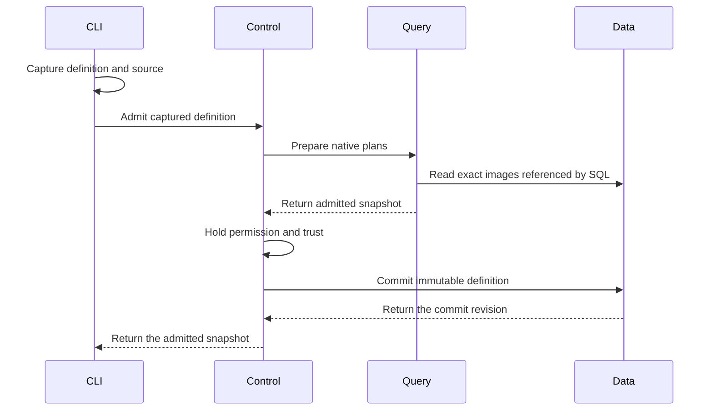
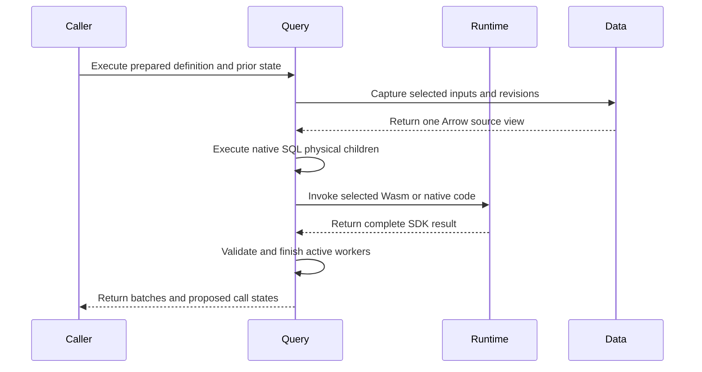
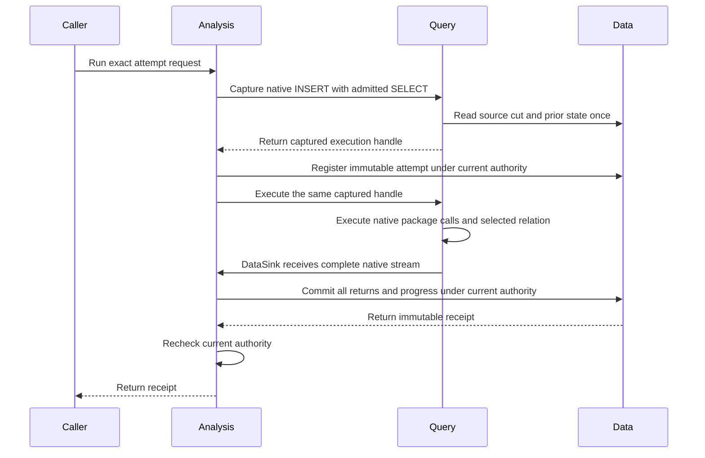

# Discovery Definition Review

This guide covers Discovery definition admission, finite OCI execution, and
the new finite Instance owner. The definition selects reusable code and inputs.
Admission starts no Discovery. Focused finite managed checks pass. The final
Rust gate and complete migration remain **Not done**.

## Intended end state

A YAML definition contains metadata and exactly one SQL, PRQL, or package-call
form. The package-call form produces a native SQL relation. Every program uses
the native DataFusion pipeline. A separate running instance owns permission,
progress, saved state, and subscription lifetime.

## Review flow

```text
An operator admits a definition file
  -> the file owner captures source files and converts a YAML call to SQL
  -> the CLI sends metadata and captured SQL or PRQL
  -> Control checks the current tenant and manager permission
  -> Query admits SQL or compiled PRQL and resolves package calls in that SQL
  -> Control holds permission and image trust through the final write
  -> Data retains one immutable definition revision
  -> no Discovery starts

Admission fails or permission expires
  -> the request returns a typed error
  -> Data commits no new definition
  -> a retry checks current permission again
```

[DefinitionArgs](../../crates/araphor-cli/src/cli/araphor/packages.rs)
accepts `araphor definition admit FILE` and
`araphor definition inspect NAME --revision REVISION`.

-> [Definition::read](../../crates/araphor-discovery-definition/src/definition.rs)
delegates YAML parsing to
[YamlDefinition::read](../../crates/araphor-discovery-definition/src/file.rs).
The file owner checks metadata and the single program selection. It resolves
relative paths from the YAML directory and captures UTF-8 source text once.
The native YAML parser rejects duplicate keys and unknown fields. No owner
watches or polls the files.

-> [Call::sql](../../crates/araphor-discovery-definition/src/file.rs)
converts the structured call to native SQL. The existing SQL parser checks
each input query. Native syntax-tree values quote names and literal
parameters. This owner does not evaluate parameter strings as SQL. The
result uses the existing `Program::Sql` type. SQL and PRQL text use the
existing source types. The JSON request and saved snapshot formats do not
change.

-> [ClientGrpcOwner::definition_request](../../crates/mithril-control/src/client_grpc/packages.rs)
accepts captured definitions only. The server does not open client paths.
Admission requires current manager permission. Inspection requires current
tenant read permission. File metadata grants no permission.

-> [Engine::prepare_definition](../../crates/araphor-query/src/definition.rs)
uses native SQL parsing, logical planning, and optimization. SQL and generated
PRQL SQL use the same route. Query loads each exact installed image referenced
by a package function. Admission executes no input query or package.

-> [Packages](../../crates/araphor-query/src/definition/package.rs)
extends native relation planning for installed package functions. Native
subquery arguments supply input plans. Native scalar expressions supply
parameters. Exact image content supplies the declared interface and locked
dependencies. A call with several output relations requires an output name
as its first string argument. SQL package output, checkpoint, evidence, and
reason queries retain their schema checks. Native analysis and optimization
check every SQL body plan, including plans that contain other package calls.

Package calls use DataFusion's `RelationPlanner` extension. They are not
registered scalar user-defined functions (UDFs) or `TableFunctionImpl`
functions. The native table-function interface accepts scalar expressions.
A package input accepts a complete relation. The relation planner gives
DataFusion each input subquery in its caller scope. DataFusion plans scalar
parameters through its existing expression planner.

The relation hook returns ordinary table references to DataFusion unchanged.
[SourceProvider](../../crates/araphor-query/src/sources/mod.rs) implements
native `TableProvider` for Araphor tables. Package input and output relations
use native `ViewTable`. The table scope returns those providers through
`provider_as_source`; the relation hook does not implement table scans.

One admission shares one native catalog and source-provider map. The package
planner parses each default input query once. Native `transform_up_with_subqueries` binds each
declared dependency to its resolved plan. Native `recompute_schema` updates
the parent schemas in that same traversal. Native `ViewTable` and
`LogicalPlanBuilder::scan` preserve the input name and projection. Binding
occurs before optimization; an unexpected scan filter or fetch is an error.
`DataFrame::with_column` adds the zero-based index with native `row_number`.
This operation generates no SQL. Existing configured Query quotas still
apply to indexed and bound plans. Every surviving package body is a child of
its native PackageCall. The root optimizer and physical planner check these
children. No separate registry repeats those passes. Native SQL can discard
an unused common table expression. Its admitted image pin and source capture
remain part of the definition contract.

The native SQL body planner needs a separate table scope for each call.
[Scope](../../crates/araphor-query/src/definition/package/scope.rs) supplies
the actual input, parameter, output, and prior-state tables through
DataFusion's `ContextProvider`. It delegates function, type, configuration,
and other metadata to the native provider. A package body cannot inherit
undeclared tables from its caller. Caller subqueries and common table
expressions are planned by DataFusion before this body scope is used.
DataFusion's native session context provider is private. This adapter supplies
the required package table scope to the native SQL planner.

-> [PackageCall](../../crates/araphor-query/src/definition/call.rs)
retains the exact image, export, selected output, and SDK descriptor. Its
logical children are the actual input plans, native parameter plan, and SQL
output, checkpoint, evidence, and reason plans when the export uses SQL.
Its schema is the selected SDK output schema.
The identity key includes the root image digest, selected export, and local
call ID. An admission token prevents native optimization or the result cache
from combining separate admissions. The token does not enter the stable plan
hash. Cursor bindings thus remain stable after the same definition is admitted
again. Separate call sites keep separate state after optimization.
The node preserves the package execution contract for typed output, saved
state, and evidence. A scalar UDF does not supply that contract.
[PackageExec](../../crates/araphor-query/src/definition/physical.rs) implements
the native physical extension. Read the finite execution route below.

The former Discovery function resolver and its crate are removed. Native
[SQL view declarations](../../crates/araphor-analysis-builtins/src/discovery/sql.rs)
define the derived relations. Query registers native `ViewTable` providers
through [Engine::register_views](../../crates/araphor-query/src/execution.rs).
The SQL query uses `FROM discovery.observed_effects` without call arguments.
The Query planner contains no Discovery-name dispatch. Package calls still
use the generic relation planner described above.

[Discovery image assembly](../../crates/araphor-analysis/src/package/builtin.rs)
retains the complete live SQL program in the existing package format. Native
SQL CTE scopes bind its input relations. Image assembly adds no executor,
subscription, or source reader.

[Package::subscribe](../../crates/araphor-analysis/src/package.rs) uses
[Program::call](../../crates/araphor-discovery-definition/src/file.rs) to
construct the same native call as the YAML form. Package retains one admitted
definition and root call in a Tokio OnceCell. Source subscriptions reuse that
admission. Query plans the declared input relations and executes each update
through PackageExec. Analysis does not extract SQL bodies or interpret input
schemas. The installed image revision and digest must match the retained
package. Package construction no longer installs an image.
The cached call creates no durable definition or Data revision. Explicit
definition admission remains a separate operation.

[DiscoveryOwner::derive](../../crates/araphor-analysis/src/discovery/mod.rs)
admits a lazy source subscription before it registers the processor. Data
registration preserves an existing required processor and rejects retirement.
The subscription receives its first poll after registration. Package execution
does not need an initial evaluation only to register the processor.

[DiscoveryOwner::publish](../../crates/araphor-analysis/src/discovery/mod.rs)
checks the actual root return against that admission before publication.
Complete typed returns remain in Update.calls. This profile publisher cannot
commit package checkpoints, reasons, or evidence. Admission rejects reachable
checkpoint contracts; publication rejects auxiliary returns even when the
selected query rows do not change. The finite Instance owner below supplies
a separate atomic state and auxiliary publication path. The profile publisher
does not use that path. Authority changes drop
the private producer and join its workers before the subscription returns
Denied. Discovery stop and source removal call `Subscription::cancel_and_join`.
Ordinary Drop cancels the operation; Drop cannot wait for async cleanup.

-> [ClientAuth::commit_definition](../../crates/mithril-control/src/client_auth/packages.rs)
holds the current permission lock through the Data write. This owner checks
permission even when a SQL or PRQL definition has no image pins. A package
call also requires current trust in its exact image digest.

-> [AnalysisStore::admit_definition](../../crates/araphor-data/src/analysis/definitions.rs)
checks exact retained image references and saves captured text, generated
SQL, metadata, and pins. The SHA-256 content revision includes every saved
field. An exact retry returns the original commit revision. Changed content
creates another immutable revision. A retry of an older revision does not
change the latest selection.

-> [AnalysisStore::validate_definitions](../../crates/araphor-data/src/analysis/definitions.rs)
checks saved identities, content digests, store revisions, and exact image
pins during store open. Inspection checks content and image pins again.

Definition recovery restores immutable definitions. Caller-owned finite
execution returns proposed state without a write. The new finite Instance
owner below connects saved state, progress, and recovery checks. Managed
start, current inspection, stop, and automatic restart remain unimplemented.



Queries with no package calls require no image lookup. Data commits no
activation or result.

## Finite execution

[Session::execute_definition](../../crates/araphor-query/src/definition.rs) accepts an admitted definition and caller invocation state
  -> [Session::capture_definition](../../crates/araphor-query/src/definition.rs) checks admitted call children before optimization or source capture
  -> [Session::capture_plan](../../crates/araphor-query/src/execution.rs) uses fixed execution time for native optimization and physical planning
  -> [SubscriptionPlanner](../../crates/araphor-query/src/planner/subscription.rs) uses the native physical planner extension for PackageCall
  -> [Session::capture_physical](../../crates/araphor-query/src/execution.rs) captures declared sources once and retains the physical plan, permit, and source view
  -> [CapturedExecution::execute](../../crates/araphor-query/src/definition.rs) starts that captured physical plan once
  -> [PackageExec](../../crates/araphor-query/src/definition/physical.rs) collects complete Arrow inputs and parameters under one operation permit
  -> [SQL execution](../../crates/araphor-query/src/definition/physical/sql.rs) uses native physical children, or [Runtime::evaluate_reserved](../../crates/araphor-package-runtime/src/lib.rs) invokes the selected guest backend
  -> [CheckedEvaluation](../../crates/araphor-analysis-sdk/src/validation.rs) validates all outputs, proposed state, reasons, and evidence
  -> [DefinitionOutput](../../crates/araphor-query/src/definition.rs) returns selected query batches, the captured receipt, and complete call results

[Session::execute_definition](../../crates/araphor-query/src/definition.rs) receives an error or cancellation
  -> [AnalysisReadControl::operation](../../crates/araphor-data/src/analysis/read.rs) stops the separate invocation control
  -> [CallContext::finish](../../crates/araphor-query/src/definition/physical.rs) closes call registration and waits for the native task tracker
  -> Data receives no automatic result, state, or progress write

The finite caller creates the invocation identity, seed, caller limits, and
prior checkpoint map. An invocation has separate cancellation state. Query
forwards parent cancellation and waits for active work. An ordinary invocation
error does not cancel the parent Session. The map uses admitted call identities.
Unknown checkpoint identities and state for a stateless export are rejected
before source capture. A call identity is not a durable instance identity. Admission retains unoptimized plans so
execution clocks are not folded at admission. Native optimization and physical
planning use the fixed session time during execution.

[Engine::new](../../crates/araphor-query/src/execution.rs) disables native
leaf-expression pushdown for DataFusion 53.1. That rule can leave a stale
join schema and make projection optimization fail. The
[upstream issue](https://github.com/apache/datafusion/issues/22895) records
the native configuration workaround. The other native optimizer rules remain
active. The struct-join regression checks selected rows, checkpoint, evidence,
and reason details. Enable this option only after an engine upgrade passes
that regression and the Discovery integration tests.

Cold Wasm preparation occurs in the native physical extension planner. It
uses the parent request control before the evaluation timeout starts. The
physical node retains an opaque prepared-code pin for the exact Runtime,
image object, package, and export. Execution cannot substitute code from
another runtime or image. Definition admission performs structural validation
without compilation. Ordinary SQL retains its existing planning timeout.

The preparation worker holds the existing evaluation permit and call tracker
token. Explicit cancellation waits for that worker. Dropping an execution
future cancels its control; the worker retains its permit until it exits.
An active synchronous Wasmtime compilation cannot be interrupted. This
boundary does not provide a compiler process memory quota.

[Subscription](../../crates/araphor-query/src/follow/mod.rs) owns a shared
Tokio task tracker. Session carries its handle through each native execution.
Native logical optimization runs in the existing tracked blocking worker.
Query then calls the native QueryPlanner for asynchronous physical planning.
This is the same order as SessionState::create_physical_plan. Cancellation
joins the optimizer worker and cold preparation. Physical planning does not
hold a blocking worker while it waits for a compiler worker. No second planner
or runtime is added.
The guest exchange, cold preparation, and source-read closures retain parent
tokens until their actual workers exit. Per-call trackers still join each
finite evaluation. Blocking workers transfer their result through a native
oneshot channel before they release their lease. If the receiver is dropped,
the worker drops the result before it releases the token. Completed returns
and captured snapshots contain no parent
token. A caller can retain a delivered Update while subscription shutdown
completes.

PackageCall retains one shared copy of its admitted native children after
DataFusion binds parameters and reconstructs schemas. Public
stream and subscription entries reject changed input or SQL body plans before
optimization. Native TableScan equality excludes its provider. The admission
check also compares the original provider identities. This check includes
native view bodies. Internal optimized plans
are not compared with the original children. DataFusion can change aliases and
share equivalent expressions. The check prevents a caller from changing image
code or inputs while retaining a cached admitted call identity.

PackageExec owns the complete typed evaluation and result. It executes once
for one admitted call, across all input batches and physical partitions.
Readers share that result. Separate call sites retain separate state. The
cache holds weak handles to running work and strong handles to complete
results. Dropping a reader does not create a cache cycle. Cancellation does
not retry an abandoned call.

[Inputs](../../crates/araphor-query/src/inputs/mod.rs) retains the admitted
source scopes before optimization. Empty relations and unused common table
expressions retain their source revision contract. Native source providers
supply Arrow buffers from the captured view. SQL output and prior-state
relations bind temporary port slots in that same view. Package SQL opens no
second live read and uses no synchronous Query bridge.

[AnalysisStore::dependency_revision_for](../../crates/araphor-data/src/analysis/dependencies.rs)
accepts the admitted table requests. Data resolves its projected tables to
storage relations. Query passes those requests through the existing revision
read. Query does not select Discovery storage dependencies.

[Memory](../../crates/araphor-query/src/memory.rs) retains input, output,
checkpoint, and reason buffers through their actual Arrow lifetimes. A
retained result keeps its metadata reservations. Plans with PackageExec do
not prepay a second public output budget before the complete call result is
retained. Actual configured capacity checks remain active.

The runtime crate owns executable loading and invocation. It has no Query or
Analysis dependency. Compatible backend code came from the
[earlier execution owner](https://github.com/Ereborlabs/erebor-runtime/blob/6a25ba1b34dbaa0a553b1883058938683ce7aaab/crates/araphor-analysis_back/src/package/execution.rs).
The backup crate is restored as reference until compatible migration is complete.
Runtime retains its own backend code.
[NativeLibrary](../../crates/araphor-package-runtime/src/native/loading.rs)
keeps file and code pins through invocation, output copy, and producer release.
Native calls run inside the process. Native cancellation remains cooperative;
a native guest that ignores cancellation can delay completion.

[WasmExecution](../../crates/araphor-package-runtime/src/wasm.rs) creates its
engine on demand. The new runtime compiles with native Wasmtime inside the
process. Production execution has no compiler child.
[EpochWatch](../../crates/araphor-package-runtime/src/wasm/execution.rs)
waits for cancellation, deadline, or completion events. It has no periodic
ticker. The runtime uses the existing TaskTracker for worker teardown.
Runtime quotas default to disabled. An explicit compiler address-space quota
returns Unsupported because compilation runs inside the process. Active
compilation must finish before cancellation can join its worker. Explicit
cancellation through execute_definition joins active work. Dropping the whole
async future cannot wait for cleanup in Drop; worker tokens retain code and
operation resources through teardown.



This API does not authorize a durable commit. The caller retains responsibility
for current authority and domain checks. The finite Instance owner below adds
the authority and Data transaction route. Long-running supervision and public
lifecycle operations remain in TODO 16. Package-issued internal SQL requires
a future SDK capability; the current guest ABI supplies no database handle.

Qualification is in progress for the current worktree. The physical execution
cases are in [definition tests](../../crates/araphor-query/src/definition/tests/execution.rs).
Entered-guest cancellation, worker drop, and capacity cases are in
[runtime tests](../../crates/araphor-package-runtime/src/wasm/tests/runtime.rs).

During recovery, backup removal was withdrawn. All 208 backup files and 34
deleted Control and E2E reference files were restored. Compatible migration requires a complete
source and test map before deletion. The finite call path does not establish
graph publication, Discovery replay, durable commit, or permission-supervision
parity. At that point, no deletion commit or push was made. That workspace
build stopped when the host disk filled; it did not pass.

The earlier finite retirement removed 29 duplicate reference leaves. Its final
Rust gate passes in `migration-final-ci42` at commit `95e9bb4d`. That record does
not qualify the later managed source. The additional finite retirement removes
exactly four mapped leaves: Graph contract source and tests, model input, and
model operation. Eight more Wasm leaves and 15 finite Graph, SQL, Discovery,
test, and asset leaves are retired. Eight more executor, component, atom,
pager, and pure test leaves are removed after 50 focused replacement checks
pass. Fifteen more retained-query, authority, Wasm, and finite notification
test leaves are removed after 89 focused checks pass. Two more complete
image/fixture leaves retire after exact replacement checks pass. The remaining
127 files keep their baseline content.
The recovery archive retains all 208 recovered files. Read the
[retirement records](../plans/araphor-analysis-migration.md#retired-finite-reference-files)
and the [four-file record](../../recovery/araphor-analysis-managed-retirement-20261019.json)
and [Wasm record](../../recovery/araphor-analysis-wasm-retirement-20261020.json),
[Graph record](../../recovery/araphor-analysis-graph-retirement-20261020.json),
the [output record](../../recovery/araphor-analysis-output-retirement-20261020.json),
the [native helper record](../../recovery/araphor-analysis-native-retirement-20261020.json),
the [retained-result record](../../recovery/araphor-analysis-retained-retirement-20261020.json),
and [image/fixture record](../../recovery/araphor-analysis-image-fixture-retirement-20261020.json)
for the exact scope. The current final Rust gate and complete migration remain
**Not done**.

## Finite Graph reads and output validation

[Data Graph reads](../../crates/araphor-data/src/analysis/graph/findings.rs)
check the tenant, supplied identifiers, positive page size, and typed revision
before they acquire a reader. Data owns the read snapshot and native current
or historical result selection. Pagination retains the caller's row and byte
bounds. A Graph reader facade and a second worker mutex are unnecessary.

[Graph::apply](../../crates/araphor-analysis/src/graph/mod.rs) consumes a sealed
native call result. Query and Package Runtime validate the complete SDK return
before they construct that result. Graph then checks the exact admission,
image, export, tenant, and canonical inputs. Its
[output validator](../../crates/araphor-analysis/src/graph/output.rs) checks
selected records, facts, subjects, evidence, reasons, and checkpoint rows.
[Graph::finish](../../crates/araphor-analysis/src/graph/finish.rs) assembles the
snapshot and calls the existing Data snapshot validator.

These finite owners do not implement Graph production, historical replay,
expiry scheduling, or restart recovery. Those reference files must remain.
Data's snapshot validator still has collection limits. This replacement does
not prove that all Graph quotas are disabled. The 31 Analysis Graph tests,
27 Data Graph tests, and 21 notification caller tests pass. Their exact
retirement scope is in the records above. Final Rust qualification is
**Not done**.

## Finite native helper replacement

[PackageExec](../../crates/araphor-query/src/definition/physical.rs) receives
captured native input relations.
  -> [Guest execution](../../crates/araphor-query/src/definition/physical/guest.rs) reserves retained inputs and encoding scratch before Runtime entry.
  -> [Native SQL execution](../../crates/araphor-query/src/definition/physical/sql.rs) keeps declared output, checkpoint, and reason order.
  -> [Query memory](../../crates/araphor-query/src/memory.rs) keeps retained arrays charged until the last alias is dropped.

[Recorded SQL](../../crates/araphor-analysis-builtins/src/discovery/sql/recorded_snapshot.sql)
receives the complete selected relations.
  -> [Native operators](../../crates/araphor-analysis-builtins/src/discovery/sql/recorded_snapshot.sql) aggregate all Arrow partitions without an Analysis pager.
  -> [DiscoveryOwner::recorded_result](../../crates/araphor-analysis/src/discovery/output.rs) checks the exact call and complete result.
  -> [Data validation](../../crates/araphor-data/src/discovery/validation/recorded.rs) checks source attribution, accounting, coverage, and lifecycle.

[Conversion preflight](../../crates/araphor-query/src/definition/tests/execution/contract/pressure.rs)
fails under configured output pressure.
  -> [The physical executor](../../crates/araphor-query/src/definition/physical.rs) returns the typed limit error before conversion.
  -> [The collection owner](../../crates/araphor-query/src/definition/physical.rs) drops the producer without a later poll.
  -> [The failure checks](../../crates/araphor-query/src/definition/tests/execution/contract/pressure.rs) prove unchanged Data and released reservations.

The [pressure cases](../../crates/araphor-query/src/definition/tests/execution/contract/pressure.rs)
also check nested encoding scratch, zero-row schema metadata, valid saved-state
exchange, and the actual Runtime SDK encoder failure. The
[record projection cases](../../crates/araphor-analysis/src/discovery/output/tests/native.rs)
check every typed event field, original bytes, source witnesses, stream
completion, and content-derived input revisions. The
[boundary cases](../../crates/araphor-analysis/src/discovery/output/tests/baseline.rs)
keep duplicate accounting and lifecycle references across the old 128-group
boundary. The [native SQL cases](../../crates/araphor-analysis/src/package/tests/sql/recorded.rs)
keep sparse declared counts, empty ranges, orphan rejection, and complete
partition results.

All 50 mapped focused checks pass before the eight reference leaves are
removed. The record pins the owner source and test binaries. No production
code is added for this removal. The long-running lifecycle and complete final
Rust gate remain **Not done**.

## Retained result inspection

[Instance::read_result](../../crates/araphor-analysis/src/instance/read.rs)
accepts a current reader grant and exact instance/result IDs.
  -> [Instance::inspect](../../crates/araphor-analysis/src/instance/read.rs) checks Inspect before the read and watches current authority events.
  -> [Instance::retained](../../crates/araphor-analysis/src/instance/read.rs) checks stored selection coverage for the reader tenant.
  -> [AnalysisStore::managed_result](../../crates/araphor-data/src/analysis/managed/read.rs) validates the retained call, receipt, descriptor, output, and exact instance binding.
  -> [Instance::inspect](../../crates/araphor-analysis/src/instance/read.rs) checks current reader authority and expiry before disclosure.

[Instance::query_result](../../crates/araphor-analysis/src/instance/read.rs)
uses that same retained read.
  -> [Session::query_local](../../crates/araphor-query/src/execution/local.rs) registers only the retained output datasets in a private native catalog.
  -> [Session indexing](../../crates/araphor-query/src/execution/tables.rs) adds original row indices before filtering across Arrow batches.
  -> [Planner](../../crates/araphor-query/src/planner/mod.rs) uses the existing native SQL parser and logical planner.
  -> [Session::stream_local](../../crates/araphor-query/src/execution.rs) uses the native optimizer, physical planner, execution permit, and output bounds.
  -> [LocalOutput](../../crates/araphor-query/src/execution/local.rs) retains the selected dataset and its metadata reservation.

The catalog contains no inherited view, external catalog, undeclared local
table, or durable source. Native admission rejects DDL, DML, multiple
statements, and unused undeclared CTEs. A retained SELECT executes no historical
package export and captures no current evidence source. Its configured bounds
combine the native Session limits with the retained descriptor limits. Data
already reads that descriptor during validation. No second descriptor read or
current image execution trust check is required.

Current Inspect authority is independent of the original writer principal,
Run authority, and image execution trust. Authority loss cancels and drains the
child operation. The parent request control remains usable. Complete results,
state, reasons, evidence, and historical receipt revision survive newer writes.
The [historical tests](../../crates/araphor-analysis/src/instance/tests/history.rs)
check those rules. The [native local tests](../../crates/araphor-query/src/execution/tests/local.rs)
also check catalog exclusion, original indices, empty metadata, native interval
output, explicit limits, and last-alias memory release.

These Rust library entry points pass focused qualification. Public Control and
CLI result operations and direct expiration of a previously valid writer grant
remain **Not done**. Keep the mixed Inspect, lifecycle, presentation, and codec
reference files until their complete replacements pass.

## Finite managed execution

[Instance::admit](../../crates/araphor-analysis/src/instance/mod.rs) accepts an
explicit Run grant, an instance ID, and an exact retained definition. It checks
permission even for SQL with no image calls. It checks every image digest and
trust decision, prepares the definition through Query, and saves immutable
instance metadata through
[AnalysisStore::admit_managed](../../crates/araphor-data/src/analysis/managed/read.rs).
It starts no subscription or guest.

Read these owners in order:

1. [Instance::manifest](../../crates/araphor-analysis/src/instance/manifest.rs)
   records each admitted call ID, image, package, export, target, artifact,
   native argument text, and dependency IDs. The manifest has a format and
   planner version. It stores no displayed or serialized logical plan.
2. [Instance::run](../../crates/araphor-analysis/src/instance/mod.rs) checks
   current generation and the exact attempt request before capture. It clones
   the admitted SELECT and uses native `LogicalPlanBuilder::insert_into` to
   add one private publication target.
3. [Session::capture_managed](../../crates/araphor-query/src/definition.rs)
   prepares one native physical plan and captures source rows and guarded
   prior state through the same Data read connection. It returns before
   execution. It rejects a different tenant, selection, definition, or supplied
   caller input or checkpoint state.
4. [CapturedExecution::blocking](../../crates/araphor-query/src/definition.rs)
   holds the captured permit and worker token while Data registers the attempt.
   [register_managed_attempt](../../crates/araphor-data/src/analysis/managed/commit.rs)
   fixes the source receipt, prior heads, logical time, seed, and rebuild flag
   before the native plan starts.
5. [PackageExec](../../crates/araphor-query/src/definition/physical.rs) selects
   captured prior state after it collects effective inputs and parameters.
   [ManagedPrior::checkpoint](../../crates/araphor-data/src/analysis/managed/model.rs)
   requires matching input revisions, coverage, parameter values and schema,
   checkpoint version, and named state dataset schemas. Rebuild or a mismatch
   resets state. Separate call sites retain separate state.
6. [Publication::write_all](../../crates/araphor-analysis/src/instance/sink.rs)
   retains selected Arrow batches and all complete call returns. It checks
   each return against the admitted call. Native optimization can remove a
   call; the sink publishes only calls that actually executed.
7. [AnalysisStore::commit_managed](../../crates/araphor-data/src/analysis/managed/commit.rs)
   checks the captured contract, current source and dependency revisions,
   witnesses, generation, and prior heads. One transaction publishes selected
   rows, actual call outputs, evidence, reasons, state, and progress. A failed
   step leaves those heads unchanged. Its pending attempt can remain retained.
8. [validate_managed](../../crates/araphor-data/src/analysis/managed/schema.rs)
   checks retained definitions, call pins, result packets, heads, and reference
   integrity during open. The storage API retains exact results and selected
   Arrow data; it does not supply a public authorized history command.



The publication target implements native `TableProvider::insert_into` and
`DataSink`; its scan is Unsupported. DataFusion's `DataSinkExec` invokes the
sink and emits the single UInt64 count result. Analysis `Publication::write_all`
drains the native stream, checks selected row and byte limits, and retains the
selected Arrow batches. Query checks the measured count array against its
output limits and reserves its buffer before execution, before the sink can
commit. This adds no parser, planner, or custom physical writer.
Ordinary source reads still use SourceProvider. Package relation arguments
still use the generic RelationPlanner described above.

Run observes authority changes before execution and applies the grant expiry
to its operation control. Cancellation signals that operation and waits for
the same captured work and workers. The final write holds `commit_many` for
the explicit grant and every exact image. Its final Data callback checks only
control; it opens no second reader while the writer is held. Current authority
is checked again before a receipt is returned. A denied acknowledgement leaves
a successful Data commit retained.

An exact completed retry returns its original receipt without another capture
or execution. A changed request conflicts. A pending retry returns Incomplete;
it cannot substitute a newer source cut after restart. Instance admission
retains immutable metadata, and each attempt retains its capture contract.
[Managed storage](../../crates/araphor-data/src/analysis/managed/schema.rs)
retains binary Arrow packets and result references. Removal, pin release, and
historical replay remain outside this finite API.

[Query limits](../../crates/araphor-query/src/execution.rs) use `input_bytes`
for the complete evaluation inputs, parameters, and prior state. The sink
checks `output_rows` and `output_bytes` against the complete selected relation.
`input_capacity`, `output_capacity`, and `execution_capacity` configure shared
pools. Evaluation and stream counts are optional global and tenant limits.
Bulk bounds default to the numeric maximum; optional limits default to None.
These defaults do not preallocate that maximum.

[SDK limits](../../crates/araphor-analysis-sdk/src/model.rs) retain separate
`max_rows`, `max_batches`, `max_bytes`, and `max_checkpoint_bytes` contracts.
Each call uses the minimum requested and model bounds; the runtime also applies its
configured backend limits. SDK defaults impose no bulk quota.
[Data extraction](../../crates/araphor-data/src/analysis/extraction.rs) and
[native storage limits](../../crates/araphor-data/src/analysis/capacity.rs)
retain their own configured bounds. `native_memory_bytes` and
`native_temp_bytes` are optional and disabled by default.

Query Memory retains captured prior buffers, package returns, and selected
Arrow buffers for their actual use. The writer retains those leases until it
exits. Data owns Arrow IPC serialization and transaction allocations; those
allocations are not all charged to Query Memory. Configured Query and SDK
limits are not a bound on all Rust heap allocation. The selected relation uses
native Arrow schemas, including Map, dictionary, and zero-column batches.
The remaining resource-boundary audit is **Not done**.

Focused finite qualification passes: 8 SQL contract cases, 11 Data managed
cases, 10 ordinary Instance cases, all 7 captured-execution cases, and both
Graph contract cases. Read the
[Instance tests](../../crates/araphor-analysis/src/instance/tests.rs),
[managed capture tests](../../crates/araphor-query/src/definition/tests/managed.rs),
and [Data transaction tests](../../crates/araphor-data/src/analysis/managed/tests.rs).
These tests check state reuse/reset, atomic failure, exact retry, authority
loss, configured pressure, crash, and recovery.

Separate source-built native runs pass 4 Query and 4 Analysis cases, including
the native Instance case. Their six artifacts have complete recorded source
provenance. Strict workspace Clippy passes after the test-only corrections.
The native57 provenance refresh passes in 31.395 seconds. All 116 recorded artifact inputs
are hashed, and its six artifacts match build54 byte for byte on
`x86_64-unknown-linux-gnu`. Exact records and run times are in the
[finite qualification table](../plans/araphor-analysis-migration.md#finite-managed-source-focused-qualification).

The required final Rust gate `migration-final-ci58` stopped during test compilation because the host disk was full. Formatting, workspace check, and strict Clippy passed. Gate59 passes these checks, 145 ordinary Analysis cases, and 333 ordinary Data cases. It stops at an OCI fixture that inherited changed SDK defaults. The corrected fixture supplies explicit limits and retains its golden digest. All 15 Package cases pass in `migration-oci-package60`. All eight source-built native Query and Analysis cases pass in the two native60 runs. The complete result is **Not done**. Long-running reactive supervision, per-port windows, public
start/inspect/stop, authorized history, CLI/Control managed operations,
historical replay, Data coordination polling, and remaining quota work stay
open. Native input scope still needs declaration-only local-port origins and
precise disjoint capture ranges. The old input executor remains until its
finite and live assertions have current owners. The complete migration remains
**Not done**.

This finite API creates no long-running job. Subscription supervision, window
completion, start/stop/resume/update/removal, current inspection, authorized
history, and CLI/Control managed operations remain **Not done**.
`Instance::admitted` returns immutable admission metadata; it is not a current
status or history API.

## Shared admitted image ownership

[Packages::new](../../crates/araphor-query/src/definition/package.rs) sorts exact
image keys and rejects duplicates before native planning.
  -> [PackageBundleV1::allocated_bytes](../../crates/araphor-package/src/memory.rs) measures defined image payload and buffer capacities after Data decode.
  -> [Packages::new](../../crates/araphor-query/src/definition/package.rs) reserves shared input capacity before image validation, digest construction, and planning.
  -> [PackageCall](../../crates/araphor-query/src/definition/call.rs) borrows the descriptor from its immutable image and shares the image reservation.
  -> [PreparedDefinition::images](../../crates/araphor-query/src/definition.rs) exposes borrowed image references for Instance authority and manifest checks.
  -> [PackageExec::new](../../crates/araphor-query/src/definition/physical.rs) retains the image charge through cold preparation and result delivery.
  -> [Exchange](../../crates/araphor-query/src/definition/physical/guest.rs) retains the image charge until the entered guest exits.

Instance removes its extra Data image load and decoded image set. Data still
validates stored image pins in its final managed transaction. This ownership
change does not account for pre-decode allocation, every native planner
allocation, or opaque allocator overhead. The retained metadata owner below
supplies spec and manifest accounting. That image delivery retires no
additional reference file.

The [capacity tests](../../crates/araphor-query/src/definition/tests/capacity.rs)
check shared ownership, exact image identity, failed cold preparation, no
guest entry after rejection, and full release after joined cancellation.
The [Instance tests](../../crates/araphor-analysis/src/instance/tests.rs)
check shared image identity and trust before preparation. All 35 Instance
cases and four source-built native Query cases pass. The two corrected Query
fixtures pass without changes to production budgets. The
[migration result](../plans/araphor-analysis-migration.md#shared-admitted-images-and-error-origins)
records exact commands and source counts.

## Retained metadata and current status

[DefinitionAdmission](../../crates/araphor-query/src/definition.rs) owns resolved
metadata, source requests, image handles, and their native reservation.
  -> [PreparedDefinition::resolved](../../crates/araphor-query/src/definition.rs) exposes borrowed metadata. Definition clones share the same owner.
  -> [Instance::manifest](../../crates/araphor-analysis/src/instance/manifest.rs) retains native extension Arc values instead of deep package-call copies.
  -> [Instance::admit](../../crates/araphor-analysis/src/instance/mod.rs) charges the exact moved spec and manifest before Data admission.

The reservations outlive their retained buffers. This scope covers defined
metadata capacity. It does not claim the complete native planner or allocator
heap. Host projected keys and the managed source-request copy remain open.

[Instance::read_status](../../crates/araphor-analysis/src/instance/read.rs)
accepts a fresh Inspect grant and an instance key.
  -> [Instance::inspect](../../crates/araphor-analysis/src/instance/read.rs) checks reader scope, authority, and expiry around the joined read.
  -> [AnalysisStore::managed_status](../../crates/araphor-data/src/analysis/managed/status.rs) reads current metadata and rejects unknown pending work.
  -> [Failure](../../crates/araphor-data/src/analysis/managed/status.rs) binds the current failure code to observed successful progress and its durable revision.

Idle suspension and eligible attempt failure write that fact in their existing
transactions. A late old lifecycle cannot replace the current fact. Stop and
start preserve it. New successful progress makes it inactive. Status reads no
image or Arrow payload and requires no current writer Run permission.

[Instance::execute](../../crates/araphor-analysis/src/instance/mod.rs) waits for
captured execution to join before it records a known prepublication failure.
  -> [Step](../../crates/araphor-analysis/src/instance/sink.rs) records actual publication entry before final authority and commit.
  -> [AnalysisStore::finish_managed](../../crates/araphor-data/src/analysis/managed/terminal.rs) records the original known failed attempt with its exact fences.

Busy, cancellation, and uncertain publication stay pending. A successful Data
commit with a lost acknowledgement retains its receipt. The
[finite tests](../../crates/araphor-analysis/src/instance/tests/finite.rs)
exercise real traps, native SQL failure, writer failure, and shared pressure.
The [status tests](../../crates/araphor-data/src/analysis/managed/tests/status.rs)
cover rollback, stale lifecycles, successful progress, reopen, backup, and
corrupt metadata. The
[qualification record](../plans/araphor-analysis-migration.md#retained-metadata-and-durable-failure-status)
states the exact checks, corrected fixtures, and remaining boundaries.

## Native package input capture

[Packages::inputs](../../crates/araphor-query/src/definition/package.rs) binds each declared input or explicit relation argument.
  -> [SourceDemand](../../crates/araphor-query/src/planner/mod.rs) retains admitted source origins before native optimization removes unused scans.
  -> [Inputs::bind_ports](../../crates/araphor-query/src/inputs/mod.rs) resolves caller ports inside nested admitted calls without changing the optimizer's admission guards.
  -> [SourceScan](../../crates/araphor-query/src/sources/mod.rs) visits the native physical tree once to collect columns and per-input time envelopes.
  -> [SourceSnapshot::read](../../crates/araphor-query/src/sources/rows.rs) captures the exact union of independent input windows and retains the original source receipts.

[PackageExec::sql](../../crates/araphor-query/src/definition/physical/sql.rs) binds a parent SDK input to its private native port.
  -> [SourceSnapshot::bind_port](../../crates/araphor-query/src/sources/rows.rs) charges defined metadata before cloning it beside the existing Arrow rows.
  -> [Inputs::input_for](../../crates/araphor-query/src/inputs/receipt.rs) borrows that port metadata and the same captured receipt.
  -> [Inputs::input](../../crates/araphor-query/src/inputs/receipt.rs) combines inherited revisions and coverage through the existing input identity algorithm.

Private port identities distinguish nested model inputs and SQL body bindings.
These identities are not persisted or included in the stable native plan hash.
Nested bodies receive parent rows through explicit relation arguments. The
isolated default-input scope stays unchanged. No second source read, executor,
clock, or codec is added. The metadata charge excludes opaque allocator headers.

The [native contract tests](../../crates/araphor-query/src/definition/tests/execution/contract.rs),
[nested origin tests](../../crates/araphor-query/src/definition/tests/execution/contract/origins.rs),
and [body-port tests](../../crates/araphor-query/src/definition/tests/execution/contract/body_ports.rs)
keep exact rows, source cuts, witnesses, coverage, revisions, checkpoints, and
readmission identity. The [binding pressure test](../../crates/araphor-query/src/sources/rows/package.rs)
proves rejection before insertion and complete resource release. All 259
connected Query cases pass. The [result](../plans/araphor-analysis-migration.md#native-input-capture-and-projected-membership)
records the exact source and qualification limits.

## Native managed subscriptions

[Instance::subscribe](../../crates/araphor-analysis/src/instance/subscription.rs)
accepts one current running lifecycle and one operation control.
  -> [AnalysisStore::managed_resume](../../crates/araphor-data/src/analysis/managed/read.rs) reads instance metadata, its native frontier, and the latest completion revision in one snapshot. An unknown unfinished attempt returns Incomplete.
  -> [Run::session](../../crates/araphor-query/src/stream/mod.rs) checks the full invocation scope before it selects the SQL window.
  -> [Runtime::evaluate](../../crates/araphor-query/src/stream/physical/runtime.rs) captures the physical plan once. An unchanged resumed cut waits for source or window events.
  -> [CapturedPhysical::reserve_complete](../../crates/araphor-query/src/execution.rs) reserves native count delivery before attempt registration.
  -> [ManagedPublication::admit](../../crates/araphor-analysis/src/instance/subscription.rs) registers the exact captured attempt before native child execution.
  -> [Publication::write_all](../../crates/araphor-analysis/src/instance/sink.rs) commits complete call returns, selected rows, saved state, and the native frontier through Data.
  -> [Step](../../crates/araphor-analysis/src/instance/sink.rs) records the completion revision. Another stream cannot combine a newer completion with its older selected cursor.

[Subscription::cancel_and_join](../../crates/araphor-analysis/src/instance/subscription.rs)
cancels the Query subscription and joins its actual workers. Data changes to
the running state use an exact lifecycle comparison. Installation and
admission remain inert. Analysis has no source clock or polling task.

The focused Query selection passes 97 cases. All 27 selected Analysis cases
pass, including the two source-built native cases. The native artifacts keep
the same 116 source inputs and six artifact hashes as native57. The progress
regression first fails on an actual duplicate commit: progress changes from
10 to 12. With the progress check, this regression preserves metadata,
frontier, results, saved state, and progress.

Known failure handling passes focused qualification.
[Subscription::cancel_and_join](../../crates/araphor-analysis/src/instance/subscription.rs)
joins Query before it uses the separate diagnostic control to record an outcome.
  -> [AnalysisStore::finish_managed](../../crates/araphor-data/src/analysis/managed/terminal.rs) accepts only the original live pending claim for a new terminal outcome. Loaded pending work remains unavailable.
  -> [AnalysisStore::check_managed_claim](../../crates/araphor-data/src/analysis/managed/commit.rs) compares the existing watch channel identity. A stale original claim cannot publish or finish after a clean reopen.
  -> [AnalysisStore::managed_resume](../../crates/araphor-data/src/analysis/managed/read.rs) selects the exact failed native offer for an unambiguous nonpressure failure. Successful state and progress stay unchanged.
  -> [Runtime::evaluate](../../crates/araphor-query/src/stream/physical/runtime.rs) waits at this native cut until its source or window changes. Cancelled offers remain unconsumed.

The [terminal tests](../../crates/araphor-data/src/analysis/managed/tests/terminal.rs)
check original claim lifetime, current caller checks, retained success, and
recovery. The [readiness tests](../../crates/araphor-data/src/analysis/managed/tests/readiness.rs)
check completion races at capture, registration, and publication. Native
[subscription tests](../../crates/araphor-analysis/src/instance/subscription/tests.rs)
hold real guests across cancellation and permission notices. They also check
the exact stored request on retry. All 83 connected behavior cases pass.
Strict Clippy and formatting pass. The
[migration result](../plans/araphor-analysis-migration.md#known-terminal-outcomes-and-failed-offers)
records the exact commands, source count, and remaining scope.

## Reactive instance host

[InstanceHost::serve](../../crates/araphor-analysis/src/instance/host.rs)
starts one driver and retains its store lease until every member drains.
  -> [InstanceHost::drive](../../crates/araphor-analysis/src/instance/host.rs) subscribes to lifecycle notices before it reads retained running instances.
  -> [InstanceHost::reconcile](../../crates/araphor-analysis/src/instance/host.rs) adds members to FuturesUnordered and cancels only replaced or stopped lifecycles.
  -> [InstanceHost::member](../../crates/araphor-analysis/src/instance/host.rs) checks current authority, admits the exact saved definition, and consumes its Query subscription.
  -> [Subscription::poll_next](../../crates/araphor-analysis/src/instance/subscription.rs) delivers receipts only after its tracked final authority callback.
  -> [Subscription::cancel_and_join](../../crates/araphor-analysis/src/instance/subscription.rs) drains pending delivery and actual Query workers before Data records a terminal outcome.

FuturesUnordered is the sole member registry. A metadata read uses a tracked
blocking worker. An older metadata snapshot cannot cancel a newer member.
The exact old member drains before its replacement starts. A held authority
callback or guest does not stop another subscription. Caller Drop cancels
the driver; its task retains the store lease through actual worker exit.

[Prepared::acquire_evaluation](../../crates/araphor-package-runtime/src/lib.rs)
uses the existing native semaphore for managed component admission.
  -> [PackageExec::guest](../../crates/araphor-query/src/definition/physical/guest.rs) waits before exchange allocation and guest launch. The captured request remains unchanged.
  -> [CallContext::finish](../../crates/araphor-query/src/definition/physical.rs) closes registration, drains its existing running shared futures, and then waits for actual workers.

A native operator can retain a pending future after cancellation drops the
output stream. Draining that same future lets its cancellation complete.
The shared future executes only once. The original error remains the result.
This path does not reset native plans, duplicate a package call, or change
the maintained native aggregate state. Component admission is unbounded by
default. Configured finite admission retains typed Busy behavior.

The [host tests](../../crates/araphor-analysis/src/instance/host/tests.rs)
cover lifecycle replacement, idle denial, real source denial, failure isolation,
unknown pending work, held callbacks, held guests, stop, and Drop. The
[capacity tests](../../crates/araphor-analysis/src/instance/subscription/tests/capacity.rs)
cover exact request retention, healthy work, cancellation, actual joins, and
full configured pool release with two blocking workers.

All 54 Instance cases and 130 selected Query cases pass across the ordinary
and corrected native commands. The
[migration record](../plans/araphor-analysis-migration.md#reactive-host-joined-delivery-and-component-admission)
identifies the source, commands, launch correction, and retired error leaf.
General pressure retry, renewal, public lifecycle,
producer supervision, and the final complete Rust gate remain **Not done**.
Unknown pending work and ambiguous Limit or Incomplete failures remain
unavailable. The mixed reference supervision files remain.

The [projected Data reader](../../crates/araphor-data/src/analysis/managed/read.rs)
returns only tenant, ID, generation, and lifecycle for recurring membership.
The member loads and fences its full row once. It releases the unused manifest
before admission. The existing member and future share one charged key.
Reconciliation cancels stale owners before metadata admission. Its wait selects
both scoped capacity release and lifecycle notices. Stop therefore remains
reactive when a previous owner fills the pool. The actual worker joins before
replacement admission. A corrupt full spec parks its member while healthy
members continue. A corrupt projected key fails the host and drains its lease.

[Run::sources](../../crates/araphor-query/src/stream/mod.rs) borrows the retained
managed definition's source map. The native managed sink test checks that exact
map identity. All 66 connected Instance cases and 44 managed Data cases pass
across the original and corrected commands. These checks qualify the complete
[memory and stream retirement](../../recovery/araphor-analysis-memory-retirement-20261020.json).
At that retirement, the 122 remaining reference files are unchanged. Initial admission pressure
retry, producer and public integration, and the final Rust gate remain open.

## Native operation validation

Read [PackageExec::collect](../../crates/araphor-query/src/definition/physical.rs)
for batch collection under the captured execution. Native child streams supply
Arrow batches. Normalization uses the declared SDK schema. Actual shared
buffers retain their existing memory claims. A configured input bound returns
the existing typed SDK Limit error; a shared pool failure returns Busy. Output
limits keep their existing classification. No second executor is present.

The [operation tests](../../crates/araphor-query/src/definition/tests/execution/contract/operation.rs)
check full input metadata, qualified table names, exact declared scope, stable
revisions, quoted aliases, input order, child deadlines, and capacity cleanup.
The [output contract test](../../crates/araphor-query/src/definition/tests/execution/contract.rs)
checks descriptor and invocation row limits before evidence execution.
All 67 connected execution and guest cases and seven finite Analysis failure
and pressure cases pass. These checks qualify the
[operation test retirement](../../recovery/araphor-analysis-operation-retirement-20261020.json).
The 121 remaining reference files and recovery archive are unchanged. Other
model rules, complete producer integration, public lifecycle, and the final
Rust gate remain open.

## In-process Wasm ownership

[WasmExecution::compiled](../../crates/araphor-package-runtime/src/wasm/cache.rs)
uses safe native `Component::new`. Its cache reservation is declared before the
compiled component. A failure drops compiled code before its retained byte
charge. Prepared handles and trap sources keep their existing code pins.
No compiler process or request/reply codec remains in the active path.

All 46 Runtime cases pass in `migration-runtime61`. The 15 relevant Query cases
pass in `migration-wasm-query61`. The tests keep exact source bounds, cache
release, preparation order, identity, cancellation, and joined worker assertions.
Strict workspace Clippy passes in `migration-wasm-clippy62`.
Configured compiler working-memory limits return Unsupported. Native synchronous
compilation cannot be preempted. Cancellation joins its worker before it returns.
These checks qualify the eight-file Wasm retirement. They do not qualify managed
lifecycle or a complete final Rust gate.

## Migration boundaries

The [migration record](../plans/araphor-analysis-migration.md) maps each
reference source file and its required tests. The reference crate remains
available while qualification is incomplete.

- [CallResult::belongs_to](../../crates/araphor-query/src/definition/physical.rs)
  checks an immutable admission token, tenant, image pin, package/export,
  and call identity.
  Domain adapters must use this check before they attribute a return to a
  package. A call ID alone is not sufficient across separate admissions.
  CallResult keeps evaluation and output private. Read-only accessors prevent
  caller changes from retaining the private execution attribution.
- [Subscription updates](../../crates/araphor-query/src/follow/mod.rs) retain
  complete call returns for each evaluated step. Unchanged selected rows do
  not suppress proposed package state, reasons, or evidence.
  [Delivery](../../crates/araphor-query/src/follow/delivery.rs) releases those
  returns after it encodes the checkpoint. A retained receipt does not hold
  buffers for the next step. An initial execution failure keeps the captured
  snapshot for error delivery. Delivery checks current read authority before
  it emits the error frame and terminal status. This path creates no checkpoint.
- [Guest exchange](../../crates/araphor-query/src/definition/physical/guest.rs)
  reserves configured transfer capacity before guest execution. The blocking
  worker owns the existing evaluation permit and memory lease until it exits.
  Native decoding uses one combined SDK byte budget, including saved state.
  Wasmtime uses the acquired copy budget as host-call fuel before it lifts
  guest output into host buffers. Input revision hashing reserves SDK encoding
  scratch before it starts the Arrow IPC writer.
  Disabled capacities reserve no maximum-sized temporary buffer.
- [Fixture qualification](../../crates/araphor-analysis/src/qualification/mod.rs)
  selects an exact installed image and checks Test authority and trust. Its
  inputs and parameters use native table providers. A supplied input revision
  or coverage value is accepted only for a declared local input whose schema
  and complete rows match native execution. Durable input provenance cannot
  be replaced through this path.
- [Graph](../../crates/araphor-analysis/src/graph/mod.rs) validates detector
  input binding, proof, and output attribution. It has no reader, scheduler,
  activation registry, or execution engine. Data retains the graph transaction.
- [Context](../../crates/araphor-analysis/src/context/selection.rs) captures
  retained document revisions once, then uses a native relational plan for
  selection, ordering, conflicts, and omissions. Finite capture uses a stream;
  it does not create a temporary subscription that cancels its caller.
- [Notification consumption](../../crates/araphor-analysis/src/notification/reactive.rs)
  uses native eligibility SQL and the existing finite router methods. Data
  publishes exact retry and grant-expiry deadlines from the captured route
  and attempt history. Query owns the waits. This API does not start a service
  or implement managed instance recovery.

Configured Wasm allocation limits remain separate from output contract
limits. A transfer reservation is not a process memory or isolation guarantee.
Native cancellation remains cooperative. The new disabled-default limits and
finite managed transaction source require qualification. Complete reactive
producers, public lifecycle operations, and automatic restart remain open in
the migration record.
Current-source qualification is **Not done** until the recorded commands pass.

## File schema

All three forms use YAML metadata. `name` is required. `description` and
`labels` are optional. Select exactly one top-level `sql`, `prql`, or `call`.
A raw SQL or PRQL file is source for a definition, not a complete definition.
Unknown fields, explicit null program forms, duplicate keys, merge keys, and
multiple YAML documents are invalid. Metadata and call names require strings.
Quote a numeric image revision, for example `revision: "1"`.

SQL supports the full native query:

```yaml
name: event-counts
description: Count retained events.
labels:
  team: security
sql: |
  SELECT count(*) FROM events
```

For a separate source file, use `sql: {file: queries/counts.sql}`. PRQL has
the same inline and file forms:

```yaml
name: selected-events
description: Select event cursors.
labels:
  team: security
prql:
  file: queries/selected-events.prql
```

The referenced file contains:

```prql
from events
select {value = source_cursor}
```

The
[compiler](../../crates/araphor-discovery-definition/src/compile.rs) uses
`prqlc` 0.13.13 with the Generic SQL target. DataFusion admits the generated
SQL. This route does not promise every PRQL expression is compatible.

Put package calls in SQL when the definition needs query composition:

```sql
SELECT *
FROM "fixture"."r1".count(
  source => (
    SELECT source_cursor AS value
    FROM events
    WHERE received_at >= now() - INTERVAL '5 minutes'
  ),
  increment => 2
)
```

The function name identifies the image, exact revision, and export. The
example uses the Query test image. Install the selected image before
admission. Its interface must declare the supplied inputs and parameters.
For an export with several outputs, use an explicit first string argument,
such as `count('result', source => (SELECT ...), increment => 2)`.

Inputs are native subqueries. Filters, joins, grouping, and windows stay in
those queries. Scalar arguments use the declared parameter names and types.
Calls can
appear in joins, nested inputs, or queries that use common table expressions.

For one direct package call, use the structured YAML form:

```yaml
name: selected-event-counts
description: Count selected event cursors.
labels:
  team: security
call:
  package: fixture
  revision: r1
  export: count
  inputs:
    source: |
      SELECT source_cursor AS value FROM events
  parameters:
    increment: 2
```

The file owner converts this form to the SQL relation above without the
time filter. Inputs accept inline SQL or `{file: queries/input.sql}`. Optional
`output` selects a named output. Query checks the exact installed image,
declared bindings, parameter types, defaults, and selected output. There is
no second parameter evaluator or YAML window language. Put filters and
windows in input SQL.

Parameters use literal strings, numbers, booleans, nulls, lists, or objects.
The reader rejects nonfinite numbers, unsupported scalar tags, and integers
outside the existing signed 64-bit or unsigned 64-bit representation. It
preserves `18446744073709551615` exactly. The reader adds no resource quota.
Parser budgets and alias quotas are disabled. Existing Query and Data limits
still apply.

SQL and PRQL source text is retained exactly. A YAML call retains metadata
and normalized SQL. It does not retain the original YAML mapping, formatting,
or source paths. JSON remains the request and saved snapshot encoding.

PRQL uses its existing SQL relation syntax and then compiles to native SQL:

```prql
from s"""SELECT * FROM "fixture"."r1".count(
  source => (SELECT source_cursor AS value FROM events), increment => 2
)"""
filter value >= 2
```

## Ownership and verification

The definition crate owns portable file and snapshot types. Data owns durable
storage. Query owns planning and finite execution. Package Runtime owns native
and Wasm invocation. Control owns current permission and transport. CLI owns
command parsing and output. The stopped draft disconnected `araphor-analysis_back`,
its package lifecycle commands, and its polling execution owners. Historical
source links use the fixed revision `6a25ba1b34dbaa0a553b1883058938683ce7aaab`.

[NotificationRouter](../../crates/araphor-analysis/src/notification/mod.rs)
retains the compatible notification operations in current Analysis.
[route_finding](../../crates/araphor-analysis/src/notification/routing.rs)
accepts one exact changed finding reference.
[deliver_obligation](../../crates/araphor-analysis/src/notification/delivery.rs)
accepts one obligation key. These operations retain current authorization,
durable attempts, human acknowledgement, and historical finding references.
[ControlNotificationOwner](../../crates/mithril-control/src/notification.rs)
delegates those finite requests. Neither owner scans all tenants or schedules
a polling clock. Automatic graph production and notification subscriptions
remain **Not done**. Data retains graph history, traversal, and notification
records. The current work does not replace the removed graph scheduler with
another scheduler.

Qualification of the current deletion and migrated operations is in progress.
The verification counts below describe earlier source states.

Read the [definition tests](../../crates/araphor-discovery-definition/src/tests.rs),
[YAML tests](../../crates/araphor-discovery-definition/src/file/tests.rs),
[Query tests](../../crates/araphor-query/src/definition/tests.rs),
[Data tests](../../crates/araphor-data/src/analysis/definitions/tests.rs),
[authority tests](../../crates/mithril-control/src/client_auth/packages/tests.rs),
and [RPC tests](../../crates/mithril-control/src/client_grpc/tests/packages.rs).
The tests cover source capture, strict forms, native planning, typed calls,
permission revocation, exact pins, immutable retries, and definition recovery.
The [TLS case](../../crates/mithril-e2e/src/discovery/packages/definitions.rs)
uses the real client to admit and inspect all three YAML forms. Its native
package calls also check the locked SQL dependency and unchanged activation
state. The Query YAML case checks exact unsigned parameter values through
the native parameter plan and rejects expression strings as numeric values.
`native_package_bound_inputs` checks dependent inputs in both declaration
orders. The test uses native physical execution to check the result and row
index. It also checks a compatible Arrow string representation and an
explicit projection quota. The default quota remains disabled.

[Dataset::normalize_batch](../../crates/araphor-analysis-sdk/src/batch.rs)
retains the explicit Arrow row count when a valid SDK input has no columns.
The [SDK batch tests](../../crates/araphor-analysis-sdk/src/batch/tests.rs)
check empty and nonempty zero-column batches. The Query case checks native
zero-column input, output, and saved-state planning and a three-row scan.
[Session::indexed_schema](../../crates/araphor-query/src/execution/tables.rs)
accepts the same empty schema and retains metadata. The
[index tests](../../crates/araphor-query/src/execution/tables/tests.rs) check
continuous row indices across empty and nonempty zero-column batches.
The changes retain the existing column and schema checks.

The previous native-call replacement passes 50 distinct focused tests. The
YAML authoring delivery passes 60. Native admission simplification passes 61:

| Owner | Native-call replacement | YAML authoring | Native admission |
| --- | --- | --- | --- |
| Definition format and PRQL | 12 | 21 | 21 |
| Query definitions and package calls | 20 | 21 | 22 |
| Data definitions and request encoding | 9 | 9 | 9 |
| Control permission and RPC admission | 5 | 5 | 5 |
| CLI admission, inspection, and output | 3 | 3 | 3 |
| TLS client admission and inspection | 1 | 1 | 1 |

Formatting and affected-crate Clippy with warnings denied passed. The
verification record is `/tmp/araphor-sql-call-verification1.json`.
The tests also reject an invalid constant cast in a body that contains a
nested package call. They accept the corrected body. Native analysis and
optimization apply before the physical-execution boundary.

The SDK batch and Query index owners are unchanged from `318a3259`. Their
earlier checks above are not repeated. The focused Query zero-column case
runs again in this delivery.

The replacement adds 165 production Rust code lines from `318a3259`:
327 additions and 162 deletions by file size. Tests, comments, documents,
blank lines, and moves do not count as reduction. The count record is
`/tmp/araphor-sql-call-count1.json`. The complete reduction target remains
**Not done**.
Complete package execution and running-instance acceptance remain open.
Full workspace CI, benchmarks, and physical Kubernetes checks did not run.

YAML implementation and selected functional qualification: **Done**. The
new tests reject null maps, duplicate keys, and integer rounding. The Query
case executes the native parameter plan and checks the exact unsigned value.
The TLS case admits SQL, PRQL, and a direct YAML call through the real client.
The source and command record is `/tmp/araphor-yaml-verification1.json`.
Formatting and affected-crate Clippy with warnings denied pass.

The YAML delivery adds 261 production Rust code lines from `d49e6bd5`:
282 additions and 21 deletions by file size. The complete redesign adds
6,180 from `7b7b407a`; another 12,180 must be removed for the 6,000-line
reduction target. The count excludes tests, comments, documents, blank lines,
and moves. The record is `/tmp/araphor-yaml-count1.json`. The complete
reduction remains **Not done**. No speed result is claimed.

Native admission simplification and selected qualification: **Done**. The
review covers the change from `b637c05a`. All 61 distinct focused tests pass.
Formatting and affected-crate Clippy with warnings denied pass. The source
and command record is `/tmp/araphor-native-simplify-verification1.json`.
The change removes 27 production Rust code lines: 15 additions and 42
deletions by file size. The count excludes tests, comments, documents, blank
lines, and moves. The record is `/tmp/araphor-native-simplify-count1.json`.
Full workspace CI, benchmarks, and physical Kubernetes checks did not run.
At this revision, physical package execution, built-in consolidation,
running instances, and the complete reduction target remained **Not done**.

Discovery effects crate removal and selected qualification: **Done**. The
complete crate, dependency entries, and function resolver are removed. Native
view declarations belong to the existing built-in package. The existing
Analysis Package owner constructs the immutable image. All 354 distinct
focused tests pass, including 36 SQL cases and 268 Query cases. Scoped
formatting and affected-crate Clippy with warnings denied pass. The source and
command record is `/tmp/araphor-native-views-verification1.json`. The change
removes 157 production Rust code lines from `5c9e2fb7`; tests, comments,
documents, blank lines, and moves are excluded. Read the
[crate-removal result](../plans/araphor-package-jobs.md#native-derived-relations-and-crate-removal)
for the count record and remaining work. Full workspace CI, benchmarks, and
physical Kubernetes checks did not run.
