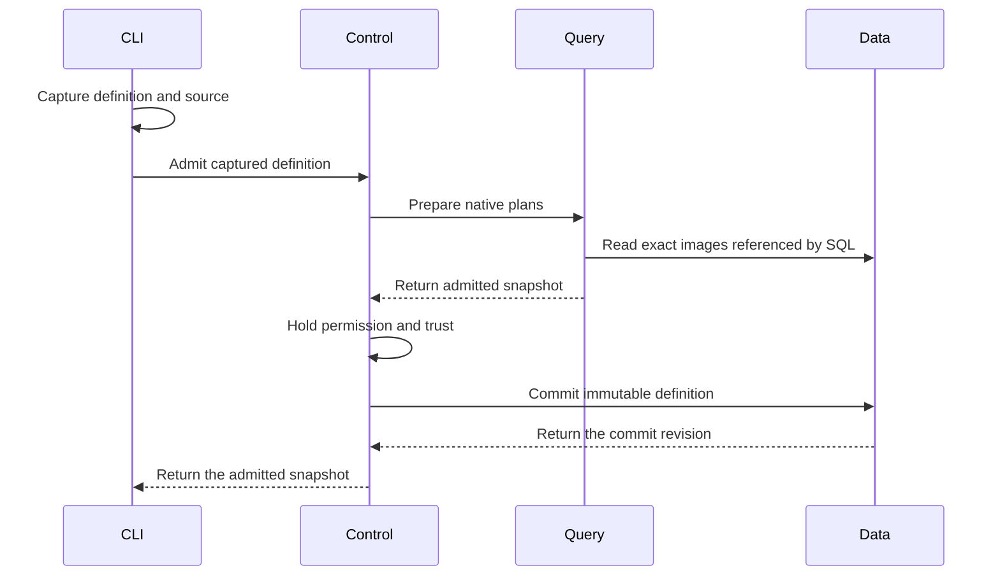

# Discovery Definition Review

This guide covers the Discovery definition file and its admission route. The
definition selects reusable code and inputs. Admission starts no Discovery.

## Intended end state

A definition contains metadata and one SQL or PRQL program. Package calls
are relations inside that program. Every program uses the native DataFusion
pipeline. A separate running instance owns permission, progress, saved state,
and subscription lifetime.

## Review flow

```text
An operator admits a definition file
  -> the CLI captures the definition and referenced source files
  -> Control checks the current tenant and manager permission
  -> Query admits SQL or compiled PRQL and resolves package calls in that SQL
  -> Control holds permission and image trust through the final write
  -> Data retains one immutable definition revision
  -> no Discovery starts

Admission fails or permission expires
  -> the request returns a typed error
  -> Data commits no new definition
  -> a retry checks current permission again
```

[DefinitionArgs](../../crates/araphor-cli/src/cli/araphor/packages.rs)
accepts `araphor definition admit FILE` and
`araphor definition inspect NAME --revision REVISION`.

-> [Definition::read](../../crates/araphor-discovery-definition/src/definition.rs)
reads the JSON definition and resolves relative source files from its
directory. The owner replaces each file reference with captured UTF-8 text.
No owner watches or polls the files.

-> [ClientGrpcOwner::definition_request](../../crates/mithril-control/src/client_grpc/packages.rs)
accepts captured definitions only. The server does not open client paths.
Admission requires current manager permission. Inspection requires current
tenant read permission. File metadata grants no permission.

-> [Engine::prepare_definition](../../crates/araphor-query/src/definition.rs)
uses native SQL parsing, logical planning, and optimization. SQL and generated
PRQL SQL use the same route. Query loads each exact installed image referenced
by a package function. Admission executes no input query or package.

-> [Packages](../../crates/araphor-query/src/definition/package.rs)
extends native relation planning for installed package functions. Native
subquery arguments supply input plans. Native scalar expressions supply
parameters. Exact image content supplies the declared interface and locked
dependencies. A call with several output relations requires an output name
as its first string argument. SQL package output, checkpoint, evidence, and
reason queries retain their schema checks. Native analysis and optimization
check every SQL body plan, including plans that contain other package calls.

The native SQL body planner needs a separate table scope for each call.
[Scope](../../crates/araphor-query/src/definition/package/scope.rs) supplies
the actual input, parameter, output, and prior-state tables through
DataFusion's `ContextProvider`. It delegates function, type, configuration,
and other metadata to the native provider. A package body cannot inherit
undeclared tables from its caller. Caller subqueries and common table
expressions are planned by DataFusion before this body scope is used.

-> [PackageCall](../../crates/araphor-query/src/definition/call.rs)
retains the exact image, export, selected output, and SDK descriptor. Its
logical children are the actual input plans and the native parameter plan.
Its schema is the selected SDK output schema.
Partial: the node has no physical executor. Native physical planning returns
an explicit unsupported error for a package-call execution attempt.

-> [ClientAuth::commit_definition](../../crates/mithril-control/src/client_auth/packages.rs)
holds the current permission lock through the Data write. This owner checks
permission even when a SQL or PRQL definition has no image pins. A package
call also requires current trust in its exact image digest.

-> [AnalysisStore::admit_definition](../../crates/araphor-data/src/analysis/definitions.rs)
checks exact retained image references and saves captured text, generated
SQL, metadata, and pins. The SHA-256 content revision includes every saved
field. An exact retry returns the original commit revision. Changed content
creates another immutable revision. A retry of an older revision does not
change the latest selection.

-> [AnalysisStore::validate_definitions](../../crates/araphor-data/src/analysis/definitions.rs)
checks saved identities, content digests, store revisions, and exact image
pins during store open. Inspection checks content and image pins again.

Not implemented: starting, inspecting, or stopping a managed instance.
Not implemented: physical package-call execution, instance saved state,
progress, and restart recovery. Definition recovery restores definitions only.



Queries with no package calls require no image lookup. Data commits no
activation or result.

## File schema

The file uses JSON. Unknown fields, the removed package program form,
duplicate program forms, and combined inline/file source objects are invalid.
No definition-specific size quota is added. The existing optional Query and
Data limits still apply.

```json
{
  "name": "event-counts",
  "description": "Count retained events.",
  "labels": {"team": "security"},
  "program": {
    "kind": "sql",
    "source": {"file": "queries/counts.sql"}
  }
}
```

Replace `source` with `{"inline":"SELECT count(*) FROM events"}` for inline
SQL. Use `kind: "prql"` with the same source forms for PRQL. The
[compiler](../../crates/araphor-discovery-definition/src/compile.rs) uses
`prqlc` 0.13.13 with the Generic SQL target. DataFusion admits the generated
SQL. This route does not promise every PRQL expression is compatible.

Put package calls in the SQL source:

```sql
SELECT *
FROM "fixture"."r1".count(
  source => (
    SELECT source_cursor AS value
    FROM events
    WHERE received_at >= now() - INTERVAL '5 minutes'
  ),
  increment => 2
)
```

The function name identifies the image, exact revision, and export. The
example uses the Query test image. Install the selected image before
admission. Its interface must declare the supplied inputs and parameters.
For an export with several outputs, use an explicit first string argument,
such as `count('result', source => (SELECT ...), increment => 2)`.

Inputs are native subqueries. Filters, joins, grouping, and windows stay in
those queries. Scalar arguments use the declared parameter names and types.
There is no separate JSON input, parameter, or window language. Calls can
appear in joins, nested inputs, or queries that use common table expressions.

PRQL uses its existing SQL relation syntax and then compiles to native SQL:

```prql
from s"""SELECT * FROM "fixture"."r1".count(
  source => (SELECT source_cursor AS value FROM events), increment => 2
)"""
filter value >= 2
```

## Ownership and verification

The definition crate owns portable file and snapshot types. Data owns durable
storage. Query owns planning. Control owns current permission and transport.
CLI owns command parsing and output. No new owner depends on
`araphor-analysis_back`. The old package route remains available separately.

Read the [definition tests](../../crates/araphor-discovery-definition/src/tests.rs),
[Query tests](../../crates/araphor-query/src/definition/tests.rs),
[Data tests](../../crates/araphor-data/src/analysis/definitions/tests.rs),
[authority tests](../../crates/mithril-control/src/client_auth/packages/tests.rs),
and [RPC tests](../../crates/mithril-control/src/client_grpc/tests/packages.rs).
The tests cover source capture, strict forms, native planning, typed calls,
permission revocation, exact pins, immutable retries, and definition recovery.
The [TLS case](../../crates/mithril-e2e/src/discovery/packages/definitions.rs)
uses the real client to admit and inspect SQL and PRQL. Its native package
calls also check the locked SQL dependency and unchanged activation state.

[Dataset::normalize_batch](../../crates/araphor-analysis-sdk/src/batch.rs)
retains the explicit Arrow row count when a valid SDK input has no columns.
The [SDK batch tests](../../crates/araphor-analysis-sdk/src/batch/tests.rs)
check empty and nonempty zero-column batches. The Query case checks native
zero-column input, output, and saved-state planning and a three-row scan.
[Session::indexed_schema](../../crates/araphor-query/src/execution/tables.rs)
accepts the same empty schema and retains metadata. The
[index tests](../../crates/araphor-query/src/execution/tables/tests.rs) check
continuous row indices across empty and nonempty zero-column batches.
The changes retain the existing column and schema checks.

The native-call replacement passes the following 50 distinct focused tests:

| Owner | Passed cases |
| --- | --- |
| Definition format and PRQL | 12 |
| Query definitions and package calls | 20 |
| Data definitions and request encoding | 9 |
| Control permission and RPC admission | 5 |
| CLI admission, inspection, and output | 3 |
| TLS client admission and inspection | 1 |

Formatting and affected-crate Clippy with warnings denied passed. The
verification record is `/tmp/araphor-sql-call-verification1.json`.
The tests also reject an invalid constant cast in a body that contains a
nested package call. They accept the corrected body. Native analysis and
optimization apply before the physical-execution boundary.

The SDK batch and Query index owners are unchanged from `318a3259`. Their
earlier checks above are not repeated. The focused Query zero-column case
runs again in this delivery.

The replacement adds 165 production Rust code lines from `318a3259`:
327 additions and 162 deletions by file size. Tests, comments, documents,
blank lines, and moves do not count as reduction. The count record is
`/tmp/araphor-sql-call-count1.json`. The complete reduction target remains
**Not done**.
Complete package execution and running-instance acceptance remain open.
Full workspace CI, benchmarks, and physical Kubernetes checks did not run.
