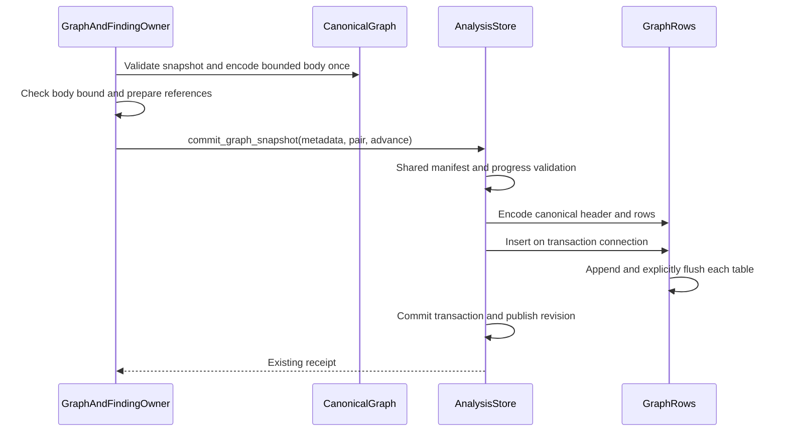
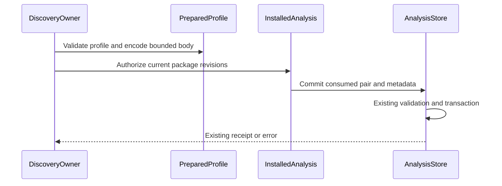

# Araphor Graph Commit Review

This guide covers the approved typed graph handoff and buffered row appends.
The retained source head is `cffde410`. Its final Rust procedure passes.
The subsequent graph, Discovery, and finding changes are committed through
`ab6b5da3` and pass focused tests and final CI. Refreshed native runtime
qualification passes through the exact retry. E2E reproducibility remains
**Not done**. The [production plan](../plans/araphor-production-dataflow-simplification.md)
defines the approved scope.

## Intended end state

Pass one typed graph snapshot between the graph owner and the store owner.
Produce canonical result bytes once. Encode only required header metadata.
Append the existing rows in the existing transaction. Preserve result bytes,
current canonical bytes, references, receipts, quotas, recovery, and notifications.
Accept only the current graph header. Reject noncanonical byte input.

## Implementation review flow

Each line below describes the implemented source. Current focused and final CI
qualification passes. Refreshed native E2E passes on exact retry after the
failure recorded below. Its reproducibility issue remains unresolved.

[CanonicalGraph::bounded](../../crates/araphor-data/src/analysis/graph_rows/mod.rs) The graph owner validates the typed snapshot and prepares its bounded canonical body once
  -> [GraphAndFindingOwner::commit_bounded_window](../../crates/araphor-data/src/graph/commit.rs) the graph owner checks the body bound before context effects
  -> [AnalysisStore::commit_graph_snapshot](../../crates/araphor-data/src/analysis/progress.rs) the graph owner submits the prepared pair and empty-body commit metadata
  -> [AnalysisStore::commit_graph_inner](../../crates/araphor-data/src/analysis/progress.rs) the store applies shared manifest, witness, scope, and progress validation
  -> [GraphRows::encode_canonical](../../crates/araphor-data/src/analysis/graph_rows/mod.rs) row preparation reuses the existing canonical body
  -> [GraphHeader::encode](../../crates/araphor-data/src/analysis/graph_rows/header.rs) header preparation serializes only required metadata
  -> [GraphRows::insert](../../crates/araphor-data/src/analysis/graph_rows/mod.rs) the transaction appends rows and checks each flush
  -> [AnalysisStore::commit_progress](../../crates/araphor-data/src/analysis/progress.rs) the existing transaction commits references, usage, and progress
  -> [AnalysisResultReceiptV1](../../crates/araphor-data/src/analysis/progress.rs) the graph owner receives the existing receipt

The reading order follows these links. Read the constructor before the commit
entry. The constructor prepares canonical bytes through a bounded writer
before context effects. The transaction remains the only graph durability
owner.

## Owners and input contracts

`GraphAndFindingOwner` derives and validates the snapshot. The owner sets the
window cursors, positions, notice revision, witness deadline, and previous
result ID. `CanonicalGraph::bounded` consumes this snapshot. The constructor
validates the snapshot and serializes its canonical body once. Private fields
keep the snapshot and body together. A borrowed snapshot accessor permits
context preparation without a large clone.

`AnalysisStore::commit_graph_snapshot` consumes the prepared pair and commit
metadata. The metadata body must be empty. The store fills that body from the
pair. A caller cannot supply an independent body for this typed entry. The
shared validation checks scope, input manifest, witnesses, expiry, context
references, and cursor movement before the transaction commits.

`GraphRows` owns the prepared header, subjects, relationships, and findings.
Canonical encoding uses the pair's bytes. Row
encoding preserves existing fields, ordinals, and storage charges. The value
lives through the transaction. Local value destruction does not remove durable
rows. Existing collection and recovery owners manage retained rows.

## Canonical and byte paths

The public byte entry remains `AnalysisStore::commit_result`. Graph byte input
uses `commit_graph`, which decodes and validates the supplied snapshot. The
byte entry requires exact current canonical JSON bytes. It rejects whitespace,
field-order changes, alternate escapes, and omitted optional fields. Both
entries use the same immutable retry checks and transaction owner. The current
format stores no layout column or tape.

## Header bytes and row appends

[HeaderMetadata](../../crates/araphor-data/src/analysis/graph_rows/header.rs)
borrows the snapshot and excludes only subjects, edges, and findings. The
serializer retains every other metadata field, including optional values.
The metadata-only `serde_json::Value` conversion applies the same recursive
key order for the current metadata. The CBOR envelope has six fields:
version 2, subject count, relationship count, finding count, canonical byte
length, and metadata bytes. The header has no separate source byte length.
Current canonical results have a 16 MiB bound. The graph window checks its
body bound before context effects and can select a smaller window. No complete
row tree is created for header extraction.

[GraphRows::insert](../../crates/araphor-data/src/analysis/graph_rows/mod.rs)
opens one scoped appender for each existing table. Each row method appends the
same typed parameters in the same order. Each appender explicitly flushes
before its scope ends. An append or flush error returns `AnalysisDatabase`
before transaction commit. Transaction rollback removes earlier flushed rows
and prevents progress, usage, witness, and receipt changes from that attempt.
Drop is not the flush error check.

Finding reads retain their existing 32 MiB budget for query batches and cached
headers. The 16 MiB canonical limit applies to one result. The finding owner
defines its read budget separately. A format-bound change must not reduce
header reuse or query batch capacity.

Read the row mappings in [subjects](../../crates/araphor-data/src/analysis/graph_rows/subjects.rs),
[relationships](../../crates/araphor-data/src/analysis/graph_rows/relationships.rs),
and [findings](../../crates/araphor-data/src/analysis/graph_rows/findings.rs).
Read [retained graph reads](../../crates/araphor-data/src/analysis/graph_rows/read.rs)
for byte reconstruction and row validation.

## Typed Discovery profile commit

[PreparedProfile::new](../../crates/araphor-data/src/analysis/progress/profile.rs) Discovery validates a profile and encodes its bounded body once
  -> [DiscoveryOwner](../../crates/araphor-data/src/discovery/live.rs) the owner obtains current package authorization for the prepared commit
  -> [AnalysisStore::commit_working_profile](../../crates/araphor-data/src/analysis/progress/profile.rs) the store consumes the private pair for a working revision
  -> [AnalysisStore::commit_progress](../../crates/araphor-data/src/analysis/progress.rs) the existing transaction checks metadata and commits the profile

`DiscoveryOwner` creates the prepared value after it sets the profile fields
and commit metadata. `PreparedProfile` owns private profile and body fields.
Its constructor validates the profile and writes its exact JSON body through
the existing 16 MiB bounded buffer. Callers cannot change either field or
supply independent body bytes. The store consumes the pair after package
authorization. It uses the same metadata, scope, witness, context reference,
revision, synchronization, and usage checks as the existing commit owner.
The pair adds no durable state or separate transaction. Its values are dropped
after success or error; retained profiles remain owned by the store.

`commit_sealed_profile` handles sealed historical profiles. It requires equal
expected and consumed cursors, so this entry cannot advance progress. Working
replacement uses `commit_working_profile` with the expected prior revision.
Both entries reject nonempty independent commit bodies. Authorization failure
prevents the store call; commit failure does not publish a successful receipt.
Retry and recovery retain their existing owners.

The byte-input `commit_working` and `commit_profile` helpers are now test-only
parity routes. [Profile handoff tests](../../crates/araphor-data/src/analysis/progress/profile/tests.rs)
compare typed and byte paths for exact bodies, request metadata, receipts,
working replacement, sealed retry, and reopen. They reject mismatched scope,
result ID, coverage revision, independent body bytes, unsealed history,
historical cursor advance, and invalid profile tenant data. Existing physical
crash tests remain at their original commit boundaries. This change adds no
ABI or BPF interface.

**Done** for source, focused profile qualification, and final CI at `ab6b5da3`.
Retained `cffde410` evidence remains historical. No runtime saving is measured.

## Verification route and limits

### Current bounded preparation and finding batches

[GraphAndFindingOwner::derive_candidate](../../crates/araphor-data/src/graph/derive.rs) The graph owner derives a validated typed candidate
  -> [GraphAndFindingOwner::commit_bounded_window](../../crates/araphor-data/src/graph/commit.rs) the owner supplies final positions, notice, witness deadline, and previous result
  -> [CanonicalGraph::bounded](../../crates/araphor-data/src/analysis/graph_rows/mod.rs) the owner serializes once into the existing bounded buffer
  -> [GraphAndFindingOwner::commit_snapshot](../../crates/araphor-data/src/graph/commit.rs) the owner prepares context references only after the body fits
  -> [AnalysisStore::commit_graph_snapshot](../../crates/araphor-data/src/analysis/progress.rs) the existing transaction commits the prepared graph

The configured graph-window bound applies during serialization. Only the
`graph output bytes` error selects a smaller window. Other errors propagate.
Public derivation retains its byte check. The pair retains private fields and
has no independent body input. The format remains the six-field version-2
header and a 16 MiB maximum canonical result. The transaction, authorization,
witnesses, references, rollback, and revision notification remain unchanged.

[AnalysisStore::preflight_findings](../../crates/araphor-data/src/analysis/graph/findings/preflight.rs) The finding owner selects keys and checks each distinct complete result's stored row charge and header
  -> [FindingKey::batch_end](../../crates/araphor-data/src/analysis/graph/findings/batches.rs) the owner charges selected rows, each copied input manifest, and one shared header per result in the batch
  -> [AnalysisStore::collect_findings](../../crates/araphor-data/src/analysis/graph/findings/batches.rs) the owner reads the batch or uses the existing single-finding fallback
  -> [FindingOutput](../../crates/araphor-data/src/analysis/graph/findings/batches.rs) the owner checks exact serialized output bytes before returning the page

The selected row charge follows the native finding columns. It no longer
charges all subjects, edges, and findings again for each selected finding.
The revision charge is per finding because decoded findings each own an input
manifest. Header accounting is shared only within that batch. Full-result
preflight remains separate from selected-row accounting. The 32 MiB read bound,
256-record batch bound, header-cache bound, output limit, row validation,
ordering, pagination, and fallback remain in force.

Read `final_header_bounds` and `output_bytes_split` in
[bounded graph tests](../../crates/araphor-data/src/graph/tests/bounded.rs).
Read `native_finding_batches`, `finding_shared_header_batch`, and
`native_finding_fallback` in
[finding tests](../../crates/araphor-data/src/analysis/graph/findings/tests.rs).
The current test routes cover final metadata growth, batch accounting,
shared headers, output pagination, and fallback. Read the current verification before treating these test routes as passed.

## Verification

Existing Rust cases in [native storage tests](../../crates/araphor-data/src/graph/tests/native_storage.rs)
cover immutable retry, rollback, exact encoding, and replacement removal.
[Encoding tests](../../crates/araphor-data/src/analysis/graph_rows/tests/encoding.rs)
cover canonical byte rejection, current metadata format, byte bounds, and
string encoding.
[Package reference tests](../../crates/araphor-data/src/analysis/graph_rows/tests/packages.rs)
cover retained package references. Recovery and corruption cases remain in
[current recovery tests](../../crates/araphor-data/src/analysis/graph_rows/tests/recovery.rs).

[graph_typed_commit_matches_bytes](../../crates/araphor-data/src/analysis/graph_rows/tests/packages.rs) checks body, header, rows, charges,
and receipt equality. `graph_typed_commit_rejects_metadata` checks metadata
rejection. `native_header_metadata_current_format` checks the current header
fields and omitted row arrays. `graph_native_commit_rollback` retains the existing rollback contract.
`graph_appender_constraint_rollback` checks rollback after an appender
constraint failure. `native_header_read_budget` checks that the cache retains
two headers whose combined charge exceeds one result's canonical bound.

These are source test routes. The
[current verification](../plans/araphor-performance-simplification-todo.md)
records results for the deletion work. Complete earlier receipts remain at
`7b7b407adf347d389984553a4d212bfce37b75b5:docs/guides/araphor-graph-commit-review.md`.
They include failed and interrupted attempts and their corrections. The earlier
native proof covers Linux x86_64 GNU with glibc 2.39. Its exact E2E retry passes;
the original failure has no established cause. Other native platforms and a
causal runtime speed improvement remain unqualified. No kernel program, ABI,
backend trait, or durable owner is added by this change.

## Current immutable context validation

This section covers the current Data commit owner. Earlier entries retain
their historical source state. The native Analysis replacement remains in
[the migration record](../plans/araphor-analysis-migration.md).

[AnalysisStore::commit_progress](../../crates/araphor-data/src/analysis/progress.rs) A caller submits a result or retries an immutable result ID
  -> [AnalysisStore::commit_progress](../../crates/araphor-data/src/analysis/progress.rs) Data compares the raw context revision with the captured input references
  -> [AnalysisStore::commit_progress](../../crates/araphor-data/src/analysis/progress.rs) Data rejects a malformed fresh header with AnalysisState
  -> [AnalysisStore::commit_progress](../../crates/araphor-data/src/analysis/progress.rs) Data rejects a malformed immutable retry with AnalysisConflict
  -> [AnalysisStore::commit_progress](../../crates/araphor-data/src/analysis/progress.rs) the transaction rolls back all proposed context rows

[AnalysisStore::commit_progress](../../crates/araphor-data/src/analysis/progress.rs) A valid exact retry reaches immutable comparison
  -> [AnalysisStore::commit_progress](../../crates/araphor-data/src/analysis/progress.rs) Data checks current final authority
  -> [AnalysisStore::commit_progress](../../crates/araphor-data/src/analysis/progress.rs) Data returns the original receipt without a new write

The raw header check stays before merged request serialization. Generated
context references can produce the same stored metadata from different raw
headers. An invalid header must not receive a successful receipt. Mutable
profile replacement keeps its existing validation.

The [atomic Graph context test](../../crates/araphor-data/src/analysis/graph_rows/tests/atomic.rs)
checks fresh and retained malformed headers, complete metadata rollback, and
the valid original retry. The [generic progress test](../../crates/araphor-data/src/analysis/progress.rs)
keeps all 16 changed-request conflict assertions. The [history test](../../crates/araphor-data/src/analysis/graph/findings/tests.rs)
creates a changed finding and checks the new head and original history.
Read the [exact correction and qualification record](../../recovery/araphor-immutable-retry-validation-20261021.json).
All 24 related Data cases and both native Graph storage cases pass. The final
shared Rust procedure remains **Not done** at this source record.
