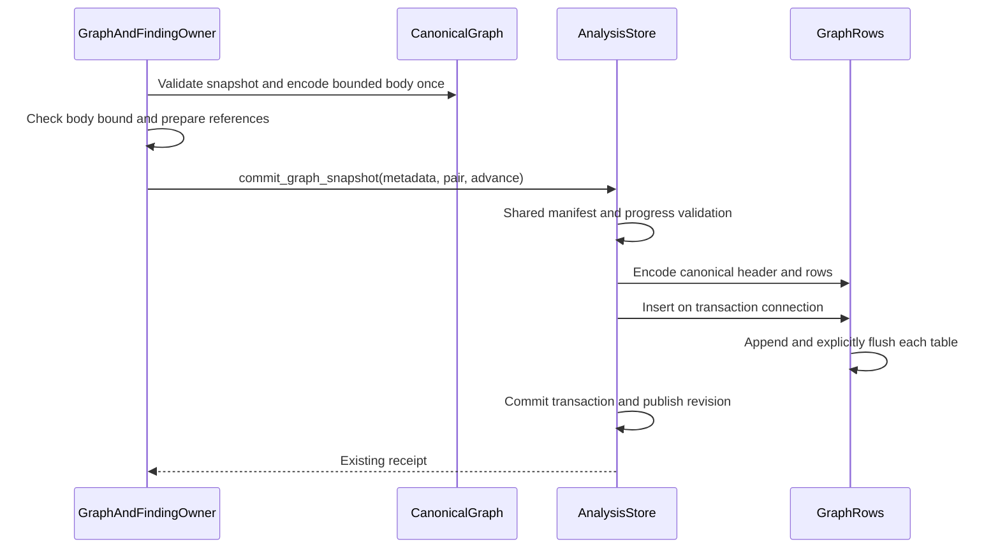
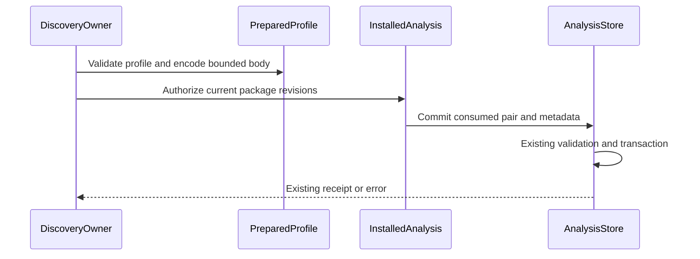
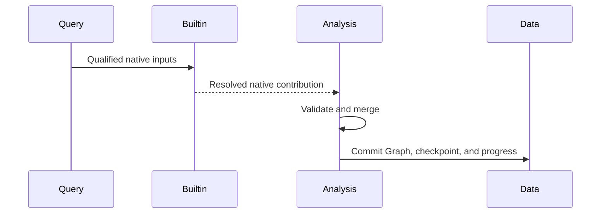
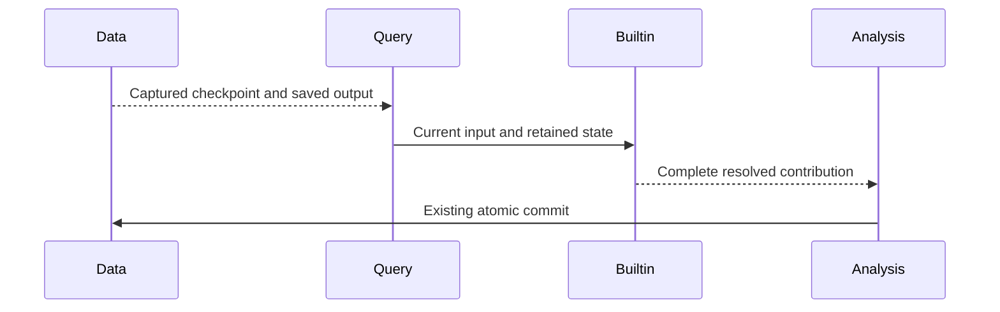

# Araphor Graph Commit Review

The [shared Graph section](#shared-graph-values-and-storage-controls) gives
the current source reading route. The compact Graph and incremental builtin
sections retain their earlier source states and verification records.

This guide covers the approved typed graph handoff and buffered row appends.
The retained source head is `cffde410`. Its final Rust procedure passes.
The subsequent graph, Discovery, and finding changes are committed through
`ab6b5da3` and pass focused tests and final CI. Refreshed native runtime
qualification passes through the exact retry. E2E reproducibility remains
**Not done**. The [production plan](../plans/araphor-production-dataflow-simplification.md)
defines the approved scope.

## Intended end state

Pass one typed graph snapshot between the graph owner and the store owner.
Produce canonical result bytes once. Encode only required header metadata.
Append the existing rows in the existing transaction. Preserve result bytes,
current canonical bytes, references, receipts, quotas, recovery, and notifications.
Accept only the current graph header. Reject noncanonical byte input.

## Implementation review flow

Each line below describes the implemented source. Current focused and final CI
qualification passes. Refreshed native E2E passes on exact retry after the
failure recorded below. Its reproducibility issue remains unresolved.

[CanonicalGraph::bounded](../../crates/araphor-data/src/analysis/graph_rows/mod.rs) The graph owner validates the typed snapshot and prepares its bounded canonical body once
  -> [GraphAndFindingOwner::commit_bounded_window](../../crates/araphor-data/src/graph/commit.rs) the graph owner checks the body bound before context effects
  -> [AnalysisStore::commit_graph_snapshot](../../crates/araphor-data/src/analysis/progress.rs) the graph owner submits the prepared pair and empty-body commit metadata
  -> [AnalysisStore::commit_graph_inner](../../crates/araphor-data/src/analysis/progress.rs) the store applies shared manifest, witness, scope, and progress validation
  -> [GraphRows::encode_canonical](../../crates/araphor-data/src/analysis/graph_rows/mod.rs) row preparation reuses the existing canonical body
  -> [GraphHeader::encode](../../crates/araphor-data/src/analysis/graph_rows/header.rs) header preparation serializes only required metadata
  -> [GraphRows::insert](../../crates/araphor-data/src/analysis/graph_rows/mod.rs) the transaction appends rows and checks each flush
  -> [AnalysisStore::commit_progress](../../crates/araphor-data/src/analysis/progress.rs) the existing transaction commits references, usage, and progress
  -> [AnalysisResultReceiptV1](../../crates/araphor-data/src/analysis/progress.rs) the graph owner receives the existing receipt

The reading order follows these links. Read the constructor before the commit
entry. The constructor prepares canonical bytes through a bounded writer
before context effects. The transaction remains the only graph durability
owner.

## Owners and input contracts

`GraphAndFindingOwner` derives and validates the snapshot. The owner sets the
window cursors, positions, notice revision, witness deadline, and previous
result ID. `CanonicalGraph::bounded` consumes this snapshot. The constructor
validates the snapshot and serializes its canonical body once. Private fields
keep the snapshot and body together. A borrowed snapshot accessor permits
context preparation without a large clone.

`AnalysisStore::commit_graph_snapshot` consumes the prepared pair and commit
metadata. The metadata body must be empty. The store fills that body from the
pair. A caller cannot supply an independent body for this typed entry. The
shared validation checks scope, input manifest, witnesses, expiry, context
references, and cursor movement before the transaction commits.

`GraphRows` owns the prepared header, subjects, relationships, and findings.
Canonical encoding uses the pair's bytes. Row
encoding preserves existing fields, ordinals, and storage charges. The value
lives through the transaction. Local value destruction does not remove durable
rows. Existing collection and recovery owners manage retained rows.

## Canonical and byte paths

The public byte entry remains `AnalysisStore::commit_result`. Graph byte input
uses `commit_graph`, which decodes and validates the supplied snapshot. The
byte entry requires exact current canonical JSON bytes. It rejects whitespace,
field-order changes, alternate escapes, and omitted optional fields. Both
entries use the same immutable retry checks and transaction owner. The current
format stores no layout column or tape.

## Header bytes and row appends

[HeaderMetadata](../../crates/araphor-data/src/analysis/graph_rows/header.rs)
borrows the snapshot and excludes only subjects, edges, and findings. The
serializer retains every other metadata field, including optional values.
The metadata-only `serde_json::Value` conversion applies the same recursive
key order for the current metadata. The CBOR envelope has six fields:
version 2, subject count, relationship count, finding count, canonical byte
length, and metadata bytes. The header has no separate source byte length.
Current canonical results have a 16 MiB bound. The graph window checks its
body bound before context effects and can select a smaller window. No complete
row tree is created for header extraction.

[GraphRows::insert](../../crates/araphor-data/src/analysis/graph_rows/mod.rs)
opens one scoped appender for each existing table. Each row method appends the
same typed parameters in the same order. Each appender explicitly flushes
before its scope ends. An append or flush error returns `AnalysisDatabase`
before transaction commit. Transaction rollback removes earlier flushed rows
and prevents progress, usage, witness, and receipt changes from that attempt.
Drop is not the flush error check.

Finding reads retain their existing 32 MiB budget for query batches and cached
headers. The 16 MiB canonical limit applies to one result. The finding owner
defines its read budget separately. A format-bound change must not reduce
header reuse or query batch capacity.

Read the row mappings in [subjects](../../crates/araphor-data/src/analysis/graph_rows/subjects.rs),
[relationships](../../crates/araphor-data/src/analysis/graph_rows/relationships.rs),
and [findings](../../crates/araphor-data/src/analysis/graph_rows/findings.rs).
Read [retained graph reads](../../crates/araphor-data/src/analysis/graph_rows/read.rs)
for byte reconstruction and row validation.

## Typed Discovery profile commit

[PreparedProfile::new](../../crates/araphor-data/src/analysis/progress/profile.rs) Discovery validates a profile and encodes its bounded body once
  -> [DiscoveryOwner](../../crates/araphor-data/src/discovery/live.rs) the owner obtains current package authorization for the prepared commit
  -> [AnalysisStore::commit_working_profile](../../crates/araphor-data/src/analysis/progress/profile.rs) the store consumes the private pair for a working revision
  -> [AnalysisStore::commit_progress](../../crates/araphor-data/src/analysis/progress.rs) the existing transaction checks metadata and commits the profile

`DiscoveryOwner` creates the prepared value after it sets the profile fields
and commit metadata. `PreparedProfile` owns private profile and body fields.
Its constructor validates the profile and writes its exact JSON body through
the existing 16 MiB bounded buffer. Callers cannot change either field or
supply independent body bytes. The store consumes the pair after package
authorization. It uses the same metadata, scope, witness, context reference,
revision, synchronization, and usage checks as the existing commit owner.
The pair adds no durable state or separate transaction. Its values are dropped
after success or error; retained profiles remain owned by the store.

`commit_sealed_profile` handles sealed historical profiles. It requires equal
expected and consumed cursors, so this entry cannot advance progress. Working
replacement uses `commit_working_profile` with the expected prior revision.
Both entries reject nonempty independent commit bodies. Authorization failure
prevents the store call; commit failure does not publish a successful receipt.
Retry and recovery retain their existing owners.

The byte-input `commit_working` and `commit_profile` helpers are now test-only
parity routes. [Profile handoff tests](../../crates/araphor-data/src/analysis/progress/profile/tests.rs)
compare typed and byte paths for exact bodies, request metadata, receipts,
working replacement, sealed retry, and reopen. They reject mismatched scope,
result ID, coverage revision, independent body bytes, unsealed history,
historical cursor advance, and invalid profile tenant data. Existing physical
crash tests remain at their original commit boundaries. This change adds no
ABI or BPF interface.

**Done** for source, focused profile qualification, and final CI at `ab6b5da3`.
Retained `cffde410` evidence remains historical. No runtime saving is measured.

## Verification route and limits

### Current bounded preparation and finding batches

[GraphAndFindingOwner::derive_candidate](../../crates/araphor-data/src/graph/derive.rs) The graph owner derives a validated typed candidate
  -> [GraphAndFindingOwner::commit_bounded_window](../../crates/araphor-data/src/graph/commit.rs) the owner supplies final positions, notice, witness deadline, and previous result
  -> [CanonicalGraph::bounded](../../crates/araphor-data/src/analysis/graph_rows/mod.rs) the owner serializes once into the existing bounded buffer
  -> [GraphAndFindingOwner::commit_snapshot](../../crates/araphor-data/src/graph/commit.rs) the owner prepares context references only after the body fits
  -> [AnalysisStore::commit_graph_snapshot](../../crates/araphor-data/src/analysis/progress.rs) the existing transaction commits the prepared graph

The configured graph-window bound applies during serialization. Only the
`graph output bytes` error selects a smaller window. Other errors propagate.
Public derivation retains its byte check. The pair retains private fields and
has no independent body input. The format remains the six-field version-2
header and a 16 MiB maximum canonical result. The transaction, authorization,
witnesses, references, rollback, and revision notification remain unchanged.

[AnalysisStore::preflight_findings](../../crates/araphor-data/src/analysis/graph/findings/preflight.rs) The finding owner selects keys and checks each distinct complete result's stored row charge and header
  -> [FindingKey::batch_end](../../crates/araphor-data/src/analysis/graph/findings/batches.rs) the owner charges selected rows, each copied input manifest, and one shared header per result in the batch
  -> [AnalysisStore::collect_findings](../../crates/araphor-data/src/analysis/graph/findings/batches.rs) the owner reads the batch or uses the existing single-finding fallback
  -> [FindingOutput](../../crates/araphor-data/src/analysis/graph/findings/batches.rs) the owner checks exact serialized output bytes before returning the page

The selected row charge follows the native finding columns. It no longer
charges all subjects, edges, and findings again for each selected finding.
The revision charge is per finding because decoded findings each own an input
manifest. Header accounting is shared only within that batch. Full-result
preflight remains separate from selected-row accounting. The 32 MiB read bound,
256-record batch bound, header-cache bound, output limit, row validation,
ordering, pagination, and fallback remain in force.

Read `final_header_bounds` and `output_bytes_split` in
[bounded graph tests](../../crates/araphor-data/src/graph/tests/bounded.rs).
Read `native_finding_batches`, `finding_shared_header_batch`, and
`native_finding_fallback` in
[finding tests](../../crates/araphor-data/src/analysis/graph/findings/tests.rs).
The current test routes cover final metadata growth, batch accounting,
shared headers, output pagination, and fallback. Read the current verification before treating these test routes as passed.

## Verification

Existing Rust cases in [native storage tests](../../crates/araphor-data/src/graph/tests/native_storage.rs)
cover immutable retry, rollback, exact encoding, and replacement removal.
[Encoding tests](../../crates/araphor-data/src/analysis/graph_rows/tests/encoding.rs)
cover canonical byte rejection, current metadata format, byte bounds, and
string encoding.
[Package reference tests](../../crates/araphor-data/src/analysis/graph_rows/tests/packages.rs)
cover retained package references. Recovery and corruption cases remain in
[current recovery tests](../../crates/araphor-data/src/analysis/graph_rows/tests/recovery.rs).

[graph_typed_commit_matches_bytes](../../crates/araphor-data/src/analysis/graph_rows/tests/packages.rs) checks body, header, rows, charges,
and receipt equality. `graph_typed_commit_rejects_metadata` checks metadata
rejection. `native_header_metadata_current_format` checks the current header
fields and omitted row arrays. `graph_native_commit_rollback` retains the existing rollback contract.
`graph_appender_constraint_rollback` checks rollback after an appender
constraint failure. `native_header_read_budget` checks that the cache retains
two headers whose combined charge exceeds one result's canonical bound.

These are source test routes. The
[current verification](../plans/araphor-performance-simplification-todo.md)
records results for the deletion work. Complete earlier receipts remain at
`7b7b407adf347d389984553a4d212bfce37b75b5:docs/guides/araphor-graph-commit-review.md`.
They include failed and interrupted attempts and their corrections. The earlier
native proof covers Linux x86_64 GNU with glibc 2.39. Its exact E2E retry passes;
the original failure has no established cause. Other native platforms and a
causal runtime speed improvement remain unqualified. No kernel program, ABI,
backend trait, or durable owner is added by this change.

## Current immutable context validation

This section covers the current Data commit owner. Earlier entries retain
their historical source state. The native Analysis replacement remains in
[the migration record](../plans/araphor-analysis-migration.md).

[AnalysisStore::commit_progress](../../crates/araphor-data/src/analysis/progress.rs) A caller submits a result or retries an immutable result ID
  -> [AnalysisStore::commit_progress](../../crates/araphor-data/src/analysis/progress.rs) Data compares the raw context revision with the captured input references
  -> [AnalysisStore::commit_progress](../../crates/araphor-data/src/analysis/progress.rs) Data rejects a malformed fresh header with AnalysisState
  -> [AnalysisStore::commit_progress](../../crates/araphor-data/src/analysis/progress.rs) Data rejects a malformed immutable retry with AnalysisConflict
  -> [AnalysisStore::commit_progress](../../crates/araphor-data/src/analysis/progress.rs) the transaction rolls back all proposed context rows

[AnalysisStore::commit_progress](../../crates/araphor-data/src/analysis/progress.rs) A valid exact retry reaches immutable comparison
  -> [AnalysisStore::commit_progress](../../crates/araphor-data/src/analysis/progress.rs) Data checks current final authority
  -> [AnalysisStore::commit_progress](../../crates/araphor-data/src/analysis/progress.rs) Data returns the original receipt without a new write

The raw header check stays before merged request serialization. Generated
context references can produce the same stored metadata from different raw
headers. An invalid header must not receive a successful receipt. Mutable
profile replacement keeps its existing validation.

The [atomic Graph context test](../../crates/araphor-data/src/analysis/graph_rows/tests/atomic.rs)
checks fresh and retained malformed headers, complete metadata rollback, and
the valid original retry. The [generic progress test](../../crates/araphor-data/src/analysis/progress.rs)
keeps all 16 changed-request conflict assertions. The [history test](../../crates/araphor-data/src/analysis/graph/findings/tests.rs)
creates a changed finding and checks the new head and original history.
Read the [exact correction and qualification record](../../recovery/araphor-immutable-retry-validation-20261021.json).
All 24 related Data cases and both native Graph storage cases pass. The final
shared Rust procedure remains **Not done** at this source record.

## Compact Graph storage and native query rows

This section covers the working changes after `f8e650ab`. The
[incremental Graph plan](../plans/araphor-incremental-graphs.md) separates this
storage change from the remaining builtin ownership and incremental work.
**Result: Done for compact storage.** The production build, relevant runtime
checks, and scoped static checks pass. The unchanged backlog case still fails
its deadline. Incremental execution remains **Not done**. Runtime checks found
schema, projection, and retained-parent availability errors; the corrections
pass their relevant checks. The corrected history test also passes. The memory
measurement error described below is resolved.

### Intended end state

Keep one input manifest for each immutable Graph result. Store subjects once
and refer to those subjects by result-local integer IDs. Store edges in native
columns. Preserve exact historical finding references, traversal, recovery,
and atomic publication. Compact storage alone does not make derivation
incremental.

### Implementation review flow

[GraphPublication::convert_graph](../../crates/araphor-analysis/src/graph/native/commit.rs) Analysis validates the captured package calls and creates a typed Graph result
  -> [CanonicalGraph::bounded](../../crates/araphor-data/src/analysis/graph_rows/mod.rs) the value validates the snapshot and checks a configured output byte bound
  -> [AnalysisStore::commit_managed_graph](../../crates/araphor-data/src/analysis/progress/graph.rs) Data binds the Graph to the captured managed attempt
  -> [AnalysisStore::progress_rows](../../crates/araphor-data/src/analysis/progress.rs) Data validates scope, witnesses, references, immutable retries, and progress
  -> [GraphHeader::encode](../../crates/araphor-data/src/analysis/graph_rows/header.rs) Data encodes one manifest and the remaining result metadata
  -> [GraphRows::insert](../../crates/araphor-data/src/analysis/graph_rows/mod.rs) Data appends subjects, native edges, and findings in the existing transaction
  -> [AnalysisStore::commit_managed_projection](../../crates/araphor-data/src/analysis/managed/commit.rs) Data commits the managed output, checkpoint, Graph, references, and progress together

[GraphWalk::query](../../crates/araphor-data/src/analysis/graph/traversal/sql.rs) Traversal joins each endpoint to its subject within the same result
  -> [GraphWalk::run](../../crates/araphor-data/src/analysis/graph/traversal/read.rs) traversal checks bounds before it allocates the selected rows
  -> [AnalysisStore::traverse_graphs](../../crates/araphor-data/src/analysis/extraction/graph/traversal.rs) traversal returns a complete selected subject dictionary and valid local endpoint references
  -> [Capture::graph](../../crates/araphor-data/src/analysis/extraction/tables/graph.rs) SQL rows keep original subject ordinals within the immutable result

### Owners and contracts

[GraphSnapshotV1](../../crates/araphor-data/src/graph/model.rs) owns the single
`input_manifest`. Findings no longer own copies of that manifest. Detached
finding reads return the finding and its exact parent manifest together.
Notification delivery retains the original result ID and revision content.

Each edge contains two subject indices and a list of evidence indices. The
subject indices refer to the sorted subject dictionary. The evidence indices
refer to the parent manifest. Validation rejects missing references, duplicate
evidence indices, and incompatible native-parent authorities. IDs have meaning
only within their immutable Graph result. Traversal compares full subject keys
across results; it does not compare unrelated integer IDs.

`CanonicalGraph` owns only the typed snapshot. The normal commit path creates
no complete Graph JSON buffer. A finite output limit uses a counting writer.
An unconfigured output limit skips that serialization. The byte-input Graph
commit helper exists only for tests and calls the same typed commit path.
Generic result reads return the retained header bytes. Typed callers use
`graph_result`. SQL serializes a complete snapshot only when the query requests
`graph_manifest.snapshot`.

The six-field header keeps its existing contract version. The fifth field
bounds native variable row bytes. Reads check row counts and this upper bound
before decoding native rows. Header-cache accounting includes header metadata.
Edge appends use DuckDB's existing Arrow appender for native list and struct
columns. An append or flush error rolls back the same transaction.

`graph_manifest.graph_revision` is one native Arrow struct for each admitted
result. Child tables join this parent by result ID. A notification that cites
an older result adds that exact parent row without adding old child rows.
Repeated references do not add duplicate admitted parents. Projected reads
retain their field-level allocation and validation behavior.

### Verification route and limits

Read the [native row tests](../../crates/araphor-data/src/analysis/graph_rows/tests.rs)
for storage, corruption, retry, and rollback. Read the
[native table tests](../../crates/araphor-data/src/analysis/extraction/tables/tests/native.rs)
for parent projection, retained notification references, and configured
allocation bounds. Read the
[traversal tests](../../crates/araphor-analysis/src/graph/tests/traversal.rs)
for direction, bindings, native IDs, replacement, and reopen. Read the
[managed Graph tests](../../crates/araphor-analysis/src/graph/native/tests/managed.rs)
for captured publication, expiry, retry, and restart.

Graph construction and traversal checks pass in 54 cases. Native Graph checks
pass in 76 cases. Notification checks pass in 41 cases. These totals combine
the relevant groups and exact correction runs; they are not one full suite
run. Data storage, native schema, projection, retained-parent, and health checks
pass. Scoped Clippy passes with warnings denied. The last change affects only
the history test; its exact rebuild and run pass, followed by the scoped
Analysis Clippy check. Existing ignored artifact checks remain ignored. No
full workspace or physical qualification is claimed.

The current build and test artifacts are in
`/tmp/araphor-package-qualification-active/compact-graph`. The incremental
builtin owner change is not implemented. This change adds no BPF interface,
graph engine, polling loop, or second store.

### First matched backlog measurement

Both runs use 1,592 events and the same test, assertions, deadlines, and build
settings. All 746 compiler artifact feature and profile sets match. Both runs
retain four Graph results: 18 subjects, 6,619 edges, and 277 findings. The
selected event counts are 940, 639, 642, and 950. The test directory remains
after shutdown for read-only storage inspection.

| Measurement | Before | Compact storage |
|---|---:|---:|
| Graph column and header payload | 10,990,951 bytes | 3,687,217 bytes |
| Edge column payload | 7,326,260 bytes | 865,704 bytes |
| Graph headers | 2,833,677 bytes | 1,990,503 bytes |
| Complete database file | 64,237,568 bytes | 59,518,976 bytes |
| Elapsed test time | 126.42 seconds | 121.78 seconds |
| Test result | Failed: deadline | Failed: deadline |

Graph payload decreases by 66.45%. This count includes fixed column fields.
It excludes row overhead, indexes, list offsets, and compression. The complete
database file includes other retained data and reusable blocks. Used blocks
increase from 168 to 170; free blocks decrease from 77 to 59. Each block is
262,144 bytes. The smaller file does not prove fewer used blocks. Do not treat
the payload count as physical disk use. Both runs fail, so these two timings
do not establish a successful runtime improvement.

The first runner reported a 2,220,883,968-byte memory peak. This value is not a
valid workload measurement. Before it started the child, the runner read the
complete executable into memory to compute its hash. The child's `wait4`
high-water mark included this earlier allocation. An empty `/bin/true` child
reproduces the value; streaming the same hash avoids it. Both measurement
runners now stream file hashes. The original records remain unchanged.

A separate run samples the exact test process through `/proc`. Its final
sample reports a 935,911,424-byte high-water mark. Samples are one second apart,
so this does not prove the peak after the final sample. This run also fails
the deadline. The baseline has no equivalent process samples. No memory
regression or improvement ratio is established by these records.

The matched artifacts are in
`/tmp/araphor-package-qualification-active/compact-graph/measured-compact/matched`.
`build-comparison.json` records matching build settings. `incident-result.json`
records the executable hash, source hash, time, memory, and failed result.
`comparison.json` records the logical-byte calculation. `storage-result.json`
records the read-only inspection and equal file hashes before and after it.
`rss-accounting-check.json` records the empty-process control. The
`rss-diagnostic` directory retains the separate workload samples and raw result.

## Saved package output for continuation

Read [SDK model](../../crates/araphor-analysis-sdk/src/model.rs),
[evaluation validation](../../crates/araphor-analysis-sdk/src/validation.rs),
[managed state](../../crates/araphor-data/src/analysis/managed/model.rs),
[capture](../../crates/araphor-data/src/analysis/managed/capture.rs),
[physical execution](../../crates/araphor-query/src/definition/physical.rs),
[commit validation](../../crates/araphor-data/src/analysis/managed/commit.rs),
and [replay](../../crates/araphor-data/src/analysis/managed/replay.rs) in that order.

A package can set `CheckpointSpec.resume_input_changes`. Its default is false.
The shared `ManagedPrior::state` method selects both checkpoint and prior
output. It preserves call identity, parameter, schema, and rebuild checks.
Without the declaration, changed input revisions or coverage discard state.
With the declaration, the package receives the saved output datasets through
`Evaluation.previous_outputs`. Their names and schemas come from the existing
output contract. Initial execution and rebuild have no prior output.

Query binds these values in the existing physical package call. SQL uses
`previous_<output>` relation slots. Native and Wasm calls use the existing SDK
transport. The native request and C header include prior dataset pointers and
their count; the WIT request includes the same prior datasets. The contract
version is unchanged during development. Arrow memory and encoding reservations
include the new fields. Saved output cannot supply an evidence link.

Data verifies the exact checkpoint and prior Arrow values at commit. The
existing attempt holds the prior result reference. It does not store the
previous Arrow bytes a second time. Replay restores the direct predecessor's
output and uses the same state selector. It does not follow earlier state
references. Package qualification stores these datasets through the existing
OCI dataset layers and sends them through the normal physical invocation.

`ManagedPrior.reusable` is separate from state continuation. It retains the
existing successful Graph capture conditions. Query requires this flag before
it applies `RetainedCall::matches`. A failed Graph does not return a saved
result as a new success. A continuation package can still receive the last
successful output to compute its next result.

Read the [SDK continuation tests](../../crates/araphor-analysis-sdk/src/tests/continuation.rs),
[Data replay tests](../../crates/araphor-data/src/analysis/managed/tests/replay.rs),
[Query continuation tests](../../crates/araphor-query/src/definition/tests/execution/continuation.rs),
[qualification tests](../../crates/araphor-analysis/src/qualification/tests/sql.rs),
and [Graph history tests](../../crates/araphor-analysis/src/graph/native/tests/managed/history.rs).
They check exact state, schema, evidence separation, failure, rollback, replay,
reopen, and actual saved-result reuse. The builtin Graph algorithms still
rebuild their contribution. Enabling their continuation declaration requires
the separate incremental implementation.

The 76 SDK tests and 26 focused Data, Query, Package, Analysis, and installed
native checks pass. The focused total includes the corrected finite-attempt
test and excludes its earlier invalid fixture setup. Native artifacts come
from the existing `ComponentBuilder::workspace_native` path. The three installed
native checks cover continuation, failure cleanup, and fixture qualification.
Scoped formatting and patch whitespace pass. Clippy passes for affected crates
and tests with warnings denied. The records and source hashes are in
`/tmp/araphor-package-qualification-active/compact-graph/continuation`.
No full workspace or physical qualification was run for this state change.

## Builtin ownership of resolved Graph rows

Each pinned builtin produces its resolved Graph contribution. Analysis validates and publishes that contribution.
[Projection::capture](../../crates/araphor-analysis/src/graph/native/capture.rs) fixes the authorized source cut and keeps its witnesses.
  -> [Graph input](../../crates/araphor-analysis/src/graph/input.rs) qualifies native records, facts, and the manifest without deriving Graph effects.
  -> [Detector::compute](../../crates/araphor-analysis-builtins/src/graph/contract.rs) runs the existing builtin Computation and its domain algorithms.
  -> [Computation::output](../../crates/araphor-analysis-builtins/src/graph/finish.rs) emits native subjects, relationships, findings, branches, and metadata.
  -> [Graph::apply](../../crates/araphor-analysis/src/graph/mod.rs) checks the pinned call, image, tenant, export, and exact captured inputs.
  -> [Graph::apply_output](../../crates/araphor-analysis/src/graph/resolved.rs) checks metadata, complete-input watermarks, evidence links, reason details, and branch projection.
  -> [Graph authority](../../crates/araphor-analysis/src/graph/authority.rs) checks source anchors, endpoint authority, effect fields, exact policy provenance, required limits, and proof ceilings.
  -> [Graph::finish](../../crates/araphor-analysis/src/graph/assembly.rs) merges identical values, remaps ordinals, sorts rows, and validates the snapshot.
  -> [GraphConversion](../../crates/araphor-analysis/src/graph/native/commit.rs) retains receipt lineage, captured references, and witness expiry for the existing [Data transaction](../../crates/araphor-data/src/analysis/progress/graph.rs).

Metadata owns each contribution's stable record and fact basis. Local evidence and endpoint ordinals refer to that contribution. Context keys alone do not establish equal fact contents.
The host preserves independent partial source fields, current-input evidence, policy limits, and exact effect coverage. A schema-valid guest cannot remove required provenance or upgrade authority.
The small native reason details describe the final finding. Opaque declared reasons retain their declared schema and data.
Native input encoding stays lazy. A finite input limit or shared pool admits a conservative allocation bound before encoding; actual Arrow ownership then replaces that reservation.
The existing retained-expiry owner can downgrade proof. The host does not regenerate successful finding, action, or correlation semantics.
At this deliverable, builtin checkpoints still declare resume_input_changes=false. This owner move does not implement incremental derivation or change the subscription window. The next section records the incremental implementation.
[Typed baselines](../../crates/araphor-analysis/src/graph/tests/baseline.rs), [host validation](../../crates/araphor-analysis/src/graph/tests.rs), [native adapter parity](../../crates/araphor-analysis/src/graph/tests/execution.rs), and [capture admission](../../crates/araphor-analysis/src/graph/native/tests/gates.rs) are the review route for result and trust-boundary parity.
Complete typed baselines, domain and hostile-output checks, opaque reasons, and SQL/Wasm/native adapter and pressure cases pass. Captured-source, exact-port, credential-join, extra-export, and atomic conversion-failure/retry checks pass. The configured allocation case rejects before encoding and retains usable buffers after temporary owners drop.
The ten detached Analysis semantic files are removed: 1,348 lines. Retained originals and the reviewed deletion record remain in compact-graph/d3-host/deletion-review.
Records in compact-graph/builtin-ownership retain each executed source and binary identity. Corrected descriptor, literal, activation-join, and old-output fixture failures remain recorded; those setup failures do not prove the intended allocation or conversion boundaries.
Scoped formatting, patch whitespace, and Clippy for the seven affected crates and their tests pass with warnings denied. Runtime evidence precedes the reviewed borrow/import-only cleanup; final Clippy covers that cleanup.
Source, artifact, environment, and verification records are in `/tmp/araphor-package-qualification-active/compact-graph/builtin-ownership`.
Builtin ownership has passing relevant runtime checks. The next sections record incremental derivation and its measurement. Incident completion, current physical proof, and complete qualification remain Not done. No execution-time gain is claimed.

## Incremental builtin contributions

Qualified additions reuse unchanged contributions. The result remains equal to complete evaluation of the same authorized cut.
[Native subscriptions](../../crates/araphor-query/src/stream/physical/runtime.rs) keep the existing DataFusion parser, planner, optimizer, and execution path.
  -> [ManagedPrior::state](../../crates/araphor-data/src/analysis/managed/model.rs) supplies the captured checkpoint and exact saved outputs.
  -> [Computation::resume](../../crates/araphor-analysis-builtins/src/graph/incremental.rs) maps stable record IDs and zips exact ordered per-record facts before reuse.
  -> [Computation::update](../../crates/araphor-analysis-builtins/src/graph/incremental.rs) derives new records and affected credential seeds through the existing detector algorithms.
  -> [Computation::output](../../crates/araphor-analysis-builtins/src/graph/finish.rs) emits the complete current contribution, reasons, evidence, package state, and watermarks.
  -> [Graph validation](../../crates/araphor-analysis/src/graph/resolved.rs) keeps the existing independent authority checks and atomic publication route.

State remains checkpoint dataset 0. Private native Progress is dataset 1; each row stores the qualified Observation/window digest and optional state assignment. It does not repeat stable IDs, facts, or a full Graph.
Old IDs must remain once and in relative order. Their facts must retain exact key, sensitivity, value, order, and multiplicity. New CPU-0 rows can precede retained CPU-1 rows. Normal additions that meet these conditions use the reuse path.
New network, Channel, or AuthorityUse inputs mark old credential seeds by the broad correlation time window. The existing matcher keeps all exact authority predicates. Repeated and suppressed state assignments retain their current-order meaning.
The shared [edge owner](../../crates/araphor-analysis-builtins/src/graph/edges.rs) chooses the minimum compatible valid paired anchor for equal subject/edge values. Finalization refreshes every finding's sensitivity from current facts. It preserves identities and proof rules.
Removal/window exit, changed old qualified input or facts, changed old order/window, or valid unusable progress selects a complete rebuild. Invalid SDK envelopes still fail. This implementation makes no incremental-removal claim.
The [host](../../crates/araphor-analysis/src/graph/mod.rs) requires version 1 and State dataset 0. SDK validation owns additional ports and resume policy. State payload lookup is name-keyed; custom State-only packages remain valid. The host does not parse Progress.
[Incremental tests](../../crates/araphor-analysis-builtins/src/graph/tests/incremental.rs) and [state tests](../../crates/araphor-analysis-builtins/src/graph/tests/incremental/state.rs) compare complete/continued output and actual derivation counts. Input decode, digesting, matching, and full output encoding can still scan the cut; these counts establish no timing or memory gain.
The source-bound focused-v2 record passes 25 builtin Graph cases plus host and example checks. Four SQL/Wasm adapter/pressure cases and two source-built native adapter/pressure cases pass. Their records keep the executed artifact identities.
Final seven-crate Clippy passes in clippy-v4.json with unchanged source; scoped formatting and whitespace pass. Earlier failed checks remain separate. All six final Graph owner cases pass: enhanced actual-Wasm subscription, failed-result reuse separation, unchanged-notice reuse, atomic conversion failure, retained replay, and committed-state Wasm restart.
The final source record is source-final-rust-v4.json (SHA-256 d893f2a052dd24b9ba043846e80635b2e6d272ecb03062f0308b9a5eb49eed51). The six owner cases use Analysis ELF 750d627311c15539f28a92d5b584abcf6fdbf7c7052151631f683deb4077f9df. Records are in compact-graph/incremental-root.
Two Data continuation/atomic-input cases and mixed_port_deadlines also pass on their recorded v2 executables. Incremental implementation checks are complete. The following section records the matched measurement. Backlog deadline qualification remains Not done. No elapsed-time gain is claimed.

## Incremental integration measurement

The existing backlog workload ran once on the current implementation. Its
assertions, workload, deadline, and shutdown path are unchanged. The temporary
fixture change only retained the store for inspection. The original fixture
was restored before execution. Dependency features and build profiles match
both historical builds. The Rust test profile is not a release benchmark.

| Measurement | Compact storage before builtin ownership/continuation | Current implementation |
|---|---:|---:|
| Workload events | 1,592 | 1,592 |
| Analysis raw segment bytes | 289,050 | 289,050 |
| Retained Graph versions | 4 | 5 |
| Current Graph subjects / edges / findings | 11 / 3,323 / 139 | 11 / 3,323 / 139 |
| Current Graph logical columns and headers, bytes | 1,854,958 | 1,855,803 |
| All Graph logical columns and headers, bytes | 3,687,217 | 4,482,156 |
| All saved package/definition IPC content, bytes | 6,302,800 | 10,657,552 |
| Current saved package output IPC, bytes | 368,016 | 1,598,576 |
| All saved package output IPC, bytes | 733,088 | 3,889,624 |
| Database file bytes | 59,518,976 | 76,034,048 |
| DuckDB used blocks | 170 | 211 |
| DuckDB free blocks | 59 | 79 |
| Installed package artifact bytes | 8,331,264 | 14,852,608 |
| Installed package descriptor bytes | 89,591 | 957,866 |
| Failed-run wall time, seconds | 121.776 | 124.420 |
| Workload result | Deadline failed | Deadline failed |

The current cuts contain 940, 639, 941, 642, and 950 evidence entries. The
earlier run has no cursor-941 version. That extra version occupies 794,094
Graph bytes. The other four versions occupy 3,688,062 bytes, 845 bytes more
than before. Their Graph row counts match. The latest actor revision has
five coverage entries instead of three; complete revisions are not identical.
Graph header bytes count once. They are not added again from result bodies.

Checkpoint IPC contains 13,560 State bytes and 508,920 Progress bytes across
all retained calls. Current calls account for 5,424 and 197,808 bytes,
respectively. All output/checkpoint dataset names match their stored metadata;
their totals reconcile to the corresponding IPC roles. These are partitions
of the IPC total, not extra bytes. This comparison includes resolved builtin
ownership, continuation, and different retained history. It does not isolate
the incremental algorithm's cost. Full output rows are still encoded and saved.

| Saved package IPC role | Compact current / history bytes | Current implementation current / history bytes |
|---|---:|---:|
| Input | 2,476,944 / 2,448,912 | 2,149,008 / 3,324,312 |
| Output | 368,016 / 365,072 | 1,598,576 / 2,291,048 |
| Checkpoint | 5,424 / 5,424 | 203,232 / 319,248 |
| Reason | 196,824 / 195,408 | 303,576 / 303,576 |

Definition-selected IPC is a further 164,976 bytes in the current total.
There are 15 saved package results, versus 12 before. Evidence reference rows
change from 19,029 to 20,560; context reference rows from 697 to 408; and
managed dependency edges from 30 to 33. Notification-state versions fall from
107 to 15. These history counts do not show equal processing progress.

The database file grew by 16,515,072 bytes. Used block bytes grew from
44,564,480 to 55,312,384; each block is 262,144 bytes. The current free block
count is 79. WAL size is zero after shutdown. File length, used/free blocks,
and logical payloads are separate measurements and must not be added together.
The workload executable is 2,232,961,392 bytes; it is separate from the three
installed package artifacts stored in the database.

The current process used 421.145 seconds of user CPU and 8.664 seconds of
system CPU across its threads. Its valid process peak is 1,048,372 KiB.
Historical peaks include the runner's earlier whole-executable allocation;
there is no valid before/after memory ratio. The new runner hashes the
executable in small blocks before it starts the measured child.

At timeout, the observer cached actor cursor 941 and background cursor 639.
The earlier compact run cached 950 and 642. Later diagnostics and the closed
store reached 950 and 642 in the current run. Those reads do not prove when
the Graphs became available. The selected actor notification remained absent.
There are 135 stale-current-finding reference conflicts, versus 132 in the
earlier matched log. A newer result makes the captured reference fail the
existing current-result guard. No new error category is recorded, but the
observed deadline progress is worse.

Three notification delivery intervals take 9.939, 5.531, and 8.611 seconds.
Each interval includes reads, state saves, routing, and delivery handling.
They are not native commit timings. The default unavailable sink returns
failure without external network delivery; `ok=true` means handling returned
successfully, not that delivery was accepted. These logs do not establish
which operation dominates the cost.

The integration build required the existing `GraphValidate` trait import in
[Mithril Control](../../crates/mithril-control/src/store/graph.rs). No validation
behavior changes. Scoped Control Clippy with warnings denied and the matched
build pass. The first failed build remains under `failed-build-v1`.
Relevant owner tests are listed in the preceding section. Full workspace CI
and physical qualification were not run.

Records are in
`/tmp/araphor-package-qualification-active/compact-graph/incremental-integration`.
`incident-result.json` binds the command, source, executable, time, and failure.
The source hash is `be8a046db9f89817627938a995d36c1d3f67bca6aebcb356402e7cc6528e9693`;
the executable hash is `c12b5ec392a7323a956e08ed10f6516eaca86229af1d2b6f3d7f0361fbc9a5fb`.
`storage-result.json` records read-only inspection with unchanged file hashes.
`incremental-comparison.json` records the payload calculations.
`notification-run-comparison.json` records the bounded log comparison.
Implementation and measurement are complete. Backlog deadline qualification
and the overall performance goal remain Not done.

## Shared Graph values and storage controls

This section covers the Graph and Data changes after `e10ae42`. Earlier
byte-charge and bounded-header routes in this guide describe historical code.
The [storage plan](../plans/araphor-graph-storage-reduction.md) records the
remaining branch and package contribution work.

### Intended end state

Data stores each Graph value once and records its membership at each result
revision. A historical result returns its original subjects, edges, findings,
proof, and source cut. The four matching result cuts use at most 1,099,095
logical Graph bytes. This target is not yet met or measured on this source.

### Implementation review flow

[GraphPublication::convert_graph](../../crates/araphor-analysis/src/graph/native/commit.rs) A subscription supplies a captured Graph cut
  -> [CanonicalGraph::new](../../crates/araphor-data/src/analysis/graph_rows/mod.rs) Data validates the typed snapshot
  -> [AnalysisStore::commit_managed_graph](../../crates/araphor-data/src/analysis/progress/graph.rs) Data binds the Graph to the captured call
  -> [GraphRows::insert_inputs](../../crates/araphor-data/src/analysis/graph_rows/evidence.rs) Data stores evidence identities and revision membership
  -> [GraphRows::insert_subjects](../../crates/araphor-data/src/analysis/graph_rows/subjects.rs) Data stores subject values and revision membership
  -> [FindingRows::apply](../../crates/araphor-graph/src/findings.rs) Graph stores finding values and revision membership through Data's transaction
  -> [GraphRows::insert_edge_values](../../crates/araphor-data/src/analysis/graph_rows/relationships/native.rs) Data shares stable edge values through revision membership
  -> [AnalysisStore::commit_managed_projection](../../crates/araphor-data/src/analysis/managed/commit.rs) Data commits the Graph, output, state, and progress in one transaction

[AnalysisStore::graph_result](../../crates/araphor-data/src/analysis/graph.rs) A caller selects one historical Graph result ID
  -> [GraphRows::read_header](../../crates/araphor-data/src/analysis/graph_rows/read.rs) Data checks the result and native row shape
  -> [GraphRows::read](../../crates/araphor-data/src/analysis/graph_rows/mod.rs) Data selects evidence, subjects, and findings by valid membership

[SourceProvider::scan](../../crates/araphor-query/src/sources/mod.rs) Query exposes captured Graph rows through its existing DataFusion table provider
  -> [GraphRows::read_findings](../../crates/araphor-data/src/analysis/graph_rows/findings.rs) Data reads the selected result from the native finding view
  -> [FindingRows::decode](../../crates/araphor-graph/src/findings.rs) Graph restores the typed finding and Data checks its manifest

[AnalysisStore::traverse_graphs](../../crates/araphor-data/src/analysis/extraction/graph/traversal.rs) A traversal request selects Graph result IDs
  -> [GraphWalk::query](../../crates/araphor-data/src/analysis/graph/traversal/sql.rs) Data builds SQL confined to those result IDs
  -> [GraphWalk::run](../../crates/araphor-data/src/analysis/graph/traversal/read.rs) Data executes the SQL and checks selected rows

[StorageLimitsV1](../../crates/araphor-data/src/analysis/capacity.rs) An operator supplies optional storage controls
  -> [AnalysisStore::open_native](../../crates/araphor-data/src/analysis/connection.rs) Data applies native DuckDB memory and temporary storage controls
  -> [AnalysisStore::check_revision_limits](../../crates/araphor-data/src/analysis/quota.rs) Data checks actual retained revision counts
  -> [AnalysisStore::check_witnesses](../../crates/araphor-data/src/analysis/quota.rs) Data checks actual witness payload bytes

[AnalysisStore::open_with_limits](../../crates/araphor-data/src/analysis/mod.rs) Data starts with configured storage controls
  -> [AnalysisStore::recover_managed_startup](../../crates/araphor-data/src/analysis/managed/terminal.rs) Data reads interrupted attempts without an intake capacity check

[AnalysisStore::recover_managed_startup](../../crates/araphor-data/src/analysis/managed/terminal.rs) An interrupted managed attempt with a frontier requires cancellation
  -> [AnalysisStore::require_capacity](../../crates/araphor-data/src/analysis/capacity.rs) Data checks maintenance capacity before the first settlement write
  -> [AnalysisStore::recover_managed_startup](../../crates/araphor-data/src/analysis/managed/terminal.rs) Data commits cancellations and publishes the revision

The Graph header holds metadata and row counts. It has no synthetic native
row-byte field. The store has no logical or tenant byte charge that excludes
Graph rows. Data keeps its real filesystem reserve and DuckDB resource checks.
This change adds no Graph engine, polling loop, Application Binary Interface
(ABI), or Berkeley Packet Filter (BPF) path.

The new `araphor-graph` crate owns the finding value table, validity
membership, historical view, and typed row codec. It receives Data's borrowed
transaction. It does not open a database or commit. It compares complete
`FindingV1` values and reuses an existing value when the same finding returns.
The view derives each result's ordinal from `finding_id`. Data still checks
the tenant, manifest, row count, and selected result. Query keeps its existing
DataFusion parser, planner, and table provider.
Nested subject, evidence, provenance, and effect properties remain encoded
inside each finding value. This slice does not normalize them to shared IDs.

For an exact result ID in the finding fixture, DuckDB `EXPLAIN` places the
`result_id` filter on `graph_versions` before the ordinal window. This check
does not prove DataFusion filter pushdown or the matched workload time.

Read [finding version tests](../../crates/araphor-graph/src/findings/tests.rs)
for unchanged values, changed proof, earlier insertion, removal, return, and
independent lineages. Read [native Graph row tests](../../crates/araphor-data/src/analysis/graph_rows/tests.rs)
for selected finding validation, duplicate membership, and rollback. Read
[Graph storage tests](../../crates/araphor-analysis/src/graph/native/tests/storage.rs)
for backup and reopen with corrupt finding rows. The current source still
copies relationship rows and package contributions. The matched Graph storage
target remains open.

Focused checks on this source passed:

- `cargo test -p araphor-graph --lib`: 2 tests.
- `cargo test -p araphor-data --lib graph_rows`: 42 tests.
- `cargo test -p araphor-data --lib analysis::graph::findings::tests`: 7 tests.
- `cargo test -p araphor-data --lib graph_event_coverage_fields`: 1 test.
- `cargo test -p araphor-query --lib native_graph_admission`: 1 test.
- `cargo test -p araphor-analysis --lib graph_package_commit_refs`: 1 test in 434.21 seconds.
- `cargo fmt --check -p araphor-graph -p araphor-data -p araphor-analysis`: passed.
- `cargo clippy -p araphor-graph -p araphor-data --lib -- -D warnings`: passed.

The full workspace CI procedure and matched 1,592-event workload did not run.
These checks do not prove the 90% Graph storage target or a runtime gain.

Read [native Graph row tests](../../crates/araphor-data/src/analysis/graph_rows/tests.rs)
for historical membership, malformed rows, and rollback. Read
[retention tests](../../crates/araphor-data/src/analysis/retention.rs) for
revision and raw evidence retention. Read
[Data quota tests](../../crates/araphor-data/src/analysis/quota.rs) for actual
counts and witness bytes. Read
[startup recovery tests](../../crates/araphor-data/src/analysis/managed/tests/terminal.rs)
for a failed maintenance reserve, unchanged durable state, and one later
settlement. The scoped verification record for this source is the focused test
and Clippy result reported with its commit. The full Graph
storage target and matched backlog measurement remain open.

## Current native finding references and binary header

This section covers the current native finding and header storage changes.
Earlier sections record older source states. The current Graph header uses a
CBOR envelope and typed MessagePack metadata. Finding rows use native subject
and evidence IDs. Data owns the transaction.

### Intended end state

Store each changed Graph contribution once. Select an exact historical Graph
through native result membership. Let the existing DataFusion table provider
read the selected Graph rows. This change covers the row encoding and selected
finding reads. Per-call incremental contribution storage remains open.

### Implementation review flow

[GraphConversion::convert_graph](../../crates/araphor-analysis/src/graph/native/commit.rs) Analysis prepares the validated Graph snapshot
  -> [AnalysisStore::commit_managed_graph](../../crates/araphor-data/src/analysis/progress/graph.rs) Data checks the managed capture and Graph scope
  -> [GraphRows::encode](../../crates/araphor-data/src/analysis/graph_rows/mod.rs) Data validates the Graph snapshot and prepares the result header
  -> [GraphHeader::encode](../../crates/araphor-data/src/analysis/graph_rows/header.rs) Data encodes typed metadata and native row counts
  -> [GraphRows::insert](../../crates/araphor-data/src/analysis/graph_rows/mod.rs) Data writes native Graph rows in the result transaction
  -> [GraphRows::insert_inputs](../../crates/araphor-data/src/analysis/graph_rows/evidence.rs) Data resolves stable evidence IDs for the selected source
  -> [GraphRows::insert_subjects](../../crates/araphor-data/src/analysis/graph_rows/subjects.rs) Data resolves stable subject IDs for the selected tenant
  -> [FindingRows::apply](../../crates/araphor-graph/src/findings.rs) The finding owner shares native values and updates historical membership
  -> [AnalysisStore::commit_managed_projection](../../crates/araphor-data/src/analysis/managed/commit.rs) Data commits Graph rows, references, and progress together

[SourceProvider](../../crates/araphor-query/src/sources/mod.rs) DataFusion requests selected Graph tables
  -> [AnalysisStore::read_tables](../../crates/araphor-data/src/analysis/extraction.rs) Data selects the authorized result
  -> [GraphRows::read_findings](../../crates/araphor-data/src/analysis/graph_rows/findings.rs) Data resolves only finding subject and evidence references
  -> [FindingRows::decode](../../crates/araphor-graph/src/findings.rs) The finding owner decodes native columns and strict MessagePack fields

[GraphRows::read_finding](../../crates/araphor-data/src/analysis/graph_rows/findings.rs) A point read requests one finding identity
  -> [GraphRows::finding_references](../../crates/araphor-data/src/analysis/graph_rows/findings.rs) Data resolves only IDs in that finding and checks result membership
  -> [GraphRows::finding](../../crates/araphor-data/src/analysis/graph_rows/findings.rs) Data checks tenant, source, and input manifest before return

### Owners and proof

`araphor-graph` owns immutable finding values and validity membership. It
accepts a borrowed DuckDB transaction. It does not open or commit a store.
The subject and evidence columns contain numeric IDs. Coverage and limit
columns use native DuckDB lists. Reason, provenance, and effect values use
typed MessagePack with strict end-of-input checks. Data maps native IDs back
to public Graph keys for the selected result.

`FindingRows::value_hash` converts the typed finding and native references to
an ordered value before it writes MessagePack into SHA-256. The writer filters
candidates by this hash. The single-column DuckDB index can serve this filter.
The writer checks the tenant,
finding ID, native references, and full typed value before reuse. A collision
cannot merge different values. The [DuckDB index rules](https://duckdb.org/docs/1.5/guides/performance/indexing)
require a single column for an eligible ART index scan. This change does not
prove that each lookup uses that scan.

The header retains the existing five-item CBOR envelope. The metadata field
uses typed MessagePack. The decoder rejects missing required fields, unknown
fields, and trailing bytes. Data still reconstructs the public Graph snapshot
for some reads.
The Graph result writer still compares complete finding membership. Managed
package outputs still retain complete Arrow datasets. Relationships and
branches still need shared incremental storage.

The earlier native storage source passed these focused checks:

- `cargo test -p araphor-graph --lib`: 5 tests. The history test writes two
  new values with one-row Arrow batches.
- `cargo test -p araphor-data analysis::graph_rows::tests::encoding:: --lib`: 8 tests.
- `cargo test -p araphor-data analysis::graph::findings::tests::native_finding_batches --lib`: 1 test.
- `cargo test -p araphor-data analysis::graph_rows::tests::atomic:: --lib`: 6 tests.
- `cargo test -p araphor-query native_graph_admission --lib`: 1 test.
- `cargo fmt --check -p araphor-data -p araphor-graph`: passed.

The indexed lookup source passed these focused checks:

- `cargo test -p araphor-graph --lib`: 6 tests. The new test checks metadata
  order, native references, a hash collision, history, and rollback.
- `cargo test -p araphor-data graph_appender_constraint_rollback --lib`: 1 test.
- `cargo test -p araphor-data analysis::graph_rows::tests::schema:: --lib`: 3 tests.
- `cargo test -p araphor-data native_rows_integrity --lib`: 1 test.
- `cargo fmt --check -p araphor-graph -p araphor-data`: passed.

The native finding history test checks value and membership reuse. The
`native_rows_integrity` test checks historical rows, selected references,
damaged referenced rows, and rollback. The batch test checks that an unrelated
damaged subject does not break a selected finding. The header test checks nonempty
typed metadata and malformed bytes. No BPF program or ABI changes in this
change. The full workspace procedure and matched backlog case remain open.

## Binary Graph identities

[FindingV1::identity](../../crates/araphor-analysis-builtins/src/graph/finding.rs) A builtin Graph finding names its package, source record, and subject
  -> The builtin writes typed MessagePack to SHA-256 and uses the digest as the finding ID
  -> [Graph::validate_finding](../../crates/araphor-analysis/src/graph/authority.rs) Analysis computes the same ID before it accepts the finding

[GraphSubjectKeyV1::provider_identity](../../crates/araphor-analysis-builtins/src/graph/model/domain.rs) A provider observation names a request, principal, and operation
  -> [Computation::subject](../../crates/araphor-analysis-builtins/src/graph/edges.rs) The builtin stores typed binary key bytes
  -> [Graph::authority_matches](../../crates/araphor-analysis/src/graph/authority.rs) Analysis checks the same key bytes

[GraphSubjectKeyV1::kubernetes_identity](../../crates/araphor-analysis-builtins/src/graph/model/domain.rs) A Kubernetes observation names an object and version
  -> The builtin stores typed binary key bytes
  -> Analysis checks the same key bytes

[Progress::new](../../crates/araphor-analysis-builtins/src/graph/incremental.rs) The builtin hashes each observation and window with typed MessagePack. These identities do not store JSON text. Package contribution membership is still open. Shared relationships are described below.

Focused checks on this source passed:

- `cargo test -p araphor-analysis-builtins graph --lib`: 32 tests.
- `cargo test -p araphor-analysis baseline --lib`: 11 tests; 3 ignored.
- `cargo test -p araphor-analysis declared_detector_retains_details --lib`: 1 test.
- `cargo fmt --check -p araphor-analysis-builtins -p araphor-analysis`: passed.

The full workspace procedure and the matched backlog workload did not run
on this source. The overall storage target is Not done.

## Native Graph checkpoint state

[GraphPackageStateV1::port](../../crates/araphor-analysis-builtins/src/graph/native.rs) The Graph package declares a native Arrow state row
  -> [GraphPackageStateV1::encode](../../crates/araphor-analysis-builtins/src/graph/native.rs) The builtin or custom detector writes one typed state row
  -> [Detector::compute](../../crates/araphor-analysis-builtins/src/graph/contract.rs) The builtin checks the row count on continuation
  -> [Graph::apply_output](../../crates/araphor-analysis/src/graph/resolved.rs) Analysis checks one typed state against the package metadata

The State row uses the existing tag and optional declared value fields. The
decoder rejects unknown tags, a missing declared value, or a declared value
on a builtin tag. The custom detector uses the Declared variant. Per-record
progress markers remain strings in the existing native Arrow progress rows.
Ordinary package state still uses its own Rows contract. Managed attempt
envelopes still use JSON storage. This change does not add per-call Graph
membership or change the DataFusion table provider.

Focused checks on the current worktree passed:

- `cargo test -p araphor-analysis-builtins graph --lib`: 34 tests.
- `cargo test -p araphor-detector-example --lib`: 1 test.
- `cargo test -p araphor-analysis checkpoint --lib`: 3 tests; 3 ignored.
- `cargo test -p araphor-analysis declared_detector_retains_details --lib`: 1 test.
- `cargo test -p araphor-analysis support_keeps_native_state --lib`: 1 test.
- `cargo test -p araphor-analysis baseline --lib`: 11 tests; 3 ignored.

The worktree also contains unfinished finding delta changes. These checks
cover the worktree, while the staged patch contains only the State change.
The full workspace procedure and matched backlog workload remain open.

`cargo test -p araphor-analysis graph_restart_keeps_frontier --lib` failed
after 54.49 seconds on this worktree. Analysis rejected full branch output
because the unstaged builtin delta work returned changed findings only. The
staged State patch still returns complete findings. An isolated recovery run
of the staged patch did not run. This failure does not qualify recovery.

## Shared native Graph relationships

[GraphRows::insert](../../crates/araphor-data/src/analysis/graph_rows/mod.rs) Data receives a validated Graph result
  -> [GraphRows::insert_inputs](../../crates/araphor-data/src/analysis/graph_rows/evidence.rs) Data assigns stable evidence IDs
  -> [GraphRows::insert_subjects](../../crates/araphor-data/src/analysis/graph_rows/subjects.rs) Data assigns stable subject IDs
  -> [GraphRows::insert_edge_values](../../crates/araphor-data/src/analysis/graph_rows/relationships/native.rs) Data maps edge references to stable IDs and compares exact native values
  -> [GraphRows::append_edge_values](../../crates/araphor-data/src/analysis/graph_rows/relationships/native/arrays.rs) Data writes new edge values in Arrow batches
  -> [graph_edge_membership](../../crates/araphor-data/src/analysis/graph_rows/schema.rs) Data opens or closes edge membership in the result lineage
  -> [graph_relationships](../../crates/araphor-data/src/analysis/graph_rows/schema.rs) The view maps stable IDs to public result ordinals
  -> [GraphRows::read_edges](../../crates/araphor-data/src/analysis/graph_rows/relationships.rs) Data reads and validates all edge rows of the selected result

An edge value stores stable subject and evidence IDs, type, package, cause,
proof, coverage, and time. A typed MessagePack hash finds candidate values.
The writer compares each candidate's native fields before reuse. A valid
edge value remains in the store after its membership closes. Old result IDs
still select that value through their revision interval.

The public view ranks subjects and evidence for each selected version. It
joins each edge evidence ID to its version rank. It keeps the original
evidence order. An empty evidence list remains empty. A missing evidence ID
produces a null list entry, which the Graph reader rejects. A missing subject
produces a null endpoint, which the Graph reader rejects. The view joins
evidence IDs and uses ordered list aggregation. It does not search a complete
evidence list for each edge.

[SourceProvider](../../crates/araphor-query/src/sources/mod.rs) remains the
DataFusion table provider. Data owns the DuckDB transaction and native Graph
rows. The query path has no new parser or planner. The edge writer still
visits every current edge and active membership. Builtin packages still save
complete output in the committed path. This change does not prove producer
delta execution or the 90% storage target.

Focused worktree checks for the edge-storage source committed at `c9bce49`
passed. The commit was not tested in isolation:

- `cargo test -p araphor-data analysis::graph_rows::tests:: --lib`: 46 tests.
- `cargo test -p araphor-data graph_event_coverage_fields --lib`: 1 test.
- `cargo test -p araphor-data native_result_defaults --lib`: 1 reopen test.
- `cargo fmt -p araphor-data -- --check` and staged whitespace check.

`earlier_keys_keep_edge_membership` inserts a subject and evidence record
before existing public ordinals. It proves that the same edge uses one native
value and one open membership across two versions. `native_row_defaults`
adds 4,097 edges to the fixture's three existing edges. It passed in 25.94
seconds for its full test path. An earlier worktree run took 22.92 seconds.
These two times do not isolate edge work or
prove a speed change. The matched 1,592-event workload, its logical bytes,
and the full workspace procedure remain open. The overall result is Not done.

## Event-anchored credential findings and captured positions

[Projection::capture](../../crates/araphor-analysis/src/graph/native/capture.rs) runs the selected DataFusion source plans and reads the exact captured event positions
  -> [GraphReplayInputV1::validate](../../crates/araphor-data/src/graph/model.rs) requires one nonzero store position for each selected record
  -> [Graph::new](../../crates/araphor-analysis/src/graph/mod.rs) qualifies each record with its captured position
  -> [Computation::resume](../../crates/araphor-analysis-builtins/src/graph/incremental.rs) retains unchanged contributions and selects new event anchors
  -> [CredentialIndex::new](../../crates/araphor-analysis-builtins/src/graph/credential/mod.rs) indexes credential reads and authority or channel facts by their join keys
  -> [Computation::credential_event](../../crates/araphor-analysis-builtins/src/graph/credential/mod.rs) creates a finding anchored to the qualifying event
  -> [Graph::apply](../../crates/araphor-analysis/src/graph/mod.rs) checks the package call and captured inputs before it merges the output
  -> [Graph::finish](../../crates/araphor-analysis/src/graph/assembly.rs) retains the captured positions in the public Graph result
  -> [GraphPublication::convert_graph](../../crates/araphor-analysis/src/graph/native/commit.rs) checks the same positions before Data's atomic commit

A new network event can use an earlier credential read as evidence. It gets a
new finding ID and anchor. The read event's finding stays unchanged when its
selected facts, coverage, and global disclosure floor stay unchanged. A
network Channel event can use only its own Channel fact for direct proof. A
network AuthorityUse event without a Channel fact can use a qualifying earlier
channel. Task, process, socket, request, lease, and operation checks still
control direct proof. A changed selected fact, coverage, disclosure, or window
can require recomputation of the affected earlier anchor. An appended
`HostRestricted` fact can raise the floor and emit replacement values for
earlier findings. An inserted event with an older store position selects the
safe rebuild path.

The position is Data's commit revision and ordinal. The per-CPU durable cursor
remains part of the stable record ID; it is not the cross-CPU event order.
Query still uses its existing DataFusion table provider and physical package
call. Data still owns the transaction and historical Graph rows. This change
adds the captured store position to the typed Graph package input. It adds no
parser, planner, TableProvider, BPF program, or kernel ABI field.

The current source passed these focused checks:

- `cargo test -p araphor-analysis-builtins graph::tests --no-default-features`:
  37 tests, including new network findings, exact channel proof, expiry, and
  cross-CPU order.
- `cargo test -p araphor-analysis graph::tests::baseline --lib`: all three
  public Graph snapshots. The credential test requires a Confirmed event
  finding with evidence cursors 1, 2, and 3.
- `cargo test -p araphor-analysis source_keeps_credential_join --lib`:
  captured native source and separate read and authority findings.
- `cargo test -p araphor-analysis graph_adapter --lib`: SQL and Wasm adapters
  passed. The source-built native adapter was ignored by its existing artifact
  requirement; the native source join above ran separately.
- `cargo test -p araphor-analysis drains_captured_backlog --lib`: exact saved
  output, replay, checkpoint, and folded progress.
- `cargo test -p araphor-analysis graph_restart_keeps_frontier --lib` and
  `cargo test -p araphor-analysis graph_replay_survives_removal --lib`:
  restart and window removal.

These checks do not measure a 100-fold speed gain. Capture still reads the
selected input, Graph assembly still reconstructs complete current values,
and [FindingRows::apply](../../crates/araphor-graph/src/findings.rs) still
visits all current findings and active membership. The matched backlog
workload, full workspace procedure, and 100-fold target remain **Not done**.
