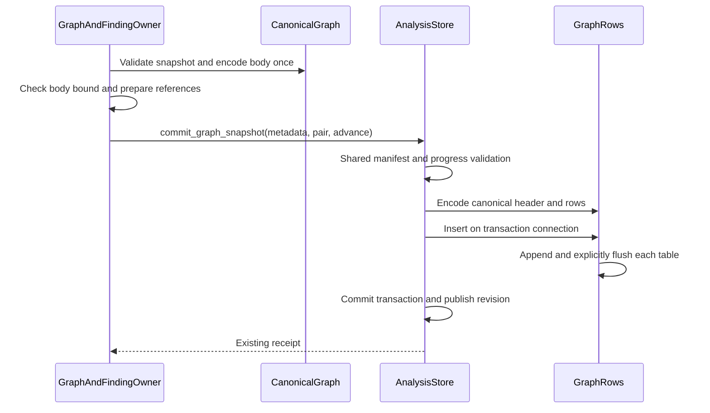

# Araphor Graph Commit Review

This guide covers the approved typed graph handoff and buffered row appends.
The implemented source head is `cffde410`. Focused verification is complete.
The final Rust procedure passes. The [production plan](../plans/araphor-production-dataflow-simplification.md)
defines the approved scope.

## Intended end state

Pass one typed graph snapshot between the graph owner and the store owner.
Produce canonical result bytes once. Encode only required header metadata.
Append the existing rows in the existing transaction. Preserve result bytes,
current canonical bytes, references, receipts, quotas, recovery, and notifications.
Accept only the current graph header. Reject noncanonical byte input.

## Implementation review flow

Each line below describes the implemented source. Focused qualification passes.

[CanonicalGraph::new](../../crates/araphor-data/src/analysis/graph_rows/mod.rs) The graph owner validates the typed snapshot and prepares its canonical body once
  -> [GraphAndFindingOwner::commit_bounded_window](../../crates/araphor-data/src/graph/commit.rs) the graph owner checks the body bound before context effects
  -> [AnalysisStore::commit_graph_snapshot](../../crates/araphor-data/src/analysis/progress.rs) the graph owner submits the prepared pair and empty-body commit metadata
  -> [AnalysisStore::commit_graph_inner](../../crates/araphor-data/src/analysis/progress.rs) the store applies shared manifest, witness, scope, and progress validation
  -> [GraphRows::encode_canonical](../../crates/araphor-data/src/analysis/graph_rows/mod.rs) row preparation reuses the existing canonical body
  -> [GraphHeader::encode](../../crates/araphor-data/src/analysis/graph_rows/header.rs) header preparation serializes only required metadata
  -> [GraphRows::insert](../../crates/araphor-data/src/analysis/graph_rows/mod.rs) the transaction appends rows and checks each flush
  -> [AnalysisStore::commit_progress](../../crates/araphor-data/src/analysis/progress.rs) the existing transaction commits references, usage, and progress
  -> [AnalysisResultReceiptV1](../../crates/araphor-data/src/analysis/progress.rs) the graph owner receives the existing receipt

The reading order follows these links. Read the constructor before the commit
entry. The constructor prepares canonical bytes before the existing body-size
check and context effects. The transaction remains the only graph durability
owner.

## Owners and input contracts

`GraphAndFindingOwner` derives and validates the snapshot. The owner sets the
window cursors, positions, notice revision, witness deadline, and previous
result ID. `CanonicalGraph::new` consumes this snapshot. The constructor
validates the snapshot and serializes its canonical body once. Private fields
keep the snapshot and body together. Borrowed accessors permit the existing
size check and context preparation without a large clone.

`AnalysisStore::commit_graph_snapshot` consumes the prepared pair and commit
metadata. The metadata body must be empty. The store fills that body from the
pair. A caller cannot supply an independent body for this typed entry. The
shared validation checks scope, input manifest, witnesses, expiry, context
references, and cursor movement before the transaction commits.

`GraphRows` owns the prepared header, subjects, relationships, and findings.
Canonical encoding uses the pair's bytes. Row
encoding preserves existing fields, ordinals, and storage charges. The value
lives through the transaction. Local value destruction does not remove durable
rows. Existing collection and recovery owners manage retained rows.

## Canonical and byte paths

The public byte entry remains `AnalysisStore::commit_result`. Graph byte input
uses `commit_graph`, which decodes and validates the supplied snapshot. The
byte entry requires exact current canonical JSON bytes. It rejects whitespace,
field-order changes, alternate escapes, and omitted optional fields. Both
entries use the same immutable retry checks and transaction owner. The current
format stores no layout column or tape.

## Header bytes and row appends

[HeaderMetadata](../../crates/araphor-data/src/analysis/graph_rows/header.rs)
borrows the snapshot and excludes only subjects, edges, and findings. The
serializer retains every other metadata field, including optional values.
The metadata-only `serde_json::Value` conversion applies the same recursive
key order for the current metadata. The CBOR envelope has six fields:
version 2, subject count, relationship count, finding count, canonical byte
length, and metadata bytes. The header has no separate source byte length.
Current canonical results have a 16 MiB bound. The graph window checks its
body bound before context effects and can select a smaller window. No complete
row tree is created for header extraction.

[GraphRows::insert](../../crates/araphor-data/src/analysis/graph_rows/mod.rs)
opens one scoped appender for each existing table. Each row method appends the
same typed parameters in the same order. Each appender explicitly flushes
before its scope ends. An append or flush error returns `AnalysisDatabase`
before transaction commit. Transaction rollback removes earlier flushed rows
and prevents progress, usage, witness, and receipt changes from that attempt.
Drop is not the flush error check.

Finding reads retain their existing 32 MiB budget for query batches and cached
headers. The 16 MiB canonical limit applies to one result. The finding owner
defines its read budget separately. A format-bound change must not reduce
header reuse or query batch capacity.

Read the row mappings in [subjects](../../crates/araphor-data/src/analysis/graph_rows/subjects.rs),
[relationships](../../crates/araphor-data/src/analysis/graph_rows/relationships.rs),
and [findings](../../crates/araphor-data/src/analysis/graph_rows/findings.rs).
Read [retained graph reads](../../crates/araphor-data/src/analysis/graph_rows/read.rs)
for byte reconstruction and row validation.

## Verification route and limits

Existing Rust cases in [native storage tests](../../crates/araphor-data/src/graph/tests/native_storage.rs)
cover immutable retry, rollback, exact encoding, and replacement removal.
[Encoding tests](../../crates/araphor-data/src/analysis/graph_rows/tests/encoding.rs)
cover canonical byte rejection, current metadata format, byte bounds, and
string encoding.
[Package reference tests](../../crates/araphor-data/src/analysis/graph_rows/tests/packages.rs)
cover retained package references. Recovery and corruption cases remain in
[current recovery tests](../../crates/araphor-data/src/analysis/graph_rows/tests/recovery.rs).

[graph_typed_commit_matches_bytes](../../crates/araphor-data/src/analysis/graph_rows/tests/packages.rs) checks body, header, rows, charges,
and receipt equality. `graph_typed_commit_rejects_metadata` checks metadata
rejection. `native_header_metadata_current_format` checks the current header
fields and omitted row arrays. `graph_native_commit_rollback` retains the existing rollback contract.
`graph_appender_constraint_rollback` checks rollback after an appender
constraint failure. `native_header_read_budget` checks that the cache retains
two headers whose combined charge exceeds one result's canonical bound.
Current row, canonical-byte, header, rollback, recovery,
and real crash cases pass. The combined focused Data qualification covers
71 distinct cases: 70 pass in the first run, and the corrected SQL parity
fixture passes in its exact retry. All 66 selected SDK cases pass.

Evidence: `/tmp/araphor-production-fresh-focused-araphor_data.log`,
`/tmp/araphor-production-final-focused.json`,
`/tmp/araphor-production-final-focused-araphor_data.log`, and
`/tmp/araphor-production-final-focused-araphor_analysis_sdk.log`.
The evidence records the tested working-tree source before the original
production commits `6b6d5ebb`, `efac8911`, and `78f80579`.

The first full Rust procedure at `78f80579` reports 616 Data passes, three
failures, and 19 ignored cases. The first attempt's logs and source capture
remain retained. Correction `9b3cbab8` restores the original 32 MiB finding
read budgets separately from the 16 MiB canonical result bound. Correction
`9f1f4ffa` fixes the retained-memory fixture. Correction `cffde410` makes the
query fixture use current canonical graph bytes.

Seven targeted correction cases pass in 214.15 seconds. The targeted clippy
check passes in 17.53 seconds. The unified workspace test build passes in
469.20 seconds. The source remains unchanged during those checks. Evidence:
`/tmp/araphor-production-targeted-fixes.json` and
`/tmp/araphor-production-targeted-fixes-tests.log`. The original graph bounds
case reproduces its default read-deadline failure in isolation, then passes
after the read-budget correction. These checks use the existing deadlines.
The committed source head is `cffde410`. The final Rust procedure passes with
90 outer test harnesses: 2,121 passed, zero failed, and 568 existing ignored.
The source remains unchanged. Total elapsed time is 1,666.48 seconds. Data has
620 passes and 19 ignored cases in 889.53 seconds. SDK has 66 passes. Control
has 188 passes and two ignored cases in 106.65 seconds. E2e has 191 passes and
528 ignored cases in 488.20 seconds. Node has 282 passes and one ignored case
in 7.46 seconds. These are ordinary functional run times. They do not prove
a speed change caused by this implementation.

Final evidence: `/tmp/araphor-production-final-ci-source.json`,
`/tmp/araphor-production-final-ci.log`, and
`/tmp/araphor-production-final-ci-report.json`.

**Done** for source implementation, focused qualification, the final Rust
procedure, and source-built native artifact parity qualification.

At `cffde410`, six Rust libraries build in 30.79 seconds under
`/tmp/araphor-production-native-current`. All 12 parent qualification cases
pass with zero failures and zero ignored cases in 255.98 seconds. The runner
records 256.00 seconds. Eight package cases execute actual stored ELF artifacts
and cover installation, lifecycle, checkpoint, overflow, errors, configured
caps, cancellation, revocation, expiry, and host-fault restart. Two Discovery
cases and two graph detector parity and large-input cases also pass. The
source remains unchanged.

The qualified native platform is Linux x86_64 GNU with glibc 2.39. This result
does not qualify another platform. Evidence:
`/tmp/araphor-production-native-qualification.json`,
`/tmp/araphor-production-native-qualification-build.log`, and
`/tmp/araphor-production-native-qualification-tests.log`.

No speed benchmark is run. No speed improvement
is measured by this guide. This change adds no kernel program, ABI, backend
trait, or long-lived runtime owner.
