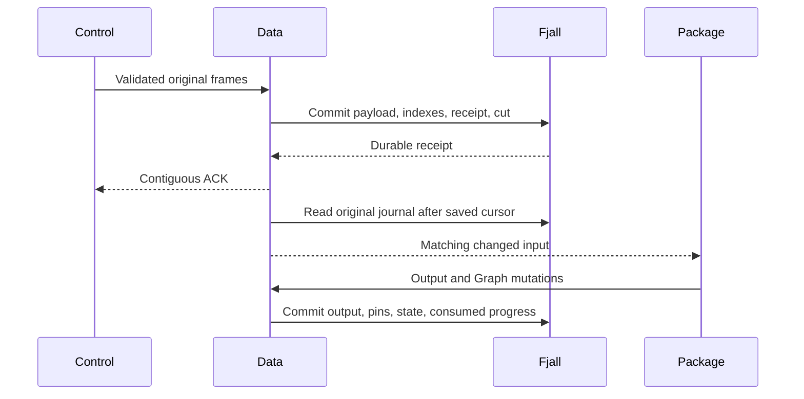

# Kernel evidence storage review

This guide covers the native collector storage replacement above commit
`9bd0c6704`. Data stores the Control kernel-evidence input in its existing
versioned Fjall database. The change does not add a collector framework.

## Intended end state

Data commits each accepted payload, its indexes, its source receipt, and its
Data cut in one transaction. Evidence has no Data segment file or second raw
archive. Subscriptions read the original native journal from saved positions.
Diagnostic output keeps its physical file owner. Node retry spools keep their
current owner.

## Implementation flow

[EvidenceIntakeOwner::receive_group](../../crates/mithril-control/src/evidence.rs) Control submits one validated kernel-evidence batch
  -> [DataWrite::evidence_batch](../../crates/araphor-data/src/analysis/native/events/intake.rs) Data checks identity, CPU, epoch, expiry, and overlapping original bytes.
  -> [DataWrite::evidence_batch](../../crates/araphor-data/src/analysis/native/events/intake.rs) Data accepts only the new cursor spans.
  -> [RawCommit::frame](../../crates/araphor-data/src/analysis/raw_segments.rs) Data stores one original RawCommit payload under source and batch-first cursor.
  -> [EventSpan](../../crates/araphor-data/src/analysis/native/events/mod.rs) Data stores one native span pointer for each accepted span.
  -> [EventBatch](../../crates/araphor-data/src/analysis/native/events/mod.rs) Data stores an ordered Data-position index to the same payload.
  -> [DataWrite::commit_locked](../../crates/araphor-data/src/analysis/native/mod.rs) Data commits payload, indexes, receipt, and Data cut in one native batch.
  -> [DataWrite::commit_locked](../../crates/araphor-data/src/analysis/native/mod.rs) Data publishes the committed view and signals input readers.

[Coordinator](../../crates/araphor-data/src/analysis/native/inputs.rs) An input subscription advances from its saved native cursor
  -> [Coordinator::records](../../crates/araphor-data/src/analysis/native/inputs/records.rs) Data reads the original committed Fjall batch.
  -> [InputChanges::raw_batch](../../crates/araphor-data/src/analysis/inputs/mod.rs) Data routes each original evidence payload once by source and logical position.
  -> [Coordinator::records](../../crates/araphor-data/src/analysis/native/inputs/records.rs) Data ignores supporting span and receipt writes as duplicate event triggers.
  -> [NativeStore::select_input](../../crates/araphor-data/src/analysis/native/events/read.rs) The package reads changes and native indexed state from its captured view.
  -> [NativeStore::commit_managed](../../crates/araphor-data/src/analysis/native/managed/commit.rs) Data commits package output, references, and consumed progress atomically.

[NativeStore::event_page](../../crates/araphor-data/src/analysis/native/events/read.rs) A retained read selects evidence
  -> [Events::lookup](../../crates/araphor-data/src/analysis/native/events/mod.rs) Data finds source/cursor spans or the ordered position index.
  -> [EventRead::check](../../crates/araphor-data/src/analysis/native/events/read.rs) Data checks current expiry authority before it returns historical payloads.
  -> [EventBatch::decode](../../crates/araphor-data/src/analysis/native/events/mod.rs) Data validates the immutable batch against its source and index metadata.
  -> [NativeStore::select_input](../../crates/araphor-data/src/analysis/native/events/read.rs) Data merges evidence and diagnostic ranges in original Data-position order.

[EvidenceRetentionOwner::select](../../crates/araphor-data/src/analysis/native/retention/selection.rs) Evidence expires after required consumers and witnesses release it
  -> [DataWrite::expire_events](../../crates/araphor-data/src/analysis/native/events/retention.rs) Data commits expiry, source floor, removal metadata, and payload tombstones together.
  -> [EventRead::check](../../crates/araphor-data/src/analysis/native/events/read.rs) Current and old application views cannot return expired payloads.
  -> [NativeStore::checkpoint](../../crates/araphor-data/src/analysis/native/backup/mod.rs) Fjall reclaims physical versions when its history and journal policies permit.

[NativeStore::open_leased](../../crates/araphor-data/src/analysis/native/mod.rs) Data reopens or restores a backup
  -> [NativeStore::decode_view](../../crates/araphor-data/src/analysis/native/mod.rs) Data admits native format 12.
  -> [RawJournal::diagnostics](../../crates/araphor-data/src/analysis/raw_segments.rs) Data rejects older formats and mixed legacy evidence files. Data does not convert or delete their payloads.
  -> [DataView::validate_events](../../crates/araphor-data/src/analysis/native/events/recovery.rs) Data validates live payloads, indexes, receipts, and epoch bindings.
  -> [NativeStore::open_leased](../../crates/araphor-data/src/analysis/native/mod.rs) The managed, attempt, and input owners validate references and saved progress.
  -> [NativeStore::backup](../../crates/araphor-data/src/analysis/native/backup/mod.rs) Evidence comes from the native checkpoint.
  -> [NativeStore::validate_bundle](../../crates/araphor-data/src/analysis/native/backup/files.rs) Only diagnostic payloads use the external segment inventory.

## Durable records

All records use Data's existing `data` branch. `DataR` is the public Data input
revision. Fjall owns its engine revisions and historical versions separately.

| Record | Key after `\0data/evidence/` | Value |
| --- | --- | --- |
| Payload | `payload/<source>/<batch-first-cursor>` | One original RawCommit frame with its checksum. |
| Span | `span/<source>/<span-first-cursor>` | Last cursor, batch-first cursor, DataR, and span slot. |
| Position | `position/<DataR>` | Source, batch-first cursor, intake, original spans, and frame size. |
| Expiry | `expired/<batch-DataR>` | Expiry DataR and expiry time. |

The position and span records contain metadata. They do not contain another
payload. A retry compares retained original bytes. An identical retry creates
no new native commit. A partial overlap stores only new spans. Each span keeps
its original DataR and dense ordinal. A source receipt advances only across a
complete accepted prefix. Pending input is durable, but Control does not ACK
past a gap.

The EXPIRED record is also the original journal item for a removal. The reader
checks its expiry DataR against the same committed Data head. The reader then
uses the retained position metadata to route the source, cursor range, and
intake time. Data does not create a second removal log.

## Read and commit ownership

The package analysis boundary does not change. Packages decide Graph mutations.
Data alone commits the transaction. The collector replacement does not change
kernel programs, their application binary interface, authentication, or Node
spool ownership.

A captured read holds an immutable native snapshot. Current expiry authority
still applies to that snapshot. Native event reads do not need the Diagnostic
file lock. A combined event and trace read selects the next original Data
position from the two owners.

A source/cursor page stops before an expired gap after retained records.
The page returns those records and sets `next_cursor` to the first expired
cursor. A read that starts in the gap returns `RetainedRangeExpired`. Current
expiry authority applies to a view captured before expiry. A new expiry during
a selected range read still returns an error.

[WitnessPin](../../crates/araphor-data/src/analysis/native/managed/references/pins.rs)
uses one interval codec with two explicit target kinds. Evidence targets name
an actual native batch DataR. Diagnostic targets name a real file ID. Evidence
uses `ref/evidence` and reverse `ref/batch` keys. Diagnostic key encoding stays
`ref/raw` and reverse `ref/segment`. No native batch has a synthetic file ID.

`evidence_bytes` counts unique pinned native frame bytes. `referenced_bytes`
counts unique referenced record bytes across both target kinds.
`extra_evidence_bytes` subtracts referenced Evidence record bytes from
`evidence_bytes`. Diagnostic witnesses do not enter that subtraction.
The segment fields count Diagnostic files. `charged_bytes` adds both kinds and
context bytes. These values describe protected logical input. They do not
measure native database allocation.

## Retention and recovery

Required processor positions, durable unconsumed input interests, and active
witness pins protect live batches. Expiry removes the live payload key and
keeps the accepted span and position metadata for gaps and historical proofs.
A current Complete scan omits expired batches. An intersecting historical
scan, point read, or saved raw read rejects the selected loss. Metadata reads
can still return retained headers.

Native expiry does not promise physical erasure. A retained package, context,
or catalogue root can keep old payload versions indefinitely. Fjall history
and journal collection control physical reclamation. Diagnostic file deletion
keeps its existing validation and unlink sequence.

The history owner retains the cut before the earliest live evidence batch.
This cut preserves the batch's before-image. A native checkpoint includes the
evidence payloads and metadata. The external backup inventory contains only
Diagnostic files. Format 11 is refused. There is no automatic format converter.
An operator must preserve the original store before a separate migration.

## Verification

The focused release run passes 293 Data integration tests in `native_events`,
`native_inputs`, `native_raw`, `native_backup`, `native_managed`, and `raw_index`.
The tests cover exact bytes and positions, partial overlaps, pending gaps,
CPU/epoch conflicts, native log resume, pins and reverse-index faults,
logical expiry, history, compaction, backup/restore, and Diagnostic file faults.

The follow-up review found a page regression at commit `9a4937584`.
The native reader discarded retained records before an expired gap.
The correction restores the retained prefix and its continuation cursor.
The [native_expiry_preserves_overlap_boundaries](../../crates/araphor-data/tests/native_events.rs)
test checks exact bytes, original positions, byte count, and continuation.
It checks current and captured views, forced compaction, and reopen.
The regression fails before the correction. After the correction, the focused
release run passes all 45 tests in `native_events`, `native_raw`, and `raw_index`.
Changed Rust files pass formatting. This review does not rerun the benchmark
or full CI.

The native Query integration passes 14 tests. The public Control intake
integration passes two tests. The existing owner example passes its partial
history test for both backends. The native production example also passes its
16,384-record smoke run. All 16 matched production benchmark runs pass.
The [measurement report](../research/results/araphor-kernel-evidence-2026-11-12.md)
records the baseline hashes, method, gains, and costs. Large cycle throughput
is 1.54 times the baseline. Large reopened scans are 3.55% slower. Retained disk
allocation increases from 37.94 to 54.42 MiB after forced maintenance.

The Data library test target reports 80 compile errors in old tests that refer
to removed DuckDB APIs and `graph_rows`. The filtered Control library test target
reports 36 compile errors in old Graph and activation tests. These tests are
not removed or disabled. The public intake test exercises the production
caller without those internal test modules.

The final `bash .github/scripts/verify-rust-ci.sh` command stops at
`cargo fmt --all --check`. It reports 123 files outside this change. Formatting
passes for the changed Rust files. The synthetic incident remains ignored.
