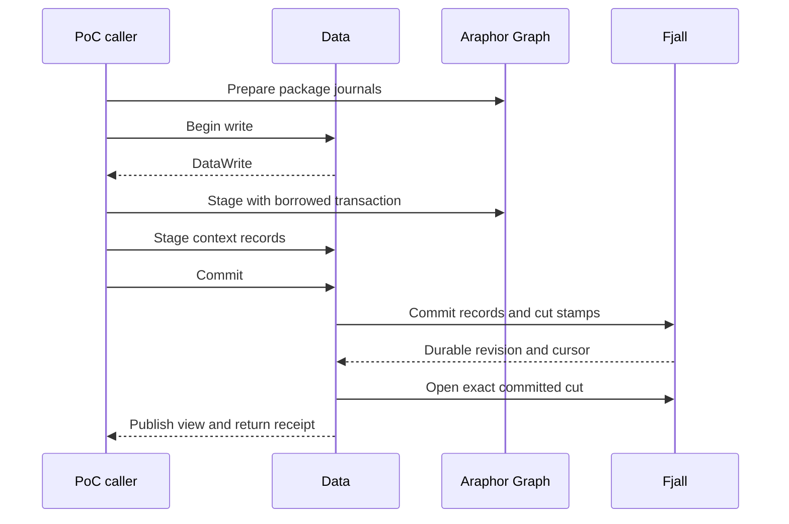
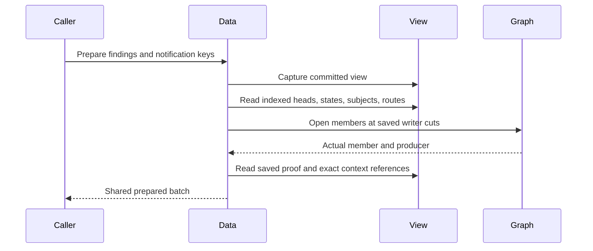
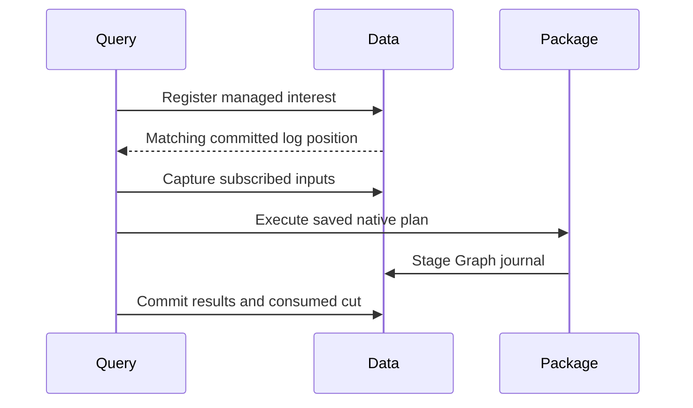
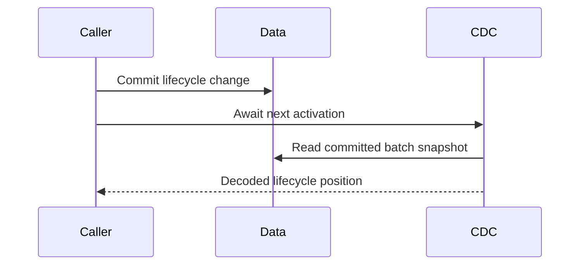
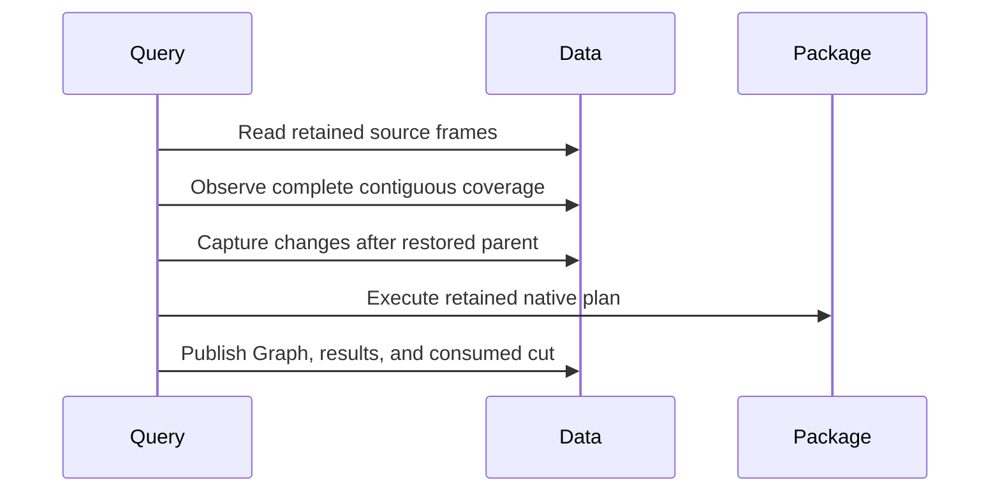

# Native Data transaction review

This guide covers the optional native Data owner, raw source storage, and its
package storage proof of concept (PoC) caller. The metadata source follows
Runtime `78e909526`. The combined raw view follows `f05f444e2`. The catalogue
source follows `b447c7142`. Qualified context admission follows `66bc190c5`. Managed admission and ordinary
start/stop follow `6087cbe9f`. Arrow source extraction follows `cc35d1c67`.
Production Data still uses DuckDB. Read the [integration research](../research/araphor-fjall-integration.md)
for the complete migration.

## Intended end state

Data owns the raw and metadata publication boundary. One native transaction
commits Graph, findings, state, references, and consumed positions. Original
logs supply selective subscription wakes. Native DataFusion plans read one
consistent view. The complete migration remains **Not done**.

## Native Graph point reads

[View::member](../../crates/araphor-graph/src/native/view.rs) resolves one
writer, relation, owner, and entity key through the existing dictionary.
It reads that membership once from the writer's selected snapshot. It uses
the same decoder, property cache, and memory leases as indexed traversal.
The returned member keeps its properties and leases after the view is dropped.

An unknown or deleted member returns `None`. Invalid relations, writer zero,
and malformed records return an error. Indexed traversal still returns an
error if an index refers to a missing member. The point API adds no scan,
persistent index, package rule, or DataFusion operator.

The [native Graph tests](../../crates/araphor-graph/src/native/tests.rs) compare
point and traversal fields. They check deleted membership with retained
dictionary IDs, selected historical writer cuts after compaction, property
lifetime, and corrupt membership/index records. All nine native cases pass:

```sh
cargo test --offline -p araphor-graph --features native-store --lib native::tests \
  --config /tmp/araphor-storage-release-override.toml
```

The local config selects the existing DuckDB build override for this workspace.
Selected-file formatting also passes. Evidence:
`output/araphor-fjall-migration-20261109/native-member-tests.log`.
Production integration and incident performance remain **Not done**.

## Review flow

[NativeStore::open](../../crates/araphor-data/src/analysis/native/mod.rs) Data opens the native metadata store
  -> [AnalysisLease::acquire](../../crates/araphor-data/src/analysis/connection.rs) Data takes the existing private-directory lease.
  -> [NativeStore::open](../../crates/araphor-data/src/analysis/native/mod.rs) Data restores the branch and checks durable history protection.
  -> [NativeStore::cut_view](../../crates/araphor-data/src/analysis/native/mod.rs) Data opens the exact stamped cut and checks its Data revision and store identity.
  -> [NativeStore::recover_raw](../../crates/araphor-data/src/analysis/native/source/raw.rs) Data recovers the original segments and their metadata controls.
  -> [NativeStore::view](../../crates/araphor-data/src/analysis/native/mod.rs) Data exposes the published immutable raw and metadata view.

[Live::apply](../../crates/araphor-graph/examples/storage_poc/live.rs) The existing package PoC prepares a step
  -> [View::prepare](../../crates/araphor-graph/src/native/prepare.rs) Araphor Graph prepares the package journals.
  -> [NativeStore::write](../../crates/araphor-data/src/analysis/native/mod.rs) Data serializes the writer and proposes the next Data revision.
  -> [Graph::stage](../../crates/araphor-graph/src/native/write.rs) Araphor Graph stages its records in the supplied transaction.
  -> [DataWrite::context](../../crates/araphor-data/src/analysis/native/context/admission.rs) Data admits and stages immutable context records and their heads.
  -> [Live::apply](../../crates/araphor-graph/examples/storage_poc/live.rs) The PoC stages its synthetic step metadata and consumed cursor.
  -> [DataWrite::commit](../../crates/araphor-data/src/analysis/native/mod.rs) Data commits all records and exact cut stamps in one native batch.
  -> [DataWrite::commit](../../crates/araphor-data/src/analysis/native/mod.rs) Data publishes the matching metadata view after durable commit.

[Walker::start](../../crates/araphor-graph/examples/storage_poc/cdc.rs) The existing journal walker reads committed source and Graph changes
  -> The native feed can wake after engine commit and before Data publishes its view.
  -> The PoC waits for `DataWrite::commit` to return before it consumes results.
  -> The production routing barrier remains **Not done**.

[DataWrite::rollback](../../crates/araphor-data/src/analysis/native/mod.rs) A step rolls back
  -> [BranchWriteTransaction::rollback](../../fjall/src/versioned/write.rs) The engine discards all staged records.
  -> [NativeStore::view](../../crates/araphor-data/src/analysis/native/mod.rs) The published view and Data revision stay unchanged.

[DataWrite::commit](../../crates/araphor-data/src/analysis/native/mod.rs) A native commit or publication fails
  -> [NativeStore::check](../../crates/araphor-data/src/analysis/native/mod.rs) Data stops new captures and writes.
  -> [NativeStore::open](../../crates/araphor-data/src/analysis/native/mod.rs) Reopen restores confirmed durable state.

## Owners and coordinates



`Live` is the PoC caller. Package code returns journals and state. Package code
receives no `NativeStore` or `DataWrite`. Graph receives a borrowed native
transaction and cannot consume that transaction to commit it.

`NativeStore` owns the engine, live branch, Data writer lock, store identity,
readiness, published view, and directory lease. `DataWrite` holds the writer
until commit and publication finish. A reader clones an `Arc<DataView>` under
a short read lock. A reader does not wait for the Data writer.

Initialization publishes Data revision 0. The first ordinary commit uses
revision 1. The proposed Data revision becomes consumed only on commit. An identical
context retry returns the original reference. That retry alone creates no
batch and does not advance Data progress.

The PoC's sparse Graph revisions remain fixture coordinates. Its `cut/` records
map those coordinates to allocated Data revisions. Data's `\0data/cut/` records
map allocated revisions to exact native cuts. Graph layer cut stamps remain
native cuts. The PoC does not inject its fixture numbers into Data's allocator.
Graph row origins also remain fixture coordinates. This caller does not qualify
production Data origin or managed reference validation.

The PoC's source, output, and checkpoint writes use this Data owner. Current
reads use its published view. Original journal readers remain unchanged.
The fixture's synthetic source records do not qualify production raw admission
or managed authority.

## Physical context records

The context participant reuses `AnalysisContextVersionV1` and
`AnalysisContextRefV1`. Its original qualification covered physical identity,
exact retries, and expected heads. The qualified admission extension is below.
Managed lifecycle and complete production admission remain **Not done**.

The `\0data/key/` dictionary interns exact serialized identities. Long keys use
linked fragments at the engine key width. No content hash selects identity.
`\0data/C` records hold immutable versions. `\0data/H` records point to the
highest owner revision for one context identity. Native snapshots select their
historical values. Value fragments use the engine value width.

The first caller stores its existing package state and captured frontier as
context versions. It removes the previous PoC `S`, `T`, and `H` records. State,
frontier, Graph, and cursor assertions retain their original meaning.

This owner currently retains the initial Data cut through future cuts. Startup
rejects a store whose required protection is absent. Data retention floors,
capacity accounting, and collection policy are not implemented here.

## Verification and limits

[Native Data tests](../../crates/araphor-data/tests/native_store.rs)
cover rollback, exact retries, context heads, joint Graph/context/progress
batches, exact stamps, captured readers during a write, long binary keys,
invalid commit recovery, compaction, reopen, and interrupted initialization.
Five public-API integration cases pass for the final source. See the
[qualification](../../crates/araphor-graph/examples/storage_poc/results/native-data-2026-11-09/README.md)
for commands, exact source hashes, and limits.

The unchanged combined and stable PoCs supply the cross-crate caller checks.
The final source passes 128 stable cycles, 640 historical package evaluations,
320 historical views, and eight combined runs. The complete comparison interval
includes Data publication and context-version records. The reported `output_sync_s`
field includes the Data commit and publication call; it does not isolate sync
time. Stable-key checks cover Graph indexes and context heads. They do not
assert a fixed count of immutable context versions.

At the original metadata qualification, raw-prefix publication, read admission
and memory budgets, qualified context checks, managed source authority, complete
result families, production log routing, notification batching, retention, and
backup were **Not done**. Later owner qualifications are below.
The earlier Data unit-test target cannot build its unchanged legacy fixtures.
Clippy stops on unchanged legacy `unwrap` and `expect` calls. These checks
remain **Not done**. The incident performance test and full workspace CI have
not run for this change. No incident speedup is established.

## Data schema initialization

[AnalysisStore::open](../../crates/araphor-data/src/analysis/mod.rs) Data creates its current store
  -> [Relations::schema](../../crates/araphor-data/src/analysis/graph_rows/store/relations/schema.rs) One factory assembles the existing Data and Araphor Graph schemas.
  -> [Relations::SCHEMA](../../crates/araphor-data/src/analysis/graph_rows/store/relations/schema.sql) The common Graph schema also creates the canonical fact index.
  -> [Relations::validate_tables](../../crates/araphor-data/src/analysis/graph_rows/store/relations/schema.rs) Validation compares all Graph columns, constraints, and views against that factory.

The previous expected schema omitted seven engine tables and the fact-index
table. A new Data store failed before raw operations. The correction uses the
same table definitions and keeps the full comparison. The
[public regression](../../crates/araphor-data/tests/store_schema.rs) passes
open, data validation, and reopen. An unexpected Graph table still makes reopen
fail. The command is `cargo test --offline -p araphor-data --features test-fixtures --test store_schema`.
The local check also enabled `native-store` and used the recorded link override.
This correction establishes no performance gain or production engine migration.

## Shared raw metadata

[RawJournal::append](../../crates/araphor-data/src/analysis/raw_segments.rs) Data accepts a raw append
  -> [RawJournal::prepare_index](../../crates/araphor-data/src/analysis/raw.rs) Data builds the next metadata root before file I/O.
  -> [RawIndex::prepare](../../crates/araphor-data/src/analysis/raw/index.rs) The next root shares unchanged ordered tree paths.
  -> [RawJournal::append](../../crates/araphor-data/src/analysis/raw_segments.rs) The existing segment append and sync complete.
  -> [RawJournal::append](../../crates/araphor-data/src/analysis/raw_segments.rs) Data publishes the prepared root after the durable checks.

[AnalysisStore::read_tables_inner](../../crates/araphor-data/src/analysis/extraction.rs) A reader needs source range metadata
  -> [RawIndex::source_state](../../crates/araphor-data/src/analysis/raw/index.rs) The reader clones the root under the raw lock, releases the lock, and scans the captured ranges.
  -> [RawIndex::selection_revision](../../crates/araphor-data/src/analysis/raw/index.rs) Dependency reads use the same capture rule.

`RawJournal` owns one `RawIndex` for sources, entries, ranges, and the latest raw
revision. The three maps use `rpds` ordered trees with shared ownership.
Segments, current paths, file usage, allocation, directory stamps, and admission
budgets remain in `RawJournal`. A captured root contains metadata, not payloads
or open files. File selection still resolves segment IDs through the live owner
and takes the existing finite read lease. Captured metadata does not prevent
retention from deleting raw files.

The existing raw format, append/sync boundary, SQL projection, recovery, and
admission remain in use. The Arrow inputs and DataFusion interfaces do not
change. No extra journal, payload archive, or Fjall write is added for an append.
The complete production raw/native Data view and CDC routing remain **Not done**.

The [raw integration cases](../../crates/araphor-data/tests/raw_index.rs) use the
actual shared roots through a `test-fixtures` helper. Public Data operations
check out-of-order input, retries, conflicts, receipt changes, selection,
positions, rotation, retention, reopen, and failed-append recovery. The helper
is absent from the normal production API. No raw latency gain is established.

The [qualification](../research/results/araphor-raw-index-2026-11-09.md) records
nine passing integration cases, the feature-off build, and the unchanged
incident. Its single timing run does not establish a gain. Production remains
on DuckDB. Clippy stops on two unchanged legacy calls; full CI does not run
during iteration.

## Combined native and raw view

[NativeStore::accept_validated_batch](../../crates/araphor-data/src/analysis/native/source/raw.rs) Data receives an Evidence batch
  -> [ValidatedEvidenceBatchV1::validate_identity](../../crates/araphor-data/src/analysis/mod.rs) The shared validator checks identity and frame bounds.
  -> [RawJournal::prepare](../../crates/araphor-data/src/analysis/raw.rs) The existing owner checks source binding, overlap, and exact retry bytes.
  -> [RawJournal::append](../../crates/araphor-data/src/analysis/raw_segments.rs) The existing segment append and durable sync finish.
  -> [NativeStore::accept_validated_batch](../../crates/araphor-data/src/analysis/native/source/raw.rs) Data publishes the new global revision and raw root with the previous native snapshot.

[NativeStore::accept_validated_coverage](../../crates/araphor-data/src/analysis/native/source/coverage.rs) Data receives a coverage report
  -> [DataWrite::coverage](../../crates/araphor-data/src/analysis/native/source/coverage.rs) Data checks the bound CPU, source epoch, report revision, and exact retry bytes.
  -> [DataWrite::coverage](../../crates/araphor-data/src/analysis/native/source/coverage.rs) Data stages the report, receipt, binding, and history index.
  -> [DataWrite::stage_raw](../../crates/araphor-data/src/analysis/native/source/raw.rs) Data stages changed raw receipt baselines, protected ends, and the allocator floor when raw input is pending.
  -> [DataWrite::commit](../../crates/araphor-data/src/analysis/native/mod.rs) One native batch commits these records and the exact Data cut.
  -> [DataWrite::commit](../../crates/araphor-data/src/analysis/native/mod.rs) Data publishes the matching raw root and native snapshot.

[NativeStore::read_at](../../crates/araphor-data/src/analysis/native/mod.rs) A reader selects global revision R
  -> [NativeStore::cut_view](../../crates/araphor-data/src/analysis/native/mod.rs) Data opens the last metadata cut M at or before R.
  -> [NativeStore::read_at](../../crates/araphor-data/src/analysis/native/mod.rs) The view retains the shared raw root and the immutable bound R.
  -> [DataView::source_receipt](../../crates/araphor-data/src/analysis/native/source/mod.rs) The reader combines the baseline at M with source ranges visible through R.
  -> [RawJournal::freeze_page](../../crates/araphor-data/src/analysis/raw/page.rs) The raw owner validates and freezes the selected ranges under a finite maintenance lease.
  -> [RawPage::read](../../crates/araphor-data/src/analysis/raw/page.rs) The shared page reader returns original records and positions with the existing page limits and cancellation.

[NativeStore::open](../../crates/araphor-data/src/analysis/native/mod.rs) Data reopens the store
  -> [NativeStore::recover_raw](../../crates/araphor-data/src/analysis/native/source/raw.rs) Data checks protected segment ends against decoded entries through the metadata head.
  -> [NativeStore::recover_raw](../../crates/araphor-data/src/analysis/native/source/raw.rs) Data restores receipt baselines and the nonzero allocator floor.
  -> [NativeStore::open](../../crates/araphor-data/src/analysis/native/mod.rs) Data publishes the greater of the recovered raw and metadata revisions.

The native metadata head can be less than the global Data revision. A metadata
write allocates global revision plus one but validates the previous metadata
head. Raw-only input adds no Fjall batch. Historical capture shares the raw
index; it does not rebuild a prefix map. Historical source receipts use visible
ranges and their selected native baseline. They do not clamp the latest cursor.
The captured revision and store identity have read-only accessors.

The source API includes source binding, receipt, status, and exact coverage
reads. The coverage history index supports the existing read contract. The
index is not a subscription change log. Production log-reader routing remains
**Not done**. `AnalysisStore` and `NativeStore` use the same page owner and
finite `RawRead` leases. Captured views contain no raw file handles.

The [native raw cases](../../crates/araphor-data/tests/native_raw.rs) check raw,
metadata, and raw revision order; exact original positions; no native batch for
raw-only input; joint coverage and raw-control publication; historical pending
ranges; exact retries; CPU and epoch conflicts; same-batch coverage bounds;
malformed history records; append and commit failure; compaction; and reopen.
Configured limits, required-input and witness accounting, diagnostics, lifecycle,
retention, backup, and production cutover remain **Not done**. The native owner
supports its current default-limit mode only. No incident gain follows from
this integration.

## Package and definition catalogue

[NativeStore::install_package_image](../../crates/araphor-data/src/analysis/native/packages/image.rs) Data receives a checked image
  -> [PackageRevisionV1::from_bundle](../../crates/araphor-data/src/analysis/packages/model.rs) Data obtains the existing immutable artifact rows.
  -> [NativeStore::install_package_image](../../crates/araphor-data/src/analysis/native/packages/image.rs) Data checks the retained image digest.
  -> [DataWrite::stage_packages](../../crates/araphor-data/src/analysis/native/packages/mod.rs) Data stages missing rows and checks dependencies with indexed reads.
  -> [NativeStore::install_package_image](../../crates/araphor-data/src/analysis/native/packages/image.rs) Data stages the installed image and latest pointer.
  -> The admission callback must succeed before Data commits.
  -> An unchanged retry returns its original revision without a new batch.

[NativeStore::admit_definition](../../crates/araphor-data/src/analysis/native/packages/definitions.rs) Data receives a resolved definition
  -> Data validates the definition and its exact installed image pins.
  -> [DefinitionRecord::find](../../crates/araphor-data/src/analysis/native/packages/definitions.rs) Data compares the latest value first and scans one name's history only for an older retry.
  -> Data stages the canonical definition bytes and latest pointer.
  -> The admission callback must succeed before Data commits.
  -> An older exact retry returns its original revision and leaves the latest pointer unchanged.

[DataView::validate_catalogue](../../crates/araphor-data/src/analysis/native/packages/recovery.rs) Data reopens the store
  -> Data checks artifact contracts, dependency closures, image digests, and definition pins.
  -> Data checks record revisions against the native metadata head.
  -> Data rejects duplicate canonical definitions for one tenant and name.
  -> Data checks latest pointers against the retained records before publication.

`DataView` supplies exact package revisions, installed or pinned images, and
latest or exact definition revisions. Native snapshots retain historical values.
The shared `Records` owner interns semantic identities and fragments long keys
at the engine key width. Definition names have no added size limit. Package
artifacts use the existing binary MessagePack setting. The decoder also accepts
the previous integer-array byte encoding. Identity encoding and canonical
definition bytes do not change.

Manual `install_package` uses the same validator as `AnalysisStore`. Checked
image admission keeps its existing contract and does not acquire the manual
name-length limits. Installation and definition admission create no instance
or subscription. At that qualification, context admission, lifecycle,
collection, uninstall reclamation, capacity accounting, and production routing
were **Not done**. The context admission extension is below.
The [catalogue cases](../../crates/araphor-data/tests/native_packages.rs) cover
these admission and read boundaries. They do not prove production cutover or
notification latency.

## Qualified context admission

[NativeStore::commit_contexts_guarded](../../crates/araphor-data/src/analysis/native/context/admission.rs) Data receives context values
  -> Data checks the existing identity and validity bounds.
  -> [DataWrite::admit_context](../../crates/araphor-data/src/analysis/native/context/admission.rs) An exact retry checks its canonical fact index and retained proof before returning its original reference.
  -> [VerifiedPackages::check_context](../../crates/araphor-data/src/analysis/context/provenance.rs) A new or conflicting input checks package provenance against the retained artifact closure.
  -> [DiscoveryContextRevisionV1::validate_history](../../crates/araphor-data/src/discovery/context.rs) A new imported document checks staged history across lifetimes.
  -> [DataWrite::record](../../crates/araphor-data/src/analysis/native/context/record.rs) A new value checks the expected head and stages its immutable record.
  -> Data stages the canonical fact index and required scope pointers in the same transaction.
  -> The guard callback must succeed before Data commits the batch.

[NativeStore::intern_contexts_guarded](../../crates/araphor-data/src/analysis/native/context/admission.rs) Data interns qualified values
  -> Data preserves the existing owner allowlist.
  -> Data compares values in one tenant, owner, and lifetime scope.
  -> Data selects the first matching entity in byte order.
  -> Each input sees prior values staged in the same batch.
  -> Ordinary context commits also update this scope index.

`C` and `H` retain context values and maximum owner-revision heads. `K` stores
the canonical fact index for a context. `V` stores scoped context IDs, without
copying bodies into keys. `M` selects the latest imported document across
lifetimes. Recovery checks these indexes, retained package proof, imported
history, and native metadata revision bounds before publication.

The native and current owners share `FactRecord::from_context`,
`PackageRevisionV1::closure`, and `VerifiedPackages::check_context`. These
helpers use the existing DTOs and private read closures. They add no storage
trait or SQL adapter. A native context getter preserves the current read
contract; it does not add a canonical fact lookup to every read.

Notification admission uses the existing obligation and approved-route
validators. The fixed obligation lifetime permits the existing `H` pointer to
serve notification CAS and latest-state reads. Finding/concern lookups and the
notification effect protocol remain separate migration work.

Borrowed `DataWrite::context` and `contexts` stage changes but cannot roll back
one failed operation in isolation. Discard the transaction after a staging
error, as required by the existing Graph participant. `NativeStore` wrappers
discard a failed batch automatically. Empty and unchanged guarded calls still
run the callback and create no batch.

The [context cases](../../crates/araphor-data/tests/native_context.rs) use the
public native APIs and a real current-owner caller for the shared validators.
This admission scope adds no raw-record or witness requirement. Configured
capacity, managed attempts/results, source-range fact reads, notification
lookups/effects, collection, and production routing remain **Not done**.

## Managed admission and start/stop

[NativeStore::admit_managed](../../crates/araphor-data/src/analysis/native/managed/admission.rs) Data receives a managed specification and grant
  -> [ManagedSpec::validate](../../crates/araphor-data/src/analysis/managed/model.rs) Data checks the actual manifest and destination contract.
  -> [ManagedSpec::check_images](../../crates/araphor-data/src/analysis/managed/contract.rs) Data checks the exact retained definition, image, export, and implementation pins.
  -> [ManagedSpec::graph_declarations](../../crates/araphor-data/src/analysis/managed/graph/admission.rs) Data reads the Graph declarations from the called package models.
  -> [DataWrite::admit_managed_graph](../../crates/araphor-data/src/analysis/native/managed/graph/mod.rs) Data stages new opaque Graph mappings and calls the generic Graph installer in the same transaction.
  -> [DataWrite::admit_managed](../../crates/araphor-data/src/analysis/native/managed/admission.rs) A new instance requires its exact images to remain installed.
  -> Data stages an immutable specification and admission scope, the current authority and lifecycle, and empty call heads.
  -> The callback must succeed before Data commits.
  -> An exact retry checks retained pins, returns the current instance, and stages no writes.

[NativeStore::set_managed_running](../../crates/araphor-data/src/analysis/native/managed/lifecycle.rs) The execution owner starts or stops an admitted instance
  -> [DataWrite::change_managed](../../crates/araphor-data/src/analysis/native/managed/lifecycle.rs) Data checks the expected lifecycle and rejects a removed instance.
  -> Data updates the running state and active index in the same transaction.
  -> The callback must succeed before Data commits.
  -> A current no-op runs the callback and creates no batch.
  -> A stale lifecycle conflicts, including a stale no-op.

[NativeStore::stop_managed](../../crates/araphor-data/src/analysis/native/managed/lifecycle.rs) The execution owner fences a captured instance
  -> Data checks the specification, grant, generation, and lifecycle.
  -> Data preserves the existing rule that stop does not require equal captured progress or running state.
  -> Data advances the lifecycle for an instance that has never started.

[NativeStore::lease_managed](../../crates/araphor-data/src/analysis/native/managed/lifecycle.rs) One execution owner takes the host lease
  -> The lease retains the store and its directory lease.
  -> Dropping the host lease releases the host claim.
  -> Another host cannot take the claim while the lease is held.

[DataView::validate_managed](../../crates/araphor-data/src/analysis/native/managed/recovery.rs) Data reopens managed records
  -> Data checks immutable versions, admission scopes, current authority, revision bounds, call heads, and the exact active index.
  -> Data compares Graph mappings with the union of retained manifests.
  -> [Graph::check_installation](../../crates/araphor-graph/src/native/installation.rs) Araphor Graph checks declarations, endpoints, writer ownership, and the exact installation indexes without writes.
  -> Data rejects absent or inconsistent records before it publishes the recovered view.

`Z` holds immutable managed versions. Named MessagePack fields preserve the
actual definition source enum. `J` holds mutable instance fields without a
second specification. `Q` holds stable call heads. `B` indexes active instances.
`G` holds Data's package-call Graph mappings. The existing semantic dictionary
allocates these identities and fragments long instance names. No branch per
instance is added. Generic Graph records retain no package or lifecycle data.

`DataView` reads exact instances and immutable versions. `active_managed` reads
the active index and returns the captured global Data revision. Native metadata
bounds remain separate from a later raw-only revision. The start/stop APIs keep
the existing lifecycle rules and add no pending-attempt condition.

Borrowed `DataWrite::admit_managed` has the same discard-on-error rule as context
and Graph staging. A wrapper drops a failed batch. The
[managed tests](../../crates/araphor-data/tests/native_managed.rs) cover actual
package and definition DTOs, guarded rollback, same-transaction retries, joint
Graph/context journal contents, retained pins when the image is no longer installed, lifecycle
CAS, long names, tenant isolation, host leases, raw interleaving, historical
reads, compaction, reopen, and missing-record rejection. One case uses the
current DuckDB owner to check the shared validation helpers.

Result at admission qualification: **Done for native managed admission and
ordinary start/stop**. Later attempt and result owners are below. Read
[native selected-result publication](#native-selected-result-publication) for
actual checkpoints, references, and consumed progress. Renewal, candidate version
admission, removal, production activation, CDC routing, package execution,
notification batching, and the incident latency targets remain **Not done**.
Graph installation checks alone do not qualify complete layer/member recovery.
Configured capacity, retention, and backup also remain **Not done**.

## Native Arrow source extraction

[NativeStore::read_tables_at](../../crates/araphor-data/src/analysis/native/extraction/mod.rs) A caller supplies one captured Data view
  -> Data checks the selection, projection, limits, store identity, and requested table owners.
  -> Data holds the existing finite maintenance lease for the read.
  -> [NativeStore::select_sources](../../crates/araphor-data/src/analysis/native/extraction/source.rs) Data selects Evidence sources from the captured raw index and native receipts.
  -> [DataView::source_header](../../crates/araphor-data/src/analysis/native/source/mod.rs) Data reads the actual receipt, coverage report, and pending gaps through the captured Data revision.
  -> [RawScan::read](../../crates/araphor-data/src/analysis/extraction/raw.rs) The shared scanner reads original raw ranges and builds the requested Arrow columns.
  -> [ContextRead::capture](../../crates/araphor-data/src/analysis/native/extraction/context.rs) Data reads selected context headers, verifies retained package proofs, and builds context Arrow columns.
  -> [Capture::finish](../../crates/araphor-data/src/analysis/extraction/tables/mod.rs) The existing builder returns actual rows, positions, witnesses, references, and source metadata.

[DataWrite::index_context](../../crates/araphor-data/src/analysis/native/context/index.rs) Data admits a new immutable context
  -> One transaction stages the context, its head, a tenant header, and an owner header.
  -> Header keys contain the admission Data revision and context ID as a tie breaker.
  -> An exact retry stages no new headers.
  -> Recovery checks every context/header pair and both exact index sets.

The header values contain context references and no context bodies. Owner
identities use the existing scoped dictionary and long-key fragments. A change
read uses native revision bounds. An owner filter uses its own index prefix.
Complete reads sort semantic context keys; change reads sort admission revision
and then semantic key. Dictionary allocation order does not set row order.
Exact context keys use direct lookups. The retained package proof cache avoids
repeated artifact checks. Generic context reads add no fact-index lookup.

[Records::charged_payload](../../crates/araphor-data/src/analysis/native/records.rs)
admits the assembled payload size before allocation. The read releases temporary
prefix, header, and decoded-record charges after their storage is dropped.
Arrow buffers, references, coverage reports, and pending gaps remain charged.
Cancellation and existing key, input, scan, and page limits stay active.

Native physical format 4 persists logical schema 41 and recovery epoch 1.
`DataView::meta` returns these saved values and the captured global Data revision.
Ordinary reopen preserves the recovery epoch. Older prototype native formats
are rejected. This does not convert a DuckDB directory.

Source header revisions identify the source's last visible raw or coverage
commit. The current DuckDB projection can stamp several sources with one later
group revision. The native owner does not copy that projection artifact.
The [extraction tests](../../crates/araphor-data/tests/native_extraction.rs)
compare actual Arrow rows, ordinals, receipts, gaps, reports, witnesses, and
references. They check exact native source revisions separately.

This API currently reads Evidence, coverage, and the admitted context table
families. A requested unported result, trace, Graph-state, or notification
family returns `Unsupported`. Native retention has no mutation API yet, so
this read does not qualify expired or removed raw ranges. Prior-result restore
and the atomic Selected boundary are now described
[below](#native-selected-result-publication). Production provider binding and
original-log subscription routing remain **Not done**.

## Native capture and terminal attempts

Read the owners in this order:

1. [capture.rs](../../crates/araphor-data/src/analysis/native/managed/capture.rs)
   captures one Data view, reads actual Arrow tables, and uses the existing
   `ManagedCapture::seal` and source-frame seal. It reads the saved call heads
   and completion head. The current owner loads actual saved call checkpoints
   and successful source parents as described below.
2. [attempts.rs](../../crates/araphor-data/src/analysis/native/managed/attempts.rs)
   checks authority, lifecycle, completion, input revisions, and retained
   references. Registration stages the immutable request/capture and pending
   index together. A live claim belongs to that store's watch channel.
3. [terminal.rs](../../crates/araphor-data/src/analysis/native/managed/terminal.rs)
   stages terminal state, pending removal, completion indexes, and failure
   status together. A qualifying Denied outcome also suspends the instance.
   Stop and join execution before this call. A loaded pending attempt has no
   live claim. An exact terminal retry checks the callback and stages no writes.
4. [status.rs](../../crates/araphor-data/src/analysis/native/managed/status.rs)
   reads saved outcomes and failure state. Completed outcomes and successful
   consumed progress are separate values.
5. [attempt_recovery.rs](../../crates/araphor-data/src/analysis/native/managed/attempt_recovery.rs)
   checks the captured contract, exact pending/outcome index sets, historical
   completion, and required failure records. Startup cancels current-generation
   pending frontier attempts in one genuine Data commit. Other pending attempts
   keep the existing behavior.

[revisions.rs](../../crates/araphor-data/src/analysis/native/revisions.rs) stores
last-change heads for capture checks. The raw owner derives event and new-binding
heads from its original committed entries. Coverage and contexts stage their
heads in their existing metadata transaction. Recovery merges saved receipts
before it derives new bindings from the later raw tail. These heads are not
subscription cursors or a copied CDC log. Original-log routing remains open.

The [managed tests](../../crates/araphor-data/tests/native_managed/attempts.rs)
check actual rows, callback rollback, live claims, parallel manual attempts,
captured cuts, completion history, failure suspension, and corrupt recovery.
The [raw tests](../../crates/araphor-data/tests/native_raw/freshness.rs) check
coverage-first binding recovery with and without a later metadata commit.
Read the [qualification](../research/results/araphor-native-attempts-2026-11-09.md)
for commands and remaining limits. Production still uses DuckDB.

## Shared package publication validation

Read [packet.rs](../../crates/araphor-data/src/analysis/managed/packet.rs),
[prepare.rs](../../crates/araphor-data/src/analysis/managed/prepare.rs), and
[selected.rs](../../crates/araphor-data/src/analysis/managed/selected.rs) for the
existing SDK output, checkpoint, and selected-result checks. The shared functions
receive actual managed attempts, outputs, and memory budgets.

Read [source/derived.rs](../../crates/araphor-data/src/analysis/managed/source/derived.rs)
and [source/selection.rs](../../crates/araphor-data/src/analysis/managed/source/selection.rs)
for per-call and selected attribution. The backend supplies exact saved-fact
reads and retains the existing context import owner.

Read [graph/domain.rs](../../crates/araphor-data/src/analysis/managed/graph/domain.rs)
and [graph/domain/contexts.rs](../../crates/araphor-data/src/analysis/managed/graph/domain/contexts.rs)
for canonical evidence and context checks. The caller supplies the expected
attempt tenant and actual captured basis. The generic Graph engine receives no
package policy.

Read [execution.rs](../../crates/araphor-data/src/analysis/managed/execution.rs)
for retained output construction. The caller promotes this cache only after the
durable commit. [commit.rs](../../crates/araphor-data/src/analysis/managed/commit.rs)
retains the production transaction. This extraction does not qualify native
successful publication. Read the
[qualification](../research/results/araphor-shared-publication-2026-11-09.md)
for the passing unchanged incident and its measurement limits.

## Native Graph snapshot validation

[Graph::validate](../../crates/araphor-graph/src/native/validation.rs) checks one
snapshot through native Graph codecs and indexes. Its property pass groups row
requirements by chunk and decodes each Arrow chunk once. Temporary chunk memory
is released before the next chunk. Native commit cuts remain separate from
logical revisions.

[Graph::layers](../../crates/araphor-graph/src/native/mod.rs) exposes the existing
layer records through a fallible iterator. The iterator and validator use the
same identity decoder. The public
[Journal iterators](../../crates/araphor-graph/src/journal.rs) expose existing
edited identities, final rows, and cleared owners without a storage write.

Read the [tests](../../crates/araphor-graph/src/native/tests/validation.rs) and
[qualification](../research/results/araphor-native-graph-validation-2026-11-09.md)
for the exact check scope. Data's historical receipt and Selected publication
checks are below. Production activation and incident latency remain **Not done**.

## Native selected-result publication

Read these owners in order:

1. [prepare.rs](../../crates/araphor-data/src/analysis/native/managed/prepare.rs)
   checks the live attempt, actual SDK returns, source attribution, change bases,
   context facts, and memory reservations. The shared packet and domain checks
   keep the current production contracts.
2. [graph/transaction.rs](../../crates/araphor-data/src/analysis/native/managed/graph/transaction.rs)
   holds each package's journal. A dependent call can read an earlier journal
   from the same attempt. The package selects mutations. No package commits.
3. [graph/publication.rs](../../crates/araphor-data/src/analysis/native/managed/graph/publication.rs)
   prepares actual journals in manifest order. It checks consumed predecessor
   journals, historical read receipts, canonical evidence, and disclosure floors.
   Generic Araphor Graph prepares and stages its own records.
4. [commit.rs](../../crates/araphor-data/src/analysis/native/managed/commit.rs)
   rechecks the attempt and context authority under Data's writer. One batch
   saves the receipt, call and selected records, checkpoints, context imports,
   raw/context/dependency references, Graph changes, findings, call heads,
   completion, and consumed progress.
5. [DataWrite::commit_published](../../crates/araphor-data/src/analysis/native/mod.rs)
   commits exact native stamps and publishes the matching Data view. It promotes
   the prepared execution cache before it sends the availability wake. This
   watch is not original-log subscription routing.

[graph/projection.rs](../../crates/araphor-data/src/analysis/native/managed/graph/projection.rs)
stores references to native Graph properties. It checks public relationship
and finding values across writers in each affected group. It stores no second
property body. Finding tokens stay stable across equal values and producer
removal. Current producer authority comes from the live group at the saved
publication cut; a token's original producer is not that authority.

[graph/cuts.rs](../../crates/araphor-data/src/analysis/native/managed/graph/cuts.rs)
saves the actual writer layers and previous publication. The native layer ID
is the actual call-result dictionary ID. Opening Data revisions and native
commit revisions are separate coordinates.

[priors.rs](../../crates/araphor-data/src/analysis/native/managed/priors.rs)
loads actual saved checkpoints and successful source parents. Successful
consumed progress stays separate from later terminal completion. Historical
capture checks read the saved Data cut before an empty or rebuild return.

Recovery checks actual receipts and call heads, exact result/checkpoint/reference
sets, derived import receipts, captured source proof receipts, Graph origins,
consumed rows, public-value groups, and publication chains. Generic Graph checks
the current snapshot and all retained property chunks. Data checks referenced
historical members at their opening or capture cuts. It does not scan the whole
Graph again at every historical revision.

This boundary supports `ManagedDestination::Selected`. Graph and Profile
destination owners and source-publication selection remain unported. A retained
Graph return is replay-only in the existing caller; native live publication
rejects it before staging. The live evaluator supplies a fresh journal.
Configured capacity, retention, backup, production providers, original-log
subscription routing, notification batches, and production cutover remain
**Not done**. This implementation does not establish an incident speedup.

## Native result reads and replay

[managed/read.rs](../../crates/araphor-data/src/analysis/native/managed/read.rs)
reads the existing result DTOs through one captured Data view. Caller scope is
checked before result integrity. Metadata reads use actual result, attempt, and
retained-version records. They do not decode checkpoint or raw bodies. Stale
results stay readable; the view's actual progress and call heads determine
`current`. Each exact dependency is visited once.

[managed/capture.rs](../../crates/araphor-data/src/analysis/native/managed/capture.rs)
binds replay to the original capture revision. The private
[read_tables_with](../../crates/araphor-data/src/analysis/native/extraction/mod.rs)
entry restores prior charges before source and Arrow allocation. Fresh capture
uses the same order. Historical replay retains its original contract and uses
the exact saved parent for changes. Only fresh reads seal a new capture.

[revisions.rs](../../crates/araphor-data/src/analysis/native/revisions.rs) uses
indexed raw predecessors at the view revision. Recovery combines original raw
positions with immutable coverage positions to restore source births. These
freshness heads do not replace original-log subscription positions.

Read the [qualification](../research/results/araphor-native-result-reads-2026-11-09.md)
for the 73 passing focused cases and the exact scope. Production provider
binding, cutover, and incident speedup remain **Not done**.

## Native input routing

[NativeStore::subscribe_inputs_at](../../crates/araphor-data/src/analysis/native/inputs.rs)
registers an existing interest after one committed Data view. The native
`subscribe_inputs` method uses the current view. This differs from the legacy
initial-head query. Query resume must use a durable consumed cut before
production binding can change.

Data publishes a view
  -> Data sends the existing revision availability signal.
  -> [Wake::changed](../../crates/araphor-data/src/analysis/native/inputs.rs) starts one blocking read of the shared readers.
  -> [Coordinator::records](../../crates/araphor-data/src/analysis/native/inputs/records.rs) reads canonical context headers, coverage references, and Graph publications from original Fjall batches.
  -> The raw reader uses original entry spans and intake times.
  -> Existing interests receive only matching positions.

The readers stop at the captured published view. A failed batch restores its
previous cursor. A lagging registration can rewind the shared readers without
repeating an already delivered position. Missing journal history or a saved raw
footer returns an error. Complete Data cuts do not replace partial raw-page
positions. At that qualification, durable consumption and collection floors
were **Not done**. The durable consumption implementation is below.

The [qualification](../research/results/araphor-native-input-routing-2026-11-09.md)
records 81 passing Data cases. Production provider binding, notifications,
cutover, and incident performance remain **Not done**.

## Durable native input consumption

This implementation follows Runtime `39e015332`. The
[qualification](../research/results/araphor-native-consumption-2026-11-10.md)
records the exact source hashes. Production still uses DuckDB.

[NativeStore::subscribe_managed_inputs](../../crates/araphor-data/src/analysis/native/inputs/registration.rs) An execution owner registers a managed subscription
  -> [InputInterest::new](../../crates/araphor-data/src/analysis/inputs/interest.rs) Data checks the selection, table requests, and context owners.
  -> [InputRecord](../../crates/araphor-data/src/analysis/native/inputs/consumer.rs) Data saves the interest, instance generation, stable binding version, and exact native/raw cut.
  -> [NativeStore::subscribe_managed_inputs](../../crates/araphor-data/src/analysis/native/inputs/registration.rs) A new record starts with no completed input; an existing record keeps its saved cut.
  -> [Coordinator::refresh](../../crates/araphor-data/src/analysis/native/inputs/recovery.rs) Data registers the interest with the shared original-log readers.
  -> [InputSubscription::needs_initial](../../crates/araphor-data/src/analysis/inputs/mod.rs) The caller must perform an initial full capture before waiting for new input.

[NativeStore::read_managed_subscribed](../../crates/araphor-data/src/analysis/native/managed/capture.rs) Data captures package input
  -> [NativeStore::capture_managed_tables](../../crates/araphor-data/src/analysis/native/managed/capture.rs) The existing read and seal procedure uses one pinned Data view.
  -> [Wake::capture_inputs](../../crates/araphor-data/src/analysis/native/inputs/capture.rs) Data binds the token to that view and the registered consumer.
  -> [Wake::capture_inputs](../../crates/araphor-data/src/analysis/native/inputs/capture.rs) Full physical coverage permits consumption; a narrowed or projected read can publish without consuming omitted input.

[NativeStore::commit_managed](../../crates/araphor-data/src/analysis/native/managed/commit.rs) A completed package publication succeeds
  -> [DataWrite::consume_inputs](../../crates/araphor-data/src/analysis/native/inputs/capture.rs) Data stages the actual exhaustive capture position with results, Graph changes, and references.
  -> [DataWrite::checkpoint_inputs](../../crates/araphor-data/src/analysis/native/inputs/checkpoint.rs) Data coalesces filtered scan progress and stops before pending matching input.
  -> [DataWrite::commit_published](../../crates/araphor-data/src/analysis/native/mod.rs) Data commits one native batch and publishes its exact view.
  -> [Delivery::complete](../../crates/araphor-data/src/analysis/native/inputs/consumer.rs) Data advances the in-memory completed position after publication.

[NativeStore::commit_managed](../../crates/araphor-data/src/analysis/native/managed/commit.rs) A publication fails, rolls back, or remains incomplete
  -> [DataWrite::consume_inputs](../../crates/araphor-data/src/analysis/native/inputs/capture.rs) Data does not advance completed input.
  -> [Wake::changed](../../crates/araphor-data/src/analysis/native/inputs.rs) Matching unconsumed input remains available from the original logs.

[NativeStore::open](../../crates/araphor-data/src/analysis/native/mod.rs) Data reopens the store
  -> [DataView::validate_attempts](../../crates/araphor-data/src/analysis/native/managed/attempt_recovery.rs) The existing attempt scan collects successful exhaustive capture positions.
  -> [DataView::check_input_completions](../../crates/araphor-data/src/analysis/native/inputs/recovery.rs) Each consumer completion must match its actual successful capture.
  -> [Coordinator::restore](../../crates/araphor-data/src/analysis/native/inputs/recovery.rs) Data restores the saved interests and exact retained log cuts.
  -> [Wake::changed](../../crates/araphor-data/src/analysis/native/inputs.rs) Data discards queued positions that the package has already consumed.

The coordinator owns each durable registration after a local subscription
handle closes. Stop/start keeps the same generation and pending input. The
original instance records retire obsolete generations. The native update and
remove callers remain **Not implemented**.

The record separates the safe physical scan cut from completed matching work.
Filtered checkpoints do not clear the initial-capture requirement. Checkpoint
records do not create matching work or another checkpoint. An ordinary write
does not run synchronous CDC replay when no durable consumer exists. Raw append
adds no checkpoint sync. The explicit checkpoint API is for maintenance; its
capacity and collection callers remain **Not implemented**.

The [committed tests](../../crates/araphor-data/tests/native_managed/inputs.rs)
cover atomic rejection and success, restart after compaction, filtered traffic,
checkpoint restart, missing completion authority, incomplete publication,
metadata and narrowed reads, stop/start, queued wakes, and a real Graph
publication with later raw input. The Graph case preserves the later input.

Collection-floor release, bootstrap retention enforcement, configured recovery
memory, and production query coverage mapping remain **Not implemented**.
Production binding, notification batches, backup, cutover, DuckDB removal, and
both incident targets remain **Not done**. No DataFusion operator changes or
incident performance claim form part of this qualification.

## Native finding and manifest tables

[extraction/graph.rs](../../crates/araphor-data/src/analysis/native/extraction/graph.rs)
resolves the selected publication and each saved writer cut. It uses native
owned-member scans. It does not scan retained property history or use current
membership indexes for a historical publication. Each opening producer supplies
scope and restriction. The canonical token supplies only value identity.

The tenant-to-Graph routing index shares a persistent root with
[DataView](../../crates/araphor-data/src/analysis/native/mod.rs). Data stages it
with admission and publishes it after commit. Raw-only publication carries the
same root. Recovery builds it during the existing validated ownership scan.
Historical reads can use the current candidate index because the captured
snapshot supplies the actual head. Foreign publication bodies are not loaded.

Charged readers pass the same extraction budget through result, attempt,
retained-version, mapping, publication, and origin records before decoding.
The existing `native_finding` and `definition_manifest` builders retain their
Arrow shapes and accounting. Full authority scope stays separate from projected
selection; the existing scope check is unchanged.

Read the [qualification](../research/results/araphor-native-finding-reads-2026-11-09.md)
for the 74 passing focused cases. Production provider binding, original-log
routing, notification batches, cutover, and incident speedup remain **Not done**.

## Native notification storage

This extension follows `f6e9a217e`. It supplies native context pages,
notification lookup indexes, and checked batch writes. Production notification
delivery remains **Not implemented** on this owner. Native preparation is
qualified in the extension below.

[NativeStore::commit_contexts_checked](../../crates/araphor-data/src/analysis/native/context/admission.rs) A caller supplies ordered context versions and expected heads
  -> [DataWrite::context](../../crates/araphor-data/src/analysis/native/context/admission.rs) Data checks each value and its expected head in the same staged transaction.
  -> [DataWrite::record](../../crates/araphor-data/src/analysis/native/context/record.rs) Data retains each immutable version and advances its head.
  -> [DataWrite::index_notification](../../crates/araphor-data/src/analysis/native/notification.rs) Data removes prior lookup membership and adds current membership when the head advances.
  -> [NativeStore::commit_contexts_checked](../../crates/araphor-data/src/analysis/native/context/admission.rs) The caller's guard runs before commit.
  -> [DataWrite::commit](../../crates/araphor-data/src/analysis/native/mod.rs) Data commits all versions and indexes and publishes one view.

[NativeStore::commit_contexts_checked](../../crates/araphor-data/src/analysis/native/context/admission.rs) A value, expected head, or guard fails
  -> [DataWrite](../../crates/araphor-data/src/analysis/native/mod.rs) Data drops the uncommitted transaction.
  -> The published view, journal position, context catalogue, and lookup indexes stay unchanged.

[DataView::context_head_page](../../crates/araphor-data/src/analysis/native/context/pages.rs) A reader requests current contexts
  -> [ContextNames](../../crates/araphor-data/src/analysis/native/context/mod.rs) Data selects identities from the ordered persistent tree.
  -> [DataView::head_context](../../crates/araphor-data/src/analysis/native/context/record.rs) The captured snapshot supplies each exact head and immutable value.

[DataView::notification_states](../../crates/araphor-data/src/analysis/native/notification.rs) A reader requests a finding or concern
  -> [NoticeIndex](../../crates/araphor-data/src/analysis/native/notification.rs) Data resolves the shared lookup identity through the existing interner.
  -> [DataView::head_context](../../crates/araphor-data/src/analysis/native/context/record.rs) Fixed-width membership keys select current contexts from the captured snapshot.

[DataView::validate_contexts](../../crates/araphor-data/src/analysis/native/context/recovery.rs) Data reopens the store
  -> The existing context validation scan restores the identity catalogue.
  -> [DataView::validate_notice_indexes](../../crates/araphor-data/src/analysis/native/notification.rs) Data compares notification membership with the validated heads.

`DataView` and `DataWrite` share immutable catalogue roots. The catalogue stores
identity-to-head-key mappings; it stores no head version or body. Raw-only
publication carries the root. A historical view can use current identities as
candidates because its snapshot supplies the visible head. Future identities
without a captured head produce no row. Pages do not sort or scan old versions.
Future context collection must preserve identities required by retained views.
Physical format 4 requires the notification indexes. The native owner rejects
earlier prototype formats. Recovery does not rebuild a missing index.

Lookup keys reuse `NotificationKeys`. The interner accepts long finding IDs;
membership keys contain a numeric scope and a 16-byte notification ID.
Historical inserts and exact retries do not change current membership. The
checked batch retains intermediate subjects and pending attempts. It does not
collapse multiple versions into the final obligation.

The [context page tests](../../crates/araphor-data/tests/native_context/pages.rs)
cover ordering, bounds, long identities, historical cuts, compaction, and reopen.
The [notification tests](../../crates/araphor-data/tests/native_notification.rs)
cover batch rollback, retries, immutable subjects, pending attempts, lookup
changes, tenant scope, long finding IDs, historical inserts, and a missing index.
The [qualification](../research/results/araphor-native-notification-2026-11-10.md)
records the exact checks. At that qualification, native finding provenance, prepared notification
reads, delivery batches, durable notification consumption, retention, backup,
production binding, DuckDB removal, and both incident targets were **Not done**.

## Native finding provenance reads

This extension follows `4b5230cf5`. It supplies native finding batches and
their retained provenance. Production notification preparation still uses
DuckDB. Native preparation is qualified below. Production delivery remains
**Not implemented** on the native owner.

[NativeStore::graph_finding_batch](../../crates/araphor-data/src/analysis/native/managed/graph/projection/findings.rs) A caller requests findings by publication and finding ID
  -> [DataView::managed_graph_owner](../../crates/araphor-data/src/analysis/native/managed/graph/cuts.rs) Data checks the saved Selected result and publication owner.
  -> [FindingRead::rows](../../crates/araphor-data/src/analysis/native/managed/graph/projection/findings.rs) Data resolves only requested groups and properties at that publication cut.
  -> [View::member](../../crates/araphor-graph/src/native/view.rs) Araphor Graph opens each actual member at its selected writer cut.
  -> [FindingRead::producer](../../crates/araphor-data/src/analysis/native/managed/graph/projection/findings.rs) Data checks the opening producer, actual call result, attempt, and definition version.
  -> [FindingRead::qualify](../../crates/araphor-data/src/analysis/native/managed/graph/projection/findings/provenance.rs) Data checks the exact Selected receipt and saved evidence references against original raw metadata and expiry.

[FindingRead::basis](../../crates/araphor-data/src/analysis/native/managed/graph/projection/findings/provenance.rs) Data collects the finding's evidence
  -> [FindingBasis::observe](../../crates/araphor-data/src/analysis/managed/graph/provenance/basis.rs) The shared accumulator adds producer witnesses and Graph proof.
  -> [FindingRead::parents](../../crates/araphor-data/src/analysis/native/managed/graph/projection/findings/provenance.rs) Data follows actual saved read rows and producer references to strictly older members.
  -> [FindingBasis::parents](../../crates/araphor-data/src/analysis/managed/graph/provenance/basis.rs) The shared accumulator rejects uncovered evidence and queues parent evidence.
  -> [DataView::context_record](../../crates/araphor-data/src/analysis/native/context/record.rs) Data loads each referenced immutable context once through its known ID.
  -> [DataView::fact_record](../../crates/araphor-data/src/analysis/native/context/facts.rs) Data checks compact fact association against the same context and fact index.
  -> [FindingBasis::context](../../crates/araphor-data/src/analysis/managed/graph/provenance/basis.rs) The shared accumulator selects related context references and rejects conflicting revisions.
  -> [FindingBasis::finish](../../crates/araphor-data/src/analysis/managed/graph/provenance/basis.rs) Data returns the validated evidence, context references, and Graph revision.

`FindingRead` owns one captured view, cancellation control, allocation charges,
and local producer and Selected caches. Its lifetime ends with the batch.
The caches contain no durable state. The Selected cache keeps the exact
revision, instance, and attempt. The native reader uses no canonical token to
select a producer. No new Graph API, durable index, or payload archive is added.

The [committed tests](../../crates/araphor-data/tests/native_managed/domain/findings.rs)
exercise the public native batch API. A package uses the supported Graph read
and update APIs to write a finding without new raw inputs. The test checks the
new member's opening revision, empty producer witnesses, and exact saved parent
rows and references. The batch reconstructs the evidence after compaction and
restart. Further cases reject damaged references, missing coverage, missing
Selected results, and a receipt rebound to a different valid Selected result.
The existing expired-reference read behavior stays unchanged.

Read the [qualification](../research/results/araphor-native-provenance-2026-11-10.md)
for the source hashes and exact checks. At that qualification, native notification
preparation, production binding, cutover, DuckDB removal, and both incident targets
were **Not done**.


## Native notification preparation

This extension follows `3ce46f4d3`. The optional native store now supplies the
existing `PreparedNotificationBatch`. Production router binding, delivery
batches, and durable notification consumption remain **Not implemented**.

[NativeStore::prepare_notifications](../../crates/araphor-data/src/analysis/notification/prepared/native.rs) A caller requests changed findings and notification keys
  -> [NativeStore::view](../../crates/araphor-data/src/analysis/native/mod.rs) Data captures one committed view before preparation starts.
  -> [PreparedNotificationBatch::new](../../crates/araphor-data/src/analysis/notification/prepared.rs) Data creates the shared batch and admits request memory.
  -> [FindingRead::heads](../../crates/araphor-data/src/analysis/native/managed/graph/projection/findings/notification.rs) Data selects only requested groups through the captured tenant Graph catalogue and exact publication heads.
  -> [DataView::context_heads_charged](../../crates/araphor-data/src/analysis/native/context/pages.rs) Data reads current routes through the ordered context catalogue.
  -> [FindingRead::value](../../crates/araphor-data/src/analysis/native/managed/graph/projection/findings/notification.rs) Data opens requested values through actual producers at saved publication cuts.
  -> [FindingRead::revision](../../crates/araphor-data/src/analysis/native/managed/graph/projection/findings/notification.rs) Data computes retained provenance separately from the finding value.
  -> [DataView::notification_states_charged](../../crates/araphor-data/src/analysis/native/notification.rs) Data reads only obligations in the requested finding lookup.
  -> [DataView::context_latest](../../crates/araphor-data/src/analysis/native/context/record.rs) Data reads explicit obligation heads from the same captured view.
  -> [NativeStore::notice_context](../../crates/araphor-data/src/analysis/notification/prepared/native.rs) Data loads each pending attempt's exact subject revision and referenced route revisions.
  -> [FindingRead::changed](../../crates/araphor-data/src/analysis/native/managed/graph/projection/findings/notification.rs) Data compares immutable canonical value tokens for the required current and prior findings.
  -> [PreparedNotificationBatch](../../crates/araphor-data/src/analysis/notification/prepared.rs) Data returns the prepared values and per-owner errors.

[PreparedNotificationBatch::capture](../../crates/araphor-data/src/analysis/notification/prepared.rs) A stored value or proof cannot be read
  -> [PreparedNotificationBatch::share](../../crates/araphor-data/src/analysis/notification/prepared.rs) Data defers the error to the affected batch method.
  -> [PreparedNotificationBatch::finding](../../crates/araphor-data/src/analysis/notification/prepared.rs) A proof-only failure does not remove an available finding value.
  -> [PreparedNotificationBatch::historical](../../crates/araphor-data/src/analysis/notification/prepared.rs) The historical method returns the deferred proof failure.

[PreparedNotificationBatch::share](../../crates/araphor-data/src/analysis/notification/prepared.rs) Preparation exceeds its memory budget or is cancelled
  -> Data returns the operation error and discards the batch.
  -> No notification write, input acknowledgement, or external delivery occurs.



The local `FindingRead` caches requested rows, actual producers, Selected
receipts, and retained package proof. The reader and caches end before the
batch returns. The batch keeps its memory leases until the caller drops it.
No cache writes durable state. One local `RefCell` permits charge callbacks;
no batch borrow remains active during storage I/O.

Context payloads and notification data are charged before decode. Package
proof uses the charged retained-package reader and the caller's cancellation
control. Decode and bundle allowances are admitted before artifact decode.
Ordinary contexts do not receive the package-proof allowance. Existing proof
validation and expired-witness behavior stay unchanged.

Head selection uses the latest `(publication revision, result ID)` order. It
reads no unrelated finding value and scans no old context versions. Canonical
tokens supply comparison only. Actual members and saved reads supply proof.
Pending subjects use `attempt.context_revision`; the current head cannot
replace that subject. Historical routes use the saved route revision.

The [notification preparation tests](../../crates/araphor-data/tests/native_managed/domain/notifications.rs)
exercise the public API with real package Graph writes. They check equal values
after producer removal and replacement, changed values, immutable subjects and
routes after compaction and restart, error isolation, a concurrent later
commit, finite memory, and cancellation. A matched allocation case proves that
a small context's large retained package proof uses the same memory budget.
Read the [qualification](../research/results/araphor-native-prepared-2026-11-10.md)
for exact source hashes and checks. This extension adds no benchmark or new
incident timing. Production still uses DuckDB. Full CI does not run.

## Optional native Query binding

The `araphor-query/native-store` feature selects the concrete native Data and
Graph types at build time. The default build still selects `AnalysisStore`.
The feature adds no backend trait or runtime dispatch. Production Control and
Analysis owners do not enable this feature.

[Runtime](../../crates/araphor-query/src/stream/physical/runtime.rs) A package subscription receives matching input progress
  -> [Progress::bind](../../crates/araphor-query/src/stream/progress.rs) Query registers the actual managed instance and native-plan interest
  -> [SourceSnapshot](../../crates/araphor-query/src/sources/mod.rs) Query carries the native input subscription into capture
  -> [read_selected](../../crates/araphor-query/src/sources/rows.rs) Providers read one captured view through `read_managed_subscribed`
  -> [Runtime](../../crates/araphor-query/src/stream/physical/runtime.rs) The saved native DataFusion plan calls the declared packages
  -> [GraphService](../../crates/araphor-query/src/definition/physical/graph.rs) Package code reads and stages native Graph changes

[ManagedCommit](../../crates/araphor-data/src/analysis/native/managed/commit.rs) The package step is ready
  -> [commit_managed](../../crates/araphor-data/src/analysis/native/managed/commit.rs) Data saves result records, Graph changes, references, and consumed progress atomically
  -> [input capture](../../crates/araphor-data/src/analysis/native/inputs/capture.rs) Later matching input remains unconsumed

Partial [Analysis publication](../../crates/araphor-analysis/src/instance/sink.rs) Production Analysis still selects the DuckDB transaction family.
Not implemented: Production Control and Analysis select the native owner.
Not implemented: Production notification delivery and acknowledgement use native batches.



`Runtime.initial` contains the actual managed session. The base `Run.session`
does not contain that instance. `Progress::bind` uses the actual session when
it creates a durable native subscription. The capture carries that subscription
only for a current read. Historical reference reads do not consume input.
The retained DataFusion plans, providers, source indexes, and package operators
remain the query owners.

Data accepts a consumed cut only for a complete capture. The projected selection
and table requests match the saved interest exactly. A context-owner filter
must cover every watched owner and each requested alias owner. An unrestricted
capture covers a finite interest. A finite capture cannot cover an unrestricted
interest. Only an absent event interval or the full `0..=u64::MAX` interval can
cover all event inputs. These rules affect acknowledgement, not wake matching.

The [native append reader](../../crates/araphor-data/src/analysis/extraction/append/native.rs)
uses the existing `AnalysisAppendRead`, `AppendCapture`, and `RawScan`.
The retained range fixes the original file end and input cut. A cached page
returns the original capture metadata and the current store metadata separately.
Each page holds the maintenance read lease. A fresh failure releases the retained
charge and clears the cursor. A cached failure preserves the cursor for retry.
No payload copy or second cursor format is added.

The [native health reader](../../crates/araphor-data/src/analysis/native/health.rs)
uses actual file usage, history policies, and readiness. It uses the existing
default storage limits. Configured capacity and collection are not qualified.
The control watch signals readiness loss after an uncertain write or publication.
Successful input commits use CDC. Nonempty trace read receipts remain unsupported
on the native path; the default build keeps its existing trace permit checks.

The [Query integration tests](../../crates/araphor-query/tests/native_execution.rs)
use the public managed-publication and Data-sink interfaces with actual native
commits. They check package inputs, exact consumed cuts, unrelated-input silence,
saved plans, restart, and input received after capture. The
[Causal test](../../crates/araphor-query/tests/native_execution/graph.rs) checks
actual package Graph links, failed-commit rollback, retry, and indexed changes.
Its retry names the first committed call as its base, keeps reset disabled,
and reads one affected audit row. Two immutable audit versions retain six links.
The fixture settles the failed attempt after execution joins, through the public
Data API. The fixture does not qualify the production Analysis sink.

An earlier direct SQL `UNION ALL` fixture exposed different field metadata in
child batches. The final mixed-owner test uses two package calls with a declared
output schema. This increment does not fix or qualify that direct-union shape.
Live follow creates a new call context for each evaluation. The tests do not
claim that an unchanged stateless package call is skipped between evaluations.

Read the [Query qualification](../research/results/araphor-native-query-2026-11-10.md)
for the exact source state and checks. Production cutover, DuckDB removal,
retention, backup, and both incident performance targets remain **Not done**.

## Native lifecycle and activation

This extension follows `7868c7199`. Native Data uses the existing instance,
version, call-head, membership, failure, pending-attempt, and outcome records.
The production Analysis host still uses DuckDB. This extension does not switch
that host or the Control constructor.

[renew_managed](../../crates/araphor-data/src/analysis/native/managed/lifecycle.rs) The caller renews a stopped instance
  -> [renew_managed](../../crates/araphor-data/src/analysis/native/managed/lifecycle.rs) Data checks the exact instance and current-generation pending work
  -> [renew_managed](../../crates/araphor-data/src/analysis/native/managed/lifecycle.rs) Data keeps the selection and generation, then commits the new grant and lifecycle

[prepare_managed_version](../../crates/araphor-data/src/analysis/native/managed/version.rs) The caller prepares a version
  -> [prepare_managed_version](../../crates/araphor-data/src/analysis/native/managed/version.rs) Data checks the current instance, image pins, and pending work
  -> [prepare_managed_version](../../crates/araphor-data/src/analysis/native/managed/version.rs) Data retains the candidate specification and Graph declarations
  -> [commit_managed](../../crates/araphor-data/src/analysis/native/managed/commit.rs) A successful package publication switches the current generation and call heads atomically

[remove_managed](../../crates/araphor-data/src/analysis/native/managed/removal.rs) The caller removes an instance after the worker joins
  -> [check_managed_idle](../../crates/araphor-data/src/analysis/native/managed/attempts.rs) Data rejects pending work from any generation with `AnalysisBusy`
  -> [remove_managed](../../crates/araphor-data/src/analysis/native/managed/removal.rs) Data marks the instance removed, clears call heads and failure state, and retains history
  -> [recreate_managed](../../crates/araphor-data/src/analysis/native/managed/removal.rs) Recreation allocates a fresh generation with zero progress and the new call set

[fail_managed](../../crates/araphor-data/src/analysis/native/managed/lifecycle.rs) Package preparation fails
  -> [change_managed](../../crates/araphor-data/src/analysis/native/managed/lifecycle.rs) Data checks the exact captured instance, completed position, and idle state
  -> [change_managed](../../crates/araphor-data/src/analysis/native/managed/lifecycle.rs) Data records a diagnostic without changing running state or lifecycle
  -> [change_managed](../../crates/araphor-data/src/analysis/native/managed/lifecycle.rs) A denial stops the instance and advances lifecycle

[subscribe_activations](../../crates/araphor-data/src/analysis/native/inputs/activation.rs) The caller captures the current Data cut
  -> [Wake::changed](../../crates/araphor-data/src/analysis/native/inputs.rs) The shared reader walks the original committed journal up to the published cut
  -> [Coordinator::records](../../crates/araphor-data/src/analysis/native/inputs/records.rs) The reader checks instance records at each committed batch snapshot
  -> [input_activation](../../crates/araphor-data/src/analysis/native/managed/lifecycle.rs) A lifecycle equal to that batch's Data revision advances the activation position
  -> [ActivationSubscription::changed](../../crates/araphor-data/src/analysis/native/inputs/activation.rs) The caller receives a newer decoded lifecycle position



The activation handle drives the same reader as package input subscriptions.
The handle adds no worker, journal, or durable activation table. A host restart
reads current membership at its captured cut. Package input consumers keep their
existing durable positions. An active activation handle prevents another input
registration from skipping unread lifecycle batches. Rewound input replay cannot
move the shared activation position backwards. Raw input, context commits,
ordinary result progress, and diagnostic failures do not cause activation.

Stop and suspend keep their existing pending-work rules. Renewal checks the
current generation. Version preparation also checks a reused target generation.
Removal, recreation, and admission-failure recording check all generations.
Exact retries run the caller guard. An exact version retry verifies Graph
mappings; the retry does not repair records or advance the Data revision.

[managed_history](../../crates/araphor-data/src/analysis/native/managed/history.rs)
reads the instance's pending and completed indexes. The reader checks each
captured generation and scope, then returns permitted successful receipts in
commit order. A terminal captured grant can authorize an empty result after
recreation changes the current scope. A separate stored-record fixture checks
the pending-only authorization rule. That fixture does not represent a normal
scope-changing lifecycle sequence.

[recovery](../../crates/araphor-data/src/analysis/native/managed/attempt_recovery.rs)
checks admission and attempt failures by their existing rules. The successful
receipt sets determine exact current progress and call heads. Removed instances
retain successful progress and zero call heads. New generations start at zero.

The [lifecycle tests](../../crates/araphor-data/tests/native_managed/lifecycle.rs)
use public native Data operations for renewal, actual version publication,
removal, recreation, guard rollback, and restart. The
[activation tests](../../crates/araphor-data/tests/native_managed/lifecycle/activation.rs)
check selective activation, registration races, rewind, restart, and consumer
retirement. The [recovery tests](../../crates/araphor-data/tests/native_managed/lifecycle/recovery.rs)
check pending-work behavior and reject damaged mappings, progress, and call heads.

Production Analysis binding, notification delivery, configured capacity,
retention, backup, DuckDB removal, and both incident targets remain **Not done**.
Read the [lifecycle qualification](../research/results/araphor-native-lifecycle-2026-11-10.md)
for the frozen source hashes, exact commands, and 120 passing tests in 11 suites.

## Native subscription startup and version changes

This extension follows `d480e3a6e`. A finite execution does not create a durable
input consumer. A following execution keeps the existing consumer for its
instance generation. Production Control and Analysis still use DuckDB.

[Progress::bind](../../crates/araphor-query/src/stream/progress.rs) Query starts a finite execution
  -> [Progress::bind](../../crates/araphor-query/src/stream/progress.rs) Query uses the existing temporary input registration
  -> [Session](../../crates/araphor-query/src/execution.rs) Query leaves the durable input token out of the finite capture
  -> [Runtime](../../crates/araphor-query/src/stream/physical/runtime.rs) A version switch starts a source index for the target generation

[Runtime::next_event](../../crates/araphor-query/src/stream/physical/runtime.rs) Query starts or resumes a following execution
  -> [InputSubscription::can_resume](../../crates/araphor-data/src/analysis/inputs/mod.rs) Query compares completed input with the saved cursor
  -> [Session](../../crates/araphor-query/src/execution.rs) Query restores the existing historical source index when completion precedes the cursor
  -> [InputSubscription::observe_source](../../crates/araphor-data/src/analysis/native/inputs/replay.rs) Data records complete source coverage without changing durable progress
  -> [Wake::capture_inputs](../../crates/araphor-data/src/analysis/native/inputs/capture.rs) Data binds a live change read to the restored parent
  -> [consume_inputs](../../crates/araphor-data/src/analysis/native/inputs/capture.rs) Only successful complete publication advances consumed progress



The replay head belongs to the input handle. Clones share the head. A new
registration starts with no replay head. The head stores one result reference
and one position. It stores no Arrow batches or raw payloads. Data requires
the exact store, schema, recovery epoch, tenant, instance, generation, and
input coverage. An initial complete frame establishes coverage. A change frame
extends coverage only from the exact saved parent. An older, duplicate, or
gapped frame does not allocate proof memory or change the head.

Record decode and retained proof memory use the caller budget. Temporary decode
leases end when observation returns. The retained head lease ends when the
head changes or the last handle closes. A failed observation leaves durable
progress unchanged. A failed publication also leaves progress unchanged.
[SourceRecovery::resume](../../crates/araphor-query/src/stream/recovery.rs) reuses
the source index and input handle only with the same prepared native plan and
memory owner.

The [Query version tests](../../crates/araphor-query/tests/native_execution/version.rs)
cover finite execution, version promotion, rollback, first following execution,
revived consumers, rejected publication, stale admission, and later input. The
[Data input tests](../../crates/araphor-data/tests/native_managed/inputs.rs)
cover full and partial demand, contiguous and gapped replay, old frames, and
memory failure. The first-follow case also reopens the store and consumes the
next matching input without the old replay handle. Read the
[startup qualification](../research/results/araphor-native-startup-2026-11-10.md)
for the frozen source hashes, exact commands, and 127 passing tests in 11 suites.
Production cutover and both incident targets remain **Not done**.
