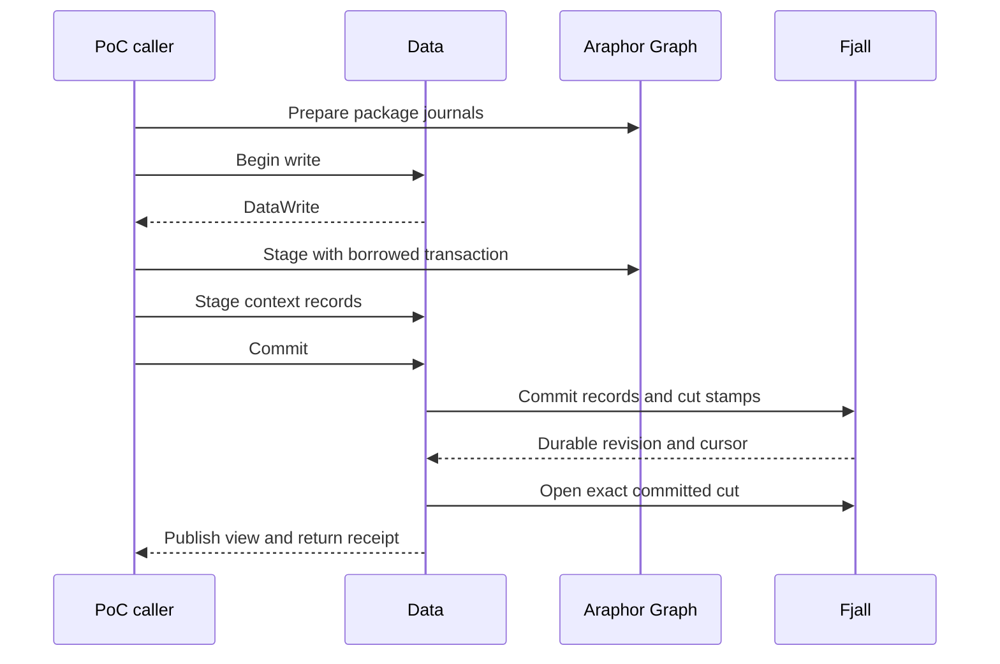

# Native Data transaction review

This guide covers the optional native metadata owner and its package storage
proof of concept (PoC) caller. The source follows Runtime `78e909526`.
Production Data still uses DuckDB. Read the [integration research](../research/araphor-fjall-integration.md)
for the complete migration.

## Intended end state

Data owns the raw and metadata publication boundary. One native transaction
commits Graph, findings, state, references, and consumed positions. Original
logs supply selective subscription wakes. Native DataFusion plans read one
consistent view. The complete migration remains **Not done**.

## Review flow

[NativeStore::open](../../crates/araphor-data/src/analysis/native/mod.rs) Data opens the native metadata store
  -> [AnalysisLease::acquire](../../crates/araphor-data/src/analysis/connection.rs) Data takes the existing private-directory lease.
  -> [NativeStore::open](../../crates/araphor-data/src/analysis/native/mod.rs) Data restores the branch and checks durable history protection.
  -> [NativeStore::cut_view](../../crates/araphor-data/src/analysis/native/mod.rs) Data opens the exact stamped cut and checks its Data revision and store identity.
  -> [NativeStore::view](../../crates/araphor-data/src/analysis/native/mod.rs) Data exposes the published immutable metadata view.

[Live::apply](../../crates/araphor-graph/examples/storage_poc/live.rs) The existing package PoC prepares a step
  -> [View::prepare](../../crates/araphor-graph/src/native/prepare.rs) Araphor Graph prepares the package journals.
  -> [NativeStore::write](../../crates/araphor-data/src/analysis/native/mod.rs) Data serializes the writer and proposes the next Data revision.
  -> [Graph::stage](../../crates/araphor-graph/src/native/write.rs) Araphor Graph stages its records in the supplied transaction.
  -> [DataWrite::context](../../crates/araphor-data/src/analysis/native/context.rs) Data stages physical immutable context records and their heads.
  -> [Live::apply](../../crates/araphor-graph/examples/storage_poc/live.rs) The PoC stages its synthetic step metadata and consumed cursor.
  -> [DataWrite::commit](../../crates/araphor-data/src/analysis/native/mod.rs) Data commits all records and exact cut stamps in one native batch.
  -> [DataWrite::commit](../../crates/araphor-data/src/analysis/native/mod.rs) Data publishes the matching metadata view after durable commit.

[Walker::start](../../crates/araphor-graph/examples/storage_poc/cdc.rs) The existing journal walker reads committed source and Graph changes
  -> The native feed can wake after engine commit and before Data publishes its view.
  -> The PoC waits for `DataWrite::commit` to return before it consumes results.
  -> The production routing barrier remains **Not done**.

[DataWrite::rollback](../../crates/araphor-data/src/analysis/native/mod.rs) A step rolls back
  -> [BranchWriteTransaction::rollback](../../fjall/src/versioned/write.rs) The engine discards all staged records.
  -> [NativeStore::view](../../crates/araphor-data/src/analysis/native/mod.rs) The published view and Data revision stay unchanged.

[DataWrite::commit](../../crates/araphor-data/src/analysis/native/mod.rs) A native commit or publication fails
  -> [NativeStore::check](../../crates/araphor-data/src/analysis/native/mod.rs) Data stops new captures and writes.
  -> [NativeStore::open](../../crates/araphor-data/src/analysis/native/mod.rs) Reopen restores confirmed durable state.

## Owners and coordinates

`Live` is the PoC caller. Package code returns journals and state. Package code
receives no `NativeStore` or `DataWrite`. Graph receives a borrowed native
transaction and cannot consume that transaction to commit it.

`NativeStore` owns the engine, live branch, Data writer lock, store identity,
readiness, published view, and directory lease. `DataWrite` holds the writer
until commit and publication finish. A reader clones an `Arc<DataView>` under
a short read lock. A reader does not wait for the Data writer.

Initialization publishes Data revision 0. The first ordinary commit uses
revision 1. The proposed Data revision becomes consumed only on commit. An identical
context retry returns the original reference. That retry alone creates no
batch and does not advance Data progress.

The PoC's sparse Graph revisions remain fixture coordinates. Its `cut/` records
map those coordinates to allocated Data revisions. Data's `\0data/cut/` records
map allocated revisions to exact native cuts. Graph layer cut stamps remain
native cuts. The PoC does not inject its fixture numbers into Data's allocator.
Graph row origins also remain fixture coordinates. This caller does not qualify
production Data origin or managed reference validation.

The PoC's source, output, and checkpoint writes use this Data owner. Current
reads use its published view. Original journal readers remain unchanged.
The fixture's synthetic source records do not qualify production raw admission
or managed authority.

## Physical context records

The context participant reuses `AnalysisContextVersionV1` and
`AnalysisContextRefV1`. It checks immutable identity, exact retries, and expected
heads. It does not replace qualified owner, package provenance, fact, import,
notification, or lifecycle admission.

The `\0data/key/` dictionary interns exact serialized identities. Long keys use
linked fragments at the engine key width. No content hash selects identity.
`\0data/C` records hold immutable versions. `\0data/H` records point to the
highest owner revision for one context identity. Native snapshots select their
historical values. Value fragments use the engine value width.

The first caller stores its existing package state and captured frontier as
context versions. It removes the previous PoC `S`, `T`, and `H` records. State,
frontier, Graph, and cursor assertions retain their original meaning.

This owner currently retains the initial Data cut through future cuts. Startup
rejects a store whose required protection is absent. Data retention floors,
capacity accounting, and collection policy are not implemented here.

## Verification and limits

[Native Data tests](../../crates/araphor-data/tests/native_store.rs)
cover rollback, exact retries, context heads, joint Graph/context/progress
batches, exact stamps, captured readers during a write, long binary keys,
invalid commit recovery, compaction, reopen, and interrupted initialization.
Five public-API integration cases pass for the final source. See the
[qualification](../../crates/araphor-graph/examples/storage_poc/results/native-data-2026-11-09/README.md)
for commands, exact source hashes, and limits.

The unchanged combined and stable PoCs supply the cross-crate caller checks.
The final source passes 128 stable cycles, 640 historical package evaluations,
320 historical views, and eight combined runs. The complete comparison interval
includes Data publication and context-version records. The reported `output_sync_s`
field includes the Data commit and publication call; it does not isolate sync
time. Stable-key checks cover Graph indexes and context heads. They do not
assert a fixed count of immutable context versions.

Raw-prefix publication, read admission and memory budgets, qualified context
checks, managed source authority, complete result families, production log
routing, notification batching, retention, and backup remain **Not done**.
The earlier Data unit-test target cannot build its unchanged legacy fixtures.
Clippy stops on unchanged legacy `unwrap` and `expect` calls. These checks
remain **Not done**. The incident performance test and full workspace CI have
not run for this change. No incident speedup is established.

## Data schema initialization

[AnalysisStore::open](../../crates/araphor-data/src/analysis/mod.rs) Data creates its current store
  -> [Relations::schema](../../crates/araphor-data/src/analysis/graph_rows/store/relations/schema.rs) One factory assembles the existing Data and Araphor Graph schemas.
  -> [Relations::SCHEMA](../../crates/araphor-data/src/analysis/graph_rows/store/relations/schema.sql) The common Graph schema also creates the canonical fact index.
  -> [Relations::validate_tables](../../crates/araphor-data/src/analysis/graph_rows/store/relations/schema.rs) Validation compares all Graph columns, constraints, and views against that factory.

The previous expected schema omitted seven engine tables and the fact-index
table. A new Data store failed before raw operations. The correction uses the
same table definitions and keeps the full comparison. The
[public regression](../../crates/araphor-data/tests/store_schema.rs) passes
open, data validation, and reopen. An unexpected Graph table still makes reopen
fail. The command is `cargo test --offline -p araphor-data --features test-fixtures --test store_schema`.
The local check also enabled `native-store` and used the recorded link override.
This correction establishes no performance gain or production engine migration.
