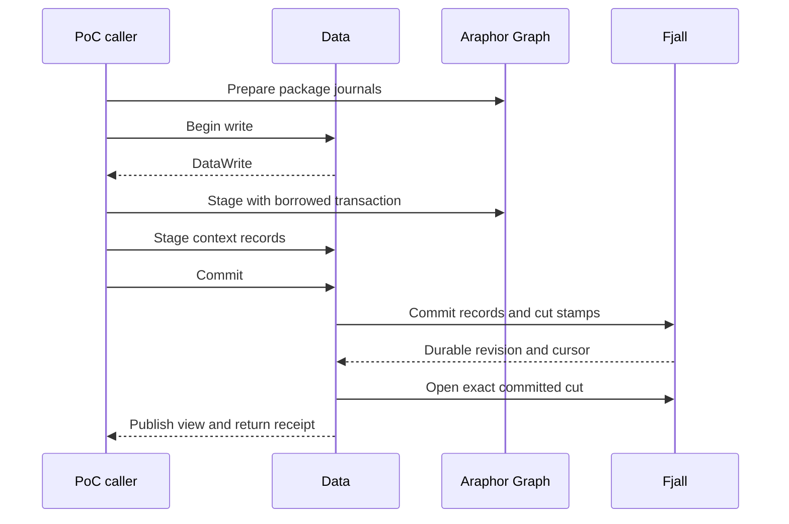

# Native Data transaction review

This guide covers the optional native Data owner, raw source storage, and its
package storage proof of concept (PoC) caller. The metadata source follows
Runtime `78e909526`. The combined raw view follows `f05f444e2`. The catalogue
source follows `b447c7142`. Qualified context admission follows `66bc190c5`. Managed admission and ordinary
start/stop follow `6087cbe9f`. Arrow source extraction follows `cc35d1c67`.
Production Data still uses DuckDB. Read the [integration research](../research/araphor-fjall-integration.md)
for the complete migration.

## Intended end state

Data owns the raw and metadata publication boundary. One native transaction
commits Graph, findings, state, references, and consumed positions. Original
logs supply selective subscription wakes. Native DataFusion plans read one
consistent view. The complete migration remains **Not done**.

## Native Graph point reads

[View::member](../../crates/araphor-graph/src/native/view.rs) resolves one
writer, relation, owner, and entity key through the existing dictionary.
It reads that membership once from the writer's selected snapshot. It uses
the same decoder, property cache, and memory leases as indexed traversal.
The returned member keeps its properties and leases after the view is dropped.

An unknown or deleted member returns `None`. Invalid relations, writer zero,
and malformed records return an error. Indexed traversal still returns an
error if an index refers to a missing member. The point API adds no scan,
persistent index, package rule, or DataFusion operator.

The [native Graph tests](../../crates/araphor-graph/src/native/tests.rs) compare
point and traversal fields. They check deleted membership with retained
dictionary IDs, selected historical writer cuts after compaction, property
lifetime, and corrupt membership/index records. All nine native cases pass:

```sh
cargo test --offline -p araphor-graph --features native-store --lib native::tests \
  --config /tmp/araphor-storage-release-override.toml
```

The local config selects the existing DuckDB build override for this workspace.
Selected-file formatting also passes. Evidence:
`output/araphor-fjall-migration-20261109/native-member-tests.log`.
Production integration and incident performance remain **Not done**.

## Review flow

[NativeStore::open](../../crates/araphor-data/src/analysis/native/mod.rs) Data opens the native metadata store
  -> [AnalysisLease::acquire](../../crates/araphor-data/src/analysis/connection.rs) Data takes the existing private-directory lease.
  -> [NativeStore::open](../../crates/araphor-data/src/analysis/native/mod.rs) Data restores the branch and checks durable history protection.
  -> [NativeStore::cut_view](../../crates/araphor-data/src/analysis/native/mod.rs) Data opens the exact stamped cut and checks its Data revision and store identity.
  -> [NativeStore::recover_raw](../../crates/araphor-data/src/analysis/native/source/raw.rs) Data recovers the original segments and their metadata controls.
  -> [NativeStore::view](../../crates/araphor-data/src/analysis/native/mod.rs) Data exposes the published immutable raw and metadata view.

[Live::apply](../../crates/araphor-graph/examples/storage_poc/live.rs) The existing package PoC prepares a step
  -> [View::prepare](../../crates/araphor-graph/src/native/prepare.rs) Araphor Graph prepares the package journals.
  -> [NativeStore::write](../../crates/araphor-data/src/analysis/native/mod.rs) Data serializes the writer and proposes the next Data revision.
  -> [Graph::stage](../../crates/araphor-graph/src/native/write.rs) Araphor Graph stages its records in the supplied transaction.
  -> [DataWrite::context](../../crates/araphor-data/src/analysis/native/context/admission.rs) Data admits and stages immutable context records and their heads.
  -> [Live::apply](../../crates/araphor-graph/examples/storage_poc/live.rs) The PoC stages its synthetic step metadata and consumed cursor.
  -> [DataWrite::commit](../../crates/araphor-data/src/analysis/native/mod.rs) Data commits all records and exact cut stamps in one native batch.
  -> [DataWrite::commit](../../crates/araphor-data/src/analysis/native/mod.rs) Data publishes the matching metadata view after durable commit.

[Walker::start](../../crates/araphor-graph/examples/storage_poc/cdc.rs) The existing journal walker reads committed source and Graph changes
  -> The native feed can wake after engine commit and before Data publishes its view.
  -> The PoC waits for `DataWrite::commit` to return before it consumes results.
  -> The production routing barrier remains **Not done**.

[DataWrite::rollback](../../crates/araphor-data/src/analysis/native/mod.rs) A step rolls back
  -> [BranchWriteTransaction::rollback](../../fjall/src/versioned/write.rs) The engine discards all staged records.
  -> [NativeStore::view](../../crates/araphor-data/src/analysis/native/mod.rs) The published view and Data revision stay unchanged.

[DataWrite::commit](../../crates/araphor-data/src/analysis/native/mod.rs) A native commit or publication fails
  -> [NativeStore::check](../../crates/araphor-data/src/analysis/native/mod.rs) Data stops new captures and writes.
  -> [NativeStore::open](../../crates/araphor-data/src/analysis/native/mod.rs) Reopen restores confirmed durable state.

## Owners and coordinates



`Live` is the PoC caller. Package code returns journals and state. Package code
receives no `NativeStore` or `DataWrite`. Graph receives a borrowed native
transaction and cannot consume that transaction to commit it.

`NativeStore` owns the engine, live branch, Data writer lock, store identity,
readiness, published view, and directory lease. `DataWrite` holds the writer
until commit and publication finish. A reader clones an `Arc<DataView>` under
a short read lock. A reader does not wait for the Data writer.

Initialization publishes Data revision 0. The first ordinary commit uses
revision 1. The proposed Data revision becomes consumed only on commit. An identical
context retry returns the original reference. That retry alone creates no
batch and does not advance Data progress.

The PoC's sparse Graph revisions remain fixture coordinates. Its `cut/` records
map those coordinates to allocated Data revisions. Data's `\0data/cut/` records
map allocated revisions to exact native cuts. Graph layer cut stamps remain
native cuts. The PoC does not inject its fixture numbers into Data's allocator.
Graph row origins also remain fixture coordinates. This caller does not qualify
production Data origin or managed reference validation.

The PoC's source, output, and checkpoint writes use this Data owner. Current
reads use its published view. Original journal readers remain unchanged.
The fixture's synthetic source records do not qualify production raw admission
or managed authority.

## Physical context records

The context participant reuses `AnalysisContextVersionV1` and
`AnalysisContextRefV1`. Its original qualification covered physical identity,
exact retries, and expected heads. The qualified admission extension is below.
Managed lifecycle and complete production admission remain **Not done**.

The `\0data/key/` dictionary interns exact serialized identities. Long keys use
linked fragments at the engine key width. No content hash selects identity.
`\0data/C` records hold immutable versions. `\0data/H` records point to the
highest owner revision for one context identity. Native snapshots select their
historical values. Value fragments use the engine value width.

The first caller stores its existing package state and captured frontier as
context versions. It removes the previous PoC `S`, `T`, and `H` records. State,
frontier, Graph, and cursor assertions retain their original meaning.

This owner currently retains the initial Data cut through future cuts. Startup
rejects a store whose required protection is absent. Data retention floors,
capacity accounting, and collection policy are not implemented here.

## Verification and limits

[Native Data tests](../../crates/araphor-data/tests/native_store.rs)
cover rollback, exact retries, context heads, joint Graph/context/progress
batches, exact stamps, captured readers during a write, long binary keys,
invalid commit recovery, compaction, reopen, and interrupted initialization.
Five public-API integration cases pass for the final source. See the
[qualification](../../crates/araphor-graph/examples/storage_poc/results/native-data-2026-11-09/README.md)
for commands, exact source hashes, and limits.

The unchanged combined and stable PoCs supply the cross-crate caller checks.
The final source passes 128 stable cycles, 640 historical package evaluations,
320 historical views, and eight combined runs. The complete comparison interval
includes Data publication and context-version records. The reported `output_sync_s`
field includes the Data commit and publication call; it does not isolate sync
time. Stable-key checks cover Graph indexes and context heads. They do not
assert a fixed count of immutable context versions.

At the original metadata qualification, raw-prefix publication, read admission
and memory budgets, qualified context checks, managed source authority, complete
result families, production log routing, notification batching, retention, and
backup were **Not done**. Later owner qualifications are below.
The earlier Data unit-test target cannot build its unchanged legacy fixtures.
Clippy stops on unchanged legacy `unwrap` and `expect` calls. These checks
remain **Not done**. The incident performance test and full workspace CI have
not run for this change. No incident speedup is established.

## Data schema initialization

[AnalysisStore::open](../../crates/araphor-data/src/analysis/mod.rs) Data creates its current store
  -> [Relations::schema](../../crates/araphor-data/src/analysis/graph_rows/store/relations/schema.rs) One factory assembles the existing Data and Araphor Graph schemas.
  -> [Relations::SCHEMA](../../crates/araphor-data/src/analysis/graph_rows/store/relations/schema.sql) The common Graph schema also creates the canonical fact index.
  -> [Relations::validate_tables](../../crates/araphor-data/src/analysis/graph_rows/store/relations/schema.rs) Validation compares all Graph columns, constraints, and views against that factory.

The previous expected schema omitted seven engine tables and the fact-index
table. A new Data store failed before raw operations. The correction uses the
same table definitions and keeps the full comparison. The
[public regression](../../crates/araphor-data/tests/store_schema.rs) passes
open, data validation, and reopen. An unexpected Graph table still makes reopen
fail. The command is `cargo test --offline -p araphor-data --features test-fixtures --test store_schema`.
The local check also enabled `native-store` and used the recorded link override.
This correction establishes no performance gain or production engine migration.

## Shared raw metadata

[RawJournal::append](../../crates/araphor-data/src/analysis/raw_segments.rs) Data accepts a raw append
  -> [RawJournal::prepare_index](../../crates/araphor-data/src/analysis/raw.rs) Data builds the next metadata root before file I/O.
  -> [RawIndex::prepare](../../crates/araphor-data/src/analysis/raw/index.rs) The next root shares unchanged ordered tree paths.
  -> [RawJournal::append](../../crates/araphor-data/src/analysis/raw_segments.rs) The existing segment append and sync complete.
  -> [RawJournal::append](../../crates/araphor-data/src/analysis/raw_segments.rs) Data publishes the prepared root after the durable checks.

[AnalysisStore::read_tables_inner](../../crates/araphor-data/src/analysis/extraction.rs) A reader needs source range metadata
  -> [RawIndex::source_state](../../crates/araphor-data/src/analysis/raw/index.rs) The reader clones the root under the raw lock, releases the lock, and scans the captured ranges.
  -> [RawIndex::selection_revision](../../crates/araphor-data/src/analysis/raw/index.rs) Dependency reads use the same capture rule.

`RawJournal` owns one `RawIndex` for sources, entries, ranges, and the latest raw
revision. The three maps use `rpds` ordered trees with shared ownership.
Segments, current paths, file usage, allocation, directory stamps, and admission
budgets remain in `RawJournal`. A captured root contains metadata, not payloads
or open files. File selection still resolves segment IDs through the live owner
and takes the existing finite read lease. Captured metadata does not prevent
retention from deleting raw files.

The existing raw format, append/sync boundary, SQL projection, recovery, and
admission remain in use. The Arrow inputs and DataFusion interfaces do not
change. No extra journal, payload archive, or Fjall write is added for an append.
The complete production raw/native Data view and CDC routing remain **Not done**.

The [raw integration cases](../../crates/araphor-data/tests/raw_index.rs) use the
actual shared roots through a `test-fixtures` helper. Public Data operations
check out-of-order input, retries, conflicts, receipt changes, selection,
positions, rotation, retention, reopen, and failed-append recovery. The helper
is absent from the normal production API. No raw latency gain is established.

The [qualification](../research/results/araphor-raw-index-2026-11-09.md) records
nine passing integration cases, the feature-off build, and the unchanged
incident. Its single timing run does not establish a gain. Production remains
on DuckDB. Clippy stops on two unchanged legacy calls; full CI does not run
during iteration.

## Combined native and raw view

[NativeStore::accept_validated_batch](../../crates/araphor-data/src/analysis/native/source/raw.rs) Data receives an Evidence batch
  -> [ValidatedEvidenceBatchV1::validate_identity](../../crates/araphor-data/src/analysis/mod.rs) The shared validator checks identity and frame bounds.
  -> [RawJournal::prepare](../../crates/araphor-data/src/analysis/raw.rs) The existing owner checks source binding, overlap, and exact retry bytes.
  -> [RawJournal::append](../../crates/araphor-data/src/analysis/raw_segments.rs) The existing segment append and durable sync finish.
  -> [NativeStore::accept_validated_batch](../../crates/araphor-data/src/analysis/native/source/raw.rs) Data publishes the new global revision and raw root with the previous native snapshot.

[NativeStore::accept_validated_coverage](../../crates/araphor-data/src/analysis/native/source/coverage.rs) Data receives a coverage report
  -> [DataWrite::coverage](../../crates/araphor-data/src/analysis/native/source/coverage.rs) Data checks the bound CPU, source epoch, report revision, and exact retry bytes.
  -> [DataWrite::coverage](../../crates/araphor-data/src/analysis/native/source/coverage.rs) Data stages the report, receipt, binding, and history index.
  -> [DataWrite::stage_raw](../../crates/araphor-data/src/analysis/native/source/raw.rs) Data stages changed raw receipt baselines, protected ends, and the allocator floor when raw input is pending.
  -> [DataWrite::commit](../../crates/araphor-data/src/analysis/native/mod.rs) One native batch commits these records and the exact Data cut.
  -> [DataWrite::commit](../../crates/araphor-data/src/analysis/native/mod.rs) Data publishes the matching raw root and native snapshot.

[NativeStore::read_at](../../crates/araphor-data/src/analysis/native/mod.rs) A reader selects global revision R
  -> [NativeStore::cut_view](../../crates/araphor-data/src/analysis/native/mod.rs) Data opens the last metadata cut M at or before R.
  -> [NativeStore::read_at](../../crates/araphor-data/src/analysis/native/mod.rs) The view retains the shared raw root and the immutable bound R.
  -> [DataView::source_receipt](../../crates/araphor-data/src/analysis/native/source/mod.rs) The reader combines the baseline at M with source ranges visible through R.
  -> [RawJournal::freeze_page](../../crates/araphor-data/src/analysis/raw/page.rs) The raw owner validates and freezes the selected ranges under a finite maintenance lease.
  -> [RawPage::read](../../crates/araphor-data/src/analysis/raw/page.rs) The shared page reader returns original records and positions with the existing page limits and cancellation.

[NativeStore::open](../../crates/araphor-data/src/analysis/native/mod.rs) Data reopens the store
  -> [NativeStore::recover_raw](../../crates/araphor-data/src/analysis/native/source/raw.rs) Data checks protected segment ends against decoded entries through the metadata head.
  -> [NativeStore::recover_raw](../../crates/araphor-data/src/analysis/native/source/raw.rs) Data restores receipt baselines and the nonzero allocator floor.
  -> [NativeStore::open](../../crates/araphor-data/src/analysis/native/mod.rs) Data publishes the greater of the recovered raw and metadata revisions.

The native metadata head can be less than the global Data revision. A metadata
write allocates global revision plus one but validates the previous metadata
head. Raw-only input adds no Fjall batch. Historical capture shares the raw
index; it does not rebuild a prefix map. Historical source receipts use visible
ranges and their selected native baseline. They do not clamp the latest cursor.
The captured revision and store identity have read-only accessors.

The source API includes source binding, receipt, status, and exact coverage
reads. The coverage history index supports the existing read contract. The
index is not a subscription change log. Production log-reader routing remains
**Not done**. `AnalysisStore` and `NativeStore` use the same page owner and
finite `RawRead` leases. Captured views contain no raw file handles.

The [native raw cases](../../crates/araphor-data/tests/native_raw.rs) check raw,
metadata, and raw revision order; exact original positions; no native batch for
raw-only input; joint coverage and raw-control publication; historical pending
ranges; exact retries; CPU and epoch conflicts; same-batch coverage bounds;
malformed history records; append and commit failure; compaction; and reopen.
Configured limits, required-input and witness accounting, diagnostics, lifecycle,
retention, backup, and production cutover remain **Not done**. The native owner
supports its current default-limit mode only. No incident gain follows from
this integration.

## Package and definition catalogue

[NativeStore::install_package_image](../../crates/araphor-data/src/analysis/native/packages/image.rs) Data receives a checked image
  -> [PackageRevisionV1::from_bundle](../../crates/araphor-data/src/analysis/packages/model.rs) Data obtains the existing immutable artifact rows.
  -> [NativeStore::install_package_image](../../crates/araphor-data/src/analysis/native/packages/image.rs) Data checks the retained image digest.
  -> [DataWrite::stage_packages](../../crates/araphor-data/src/analysis/native/packages/mod.rs) Data stages missing rows and checks dependencies with indexed reads.
  -> [NativeStore::install_package_image](../../crates/araphor-data/src/analysis/native/packages/image.rs) Data stages the installed image and latest pointer.
  -> The admission callback must succeed before Data commits.
  -> An unchanged retry returns its original revision without a new batch.

[NativeStore::admit_definition](../../crates/araphor-data/src/analysis/native/packages/definitions.rs) Data receives a resolved definition
  -> Data validates the definition and its exact installed image pins.
  -> [DefinitionRecord::find](../../crates/araphor-data/src/analysis/native/packages/definitions.rs) Data compares the latest value first and scans one name's history only for an older retry.
  -> Data stages the canonical definition bytes and latest pointer.
  -> The admission callback must succeed before Data commits.
  -> An older exact retry returns its original revision and leaves the latest pointer unchanged.

[DataView::validate_catalogue](../../crates/araphor-data/src/analysis/native/packages/recovery.rs) Data reopens the store
  -> Data checks artifact contracts, dependency closures, image digests, and definition pins.
  -> Data checks record revisions against the native metadata head.
  -> Data rejects duplicate canonical definitions for one tenant and name.
  -> Data checks latest pointers against the retained records before publication.

`DataView` supplies exact package revisions, installed or pinned images, and
latest or exact definition revisions. Native snapshots retain historical values.
The shared `Records` owner interns semantic identities and fragments long keys
at the engine key width. Definition names have no added size limit. Package
artifacts use the existing binary MessagePack setting. The decoder also accepts
the previous integer-array byte encoding. Identity encoding and canonical
definition bytes do not change.

Manual `install_package` uses the same validator as `AnalysisStore`. Checked
image admission keeps its existing contract and does not acquire the manual
name-length limits. Installation and definition admission create no instance
or subscription. At that qualification, context admission, lifecycle,
collection, uninstall reclamation, capacity accounting, and production routing
were **Not done**. The context admission extension is below.
The [catalogue cases](../../crates/araphor-data/tests/native_packages.rs) cover
these admission and read boundaries. They do not prove production cutover or
notification latency.

## Qualified context admission

[NativeStore::commit_contexts_guarded](../../crates/araphor-data/src/analysis/native/context/admission.rs) Data receives context values
  -> Data checks the existing identity and validity bounds.
  -> [DataWrite::admit_context](../../crates/araphor-data/src/analysis/native/context/admission.rs) An exact retry checks its canonical fact index and retained proof before returning its original reference.
  -> [VerifiedPackages::check_context](../../crates/araphor-data/src/analysis/context/provenance.rs) A new or conflicting input checks package provenance against the retained artifact closure.
  -> [DiscoveryContextRevisionV1::validate_history](../../crates/araphor-data/src/discovery/context.rs) A new imported document checks staged history across lifetimes.
  -> [DataWrite::record](../../crates/araphor-data/src/analysis/native/context/record.rs) A new value checks the expected head and stages its immutable record.
  -> Data stages the canonical fact index and required scope pointers in the same transaction.
  -> The guard callback must succeed before Data commits the batch.

[NativeStore::intern_contexts_guarded](../../crates/araphor-data/src/analysis/native/context/admission.rs) Data interns qualified values
  -> Data preserves the existing owner allowlist.
  -> Data compares values in one tenant, owner, and lifetime scope.
  -> Data selects the first matching entity in byte order.
  -> Each input sees prior values staged in the same batch.
  -> Ordinary context commits also update this scope index.

`C` and `H` retain context values and maximum owner-revision heads. `K` stores
the canonical fact index for a context. `V` stores scoped context IDs, without
copying bodies into keys. `M` selects the latest imported document across
lifetimes. Recovery checks these indexes, retained package proof, imported
history, and native metadata revision bounds before publication.

The native and current owners share `FactRecord::from_context`,
`PackageRevisionV1::closure`, and `VerifiedPackages::check_context`. These
helpers use the existing DTOs and private read closures. They add no storage
trait or SQL adapter. A native context getter preserves the current read
contract; it does not add a canonical fact lookup to every read.

Notification admission uses the existing obligation and approved-route
validators. The fixed obligation lifetime permits the existing `H` pointer to
serve notification CAS and latest-state reads. Finding/concern lookups and the
notification effect protocol remain separate migration work.

Borrowed `DataWrite::context` and `contexts` stage changes but cannot roll back
one failed operation in isolation. Discard the transaction after a staging
error, as required by the existing Graph participant. `NativeStore` wrappers
discard a failed batch automatically. Empty and unchanged guarded calls still
run the callback and create no batch.

The [context cases](../../crates/araphor-data/tests/native_context.rs) use the
public native APIs and a real current-owner caller for the shared validators.
This admission scope adds no raw-record or witness requirement. Configured
capacity, managed attempts/results, source-range fact reads, notification
lookups/effects, collection, and production routing remain **Not done**.

## Managed admission and start/stop

[NativeStore::admit_managed](../../crates/araphor-data/src/analysis/native/managed/admission.rs) Data receives a managed specification and grant
  -> [ManagedSpec::validate](../../crates/araphor-data/src/analysis/managed/model.rs) Data checks the actual manifest and destination contract.
  -> [ManagedSpec::check_images](../../crates/araphor-data/src/analysis/managed/contract.rs) Data checks the exact retained definition, image, export, and implementation pins.
  -> [ManagedSpec::graph_declarations](../../crates/araphor-data/src/analysis/managed/graph/admission.rs) Data reads the Graph declarations from the called package models.
  -> [DataWrite::admit_managed_graph](../../crates/araphor-data/src/analysis/native/managed/graph.rs) Data stages new opaque Graph mappings and calls the generic Graph installer in the same transaction.
  -> [DataWrite::admit_managed](../../crates/araphor-data/src/analysis/native/managed/admission.rs) A new instance requires its exact images to remain installed.
  -> Data stages an immutable specification and admission scope, the current authority and lifecycle, and empty call heads.
  -> The callback must succeed before Data commits.
  -> An exact retry checks retained pins, returns the current instance, and stages no writes.

[NativeStore::set_managed_running](../../crates/araphor-data/src/analysis/native/managed/lifecycle.rs) The execution owner starts or stops an admitted instance
  -> [DataWrite::change_managed](../../crates/araphor-data/src/analysis/native/managed/lifecycle.rs) Data checks the expected lifecycle and rejects a removed instance.
  -> Data updates the running state and active index in the same transaction.
  -> The callback must succeed before Data commits.
  -> A current no-op runs the callback and creates no batch.
  -> A stale lifecycle conflicts, including a stale no-op.

[NativeStore::stop_managed](../../crates/araphor-data/src/analysis/native/managed/lifecycle.rs) The execution owner fences a captured instance
  -> Data checks the specification, grant, generation, and lifecycle.
  -> Data preserves the existing rule that stop does not require equal captured progress or running state.
  -> Data advances the lifecycle for an instance that has never started.

[NativeStore::lease_managed](../../crates/araphor-data/src/analysis/native/managed/lifecycle.rs) One execution owner takes the host lease
  -> The lease retains the store and its directory lease.
  -> Dropping the host lease releases the host claim.
  -> Another host cannot take the claim while the lease is held.

[DataView::validate_managed](../../crates/araphor-data/src/analysis/native/managed/recovery.rs) Data reopens managed records
  -> Data checks immutable versions, admission scopes, current authority, revision bounds, call heads, and the exact active index.
  -> Data compares Graph mappings with the union of retained manifests.
  -> [Graph::check_installation](../../crates/araphor-graph/src/native/installation.rs) Araphor Graph checks declarations, endpoints, writer ownership, and the exact installation indexes without writes.
  -> Data rejects absent or inconsistent records before it publishes the recovered view.

`Z` holds immutable managed versions. Named MessagePack fields preserve the
actual definition source enum. `J` holds mutable instance fields without a
second specification. `Q` holds stable call heads. `B` indexes active instances.
`G` holds Data's package-call Graph mappings. The existing semantic dictionary
allocates these identities and fragments long instance names. No branch per
instance is added. Generic Graph records retain no package or lifecycle data.

`DataView` reads exact instances and immutable versions. `active_managed` reads
the active index and returns the captured global Data revision. Native metadata
bounds remain separate from a later raw-only revision. The start/stop APIs keep
the existing lifecycle rules and add no pending-attempt condition.

Borrowed `DataWrite::admit_managed` has the same discard-on-error rule as context
and Graph staging. A wrapper drops a failed batch. The
[managed tests](../../crates/araphor-data/tests/native_managed.rs) cover actual
package and definition DTOs, guarded rollback, same-transaction retries, joint
Graph/context journal contents, retained pins when the image is no longer installed, lifecycle
CAS, long names, tenant isolation, host leases, raw interleaving, historical
reads, compaction, reopen, and missing-record rejection. One case uses the
current DuckDB owner to check the shared validation helpers.

Result: **Done for native managed admission and ordinary start/stop**.
Renewal, candidate version admission, removal, failure/resume, captured attempts,
results, checkpoints, references, and consumed progress remain **Not done**.
These APIs require the real attempt and result owners. This change supplies no
placeholder pending-attempt check. Production activation, CDC routing, package
execution, notification batching, and the incident latency targets remain
**Not done**. Graph installation checks do not qualify complete layer/member
recovery. Configured capacity, retention, and backup also remain **Not done**.

## Native Arrow source extraction

[NativeStore::read_tables_at](../../crates/araphor-data/src/analysis/native/extraction/mod.rs) A caller supplies one captured Data view
  -> Data checks the selection, projection, limits, store identity, and requested table owners.
  -> Data holds the existing finite maintenance lease for the read.
  -> [NativeStore::select_sources](../../crates/araphor-data/src/analysis/native/extraction/source.rs) Data selects Evidence sources from the captured raw index and native receipts.
  -> [DataView::source_header](../../crates/araphor-data/src/analysis/native/source/mod.rs) Data reads the actual receipt, coverage report, and pending gaps through the captured Data revision.
  -> [RawScan::read](../../crates/araphor-data/src/analysis/extraction/raw.rs) The shared scanner reads original raw ranges and builds the requested Arrow columns.
  -> [ContextRead::capture](../../crates/araphor-data/src/analysis/native/extraction/context.rs) Data reads selected context headers, verifies retained package proofs, and builds context Arrow columns.
  -> [Capture::finish](../../crates/araphor-data/src/analysis/extraction/tables/mod.rs) The existing builder returns actual rows, positions, witnesses, references, and source metadata.

[DataWrite::index_context](../../crates/araphor-data/src/analysis/native/context/index.rs) Data admits a new immutable context
  -> One transaction stages the context, its head, a tenant header, and an owner header.
  -> Header keys contain the admission Data revision and context ID as a tie breaker.
  -> An exact retry stages no new headers.
  -> Recovery checks every context/header pair and both exact index sets.

The header values contain context references and no context bodies. Owner
identities use the existing scoped dictionary and long-key fragments. A change
read uses native revision bounds. An owner filter uses its own index prefix.
Complete reads sort semantic context keys; change reads sort admission revision
and then semantic key. Dictionary allocation order does not set row order.
Exact context keys use direct lookups. The retained package proof cache avoids
repeated artifact checks. Generic context reads add no fact-index lookup.

[Records::charged_payload](../../crates/araphor-data/src/analysis/native/records.rs)
admits the assembled payload size before allocation. The read releases temporary
prefix, header, and decoded-record charges after their storage is dropped.
Arrow buffers, references, coverage reports, and pending gaps remain charged.
Cancellation and existing key, input, scan, and page limits stay active.

Native physical format 3 persists logical schema 41 and recovery epoch 1.
`DataView::meta` returns these saved values and the captured global Data revision.
Ordinary reopen preserves the recovery epoch. Older prototype native formats
are rejected. This does not convert a DuckDB directory.

Source header revisions identify the source's last visible raw or coverage
commit. The current DuckDB projection can stamp several sources with one later
group revision. The native owner does not copy that projection artifact.
The [extraction tests](../../crates/araphor-data/tests/native_extraction.rs)
compare actual Arrow rows, ordinals, receipts, gaps, reports, witnesses, and
references. They check exact native source revisions separately.

This API currently reads Evidence, coverage, and the admitted context table
families. A requested unported result, trace, Graph-state, or notification
family returns `Unsupported`. Native retention has no mutation API yet, so
this read does not qualify expired or removed raw ranges. Prior result restore,
atomic results/progress, production
provider binding, and original-log subscription routing remain **Not done**.

## Native capture and terminal attempts

Read the owners in this order:

1. [capture.rs](../../crates/araphor-data/src/analysis/native/managed/capture.rs)
   captures one Data view, reads actual Arrow tables, and uses the existing
   `ManagedCapture::seal` and source-frame seal. It reads the saved call heads
   and completion head. An unported result or source parent returns `Unsupported`.
2. [attempts.rs](../../crates/araphor-data/src/analysis/native/managed/attempts.rs)
   checks authority, lifecycle, completion, input revisions, and retained
   references. Registration stages the immutable request/capture and pending
   index together. A live claim belongs to that store's watch channel.
3. [terminal.rs](../../crates/araphor-data/src/analysis/native/managed/terminal.rs)
   stages terminal state, pending removal, completion indexes, and failure
   status together. A qualifying Denied outcome also suspends the instance.
   Stop and join execution before this call. A loaded pending attempt has no
   live claim. An exact terminal retry checks the callback and stages no writes.
4. [status.rs](../../crates/araphor-data/src/analysis/native/managed/status.rs)
   reads saved outcomes and failure state. Completed outcomes and successful
   consumed progress are separate values.
5. [attempt_recovery.rs](../../crates/araphor-data/src/analysis/native/managed/attempt_recovery.rs)
   checks the captured contract, exact pending/outcome index sets, historical
   completion, and required failure records. Startup cancels current-generation
   pending frontier attempts in one genuine Data commit. Other pending attempts
   keep the existing behavior.

[revisions.rs](../../crates/araphor-data/src/analysis/native/revisions.rs) stores
last-change heads for capture checks. The raw owner derives event and new-binding
heads from its original committed entries. Coverage and contexts stage their
heads in their existing metadata transaction. Recovery merges saved receipts
before it derives new bindings from the later raw tail. These heads are not
subscription cursors or a copied CDC log. Original-log routing remains open.

The [managed tests](../../crates/araphor-data/tests/native_managed/attempts.rs)
check actual rows, callback rollback, live claims, parallel manual attempts,
captured cuts, completion history, failure suspension, and corrupt recovery.
The [raw tests](../../crates/araphor-data/tests/native_raw/freshness.rs) check
coverage-first binding recovery with and without a later metadata commit.
Read the [qualification](../research/results/araphor-native-attempts-2026-11-09.md)
for commands and remaining limits. Production still uses DuckDB.
