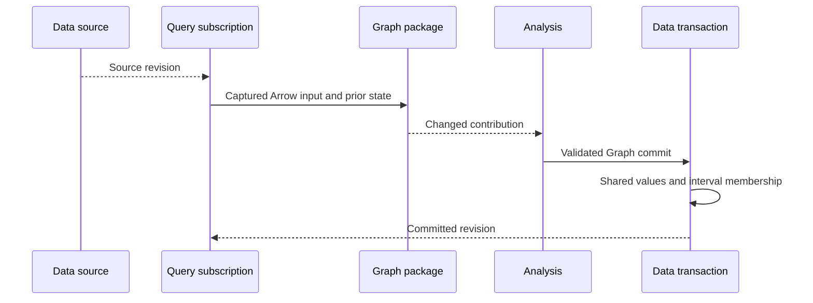

# Native Graph row review

This guide covers the Graph row rewrite in the current working tree. Data owns
the durable Graph. Query uses the DataFusion parser, plans, and table provider.
The rewrite stores shared values and version membership in DuckDB.

## Intended end state

The same four Graph result cuts must use at most 1,099,095 logical Graph bytes.
Each result ID must return its exact historical Graph, proof, findings, and
package attribution. A failed transaction must leave the previous result and
managed progress intact. The query subscription must wake on relevant source
changes. It must not wake on its own selected result write.

## Implementation review flow

[GraphPublication::admit](../../crates/araphor-analysis/src/graph/native/managed.rs) A subscription selects a changed authorized input cut
  -> [Runtime::evaluate](../../crates/araphor-query/src/stream/physical/runtime.rs) Query captures the source and exact prior managed result
  -> [Computation::update](../../crates/araphor-analysis-builtins/src/graph/incremental.rs) the builtin computes new and affected Graph contributions
  -> [GraphPublication::convert_graph](../../crates/araphor-analysis/src/graph/native/commit.rs) Analysis checks each contribution against current captured input and proof
  -> [AnalysisStore::commit_managed_graph](../../crates/araphor-data/src/analysis/progress/graph.rs) Data commits changed contributions, Graph version, state, and references in one transaction
  -> [Progress::next](../../crates/araphor-query/src/stream/progress.rs) Query and notification subscriptions receive the committed revision

[GraphRows::stage_managed](../../crates/araphor-data/src/analysis/graph_rows/publication.rs) A Graph version is committed
  -> [GraphRows::call_scope](../../crates/araphor-data/src/analysis/graph_rows/history.rs) Data selects the prior package call scope, or `new_scope` creates one
  -> [GraphRows::apply_output](../../crates/araphor-data/src/analysis/graph_rows/calls.rs) Data checks and decodes the changed contribution
  -> [GraphRows::intern_edges](../../crates/araphor-data/src/analysis/graph_rows/intern.rs) Data reuses exact native values and stable IDs
  -> [GraphStage::apply](../../crates/araphor-data/src/analysis/graph_rows/stage.rs) Data changes membership for rows added or removed at this revision
  -> [GraphRows::publish](../../crates/araphor-data/src/analysis/graph_rows/publication.rs) Data writes Graph metadata and creates the result version
  -> [GraphRows::bind_result](../../crates/araphor-data/src/analysis/graph_rows/history.rs) Data binds the Graph result to exact producer version IDs
  -> [GraphRows::result_counts](../../crates/araphor-data/src/analysis/graph_rows/history.rs) Data counts the selected subjects, edges, and findings

`GraphRows::publication_scope` handles metadata and direct scope reuse.
Explicit expiry uses `new_scope`. Managed package calls use `call_scope` or
`new_scope`. Managed branches come from findings on read.

[AnalysisStore::graph_input](../../crates/araphor-data/src/analysis/extraction/graph.rs) A caller selects a historical Graph result ID
  -> [GraphRows::header_mode](../../crates/araphor-data/src/analysis/graph_rows/read.rs) Data checks the manifest, evidence, row counts, and result scope
  -> [GraphRows::read_control](../../crates/araphor-data/src/analysis/graph_rows/read.rs) Data selects the native rows valid for that exact result
  -> [GraphRows::read_control](../../crates/araphor-data/src/analysis/graph_rows/read.rs) Data maps stable IDs to public result ordinals
  -> [GraphRows::read_control](../../crates/araphor-data/src/analysis/graph_rows/read.rs) Data reconstructs the public Graph snapshot and original order

Native Query projections read selected Graph families through the DataFusion
table provider. They do not need a complete public Graph snapshot. The
`graph_manifest.snapshot` Binary field uses `encode_native` and
`decode_native` MessagePack when a caller selects it. Data does not store a
second snapshot for that field.

[AnalysisStore::capture_managed](../../crates/araphor-data/src/analysis/managed/capture.rs) A process restarts or a managed call retries
  -> [GraphCallRows::load_progress](../../crates/araphor-data/src/analysis/graph_rows/calls.rs) Data restores an authenticated builtin append, or `load` restores a complete or custom call
  -> [GraphPublication::prepare_managed](../../crates/araphor-analysis/src/graph/native/managed.rs) Query binds the state to the captured call
  -> [Computation::update](../../crates/araphor-analysis-builtins/src/graph/incremental.rs) the builtin emits changes relative to that state
  -> [AnalysisStore::check_managed_capture](../../crates/araphor-data/src/analysis/managed/commit.rs) Data rejects a stale call or expired witness

Replay restores the saved input basis and checks the saved call declaration
before it uses native append state.

[Computation::update](../../crates/araphor-analysis-builtins/src/graph/incremental.rs) An input leaves a window or old proof changes
  -> [GraphRows::stage_managed](../../crates/araphor-data/src/analysis/graph_rows/publication.rs) Data records the resulting row changes in the same transaction
  -> [GraphRows::intern_edges](../../crates/araphor-data/src/analysis/graph_rows/intern.rs) changed proof produces a new Graph value
  -> [GraphRows::read_control](../../crates/araphor-data/src/analysis/graph_rows/read.rs) older Graph result IDs still select their old rows and proof

[GraphStage::apply](../../crates/araphor-data/src/analysis/graph_rows/stage.rs) Validation or commit fails
  -> [AnalysisStore::commit_managed_projection](../../crates/araphor-data/src/analysis/managed/commit.rs) Data rolls back membership, result, checkpoint, and progress together
  -> [AnalysisStore::capture_managed](../../crates/araphor-data/src/analysis/managed/capture.rs) a retry reads only the last committed state

[AnalysisStore::capture_managed](../../crates/araphor-data/src/analysis/managed/capture.rs) A managed Graph call resumes
  -> [AnalysisStore::verified_package_from](../../crates/araphor-data/src/analysis/context/provenance.rs) Data reads stored hashes from the captured database cut and decodes the OCI artifact on a cold lookup
  -> [PackageProof::from_artifact](../../crates/araphor-data/src/analysis/context/provenance.rs) Data checks each Wasm export in the decoded artifact
  -> [AnalysisStore::verified_native_graph_call](../../crates/araphor-data/src/analysis/context/provenance.rs) Data checks the exact call artifact identity and builtin resume support
  -> [GraphRows::stage_managed](../../crates/araphor-data/src/analysis/graph_rows/publication.rs) Data selects the model, excludes retained results, and checks the current proof and hashes again in the separate commit transaction

[AnalysisStore::verified_package_from](../../crates/araphor-data/src/analysis/context/provenance.rs) A stored package revision is missing or its hashes change
  -> [AnalysisStore::verified_native_graph_call](../../crates/araphor-data/src/analysis/context/provenance.rs) Data rejects the call before it publishes a new Graph result

## Ownership and data flow

`araphor-analysis-builtins` owns the detector computation and its change
output. Analysis owns the captured Graph input, validates package results, and
constructs the Graph commit request. Query owns the DataFusion subscription
and calls its physical plan when the source changes. Data owns stable row IDs,
interval membership, the managed checkpoint, and the transaction. Only Data
commits Graph state. The query provider reads Data tables into Arrow batches.
`araphor-graph` writes native finding values through Data's borrowed
transaction. It does not open or commit a store.

The subscription uses a revision watch and a window deadline. The dependency
check reads selected Graph result IDs and their notice revisions. It does not
use the global `analysis_results` revision for a mixed Graph query. A managed
step with no Graph output still records its frontier. That step does not wake
its own Graph subscription.

Data stores native subject, edge, finding, evidence, and progress values.
The `graph_producer_members` intervals select each package contribution. The
`graph_result_producers` bindings select the public Graph result. A selected
result read maps stable IDs to the public ordinals. A Graph header uses a CBOR
envelope with typed MessagePack metadata. Managed state uses MessagePack. The
store does not use JSON for these rows.

`AnalysisStore` owns the in-memory package proof cache. A proof contains the
current stored hashes and the exact identity of each Wasm export. Context
validation and Graph call validation share the proof. Data does not persist
the cache. Reopen validates a package again before it uses the package call.

## Verification route

[Graph row tests](../../crates/araphor-data/src/analysis/graph_rows/tests.rs)
check native values, history, branches, validation, and rollback.
[Managed Graph tests](../../crates/araphor-data/src/analysis/managed/tests/input/current/follow.rs)
check retained calls, empty steps, and exact result binding.
[Dependency tests](../../crates/araphor-data/src/analysis/dependencies.rs)
check Graph result and notice wakeups.
[Graph restart tests](../../crates/araphor-analysis/src/graph/native/tests/managed/restart.rs)
check a failed native write, retry, and reopen.
[Incident workload](../../crates/mithril-e2e/src/discovery/packages/required/incident/backlog.rs)
checks the production subscription, Graph results, and notification path.

The 66 Data Graph row tests, seven Data finding-read tests, 15 reactive
notification tests, six native finding-row tests, and detector example test
passed on this source. The fixed incident workload in this measurement series
passed its unchanged 90-second observation deadline and assertions in a
119.79-second whole test. Its four matching Graph
cuts used 1,081,703 logical bytes, 90.16% less than the old path. The required
`CARGO_INCREMENTAL=0 bash .github/scripts/verify-rust-ci.sh` passed formatting,
workspace check, and all-target Clippy. The workspace test command,
`cargo test --workspace --all-targets --all-features`, stopped during linking
with `error: linking with cc failed: exit status: 1`. The host had zero free
space. The full workspace test result is **Blocked**. The 100-fold computation
speed target is not proved.
This rewrite adds no BPF program or external application binary interface.

The package proof tests in
[provenance.rs](../../crates/araphor-data/src/analysis/context/provenance.rs)
check a fresh lookup, store-level reuse, changed stored bytes, an unqualified
Native export, an ambiguous executable export, and reopen. The fixed incident
case made 18 extra OCI decodes in the baseline Graph classifier and zero in
the instrumented cache run. One warm whole test took 104.25 seconds before
the cache and 103.06 seconds after it. The four Graph stages took 3.78 and
3.79 seconds. These runs do not prove a Graph-stage or end-to-end speed gain.
