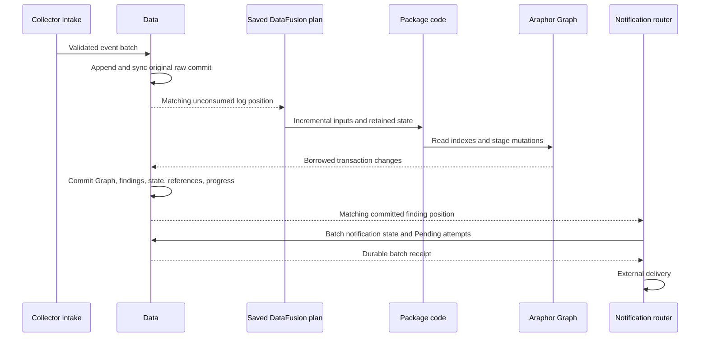

# Native Data storage review

Result: **Not done for the complete replacement**. This guide describes the
connected production replacement. Read the [current worklist](../research/araphor-fjall-integration.md#current-replacement-work-2026-11-10)
for qualification and remaining work. Earlier SQL review records are historical.

Read the [core store cases](../../crates/araphor-data/tests/native_store/core.rs),
[core raw cases](../../crates/araphor-data/tests/native_raw/store.rs), and
[definition cases](../../crates/araphor-data/tests/native_packages/catalogue/definitions.rs)
with [native fixture support](../../crates/araphor-data/src/analysis/native/fixtures.rs),
[raw recovery](../../crates/araphor-data/src/analysis/native/source/raw.rs), and
[definition storage](../../crates/araphor-data/src/analysis/native/packages/definitions.rs).
These thirteen cases replace their complete old SQL families. They preserve
exact receipts, raw spans, retry behavior, bulk rollback, page bounds, large
coverage reports, schema checks, private directories, and abrupt crash replay.
The schema fault must leave the complete native key/value inventory unchanged
after refused reopen. The raw fault removes one committed segment end after
a metadata anchor. Cached page bytes and positions remain exact. Recovery and
reopen must reject `raw segment baseline` at the published metadata cut.
The final relation-head proof uses one explicit metadata commit and preserves
all four original relation change times. Raw-only commits keep their native
append behavior. DuckDB version, `COPY`, and SQL table checks are retired.

Definition proof keeps captured source after file replacement and deletion,
labels, description, tenant scope, revision history, cancellation, exact guard
errors, image pins, and activation silence. Its D-record fault changes only
the encoded name and preserves the record key, tenant, revision, and F head.
Live lookup and startup must report their specific identity errors. The shared
native no-execution check includes managed records, both result owners, and
reference records. The old shared SQL helper and empty definition shell are
removed. The existing raw index fixture now belongs to the native fixture
owner. It keeps counts and receipt reads and adds only a source-scoped range
count from the immutable published index. It remains test-only. Its three
[existing callers](../../crates/araphor-data/tests/raw_index.rs) pass in
0.07 seconds. Their native Metadata read preserves exact selected revisions
2 and 4 and excludes foreign revision 3. The checkpoint keeps the logical
revision unchanged when there are no consumers. Expiry preserves original
metadata and removes the payload file. Both current and held-view payload reads
report expiry, while captured receipt metadata remains exact. Append failure
blocks live reads and writes. Genuine recovery precedes the current root
comparison; no fixture readiness bypass is added. The focused run also passes
eight native store, 24 raw, and 31 package cases. The release library check without
default features and formatting of changed Rust files pass. Data unit compilation
has 388 diagnostics, down from 420. That unit target still does not compile or run.
Read the `native-core-*` evidence
under `output/araphor-fjall-migration-20261110`. Complete migration qualification
and incident performance remain open.

Read the [36 native control cases](../../crates/araphor-data/tests/native_managed/storage/control.rs)
with the [activation classifier](../../crates/araphor-data/src/analysis/native/managed/lifecycle.rs)
and [original-log activation proof](../../crates/araphor-data/tests/native_managed/lifecycle/activation.rs).
The cases replace the complete old lifecycle, history, renewal, removal, status,
and version case families. They keep authority guards, checkpoint continuation,
scope checks, corruption matrices, rollback, recreation, and restart. Continuation
uses the original evaluation parameters through `hydrate_prior`; Data does not
archive parameters. The fixture projects the current instance selection through
its requested tables. The old version path contains only two helpers needed by
other unit cases.

The port exposes a false host wake on initial inactive admission. The classifier
still uses the committed Data revision from the original CDC batch. If lifecycle
and generation both equal that revision, one owner-scoped prefix lookup reads
the earliest logical version key in the exact batch view. Initial admission has
the same generation and stays silent. Recreation retains an earlier version
and emits its wake. All logical generations remain revivable. Native MVCC
collection does not remove those current logical version keys. Other lifecycle
transitions keep the existing revision check. No new snapshot, storage record,
subscription, or retention root is added. The focused run passes 187 managed,
18 raw, six lifecycle, and eight backup cases. The release library check without
default features and formatting of changed Rust files pass. Data unit compilation
has 420 diagnostics, down from 450. That unit target still does not compile or run.
Read the `native-control-*` evidence
under `output/araphor-fjall-migration-20261110`. Complete migration qualification
and the incident performance goal remain open.

Read the [native lifecycle fault cases](../../crates/araphor-data/tests/native_managed/lifecycle/faults.rs)
with [Data publication](../../crates/araphor-data/src/analysis/native/mod.rs)
and [recovery](../../crates/araphor-data/src/analysis/native/recovery.rs).
The journal failure case uses an actual `EFBIG` error in a child process. It
checks blocked reads, writes, captures, and activation catch-up before it exits.
The parent requires the explicit marker and exit code 73. It then checks exact
pre-change Data records, metadata, active membership, and the original log.
Abrupt exit prevents database destruction from retrying buffered journal data.
A returned journal error alone does not establish an aborted transaction.
The other case injects an error after durable commit and before publication.
`AfterMetadataSync` is part of the existing test-only commit hook. Its error
uses the existing Data poison path. Native recovery requires reopen after a
changed metadata cut; it does not recreate SQL in-place commit reconciliation.
Reopen restores the committed stop and exactly one original journal instance
change. Both cases retain historical state and reject unrelated activation.
The old SQL ambiguity case is removed. The focused run passes 151 managed,
18 raw, six lifecycle, and eight backup cases. The release library check without
default features passes. Shared fixture wiring and removal of reader-quota
assertions reduce unit compilation diagnostics to 450. That unit target still
does not compile or run; its remaining native fixture ports stay open.

Read [selected result reads](../../crates/araphor-data/src/analysis/native/managed/read.rs)
with [recovery metadata checks](../../crates/araphor-data/src/analysis/native/managed/result_recovery.rs)
and the [eight result-reference cases](../../crates/araphor-data/tests/native_managed/storage/output.rs).
The live read checks scope before integrity. A selected read checks its saved
dependency set, its exact native dependency prefix, and each returned call by
point lookup. Each call must bind the saved instance, attempt, call ID, result
revision, and receipt revision. The same helper serves startup. Live metadata
reads do not load checkpoint records. Startup retains its deeper call and
evidence checks and its full reference-index check. Native proof preserves
errors from scope checks, historical schema, receipt pins, exact dependency maps,
valid replacement targets, unchanged Call reads after edge faults, and exact
native reopen errors. The reproduced baseline passes five cases and fails
three; the correction passes all eight. The old SQL result-reference family
and its module declaration are removed. Final focused proof passes 149 managed,
18 raw, six lifecycle, eight backup, 15 native Query, five native Instance, and
13 notification cases. The final Data library test compile still fails with
737 diagnostics from old fixtures and removed APIs. Read
`native-selected-integrity-contracts.log`,
`native-selected-integrity-query.log`,
`native-selected-integrity-analysis.log`, and
`native-selected-integrity-lib.log` under
`output/araphor-fjall-migration-20261110`.

Read [startup settlement](../../crates/araphor-data/src/analysis/native/managed/terminal.rs)
with the [candidate-promotion case](../../crates/araphor-data/tests/native_managed/storage/terminal.rs).
The outcome index has one entry for each owner and terminal revision. Startup
uses one attempt per owner in each transaction, with the original pending-scan
order. Different owners share a transaction. Two promoted attempts for one
owner get successive revisions. The existing terminal writer and eligibility
checks remain. No format or index changes. The regression preserves exact
immutable attempt bytes and the historical pending image. It also preserves
successful results, checkpoints, lifecycle, and input frontier. A second reopen
does not write another revision.

The same native file replaces all nine old SQL terminal cases. It checks claim
ownership, failure guards, activation, five corruption cases, live recovery,
generation selection, and restore. Whole-prefix comparisons require three
result records, two checkpoint records, and two dependency records. They use
the actual native prefixes. Exact X and U bytes cover the old frozen result
metadata and checkpoint bytes. Public reads also check context, checkpoint,
and selected results. Both stores reopen after the source commits its 22 and
33 outputs. Restore keeps its earlier 2 and 3 outputs. Full Data records,
metadata, and history remain exact. The old terminal file and module
declaration are removed; other old fixtures remain. The focused run passes
141 managed, 18 raw, six lifecycle, and eight backup cases. At that source state,
Data library test compilation has 776 diagnostics from old fixtures and
removed APIs. The later result-reference retirement is recorded above.
Read `native-terminal-retirement-contracts.log` and
`native-terminal-retirement-lib.log` under
`output/araphor-fjall-migration-20261110`.

Read [Graph conversion](../../crates/araphor-analysis/src/graph/native/commit.rs)
with the [managed sink](../../crates/araphor-analysis/src/instance/sink.rs)
and [native publication](../../crates/araphor-data/src/analysis/native/managed/source/publication.rs).
Conversion keeps source identity, returned-call identity, sealed input selection,
progress, completion, and deadline checks. Its memory reservations remain held
through the Data commit. Data derives publication and consumed progress from
the prepared native source. The unused SQL-era `GraphCommit` packet and its
exports, UUID, and fixture builders are removed. No replacement packet is added.
The [native position case](../../crates/araphor-data/tests/native_managed/source/read/proofs.rs)
rejects future and swapped record positions after admission. Each rejection
preserves all native Data records, metadata, and the original journal head.
The same attempt then commits valid input. Public reads check consumed cursor
two and both retained record keys. The old private capture-tamper assertion
remains in its unit fixture; that target still needs its native fixture port.

The [native managed call cases](../../crates/araphor-data/tests/native_managed/storage/calls.rs)
replace four old lifecycle cases. Read the shared
[storage fixture](../../crates/araphor-data/tests/native_managed/storage.rs)
first. The cases check two independent checkpoints, current and historical
call identity, atomic failure, guard order, backup, restore, and reopen.
They also check stale attempts and every existing checkpoint eligibility guard.
Native result and attempt counts replace the old SQL count query. The focused
run passes 130 managed cases and 18 raw cases. Other Data unit fixtures remain
open. This fixture retirement establishes no latency gain.

Read [runtime failure handling](../../crates/araphor-query/src/stream/physical/runtime.rs)
with [recovery](../../crates/araphor-query/src/stream/recovery.rs) and the
[Analysis host](../../crates/araphor-analysis/src/instance/host.rs).
Runtime retains the existing captured recovery handle through admission and
output execution. It sets the local wait position and deadline from the actual
snapshot before execution. This does not consume input. Busy, denied, and
cancelled errors keep their existing paths. Host joins the failed execution,
records its terminal state, checks current authority, and then waits through
the recovery handle. Unrelated input cannot restart that failed cut. Matching
input or its captured deadline permits a retry with the retained native session.

[Progress](../../crates/araphor-query/src/stream/progress.rs) registers durable
managed input with the original Run session selection. A moving window applies
to each read; it does not change the saved CDC interest. Fixed caller bounds,
requests, owners, and Data scope checks remain. Ordinary subscriptions keep
their existing selection path. The
[managed fixture](../../crates/araphor-query/src/definition/tests/captured/managed.rs)
now uses real admission, native commits, and durable receipts. It compares the
original input position separately from the later publication revision.
Idle-pressure cases attach the live replay handle before they fill the pool.
The failure case checks unconsumed input, unrelated context changes, matching
input, and the actual 60-second window deadline. The focused run passes
24 capture cases. The [native Host case](../../crates/araphor-analysis/tests/native_instance/recovery.rs)
runs the real Runtime Wasm package. It preserves prior output after trap and
limit failures, rejects a restart from unrelated tenant input, and commits one
repair after matching input. Five native Instance and 13 notification cases pass.

[Captured admission](../../crates/araphor-query/src/definition.rs) and
[managed begin](../../crates/araphor-query/src/stream/mod.rs) release their
blocking worker's permit before its completion tokens. This order prevents a
joined cancellation from reporting completion before the permit is free.
The idle fixture waits on the existing semaphore before it applies pool
pressure. Its clock signal occurs before that release and is not a release
barrier.

Read [Query capture](../../crates/araphor-query/src/execution.rs) with
[native extraction](../../crates/araphor-data/src/analysis/native/extraction/mod.rs).
Query removes registered local declarations before Data checks durable owners.
Complete event reads retain witnesses when no event column remains.
[Input identity](../../crates/araphor-query/src/inputs/receipt.rs) binds catalog
reads to the captured owner flags. It does not use an unrelated Data head.
Derived IDs also bind the exact pruned selection and the revisions of
materialized parent inputs. One private metadata frame preserves native view,
call, time, seed, invocation, and optional-value distinctions. Parent revisions
use canonical order. No row or query plan is serialized. Full-identity
forwarding remains unchanged. Existing evaluation accounting covers the
retained ID. Read the supplied-parent owner/window/repeat case in
[body port metadata](../../crates/araphor-query/src/definition/tests/execution/contract/body_ports.rs)
and the bounded-selection case in
[model source lifetimes](../../crates/araphor-query/src/definition/tests/execution/contract/model.rs).
[Input replay](../../crates/araphor-data/src/analysis/native/inputs/replay.rs)
owns the live handle's budget leases. The durable consumer keeps its log
positions when those handles close. Read the
[lease case](../../crates/araphor-data/tests/native_managed/inputs/leases.rs)
for clone, release, and offline wake proof.
[Query progress](../../crates/araphor-query/src/stream/progress.rs) reads the
clock for a deadline; an idle wait with no deadline waits for an event.
The 19 affected Query contracts and 15 native integration cases pass.
Complete unit qualification remains open:
419 Query cases pass, 25 fail, and five are ignored. The Data unit target still
has old fixture compile failures. Read the current worklist for exact evidence.

[Notification extraction](../../crates/araphor-data/src/analysis/native/extraction/notification.rs)
checks source presence before it reads scoped state and routes. A metadata
request with no output columns must still compute the next deadline and retain
its context references. The existing `obligation_source_deadline` case checks
that behavior, exact byte counts, scoped exclusion, acknowledgement, and the
maximum timestamp. Four native notification owner cases also pass. The three
Query deadline cases pass with exact native replacement values.

Read the [native result contract](araphor-retained-execution-review.md#native-result-delivery-after-a-commit)
before reviewing the fixture ports. Executed replacements return native rows
even when those rows equal a previous result. The five delivery cases now check
their exact values. Bare-clock and unrelated-source paths that do not execute
keep their `None` assertions. The source stream case also checks metadata before
EOF, metadata release at EOF, and borrowed-buffer protection after EOF.
No output hash, equality suppression, or stream wrapper is added.

The five unused SQL storage files and five empty legacy package modules are
removed. The two `ResolvedInput` SQL files remain active DataFusion queries.
Historical package review links use the verified DuckDB control source revision.
The production Data library check passes after this removal. Existing warnings
remain. No new runtime or timing result follows from removal of unreachable files.

The connected release at `d429b0d08` passes two matched incident pairs.
Durable notification creation is 49.947–88.429 ms, a measured 6.70–7.30-fold
gain against DuckDB. Public receipt is 59.273–123.986 ms. Whole-test time is
2.12–2.23 seconds native and 5.10–5.13 seconds DuckDB. The 100-fold target
remains **Not done**. These short pairs do not establish a sustained latency
bound or a new gain from the journal/resume corrections alone.

Saved plans use native DataFusion operators. The default
[Causal bundle](../../crates/araphor-analysis/src/package/builtin.rs) contains
the Wasm Causal component. Its calls use
[WasmExecution](../../crates/araphor-package-runtime/src/wasm.rs).
Native shared-library loading is outside this incident path. Matched release
pairs show no incident gain from retaining native libraries. That experiment
is removed from production. Read the current worklist for its evidence.

## Reading order

1. [Public Data exports](../../crates/araphor-data/src/analysis/mod.rs) select the
   native owner. [NativeStore, DataView, and DataWrite](../../crates/araphor-data/src/analysis/native/mod.rs)
   own storage, captured reads, and the single commit boundary.
2. [Original raw intake](../../crates/araphor-data/src/analysis/native/source/raw.rs)
   appends event payloads once. [RawIndex](../../crates/araphor-data/src/analysis/raw/index.rs)
   indexes those original spans. A published DataView binds that raw prefix to
   one native snapshot. [Coverage reads](../../crates/araphor-data/src/analysis/native/source/coverage.rs)
   preserve the public API through one captured view and read cancellation.
3. [Input registration](../../crates/araphor-data/src/analysis/native/inputs/registration.rs)
   and [input checkpoints](../../crates/araphor-data/src/analysis/native/inputs/checkpoint.rs)
   retain subscription progress. [Query progress](../../crates/araphor-query/src/stream/progress.rs)
   consumes Data's matched log positions.
4. [Managed publication](../../crates/araphor-data/src/analysis/native/managed/commit.rs)
   commits package output and consumed progress. [Araphor Graph](../../crates/araphor-graph/src/native/mod.rs)
   supplies generic graph operations through Data's borrowed transaction.
5. [Source snapshots](../../crates/araphor-data/src/analysis/native/extraction/graph/snapshot.rs)
   and [indexed traversal](../../crates/araphor-data/src/analysis/native/extraction/graph/traversal.rs)
   serve retained results. [PublicationRead](../../crates/araphor-data/src/analysis/native/managed/graph/read/publication.rs)
   binds the selected publication to its exact writer cuts.
6. [Notification preparation](../../crates/araphor-data/src/analysis/notification/prepared/native.rs)
   reads one captured view. [NotificationCycle](../../crates/araphor-analysis/src/notification/cycle.rs)
   batches state writes. Pending attempts are durable before external delivery.

## Ownership and commit flow

Package definitions start subscriptions. SQL calls packages; package code owns
analysis. A package can use generic Graph facilities and stage the mutations it
chooses. It cannot commit Data's transaction. Graph has no package catalogue or
detector policy.

Native commit failure stops publication. An uncertain engine write poisons the
owner. [Raw recovery](../../crates/araphor-data/src/analysis/native/recovery.rs)
must preserve every acknowledged raw commit. Changed native metadata or engine
poison requires reopen. A failed package attempt cannot advance consumed input.

The existing post-commit timing event divides transaction work into validation,
derived values, results, references, Graph staging, Source publication,
projection, and final state. Adjacent timers cover that interval exactly.
They change no operation order. The release incident diagnostic passes in
2.07 seconds. Its largest inner phase is Graph staging at 4.870 ms median.
Read the current worklist for the measured notification boundaries and limits.

Ordinary Graph table projections do not require package state. Explicit complete
snapshots require real package state. Traversal uses native node and adjacency
indexes. One depth map spans the requested retained versions. Identity reads do
not load property chunks. Selected properties retain the normal validation path.

## Package evaluation

[Runtime::evaluate_reserved](../../crates/araphor-package-runtime/src/lib.rs)
passes the current tracing subscriber into its blocking worker.
[WasmExecution](../../crates/araphor-package-runtime/src/wasm.rs) reports wire
intervals. [GuestState](../../crates/araphor-package-runtime/src/wasm/execution.rs)
counts Graph calls and sums callback and native service durations. One event
reports those totals after the component call and cleanup. No payload is logged.
The unchanged diagnostic incident passes. All 31 Wasm runtime cases pass
serially. An earlier parallel cancellation case times out before guest entry;
the exact unchanged rerun passes. Its cause remains unproved. Diagnostic timing
does not establish an end-to-end gain.

[Runtime::evaluate_reserved](../../crates/araphor-package-runtime/src/lib.rs) sends the owned evaluation and host service to its existing blocking worker.
  -> [Package::check_evaluation](../../crates/araphor-analysis-sdk/src/validation.rs) checks the immutable descriptor and current input once at the host boundary.
  -> [HostAccess::bind](../../crates/araphor-package-runtime/src/host.rs) obtains Graph capability from that checked model.
  -> [WasmExecution::evaluate_prepared](../../crates/araphor-package-runtime/src/wasm.rs) reuses the checked value for input encoding and output decoding.
  -> [Output::decode_checked](../../crates/araphor-analysis-sdk/src/wire/output.rs) checks wire framing, output schemas, evidence, reasons, checkpoints, and the configured copy bound.

The guest retains its own input checks across the Wasm boundary. Graph callbacks
retain schema checks and current transaction authority. Native calls bind the
same narrowed host after their checked input is constructed. A caller without
declared Graph capability receives the same typed denial before any callback.
Standalone output decoding keeps its existing error order. No ABI or durable
format changes.

The existing package event separates Graph binding, evaluation, output retention,
Graph freezing, and final row counts. Adjacent timers use one completion time.
Their sum equals the measured interval before microsecond truncation. Initial
qualification measures evaluation medians of 7.043 and 6.569 ms for the two Causal
calls. Binding is about 1.9 ms per call. Freezing is about 0.2 ms per call.
These values identify the measured owner; they do not establish a latency gain.

Ninety SDK cases and 31 Wasm runtime cases pass. The current ABI fixture uses
native request and API v2 names. C and Rust sizes, alignments, and existing
offsets remain checked. The additional host-pointer offset check passes.
The new runtime case checks exact capability denial, zero service callbacks,
an untouched invocation gate, and a successful ordinary retry. Read the current
worklist for the paired incident measurements and remaining work.

## Unapplied Causal index experiment

The Causal claim/origin index and canonical change-pair experiment is preserved
in the [unapplied artifact](../plans/araphor-execution-handoff/causal-canonical-inputs-review.md).
The patch passes its functional cases but regresses notification latency after
bulk input. The package source is restored to its last committed implementation.
The generic grouped pin implementation below remains active. Performance work
is deferred until the remaining migration and fixture retirement are complete.

## Grouped raw witness pins

[DataWrite::stage_result_references](../../crates/araphor-data/src/analysis/native/managed/references.rs) receives exact witnesses and their resolved original segments.
  -> [RawPin::collect](../../crates/araphor-data/src/analysis/native/managed/references/pins.rs) groups cursor ranges by result, segment, and expiry.
  -> [DataWrite::commit_locked](../../crates/araphor-data/src/analysis/native/mod.rs) commits the groups, reverse pins, results, Graph, and progress in one native batch.
  -> [DataView::check_result_pins](../../crates/araphor-data/src/analysis/native/managed/references/read.rs) checks exact declared cursor membership and the reverse key.
  -> [Witnesses::read](../../crates/araphor-data/src/analysis/native/witnesses.rs) checks ranges against original segment spans before it expands cursors for exact usage.
  -> [NativeStore::validate_result_references](../../crates/araphor-data/src/analysis/native/managed/references.rs) rebuilds the same groups from retained result metadata during recovery.

The RAW key contains result, segment, and expiry. Its value contains sorted,
disjoint cursor ranges. The SEGMENT key contains segment, result, and expiry.
Its value repeats the expiry. Sparse holes and different expiries remain
separate. Exact witness lists remain in managed and typed result records.
No raw payload copy is added. Retention still takes the maximum expiry for each
whole segment. Live reads retain the existing allowance for missing expired
pins. Recovery requires the exact complete index.

Native format 11 rejects older formats. The representation adds no conversion
path. The [pin cases](../../crates/araphor-data/tests/native_managed/progress/pins.rs)
check mixed expiry, sparse ranges, exact usage across duplicate result owners,
history, compaction, backup, restore, raw expiry, and reopen. Six corruption
cases reject invalid bounds, overlap, adjacent ranges, extra cursors, missing
groups, and missing reverse pins. The strict store case requires format 11 and
rejects format 10.

The grouped pin candidate passes 170 native Data cases. The combined package
experiment also passes 18 Query cases. Its package changes are now unapplied.
The restored package and grouped pins have no separate timing result. Read the
current worklist for exact evidence and remaining qualification.

## Managed binary storage

[StorageFixture](../../crates/araphor-data/tests/native_managed/storage.rs) uses the public native managed APIs and the original source, parameter, evidence, reason, and checkpoint model.
  -> [managed_binary_envelopes](../../crates/araphor-data/tests/native_managed/storage.rs) reads binary instance, version, and attempt records and checks the complete captured contract.
  -> [large_contract_preserves_bytes](../../crates/araphor-data/tests/native_managed/storage.rs) retains the small baseline instance and publishes the original large values through two independent calls.
  -> [NativeStore::commit_managed](../../crates/araphor-data/src/analysis/native/managed/commit.rs) rolls back rejected publication without advancing Data, the journal, call heads, results, or checkpoints.
  -> [NativeStore::backup](../../crates/araphor-data/src/analysis/native/backup/mod.rs) creates the owned backup used for reopen and restore checks.

The large values remain a 17 MiB definition description and a 16 MiB plus one
byte reason. Checkpoint values remain two and three. Native result packets
retain checkpoints and provenance. They do not add an output archive.
The cases check exact definition bytes, result and dependency identities,
historical reads, retries, backup, reopen, and restore. Sixty-five point reads
check reference stability. Foreign-tenant reads reject. The unused SQL batch
wrapper and its ordering mechanics are retired. No replacement wrapper is added.

The two focused cases pass in 19.34 seconds. The final affected targets pass
123 managed cases in 29.68 seconds and six lifecycle cases. Other legacy Data
unit fixtures remain unported. Read the current worklist for the exact evidence.

## Prepared descriptor reuse

[NativeStore::prepare_managed](../../crates/araphor-data/src/analysis/native/managed/prepare.rs) reads each returned call's current descriptor.
  -> [Contract::parse](../../crates/araphor-data/src/analysis/native/managed/prepare.rs) applies the existing parse allocation charge and package pin checks.
  -> [PreparedManagedCommit](../../crates/araphor-data/src/analysis/native/managed/prepare.rs) retains the parsed package and descriptor bytes for this attempt.
  -> [NativeStore::commit_managed_projection](../../crates/araphor-data/src/analysis/native/managed/commit.rs) reads the current descriptor under the Data writer.
  -> [Contract::parse](../../crates/araphor-data/src/analysis/native/managed/prepare.rs) runs again only when descriptor bytes differ.
  -> [DataWrite::check_managed_graph](../../crates/araphor-data/src/analysis/native/managed/graph/mod.rs) uses the qualified package from the same prepared contract.

The current metadata read retains its identity, revision, and cut checks.
Different descriptor bytes retain semantic package comparison. Equivalent JSON
remains valid. A changed export returns the existing conflict. Malformed JSON
and wrong package pins retain their existing errors. This reuse lasts for one
prepared attempt. It adds no global cache, durable copy, API, or format.
Each metadata read retains its allocation charge. Parsing retains its existing
allocation estimate. Preparation charges the retained descriptor buffer once.

The [descriptor case](../../crates/araphor-data/tests/native_managed/publication/contracts.rs)
checks equivalent JSON, a changed export, malformed JSON, and two wrong pins.
Each failed publication preserves Data revision, journal head, and results.
Repair permits the same attempt. Reopen preserves the committed receipt.
The final focused run passes 121 managed cases and six lifecycle cases.

Both matched unchanged incident pairs pass. Median commit validation falls
from 1.807–1.856 ms to 1.112–1.113 ms. Durable creation measures
42.151–71.520 ms; public receipt measures 50.321–88.374 ms; whole-test time
measures 2.08–2.09 seconds. The second notification has mixed paired results.
The matched DuckDB gain is 7.89–9.80 fold. The 100-fold target remains
**Not done**. Read the current worklist for source hashes and complete evidence.

## Graph publication contracts

[NativeStore::commit_managed_projection](../../crates/araphor-data/src/analysis/native/managed/commit.rs) compares prepared returned-call contracts with the current view under the Data writer.
  -> [PreparedGraph::stage](../../crates/araphor-data/src/analysis/native/managed/graph/publication.rs) passes those qualified contracts to Graph mapping admission.
  -> [DataWrite::check_managed_graph](../../crates/araphor-data/src/analysis/native/managed/graph/mod.rs) reuses each returned-call contract and loads each unreturned manifest call normally.
  -> [ManagedSpec::graph_declarations](../../crates/araphor-data/src/analysis/managed/graph/admission.rs) checks the declarations of all manifest calls.
  -> [DataWrite::stage_graph_admission](../../crates/araphor-data/src/analysis/native/managed/graph/mod.rs) retains the original complete mapping validation and required mapping checks.
  -> [Graph::stage](../../crates/araphor-graph/src/native/write.rs) retains native declaration, parent, member, and endpoint checks before publication.

The same writer remains held between current contract validation and reuse.
Additional mappings can belong to a prepared candidate version. The check
permits those mappings. Admission, revival, version preparation, and recovery
use their existing contract lookup path. No public API, cache, or format changes.

The two [publication cases](../../crates/araphor-data/tests/native_managed/graph/contracts.rs)
check a distinct unreturned relation and a retained candidate writer. A changed
required relation rejects with the existing conflict and no Data or journal
advance. Repair permits the same attempt. A capture that precedes candidate
preparation can publish without removing the added writer or changing the live
generation. Reopen preserves the mapping.

The final focused run passes 120 managed cases and six lifecycle cases. Both
matched unchanged incident pairs pass. Median Graph staging falls from
3.194–3.200 ms to 1.604–1.666 ms. Creation measures 44.222–74.645 ms; public
receipt measures 52.252–90.227 ms; whole-test time measures 2.20–2.25 seconds.
The matched DuckDB gain is 7.56–10.37 fold. The 100-fold target remains
**Not done**. Read the current worklist for source hashes and complete evidence.

## Causal relation construction

[Causal::detect_model](../../crates/araphor-analysis-builtins/src/causal/descriptor.rs) constructs the one finding relation that the export declares.
  -> [FindingMember::port](../../crates/araphor-analysis-types/src/relations.rs) supplies the existing property schema.
  -> [CausalComponent](../../crates/araphor-analysis-builtins/components/causal/src/lib.rs) supplies the same package declaration inside each fresh guest.
  -> [Component::evaluate](../../crates/araphor-analysis-sdk/src/guest.rs) retains the existing guest input checks and Graph binding.

The prior factory constructs all four domain relations before it selects the
finding relation. Causal no longer constructs the three unused schemas. The
[descriptor case](../../crates/araphor-query/tests/native_execution/graph.rs)
compares the complete package and its JSON bytes with the prior factory.
The default definition, package exports, Graph operations, and component
isolation remain unchanged.

The focused Query target passes all three selected cases in 2.68 seconds.
It includes descriptor equality, real Wasm Graph publication with consumed
progress, and retained indexed versions.

Both matched unchanged incident pairs pass. Creation measures 44.157–82.437 ms
after this change and 49.254–86.804 ms immediately before it. Public receipt
measures 53.124–99.965 ms after this change. Whole-test time measures
2.26–2.30 seconds. The gain against the matched DuckDB control is 7.34–9.87 fold.
The 100-fold target remains **Not done**. Read the current worklist for build
hashes, the temporary diagnostic, and the exact verification commands.

## Scoped Graph reads

[Values::load](../../crates/araphor-data/src/analysis/native/managed/graph/projection.rs) receives an exact retained Graph property reference.
  -> [NativeStore::read_at](../../crates/araphor-data/src/analysis/native/mod.rs) selects its historical Data cut.
  -> [Graph::scoped_view](../../crates/araphor-graph/src/native/mod.rs) point-reads the selected relation and writer metadata.
  -> [View::member](../../crates/araphor-graph/src/native/view.rs) reads the existing dictionaries, membership, and typed property chunk.
  -> [Values::load](../../crates/araphor-data/src/analysis/native/managed/graph/projection.rs) checks the saved layer and complete member identity before it compares values.

The reader uses the same private metadata loaders as the full Graph view. It
does not enumerate other relations or writers. Its existing local cache uses
graph, revision, writer, and relation as the key. Full Graph enumeration remains
available to callers that need the complete view. Canonical selection still
compares every distinct retained candidate, including a value sequence A, B, A.
No durable format, index, or authority rule changes.

The [Graph member cases](../../crates/araphor-graph/src/native/tests.rs) compare
full and scoped node and edge reads. They check retained history after compaction,
memory leases after the view closes, selected metadata errors, and isolation
from unrelated metadata. All 14 cases pass with `native-store` enabled in
0.72 seconds. The native Data domain suite passes all 24 cases in 2.57 seconds.
Both matched incident pairs pass. Durable creation measures 49.130–91.787 ms;
public receipt measures 57.319–107.847 ms. Whole-test time is 2.26–2.32 seconds.
The pairs establish no end-to-end gain over the preceding native source.
Result: **Done for the scoped reader**. The complete replacement and 100-fold
performance proof remain **Not done**.

## Package-row replacement

The package-row replacement introduced native format 10. Grouped witness pins
now require format 11. Data rejects older formats before it reads package rows.
No automatic conversion is provided. The cutover qualification below used
format 9.

[PackageRecord](../../crates/araphor-data/src/analysis/native/packages/mod.rs)
stores immutable metadata in `P`. The original artifact bytes occur once under
`\0data/@package-body/` and the same dictionary ID. Routine managed contracts
read metadata only. Full package reads join the artifact through the same native
snapshot or transaction. Existing artifact and bundle authentication still runs
at its owning callers. No verifier cache is added by this change.

Staged Graph admission uses the same metadata-only path. The public regression
removes a package body after it creates both Graph journals. Publication must
reach its exact final rejection guard and leave Data and WAL unchanged. Full
artifact reads and reopen still reject the missing body. Three Graph checks
pass. Matched incident runs reduce the measured Graph phase but do not establish
an end-to-end notification gain. Read the current worklist for those results.

Installation retries compare both metadata and artifact bytes.
[Collection](../../crates/araphor-data/src/analysis/native/packages/collection.rs)
removes metadata, body fragments, and the compact GC catalogue atomically.
[Recovery](../../crates/araphor-data/src/analysis/native/packages/recovery.rs)
checks exact body ownership, length, and fragment membership before it
authenticates artifacts. Historical views retain their original bodies.

The focused checks pass: ten package lifecycle cases, twelve context-proof
cases, three Graph authority cases, and prior-format rejection. Two opposite-order
native pairs pass the unchanged incident. This change reduces durable creation
from 143.985–265.681 ms to 50.864–89.282 ms, a measured 2.78–3.48-fold gain.

Two matched release pairs against the saved successful DuckDB control also pass.
Native durable creation is 50.864–88.972 ms; the paired gain is 6.45–7.36 fold.
Public receipt is 58.730–104.749 ms. Whole-test time is 2.08–2.12 seconds native
and 5.03–5.09 seconds DuckDB. The measured creation target is met in these runs;
the 100-fold requirement is not met. These short pairs do not establish a
sustained latency guarantee. Read the current worklist for exact report paths.

## Package image reads

[NativeStore::package_revision_until](../../crates/araphor-data/src/analysis/native/packages/mod.rs) receives a tenant, exact package revision, and read control.
  -> [AnalysisReadControl::check](../../crates/araphor-data/src/analysis/read.rs) rejects cancellation.
  -> [DataView::package_revision](../../crates/araphor-data/src/analysis/native/packages/mod.rs) joins metadata and the original body from one captured cut.

The default `package_revision` call uses that same path. The public
`package_image` and `retained_package_image` calls use the same read control.
Captured DataView reads and staged DataWrite reads keep their existing lifetime.
The image closure reader authenticates artifacts and the saved bundle digest.

[PackageHeader::check](../../crates/araphor-data/src/analysis/native/packages/catalogue.rs)
sorts its two temporary dependency-ID vectors before comparison. Dependency order
has no semantic effect. Missing, extra, or duplicate IDs still fail comparison.
The check does not change stored metadata, descriptors, artifacts, or the format.

[Row tests](../../crates/araphor-data/tests/native_packages/catalogue/rows.rs)
preserve the nine malformed-row errors and their status and retry categories.
The positive ordering case reverses only retained metadata. Live image reads and
reopen succeed. The stored vector stays reversed and the image digest stays equal.
[Image tests](../../crates/araphor-data/tests/native_packages/catalogue/images.rs)
keep the 33 MiB unqualified Native artifact and its exact round trip without
execution. Point-read checks preserve cancellation, unchanged Data metadata,
and unchanged original journal position. Reader quotas are removed.
[Lifecycle tests](../../crates/araphor-data/tests/native_packages/catalogue/lifecycle.rs)
retain shared dependencies, explicit dependency images, foreign tenant images,
definition roots, guarded uninstall, and reinstall after reopen.

The no-execution assertion checks managed instances, versions, calls, attempts,
Graph records, managed results, processor results, and the Discovery enable flag.
The native activation subscription owns a database handle. The restart fixture
drops that handle before it reopens the store. All no-activation assertions remain.
Sixteen native cases replace the fifteen old SQL cases; the positive dependency
ordering case is separate from the malformed-row matrix. Read the current
worklist for verification results. Private verifier and witness ports remain open.

## Package context collection

[NativeStore::collect_package](../../crates/araphor-data/src/analysis/native/packages/collection.rs) receives one tenant and package revision.
  -> [DataWrite::package_roots](../../crates/araphor-data/src/analysis/native/packages/collection.rs) selects retained image, context, definition, and managed roots for that tenant.
  -> [DataWrite::context_owner_ids](../../crates/araphor-data/src/analysis/native/context/index.rs) reads the existing tenant/owner index before it loads context bodies.
  -> [DataWrite::collect_packages](../../crates/araphor-data/src/analysis/native/packages/collection.rs) counts dependencies within the selected tenant and stages eligible removals.
  -> [DataWrite::commit](../../crates/araphor-data/src/analysis/native/mod.rs) commits those removals and publishes one Data revision.

Targeted collection and image uninstall carry the same tenant scope. All retained
context versions, definition revisions, and managed generations remain roots.
Global admission collection checks all tenants. A malformed selected context
rejects the transaction. Repair permits retry. Neither rejection nor a no-op retry
changes Data revision or the original journal head. No new index or format is added.

The old target path decoded a foreign tenant's malformed context. The public
native regression fails on that path and passes after the scope correction.
[Package context tests](../../crates/araphor-data/tests/native_context/packages.rs)
preserve tenant roots, revision notices, exact retries, seven forged fields,
dependency export identity, and malformed or trailing binary input.
[The large closure test](../../crates/araphor-data/tests/native_context/packages/closure.rs)
keeps 1,025 artifacts, 1,024 dependencies, dependency metadata above one MiB,
1,025 dependency exports, and exact digest equality after backup and restore.
[Corruption tests](../../crates/araphor-data/tests/native_context/packages/corruption.rs)
check current context, descriptor, missing artifact, and changed body faults.
The body change preserves byte length. Point reads, head pages, and reopen reject
the faults. One test warms verification, removes a dependency in the same staged
transaction, and rejects exact retry before rollback.

These ten native checks replace the old SQL package-context family. The separate
private verifier tests still require a native port. These checks do not establish
a new incident speed gain. Read the current worklist for commands and results.

## Usage, retention, and maintenance

[Checkpoint](../../crates/araphor-data/src/analysis/native/backup/mod.rs) first
saves safe filtered input positions. It then holds the Data writer during raw
sealing, native flush, and [journal collection](../../crates/araphor-data/src/analysis/native/inputs/collection.rs).
The collection owner catches the shared reader through the published view under
the scan lock. The minimum of that reader, the published cut, and every durable
input generation protects the original cursor anchors. Fjall removes only
eligible sealed journals. The active journal and anchor journal remain.

All saved generations constrain this floor. Version selection can revive an
older generation after removal and recreation. Collection does not add an
incarnation limit or change that behavior. Retained native values survive old
journal removal. Native history and original-log retention have separate policies.

Fresh subscription capture uses the same scan lock. The coordinator remembers
its acknowledged cursor there. A cached old snapshot can still report a cursor,
so explicit registration behind that floor is rejected. Restart restores saved
consumers before a later checkpoint advances the engine acknowledgement again.
No extra synchronization is added to each package commit.

Ordinary Query resume uses `NativeStore::subscribe_inputs_since`. A cursor at
the end of Data revision R starts at R. A partial cursor starts at R minus one,
clamped at zero, and replays the original commit. Existing row positions and
filters select the unread portion. The captured read revision can be newer than
the last consumed row; it is not the replay start. Fresh subscriptions still
start at the current captured cut and perform the initial query capture.
Durable managed and notification consumers keep their saved-position path.

An absent or released native cursor returns `AnalysisInputExpired`, with the
requested position. Query reports `CursorExpired`. Decoder and I/O errors are
not converted to expiry. No context/result scan or extra journal is added.

The user removes Data storage quotas on 2026-11-10. The source has no
`StorageLimitsV1`, quota constructor, reader permit, or storage-quota error.
[StorageUsageV1](../../crates/araphor-data/src/analysis/capacity.rs) reports file
bytes, allocated bytes, and available filesystem bytes. It does not reject an
operation at a configured threshold. [RevisionCounts](../../crates/araphor-data/src/analysis/native/capacity.rs)
remain integrity metadata and are checked during recovery. The quota removal
preserves physical format 10. Grouped witness pins now require format 11.
Actual I/O errors still stop an uncertain owner.

[Trace authority](../../crates/araphor-data/src/analysis/native/admission.rs)
checks store readiness and current request state. [Query](../../crates/araphor-query/src/execution.rs)
awaits that check inside its blocking worker. The [native revocation case](../../crates/araphor-query/tests/native_execution/trace.rs)
reads a real trace through a package plan. Revocation rejects the saved receipt
and captured execution. Failed execution leaves Data revision unchanged.

[Required backlog](../../crates/araphor-data/src/analysis/raw/budget.rs) derives
active Required minima from committed processor state. Volatile counters use
original raw spans. Byte admission includes unconsumed out-of-order spans.
Age admission includes only the contiguous accepted prefix. Exact retries pass
before these checks. A cursor advance examines the spans it crosses; partial
spans use the original frame ends. Rollback does not change the counters.

[Retention](../../crates/araphor-data/src/analysis/native/retention/mod.rs)
reconciles committed processor changes before it removes raw segments. It uses
those same Required minima. Reopen rebuilds the counters from committed state
and original spans. No second durable backlog index is added.

## Backup and recovery

[DataWrite::profile_rows](../../crates/araphor-data/src/analysis/native/progress/profile.rs) receives a typed package profile and its managed attempt.
  -> [NativeStore::read_at](../../crates/araphor-data/src/analysis/native/mod.rs) selects the attempt's captured input cut.
  -> [DataView::progress_inputs](../../crates/araphor-data/src/analysis/native/progress/coverage.rs) walks only the requested original source spans.
  -> [DataWrite::progress_rows](../../crates/araphor-data/src/analysis/native/progress/commit.rs) stages proved gaps, resume progress, profile results, and references in the existing transaction.
  -> [NativeStore::commit_managed_projection](../../crates/araphor-data/src/analysis/native/managed/commit.rs) checks cancellation and the final guard after the test hook, then commits the managed result and consumed input together.

The span proof excludes input expired at the captured metadata cut. Each new
gap matches the exact expiry revision and clipped original commit/intake group.
Live records plus proved missing records cover the consumed interval. Only
Optional Discovery accepts those gaps. Witness and context authority remain
current at the DataWrite cut. Profile and interval IDs have no equality rule.

[Progress recovery](../../crates/araphor-data/src/analysis/native/progress/recovery.rs)
gets the producer capture from the existing qualified managed result. It checks
each advancing typed result at its publication cut. Accepted gaps are absent
before publication and present at publication. The existing exact gap-set check
rejects missing or changed current rows. Resume-only transitions keep their
existing rule. No new table, archive, or durable format is added.

Eight [native gap cases](../../crates/araphor-data/tests/native_managed/progress/profile/gaps.rs)
pass, including later expiry, exact head conflicts, cancellation, and stamped
corruption. The final native managed suite passes 108 cases in 2.34 seconds.
Six native lifecycle cases pass in 0.14 seconds. The four legacy SQL gap cases
are removed. Result: **Done for these gap contracts**. At that source state,
ten other legacy profile cases remained. The grouped port below replaces those
cases. The complete replacement remains **Not done**. Both recorded production
incident pairs pass. Durable creation measures 47.035–83.606 ms; public receipt
measures 55.053–99.452 ms. Whole-test time is 2.10–2.12 seconds. The paired gain
against DuckDB is 7.01–8.04 fold. This parity change establishes no latency gain
over the preceding native source. The 100-fold target remains **Not done**.

The remaining profile SQL family is removed after ten native cases pass.
[Publication contracts](../../crates/araphor-data/tests/native_managed/progress/profile/contracts.rs)
check two canceled updates, exact JSON and stored request fields, completed
admission retries, invalid historical changes, and captured contexts. The
changed-context negative uses a valid new profile. Its unchanged-context retry
succeeds on the same attempt. Failed publications preserve Data and journal
positions.
[State cases](../../crates/araphor-data/tests/native_managed/progress/profile/state.rs)
check bootstrap state, foreign tenant exclusion, exact references, projection
without body decode, cumulative gaps, three-record raw expiry, compaction,
and reopen. A repair to an older sealed interval preserves the current live
head. The original
[Arrow case](../../crates/araphor-data/tests/native_managed/progress/profile/native.rs)
keeps the atom snapshot, manifest, stream identity, nested values, nullability,
source counts, result reference, and evidence witnesses.
[Notice cases](../../crates/araphor-data/tests/native_managed/progress/profile/notices.rs)
check exact per-interval values, immutable result bytes, monotonic notice
revisions, and historical cuts. A new managed publication retains its own
receipt even when the Notice row stays equal. Production
[DataFusion predicates](../../crates/araphor-analysis/src/package/builtin.rs)
own threshold selection. The removed Data notice-selection API is not restored;
the existing Analysis threshold cases are not new passing evidence.

The final focused native run passes 118 managed cases in 13.00 seconds and six
lifecycle cases in 0.29 seconds. The old test root, four child files, test module
declaration, and unused private `ProfileWrite` enum are removed. Typed profile
validation and public managed publication remain. Result: **Done for profile
fixture retirement**. No additional incident gain follows from this port.

[Processor history](../../crates/araphor-data/tests/native_managed/progress/history.rs)
walks the same processor key backward through native snapshots. Each stored
revision selects the preceding cut. The test requires exactly four versions:
registration, two results, and retirement. It checks result bodies and context
watermarks before expiry, after two raw records expire, and after compaction
and reopen. Exact retries and a rejected commit preserve Data revision and the
original journal head. [Processor recovery](../../crates/araphor-data/tests/native_managed/progress.rs)
also rejects invalid history start, class, progress, retirement revision, and
declared revision. The former SQL history module is removed. All three focused
processor cases pass in 0.47 seconds with `test-fixtures` enabled.

[Backup](../../crates/araphor-data/src/analysis/native/backup/mod.rs) seals raw
segments and exports the protected engine cut. The checkpoint callback records
unique relative paths and expected file lengths. Data compares that inventory
with the exported files. Data also checks directory membership, checksums, raw
records, and trace obligation metadata. The callback applies no storage quota.

A destination I/O failure can leave source flushing completed. It preserves the
logical Data cut and source readiness. Fjall removes the incomplete checkpoint.
The outer staging directory is temporary. Raw payloads occur once in the backup.

[Restore](../../crates/araphor-data/src/analysis/native/backup/restore.rs)
validates the complete bundle before it creates the target. It uses an exclusive
lease and a durable pending marker during copy and validation. A failed copy can
leave partial files. The pending marker prevents open and repeated restore.
Restore verifies store identity, raw receipts, history, and the committed cut
before it clears that marker. It advances the recovery epoch. An existing
DuckDB directory is rejected; it is not opened as an empty native database.

[Native crash checks](../../crates/araphor-data/tests/native_crash.rs) terminate
a child process at four backup and four restore boundaries. Only the final
backup publication exposes a restorable target. An interrupted restore keeps
its pending marker and rejects repeated opens. A complete restore advances the
recovery epoch once. The checks compare exact raw pages, native contexts,
source metadata, and every file listed in the backup manifest. They also check
backup retry after later input. The three focused tests pass in 1.47 seconds.
The old SQL backup and restore crash tests are removed.

## Quota removal qualification

The source removes Data quotas and their Control configuration. The retired
protobuf field numbers and names remain reserved. The engine keeps its normal
cache and memtable settings. Query, package, and Required-input resource owners
remain separate from storage usage reporting.

[Native backup checks](../../crates/araphor-data/tests/native_backup.rs) pass
eight cases. The tests include incomplete traces, 17 MiB raw segments, writer
exclusion, held views, duplicate-stamp readiness failure, private bundle paths,
physical faults, and semantic restore faults. The old SQL backup family is
removed after these replacements pass. Six lifecycle and four indexed
notification cases also pass. The [native trace check](../../crates/araphor-query/tests/native_execution/trace.rs)
passes captured-read revocation through Query and package execution.
The process-isolated file-size cases pass raw append failure and checkpoint
export failure. Both cases preserve their distinct ACK and recovery boundaries.
The export fixture copies empty native directories and checks the real EFBIG
cause. The failed export destination remains unpublished.

Production checks pass for Data, Query, Analysis, Control, CLI, and the E2E
harness. Full CI remains excluded by user instruction. Existing obsolete Data
unit fixtures still prevent complete unit-target qualification. The new private
usage fixture has no execution result from that target. No new speed gain is
claimed from quota removal.

## Verification and limits

- Journal collection passes the slowest-consumer, rejected-publication,
  exhaustive-consumption, dormant-generation, removal/recreation, exact retry,
  physical journal removal, historical-read, and restart checks. Six storage
  lifecycle and sixteen managed input cases pass. Actual notification completion
  and restart after collection also pass. Read the current worklist for commands
  and logs. The later saved-cut correction passes all six native input and
  thirteen native Query cases. Ordinary resume, partial spans, filtered offline
  traffic, log expiry, and fresh initial capture have public Query proof.
- [Native coverage checks](../../crates/araphor-data/tests/native_raw.rs)
  preserve six-report bounded reads, exact report references and bytes,
  retry stability, conflicting-content rejection, and multi-report batches.
  The old SQL commit-revision uniqueness rule is removed. One native batch
  can contain several reports; each report retains its own source and revision.
- [Coverage parity cases](../../crates/araphor-data/tests/native_raw/coverage.rs)
  check arrival after capture, exact receipt history through expiry and reopen,
  backup and restore, source and tenant scope, damaged unselected bodies,
  reference corruption, cancellation, and unchanged progress. Four fixture
  cases pass in 0.21 seconds. Three default-feature cases pass in 0.43 seconds.
  The five replaced SQL cases are removed. The historical-corruption case
  still requires a native port.
- The focused native lifecycle suite passes six cases. It covers raw recovery,
  backup and restore, Required byte and age bounds, rollback, restart, retirement
  before expiry, witness expiry, and maintenance after Required retirement.
- The four indexed notification cases pass. Lookup returns all five retained
  states before and after reopen. The two quota-only preparation cases are
  removed. Prepared memory, cancellation, and current-view checks remain.
- The expanded Graph domain suite passed 24 cases before the final admission
  changes. It includes retained traversal and ordinary projections without state.
- Fjall checkpoint checks pass three cases. LSM metadata checks pass two cases.
  These cover exact output admission, refusal, source readiness, encoding parity,
  and retained branches, history, CDC, and compaction.

The format 9 cutover release build passed. The unchanged incident passed in
3.03 seconds, with durable creation delays of 147.276 to 268.944 ms.
That earlier unpaired run does not prove either performance target. SQL-only fixture
ports, finite-history collection, and complete production qualification remain
open. Full CI and physical device failure after manifest replacement have not
been run for this replacement.
