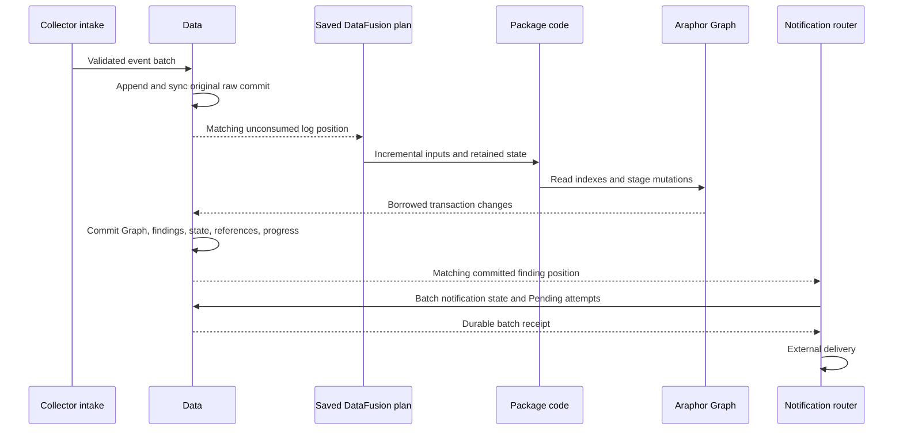

# Native Data storage review

Result: **Not done for the complete replacement**. This guide describes the
connected production replacement. Read the [current worklist](../research/araphor-fjall-integration.md#current-replacement-work-2026-11-10)
for qualification and remaining work. Earlier SQL review records are historical.

## Reading order

1. [Public Data exports](../../crates/araphor-data/src/analysis/mod.rs) select the
   native owner. [NativeStore, DataView, and DataWrite](../../crates/araphor-data/src/analysis/native/mod.rs)
   own storage, captured reads, and the single commit boundary.
2. [Original raw intake](../../crates/araphor-data/src/analysis/native/source/raw.rs)
   appends event payloads once. [RawIndex](../../crates/araphor-data/src/analysis/raw/index.rs)
   indexes those original spans. A published DataView binds that raw prefix to
   one native snapshot.
3. [Input registration](../../crates/araphor-data/src/analysis/native/inputs/registration.rs)
   and [input checkpoints](../../crates/araphor-data/src/analysis/native/inputs/checkpoint.rs)
   retain subscription progress. [Query progress](../../crates/araphor-query/src/stream/progress.rs)
   consumes Data's matched log positions.
4. [Managed publication](../../crates/araphor-data/src/analysis/native/managed/commit.rs)
   commits package output and consumed progress. [Araphor Graph](../../crates/araphor-graph/src/native/mod.rs)
   supplies generic graph operations through Data's borrowed transaction.
5. [Source snapshots](../../crates/araphor-data/src/analysis/native/extraction/graph/snapshot.rs)
   and [indexed traversal](../../crates/araphor-data/src/analysis/native/extraction/graph/traversal.rs)
   serve retained results. [PublicationRead](../../crates/araphor-data/src/analysis/native/managed/graph/read/publication.rs)
   binds the selected publication to its exact writer cuts.
6. [Notification preparation](../../crates/araphor-data/src/analysis/notification/prepared/native.rs)
   reads one captured view. [NotificationCycle](../../crates/araphor-analysis/src/notification/cycle.rs)
   batches state writes. Pending attempts are durable before external delivery.

## Ownership and commit flow

Package definitions start subscriptions. SQL calls packages; package code owns
analysis. A package can use generic Graph facilities and stage the mutations it
chooses. It cannot commit Data's transaction. Graph has no package catalogue or
detector policy.

Native commit failure stops publication. An uncertain engine write poisons the
owner. [Raw recovery](../../crates/araphor-data/src/analysis/native/recovery.rs)
must preserve every acknowledged raw commit. Changed native metadata or engine
poison requires reopen. A failed package attempt cannot advance consumed input.

Ordinary Graph table projections do not require package state. Explicit complete
snapshots require real package state. Traversal uses native node and adjacency
indexes. One depth map spans the requested retained versions. Identity reads do
not load property chunks. Selected properties retain the normal validation path.

## Package-row replacement

The current replacement uses native format 10. It rejects format 9 before Data reads
package rows. This is a changed durable format; no automatic conversion is
provided. The cutover qualification below used format 9.

[PackageRecord](../../crates/araphor-data/src/analysis/native/packages/mod.rs)
stores immutable metadata in `P`. The original artifact bytes occur once under
`\0data/@package-body/` and the same dictionary ID. Routine managed contracts
read metadata only. Full package reads join the artifact through the same native
snapshot or transaction. Existing artifact and bundle authentication still runs
at its owning callers. No verifier cache is added by this change.

Installation retries compare both metadata and artifact bytes.
[Collection](../../crates/araphor-data/src/analysis/native/packages/collection.rs)
removes metadata, body fragments, and the compact GC catalogue atomically.
[Recovery](../../crates/araphor-data/src/analysis/native/packages/recovery.rs)
checks exact body ownership, length, and fragment membership before it
authenticates artifacts. Historical views retain their original bodies.

The focused checks pass: ten package lifecycle cases, twelve context-proof
cases, three Graph authority cases, and prior-format rejection. Two opposite-order
native pairs pass the unchanged incident. This change reduces durable creation
from 143.985–265.681 ms to 50.864–89.282 ms, a measured 2.78–3.48-fold gain.

Two matched release pairs against the saved successful DuckDB control also pass.
Native durable creation is 50.864–88.972 ms; the paired gain is 6.45–7.36 fold.
Public receipt is 58.730–104.749 ms. Whole-test time is 2.08–2.12 seconds native
and 5.03–5.09 seconds DuckDB. The measured creation target is met in these runs;
the 100-fold requirement is not met. These short pairs do not establish a
sustained latency guarantee. Read the current worklist for exact report paths.

## Capacity and maintenance

[Writer admission](../../crates/araphor-data/src/analysis/native/capacity.rs)
checks actual current usage. Ordinary writes enforce configured disk, entry,
and free-space limits. Maintenance preserves the free-space reserve and can
release input when ordinary intake is over capacity. Startup settlement uses
its dedicated recovery access. The guard does not estimate encoded writes.

[Required backlog](../../crates/araphor-data/src/analysis/raw/budget.rs) derives
active Required minima from committed processor state. Volatile counters use
original raw spans. Byte admission includes unconsumed out-of-order spans.
Age admission includes only the contiguous accepted prefix. Exact retries pass
before these checks. A cursor advance examines the spans it crosses; partial
spans use the original frame ends. Rollback does not change the counters.

[Retention](../../crates/araphor-data/src/analysis/native/retention/mod.rs)
reconciles committed processor changes before it removes raw segments. It uses
those same Required minima. Reopen rebuilds the counters from committed state
and original spans. No second durable backlog index is added.

## Backup and recovery

[Backup](../../crates/araphor-data/src/analysis/native/backup/mod.rs) seals raw
segments and exports the protected engine cut. [BackupBudget](../../crates/araphor-data/src/analysis/native/backup/budget.rs)
admits each engine output before it is created. It reserves the remaining raw
copies, manifest, and trace capacity. Fjall and lsm-tree report paths and exact
lengths; Data owns capacity policy. The final manifest uses actual checksums.

A destination refusal can leave source flushing completed. It preserves the
logical Data cut and source readiness. Fjall removes the incomplete checkpoint.
The outer staging directory is temporary. Raw payloads occur once in the backup.

[Restore](../../crates/araphor-data/src/analysis/native/backup/restore.rs)
validates the bundle and pure entry limits before it creates the target. It
uses an exclusive lease and a durable pending marker during copy and validation.
Restore verifies store identity, raw receipts, history, and the committed cut
before it clears that marker. It advances the recovery epoch. An existing
DuckDB directory is rejected; it is not opened as an empty native database.

[Native crash checks](../../crates/araphor-data/tests/native_crash.rs) terminate
a child process at four backup and four restore boundaries. Only the final
backup publication exposes a restorable target. An interrupted restore keeps
its pending marker and rejects repeated opens. A complete restore advances the
recovery epoch once. The checks compare exact raw pages, native contexts,
source metadata, and every file listed in the backup manifest. They also check
backup retry after later input. The three focused tests pass in 1.47 seconds.
The old SQL backup and restore crash tests are removed.

## Verification and limits

- The focused native lifecycle suite passes six cases. It covers raw recovery,
  backup and restore, Required byte and age bounds, rollback, restart, retirement
  before expiry, witness expiry, and maintenance while ordinary admission fails.
- Seven focused notification preparation cases and four indexed notification
  cases pass. Configured route and related-state bounds are included.
- The expanded Graph domain suite passed 24 cases before the final admission
  changes. It includes retained traversal and ordinary projections without state.
- Fjall checkpoint checks pass three cases. LSM metadata checks pass two cases.
  These cover exact output admission, refusal, source readiness, encoding parity,
  and retained branches, history, CDC, and compaction.

The format 9 cutover release build passed. The unchanged incident passed in
3.03 seconds, with durable creation delays of 147.276 to 268.944 ms.
That earlier unpaired run does not prove either performance target. SQL-only fixture
ports, finite-history collection, and complete production qualification remain
open. Full CI and physical device failure after manifest replacement have not
been run for this replacement.
