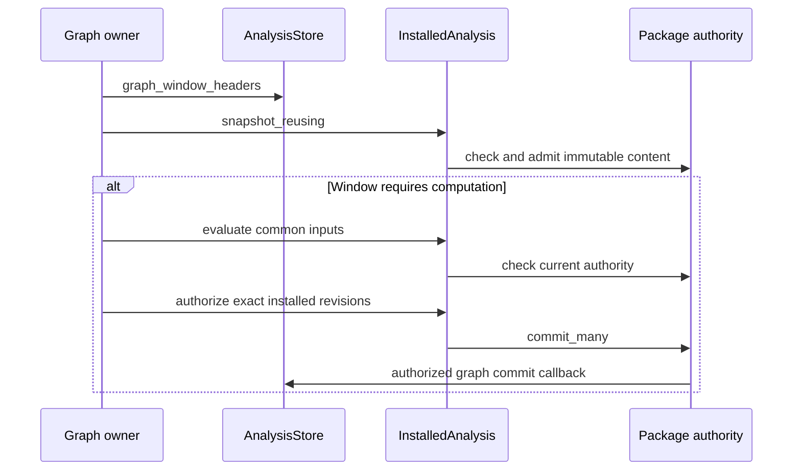

# Araphor Performance Simplification Review

Review the production changes in the [approved TODO](../plans/araphor-performance-simplification-todo.md).
These changes remove repeated reads, decoding, validation, and input preparation.
The source basis is `aa390d9f647c304ef212396433824a6b9c560982` plus the working tree.
The earlier source passed the verification recorded below. The deletion work
requires the current verification in the TODO. The user requires relevant
builds and tests for each iteration. The production Rust deletion target is
6,000 nonblank lines; tests and documents do not count toward it.

## Intended end state

Owners check relevant changes and due deadlines before they load payloads.
One operation prepares common inputs once. Existing owners retain immutable
declarations, artifact identities, and cursors for their required lifetimes.
Current authorization, exact revisions, evidence, recovery, and physical limits
remain. DuckDB executes queries. Arrow contracts do not depend on DuckDB.

## Implementation review flow

[AnalysisStore::open_with_limits](../../crates/araphor-data/src/analysis/mod.rs) An owner starts or recovers
  -> [AnalysisStore::validate_state](../../crates/araphor-data/src/analysis/schema.rs) the existing store validates current durable state
  -> [NodeTraceOwner::recover_inactive](../../crates/araphor-observability/src/capture.rs) the owner reconstructs its immutable inputs and cursor state
  -> [AnalysisPackageOwner::serve](../../crates/araphor-data/src/package/owner.rs) the owner registers existing change subscriptions and required deadlines

[QueryStream::advance](../../crates/araphor-data/src/query/follow.rs) A relevant commit or due deadline occurs
  -> [AnalysisPackageOwner::reconcile_until](../../crates/araphor-data/src/package/supervision.rs) the owner checks current authorization and exact metadata
  -> [GraphAndFindingOwner::refresh_source](../../crates/araphor-data/src/graph/live.rs) the owner selects affected work
  -> [GraphAndFindingOwner::derive_candidate](../../crates/araphor-data/src/graph/derive.rs) the owner prepares required inputs once
  -> [InstalledAnalysis::evaluate](../../crates/araphor-data/src/package/installed.rs) the existing execution owner computes the result
  -> [AnalysisStore::commit_package](../../crates/araphor-data/src/analysis/packages/commit.rs) the existing store validates and commits the result
  -> [commit](../../crates/mithril-control/src/store.rs) the owner publishes the committed change

[AuthorityWatch](../../crates/araphor-data/src/package/installed/control.rs) An operation fails, expires, or loses authority
  -> [AnalysisReadControl::cancel](../../crates/araphor-data/src/analysis/read.rs) the current control cancels active work
  -> [ModelOperation](../../crates/araphor-data/src/query/model/operation.rs) the owner releases handles, inputs, and reservations
  -> [AnalysisStore::commit_metadata](../../crates/araphor-data/src/analysis/connection.rs) the store retains only committed state
  -> [AnalysisStore::recover_segments](../../crates/araphor-data/src/analysis/raw_catalog.rs) recovery or retry checks current exact state

The lines above keep the TODO event order. Each owner below supplies its part
of that flow. The links are the source reading route.

## Package scheduling and immutable content: items 1 and 8

[reconcile_until](../../crates/araphor-data/src/package/supervision.rs) groups
each activation page by tenant, scope, and installation root. One group shares
one bounded `InstalledBundle` and one orphan check. Each export reads its
current activation. Startup and an authority change require bundle admission.
An incomplete or cancelled pass does not advance the checked authority epoch.

[package_current](../../crates/araphor-data/src/analysis/packages/read.rs) reads
result metadata before Arrow inputs. The check includes the current head,
activation, source revisions, dependencies, contexts, and witness expiry.
[serve](../../crates/araphor-data/src/package/owner.rs) retains one checked store
epoch. Timer passes at that epoch still check grants, witnesses, and due clocks.
Commits during a pass require another pass. Activation metadata records the
prepared-input flag and the clock dependency. Admission checks both values
against the model. The clock dependency distinguishes no clock, input refresh,
and model execution. An input clock requires source refresh at the due tick.
If its input revision remains unchanged, the model still skips computation.
A model clock requires computation at the due tick. Notification inputs need
clock refresh because their `overdue` value depends on time.

[InstalledBundle](../../crates/araphor-data/src/package/installed/snapshot.rs)
owns immutable content, its digest, implementation identities, and one memory
lease. [BundleMemory](../../crates/araphor-data/src/package/installed/snapshot/memory.rs)
charges the wrapper, vectors, strings, descriptors, fixtures, and code.
[PackageBundleRef](../../crates/araphor-data/src/package/bundle.rs) exposes a
content-derived digest without a caller-supplied digest field.
[ClientAuth](../../crates/mithril-control/src/client_auth/packages.rs) checks
current trust membership. The commit callback still holds current authority.

[snapshot_reusing](../../crates/araphor-data/src/package/installed/read.rs)
checks current pins and grants before it reuses a bundle. Replacement drops an
inapplicable snapshot before it loads another bundle. The graph operation
retains at most one previous installed snapshot across calls. The last
snapshot reference releases its metadata lease. The last bundle reference
releases its content lease.

[PackageCommitV1](../../crates/araphor-data/src/analysis/packages/model.rs)
owns the commit contract and its payloads. The stored result retains this
contract. It has no second metadata DTO or dependency JSON column. The
[result reader](../../crates/araphor-data/src/analysis/packages/read.rs)
checks native tenant, installation, window, and revision indexes against the
contract. Dependency references keep their native index and exact revision
checks. [Representation tests](../../crates/araphor-data/src/analysis/packages/tests/representation.rs)
cover canonical bytes, complete retry identity, corruption, backup, and charges.

## Shared analysis values

The existing built-ins crate owns the pure
[discovery values](../../crates/araphor-analysis-builtins/src/discovery/model.rs)
and [source identity](../../crates/araphor-analysis-builtins/src/discovery/source.rs).
Host and guest use the same record IDs, atoms, coverage, lifecycle, groups, and
comparison values. The separate string keys, rank maps, and value conversion
owner are removed. Data retains context qualification and checks returned
values against the exact admitted inputs.

The same crate owns pure [graph facts and keys](../../crates/araphor-analysis-builtins/src/graph/model/domain.rs)
and [proof values](../../crates/araphor-analysis-builtins/src/graph/model/proof.rs).
Data retains reviewed-policy qualification, tenant joins, evidence lookup,
and output proof checks. Both paths execute the selected installed artifact.
Data reexports the shared types. Code that calls their host `validate` methods
imports `DiscoveryValidate` or `GraphValidate` from `araphor_data`.

## Graph and built-in computation: items 2, 4, 5, and 14

[graph_window_headers](../../crates/araphor-data/src/analysis/graph/windows.rs)
returns at most 32 current headers per page. The graph owner checks notice,
coverage, installed revisions, witness deadline, and retained floor before
[commit_window](../../crates/araphor-data/src/graph/window.rs) reconstructs graph rows.
Header reads keep the existing stored-byte checks.
Expiry still runs without new evidence. Changed and forced windows use the
existing complete row and snapshot checks.

[derive_candidate](../../crates/araphor-data/src/graph/derive.rs) prepares one
common evaluation per window. Each detector uses its own export and limits.
[Computation::new](../../crates/araphor-analysis-builtins/src/graph/mod.rs)
validates record references and indexes facts once. The index retains original
fact ordinals and order. [Detector declarations](../../crates/araphor-analysis-builtins/src/graph/contract.rs)
and [Discovery declarations](../../crates/araphor-analysis-builtins/src/discovery/mod.rs)
use `OnceLock`. Public descriptor methods return independent clones.

[Discovery page admission](../../crates/araphor-data/src/discovery/live.rs)
returns the accepted record count, merged snapshot, and total input bytes.
The live owner uses that checked result. It does not execute the detector and
merge again for the same accepted page. Candidate size checks still include
the largest possible context references before any profile commit.

[Native graph storage](../../crates/araphor-data/src/analysis/graph_rows/mod.rs)
appends borrowed canonical subjects, relationships, and findings. It retains
no second row DTO family or complete encoded row buffer. Each native appender
is flushed before the existing result-scoped SQL charge is read. The same
transaction checks quota and commits. Reads decode native cells directly into
canonical values and keep header, byte, ordinal, tenant, and value checks.
They report faults in row order. If several rows are corrupt, the first error
can differ from the former buffered decoder.

## Query selection and follow: items 6, 7, and 13

[QueryState](../../crates/araphor-data/src/query/follow.rs) retains the observed
store commit, exact dependency selection, and selected revision. An unchanged
commit and selection reuse that check. Moving windows, clock signals, expiry,
and authority changes retain their wake paths. Empty append output still
advances its durable position.

[QuerySql admission](../../crates/araphor-data/src/query/admission.rs) selects
event columns for supported direct statements and exact counts. Supported
operation equality can filter rows during extraction. Joins, common table
expressions, ordering, grouping, windows, and other complex forms keep the
complete path. [InputProjection](../../crates/araphor-data/src/query/input.rs)
keeps commit position fields. Model provenance is collected before pruning.
`InputRelations` creates only admitted built-in tables. Unreferenced built-ins do
not enter the operation catalog.

The production admission owner also owns the former offline parser tests.
The offline parser is removed. Fixed lower bounds under `OR` use the weaker
bound only when both branches prove a lower bound. Moving-clock disjunctions
retain the complete fallback or rejection path. The private extraction
pipeline accepts the existing borrowed `AnalysisProjection` trait with its
row type fixed. A new caller closure does not require another complete
extraction implementation.
CTE names keep the production parser's shadowing behavior. Hidden columns
remain unavailable and fail during admission.

[ScopedSources](../../crates/araphor-data/src/query/input.rs) exposes append
positions as SQL aliases for existing commit and ordinal columns. Input rows
retain their original width and values. Each statement still binds an
independent scan cursor. Source cleanup releases the retained input.

[package provenance reads](../../crates/araphor-data/src/analysis/packages/witnesses.rs)
validate references before an empty-list return. Empty references need no
reader reservation. Nonempty references retain exact revision checks.

## Guest validation and ABI: item 15

[CheckedEvaluation](../../crates/araphor-analysis-sdk/src/validation.rs) borrows
the package, model, and accepted evaluation. One checked contract supplies input
and output validation. [Rows::input](../../crates/araphor-analysis-builtins/src/rows.rs)
accepts this value. Public standalone decode and validation methods still
check their inputs. JavaScript Object Notation (JSON) parsing still checks each
requested typed row.

The [component wrapper](../../crates/araphor-analysis-sdk/src/guest.rs) and
[native wrapper](../../crates/araphor-analysis-sdk/src/native/mod.rs) call the
required `Guest::compute` hook. Built-in guests and the
[detector example](../../crates/araphor-detector-example/src/lib.rs) implement
that hook. Standalone `Guest::evaluate` validates input and output around the
same hook. The forwarding hook and separate contract validator are removed.
[Wire import](../../crates/araphor-analysis-sdk/src/wire/evaluation.rs)
and native import retain framing and input checks. Output checks still cover
schemas, bounds, evidence, reasons, and checkpoints before export or host use.
The application binary interface (ABI) and its release function do not change.

The [built-in build script](../../crates/araphor-analysis-builtins/build.rs)
builds six locked Wasm guests for `wasm32-unknown-unknown` through
[ComponentBuilder](../../crates/araphor-component-build/src/workspace.rs). Its input
list includes the SDK, built-ins, wrappers, and both examples. The built-in
crate embeds the resulting components. Native parity tests execute these
components through the installed owner. The detector contract test also uses
the source-built example component. The raw runtime fixture has its own WIT
guest; graph, discovery, and example tests cover the generic checked guest hook.

## Capture and operation controls: items 10, 11, and 12

[NodeTraceOwner](../../crates/araphor-observability/src/capture.rs) owns at most
128 retained dispatches and two active capture slots. Admission verifies the
dispatch and target lifetime. Durable intent precedes worker spawn. Recovery
checks stored identities and complete frames once. Recovery records a terminal
result without another spawn. One retained entry owns its dispatch, cursor,
and optional worker. Idle retained reads use that entry.

The same owner retains a checked spool sequence and byte offset. A backward
cursor or reopen requires replay checks. Active reads stop at the synced
prefix. Acknowledgement and retirement remove the associated cursor state.
The existing Interceptor diagnostic backend owns capture execution. This
change adds no kernel program, map, attachment, or loader.

[AnalysisReadControl](../../crates/araphor-data/src/analysis/read.rs) shares
cancellation and an interrupt slot across stages. Trusted readers reuse their
deadline monitor. Trace-intent reads share the writer's monitor. SQL stages
share their operation's monitor. A stage drop clears its active deadline before rollback.
Monitor drop wakes and joins the worker. Direct synchronous calls keep these
checks. [AuthorityWatch](../../crates/araphor-data/src/package/installed/control.rs)
waits on a change or closed channel. Watch drop joins the worker. Package
execution also checks its grant before and after work and at commit.
The synchronous watch uses a separate event thread. A blocked caller's Tokio
executor cannot prevent that thread from receiving an authority change.

[WireFrame](../../crates/mithril-control/src/client_grpc/wire.rs) moves owned
query rows, text, binary values, columns, and context keys into transport
output. The original frame retains its memory lease until the next poll or
drop. [TraceTransport](../../crates/mithril-control/src/client_grpc/trace.rs)
checks the output schema, sequence, position, and terminal identity before it
moves buffers. It also retains the last output frame until the next poll.
The scalar and transport tests retain their existing value and denial checks.
New pointer checks prove that text and binary buffers are moved.

## Durable context, capacity, retention, and quota: items 3, 9, 16, and 17

[commit](../../crates/mithril-control/src/store.rs) updates
[ContextIndex](../../crates/mithril-control/src/store/context.rs) after durable
replacement and before change publication. The authoritative transaction
application returns changed keys; a second transaction interpreter is removed.
One `ContextIndex` retains ordered source keys and their revisions. One cursor
holds the source and optional target/fact position. A target snapshot has one
index entry regardless of its fact count. Startup rebuilds this index from
admitted Control state and replays stored facts. Distinct sources remain
distinct even when they produce the same public context key.
Later cycles visit ordered source keys and serialize only changed records.
Each call visits at most 16 entries, including unchanged keys. Each source selects its own tenant. Only global trust records repeat for
each admitted tenant. The owner does not scan every source for each tenant. A failed data-store write keeps the cursor. A serialization error skips
that record once. A new commit selects that key again. Unrelated commits do
not replay old context bodies. These positions are not durable authority data.
Coverage commits use the analysis owner and can progress while policy priority
is held. A direct store test checks the final priority release for actual
low-priority waiters. Neither check depends on an idle context poll.

[RawJournal](../../crates/araphor-data/src/analysis/raw.rs) owns physical raw
segments. [Its segment methods](../../crates/araphor-data/src/analysis/raw_segments.rs)
maintain file sizes, allocated bytes, and entry counts through append,
seal, rotation, deletion, and recovery. [storage_for_append](../../crates/araphor-data/src/analysis/capacity.rs)
uses those totals when the segment directory stamp matches. Current volume
space, database files, and other entries still receive filesystem checks.
A changed directory requires full inspection. Explicit `storage_usage` keeps
the complete inspection path. Only the raw journal changes known segment
files. Recovery and evidence reads retain their integrity checks.
A changed directory type invalidates the cache. The append still reports its
real filesystem error and keeps the existing writer-recovery rules.
Raw acceptance still synchronizes evidence
before [Control returns its acknowledgement](../../crates/mithril-control/src/evidence.rs).

One append decision supplies the quota check and physical append. Recovery
validates and indexes each frame once. A sealed file name contains its exact
end offset. Recovery rejects a sealed file that loses a complete frame.
The journal can recover accepted raw data without the analysis database.

[retention](../../crates/araphor-data/src/analysis/retention.rs) uses existing
source ranges and selects at most 16 eligible segments per visit. The current
transaction reads pins and required progress. Age, pressure, replay floors,
expired ranges, and usage updates remain. [forget_segments](../../crates/araphor-data/src/analysis/raw.rs)
updates the raw indexes once for the set. A cleanup failure leaves the writer
unavailable. Recovery completes committed `Deleting` rows before reuse.

[StoredArtifact](../../crates/araphor-data/src/package/storage.rs) uses the
current Concise Binary Object Representation (CBOR) frame with metadata and raw
binary fields. Frame validation checks
version, placeholders, binary count, truncation, and trailing bytes.
[Package charges](../../crates/araphor-data/src/analysis/packages/schema.rs)
use actual stored artifact bytes. Decimal JSON byte counting, its frame field,
and `encoded_bytes` are removed. Schema 22 has no older-format reader.
The quota-unit change does not replace executable hashing or current trust.

[SDK wire types](../../crates/araphor-analysis-sdk/src/wire/model.rs) own the
dataset, input, output, reason, and checkpoint representations used by package
fixtures, OCI layers, and stored results. Data's second wire type family is
removed. [Package output](../../crates/araphor-data/src/package/output.rs) keeps
Data's existing per-port row/batch limits, aggregate encoded/decoded byte limits,
checkpoint checks, and error classes. These policies differ from the ABI's
aggregate budget. Sharing a representation does not replace either boundary.

## Functional review checks

These are source test routes. This table does not report a passed run.

| Items | Tests and reading route |
| --- | --- |
| 1, 8 | [Supervisor tests](../../crates/araphor-data/src/package/supervision/tests.rs): `root_group_reuses_bundle`, `idle_reconcile_checks_grant`. [Preparation tests](../../crates/araphor-data/src/package/evaluation/preparation/tests.rs): `unchanged_input_skips_extraction`, `automatic_clock_ticks`. [Snapshot replacement tests](../../crates/araphor-data/src/package/installed/read/tests/retained/reusing.rs) cover current grants, scope changes, and release before loading. [Control trust test](../../crates/mithril-control/src/client_auth/packages/tests.rs): `package_commit_holds_authority`. |
| 2, 4, 5, 14 | [Notice tests](../../crates/araphor-data/src/graph/tests/notices.rs): `idle_graph_uses_headers`, `graph_notice_checks_once`. [Bundle reuse test](../../crates/araphor-data/src/graph/tests/notices/reuse.rs): `idle_graph_reuses_bundle`. [Built-in tests](../../crates/araphor-analysis-builtins/src/graph/tests.rs): `record_index_keeps_fact_ordinals`, `detector_declarations_stay_independent`. [Native parity](../../crates/araphor-data/src/graph/derive/adapter/tests/native.rs): `native_detectors_match_wasm`. |
| 3, 9, 17 | [Capacity tests](../../crates/araphor-data/src/analysis/capacity.rs): `analysis_store_segment_usage`, `analysis_store_capacity_bounds`. [Retention tests](../../crates/araphor-data/src/analysis/retention.rs): `retention_bounds_segments`, `analysis_store_retention_guards`, `analysis_store_physical_reuse`. [Quota test](../../crates/araphor-data/src/analysis/packages/tests.rs): `packages_charge_stored_bytes`. [Frame tests](../../crates/araphor-data/src/package/storage/tests.rs): native dependencies and corruption. [Upload fault proof](../../crates/mithril-e2e/src/observability.rs): `observability_owned_upload` keeps native append errors and reopen checks. |
| 6, 7, 13 | [Follow tests](../../crates/araphor-data/src/query/follow_tests.rs): `query_follow_dependency_reuse`, `query_follow_autonomous_expiry`. [Client projection](../../crates/araphor-data/src/query/client_tests.rs): `query_event_projection`. [Model provenance](../../crates/araphor-data/src/query/model/operation/tests.rs): `pruned_source_evidence`. [Empty provenance](../../crates/araphor-data/src/analysis/packages/witnesses.rs): `empty_provenance_reads`. |
| 10, 11 | [Capture tests](../../crates/araphor-observability/src/capture.rs): `observability_recovery_preserves_all_pages_and_never_respawns`, `observability_spool_seeks_forward_and_checks_replay`, `observability_recovery_uploads_only_the_synced_prefix`. |
| 12, 15 | [Read tests](../../crates/araphor-data/src/analysis/read.rs): `read_monitor_store_reuse`, `read_monitor_stage_cleanup`, cancellation and deadline cases. [Authority tests](../../crates/araphor-data/src/package/installed/control.rs): direct and blocked-runtime cancellation. [SDK tests](../../crates/araphor-analysis-sdk/src/native/tests.rs): `checked_guest_keeps_output_boundary`, `invalid_abi_values_are_errors`. [Contract tests](../../crates/araphor-analysis-sdk/src/tests/boundaries.rs): `checked_output_keeps_contract`. |
| 16 | [Context tests](../../crates/mithril-control/src/store/context.rs): `control_context_bounded_replay`, `control_context_retries_write`, `control_context_preserves_changed_body_conflicts`, `control_context_empty_tenants_stay_idle`. [Coverage priority proof](../../crates/mithril-e2e/src/control_tls/partition.rs): `coverage_progresses_during_priority`. [Store wake proof](../../crates/mithril-control/src/store.rs): `final_priority_release_wakes_evidence`. |
| Package transport | [SDK codec tests](../../crates/araphor-analysis-sdk/src/tests/codec.rs): `wire_contract_boundaries`. [Data output tests](../../crates/araphor-data/src/package/tests/wire.rs): `package_ipc_limits`. [OCI tests](../../crates/araphor-data/src/package/oci/tests.rs) check raw reason and checkpoint layers, canonical identity, and invalid slots. [Memory tests](../../crates/araphor-data/src/package/installed/snapshot/memory/tests.rs): `fixture_capacity_is_charged`. |

## Verification state

Read the [current TODO](../plans/araphor-performance-simplification-todo.md#verification-and-result)
for source-bound commands and terminal results. The earlier passing source is
`7b7b407adf347d389984553a4d212bfce37b75b5`. Its complete receipt remains in that
revision of this guide. It does not qualify the deletion work.

No benchmark or physical Kubernetes qualification is part of this change.
Functional results do not establish a production speed increase. Native proof
requires source-built artifacts and separately selected execution cases; ordinary
CI does not run those ignored cases.
