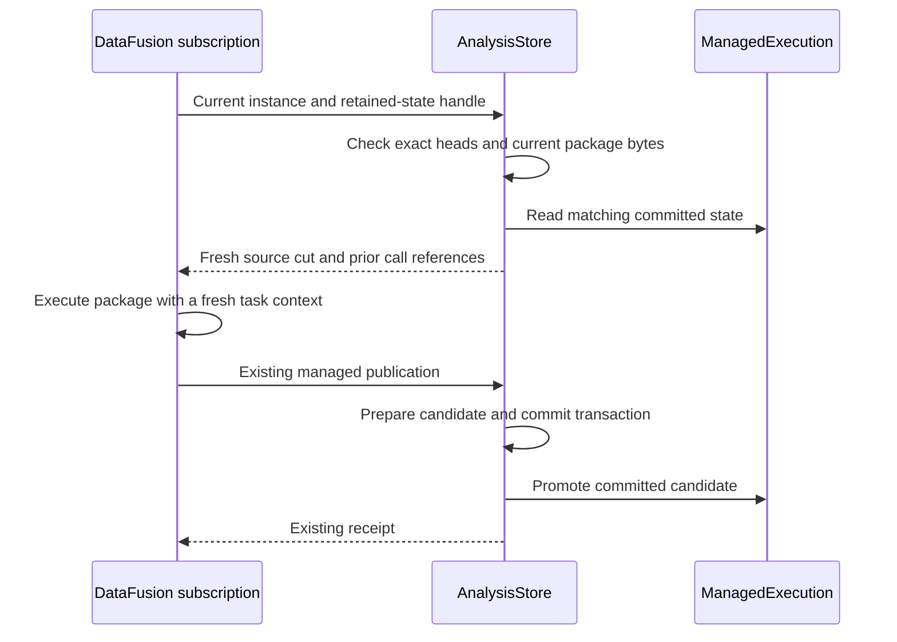
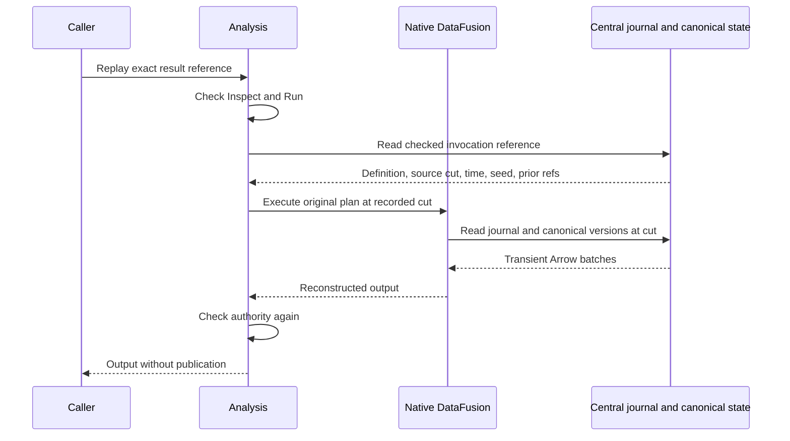

# Araphor retained execution state review

The [journal-reference review](#checked-journal-references) describes the
current change after `3f9bbd3a4`. The bounded storage change is qualified.
The earlier sections retain the source review record for retained state and
lookup inputs through `babd497c4`, plus the unit migration and managed
raw-change reads. The context change
reader follows `e80f918fd`. The binary input frontier follows `ad4aad54b`.
The coverage change reader follows `b2df26330`.
The changes remove
repeated saved-call reads and deliver declared input changes to packages. The parent
plan is [reactive execution latency](../plans/araphor-reactive-execution-latency.md).

## Intended end state

A subscription retains checked package state after each successful commit.
Each invocation receives changes to its input query and the last committed
state. Data remains the durable owner. Native DataFusion operators execute
the input query. Native and Wasm packages use the same checked contract.

The prior committed implementation retains saved state and delivers changed Graph units with
their current support. Native input SQL still selects complete targets. Data
retains those targets for difference execution and cold recovery. Graph
packages do not receive the complete prior Graph. Data owns contribution
history and the derived package state. Live integration, historical anchor
validation, exact replay, and restart checks pass. Combined timing proof
for the unit migration is **Not done**.

The journal-reference change removes the saved payload path described in
the earlier sections. Those sections do not qualify the new Replay path.

## Implementation review flow

[AnalysisStore::accept_validated_batch](../../crates/araphor-data/src/analysis/mod.rs) Data commits new source rows or a relevant context change
  -> [Runtime::next_event](../../crates/araphor-query/src/stream/physical/runtime.rs) Query wakes subscriptions whose native plans use those inputs
  -> [ManagedPublication::begin](../../crates/araphor-analysis/src/instance/subscription.rs) the subscription supplies its retained state with the current instance
  -> [AnalysisStore::capture_managed](../../crates/araphor-data/src/analysis/managed/capture.rs) Data checks the store, instance, current package bytes, and exact saved-call heads
  -> [ManagedExecution::calls](../../crates/araphor-data/src/analysis/managed/execution.rs) Data borrows matching saved state or uses the existing cold read
  -> [PackageExec::change_inputs](../../crates/araphor-query/src/definition/physical/changes.rs) Query binds the committed base and current target to the prepared native difference plans
  -> [PackageExec::evaluate](../../crates/araphor-query/src/definition/physical.rs) package physical execution receives changed units and their current lookup rows
  -> [GraphRows::stage_managed](../../crates/araphor-data/src/analysis/graph_rows/publication.rs) Data checks each producer base and validates current unit support
  -> [Contributions::apply](../../crates/araphor-graph/src/contributions.rs) Graph replaces the changed unit members in Data's transaction
  -> [StateRows::current](../../crates/araphor-graph/src/contributions/state.rs) Graph selects the current package state from active unit members
  -> [AnalysisStore::retain_managed](../../crates/araphor-data/src/analysis/managed/execution.rs) Data prepares retained state from checked live inputs, targets, and output
  -> [AnalysisStore::commit_managed_projection](../../crates/araphor-data/src/analysis/managed/commit.rs) Data commits output changes, saved state, progress, and replay references
  -> [ManagedExecution::promote](../../crates/araphor-data/src/analysis/managed/execution.rs) Data replaces retained state after the commit succeeds

[AnalysisStore::commit_managed_projection](../../crates/araphor-data/src/analysis/managed/commit.rs) An invocation fails or its authority changes
  -> [ManagedExecution::promote](../../crates/araphor-data/src/analysis/managed/execution.rs) Data promotes retained state only after the commit succeeds
  -> [ManagedExecution](../../crates/araphor-data/src/analysis/managed/execution.rs) the last committed state remains available after a failed publication

[Instance::subscribe_on](../../crates/araphor-analysis/src/instance/subscription.rs) The process restarts
  -> [Step](../../crates/araphor-analysis/src/instance/sink.rs) Analysis creates empty retained state for the new subscription
  -> [AnalysisStore::capture_managed](../../crates/araphor-data/src/analysis/managed/capture.rs) the first invocation restores saved state from Data
  -> [ManagedExecution::promote](../../crates/araphor-data/src/analysis/managed/execution.rs) the first successful commit retains state for later invocations

## Execution diagnostics

[Engine](../../crates/araphor-query/src/execution.rs) keeps the current trace
subscriber and span across its worker boundaries.
[CallContext::call](../../crates/araphor-query/src/definition/physical.rs)
keeps that context while it shares a package evaluation.
[InstanceHost](../../crates/araphor-analysis/src/instance/host.rs) keeps the
same context in its existing host and lifecycle tasks. No new task or store
owns the diagnostics.

[PackageExec::evaluate](../../crates/araphor-query/src/definition/physical.rs)
emits a `package` debug event after SQL or guest execution, output validation,
and buffer admission succeed. The event contains the instance, source cut,
call, package, and actual input and output row counts. The declared change
ports supply the affected, before, and after row counts. The event contains
no evidence or package payload. A retained call that does not execute emits
no execution event.

`elapsed_us` measures the wall time from the SQL or guest branch through
output admission. This value includes validation. It does not measure pure
guest CPU time or result commit time. This event does not prove a durable
commit or an end-to-end latency improvement.

The local test subscriber receives these events through the same trace
context. The replacement Follow test remains **Not done** until the complete
source, Graph, and notification path passes its checks.

Source: the diagnostics change after `4266d0abd`. `cargo check -p
araphor-query --tests` passes. Four exact Query checks also pass:
`physical_sql_return_retains_contract`, `physical_calls_keep_capture_and_clock`,
`physical_call_cancellation_joins`, and `native_planning_joins_worker`.
These checks cover the diagnostics change. They do not qualify the new
incremental Graph path.

## State and lifetime

Analysis creates one opaque `ManagedExecution` in each subscription's `Step`.
Data alone changes its contents. Each entry contains the last committed
input, output, checkpoint, context, and result reference. The cache
does not hold a Query task context, source snapshot, operation control,
execution receipt, database connection, or exchange permit.

Saved evaluations omit their prior checkpoint and previous outputs. This
rule prevents a chain of all earlier invocation states. Arrow batches share
their existing buffer reservations. Analysis reserves retained metadata
through its existing memory owner. If an enabled memory setting rejects
optional retention, Analysis drops retained state and keeps the successful
durable receipt. The next invocation reads state from Data.



The existing attempt transaction and final authority checks remain in place.
A call-head, instance, store UUID, schema, or recovery-epoch mismatch uses the
cold path. A clean reopen can reuse matching immutable state. A new process
cannot retain these memory references and restores state from the store.

Recovery uses the saved evaluation that Data already decodes for each call.
It checks member anchors against that call's inputs and the owning unit's
support. The check includes closed historical intervals. Publication and
recovery use the same `CallBasis::local_for` rule. A fact can refer to another
record when both records are in that unit's support. Recovery does not load
a prior complete Graph for this check.

Arrow and MessagePack use the same state row: a tag and a nullable declared
value. The builtin `WAITING` state has tag `WAITING` and no declared value.
A custom state named `WAITING` has tag `DECLARED` and value `WAITING`.
Both compact and named MessagePack preserve that difference.

## Package provenance validation

[AnalysisStore::verify_package_revision](../../crates/araphor-data/src/analysis/context/provenance.rs)
reads the selected installed package and checks its descriptor, declared
dependency keys, and Wasm export selection. `VerifiedPackages` records successful checks
within the current read operation. The set does not survive that operation.

[AnalysisStore::verify_context_packages](../../crates/araphor-data/src/analysis/context/provenance.rs)
checks the current package closure with
[NativePackageContext::validate](../../crates/araphor-data/src/package/provenance.rs).
The check retains the OCI image digest, selected export, output, tenant, and
exact context identity. A missing dependency or corrupt package is an error.
An exact context retry still checks its retained package.

[NativePackageContext::entity_key](../../crates/araphor-data/src/package/provenance.rs)
uses the existing typed package reference, export, and output as its entity
key. The key uses MessagePack. It does not hash the context body. The tenant,
owner, revision, OCI image lifetime, sensitivity, and temporal checks remain.
The decoder checks the same tuple against the stored key.

The later focused build includes this key change and passes without warnings.
Eight related Data tests pass. These tests check missing packages, malformed
and trailing bytes, changed package content, corrupt context metadata,
missing dependencies, exact retries, artifact pins, and reopen. The complete
incremental Graph path remains unqualified.

The store no longer retains a provenance validation cache. It does not hash
stored descriptors, executable bytes, or dependencies to detect a cache
change. The unused package inspection callback and private proof objects
are removed. OCI integrity checks remain in the existing package validator.

The focused build on 2026-11-02 passes after this deletion. Six existing
Data tests pass: current package bytes and export identity, mixed native and
Wasm exports with reopen, context corruption, missing dependencies, exact
retry, and dependency artifact pins. The first test now also corrupts an
installed package with two executable implementations for one export. This
check replaces the removed private proof-object test. The build reports one
unrelated unused Query import. These results do not qualify the complete
incremental Graph path.

## Discovery instance identity

[DiscoveryOwner::instance_id](../../crates/araphor-analysis/src/discovery/feed.rs)
uses the exact native source key as hexadecimal text. It does not hash the
source key. The key includes the tenant, node, boot, label epoch, source,
and source epoch. The existing Graph instance owner uses the same encoding.

The existing restore and destination checks still compare the complete
source. Focused start, stop, restart-intent, and foreign-source rejection
cases pass. These checks qualify identity and lifecycle behavior. They do
not qualify event latency.

## Coverage input revision

[The builtin package input](../../crates/araphor-analysis/src/package/builtin.rs)
includes the existing nullable `interval_revision` column. The shared
coverage SQL reads this column. Omitting the column caused native planning
to fail before Discovery execution. The Data table provider already supplies
the interval's own revision. The existing coverage and Discovery lifecycle
cases pass with the corrected declaration.

## Declared change inputs

[ChangeInputs](../../crates/araphor-analysis-sdk/src/model/changes.rs) names
ordinary input ports. Each pair has a `before` port for removed rows and an
`after` port for inserted rows. A separate reset port has one non-null Bool
row. A guest checkpoint is optional. A stateful model declares a resumable
checkpoint. The descriptor fragment is:

```yaml
change_inputs:
  reset: reset
  ports:
    - before: removed
      after: input
```

All three ports are declared in the model's typed interface. The before and
after schemas match. The caller supplies the after query. Query supplies
before and reset. Admission rejects caller arguments for generated ports.
The following SQL calls the qualification package. This SQL does not start
a subscription:

```sql
SELECT * FROM "runtime-fixture"."1".changes(
  input => (SELECT source_cursor AS value FROM events))
```

A Discovery definition stores this SQL with YAML metadata. Admission checks
the definition and starts nothing. Starting a Discovery creates the managed
Query subscription. The subscription executes on relevant source changes
and runs until stopped. The name `runtime-fixture` identifies a test image.

[Packages::changes](../../crates/araphor-query/src/definition/package/changes.rs)
builds native `ROW_NUMBER` windows and two anti joins. The row number is
partitioned by all input columns. The join compares all columns and that
occurrence number, with NULL values equal. Thus `[7]` to `[7, 7]` supplies
one inserted row. Native optimization and physical planning prepare these
children with the rest of the package call. There is no custom difference
execution operator. The
[subscription runtime](../../crates/araphor-query/src/stream/physical/runtime.rs)
uses DataFusion's plan-state reset before reuse. Each invocation has its own
source bindings and task context.

DataFusion computes inserted and removed row occurrences. Araphor passes
the resulting Arrow batches to the package without changing their values,
row order, or batch order. The package handles each declared input change.
Metadata-only changes still invoke the package.
Current support inputs remain ordinary complete inputs. A missing base,
changed parameters, or changed support input resets the whole invocation.
Reset supplies empty before ports and complete after targets. Reset also
clears the checkpoint and previous outputs.

An [InputSource::Lookup](../../crates/araphor-analysis-sdk/src/model.rs)
contains native SQL that executes after the difference plans. Admission
prepares that SQL and rejects caller overrides. The input dependency graph
rejects a target or stable support query that reads a late lookup, before
port, or reset port. Lookup queries can read the delivered before, after,
reset, and earlier lookup ports. Their raw source dependencies share the
captured snapshot. Native row numbering supplies zero-based `__row_index`
values before lookup filters and joins.

## Query result delivery

A subscription for `SELECT source_cursor FROM events` delivers rows in
committed arrival order. The order uses `(commit_revision, ordinal)`.
The numeric cursor value does not change that order. A resumed subscription
continues after its saved position. One wake can cover multiple commits;
the subscription reads every retained row after that position.

A snapshot delivers the batches that DataFusion produces. Araphor does not
sort rows, change values, or change batch order before package execution.
An explicit top-level `ORDER BY` remains part of that query's execution.

[PackageCall](../../crates/araphor-query/src/definition/call/program.rs)
uses native views to keep each package's standalone input and output program
outside the caller's derived-relation cleanup. Query expands these views
after SQL planning and before parameter binding, source checks, and admission
sealing. Native `OutputRequirements` preserves the physical program's final
ordering. No view marker remains in the admitted package call.

A caller-supplied derived relation keeps native DataFusion SQL behavior.
Query does not rebuild an inner `ORDER BY` that DataFusion removes from that
relation. Standalone descriptor queries and package output programs have
their own query roots.

Lookup ports retain bound-input provenance as well as durable dependencies.
A lookup over removed rows inherits their historical revision and coverage.
Data stores delivered lookup rows for exact replay. Data excludes lookup
rows from the target cache and support-reset comparison. A lookup source
change can therefore invoke a package when the main row difference is empty.

A stateless package retains no guest checkpoint. Data still retains its
exact committed target and base. Commit and replay validate the reset flag
against that base independently of guest checkpoint presence. Stateful
packages retain their existing checkpoint/reset checks.

The SDK rejects output evidence links to before and reset ports. A new
output cites current after or support inputs. Historical before inputs keep
their old revision and coverage. Data binds their metadata to the exact
committed prior result. That historical base is replay lineage. Data does
not turn old witnesses into current witnesses.

[ManagedChanges](../../crates/araphor-data/src/analysis/managed/model.rs)
retains full targets separately from delivered inputs. Data stores the
delivered before, after, and reset Arrow batches without reordering them.
[RecordTarget](../../crates/araphor-data/src/analysis/managed/model.rs)
stores target metadata through the existing binary record and Arrow payload
path. Target IPC is absent from the record header. Cold restoration charges
the wire and decoded Arrow memory before decoding. Replay restores the saved
state, then performs the complete SDK validation. Native and Wasm ABI
layouts and contract versions are unchanged.

[Inputs::input](../../crates/araphor-query/src/inputs/receipt.rs) identifies
managed after targets by invocation, call, port, committed store cut, and
selected provenance. These positions do not encode the full Arrow selection
to obtain its identity. Direct producer bindings keep the producer's exact
revision. Snapshot and unpaired support inputs keep row-based identity.

## Graph contribution membership

[UnitBatch::new](../../crates/araphor-data/src/analysis/graph_rows/units.rs) Data validates one contribution for each changed unit
  -> [GraphRows::apply_units](../../crates/araphor-data/src/analysis/graph_rows/units.rs) Data interns the changed native values and their current evidence
  -> [Contributions::apply](../../crates/araphor-graph/src/contributions.rs) Graph closes removed or changed intervals before it opens replacement intervals
  -> [Contributions::apply](../../crates/araphor-graph/src/contributions.rs) Graph updates logical counts from touched-key presence changes
  -> [ProducerChanges::resolve_metadata](../../crates/araphor-data/src/analysis/graph_rows/publication.rs) Data uses the same derived state for result metadata and publication
  -> [AnalysisStore::commit_managed_projection](../../crates/araphor-data/src/analysis/managed/commit.rs) Data commits the existing transaction

[GraphRows::write_metadata](../../crates/araphor-data/src/analysis/graph_rows/history.rs) Data prepares the result metadata contribution
  -> [Contributions::apply](../../crates/araphor-graph/src/contributions.rs) Graph uses the same member comparison and interval writer

Data supplies one batch for each scope and version. Graph opens no store and
commits no transaction. The member history includes an interned event
reference as the unit key. An empty unit replacement removes that unit's
members. An omitted unit remains unchanged. Shared logical members survive
removal of one owner. Equal replacements preserve their intervals. A reset
replaces the scope's active members. It does not remove historical values.

[SubjectRows](../../crates/araphor-graph/src/subjects.rs),
[RelationshipRows](../../crates/araphor-graph/src/relationships.rs), and
[FindingRows](../../crates/araphor-graph/src/findings.rs) own native value
schema, interning, and decoding. Data retains source, context, package, and
result authorization. Existing DataFusion table providers read the selected
historical cut. No query planner or second Graph store is added.

[StateRows](../../crates/araphor-graph/src/contributions/state.rs) stores the
existing typed package state as a unit member. Process and credential state
use native record identity order. Kubernetes state uses context key order.
Source position proves provenance; it does not select the summary. The
selected state reference is a checked index over member history. A declared
custom value uses the existing state tag and declared payload.

[Recovery validation](../../crates/araphor-data/src/analysis/graph_rows/validation.rs)
checks source ownership, overlap within each unit, conflicting historical
values, logical counts, and the selected state.
[GraphRows::call_scope](../../crates/araphor-data/src/analysis/graph_rows/history.rs)
checks the exact source, instance, call, package, image, and producer version.
The result-to-producer-cut relation still selects historical Graphs. The
[Graph owner tests](../../crates/araphor-graph/src/contributions/tests.rs),
[state tests](../../crates/araphor-graph/src/contributions/state/tests.rs), and
[Data unit tests](../../crates/araphor-data/src/analysis/graph_rows/units/tests.rs)
exercise these rules. Current-source run results remain pending.

## Committed raw changes

[AnalysisStore::read_managed_tables_filtered](../../crates/araphor-data/src/analysis/extraction.rs)
accepts a managed read after a complete committed input position
  -> [AnalysisTableRead::check_managed_changes](../../crates/araphor-data/src/analysis/extraction.rs) rejects projected relations and selections that this read cannot supply
  -> [AnalysisStore::capture_managed](../../crates/araphor-data/src/analysis/managed/capture.rs) checks the instance, grant, generation, progress, and current call heads in the captured transaction
  -> [RawJournal::select_position](../../crates/araphor-data/src/analysis/raw.rs) selects committed raw rows after the input position and through the captured revision
  -> [AnalysisStore::raw_removals](../../crates/araphor-data/src/analysis/extraction/changes.rs) reads retirement ranges from the same revision interval
  -> [ManagedCapture::seal](../../crates/araphor-data/src/analysis/managed/capture.rs) retains the exact source interests and witnesses for publication

This read returns additions, removals, and current source metadata. Current
metadata is not a delta relation. The supported projected relations are
`events`, `trace_output`, `coverage`, `discovery_state`, `graph_state`, and
`context_versions`. The next section describes the context reader. Trace
measurements, derived context relations, and result relations require their
own change read support. This read rejects those requests. A dependency-only
context
request retains its source interest without reading context rows. An
unselected `contexts = All` scope is not expanded to all context keys.

The reader owns the captured revision and segment lease. The returned
`ManagedCapture` has the existing publication contract. A read, failed read,
or cancellation does not advance the instance progress or call heads.
Only the existing publication transaction commits execution state.

The [managed journal tests](../../crates/araphor-data/src/analysis/managed/tests/journal.rs)
check bounded reads, arrivals after the captured cut, late gap repair, idle
reads, unsupported selections, stale owners, cancellation, retirement,
reopen, and unselected context keys. The existing
[raw change tests](../../crates/araphor-data/src/analysis/extraction/changes/tests.rs)
also check source and trace retirement, binding filters, and replay floors.

This Data API is a prerequisite. Query still uses complete captures for
managed Graph execution. Native input execution, coverage integration,
and the complete incremental Graph path are **Not done**. The parent
plan records the required replacement. This API alone proves no latency gain.

## Committed context changes

[AnalysisStore::read_tables_inner](../../crates/araphor-data/src/analysis/extraction.rs) Data receives a managed or ordinary change read after committed input cut C
  -> [AnalysisStore::resolve_selection_filtered](../../crates/araphor-data/src/analysis/extraction.rs) Data resolves source keys without expanding the context history
  -> [AnalysisStore::extract_context_changes](../../crates/araphor-data/src/analysis/extraction/changes/context.rs) the native revision index selects new context key headers through captured cut R
  -> [AnalysisStore::extract_context_changes](../../crates/araphor-data/src/analysis/extraction/changes/context.rs) Data checks tenant, owner, and exact-key scope before it reads a value
  -> [AnalysisStore::read_context_verified_from](../../crates/araphor-data/src/analysis/context/reads.rs) the existing verified context reader fetches each selected value by its unique key
  -> [AnalysisStore::extract_context_changes](../../crates/araphor-data/src/analysis/extraction/changes/context.rs) Data checks the key, header revision, value revision, and package provenance
  -> [Capture::context](../../crates/araphor-data/src/analysis/extraction/tables/context.rs) Data returns every selected immutable version and its exact reference

The existing reader transaction fixes R before either query. The revision
query reads only headers after C. Trusted Data applies the original scope
before it requests a body. The unique-key query validates the stored identity
and package provenance. The change reader also requires the body revision
to equal its header revision. It does not select only current heads or omit
versions because their validity interval excludes the invocation time.

[Capture::key_count](../../crates/araphor-data/src/analysis/extraction/tables/mod.rs)
supplies the resolved source, trace, and binding count for an enabled key
setting. Each emitted version adds one key. The reader checks peak memory
for each temporary key and decoded value. It drops those values before it
releases their charges. Arrow and reference allocations remain charged.
No read changes the instance progress or call heads.

The [context change tests](../../crates/araphor-data/src/analysis/managed/tests/journal/contexts.rs)
exercise managed and ordinary reads, fixed cuts, all immutable versions,
unsorted exact keys, excluded invalid bodies, provenance, enabled settings,
cancellation, and reopen. The
[native access-path test](../../crates/araphor-data/src/analysis/extraction/changes/context/tests.rs)
uses the actual production statements. It checks the revision index and six
unique-key lookups. It does not force an optimizer setting or set a timing
target. The parent plan records verification and the remaining Graph work.

## Binary managed input cut

[Runtime::evaluate](../../crates/araphor-query/src/stream/physical/runtime.rs) A managed subscription captures input through transaction revision R
  -> [Cursor::new](../../crates/araphor-query/src/follow/cursor.rs) Query stores input position `(R, u32::MAX)` in the offered frontier
  -> [ExecutionReceipt::acknowledge](../../crates/araphor-query/src/definition/physical.rs) the existing Data publication can acknowledge output commit P
  -> [Runtime::evaluate](../../crates/araphor-query/src/stream/physical/runtime.rs) Query emits input position R and publication revision P as separate fields
  -> [Run::resume_revision](../../crates/araphor-query/src/stream/mod.rs) a live or resumed subscription reads input progress from R

[SubscribeExec::open](../../crates/araphor-query/src/stream/physical.rs)
uses the input cut for its dependency check before it waits. Runtime uses the
same cut after capture and at initialization. Graph and Selected publication
use the same rule. `Run::session` retains the publication revision for
offered and completed window acknowledgements.

Cursor encoding uses named MessagePack fields. The decoder requires one
complete value and then validates the fields. Source-scope fingerprints use
the same binary serializer. No JSON compatibility path or version change
exists. The
[cursor tests](../../crates/araphor-query/src/follow/cursor/tests.rs)
check maximum values, malformed values, trailing bytes, store identity,
scope binding, and window identity. The
[pending-input test](../../crates/araphor-query/src/definition/tests/captured/managed/snapshot.rs)
holds publication while new input arrives. It checks live execution and
both restart cursor forms for Graph and Selected destinations.

This correction does not implement the indexed source view. The complete
Query and Graph input reads remain open in the parent plan.

## Committed coverage changes

[AnalysisStore::coverage_changes](../../crates/araphor-data/src/analysis/coverage.rs) Data receives a coverage change read after complete input cut C
  -> [AnalysisReadControl::run](../../crates/araphor-data/src/analysis/read.rs) the existing reader transaction fixes committed revision R
  -> [AnalysisStore::coverage_changes_from](../../crates/araphor-data/src/analysis/coverage.rs) the native revision index selects coverage headers after C
  -> [AnalysisStore::coverage_changes_from](../../crates/araphor-data/src/analysis/coverage.rs) Data checks tenant, node, and source scope before it reads a report
  -> [AnalysisStore::coverage_report_from](../../crates/araphor-data/src/analysis/coverage.rs) a native equality lookup reads each selected immutable report through R
  -> [CoverageChanges](../../crates/araphor-data/src/analysis/coverage.rs) Data returns the report bytes and exact source, revision, and position

The existing coverage writer assigns a fresh global revision to each report.
The unique `coverage_commit_idx` index is installed at store open. Both read
statements filter on that index column. The header reader uses only the
immutable source identity from the raw journal cache. It does not use cached
receipt progress as metadata for R. The report lookup checks the stored
source key, tenant, logical revision, commit revision, ordinal, and body.

[AnalysisStore::coverage_report](../../crates/araphor-data/src/analysis/coverage.rs)
checks an exact historical reference against its authorized scope and the
captured store revision. Report bytes retain their existing encoding. A read
owns no managed progress, source cursor, or call state.

The [coverage tests](../../crates/araphor-data/src/analysis/coverage/tests.rs)
exercise fixed cuts, excluded invalid reports, historical lookup, invalid
references, cancellation, idempotence, reopen, backup, restore, and both
native index statements. The parent plan records the five passing tests and
Data clippy result. Source-view integration is **Not done**. This component
does not prove lower incident latency.

## Proof and limits

The working source-record path follows `29d7a356b`. This path is **Partial**.
The managed change runtime now uses this path for source capture.

[AnalysisStore::read_managed_tables](../../crates/araphor-data/src/analysis/extraction.rs) A caller supplies an explicit initial or continued source read
  -> [AnalysisStore::capture_source](../../crates/araphor-data/src/analysis/managed/source/reader.rs) Data checks the committed parent, actual read mode, input cut, selection, and projection
  -> [AnalysisStore::seal_source](https://github.com/Ereborlabs/erebor-runtime/blob/3f9bbd3a4/crates/araphor-data/src/analysis/managed/source/metadata.rs) Data retains one source frame and typed metadata changes
  -> [AnalysisStore::insert_managed_step](../../crates/araphor-data/src/analysis/managed/commit.rs) Data stores shared source Arrow payloads and a separate source-parent edge
  -> [AnalysisStore::commit_managed_projection](../../crates/araphor-data/src/analysis/managed/commit.rs) Data commits the existing transaction before it publishes the source proof

[AnalysisStore::managed_source_history](../../crates/araphor-data/src/analysis/managed/source/reader.rs)
checks the parent chain and invokes a callback for each decoded frame in
commit order. The callback can retain live Arrow buffers and release retired
buffers before the next frame loads. Data uses the existing Step witnesses
and context references as the frame's proof catalogue. Indexed row reads
must select exact references from that catalogue. Copying every catalogue
into a new call would restore the repeated work.

[SourceCapture](../../crates/araphor-data/src/analysis/managed/source.rs)
holds candidate membership. The current `ManagedExecution` retains the
committed membership. Arrow row blocks retain no membership history.
Zero-batch headers reconstruct empty datasets from the canonical schema.
They have no source IPC payload. Explicit empty batches retain their exact
batch count. The
[source-frame tests](../../crates/araphor-data/src/analysis/managed/tests/source.rs)
exercise publication, fixed cuts, replay, rejection, payload shape, and empty
tables. Current verification results remain in the parent plan.

Native indexed execution and runtime integration are **Partial**.
[Runtime](../../crates/araphor-query/src/stream/physical/runtime.rs) retains
the index for a managed change subscription.
[Session::capture_physical](../../crates/araphor-query/src/execution.rs)
selects an explicit source-change read and binds the index before capture.
[SourceIndex](../../crates/araphor-query/src/sources/index.rs) stages new
blocks, selects keyed old rows, and retains leased versions.
[SourceJoin and SourceLookup](../../crates/araphor-query/src/sources/keys/planner.rs)
extend native physical planning. The native hash join executes equality,
null handling, and join predicates. The source provider supplies indexed
candidate rows. It rejects an unkeyed retained scan.

[Packages::change_plans](../../crates/araphor-query/src/definition/package/changes.rs)
plans affected, before, after, and lookup ports.
[PackageExec::change_inputs](../../crates/araphor-query/src/definition/physical/changes.rs)
executes the ports once in dependency order. Data stores the exact delivered
inputs. It no longer stores complete targets for difference execution.
[ExecutionReceipt::acknowledge](../../crates/araphor-query/src/definition/physical.rs)
promotes the source frame that Data committed. A committed unfinished step
also requires source promotion.

The source subscription, direct-run, and selected-key Graph checks pass.
The SQL, Wasm, and source-built native counter checks read Arrow rows
directly and preserve descending order after runtime restoration. Native
query planning preserves the argument's SQL scope and order. The native
physical output-requirement operator protects the ordered probe input.
Multicolumn, outer CTE, inner CTE, explicit SQL limit, and native
duplicate-name checks also pass. The shadowed-name rejection matches a
plain native DataFusion session.
Selected old-row evidence is now implemented in the working code.
[ManagedSourceFrame](../../crates/araphor-data/src/analysis/managed/source.rs)
creates immutable row handles. The
[selection owner](../../crates/araphor-data/src/analysis/managed/source/selection.rs)
checks the source scope, row position, and origin proof before it records a
selected old row. Publication freezes that selection. Data stores compact
origin indices once on the Step source record and uses the combined evidence
for new call records and reference retention. Cold validation reads each named
origin header. Inputs use the actual physical read handles for revision
provenance.

The current code has separate Arrow block, table index, candidate view,
evidence, and scope types. Data remains the durable owner. The custom version
leases and reclamation code remain unqualified. Evidence vectors and scope
fields repeat information from existing Step and Capture records. The user
requires a checkpoint commit and a stop for architecture review. Complete
Graph integration, semantic window transitions, and proof memory accounting
remain Not done. No new incident latency result is available.

[Data tests](../../crates/araphor-data/src/analysis/managed/tests/execution.rs)
cover failed publication, retry, matching warm and cold values, parameter
changes, call-head changes, current package modification and deletion,
recovery-epoch changes, and a fresh retained-state owner after reopening.
The old Graph progress map and its temporary retention owner are removed.

The [managed Graph tests](../../crates/araphor-analysis/src/graph/native/tests/managed.rs)
and their history, notices, and restart modules exercise the production
subscription, Wasm calls, proof changes, empty input, historical output,
rollback, reopen, and memory release. Run results and the existing incident
measurement are recorded in the parent plan. This guide does not claim
millisecond event latency or completed qualification of the unit migration.

[Change-input qualification](../../crates/araphor-analysis/src/instance/tests/changes.rs)
uses SQL, Wasm, and the existing source-built native fixture. The tests cover
NULL duplicates, insertion, removal, exact replay, restart, parameter reset,
and separate captures of the same plan. The parent plan records run results
and the remaining work.

## Checked journal references

The source removes stored package inputs, outputs, selected payloads,
and source Arrow records. Data stores references to the central journal and
canonical context versions. Data keeps one optional declared checkpoint as
canonical package state. Query reconstructs required data with the original
native plan.

### Intended end state

Inspect returns metadata without executing package code. Explicit Replay
requires Run and Inspect permission. Replay uses the original package pins,
source cut, invocation time, seed, and prior call references. Replay does not
publish another result. Missing required journal bytes produce an expired
input error. Current data cannot replace those bytes.

### Implementation review flow

[AnalysisStore::accept_validated_batch](../../crates/araphor-data/src/analysis/mod.rs) Data commits a source event
  -> [Runtime::next_event](../../crates/araphor-query/src/stream/physical/runtime.rs) the subscription receives the committed source position
  -> [Session::capture_physical](../../crates/araphor-query/src/execution.rs) native DataFusion executes the admitted SQL at that source position
  -> [PackageExec::evaluate](../../crates/araphor-query/src/definition/physical.rs) the package consumes the query result
  -> [AnalysisStore::insert_managed](../../crates/araphor-data/src/analysis/managed/commit.rs) Data commits the call reference and its canonical produced data
  -> [ManagedExecution::promote](../../crates/araphor-data/src/analysis/managed/execution.rs) the subscription advances after the commit succeeds

[Instance::replay_response](../../crates/araphor-analysis/src/instance/replay.rs) A caller requests Replay
  -> [Instance::replay_bound](../../crates/araphor-analysis/src/instance/replay.rs) Analysis checks current Run permission
  -> [AnalysisStore::managed_reference](../../crates/araphor-data/src/analysis/managed/read.rs) Data checks the retained call, package, source, and authority references
  -> [AnalysisStore::bind_reference](../../crates/araphor-data/src/analysis/managed/reference.rs) Data binds administrative values at the recorded source cut
  -> [Session::replay_reference](../../crates/araphor-query/src/definition/replay.rs) native DataFusion reconstructs the inputs at the recorded source time
  -> [Session::hydrate_source](../../crates/araphor-query/src/definition/replay.rs) execution reconstructs required prior state through recorded calls
  -> [Instance::replay_response](../../crates/araphor-analysis/src/instance/replay.rs) Replay returns data after the final authority check

[AnalysisStore::check_journal_source](../../crates/araphor-data/src/analysis/managed/reference.rs) Required source data is no longer retained
  -> [Discovery Replay](../../crates/araphor-analysis/src/discovery/replay.rs) Discovery reports `JOURNAL_INPUT_UNAVAILABLE` without using current input

[Instance::read_result](../../crates/araphor-analysis/src/instance/read.rs) A caller requests Inspect
  -> [Instance::inspect](../../crates/araphor-analysis/src/instance/read.rs) Analysis checks Inspect permission and watches authority changes
  -> [AnalysisStore::managed_result](../../crates/araphor-data/src/analysis/managed/read.rs) Data returns call or selected reference metadata
  -> [InstanceResultV1](../../crates/araphor-data/src/package/model.rs) the response contains no SDK input or output payload



### Durable state and temporary state

| Owner | Stored state | Lifetime and checks |
| --- | --- | --- |
| Data managed call | Call ID in the immutable version manifest, context, dependencies, evidence refs, optional declared checkpoint | One immutable call result. Inspect reads metadata. Execution reads the checkpoint. |
| Data selected result | Receipt, row count, dependencies | The body is empty. No selected Arrow rows are stored. |
| Data native histories | Source receipts, processor progress, result notices, trace states and receipts | A real commit revision selects each historical value. These histories do not contain copied raw input. |
| Data raw journal | Canonical source event bytes | Existing retention controls the bytes. Retired headers preserve acceptance metadata only. |
| Query and Analysis | Reconstructed Arrow batches, source index, retained call output | Memory reservations cover the active operation or running subscription. Process restart removes this state. |
| Graph | Canonical nodes, edges, findings, member support, package state | Data owns the transaction. Graph borrows the transaction. Native support references replace saved SDK input validation. |

`managed_arrow`, saved evaluations, and saved selected readers are removed.
No replacement payload table or blob exists. Current trace revocation remains
effective during historical reads. Temporary historical views do not change
the canonical tables or the current authorization state.

A historical before-input query can contain a native package dependency.
Query reconstructs that child at its own invocation and seeds the existing
call cache before source demand is computed. Parent restoration and candidate
changes use the native query and recorded grant.
Transient source scopes check row identity, schema, source range, and index
coverage. No saved projection contract or source metadata cache remains.

Inspect returns metadata and references. Explicit Replay requires Run access
and reconstructs the result at its recorded journal position. The unused
`register_retained` output alias and `query_local` result wrapper are removed.
Their producer-replay bridge is removed. Native SDK `TableRef::Output`
dependencies still execute within the admitted program. The context owner
still uses `stream_local` and native local table providers.

The [Control package RPC](../../crates/mithril-control/src/client_grpc/packages.rs)
calls the Instance owner and encodes its response directly. The unused
`package_response` forwarding method and its round-trip test are removed.
The [RPC tests](../../crates/mithril-control/src/client_grpc/tests/packages/instance.rs)
use the real handler for reference reads, Replay, history, and shutdown.
The [CLI](../../crates/araphor-cli/src/cli/araphor/packages.rs) sends the same
typed requests. Inspect prints metadata. Replay is an explicit command.

The SDK keeps its full input and output validation paths. The separate
saved-payload decoders and row-count-only output validator are removed.
Query and Data use the SDK batch traversal and checkpoint validator.

Graph source tables use native DataFusion TableProviders. Each provider owns
its six native input queries. Its scan plans those queries with the supplied
session and source image. The physical Graph port reads those inputs, binds
its full SDK input, and executes a native output port reader. All seven
physical children remain visible. The outer logical plan contains a table
scan. It does not contain copies of the six queries in every package input.

The existing source, call, and subscription checks inspect the provider's
owned queries. They preserve source admission, image pins, call attribution,
and reuse checks for recursive or volatile queries. A direct input identity
requires a full table scan without filters or a fetch bound. Native SQL
operators continue to handle other selections.

Each physical source inside a composite port keeps its port ancestry. A
derived input uses that ancestry only after it obtains the port's checked SDK
input metadata. Its fingerprint then uses the checked port revision. It does
not also count raw reads inside that port. Direct table reads and reads with
no checked port metadata keep their own proofs. This rule makes the revision
independent of which Graph port first creates the shared capture.

A native SQL scan without a join key reads the sealed retained Arrow state.
The scan keeps the recorded cut and row references. The scan does not read a
new journal snapshot. Native DataFusion executes `MAX`, `UNION`, and the other
SQL operators. These queries can still read the full retained relation at
each cut. Incremental global aggregation and millisecond execution remain
outside the requested storage change.

### Change inputs and source progress

Normal continuation requires the previous call and the current source parent
to have the same publication revision. Data commits each executed call and
the selected source step in one transaction.

If a package is skipped while another package advances the subscription,
its next call uses the existing reset protocol. Query supplies the complete
current query result, an empty typed before input, and all current affected
keys. Query clears the checkpoint and previous outputs for that call. Other
packages continue from their own valid state. This reset includes data that
arrived while the package was skipped.

A normal before-input query uses the previous call's recorded time and the
retained source view at that cut. Its key batches select rows. Those batches
do not add current evidence to the historical input. Native DataFusion window
and anti-join operators preserve duplicate and NULL counts in the delivered
changes. An ordinary Lookup receives the delivered changes.

Graph packages declare a before-input SQL query over the affected roots.
Query then supplies the complete current affected targets and their prior
rows. The existing Graph validator checks that set. Graph uses the same
native package path as an installed package.

The Graph facts adapter does not declare which roots a source change can
affect. The composite inserted and removed queries are unsupported when they
execute. Initial and reset planning do not prove this incremental path.

### Qualification

**Journal-reference storage replacement: Done.** The source state is the
complete change after `3f9bbd3a4`. Qualification uses existing production
owner tests on Linux `x86_64-unknown-linux-gnu`. The native cases use the
fixture built from source with debug sections removed from its temporary copy.

| Owner | Result and proof |
| --- | --- |
| SDK | 14 codec and output checks pass. They include compressed IPC rejection, schema validation, owned buffers, rows without columns, and checkpoint accounting. |
| Data | Ten source-history checks and four metadata/scope checks pass. The three failed cases pass after correction. Five committed-state, rollback, recovery, frontier, and large-payload checks also pass. |
| Query | Seven final checks pass. They cover the journal cut, notification deadlines, fixed windows, source wakeups, catalog metadata, and witness ownership. |
| Analysis | Twelve SQL, Wasm, native, authority, expiry, and trace Replay cases pass. Four final cases pass for SQL/Wasm changes, Before inputs, reopen, and restart under memory pressure. |
| Graph | The reset Replay case passes for three detectors. It preserves original revisions, coverage, records, units, time, and seed after instance and image removal. It checks that Replay writes nothing. |
| Control and CLI | Seven real RPC checks and four CLI checks pass. They cover reference reads, explicit Replay, history, lifecycle, and shutdown. |

The Graph result is from the source artifact after the composite-port ancestry
fix. Its log is `/tmp/araphor-journal-final-owned-graph.log`. This artifact
precedes the namespace/header correction and removed decoder entry points. The
Graph implementation does not change after that run. Its three calls reset;
they have no previous checkpoint or outputs, and their six source programs
have physical column projections. The later changes do not alter those
branches. Final Data and Query checks and the four final Analysis cases cover
the changed metadata and Before-input branches. The result lookup first checks
the tenant and result. It keeps all guards for existing rows. The check for an
absent result in another tenant passes.

Final logs are `/tmp/araphor-journal-complete-clippy.log`,
`/tmp/araphor-journal-final-codec-verified.log`,
`/tmp/araphor-journal-complete-data.log`,
`/tmp/araphor-journal-complete-data-corrections.log`,
`/tmp/araphor-journal-complete-data-metadata.log`,
`/tmp/araphor-journal-final-data-verified.log`,
`/tmp/araphor-journal-complete-query.log`, and
`/tmp/araphor-journal-complete-analysis.log`. The Control and CLI results are
in `/tmp/araphor-journal-final-control-verified.log` and
`/tmp/araphor-journal-final-cli-verified.log`. The earlier 12 Analysis passes
are in `/tmp/araphor-journal-final-owned-analysis.log`; its failed restart case
passes in the final four-case run.

Scoped formatting and Clippy pass for all nine affected crates. Clippy
includes test targets and denies warnings. Full workspace CI is not run under
the user's relevant-test instruction. The complete source change removes
10 nonblank production Rust lines and 607 nonblank test lines. The totals
use `3f9bbd3a4` as the common base and exclude blank lines.

The Graph functional check takes 2,683.70 seconds. It includes admission and
explicit Replay; it does not measure latency from an event to a finding. Incremental
Graph root dependencies and millisecond execution remain **Not done**. No new
latency or storage-size improvement is claimed. Cache helper tests with
invented publication references, host alias tests, and codec assertions for
removed forwarding methods are removed. The real owner and RPC assertions remain.

## Native result delivery after a commit

Query uses committed source positions to select work. A completed native
execution returns its result even when its rows equal the previous result.
This change removes the output fingerprint and the scalar conversion of
every output cell.

[AnalysisStore::commit_raw](../../crates/araphor-data/src/analysis/raw.rs) Data commits a source position
  -> [Progress::next](../../crates/araphor-query/src/stream/progress.rs) the subscription receives the source notification
  -> [Runtime::evaluate](../../crates/araphor-query/src/stream/physical/runtime.rs) the retained native plan executes at the captured cut
  -> [Output::complete](../../crates/araphor-query/src/stream/physical/output.rs) Query retains the native batches and checks read authority
  -> [Update](../../crates/araphor-query/src/follow/mod.rs) the subscription returns the result and committed progress

[Output::complete](../../crates/araphor-query/src/stream/physical/output.rs) Execution fails or is cancelled
  -> [Session::bounded](../../crates/araphor-query/src/execution.rs) Query releases the stream and its evaluation permit
  -> [Runtime::evaluate](../../crates/araphor-query/src/stream/physical/runtime.rs) Query preserves the existing failure path

`Output` owns temporary result batches and their memory reservation. It does
not own a content digest. Empty native results remain empty results. Native
array types and batch boundaries remain intact. Configured row, byte, and
memory limits still apply. A managed sink reserves count-delivery memory
before its transaction can commit.

`Cursor::binding` owns one private opaque request commitment. Plain queries
bind the native plan, source names, exact selection, operation, and caller.
Managed queries bind the admitted tenant, generation, and instance instead
of fresh native source slots or a definition-content digest. The complete
managed definition and grant checks still apply. The commitment does not
sign a cursor or replace read authorization. It does not detect row changes.
The client scope is encoded once and passed directly to this owner.

Focused Linux qualification on 2026-11-02 passes seven existing output cases,
committed progress, prepaid count delivery, fixed-window cuts, four cursor
cases, and foreign managed binding rejection. Logs are in
`/tmp/araphor-cdc-output-20261102.log`,
`/tmp/araphor-cdc-progress-20261102.log`,
`/tmp/araphor-cdc-prepay-20261102.log`,
`/tmp/araphor-cdc-window-20261102-2.log`,
`/tmp/araphor-cdc-cursor-20261102-2.log`, and
`/tmp/araphor-cdc-resume-20261102-2.log`.

The Graph, Control, restart, and multi-source checks did not finish within
the 90-second diagnostic cutoff. They remain **Not done**. This output
qualification does not prove complete incremental execution, a complete
hash audit, or a latency improvement. Generic input receipts and native
source-key replacement remain separate work.

## Native context selection without a packet bridge

[Context::select_context](../../crates/araphor-analysis/src/context/selection.rs) selects the admitted context versions
  -> [Context::select_captured](../../crates/araphor-analysis/src/context/selection.rs) checks the captured context and returns the typed view
  -> [Native capture test](../../crates/araphor-analysis/src/context/tests.rs) checks cutoff, revision, trust, and selection results

The unused SDK context-packet bridge, `ContextSelection`, JSON `host_packet`,
and packet content digest are removed. The native selector keeps its
cutoff, trust, tenant, source, quota, and cancellation checks. Existing
context field encoding and optional byte accounting remain. The component
echo test checks exact Arrow batches, revision, window, and gapped coverage
through its existing input contract. The removed roundtrip codec modules
had no declared parent module.

Focused Linux qualification at the connected build-14 source checkpoint:
**Done**. All 14 Context cases complete across the grouped run and its
final-case retry. The group reaches its 60-second diagnostic cutoff after
13 passes. The final case passes separately in 6.85 seconds. The component
echo case also passes. Logs are `/tmp/araphor-cdc-context-native-20261102.log`,
`/tmp/araphor-cdc-context-subject-20261102.log`, and
`/tmp/araphor-cdc-context-echo-20261102.log`. These checks do not qualify full
JSON or hash removal, event latency, or the complete subscription path.


## Native executable cache keys on 2026-11-03

[Runtime::prepare](../../crates/araphor-package-runtime/src/lib.rs) receives an immutable admitted package image and model
  -> [WasmExecution::prepare_model](../../crates/araphor-package-runtime/src/wasm/cache.rs) selects code from that same image
  -> [CodeCache](../../crates/araphor-package-runtime/src/wasm/cache.rs) looks up its checked OCI image identity and exact package/export
  -> [Prepared](../../crates/araphor-package-runtime/src/lib.rs) retains the compiled component and its existing lease

The unprepared worker path uses the same image/model lookup. It does not
compute another content digest. The public raw Wasm path uses exact
executable bytes. A raw lookup borrows those bytes; a cache miss retains
them after reservation. These cache keys select immutable executable code.
Journal positions still select subscription work.

Cache charges include source bytes, native image bytes, the actual entry
type, and retained image/model strings. Compiler serialization, cancellation,
interface checks, resource checks, eviction, and pinned leases remain at
their existing owners. Cache inspection helpers are test-only. Their Query
and Control callers use the actual admitted image pins and export.

Focused Linux qualification: **Done** for 30 Wasm owner cases across the
initial run and the corrected fixture rerun. The fixture now uses current
disabled-by-default quotas. Configured byte, entry, eviction, and pinned
lease cases remain unchanged and pass. The actual prepared-owner case
checks shared compiled code across independently admitted copies of one
OCI image. A different image with the same package/export fails its actual
interface check. Foreign handles remain rejected.

Logs are `/tmp/araphor-cdc-code-cache-wasm-20261103.log` and
`/tmp/araphor-cdc-code-cache-default-fixture-20261103.log`. The first run
passes 29 cases and fails the obsolete fixed-cap fixture. The corrected
fixture passes separately. These checks do not qualify full Graph
execution, complete hash removal, or a latency improvement.
