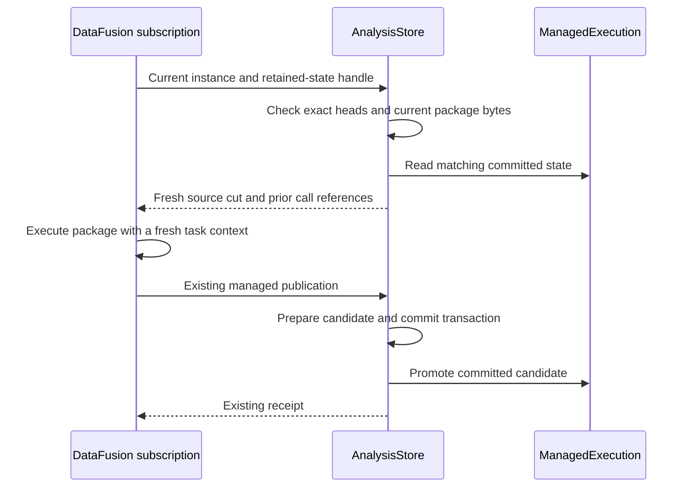

# Araphor retained execution state review

This guide covers retained state, change inputs, and membership in
`6a61cd89a`, plus the lookup working tree based on that commit. The changes remove repeated saved-call reads and
deliver declared input changes to packages. The parent
plan is [reactive execution latency](../plans/araphor-reactive-execution-latency.md).

## Intended end state

A subscription retains checked package state after each successful commit.
Each invocation receives changes to its input query and the last committed
state. Data remains the durable owner. Native DataFusion operators execute
the input query. Native and Wasm packages use the same checked contract.

The current code retains saved state and delivers declared change inputs.
Builtin Graph inputs still use complete selections. Native input SQL still
executes its complete selection. Data still encodes the complete target for
cold recovery. Complete Graph state uses the cold path when the retained
state is incomplete. The complete latency proposal remains **Not done**.

## Implementation review flow

[AnalysisStore::accept_validated_batch](../../crates/araphor-data/src/analysis/mod.rs) Data commits new source rows or a relevant context change
  -> [Runtime::next_event](../../crates/araphor-query/src/stream/physical/runtime.rs) Query wakes subscriptions whose native plans use those inputs
  -> [ManagedPublication::begin](../../crates/araphor-analysis/src/instance/subscription.rs) the subscription supplies its retained state with the current instance
  -> [AnalysisStore::capture_managed](../../crates/araphor-data/src/analysis/managed/capture.rs) Data checks the store, instance, current package bytes, and exact saved-call heads
  -> [ManagedExecution::calls](../../crates/araphor-data/src/analysis/managed/execution.rs) Data borrows matching saved state or uses the existing cold read
  -> [PackageExec::change_inputs](../../crates/araphor-query/src/definition/physical/changes.rs) Query binds the committed base and current target to the prepared native difference plans
  -> Partial [PackageExec::evaluate](../../crates/araphor-query/src/definition/physical.rs) package physical execution receives declared changes or the complete selection and computes output and tentative state
  -> [GraphRows::progress_plan](../../crates/araphor-data/src/analysis/graph_rows/progress.rs) the existing Graph writer validates the next progress map
  -> [AnalysisStore::retain_managed](../../crates/araphor-data/src/analysis/managed/execution.rs) Data prepares retained state from checked live inputs, output, and validated progress
  -> [AnalysisStore::commit_managed_projection](../../crates/araphor-data/src/analysis/managed/commit.rs) Data commits output changes, saved state, progress, and replay references
  -> [ManagedExecution::promote](../../crates/araphor-data/src/analysis/managed/execution.rs) Data replaces retained state after the commit succeeds

[AnalysisStore::commit_managed_projection](../../crates/araphor-data/src/analysis/managed/commit.rs) An invocation fails or its authority changes
  -> [PendingProgress::drop](../../crates/araphor-data/src/analysis/managed/execution.rs) Data releases tentative progress on success or failure
  -> [ManagedExecution](../../crates/araphor-data/src/analysis/managed/execution.rs) the last committed state remains available after a failed publication

[Instance::subscribe_on](../../crates/araphor-analysis/src/instance/subscription.rs) The process restarts
  -> [Step](../../crates/araphor-analysis/src/instance/sink.rs) Analysis creates empty retained state for the new subscription
  -> [AnalysisStore::capture_managed](../../crates/araphor-data/src/analysis/managed/capture.rs) the first invocation restores saved state from Data
  -> [ManagedExecution::promote](../../crates/araphor-data/src/analysis/managed/execution.rs) the first successful commit retains state for later invocations

## State and lifetime

Analysis creates one opaque `ManagedExecution` in each subscription's `Step`.
Data alone changes its contents. Each entry contains the last committed
input, output, checkpoint, context, and result reference. Graph continuation
also retains the progress map that the existing writer validates. The cache
does not hold a Query task context, source snapshot, operation control,
execution receipt, database connection, or exchange permit.

Saved evaluations omit their prior checkpoint and previous outputs. This
rule prevents a chain of all earlier invocation states. Arrow batches share
their existing buffer reservations. Analysis reserves retained metadata
through its existing memory owner. If an enabled memory setting rejects
optional retention, Analysis drops retained state and keeps the successful
durable receipt. The next invocation reads state from Data.



The existing attempt transaction and final authority checks remain in place.
A call-head, instance, store UUID, schema, or recovery-epoch mismatch uses the
cold path. A clean reopen can reuse matching immutable state. A new process
cannot retain these memory references and restores state from the store.

## Declared change inputs

[ChangeInputs](../../crates/araphor-analysis-sdk/src/model/changes.rs) names
ordinary input ports. Each pair has a `before` port for removed rows and an
`after` port for inserted rows. A separate reset port has one non-null Bool
row. A guest checkpoint is optional. A stateful model declares a resumable
checkpoint. The descriptor fragment is:

```yaml
change_inputs:
  reset: reset
  ports:
    - before: removed
      after: input
```

All three ports are declared in the model's typed interface. The before and
after schemas match. The caller supplies the after query. Query supplies
before and reset. Admission rejects caller arguments for generated ports.
For example, the qualification image accepts:

```sql
SELECT * FROM "runtime-fixture"."1".changes(
  input => (SELECT source_cursor AS value FROM events))
```

[Packages::changes](../../crates/araphor-query/src/definition/package/changes.rs)
builds native `ROW_NUMBER` windows and two anti joins. The row number is
partitioned by all input columns. The join compares all columns and that
occurrence number, with NULL values equal. Thus `[7]` to `[7, 7]` supplies
one inserted row. Native optimization and physical planning prepare these
children with the rest of the package call. There is no custom difference
execution operator. The
[subscription runtime](../../crates/araphor-query/src/stream/physical/runtime.rs)
uses DataFusion's plan-state reset before reuse. Each invocation has its own
source bindings and task context.

Change ports describe unordered row collections. The package handles each
declared input change. Metadata-only changes still invoke the package.
Current support inputs remain ordinary complete inputs. A missing base,
changed parameters, or changed support input resets the whole invocation.
Reset supplies empty before ports and complete after targets. Reset also
clears the checkpoint and previous outputs.

An [InputSource::Lookup](../../crates/araphor-analysis-sdk/src/model.rs)
contains native SQL that executes after the difference plans. Admission
prepares that SQL and rejects caller overrides. The input dependency graph
rejects a target or stable support query that reads a late lookup, before
port, or reset port. Lookup queries can read the delivered before, after,
reset, and earlier lookup ports. Their raw source dependencies share the
captured snapshot. Native row numbering supplies zero-based `__row_index`
values before lookup filters and joins.

Lookup ports retain bound-input provenance as well as durable dependencies.
A lookup over removed rows inherits their historical revision and coverage.
Data stores delivered lookup rows for exact replay. Data excludes lookup
rows from the target cache and support-reset comparison. A lookup source
change can therefore invoke a package when the main row difference is empty.

A stateless package retains no guest checkpoint. Data still retains its
exact committed target and base. Commit and replay validate the reset flag
against that base independently of guest checkpoint presence. Stateful
packages retain their existing checkpoint/reset checks.

The SDK rejects output evidence links to before and reset ports. A new
output cites current after or support inputs. Historical before inputs keep
their old revision and coverage. Data binds their metadata to the exact
committed prior result. That historical base is replay lineage. Data does
not turn old witnesses into current witnesses.

[ManagedChanges](../../crates/araphor-data/src/analysis/managed/model.rs)
retains full targets separately from delivered inputs. Data stores the
delivered before, after, and reset Arrow batches without reordering them.
[RecordTarget](../../crates/araphor-data/src/analysis/managed/model.rs)
stores target metadata through the existing binary record and Arrow payload
path. Target IPC is absent from the record header. Cold restoration charges
the wire and decoded Arrow memory before decoding. Replay restores the saved
state, then performs the complete SDK validation. Native and Wasm ABI
layouts and contract versions are unchanged.

[Inputs::input](../../crates/araphor-query/src/inputs/receipt.rs) identifies
managed after targets by invocation, call, port, committed store cut, and
selected provenance. These positions do not encode the full Arrow selection
to obtain its identity. Direct producer bindings keep the producer's exact
revision. Snapshot and unpaired support inputs keep row-based identity.

## Graph contribution membership

[GraphStage::apply](../../crates/araphor-data/src/analysis/graph_rows/stage.rs) the Snapshot adapter validates and merges the unit-zero contribution
  -> [Contributions::apply](../../crates/araphor-graph/src/contributions.rs) Graph compares complete replacement rows with current unit members
  -> [Contributions::apply](../../crates/araphor-graph/src/contributions.rs) Graph closes removed or changed intervals before it opens replacement intervals
  -> [Contributions::apply](../../crates/araphor-graph/src/contributions.rs) Graph updates logical counts from touched-key presence transitions
  -> [AnalysisStore::commit_managed_projection](../../crates/araphor-data/src/analysis/managed/commit.rs) Data commits the existing transaction

[GraphRows::write_metadata](../../crates/araphor-data/src/analysis/graph_rows/history.rs) Data prepares one complete metadata contribution
  -> [Contributions::apply](../../crates/araphor-graph/src/contributions.rs) Graph uses the same member comparison and interval writer

Data supplies one batch for each scope and version. Graph opens no store and
commits no transaction. The existing member history includes an interned
event reference as the unit key. An empty unit replacement removes that
unit's members. An omitted unit remains unchanged. Shared logical members
survive removal of one owner. Equal replacements preserve their intervals.

[Recovery validation](../../crates/araphor-data/src/analysis/graph_rows/validation.rs)
checks source ownership, overlap within each unit, conflicting historical
values, and logical counts. The result-to-producer-cut relation still selects
historical Graphs. The
[Graph owner tests](../../crates/araphor-graph/src/contributions/tests.rs)
and [Data unit tests](../../crates/araphor-data/src/analysis/graph_rows/tests/schema.rs)
exercise these rules.

This is the membership foundation. Builtin event-unit publication is not
connected yet. The Snapshot adapter still reads its complete prior unit.
This guide does not claim a timing gain for that transitional path.

## Proof and limits

[Data tests](../../crates/araphor-data/src/analysis/managed/tests/execution.rs)
cover failed publication, retry, matching warm and cold values, parameter
changes, call-head changes, current package modification and deletion,
recovery-epoch changes, and a fresh retained-state owner after reopening.
[Pending progress](../../crates/araphor-data/src/analysis/managed/execution.rs)
has a cleanup test for both successful and failed scopes.

The [managed Graph tests](../../crates/araphor-analysis/src/graph/native/tests/managed.rs)
and their history, notices, and restart modules exercise the production
subscription, Wasm calls, proof changes, empty input, historical output,
rollback, reopen, and memory release. Run results and the existing incident
measurement are recorded in the parent plan. This guide does not claim
millisecond event latency or migration of the builtin Graph input contract.

[Change-input qualification](../../crates/araphor-analysis/src/instance/tests/changes.rs)
uses SQL, Wasm, and the existing source-built native fixture. The tests cover
NULL duplicates, insertion, removal, exact replay, restart, parameter reset,
and separate captures of the same plan. The parent plan records run results
and the remaining work.
