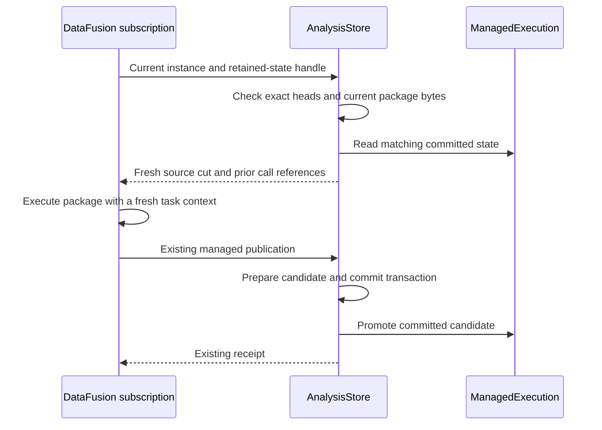

# Araphor retained execution state review

This guide covers retained state and lookup inputs through `babd497c4`, plus
the current unit migration and managed raw-change reads. The changes remove
repeated saved-call reads and deliver declared input changes to packages. The parent
plan is [reactive execution latency](../plans/araphor-reactive-execution-latency.md).

## Intended end state

A subscription retains checked package state after each successful commit.
Each invocation receives changes to its input query and the last committed
state. Data remains the durable owner. Native DataFusion operators execute
the input query. Native and Wasm packages use the same checked contract.

The current code retains saved state and delivers changed Graph units with
their current support. Native input SQL still selects complete targets. Data
retains those targets for difference execution and cold recovery. Graph
packages do not receive the complete prior Graph. Data owns contribution
history and the derived package state. Live integration, historical anchor
validation, exact replay, and restart checks pass. Combined timing proof
for the unit migration is **Not done**.

## Implementation review flow

[AnalysisStore::accept_validated_batch](../../crates/araphor-data/src/analysis/mod.rs) Data commits new source rows or a relevant context change
  -> [Runtime::next_event](../../crates/araphor-query/src/stream/physical/runtime.rs) Query wakes subscriptions whose native plans use those inputs
  -> [ManagedPublication::begin](../../crates/araphor-analysis/src/instance/subscription.rs) the subscription supplies its retained state with the current instance
  -> [AnalysisStore::capture_managed](../../crates/araphor-data/src/analysis/managed/capture.rs) Data checks the store, instance, current package bytes, and exact saved-call heads
  -> [ManagedExecution::calls](../../crates/araphor-data/src/analysis/managed/execution.rs) Data borrows matching saved state or uses the existing cold read
  -> [PackageExec::change_inputs](../../crates/araphor-query/src/definition/physical/changes.rs) Query binds the committed base and current target to the prepared native difference plans
  -> [PackageExec::evaluate](../../crates/araphor-query/src/definition/physical.rs) package physical execution receives changed units and their current lookup rows
  -> [GraphRows::stage_managed](../../crates/araphor-data/src/analysis/graph_rows/publication.rs) Data checks each producer base and validates current unit support
  -> [Contributions::apply](../../crates/araphor-graph/src/contributions.rs) Graph replaces the changed unit members in Data's transaction
  -> [StateRows::current](../../crates/araphor-graph/src/contributions/state.rs) Graph selects the current package state from active unit members
  -> [AnalysisStore::retain_managed](../../crates/araphor-data/src/analysis/managed/execution.rs) Data prepares retained state from checked live inputs, targets, and output
  -> [AnalysisStore::commit_managed_projection](../../crates/araphor-data/src/analysis/managed/commit.rs) Data commits output changes, saved state, progress, and replay references
  -> [ManagedExecution::promote](../../crates/araphor-data/src/analysis/managed/execution.rs) Data replaces retained state after the commit succeeds

[AnalysisStore::commit_managed_projection](../../crates/araphor-data/src/analysis/managed/commit.rs) An invocation fails or its authority changes
  -> [ManagedExecution::promote](../../crates/araphor-data/src/analysis/managed/execution.rs) Data promotes retained state only after the commit succeeds
  -> [ManagedExecution](../../crates/araphor-data/src/analysis/managed/execution.rs) the last committed state remains available after a failed publication

[Instance::subscribe_on](../../crates/araphor-analysis/src/instance/subscription.rs) The process restarts
  -> [Step](../../crates/araphor-analysis/src/instance/sink.rs) Analysis creates empty retained state for the new subscription
  -> [AnalysisStore::capture_managed](../../crates/araphor-data/src/analysis/managed/capture.rs) the first invocation restores saved state from Data
  -> [ManagedExecution::promote](../../crates/araphor-data/src/analysis/managed/execution.rs) the first successful commit retains state for later invocations

## State and lifetime

Analysis creates one opaque `ManagedExecution` in each subscription's `Step`.
Data alone changes its contents. Each entry contains the last committed
input, output, checkpoint, context, and result reference. The cache
does not hold a Query task context, source snapshot, operation control,
execution receipt, database connection, or exchange permit.

Saved evaluations omit their prior checkpoint and previous outputs. This
rule prevents a chain of all earlier invocation states. Arrow batches share
their existing buffer reservations. Analysis reserves retained metadata
through its existing memory owner. If an enabled memory setting rejects
optional retention, Analysis drops retained state and keeps the successful
durable receipt. The next invocation reads state from Data.



The existing attempt transaction and final authority checks remain in place.
A call-head, instance, store UUID, schema, or recovery-epoch mismatch uses the
cold path. A clean reopen can reuse matching immutable state. A new process
cannot retain these memory references and restores state from the store.

Recovery uses the saved evaluation that Data already decodes for each call.
It checks member anchors against that call's inputs and the owning unit's
support. The check includes closed historical intervals. Publication and
recovery use the same `CallBasis::local_for` rule. A fact can refer to another
record when both records are in that unit's support. Recovery does not load
a prior complete Graph for this check.

Arrow and MessagePack use the same state row: a tag and a nullable declared
value. The builtin `WAITING` state has tag `WAITING` and no declared value.
A custom state named `WAITING` has tag `DECLARED` and value `WAITING`.
Both compact and named MessagePack preserve that difference.

## Declared change inputs

[ChangeInputs](../../crates/araphor-analysis-sdk/src/model/changes.rs) names
ordinary input ports. Each pair has a `before` port for removed rows and an
`after` port for inserted rows. A separate reset port has one non-null Bool
row. A guest checkpoint is optional. A stateful model declares a resumable
checkpoint. The descriptor fragment is:

```yaml
change_inputs:
  reset: reset
  ports:
    - before: removed
      after: input
```

All three ports are declared in the model's typed interface. The before and
after schemas match. The caller supplies the after query. Query supplies
before and reset. Admission rejects caller arguments for generated ports.
The following SQL calls the qualification package. This SQL does not start
a subscription:

```sql
SELECT * FROM "runtime-fixture"."1".changes(
  input => (SELECT source_cursor AS value FROM events))
```

A Discovery definition stores this SQL with YAML metadata. Admission checks
the definition and starts nothing. Starting a Discovery creates the managed
Query subscription. The subscription executes on relevant source changes
and runs until stopped. The name `runtime-fixture` identifies a test image.

[Packages::changes](../../crates/araphor-query/src/definition/package/changes.rs)
builds native `ROW_NUMBER` windows and two anti joins. The row number is
partitioned by all input columns. The join compares all columns and that
occurrence number, with NULL values equal. Thus `[7]` to `[7, 7]` supplies
one inserted row. Native optimization and physical planning prepare these
children with the rest of the package call. There is no custom difference
execution operator. The
[subscription runtime](../../crates/araphor-query/src/stream/physical/runtime.rs)
uses DataFusion's plan-state reset before reuse. Each invocation has its own
source bindings and task context.

DataFusion computes inserted and removed row occurrences. Araphor passes
the resulting Arrow batches to the package without changing their values,
row order, or batch order. The package handles each declared input change.
Metadata-only changes still invoke the package.
Current support inputs remain ordinary complete inputs. A missing base,
changed parameters, or changed support input resets the whole invocation.
Reset supplies empty before ports and complete after targets. Reset also
clears the checkpoint and previous outputs.

An [InputSource::Lookup](../../crates/araphor-analysis-sdk/src/model.rs)
contains native SQL that executes after the difference plans. Admission
prepares that SQL and rejects caller overrides. The input dependency graph
rejects a target or stable support query that reads a late lookup, before
port, or reset port. Lookup queries can read the delivered before, after,
reset, and earlier lookup ports. Their raw source dependencies share the
captured snapshot. Native row numbering supplies zero-based `__row_index`
values before lookup filters and joins.

## Query result delivery

A subscription for `SELECT source_cursor FROM events` delivers rows in
committed arrival order. The order uses `(commit_revision, ordinal)`.
The numeric cursor value does not change that order. A resumed subscription
continues after its saved position. One wake can cover multiple commits;
the subscription reads every retained row after that position.

A snapshot delivers the batches that DataFusion produces. Araphor does not
sort rows, change values, or change batch order before package execution.
An explicit top-level `ORDER BY` remains part of that query's execution.

[PackageCall](../../crates/araphor-query/src/definition/call/program.rs)
uses native views to keep each package's standalone input and output program
outside the caller's derived-relation cleanup. Query expands these views
after SQL planning and before parameter binding, source checks, and admission
sealing. Native `OutputRequirements` preserves the physical program's final
ordering. No view marker remains in the admitted package call.

A caller-supplied derived relation keeps native DataFusion SQL behavior.
Query does not rebuild an inner `ORDER BY` that DataFusion removes from that
relation. Standalone descriptor queries and package output programs have
their own query roots.

Lookup ports retain bound-input provenance as well as durable dependencies.
A lookup over removed rows inherits their historical revision and coverage.
Data stores delivered lookup rows for exact replay. Data excludes lookup
rows from the target cache and support-reset comparison. A lookup source
change can therefore invoke a package when the main row difference is empty.

A stateless package retains no guest checkpoint. Data still retains its
exact committed target and base. Commit and replay validate the reset flag
against that base independently of guest checkpoint presence. Stateful
packages retain their existing checkpoint/reset checks.

The SDK rejects output evidence links to before and reset ports. A new
output cites current after or support inputs. Historical before inputs keep
their old revision and coverage. Data binds their metadata to the exact
committed prior result. That historical base is replay lineage. Data does
not turn old witnesses into current witnesses.

[ManagedChanges](../../crates/araphor-data/src/analysis/managed/model.rs)
retains full targets separately from delivered inputs. Data stores the
delivered before, after, and reset Arrow batches without reordering them.
[RecordTarget](../../crates/araphor-data/src/analysis/managed/model.rs)
stores target metadata through the existing binary record and Arrow payload
path. Target IPC is absent from the record header. Cold restoration charges
the wire and decoded Arrow memory before decoding. Replay restores the saved
state, then performs the complete SDK validation. Native and Wasm ABI
layouts and contract versions are unchanged.

[Inputs::input](../../crates/araphor-query/src/inputs/receipt.rs) identifies
managed after targets by invocation, call, port, committed store cut, and
selected provenance. These positions do not encode the full Arrow selection
to obtain its identity. Direct producer bindings keep the producer's exact
revision. Snapshot and unpaired support inputs keep row-based identity.

## Graph contribution membership

[UnitBatch::new](../../crates/araphor-data/src/analysis/graph_rows/units.rs) Data validates one contribution for each changed unit
  -> [GraphRows::apply_units](../../crates/araphor-data/src/analysis/graph_rows/units.rs) Data interns the changed native values and their current evidence
  -> [Contributions::apply](../../crates/araphor-graph/src/contributions.rs) Graph closes removed or changed intervals before it opens replacement intervals
  -> [Contributions::apply](../../crates/araphor-graph/src/contributions.rs) Graph updates logical counts from touched-key presence changes
  -> [ProducerChanges::resolve_metadata](../../crates/araphor-data/src/analysis/graph_rows/publication.rs) Data uses the same derived state for result metadata and publication
  -> [AnalysisStore::commit_managed_projection](../../crates/araphor-data/src/analysis/managed/commit.rs) Data commits the existing transaction

[GraphRows::write_metadata](../../crates/araphor-data/src/analysis/graph_rows/history.rs) Data prepares the result metadata contribution
  -> [Contributions::apply](../../crates/araphor-graph/src/contributions.rs) Graph uses the same member comparison and interval writer

Data supplies one batch for each scope and version. Graph opens no store and
commits no transaction. The member history includes an interned event
reference as the unit key. An empty unit replacement removes that unit's
members. An omitted unit remains unchanged. Shared logical members survive
removal of one owner. Equal replacements preserve their intervals. A reset
replaces the scope's active members. It does not remove historical values.

[SubjectRows](../../crates/araphor-graph/src/subjects.rs),
[RelationshipRows](../../crates/araphor-graph/src/relationships.rs), and
[FindingRows](../../crates/araphor-graph/src/findings.rs) own native value
schema, interning, and decoding. Data retains source, context, package, and
result authorization. Existing DataFusion table providers read the selected
historical cut. No query planner or second Graph store is added.

[StateRows](../../crates/araphor-graph/src/contributions/state.rs) stores the
existing typed package state as a unit member. Process and credential state
use native record identity order. Kubernetes state uses context key order.
Source position proves provenance; it does not select the summary. The
selected state reference is a checked index over member history. A declared
custom value uses the existing state tag and declared payload.

[Recovery validation](../../crates/araphor-data/src/analysis/graph_rows/validation.rs)
checks source ownership, overlap within each unit, conflicting historical
values, logical counts, and the selected state.
[GraphRows::call_scope](../../crates/araphor-data/src/analysis/graph_rows/history.rs)
checks the exact source, instance, call, package, image, and producer version.
The result-to-producer-cut relation still selects historical Graphs. The
[Graph owner tests](../../crates/araphor-graph/src/contributions/tests.rs),
[state tests](../../crates/araphor-graph/src/contributions/state/tests.rs), and
[Data unit tests](../../crates/araphor-data/src/analysis/graph_rows/units/tests.rs)
exercise these rules. Current-source run results remain pending.

## Committed raw changes

[AnalysisStore::read_managed_tables_filtered](../../crates/araphor-data/src/analysis/extraction.rs)
accepts a managed read after a complete committed input position
  -> [AnalysisTableRead::check_managed_changes](../../crates/araphor-data/src/analysis/extraction.rs) rejects projected relations and selections that this read cannot supply
  -> [AnalysisStore::capture_managed](../../crates/araphor-data/src/analysis/managed/capture.rs) checks the instance, grant, generation, progress, and current call heads in the captured transaction
  -> [RawJournal::select_position](../../crates/araphor-data/src/analysis/raw.rs) selects committed raw rows after the input position and through the captured revision
  -> [AnalysisStore::raw_removals](../../crates/araphor-data/src/analysis/extraction/changes.rs) reads retirement ranges from the same revision interval
  -> [ManagedCapture::seal](../../crates/araphor-data/src/analysis/managed/capture.rs) retains the exact source interests and witnesses for publication

This read returns additions, removals, and current source metadata. Current
metadata is not a delta relation. The supported projected relations are
`events`, `trace_output`, `coverage`, `discovery_state`, and `graph_state`.
Trace measurements and context or result relations require their own change
read support. This read rejects those requests. A dependency-only context
request retains its source interest without reading context rows. An
unselected `contexts = All` scope is not expanded to all context keys.

The reader owns the captured revision and segment lease. The returned
`ManagedCapture` has the existing publication contract. A read, failed read,
or cancellation does not advance the instance progress or call heads.
Only the existing publication transaction commits execution state.

The [managed journal tests](../../crates/araphor-data/src/analysis/managed/tests/journal.rs)
check bounded reads, arrivals after the captured cut, late gap repair, idle
reads, unsupported selections, stale owners, cancellation, retirement,
reopen, and unselected context keys. The existing
[raw change tests](../../crates/araphor-data/src/analysis/extraction/changes/tests.rs)
also check source and trace retirement, binding filters, and replay floors.

This Data API is a prerequisite. Query still uses complete captures for
managed Graph execution. Native input execution, context and coverage change
feeds, and the complete incremental Graph path are **Not done**. The parent
plan records the required replacement. This API alone proves no latency gain.

## Proof and limits

[Data tests](../../crates/araphor-data/src/analysis/managed/tests/execution.rs)
cover failed publication, retry, matching warm and cold values, parameter
changes, call-head changes, current package modification and deletion,
recovery-epoch changes, and a fresh retained-state owner after reopening.
The old Graph progress map and its temporary retention owner are removed.

The [managed Graph tests](../../crates/araphor-analysis/src/graph/native/tests/managed.rs)
and their history, notices, and restart modules exercise the production
subscription, Wasm calls, proof changes, empty input, historical output,
rollback, reopen, and memory release. Run results and the existing incident
measurement are recorded in the parent plan. This guide does not claim
millisecond event latency or completed qualification of the unit migration.

[Change-input qualification](../../crates/araphor-analysis/src/instance/tests/changes.rs)
uses SQL, Wasm, and the existing source-built native fixture. The tests cover
NULL duplicates, insertion, removal, exact replay, restart, parameter reset,
and separate captures of the same plan. The parent plan records run results
and the remaining work.
