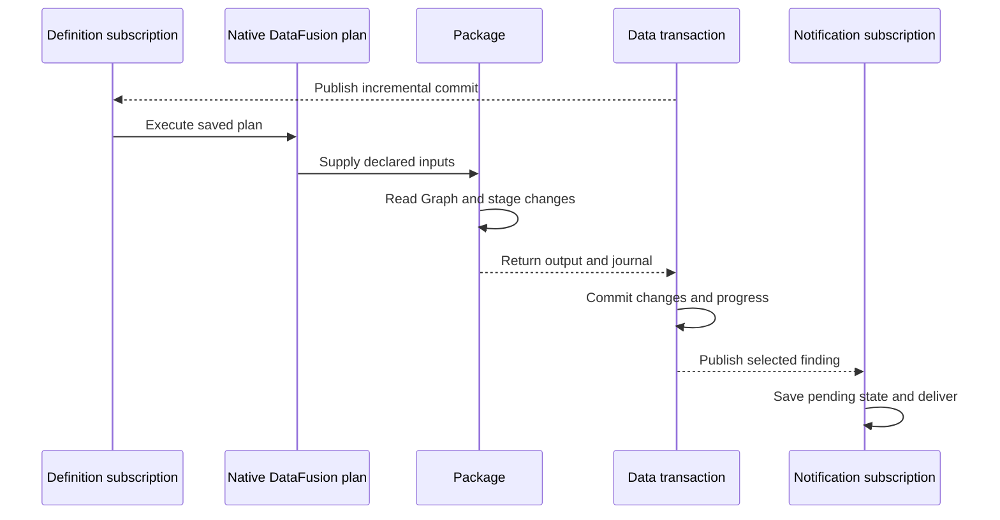
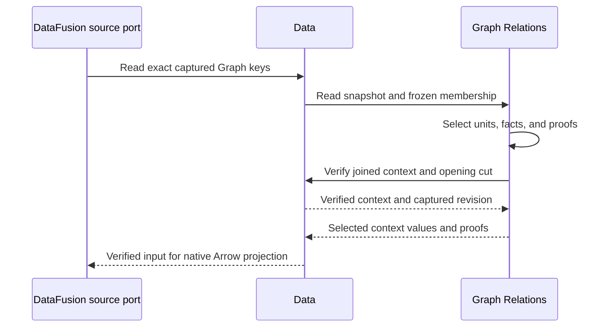
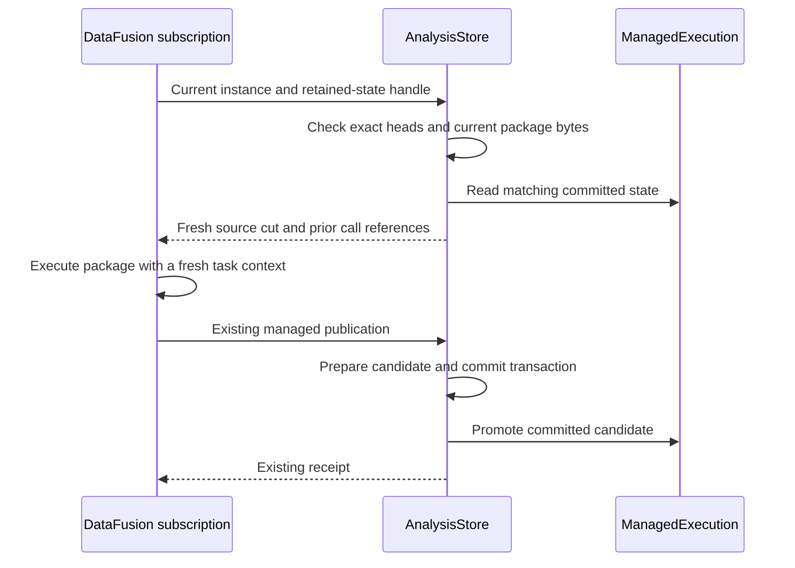
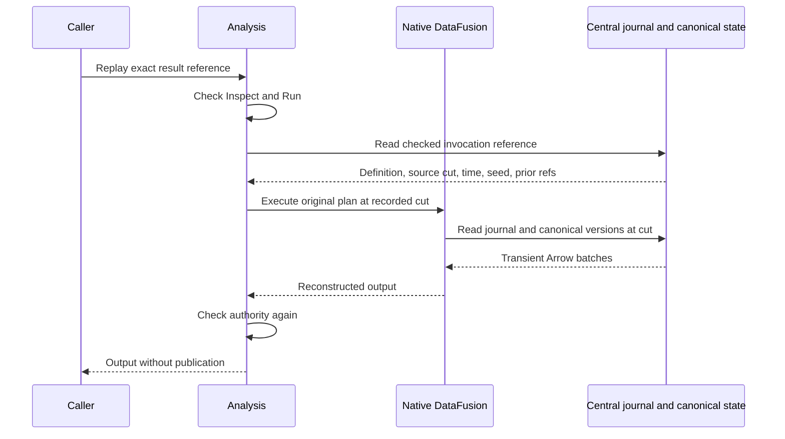

# Araphor retained execution state review

## Native finding publication, 2026-11-05

Read [publication](../../crates/araphor-data/src/analysis/managed/graph/publication.rs)
first, then the [property dictionary](../../crates/araphor-data/src/analysis/managed/graph/projection/publish.rs).
Data reads current pinned writer heads and visits every current member alias.
The existing [pending layer](../../crates/araphor-graph/src/committed.rs)
provides actual added and closed members. Its guard remains armed through
projection and commit. Generic [property visitation](../../crates/araphor-graph/src/properties.rs)
includes property-only rows. Neither Graph API knows a package or finding ID.

Data groups `properties.value` with native Arrow sort and partition kernels.
It checks all current aliases of each changed tenant/finding key. The canonical
candidate order is effective property reference, then candidate relation.
The emitted pair uses the existing canonical mapping when present. Only
current rows opened at this publication revision receive missing mappings.
The fixed recognized finding schema has no float leaves. Binary reason data
stays binary. The dictionary and its reservations end with publication.

Five alternating pairs of the unchanged exact test pass with equal work.
All 25 matched projection spans are lower. The paired median reductions are
77.26 percent for complete projection and 3.23 percent for the whole process.
Both warm notification intervals are lower in every pair; initial results are
mixed. The nested costs are not added. Millisecond latency and the 100-fold
target remain **Not done**. Edge cases outside the exact incident case have
source review only. See the [publication evidence](../plans/araphor-execution-handoff.md#native-finding-publication-result-2026-11-05).

## Bounded append reader, 2026-11-05

[Runtime](../../crates/araphor-query/src/stream/physical/runtime.rs) gives each
Append subscription one [Data reader](../../crates/araphor-data/src/analysis/extraction/append.rs).
It retains a typed source header and one immutable journal descriptor.
[Query](../../crates/araphor-query/src/sources/append.rs) retains its native
DataFusion memory reservation. Fresh page evaluations keep the saved physical
plan, page limits, timeout, and call-context completion. The
[common raw scanner](../../crates/araphor-data/src/analysis/extraction/raw.rs)
uses the emitted output position for each window. A short read checks current
metadata, replay floor, and trace authority. Its maintenance lease covers row
construction. Changed inputs or a completed range use the ordinary reader.
Requests other than projected events or trace output also use that reader.

Five alternating pairs of the unchanged exact test pass. Each candidate uses
the retained path for 60 of 64 bulk pages. Physical frame work is equal.
The paired median reductions are 76.05 percent for summed capture time,
36.35 percent for the complete bulk interval, and 7.28 percent for the whole
process. Initial and warm arrival differences are mixed. These nested costs
are not added together. Millisecond latency and the 100-fold target remain
**Not done**. See the [append reader evidence](../plans/araphor-execution-handoff.md#bounded-append-reader-result-2026-11-05).

## Current package path, 2026-11-05

[SourceRecovery](../../crates/araphor-query/src/stream/recovery.rs) now transfers
the committed source index after the failed subscription joins. The same Host
member loop passes it to a fresh subscription. Reuse requires the same saved
native plan and Memory owner. A fresh rebuild uses cold restoration. Failed
views, call contexts, Graph resources, attempts, and controls keep their cleanup
path. Data still commits source index changes only through the existing receipt.
Five alternating pairs of the exact test pass. Cold restorations fall from
three to zero in every pair. The paired whole-process median is 5.28 percent
lower, and both warm arrivals are lower in every pair. Initial and bulk results
are mixed. Millisecond latency and the 100-fold target remain **Not done**.
See the [source continuation evidence](../plans/araphor-execution-handoff.md#source-index-continuation-result-2026-11-05).

[LayerKeys](../../crates/araphor-graph/src/layers/keys.rs) now resolves one
batch per dictionary kind before member append. The public intern APIs use the
same [dictionary core](../../crates/araphor-graph/src/dictionary.rs). Existing
IDs remain in the durable tables. Borrowed keys, checked memory, cancellation,
and transaction rollback keep their existing owners. Five alternating pairs
of the exact test pass. All 25 matched apply spans are lower, with a 27.14
percent median reduction in summed apply time. Mixed whole-test differences
establish no overall gain or regression. See the [dictionary evidence](../plans/araphor-execution-handoff.md#graph-dictionary-batch-result-2026-11-05).

[Source freshness checks](../../crates/araphor-data/src/analysis/dependencies.rs)
now read the requested relation versions in one query for each freshness check.
They compare the same captured pairs in the same order, including missing and
duplicate names. No validation state crosses snapshots. Five alternating pairs
of the exact test pass. The final index call's source/trace validation median
falls from 238.994 to 82.294 milliseconds. Warm notification arrivals are lower
in each pair. Whole-test differences are mixed, with a 2.54 percent lower paired
median; this is not a certain overall gain. The millisecond and 100-fold targets
remain **Not done**. See the [source freshness evidence](../plans/araphor-execution-handoff.md#source-freshness-reader-result-2026-11-05).

The Graph preparation change also passes ten exact-test runs in five
alternating pairs. Every nonzero origin-validation loop is faster in its
matched pair. The final warm median falls from 254.104 to 105.720 milliseconds;
complete prewriter preparation falls from 574.387 to 432.947 milliseconds.
The small, mixed whole-test differences establish no overall gain or regression.
No separate arrival or bulk gain is claimed. See the [origin preparation evidence](../plans/araphor-execution-handoff.md#graph-origin-preparation-result-2026-11-05).

The latest committed authority reader passes six exact-test runs in three
alternating pairs. Test times are 44.10–46.12 seconds for the shared-reader
baseline and 40.48–41.33 seconds for the committed owner. The median paired
process reduction is 10.35 percent. Median arrival times fall from 3.988862 to
3.393343 seconds initially, from 6.558421 to 5.601720 seconds for the second
notification, and from 7.412637 to 6.117422 seconds for the third. The bulk
difference does not establish a gain. The millisecond and 100-fold targets
remain **Not done**. See the [committed authority evidence](../plans/araphor-execution-handoff.md#committed-authority-reader-result-2026-11-05).

This section covers the native Graph reader. Three alternating pairs of the
exact incident test pass with all 16,402 records. Baseline test time is
70.51–71.87 seconds. Native reader time is 47.44–47.68 seconds. The median
paired process reduction is 33.64 percent. Median notification arrival takes
3.992181 seconds initially and 6.717021 and 7.609041 seconds later.
The earlier single-run speed factors are reference ratios only. The package
input replacement's matched prepared reservation remains 22,796,472 bytes,
compared with 380,210,812 bytes before it. This is charged retention, not RSS.
Millisecond latency and the 100-fold target remain **Not done**.

The subsequent standalone finding reader change also passes ten exact-test
runs in five alternating pairs. Each public read snapshot now shares one
`OwnerRead` across heads, publication authority, values, and provenance.
Batch and history reads share that owner across their requested results.
The replaced fresh-owner wrappers are removed. The paired process reduction
is 2.49 percent at the median, with a range of 0.92 to 4.67 percent.
Notification arrival and bulk differences do not establish a gain. Pair 1
has 23 baseline captures and 25 candidate captures; all other runs have 24.
See the [standalone read evidence](../plans/araphor-execution-handoff.md#standalone-finding-reader-result-2026-11-05).

### Intended end state

An incremental commit wakes the ordinary Definition subscription. A saved
native DataFusion plan selects inputs and calls package code. The package uses
Araphor Graph and stages changes. Data commits Graph, finding, and progress
changes together. The notification subscription delivers the resulting finding.
The target requires millisecond latency and a measured 100-fold improvement.

### Current builtin causal package

The default Definition calls `HF-CAUSAL-001` revision `1`, export `detect`.
That export also consumes the package's `index` outputs. Package code owns both
operations. The generic Graph engine has no incident rules.

The index stores these entity identities:

| Entity | Identity |
| --- | --- |
| Source | Authenticated tenant, node, boot, label, source, and source epoch |
| Record | Source identity, CPU, and durable cursor |
| Actor | Exact native task identity and process instance |
| Credential | Tenant, authority, lease, and principal |
| Request | Tenant, cluster, carried request ID, and audit ID |
| Pod | Tenant, cluster, UID, and creation revision |
| Binding | Tenant, cluster, binding ID, and destination node |

The links connect credential acquisition, authenticated requests, token
issuance, Pod creation, scheduling, and container admission. Each audit context
owns its contributions. Each edge retains exact record and context references,
the context revision, and disclosure requirements. The graph stores no raw event
body archive.

An audit or coverage change selects connected references through keyed Graph
adjacency in both directions. The index clears changed contributions and stages
replacement links. Native SQL loads the selected canonical records and audit
versions. Rust package code matches the incident chain. The pattern matcher
does not execute a graph query.

The detector requires successful credential acquisition, an issuance to a
different authority or principal, and use of that issued credential to create
a Pod. The same named container must be privileged and mount host `/` with
write access. Exact creation, scheduler binding, and admission references must
place it on a different node. Actor, process, socket, object, and proof checks
bind the audit claims to canonical evidence. Shared names and nearby times do
not establish the chain.

A complete chain with consistent proof and coverage produces a Critical,
Confirmed finding. Conflicts or incomplete canonical coverage produce
CoverageInsufficient with explicit limits. Related denied or failed actions
can be supporting evidence. They cannot replace a successful chain step.
Missing chain steps produce no finding. The detector does not prove host-root
execution or remote deletion. It does not implement a general attack-path
matcher or every credential-access bypass.

### Source freshness limit

Ordinary Selected subscriptions still use the conservative source freshness
check at registration and publication. An overlapping input change can stop
an evaluation and restart its retained source owner. A trial extended the
older Graph destination's captured-cut Follow mode to all subscriptions.
It removed three restarts but increased complete publications from five to
eight. The unchanged incident test slowed from 72.96 to 89.78 seconds.
That trial and its new tests were removed. The current source has no change
from that experiment. Its proof remains in the planning record.

### Native Graph read owner

[GraphStore](../../crates/araphor-graph/src/committed.rs) retains shared Arrow
property batches and row addresses. Key, outgoing, and incoming indexes select
members. Writer heads from the Data read transaction determine historical
visibility. [Graph reads](../../crates/araphor-graph/src/read.rs) use native Arrow
take over selected rows from each shared batch. Presence uses the same index.
The engine has no package IDs, finding IDs, subscriptions, or incident logic.

Data applies prepared Graph rows
  -> [layer application](../../crates/araphor-graph/src/layers.rs) records final coordinates and exact closes
  -> Data seals the native index before database COMMIT
  -> [managed commit](../../crates/araphor-data/src/analysis/managed/commit.rs) commits Graph, findings, and progress
  -> Data disarms the pending-layer cleanup and publishes its revision signal

Data rejects or rolls back the transaction
  -> the pending-layer guard removes its additions and closure markers
  -> Data releases the writer after that cleanup
  -> later readers use the last committed writer heads

[Installation](../../crates/araphor-graph/src/properties.rs) restores the native
index once from validated durable Graph tables. The native owner retains only
Graph arrays and indexes. Preparation scratch, package journals, invocations,
and input/output batches retain their existing lifetimes. The durable engine
and its write-side checks remain in use.

[Finding reads](../../crates/araphor-data/src/analysis/managed/graph/projection/native.rs)
combine those generic rows with Data's publication pins, actual producer
references, disclosure fields, and canonical value IDs. The common iterator
keeps every alias. Point and extraction readers use the existing representative
order. Provenance follows every matching origin.
[OwnerRead](../../crates/araphor-data/src/analysis/managed/reader/graph.rs) retains
one catalog and authority owner for its read transaction.
[Standalone finding APIs](../../crates/araphor-data/src/analysis/graph/findings.rs)
create that owner once per snapshot. Definition classification, current heads,
finding values, and the existing provenance traversal use it until the
snapshot ends. Each use retains its existing proof and reference checks.
Reader-scoped validation and live witness checks do not cross the snapshot
boundary. Committed metadata remains in the Data owner. Extraction and
notification capture keep their existing reader lifetimes.
[Notification lookup](../../crates/araphor-data/src/analysis/extraction/notifications/native.rs)
uses IDs from existing notification references. Package code chooses the IDs
before Data commits them. No host code predicts a package's future findings.

The final focused build passes in 258.773250 seconds. Six runs in three pairs pass with
unchanged workload and assertions. Each run has five publications and 24
notification captures. Full CI and the legacy Data library-test target were
not run. Rollback injection and durable restoration have source review only.
See the [paired evidence](../plans/araphor-execution-handoff.md#native-graph-reader-result-2026-11-05).

### Data committed authority owner

[CommittedOwners](../../crates/araphor-data/src/analysis/managed/reader/committed.rs)
retains Data's typed selected-result and actual-call metadata. It does not
retain package input/output batches, checkpoints, journals, or preparation
reservations. The generic Graph engine has no package metadata.

[Managed commit](../../crates/araphor-data/src/analysis/managed/commit.rs)
assigns the final proof references and writes each call Record
  -> it writes the final selected Step and completed Attempt
  -> Data seals those same typed values before database COMMIT
  -> successful COMMIT keeps the handles, then publishes the revision wake
  -> failure removes the provisional handles before the writer is released

[OwnerRead](../../crates/araphor-data/src/analysis/managed/reader.rs)
checks result visibility with the existing tenant, processor, and revision query
  -> it gets the exact native selected or call handle
  -> it checks live witness pins once for the selected union and actual call
  -> existing callers check requested scope, current heads, and finding values

[Witness pin checks](../../crates/araphor-data/src/analysis/managed/source/check.rs)
still require exact identity, expiry, and Live segment binding. Missing pins
remain permitted only after their saved expiry at the database snapshot clock.
The immutable contract validators remain available to recovery and other
existing integrity owners. Initial open runs full recovery validation before
it restores native handles. [Explicit recovery](../../crates/araphor-data/src/analysis/connection.rs)
replaces native metadata and Graph members before it reopens readers.
[Backup reopening](../../crates/araphor-data/src/analysis/backup.rs) restores the
Graph Shape registration on the new connection.

[Graph preparation](../../crates/araphor-data/src/analysis/managed/graph/commit.rs)
also shares one reader across all journals. Its runtime
[origin lookup](../../crates/araphor-data/src/analysis/managed/graph/read.rs)
uses the same committed producer handles. Origin identity, original scope,
selected instance, actual call, and live witness checks remain. Final commit
checks still compare the prepared parent, origin tuple, and disclosure state.
The separate profile replay and recovery paths keep their full validator.

The final focused build and six append-test runs pass. Recovery, backup, and
retention transitions have source review only. Full CI was not run.

### Source reading route

[Default Definitions](../../packages/default-definitions/causal.yaml) name package calls in ordinary SQL
  -> [ControlPackages::start_definitions](../../crates/mithril-control/src/service/packages/definitions.rs) reads the default folder or an operator folder and admits normal instances
  -> [InstanceHost](../../crates/araphor-analysis/src/instance/host.rs) owns managed subscriptions and lifecycle
  -> [PackageExec::change_inputs](../../crates/araphor-query/src/definition/physical/changes.rs) executes native plans for declared change inputs
  -> [BeforeReplay](../../crates/araphor-query/src/definition/replay.rs) validates one historical call and captures the union of its Before inputs
  -> [SourceSnapshot::fork_before](../../crates/araphor-query/src/sources/rows/before.rs) shares immutable captured rows and gives each plan separate mutable state
  -> [Causal package](../../crates/araphor-analysis-builtins/src/causal/index.rs) selects affected entities and stages package-defined Graph changes
  -> [Causal detector](../../crates/araphor-analysis-builtins/src/causal/detect.rs) checks cross-node evidence and stages a finding
  -> [GraphAuthority](../../crates/araphor-data/src/analysis/managed/graph/authority.rs) retains validated invocation authority and checks live state with short reads
  -> [Graph engine](../../crates/araphor-graph/src/read.rs) reads package-agnostic relations at the captured cut
  -> [PreparedManagedCommit](../../crates/araphor-data/src/analysis/managed/prepare.rs) prepares bounded changes outside the final writer transaction
  -> [Managed commit](../../crates/araphor-data/src/analysis/managed/commit.rs) validates current authority and commits changes and progress atomically
  -> [Notification publication](../../crates/araphor-analysis/src/instance/sink.rs) sends selected subscription rows to the notification router
  -> [PreparedNotificationBatch](../../crates/araphor-data/src/analysis/notification/prepared.rs) captures exact route, state, subject, finding, and basis versions in one bounded read
  -> [NotificationCycle](../../crates/araphor-analysis/src/notification/cycle.rs) preserves pending-state writes and current delivery checks

### Owner lifetimes

Control uses the same admission and instance APIs for default and operator
Definitions. Each Definition can contain zero or more package calls. Installing
an image does not start an analysis. Definition SQL selects the package export.
The default folder does not grant trust to an image.

The managed execution creates one `BeforeReplay` only when compatible prior
inputs are needed. The owner retains one validated historical reference, one
historical Session, one CallContext, native plans, and a captured source template.
Each input keeps its declared pair, schema, image, revision, coverage, and trace
checks. A fork shares the Arrow receipt, canonical buffers, and SourceView. Its
keys, ports, lineage, read tracking, and index start empty. Query memory charges
the copied metadata before cloning. Success and failure both finish the shared
CallContext. Failure also cancels the historical operation. No replay state
survives the invocation.

[Runtime::metadata_update](../../crates/araphor-query/src/stream/physical/runtime.rs)
receives a health update after an unrelated commit or a clock change.
  -> [Session::subscription_metadata](../../crates/araphor-query/src/execution.rs) creates one bounded header read
  -> [MetadataRead](../../crates/araphor-query/src/sources/rows/metadata.rs) reserves input memory before copying header selections and demand names
  -> [Window::apply_selection](../../crates/araphor-query/src/follow/window.rs) applies the existing time bound when the plan has no package call
  -> [AnalysisStore::subscription_metadata](../../crates/araphor-data/src/analysis/extraction.rs) reads current source, trace, and store headers in one Data snapshot
  -> [Capture::finish](../../crates/araphor-data/src/analysis/extraction/tables/mod.rs) checks availability with the original demand names
  -> [Runtime::metadata_update](../../crates/araphor-query/src/stream/physical/runtime.rs) returns a health update without changing evaluated progress

The header read retains exact source, trace, node, binding, and time bounds.
The read does not copy context, profile, Graph, result, or notification selectors.
Session keeps its full metadata read for cursor recovery and other callers.
An established subscription keeps its prior evaluated snapshot, requests, cursor,
and deadline. A pending relevant commit remains pending. A deadline that requires
execution still uses the existing full evaluation path. The header read returns
no row authority. One memory lease moves with the normalized demand map. The
remaining read lease moves with the returned header. Temporary scope memory is
released when the read ends. Native DataFusion plans and Arrow buffers keep
their existing owners.

Package code owns incident matching and node and edge changes. Native and guest
packages use the same SDK Graph operations. The generic Graph engine has no
package or detector rules. A package cannot commit. Data remains the transaction
owner. The old finite Graph analysis API remains a retirement item; its presence
does not provide a second startup path for the default causal Definition.

The causal index now declares only audit and coverage change inputs. Its
[descriptor](../../crates/araphor-analysis-builtins/src/causal/descriptor.rs)
uses native SQL for Before, After, and affected keys. The raw event input pair
and its key conversion are removed. The
[coverage owner](../../crates/araphor-analysis-builtins/src/causal/coverage.rs)
groups rows by exact source and CPU. Each returned group requires one receipt
and consistent report and floor fields. Exact expired ranges can include loss
above an unchanged retained floor. Recovery and pending ranges cause a new
evaluation but do not permanently retire an index reference. A missing current
source prevents restaging and clears reached prior owners. Old references remain
in the frontier so the detector can clear findings. Reset clears both writers.

The [index](../../crates/araphor-analysis-builtins/src/causal/index.rs) seeds
the old and current audit entities and source entities. Graph adjacency selects
connected references. The [detector query](../../crates/araphor-analysis-builtins/src/causal/records.sql)
still reads each requested canonical event and its coverage. Data can still
process every journal record in its native source view. Unrelated raw keys no
longer enter the index package input or its evidence pins. The append test
checks initial reset, late audit arrival, and the full background drain.
Nonprefix retirement, recovery, source absence, and re-registration remain
source-reviewed boundaries until their runtime cases pass. The input
replacement passes the exact append test in 72.96 seconds.

The Graph authority binds before the package transfer reserves memory.
Binding checks the registered attempt, captured source state, admitted model,
and relation contracts. The owner retains the actual attempt Arc, call ID,
compatible call-head set, and original native authority bytes. Each operation
uses a new short Data reader. The operation checks pending status, exact
current authority, lifecycle, generation, progress, completion, call heads,
source freshness, trace revocation, context proof, dependencies, and expiry.

The first read of a historical producer validates its full record, selected
owner, spec, pins, Graph proof, and original grant. Later reads check the exact
canonical result, Graph layer, writer, revision, tenant, instance, and call.
The original grant must still permit the bound scope. The owner retains no
Graph result values. Freeze drops authority scratch and certificates. The
existing journal retains exact origin references and row pins. Final Data
preparation and commit keep their full validation. The third index invocation takes 1.681420 seconds in the passing run.

Data owns pending attempt writes. A pending request and capture remain
immutable until success or termination sets `completed` in the same transaction.
The initial bind and final commit validate full contracts. The scalar live
guard does not detect an unsupported direct database edit to a pending contract
after binding. Startup recovery keeps its existing full corruption checks.

[AnalysisStore::read_tables_inner](../../crates/araphor-data/src/analysis/extraction.rs)
opens one immutable Data read snapshot.
  -> [OwnerRead](../../crates/araphor-data/src/analysis/managed/reader.rs) owns selected, producer, and publication proofs for that snapshot
  -> [OwnerRead::publication](../../crates/araphor-data/src/analysis/managed/reader/graph.rs) validates the selected owner and complete Graph writer pins before retaining a proof
  -> [Graph extraction](../../crates/araphor-data/src/analysis/extraction/graph/native.rs) uses that proof and checks each actual producer against the original requested scope
  -> [NativeNotifications](../../crates/araphor-data/src/analysis/extraction/notifications/native.rs) reads scalar values with the same owner and tenant relation SQL
  -> [AnalysisStore::finding_basis_on](../../crates/araphor-data/src/analysis/managed/graph/provenance.rs) selects exact records, contexts, coverage, and parent evidence with the same producer proofs

The owner retains no Graph values or permission decisions. Each cache use checks
the reader, tenant, and cancellation control. The first producer read keeps full
call, source pin, context pin, proof, and dependency validation. Canonical context
writes and recovery validate encoded context keys. Provenance does not rebuild
those same context pins in a second temporary table. Its requested-record table
and canonical context, fact, source-proof, coverage, and parent checks remain.
Each caller checks the historical grant against the original scope. Existing
live expiry checks remain at their current owners. The read context ends with
the reader transaction. It cannot cross a commit or an asynchronous wait.

The prepared router creates its existing budgeted owner before the current-head
read. Current heads, requested finding values, historical comparisons, and basis
reads share the tenant relation SQL. Publication proofs borrow their validated
grants. Map entries and shared allocation metadata are charged before insertion.
No permission or finding-value cache survives the read. Standalone point APIs
create their own read owner at their boundary.

The prepared notification batch owns one bounded read result. The batch stores
exact historical subjects for pending attempts. The router checks live grants
and lifecycle before effects. It saves pending state before delivery and saves
the outcome with the existing compare-and-set check. The batch adds no durable
input or output archive.



The [single incident test](../../crates/mithril-e2e/src/discovery/packages/required/incident/incremental.rs)
checks all 16,402 records, exact six-record evidence, two nodes, four sources,
public finding and revision reads, notification references, and atomic call
publication revisions. The current passing logs are
`/tmp/araphor-build-audit-input-20261105-a.log` and
`/tmp/araphor-live-audit-input-20261105-a.log`. These results cover this focused
case. They do not qualify the full workspace or the latency target.


This guide covers the retained native execution path and the Graph relation
replacement in the working tree on 2026-11-04. The replacement removes
repeated membership reconstruction and frozen context reads.

## Intended end state

The user has authorized a real Hugging Face incident workload in the single
incremental test. The process detector and Kubernetes placeholder are removed.
The new causal package must use one ordinary Definition over its admitted
source scope. Failed attempts and successful effects remain separate evidence.
The [current handoff](../plans/araphor-execution-handoff.md#current-causal-replacement-on-2026-11-04)
records the agreed replacement and its unqualified boundaries.

Data's [domain input owner](../../crates/araphor-data/src/analysis/managed/graph/domain.rs)
checks each source input, then joins the canonical proof basis for the staged
commands. [EvidenceBasis](../../crates/araphor-data/src/graph/evidence.rs)
checks native identities against each observation's source. A declared package
finding need not consume policy metadata. The source still checks actual
record identity, effects, coverage, disclosure, and declared reason authority.
These changes are under review. They have no passing runtime result yet.

The last unchanged live run failed in 218.337689 s during coverage reporting.
Eleven nonempty Graph receipts completed. Bulk drain and later arrivals did
not finish. The Shared future repair removed the observed parked input fill.
A complete passing test, millisecond latency, and the 100-fold target remain
**Not done**. The sections below retain earlier source states and results.


## Native journal reduction

Read [Journal](../../crates/araphor-graph/src/journal.rs) first. The private
edit retains the first relevant base-presence assertion. Later commands
cannot replace that assertion. Clear barriers select the final surviving
rows. Original batches remain available for Data domain validation.

[GraphStore::prepare_layers](../../crates/araphor-graph/src/layers/prepared.rs)
checks every original schema and stored relation namespace before the Data
writer is acquired. The admitted Data descriptor remains the logical schema
authority. The native storage comparison permits the existing Arrow storage
conversions. [BaseRows](../../crates/araphor-graph/src/layers/base.rs) reads
only touched identities and requested clear ranges at each captured cut.
It rejects duplicate identities and false base assertions. Preparation
retains exact opening revisions and native Arrow property rows.
[PendingGraph::apply_prepared](../../crates/araphor-graph/src/layers.rs)
consumes those rows and closes the exact intervals after a parent check.
The final endpoint guard checks affected edges across all Graph writers.
The generic Graph owner contains no package or finding rules.

Partial runs exercise native journal reduction. The exact incident test
must still complete. The current evidence does not establish a timing gain.


## Managed change preparation

Start with [Instance publication](../../crates/araphor-analysis/src/instance/sink.rs),
then read [PreparedManagedCommit](../../crates/araphor-data/src/analysis/managed/prepare.rs).
The tracked worker prepares before it enters the authority commit closure.
Preparation uses one pinned, controlled Data reader transaction. The opaque
token borrows the actual managed input. It is not Clone and holds no connection.
All destination commit APIs consume this token. There is no inline fallback.

The preparation owner builds revision-free call packets, checked canonical
context slots, source membership keys and counts, and native Graph layers.
Read [prepared imports](../../crates/araphor-data/src/analysis/managed/source/import.rs)
for fixed references, context ordinal slots, per-call attribution, the union,
and preencoded pin keys. Read [canonical context rows](../../crates/araphor-data/src/analysis/context/batch.rs)
for immutable body and fact-index equality. A fresh supplied context keeps
its import flag when another handle has the same historical reference.
The final transaction can bind an exact context committed after capture.

[PreparedMemory](../../crates/araphor-data/src/analysis/managed/budget.rs)
uses the actual commit worker control and the existing Query memory pool.
It charges new retained buffers and temporary decode work. Graph writer
limits also apply. The token retains its memory owner after its buffers.
It adds no durable input or output copy.

Read [the final commit](../../crates/araphor-data/src/analysis/managed/commit.rs)
and [Graph preparation and publication](../../crates/araphor-data/src/analysis/managed/graph/commit.rs)
next. Before writes, Data checks the registered attempt, store, schema,
recovery, live grant, exact target version, captured instance and call heads,
source parent, Graph parents, and writer and historical origin identities.
An origin check includes its original call ID even if no row pin exists.
Data then binds revisions, imports canonical contexts, writes call and
source pins, applies Graph layers, publishes findings, and advances progress.
The exact context conflict join, final endpoint guard, public-domain conflict
checks, source expiry claims, domain counts, and final caller check remain
inside this transaction. Retained-state promotion and subscription wakes
occur after COMMIT.

The focused library check passes in 37.97 s. The exact target build with
the final guard and charges passes in 255.382395 s. The unchanged live case
fails in 249.617853 s with `Elapsed(())`. Four initial notices pass in
9.269059 to 15.727428 s. Fourteen nonempty Graph publications complete
before teardown. A fifteenth completes during teardown. Bulk drain and
warm arrivals remain unqualified. The largest healthy writer hold is
10.819473 s, including 5.641296 s in actual COMMIT. The largest Status header
is 13.842859 s. These boundaries overlap and must not be added.

The native diagnostic used `sum_by_name`, which excludes built-in compute,
output, and spill metrics. Their zeros are unread values. The corrected
reader uses native `MetricsSet::sum` with the metric name. Its exact build
is in progress. Millisecond latency and the 100-times target remain
**Not done**.


## Current qualification before Status

[GraphPublication::prepare_on](../../crates/araphor-analysis/src/graph/native.rs)
now uses explicit After row providers for the current resolver. The existing
[SourceLookup](../../crates/araphor-query/src/sources/keys/planner.rs) can bind
keys to those providers. Complete fallback identities come from the admitted
canonical event driver. The old full-resolved identity enumeration is
removed. Status and dirty each join their own selected identities to current
payloads. Their keyed driver bindings are separate. A partial Status result
cannot become the complete dirty target. LEFT joins retain missing keys.
Changed, Control, Prefix, and header image rules remain separate. Full Before
imaging can overwrite the explicit After event and context row providers.

Corrected native metrics at cut 210 show 3329 build rows for 1024 selected
rows and a 15.859990-second Status header. The largest reported local
aggregate takes 2.456017 s. The unchanged case fails after 355.522293 s on
client authentication expiry. Twenty-one nonempty Graph publications
complete; bulk drain and warm arrivals do not. This supports the changed
work order but proves no complete-workload gain.

The focused library check passes in 38.93 s. The exact target build passes
in 208.161715 s. The unchanged live case fails in 250.916525 s with
`Elapsed(())`. Thirteen nonempty Graph publications complete before teardown;
a fourteenth completes during teardown. Healthy source heads reach 769,
769, 769, and 2049 members. Bulk drain and later arrivals do not complete.

[PortExec](../../crates/araphor-query/src/sources/port.rs) reports four keyed
After event readers. However, the resolver still returns 769 current rows
for 512 selected keys. Internal canonical join keys do not prove external
demand binding. A healthy Status header takes 23.169358 s.

The reviewer agrees with a native join-direction correction in
[SourceJoin](../../crates/araphor-query/src/sources/keys/planner.rs).
An explicitly keyed Port has priority over a plain retained row reader.
Native input swapping places that Port on the probe side before distribution
enforcement. SourceLookup can then bind external keys before internal joins.
The focused check passes in 30.90 s. Its exact build passes in 215.017859 s.
The unchanged case fails in 345.660874 s on client authentication expiry.
Twenty-two nonempty publications complete before teardown. A twenty-third
completes during teardown. Healthy source heads reach 2049, 1793, 1281,
and 1025 members. The resolver still reads 513 rows for 256 selected keys.
The largest healthy Status header takes 19.801407 s. No complete-workload
gain is established.

The next correction carries keys through native HashJoin output projections.
SourceLookup uses the native output indices to map the complete join columns.
It keeps the existing preserved-side rules and native join, projection,
filter, null rules, and output schema. Static Port bind-outcome events and
the numeric projected-join count support runtime inspection. The reviewer
agrees with this correction. The focused check passes in 32.19 s. The exact
build passes in 219.815549 s. The unchanged case fails in 345.157697 s on
client authentication expiry. Twelve nonempty publications complete before
teardown. Healthy heads reach 1025, 769, 1281, and 1281 members.

At cut 101, actual payloads read 512 selected rows at cursors 258 to 769,
or 768 selected rows at cursors 258 to 1025. The false full fallback still
builds 769 or 1025 one-row batches and returns no rows. The largest healthy
Status header takes 63.841803 s. Source selection takes 73.945485 s and
includes dependent work. A Facts worker records 0.650100 s of work and
44.540863 s of return delay through cleanup and asynchronous resumption.
Do not assign that whole delay to SQL or to one fallback operator.

The current correction replaces that complete fallback step. Metadata-only
Status and dirty conditions use separate existing native source Ports with
no keys. Native INNER scope joins build these gates before they probe
current identities. An empty build can finish without reading the probe.
Identities now use the unchanged record expression on the original admitted
event selection. The complete payload validator remains on requested data.
Identity demand grants no source receipt or proof. The reviewer agrees with
this correction. The focused check passes in 13.10 s. The exact build passes
in 167.362110 s. The unchanged case fails in 340.604655 s on client
authentication expiry. Eleven nonempty publications complete before
teardown. Healthy heads reach 1025, 1025, 1025, and 257 members. Bulk drain
and later arrivals remain unqualified.

The user requires a complete passing run before more performance work.
The current correction removes repeated equivalent input execution. In the
projected lookup run, four 257-row windows use 148 resolver executions and
96 Facts callbacks. The ranked run uses 8 resolver executions and 4 Facts
callbacks for the same windows. Partial binding had disabled shared input.

Read [PortDemand and PortScope](../../crates/araphor-query/src/sources/port.rs)
and [SourceSnapshot::bind_shared](../../crates/araphor-query/src/sources/rows/package.rs).
The existing binding owner stores complete and partial inputs separately.
A partial match requires equal physical expressions and exact native row
keys under the same native converter and type identities. The existing
family, image, clock, and captured snapshot also apply. No second input
store is added. Schema, lineage, cancellation, and memory checks remain.

[SourceLookup](../../crates/araphor-query/src/sources/keys/planner.rs)
shares native converters for equal ordered key types within one optimizer
invocation. [KeySlot](../../crates/araphor-query/src/sources/keys.rs) retains
the actual producer format. Before replay can use another format and then
does not reuse that input. A missing Before producer disables sharing but
retains the bound marker. Non-shareable ports execute without this binding.

The reviewer finds no source blockers. The focused Query and Analysis
library check passes in 37.41 s. The exact build passes in 237.560929 s.
The unchanged live case fails in 317.646154 s; the wrapper records
317.756361 s. Four initial notices pass in 10.301214 to 17.309578 s.
Facts executes once per input, instead of 24 times. Five nonempty Graph
publications complete. At cut 203, event intake reaches cursor 4096, but
source 33 retains Graph publication 20 at cursor 1. The existing progress
check fails. The log is `/tmp/araphor-live-scoped-binding-20261104.log`.

Call 1 does not complete at cuts 71, 73, 81, and 118. Its sibling calls
complete. The cause is not proved. Numeric key-producer and shared-binding
lifecycle events now identify the snapshot, slot, family, read, and action.
They report no row values, expressions, or schemas. The reviewer agrees with
these diagnostics. The diagnostic build passes in 265.892248 s. Its unchanged
live case fails in 351.163505 s on client authentication expiry. Seven
nonempty Graph publications complete. Immediate demand keys finish before
the stalled shared bindings. The log is
`/tmp/araphor-live-binding-lifecycle-20261104.log`.

Read the shared binding owner again for the current repair. The old Tokio
OnceCell lets only its first reader drive input preparation. A native join
can retain that pending reader while a later package input waits. The owner
now uses a Shared future and a weak pending reference, as the existing
CallContext does for package calls. Any active waiter can drive the same
preparation. Success records the completed read ID. Abandonment permits a
new initializer. There is no new task or input store. Exact scopes, Before
rules, schema checks, cancellation, and lineage remain in force. Fill and
waiter metadata stay charged to the captured snapshot before allocation or
polling. This covers waker storage retained after a waiter stops.

The reviewer finds no source blocker. The final focused library check
passes in 33.80 s. The exact build is in progress in
`/tmp/araphor-build-shared-fill-20261104.log`. No live result covers this
repair. The test and the 100-times target remain **Not done**.


## Owned SQL input reuse

[GraphExec](../../crates/araphor-query/src/definition/physical/graph/lookup.rs)
uses the existing
[shared source binding](../../crates/araphor-query/src/sources/rows/package.rs)
for the canonical full Graph Input. Each provider family belongs to one
declared call and Lookup relation. SourceSnapshot binds each actual
captured attempt. A scan applies its own projection after the shared binding.
The first Data read records trusted row origins. Later aliases retain
that Input and its Arrow leases.

[GraphService](../../crates/araphor-query/src/definition/physical/graph.rs)
checks SQL input access under the same gate that protects guest entry and
freeze. Guest entry and freeze close SQL input access. SQL input access
cannot observe later package edits. Direct SDK reads use `read_inner` and
remain current. No second cache, query operator, or transaction owner is
added. The unchanged live case must prove the read count and elapsed time.


## Notification scalar capture

[NotificationState](../../crates/araphor-data/src/analysis/extraction/notifications.rs)
decodes each selected obligation once.
[NativeNotifications](../../crates/araphor-data/src/analysis/extraction/notifications/native.rs)
resolves original membership, current heads, canonical value IDs, and
publication ownership for the requested finding keys. The Data read owns
these temporary relations. It uses no persistent cache or payload copy.
The tenant catalog is loaded once for the read.
[The catalog reader](../../crates/araphor-data/src/analysis/managed/graph/projection.rs)
checks the complete MessagePack structure before typed schema decoding.
It charges raw buffers, a conservative structural bound, and retained schema
memory. Selected states retain a context key and a decoded obligation.
The focused Query and Analysis library check passes in 38.01 s. The reviewer
accepts the source. The exact target build passes in 245.901805 s. The unchanged
live case fails in 169.173813 s with `Elapsed(())`. Four initial notifications
pass in 8.722233 to 15.324871 s. Twelve Graph publications commit; the last
append commits during teardown. Bulk drain and later arrivals do not complete.
For source 36, evaluation to router entry falls from 11.669007 s to 3.741663 s.
This interval includes capture and scheduling. The full workload and the
100 times target remain Not done.

[The extraction owner](../../crates/araphor-data/src/analysis/extraction.rs)
registers original and permitted current references. Unbound scalar reads
use availability directly.
[The Arrow notification table](../../crates/araphor-data/src/analysis/extraction/tables/notification.rs)
receives that Boolean. Binding and manifest requests still read canonical
evidence. The router still reads the full finding when actual delivery
requires it. The generic Graph engine has no notification rules.

## Current Graph owner boundary

The current Data source publication owner is
[publication.rs](../../crates/araphor-data/src/analysis/managed/source/publication.rs).
The canonical input receipt is
[input.rs](../../crates/araphor-data/src/analysis/managed/source/input.rs).
Routine owner reads use immutable scalar references in
[read.rs](../../crates/araphor-data/src/analysis/managed/source/publication/read.rs).
Explicit revision reads use
[revision.rs](../../crates/araphor-data/src/analysis/managed/source/publication/revision.rs).

The native notification path uses
[finding provenance](../../crates/araphor-data/src/analysis/managed/graph/provenance.rs),
[scalar projection](../../crates/araphor-data/src/analysis/extraction/graph/native.rs),
and [dependency revisions](../../crates/araphor-data/src/analysis/dependencies.rs).
The source admission adapter in
[feed.rs](../../crates/araphor-analysis/src/graph/feed.rs) now reads Data
inventory and lifecycle notices. It uses the existing Definition host.
It has no separate source-query subscription.

The common Graph client now has a writer-scoped `owned` read. Data retains
exact row identities in the invocation read ledger. The
[domain basis](../../crates/araphor-data/src/analysis/managed/graph/domain/basis.rs)
checks unchanged native values and exact proof-loss changes against those
rows. New claims still require canonical input evidence. Production admission,
conversion, and capture no longer use the separate host expiry path.

[Control selection](../../crates/mithril-control/src/service/packages/graph-control.sql) selects a window whose retained proof expires
  -> [Selection port](../../crates/araphor-analysis/src/graph/native/node.rs) records the sealed input receipt and keeps one gate row for an empty selection
  -> [Detector::compute](../../crates/araphor-analysis-builtins/src/graph/units.rs) reads the authenticated Window input
  -> [GraphCommands::expire](../../crates/araphor-analysis-builtins/src/graph/commands.rs) reads owned rows before it stages explicit proof-loss changes
  -> [DomainProjection](../../crates/araphor-data/src/analysis/managed/graph/projection.rs) checks the final source-retention claims
  -> [SourcePublication::publish](../../crates/araphor-data/src/analysis/managed/source/publication.rs) publishes the one-shot expired state in the same transaction

[Finding provenance](../../crates/araphor-data/src/analysis/managed/graph/provenance.rs) follows exact finding-row read pins to the original witnesses. It retains the requested evidence only.

The unused private root relation and full Unit/support copies are removed.
The exact build passes in 316.030355 s. The unchanged live case fails in
149.504977 s. Its first Graph execution returns the masked error `Graph host`.
No Graph publication completes. The first notification expires after
90.229616 s. The run log is `/tmp/araphor-live-owned-expiry-20261104.log`.

The next diagnostic build passes in 285.564122 s. Its unchanged live case
fails in 149.010167 s. The retained host cause is `AnalysisBusy: read control`
at `analysis/read.rs:337`. Three parallel package calls share one native
interrupt slot through the Definition control. No Graph publication completes.
The run log is `/tmp/araphor-live-graph-cause-20261104.log`.

[PackageExec::guest](../../crates/araphor-query/src/definition/physical/guest.rs)
now creates one operation control for each actual invocation. The runtime and
[GraphService](../../crates/araphor-query/src/definition/physical/graph.rs)
share that control. Runtime cancellation can interrupt the active Graph
callback. Parallel invocations have separate native slots. The native overlap
guard remains in force. The reviewer agrees with this change. The exact build
passes in 232.123725 s. The unchanged live case fails in 150.865488 s.
All three package calls complete. Their reported intervals are 147.160 ms,
154.909 ms, and 337.761 ms. The first native Graph commit then rejects
`range(UBIGINT)` during property identity allocation. No publication completes.
The run log is `/tmp/araphor-live-call-control-20261104.log`.

[GraphStore::append_properties](../../crates/araphor-graph/src/properties.rs)
now checks the row count with `i64::try_from` before it binds the signed range
argument. Identity count and nonzero checks remain in force. The reviewer
agrees with this correction. Its exact build passes in 296.944431 s. The
unchanged live case fails in 364.822259 s. Four initial notifications complete
in 12.614454 s, 22.647062 s, 41.350293 s, and 43.668153 s. Four native Graph
publications complete. No bulk publication completes. The first projection
takes 1.628140 s; the complete commit takes 2.019670 s. The run ends with
`Unauthenticated: Client authentication expired or failed`. The run log is
`/tmp/araphor-live-property-count-20261104.log`.

[Managed freshness](../../crates/araphor-data/src/analysis/managed/read.rs)
now treats native source publications as immutable input leaves. The existing
[native_source_cut](../../crates/araphor-data/src/analysis/managed/source/publication/read.rs)
checks the exact tenant, result, revision, registered attempt, generation,
and captured cut. A malformed publication fails closed. Ordinary Definition
and call freshness checks stay in force. New work still uses current source
guards and publication parent checks. This corrects the repeated rejection
of the prior Graph publication at `managed/commit.rs:597`. The reviewer agrees
with the correction. Its exact build passes in 299.954965 s. The unchanged
live case fails in 171.718207 s. The first notification completes in
14.521128 s. The second source has an event, Graph publication, and finding,
but no notification. Its notification deadline expires after 90.268920 s.
The freshness loop does not recur. The run log is
`/tmp/araphor-live-source-leaf-20261104.log`.

The notification subscription stops with `the current notification Graph
index is absent`. An idle Definition step publishes a Graph head without a
fresh Graph journal or source receipt. The finding-head query selects that
head, but it has no source notification index.

[The publication owner](../../crates/araphor-data/src/analysis/managed/graph/publication.rs)
now skips a Graph head only when both a fresh Graph journal and sealed source
selection are absent. A fresh empty or read-only journal still publishes.
A source selection still publishes when calls are retained.
[Recovery](../../crates/araphor-data/src/analysis/managed/schema.rs) requires
the publication for actual Graph results or an exact source publication.
The reviewer agrees with these paired changes. The exact build passes in
279.133830 s. The unchanged live case has finished in
`/tmp/araphor-live-idle-graph-20261104.log`.

The unchanged live case fails in 336.747302 s. Four initial notifications
complete in 12.340655 s, 21.347495 s, 28.487721 s, and 36.086261 s.
Four nonempty native Graph publications complete at the initial cursor only.
No bulk package call or publication completes. Data receives all 4,096 events
for the first source. The idle projection now takes 9 to 11 microseconds;
this result does not prove an improvement for the complete workload.

Bulk execution fails before package code. The log has repeated
`the before source image differs` and `conflicting Graph capture header`
errors. The old selection query combines Before roots with the current
`graph_window`. Selection takes 21.168 s at cut 228, including 18.882 s in
its header. These intervals contain nested work and must not be added.
The log is `/tmp/araphor-live-idle-graph-20261104.log`.

The replacement input path is under review. It will remove full Unit support
aggregation and the frozen support-fact scan. Historical roots will use exact
source membership identities. Package Lookup SQL will request canonical
records through native DataFusion joins with private candidate metadata.
The same invocation Graph transaction will serve those reads and package
code. Actual predecessor inputs must complete before Graph binding. The
replacement has no build or live proof. The complete workload and the
100 times target remain **Not done**.

The flat input replacement now passes the focused Query and Analysis library
check in 34.77 s. The exact unchanged test target build passes in 294.975564 s.
Its log is `/tmp/araphor-build-flat-input-20261104.log`. The unchanged live case
has finished in `/tmp/araphor-live-flat-input-20261104.log`.

The flat-input live case fails in 134.893773 s. The first notice expires after
90.203996 s. No package call or Graph publication completes. Startup takes
44.482158 s, including 44.039886 s for configuration. The managed subscription
rejects the new Graph provider with `a retained source subscription requires
a reusable native plan`. This result gives no bulk performance comparison.

The retained-plan owner now recognizes that exact provider. The provider
retains only call identity, relation, schema, and source family. Each execution
gets its actual host from the TaskContext and resets the read identity. Other
provider and expression reuse checks remain in force. The reviewer agrees
with this correction. Its exact build passes in 222.217538 s. The build log is
`/tmp/araphor-build-graph-lookup-reuse-20261104.log`. The unchanged live case is
finished in `/tmp/araphor-live-graph-lookup-reuse-20261104.log`.

The corrected provider build passes in 222.217538 s. Its unchanged live case
fails in 331.131550 s. Four initial notices pass in 11.244687 s, 18.262584 s,
29.806101 s, and 30.672545 s. The run has 20 source-backed Graph publications;
only nine stage Graph edits. These include the four initial results, four
old-root evaluations, and one 512-root bulk result. Raw source 33 reaches
cursor 4,096, but its latest Graph publication reports cursor 1. Later
source-backed publications can have zero changed roots. The failure is the
existing subscription-progress assertion. It is not an authentication error.
The log is `/tmp/araphor-live-graph-lookup-reuse-20261104.log`.

The old Before-image and capture-header errors do not recur. This does not
prove complete incremental processing. Selection reaches 16.459418 s at cut
227, including a 14.896947 s header. The 512-root publication at cut 99 takes
6.003124 s for row work; its combined Graph and source publication stage
takes 4.796571 s. That stage includes Graph journal application, domain
publication, and the source callback. It does not isolate one Graph owner.
A separate commit waits 6.076051 s for the writer. These overlapping
intervals must not be added.

The root After driver now uses native source imaging. SourceLookup can map
keys through a native CrossJoin only when every expression belongs to one
child. It preserves the lifecycle child and native join execution. The
reviewed diagnostics report selected and frozen window bounds, source
progress, source publication bounds, and the parts of the combined commit
interval. They add no queries or per-row logs. The focused Query and Analysis
library check passes in 37.54 s. The reviewer accepts the native imaging,
CrossJoin key mapping, and timing boundaries. The exact target build passes
in 243.739724 s. The unchanged live case fails in 347.315088 s with client
authentication expiry. Four initial notices pass in 11.421090 s, 18.238251 s,
28.511040 s, and 29.763973 s. The logs are
`/tmp/araphor-build-source-window-20261104.log` and
`/tmp/araphor-live-source-window-20261104.log`.

The run has 24 source publications. Seven stage Graph edits; each inserts
eight rows. No new-root bulk mutation completes. At cut 71, source 33 selects
window 1 to 1 while its header reports consumed cursor 1 and contiguous
cursor 257. At cut 80, it selects window 1 to 257, but publication 99 retains
one record and selects zero new records. The source image parent has already
advanced past those new rows. Later Inserted inputs cannot recover them.
The internal Control branch inputs still need diagnosis.

The largest source count interval is 1.161726 s for a zero-row selection.
The largest journal apply interval is 0.928771 s for an old-root evaluation.
These intervals do not qualify bulk Graph performance. A Graph SQL read can
also overlap the same invocation's guest transfer. The run has one
`Graph transfer overlap` error.

Graph SQL reads, guest execution, and freeze now share one per-call gate.
The tracked worker retains that gate until it exits. The reviewer accepts
this change. The entered-key correction reads actual identity rows through
the existing source cursor index. Native SQL adds the newly covered identities
to the shared changed-key relation before status and package input selection.
Canonical keyed reads remain the proof authority. Arbitrary selections retain
the complete invalidation path. The final focused library check passes in
12.32 s. The port rejects unsupported delta images. A checked native Arrow
memory bound covers encoding before allocation. The final cancellation check
also covers an empty result. The reviewer accepts the final code. The exact
target build passes in 205.355698 s. Its unchanged live case fails in
343.495093 s with authentication expiry. Four initial notices pass in
10.786400 s, 17.377505 s, 27.340496 s, and 29.306023 s. Twenty Graph and source
publications have commit receipts. All retain cursor 1 and one record.
A later row-work result at cut 225 has no commit receipt and is excluded.
The logs are `/tmp/araphor-build-entered-keys-20261104.log` and
`/tmp/araphor-live-entered-keys-20261104.log`.

The native source header rows and actual Capture resume flags are current.
At source 34 cut 97, Control None selects 1 to 769; Control After selects
1 to 1 for the same base and captured cut. At source 35 cut 174, None selects
1 to 2,561; After selects 1 to 1. The strict capture-header guard rejects
both attempts. No Graph transfer overlap occurs in this run. No extended
window publishes, so the entered-key recovery still has no live proof.

The native Control arbitration query now uses one CASE selection. The old
work UNION and priority sort are removed. Exact head joins retain expiry and
notice metadata. A filtered eligibility relation precedes the retained-event
probe. Control opts in to the current port for its After image. This preserves
its prepared plan, source family, current binding, clock, and lineage. Before
and the strict capture-header guard stay in force. The reviewer accepts this
replacement. The exact target build passes in 208.276888 s. Its log is
`/tmp/araphor-build-case-control-20261104.log`. The unchanged live case fails
in 155.200669 s. Four initial notices pass in 10.762951 s, 17.563189 s,
27.800547 s, and 29.091419 s. Each source selects window 1 to 257. All four
bulk publications have Graph commit receipts and 257 source members. No
capture-header or Graph overlap error occurs. The run log is
`/tmp/araphor-live-case-control-20261104.log`.

The failure is a 15 s upload acknowledgement timeout. The log does not
identify EvidenceAck or CoverageAck. Bulk Graph apply takes 1.288 to
1.351 s. The first two writer holds take 5.480 s and 4.856 s. The last
bulk commit waits 14.003 s for the writer. Two bulk commit receipts occur
after teardown starts. These receipts do not prove that bulk drain passes.
Input and guest work also remain slow. No warm arrival completes.

The reviewer agrees to replace the Graph journal replay. The journal now
retains its first base assertion across edits and clears. The commit owner
checks the touched open membership after writer-head checks. It validates
every original staged relation and command schema. It persists only final
surviving properties and members. The old SQL edit ordering, state replay,
and alternate public edit API are removed. Data retains domain checks,
provenance, and the only transaction commit. The generic Graph commit
receives the existing per-writer budget through a callback. It checks
cancellation and reserves scratch memory before native Arrow allocation.
The base owner reserves from actual sparse row counts and key lengths.
It verifies those bounds before each key copy. The final focused Query and
Analysis library check passes in 42.91 s. The exact target build passes in
259.022666 s. The build log is
`/tmp/araphor-build-native-reduction-20261104.log`. Its unchanged live case
fails in 151.482379 s. The failure is `ControlRpc: Cancelled: Timeout expired`
at `mithril-node/src/control.rs:812`. Four initial notices pass in 10.505221 s,
17.132293 s, 27.103592 s, and 29.131767 s. All four first bulk source
publications have 257 members. The fourth commit completes during teardown.
No new base, schema, capture-header, or overlap guard fails. The run log is
`/tmp/araphor-live-native-reduction-20261104.log`.

For the same 257-record first bulk windows, Graph apply takes 1.009 to
1.064 s, against 1.288 to 1.351 s in the prior run. Complete writer holds
take 4.314 to 4.770 s. This is a bounded stage reduction. It does not prove
complete bulk drain or the 100 times target.

The remaining input path reads one owned candidate relation 12 times per
source frame. Those worker intervals total 2.335 to 3.094 s per bulk frame.
They are aggregate intervals, not total CPU time. The reviewer agrees to
reuse the full canonical Input through the existing SourceSnapshot binding
before per-scan projection. SQL input access closes under the existing
GraphService gate at guest entry and journal freeze. Direct SDK Graph reads
stay current. Host and source controls still check each read. The final
focused Query and Analysis library check passes in 29.88 s. The reviewer
accepts the input binding and phase guards. The exact build passes in
212.962373 s. Its log is `/tmp/araphor-build-owned-input-reuse-20261104.log`.
The unchanged live case fails in 209.808713 s with `ControlRpc:
DeadlineExceeded: Control unary RPC timed out` at `control.rs:811`.
The run log is `/tmp/araphor-live-owned-input-reuse-20261104.log`.

All four initial notices pass in 9.898918 s, 16.733534 s, 22.630665 s,
and 28.987879 s. Each frame now has one owned Graph input worker, against
12 in the prior run. No input-phase, overlap, or capture-header guard fails.
Twelve Graph publications have commit receipts: four initial windows,
four 257-record windows, and four append windows through cursor 1,025.
The append windows select 768 new records. The last receipt completes
during teardown. Bulk drain and later arrivals remain unqualified.

The fourth notification capture still takes about 11.669 s before its
sink callback. In the prior run, that interval grows from 0.239 s with
zero old obligations to 11.452 s with three old obligations. Data capture
completes only 7 to 11 ms before the routing callback starts. Thirteen
logical scans do not prove thirteen database reads. The notification
capture loop reads original, current, and previous Graph headers and
full finding properties for each obligation. It reloads global admitted
relation shapes for each native finding read.

The largest source selection interval is 15.707727 s at cut 104. It
includes a 14.185242 s header interval. These intervals are nested and
must not be added. Repeated frozen metadata reads and worker scheduling
still need separate attribution. The next owner replacement is under
review. No complete-workload or 100 times improvement is proved.

The reviewer agrees to replace native notification capture with one
read-scoped scalar relation. Selected notification contexts decode once.
One tenant catalog load supplies current-head and pinned-membership queries.
Current heads keep the existing tenant-wide legacy and native ordering.
Source and Graph filters apply after head selection. Original availability
uses the pinned original membership, independent of the current head.
Native publication ownership uses SOURCE_OWNER, source identity, revision,
and instance checks. Canonical finding value IDs remain nonzero.

Ordinary native notification capture no longer reconstructs original,
current, and previous full findings. It registers the same finding and
result references. Native revision equivalence remains exact result ID
equality. Binding filters and requested Graph manifests retain canonical
evidence reads. Route, deadline, retry, and actual delivery behavior stay
at their existing owners. No persistent index, payload archive, query
operator, or Graph domain dependency is added. The replacement is under
source review. It has no completed exact build or live result.
The full workload and the 100 times target remain **Not done**.


The active Unit schema now contains only record identity, window duration,
and disclosure configuration. The old support aggregation SQL, frozen support
port, and fact-key aggregation view are removed. The root port reads exact
prior membership identities and scalar metadata for Before. It has no event,
fact, Window, Control, or GraphRun dependency in that image. The After image
uses canonical current records and the native lifecycle gate.

Package Lookup SQL can read `graph.<relation>` for a relation declared by
that model. This first source uses the invocation writer's owned metadata.
Native DataFusion executes the joins and canonical record requests. The source
has no equality lookup optimization; do not claim one. Graph-independent
actual inputs complete before one invocation transaction is bound. Graph
inputs and guest code share that transaction. The new source rejects an
unresolved package dependency in its Graph-dependent input closure. Existing
package compositions do not acquire that new source by default.

The credential package retains only candidate matching fields and canonical
record IDs in its private relation. It retains competing and negative
candidates. Rust still checks time, position, lifetime, and conflicts. It
stages metadata for current roots in one batch after explicit clears. It does
not retain event, Fact, Unit, or support payloads in that relation. All three
existing actual package calls remain in the Definition.

Generic Graph-call replay and the old example Contribution output path remain
unqualified. Old Unit support test fixtures still need migration. The exact
incident test has no source change. The full workload and the 100 times
target remain **Not done**.

Read the new input owners in this order:

1. [Flat Unit input](../../crates/araphor-analysis-builtins/src/graph/model/units.rs)
   and [selection SQL](../../crates/araphor-analysis-builtins/src/graph/units/selection.sql).
2. [RootPort](../../crates/araphor-analysis/src/graph/native/roots.rs) for exact
   historical membership and current lifecycle checks. Read
   [EnteredPort](../../crates/araphor-analysis/src/graph/native/entered.rs) and
   [the source cursor index](../../crates/araphor-query/src/sources/index/keys.rs)
   for identities that enter an extended window.
3. [GraphProvider and GraphExec](../../crates/araphor-query/src/definition/physical/graph/lookup.rs)
   for the declared native table source, input receipt, and fresh read identity.
4. [GraphService](../../crates/araphor-query/src/definition/physical/graph.rs)
   and [change input execution](../../crates/araphor-query/src/definition/physical/changes.rs)
   for actual predecessor ordering, worker cancellation, and transaction reuse.
   [Guest execution](../../crates/araphor-query/src/definition/physical/guest.rs)
   retains the same per-call gate through its tracked worker.
5. [Candidate input](../../crates/araphor-analysis-builtins/src/graph/credential/input.rs)
   and [candidate SQL](../../crates/araphor-analysis-builtins/src/graph/units/candidates.sql)
   for private metadata and canonical record selection.

The host freezes the journal after successful output validation in
[PackageExec::evaluate](../../crates/araphor-query/src/definition/physical.rs).
Package code has no commit method. The latest focused library check passes
in 12.32 s. The exact target build is in progress. The latest completed live
case fails as recorded above. It does not cover the entered-key correction.


 This does not repair idle heads
that an older binary already stored. No bulk timing or overall speed improvement is proved.

Complete native public readers, obsolete code removal, old expiry test-helper
migration, historical candidate input work, and the latency target remain
**Not done**.

This section records the user correction on 2026-11-04. This section
supersedes the earlier ownership descriptions below. The older sections
record the previous implementation and measurements. Their moved source
links now point to the Data adapter.

[GraphSpec](../../crates/araphor-analysis-sdk/src/model/graph.rs) A package model declares optional Graph access and native Arrow property schemas
  -> [Relation](../../crates/araphor-graph/src/relation.rs) the engine defines generic node and edge command schemas
  -> [CheckedEvaluation::graph](../../crates/araphor-analysis-sdk/src/host.rs) package code obtains the supplied engine transaction client
  -> [HostAccess](../../crates/araphor-package-runtime/src/host.rs) the shared runtime checks the admitted relations and schemas
  -> [PackageExec::guest](../../crates/araphor-query/src/definition/physical/guest.rs) Query supplies the optional shared Graph service
  -> [ManagedGraphTransaction](../../crates/araphor-data/src/analysis/managed/graph/transaction.rs) Data binds the actual call, journal, and callback lifetime
  -> [Journal::prepare](../../crates/araphor-graph/src/journal.rs) the engine checks ordered edits against the bound base and staged state
  -> [Journal::publish](../../crates/araphor-graph/src/journal.rs) the engine accepts a prepared stage after the caller reserves memory
  -> [GraphService](../../crates/araphor-query/src/definition/physical/graph.rs) Query freezes the successful call journal and carries its memory leases
  -> [PendingGraph::apply_prepared](../../crates/araphor-graph/src/layers.rs) the engine converts native journals and applies all requested writer layers
  -> [commit_graph_journals](../../crates/araphor-data/src/analysis/managed/graph/commit.rs) Data applies the journals in the complete Definition transaction

The engine contains opaque graph, writer, relation, owner, and entity
identities. It has no package, SDK, detector, or finding dependency. The
engine has no package commit method. The SDK and runtime carry the same
optional invocation resource for native and Wasm packages. Builtin code
has no separate engine privilege.


[Mutation entry points](../../crates/araphor-graph/src/store.rs) borrow
`duckdb::Transaction`. The installed binding's `is_autocommit()` method is a
constant stub and cannot prove transaction state. Data keeps commit and
rollback ownership. [Call evidence](../../crates/araphor-data/src/analysis/managed/source/canonical.rs)
selects the actual call and declared ancestor input cells. The Definition
result keeps the complete source read set. [Native pin checks](../../crates/araphor-data/src/analysis/managed/source/check.rs)
compare per-result metadata with `evidence_refs` and `context_refs`.
[Predecessor capture](../../crates/araphor-query/src/definition/physical/graph.rs)
includes successful fresh journals that were complete at binding time.
[Publication checks](../../crates/araphor-data/src/analysis/managed/graph/commit.rs)
check that captured set without requiring returns from skipped static calls.


[Definition Graph publications](../../crates/araphor-data/src/analysis/managed/graph/publication.rs)
pin all visible writer layers to the existing selected result in the same
transaction. This catalog needs no Graph destination or evidence source.
[Canonical coverage](../../crates/araphor-data/src/analysis/managed/source/coverage.rs)
checks the original Data coverage batches before Data seals derived values.
It checks requested current-epoch intervals and source gaps. Missing required
columns fail closed. The exact-cut metadata fallback and native public
projection remain unfinished. The schema version is 39.

The exact target build passes in 253.654040 s. The unchanged live case fails
in 347.226456 s after four initial notifications. Historical metadata captures
incorrectly request a current source seal and retry. The corrected
[historical source path](../../crates/araphor-analysis/src/graph/native/capture.rs)
uses the bound reference, guarded frozen reads, and no new import handle.
The later corrections and publication catalog have no exact live proof yet.

[Portable domain types](../../crates/araphor-analysis-types/src/lib.rs) hold
observation, fact, finding, checkpoint, model, and Arrow contracts.
[The Data adapter](../../crates/araphor-data/src/analysis/graph_rows/store/mod.rs)
holds typed persistence, input proofs, and finding projection.
[The current publication path](../../crates/araphor-data/src/analysis/graph_rows/publication.rs)
still recognizes the builtin contribution contract. This path is pending
replacement. The named incident test still exercises this older mutation
path through production OCI/Wasm packages and a saved native Definition
subscription. The test does not yet qualify the corrected Graph facility.

Focused library checks pass. The exact target build passes in 343.507598 s.
The unchanged live case fails during planning in 7.723330 s with
`NotImplemented("Graph support fact delta image")`. No event processing
runs. The run proves no speed improvement. Integration and the performance
target are **Not done**.

[Scope::get_table_source](../../crates/araphor-query/src/definition/package/scope.rs)
now resolves a complete input image only when native SQL requests that
image. [Packages::change_plans](../../crates/araphor-query/src/definition/package/changes.rs)
supplies the original complete plans. The removed eager image loop caused
the early failure above. The retry build passes in 343.739126 s. The
unchanged case fails during physical planning in 9.393989 s. DataFusion
rejects `EXISTS` in the prefix projection. The run processes no events.
The reviewed correction uses native one-row aggregates and a cross join.
The next focused build is in progress in
`/tmp/araphor-build-graph-admitted-20261104.log`.

[ManagedPublication::admit](../../crates/araphor-query/src/follow/managed.rs)
now returns the exact optional registered attempt. The production
[publication adapter](../../crates/araphor-analysis/src/instance/subscription.rs)
returns the same `Arc` that its sink retains.
[SourceSnapshot::bind_attempt](../../crates/araphor-query/src/sources/mod.rs)
binds that attempt before execution starts.
[ManagedCapture::check_current](../../crates/araphor-data/src/analysis/managed/model.rs)
checks the normalized capture, complete instance, and source and execution
identities. Query also checks invocation and frontier identity. This
binding does not yet supply the Graph service or change mutation ownership.

The registered-attempt build passes in 236.819293 s. The unchanged case
fails in 134.437902 s. Its first notification gate expires after
90.185894 s. The Graph subscription rejects a support callback dataset
name mismatch. [SupportPort::read](../../crates/araphor-analysis/src/graph/native/support.rs)
now returns the registered `__graph_support_facts` name. Port schema and
name validation stay strict. No performance gain is proved.

[Data admission](../../crates/araphor-data/src/analysis/managed/graph.rs)
now registers relations from canonical package descriptors and binds an
actual attempt and call to a stable writer and captured head. This path
does not require an event source or a Graph destination.
[Data opening](../../crates/araphor-data/src/analysis/mod.rs) installs the
generic schema and one native property adapter. The schema version is 35.
[Native properties](../../crates/araphor-graph/src/properties.rs) use the
existing Arrow type mapper, a temporary schema binding, and the native
appender. The binding clears on success and failure. Unsupported lossless
property types fail admission.
[Keyed reads](../../crates/araphor-graph/src/read.rs) select the captured
membership cut, reject broken selected references, and check declared
schemas before native Arrow normalization. A caller reserves each batch
before normalization and accumulation.

The Data library check passes. The exact target build is in progress in
`/tmp/araphor-build-graph-catalog-20261104.log`. The runtime service,
frozen journal delivery, and common commit integration remain **Not done**.

## Current integration review route

[GraphService](../../crates/araphor-query/src/definition/physical/graph.rs)
uses the existing input pool and tracked blocking worker. Native, Wasm,
and builtin invocations use the same service trait. The service has no
package commit operation.
[Data journal delivery](../../crates/araphor-data/src/analysis/managed/graph/commit.rs)
checks exact attempt, actual call, retained state, declared predecessors,
and historical origin grants. It validates the captured pre-state before
new call rows advance their heads. Generic layer application stays in the
borrowed transaction.

[Canonical source cells](../../crates/araphor-data/src/analysis/managed/source.rs)
retain Data-created batches, selected indices, and reservation-only leases.
[Native lineage](../../crates/araphor-query/src/sources/lineage.rs) follows
port aliases and shared bindings. Input collection attributes that lineage
to the actual call. [EvidenceBasis](../../crates/araphor-data/src/graph/evidence.rs)
holds the moved read-only domain checks. It does not dispatch packages or
infer mutations. [DomainRelations](../../crates/araphor-analysis-types/src/relations.rs)
defines portable Arrow contracts. [Fact indexing](../../crates/araphor-data/src/analysis/context/facts.rs)
records canonical identities without a payload copy. Context insertion and
recovery check index consistency. The current store schema version is 38.

Read Data `analysis/managed/source/derived.rs` next. A native source adapter
seals canonical rows and pending derived facts in Data handles. Query
`PortRead` carries a handle beside the Arrow result. Shared port lineage
copies the same handle. At actual input collection, Data checks raw and
derived lineage together. A Before image supplies no current import.
The frozen reader seals historical context and proof refs in its existing
validated read. Data imports pending canonical values in the complete
Definition transaction. Raw captured refs and derived refs stay separate.
Native import receipts and historical origin pins supply recovery checks.
Data `context/batch.rs` performs native batch context conflict checks and
absent-row inserts. Source `check.rs` joins immutable refs with canonical
bytes, identity rows, witnesses, and native receipts. Source `import.rs`
appends native import and origin pins. This batch code has library checks
only. It has no live SQL or performance proof yet.


**Result: Not done.** The builtin Graph capability, canonical domain
validation from these cells, direct native public projections, package
state migration, source lifecycle replacement, and historical replay are
unfinished. The incident case still uses the old mutation path. Focused
library checks pass. The last exact target build passes in 243.060148 s;
its live run fails in 347.387118 s after 25 nonempty bulk publications.
The later integration source has no exact target result yet. The full
workload and 100-times target remain unproved.

## Graph relation replacement review route

[Feed](../../crates/araphor-analysis/src/graph/feed.rs) A committed source change wakes the existing subscription
  -> [SourceSnapshot](../../crates/araphor-query/src/sources/rows/package.rs) Query pins the exact source and Graph cut
  -> [Relations::frozen](../../crates/araphor-data/src/analysis/graph_rows/store/relations/frozen.rs) Graph selects stable value IDs and membership through the bound indexes
  -> Partial [Projection::read_bound](../../crates/araphor-analysis/src/graph/native/capture.rs) Graph supplies requested native Arrow columns and explicit membership changes
  -> [PackageExec](../../crates/araphor-query/src/definition/physical.rs) DataFusion executes the saved native plan and package calls
  -> Partial [GraphRows::stage_managed](../../crates/araphor-data/src/analysis/graph_rows/publication.rs) Graph prepares only changed values, membership, and adjacency
  -> [AnalysisStore::commit_managed](../../crates/araphor-data/src/analysis/managed/commit.rs) Data checks current authority, source cuts, context proofs, and expected state
  -> [Relations::apply](../../crates/araphor-data/src/analysis/graph_rows/store/relations/apply.rs) Graph applies producer and metadata changes through Data's transaction
  -> [Graph commit](../../crates/araphor-data/src/analysis/progress/graph.rs) Data commits Graph, findings, state, progress, and replay references together
  -> Partial [Source follow](../../crates/araphor-query/src/follow/mod.rs) Data publishes committed changes to dependent subscriptions

[Managed commit](../../crates/araphor-data/src/analysis/managed/commit.rs) A check or transaction fails
  -> [Transaction owner](../../crates/araphor-data/src/analysis/connection.rs) Data rolls back all changes
  -> [Relations::apply](../../crates/araphor-data/src/analysis/graph_rows/store/relations/apply.rs) Graph publishes no new head or retained state
  -> [Managed capture](../../crates/araphor-data/src/analysis/managed/read.rs) A retry uses the same committed parent and input position

The partial lines identify current limits. Analysis still builds native
Arrow input from verified context values. Public Graph extraction still
uses Data's capture code. Data still prepares authorized producer changes.
Subscription dependency selection still uses its existing implementation.
These lines do not establish the complete Graph owner or the latency target.

Read [Relations](../../crates/araphor-data/src/analysis/graph_rows/store/relations.rs) first. Data creates
this borrowed owner for one operation. `head` selects a source at a committed
cut. `read_snapshot` reads and checks the compact header and metadata counts
in one query. `Snapshot` borrows the same connection. `frozen` rejects a
snapshot from another connection. Graph opens and commits no store.

Read [Changes](../../crates/araphor-data/src/analysis/graph_rows/store/relations/changes.rs) next.
The change reader compares the exact producer cuts. A native requested-key
relation restricts normal reads to the touched keys. Shared owners with the
same value produce one selected value. Conflicting selected values fail.
A full check computes distinct counts from all selected values. A normal
check preserves the original touched-key endpoint checks, including keys
whose selected value does not change. Empty key requests still check cuts.

Read [Apply](../../crates/araphor-data/src/analysis/graph_rows/store/relations/apply.rs) after Changes.
The owner checks producer bases and removed support. It applies contributions
through the existing borrowed transaction. Metadata counts and the compact
header change with the producer bindings. Data retains final authority,
source and context proofs, state, progress, durable COMMIT, and publication.
No reader can observe the staged result before Data commits.

Read [frozen input](../../crates/araphor-data/src/analysis/graph_rows/store/relations/frozen.rs) and its
[Data bridge](../../crates/araphor-data/src/analysis/graph_rows/read.rs) together.
Graph uses the requested record keys to select units. It validates every
matched unit, including a unit with no fact or proof. Separate native queries
read facts and proofs. The queries do not form a fact-by-proof product.
The fact query includes the complete stored context row. Data decodes this
row and checks grants and stored package provenance. Data does not issue a
second length query or a point read for each selected fact.

Graph checks the canonical fact, source, unit, context key, record, ordinal,
revision, and duplicate rules. Data supplies the actual opening capture cut
for each proof. A direct historical result uses the same Graph owner and
retains its optional fact conversion behavior. Every selected direct context
still passes Data validation before a non-fact can be skipped. Deadline and
resource callbacks return the original Data errors. Native SQL cancellation
remains under `AnalysisReadControl::run`.



The current schema and public encodings are unchanged. The Graph owner now
holds their codecs and checks. No new durable archive, head registry,
content-hash change detector, or store is present. Temporary frozen-record
and frozen-unit tables are removed. Rust request buffers and retained output
remain subject to Data's memory limits. Dropping the operation drops these
buffers. Data closes the read transaction before it returns its connection.

The qualification test is
[`follows_incremental_sources`](../../crates/mithril-e2e/src/discovery/packages/required/incident/incremental.rs).
The first successful replacement build takes 235.600379 seconds. It covers
the frozen owner before the final memory-accounting correction. The named
live run fails in 267.578013 seconds at the unchanged Control unary deadline.
Four initial and eight bulk Graph publications commit. The log is
`/tmp/araphor-live-relations-frozen-20261104.log`. That diagnostic does not
qualify the later accounting and timing source. The complete owner, full workload,
millisecond latency, and 100-times target remain **Not done**.

## Native subscription task owner

Read [SubscribeExec::execute_committed](../../crates/araphor-query/src/stream/physical.rs),
[Runtime::next](../../crates/araphor-query/src/stream/physical/runtime.rs), and
[Engine::run](../../crates/araphor-query/src/execution.rs) together. One requested
pull moves the current Runtime into a native DataFusion `SpawnedTask` on the
existing Query runtime. This replaces caller-driven subscription polling for
Follow and the native subscription plan. The old caller-polled closure is
removed. Input execution, Before replay, package calls, and publication stay
inside the same native physical plan.

The task returns the same Runtime and its exact nested result. Query does
not queue or prefetch a batch. Existing Arrow reservations, output checks,
row order, and backpressure keep their current owner. The task holds the
Engine until it stops. Engine shutdown uses `shutdown_background`, including
when its last reference drops on a Query worker.

The task holds an explicit outer subscription worker token. It does not
hold a call worker token. `calls.finish()` can therefore join its own calls
without waiting for the task that runs it. Existing read controls check
cancellation and deadlines. The task boundary adds no cancellation select
that could discard a recovery snapshot. Dropping a pull aborts the native
task and cancels its root control through `PendingRead`. Tracked blocking
callbacks keep their tokens until they stop. Subscription `cancel_and_join`
waits for these tokens. Only a runtime or task failure maps to an error
without the Runtime's captured snapshot.

Before this change, the unchanged test records a 0.070171-second Graph
worker operation followed by a 3.388672-second return interval during bulk
processing. It fails in 135.254775 seconds at the original Control timeout.
The log is `/tmp/araphor-live-source-dispatch-timing-20261104.log`. These
measurements select the execution owner replacement. They do not prove its
gain. The corrected source passes the named build in 224.452313 seconds.
The unchanged live case is in progress in
`/tmp/araphor-live-subscription-owner-20261104.log`. Runtime qualification
and the performance target remain **Not done**.

The native-owner run then fails in 288.512691 seconds at an unchanged
15-second upload ACK wait. The exact ACK is not identified. Thirteen
nonempty Graph publications commit before shutdown. No bulk drain or later
arrival completes. Source-worker return delays still reach 5.522833 seconds.
The selected cut 224 spends about 85 seconds before its final 10.310135-second
transaction. Native input and support execution remains the larger measured
interval. The native task owner is implemented; the workload and performance
target remain **Not done**.

## Native resolved input

Read [ResolvedInput](../../crates/araphor-data/src/analysis/graph_rows/store/input.rs) and its
[native SQL](../../crates/araphor-data/src/analysis/graph_rows/store/input/resolved.sql) first. The
query groups full candidate and acknowledgement values by their five
binding fields. It joins this material to canonical events. Missing
material becomes typed empty lists. Full-value DISTINCT preserves context
conflict detection. SQL NULL fields do not match. A record-key aggregate
preserves the old collapse of identical canonical events without grouping
the full nested event. The existing event driver still rejects duplicate
selected values and differences from the central journal.

Read [Control interpretation](../../crates/mithril-control/src/store/graph/native.rs)
next. Control supplies native candidate keys and interprets signed policy
material. Its resolver still checks complete context identity, candidate
keys, source identity, and conflicting versions. Its changed-input query
still includes Inserted, Removed, After, Before, and context cutoff rules.
The old Control resolution SQL file is removed.

Read [Graph input preparation](../../crates/araphor-analysis/src/graph/native.rs)
and [SourcePort::native](../../crates/araphor-query/src/sources/port.rs) together.
Graph supplies the complete native event, resolution, and coverage plan.
Status, Dirty, Records, and Facts scan the same native source family. Query
uses its existing captured binding. It adds no Graph cache owner. A bound
key demand clears sharing. Before, source image, statement clock, and
capture identity remain separate. Query does not preload a window before
a consumer requests the source.

The native port has no SDK input metadata of its own. Scoped
[source demand](../../crates/araphor-query/src/planner/mod.rs) walks its
driver with the same scope rule. Nested custom sources remain opaque.
Existing [input receipts](../../crates/araphor-query/src/inputs/receipt.rs)
use those origins and actual physical bounds. No default revision or
coverage is supplied. Shared aliases preserve optional metadata and the
same Arrow buffers. Failed initialization remains unpublished and retryable.

Native collection holds the existing permit and worker lease. It checks
cancellation before collection and after binding. Native Arrow buffers and
headers use existing input reservations. This intermediate relation does
not retain Graph evidence. Records and Facts retain only the evidence that
their downstream consumers select, through the existing Graph projection.

The named build is in progress in
`/tmp/araphor-build-resolved-input-20261104.log`. Runtime qualification and
the performance target remain **Not done**. The preceding bulk diagnostic
identifies repeated nested aggregation and policy resolution. Its six
debugger pauses total 20.577583 seconds, so it proves no speed factor.

The named build then passes in 278.513541 seconds. The unchanged case fails
in 344.596022 seconds when client authentication expires. All four initial
notices and twenty nonempty Graph publications complete. Confirmed Graph
input frontiers are 1537, 1537, 1793, and 1793. No bulk drain or later arrival
completes. The log is `/tmp/araphor-live-resolved-input-20261104.log`.
The last completed cut spends 76.426214 seconds on input and packages.
It captures 512 changed rows but still qualifies 1793 current records and
reconstructs historical support. Runtime completion and the 100-times
target remain **Not done**.

## Scoped native Graph support

This section covers the current working tree. The named build is in
progress. Runtime qualification and the 100-times target are **Not done**.

[ChangeInput](../../crates/araphor-analysis-sdk/src/model/changes.rs) declares a scoped Current query and a complete reset target.
  -> [Packages::change_plans](../../crates/araphor-query/src/definition/package/changes.rs) prepares Current with affected bindings and the final native semijoin.
  -> [SupportPort](../../crates/araphor-analysis/src/graph/native/support.rs) merges pinned Graph facts with captured dirty facts.
  -> [Relations::frozen](../../crates/araphor-data/src/analysis/graph_rows/store/relations/frozen.rs) validates native membership, context values, and source proof refs at the exact Graph head.
  -> [Unit SQL](../../crates/araphor-analysis-builtins/src/graph/units/selection.sql) binds roots and explicit policy references.
  -> [Record input](../../crates/araphor-analysis-builtins/src/graph/units/records.sql) reads roots and typed fact candidates by native keys.
  -> [CredentialIndex](../../crates/araphor-analysis-builtins/src/graph/credential/mod.rs) selects causal support inside the package Rust implementation.
  -> [Computation::unit_output](../../crates/araphor-analysis-builtins/src/graph/units.rs) returns results and exact Contribution support.
  -> Pending replacement: [Detector::supports_units](../../crates/araphor-analysis-builtins/src/graph/units.rs) still admits the old builtin contribution contract.
  -> [UnitBatch](../../crates/araphor-data/src/analysis/graph_rows/units.rs) validates contribution support and stores exact dependencies.
  -> [GraphPublication::convert_graph](../../crates/araphor-analysis/src/graph/native/commit.rs) validates actual package inputs and prepares a compact input proof.
  -> [AnalysisStore::commit_managed_projection](../../crates/araphor-data/src/analysis/managed/commit.rs) commits the result before it promotes retained execution state.

[InputProof](../../crates/araphor-data/src/analysis/graph_rows/store/input/proof.rs) contains sequence
bounds and counts per CPU and effective interval. It contains no event or
package row archive. A captured proof must match the prior Graph head and
source basis. Data copies the guarded reference into ManagedCapture once.
Ports do not read mutable retained execution state during a query.

[MetadataPort::Prefix](../../crates/araphor-analysis/src/graph/native/node.rs)
emits the committed complete sequence bounds as metadata. The existing
native coverage SQL checks both bounds against the captured reports. A
missing proof emits an unavailable row. Empty or NULL qualification cannot
permit incremental execution. Pending, recovery, and expired ranges for
the same source prevent prefix reuse.

The append path also requires a stable point selection, local policy
observations, strictly later source positions, and no sensitivity zero
crossing. [Projection::read_status](../../crates/araphor-analysis/src/graph/native/capture.rs)
selects that path. Full invalidation reads all current roots and adds pinned
prior IDs through [Relations::inputs](../../crates/araphor-data/src/analysis/graph_rows/store/relations/read.rs).
A prior ID absent from current roots becomes an explicit removal. Cold
execution, recovery, and scope mismatch use this complete path.

The existing managed commit owner promotes proofs after COMMIT. A Graph
projection without a valid proof clears the retained proof. An empty commit
keeps the old proof and its original source and Graph anchors. It does not
advance those anchors from an empty progress receipt. A later basis mismatch
therefore uses full invalidation.

## Definition, package, and Graph owners

An OCI image is a package. A Definition owns the subscription SQL and OCI
pins. SQL calls an export; the export implementation owns analysis. The
current Mithril Graph exports contain Rust code compiled into the installed
Wasm artifacts. Graph supplies source data, proof checks, and membership.
Data owns the atomic commit. Session subscription methods are Query runtime
operations. They do not perform detector analysis.

[GraphPublication](../../crates/araphor-analysis/src/graph/native.rs) keeps
all admitted calls for receipt identity and authority. Its `graph_calls`
set contains only calls with the canonical Graph contract.
[Managed Graph commit](../../crates/araphor-data/src/analysis/progress/graph.rs)
passes that exact subset to Graph staging. Generic managed verification
and result insertion still process every call in the same transaction.
The generic Graph path no longer requires the three Mithril package IDs.
The fixed [Control Definition](../../crates/mithril-control/src/service/packages/graph-calls.sql)
still calls those three images.

[The named test](../../crates/mithril-e2e/src/discovery/packages/required/incident/incremental.rs)
uses this production path. Its four public Follow streams observe events,
Graph heads, findings, and notifications. It does not call `Package::subscribe`
or inject Graph output. This fixed composition does not qualify SQL-only
Definitions, mixed output kinds, repeated Graph calls from one package, a
YAML loader, or external notification delivery. Graph checkpoints still
permit one Graph call per package ID. Runtime and performance qualification
of the current source remain **Not done** until the named run completes.

## Package mutation transaction boundary

The user further corrects the transaction boundary on 2026-11-03.
The package requests its inputs and chooses its analysis, incremental
strategy, and exact Graph additions, updates, and removals. It operates
inside the supplied transaction and cannot commit. Data commits or rolls
back the complete Definition transaction. The canonical Unit contract
above is not the accepted generic package interface.

The implementer and reviewer agree to replace host-inferred Graph writes
with explicit package mutation commands through the existing Arrow output
transport. Ordinary output rows have no Graph side effect. Empty commands
preserve the prior state. Builtin Unit and contribution logic stays private
to those packages. Graph values, codecs, validation, and the transaction
builder move to a guest-safe Graph core. Native storage remains optional.
There is no new host import or package commit method. This replacement is
**Not done**. Implementation must remove the old generic Unit inference.

The earlier ownership build passes in 254.215715 s in
`/tmp/araphor-build-package-owners-20261104c.log`. That build does not cover
this corrected transaction design. No live result covers either change.
The unchanged named test and 100-times target remain **Not done**.

## Shared source binding in one captured execution

[SourcePort::scan](../../crates/araphor-query/src/sources/port.rs) prepares a deterministic native source plan
  -> the source must explicitly permit one result and its effects for each snapshot and source image
  -> the port must have no bound key demand, package calls, clock expressions, runtime window, or local table
  -> a provider that was already imaged cannot share its binding
  -> [SourceSnapshot::bind_shared](../../crates/araphor-query/src/sources/rows/package.rs) selects a binding by provider family, image, and statement clock
  -> the first consumer executes the existing native driver, header, and callback
  -> the existing captured-input owner stores the checked Arrow data, revision, and coverage
  -> concurrent consumers bind the same Arrow buffers to their distinct read IDs
  -> a failed initializer publishes no shared binding
  -> a new source snapshot has no prior binding

The snapshot accounts for the binding registry before insertion. No lock
remains held during an asynchronous wait. Each consumer holds its checked
permit and worker lease through the wait and checks cancellation and the
deadline after it. The native parser, planner, optimizer, join rules, and
keyed record and fact reads retain separate bindings. Graph metadata and
complete-driver Records, Facts, and affected-unit reads opt in. The public
capability defaults to false. Native source errors retain their original
type. [SourceLookup::bind](../../crates/araphor-query/src/sources/keys/planner.rs)
clears the shared binding when it applies a key demand to a port driver.

The [focused source tests](../../crates/araphor-query/src/sources/port/tests.rs)
cover concurrent reads, Arrow and metadata sharing, source cut, image and
clock isolation, failed initialization, cancellation during a wait, foreign
contexts, keyed ports, and sources that do not permit sharing. All five
binding checks pass. Both existing input-memory checks also pass. Their
fixtures now reserve against the complete input pool, including the
separate request-metadata reservation. Capacity and assertions are
unchanged. The check log is
`/tmp/araphor-shared-port-fixture-checks-20261103.log`. The combined focused
build passes in 290.791496 s. Live qualification remains **Not done**.

The original live-case build also passes. Its isolated run fails in
183.793047 s at the existing Control unary RPC timeout. The first initial
check records 96 native event reads, against 242 before this change.
Initial notifications still take 13.863268 to 19.213600 s. Records and
Facts callbacks remain repeated. No bulk Graph publication completes.
The run log is `/tmp/araphor-live-shared-port-20261103.log`. The complete
workload and performance target remain **Not done**.

The next change extends sharing to complete-driver Records and Facts.
Its focused regression commits two real journal rows and captures a
managed source view. Its capture uses the admitted requests from native
preparation and the production request projection. Two full reads must
share one callback. Native SourceLookup joins then apply key 1, key 2,
and an unmatched key in that same capture. Each must execute a separate
callback with its exact rows. An empty native join build must not probe
the source. Runtime qualification of this extension is **Not done**.

## Batched native Graph driver decoding

[Projection::decode_rows](../../crates/araphor-analysis/src/graph/native/capture.rs)
finds contiguous rows with valid record IDs and matching event and resolved
presence. Each present run uses native Arrow slices. The native affected-ID
and resolved-row decoders execute once for the run. Event decoding uses the
run offset. Payload and coverage checks use the original driver row.

The resolved decoder still checks canonical facts against their contexts.
Source identity, nested record binding, conflicting payloads, facts and
proofs, removals, and duplicate coverage checks remain. Null-ID padding is
ignored. A mixed event and resolved null state is an error. No nullable
StructArray is converted to a RecordBatch.

The [decoder checks](../../crates/araphor-analysis/src/graph/native/capture/tests.rs)
cover two initial present rows, padding, a removed row, and a later present
run. They compare records, positions, contexts, proofs, removals, and
coverage. They also reject altered facts, record binding, and mismatched
presence. The three decoder checks and the production credential SQL
regression pass in `/tmp/araphor-driver-decoder-analysis-checks-20261103.log`.
The combined focused build passes in 354.668514 s. The final test-source
build passes in 224.864988 s, including its queue wait. Both input-memory
checks and four binding checks pass. The managed key-demand check exposes
missing fixture admission input. Its correction uses the native prepared
request map. Its rerun and live qualification are **Not done**.

The admission-fixture build retry passes in 232.892912 s, including its
queue wait. All five binding checks now pass in 8.723559 s. The log is
`/tmp/araphor-key-demand-admission-checks-20261103.log`. The original-feature
live build passes in 372.578288 s, including its queue wait. No build is
active when the unchanged live test starts. Live qualification remains
**Not done**.

The unchanged live case fails in 163.639195 s at the existing Control
transport timeout. All four initial notifications pass in 10.499888 to
14.817532 s. Records and Facts callbacks execute once for each image.
The first bulk affected callback takes 2.879023 s. Three bulk Graph
publications commit roots 2 through 257. A fourth projection has no
commit receipt before teardown. The run log is
`/tmp/araphor-live-driver-decoder-20261103.log`. Full qualification remains
**Not done**.

## Saved native Before inputs

The preceding live transport failure comes from
[Node coverage reporting](../../crates/mithril-node/src/control.rs#L598).
The native unary timeout is 10 s. The
[test input owner](../../crates/mithril-e2e/src/discovery/packages/required/input.rs#L96)
uses separate 15-second ACK waits. All limits remain unchanged. Coverage
and managed publication use the same Data writer. The logs do not prove
that the failed request waited at that lock.

[PackageExec::before_reusable](../../crates/araphor-query/src/definition/physical.rs) checks the admitted and optimized input
  -> the input must have immutable supported providers and no package call, local table, clock, or runtime window
  -> native dynamic filter pushdown must be disabled
  -> the physical input must have no scalar-subquery execution state
  -> [Session::replay_before](../../crates/araphor-query/src/definition/replay.rs) checks the exact historical reference and declaration
  -> native `reset_plan_states` resets the saved physical input
  -> a fresh historical source snapshot supplies its source cut, task context, and key slots
  -> the existing normalization and final read checks apply

An ineligible input uses the existing native planning path. The replay
retains the existing lookup-binding walk and call-binding filter. No
second plan cache or input archive is added. The focused named-Before
check first fails with `the materialized port is not bound`. The log is
`/tmp/araphor-before-policy-analysis-checks-20261103.log`.

All six native port checks pass in 11.482162 s. The reset check uses one
saved native join with separate captured cuts, exact key demands, source
revisions, coverage, and cancellation controls. The log is
`/tmp/araphor-before-reset-query-checks-20261103.log`. This binary precedes
the local named-view binding correction.

The attempted named-view binding correction does not remove the failure.
A debugger trace identifies Port 23 under a native scalar subquery during
the subscription read. The trace precedes historical replay. DataFusion
55 collects scalar subqueries across the package's logical children and
executes them before the package binds its inputs. The local binding
change is removed.

[Engine configuration](../../crates/araphor-query/src/execution.rs) sets
the native `enable_physical_uncorrelated_scalar_subquery` option to false.
The existing DataFusion `ScalarSubqueryToJoin` optimizer then keeps the
calculation inside its native child plan. No custom evaluator or optimizer
is added. The corrected scalar and Before checks are **Not done**. The
debugger log is `/tmp/araphor-before-binding-gdb-stack-20261103.log`.

The scalar correction clears the missing-port error. Ten Query checks
and seven Analysis checks pass. The named-Before case reaches its restored
input check, then receives `[4, 5]` instead of the required `[5, 4]`.
The assertion is unchanged.

[PackageExec](../../crates/araphor-query/src/definition/physical.rs) now
records each physical child's native output ordering before optimization.
Its `required_input_ordering` method returns the exact native hard
requirements. Replacement and reset retain them. This preserves the
package's consumed order when the native output-order helper stops at a
semi join. No custom sorting is added. Qualification of this correction
remains **Not done**.

## Native policy support selection

[Unit selection](../../crates/araphor-analysis-builtins/src/graph/units/selection.sql) reads each distinct base support row once
  -> a native left join reads its policy facts
  -> native array concatenation and `UNNEST` emit the base ID and policy observation IDs
  -> the existing distinct support set removes repeated IDs
  -> the final qualified join excludes absent records

The ordered support, fact keys, window, proof, and sensitivity fields
retain their checks. The native policy regression passes. It covers
duplicate observations, repeated policy rows, absent referenced records,
an empty policy, and a root without a policy. The three decoder checks
and credential SQL regression also pass in the same log. These results
do not qualify live latency.

The native input-order build passes in 318.275160 s. The named-Before
case now passes in 20.328811 s. It retains the exact `[5, 4]` assertion,
prepared-plan eligibility, source, coverage, and replay checks. Ten Query
checks pass in 52.578568 s. Seven more Analysis checks pass in 24.185028 s.
Their logs use the `/tmp/araphor-native-order-` prefix. The new credential
test name is shortened to `credential_support_keeps_matches`; its query
and assertions are unchanged. Its rebuild is pending. Full-workload
qualification remains **Not done**.

## Nullable Graph context correction on 2026-11-03

[The unchanged incident case](../../crates/mithril-e2e/src/discovery/packages/required/incident/incremental.rs) sends an event without a matching policy candidate
  -> the former native context SQL preserves the left-join row with null candidate fields
  -> [GraphContext::resolve_function](../../crates/mithril-control/src/store/graph/native.rs) skips a pair only when both context and key are null
  -> the resolver rejects a pair with only one null field
  -> the resolver converts each valid context or acknowledgement through a native Arrow slice
  -> [Projection::decode_rows](../../crates/araphor-analysis/src/graph/native/capture.rs) converts only the checked live event and resolved row

The backtrace identifies the former candidate-context conversion at
`native.rs:238`. The source converted the full nullable struct before its
padding checks. Raw candidate and event arrays now reject null rows before
conversion. The correction keeps source, key, value, revision, duplicate,
and removed-row checks. Arrow slices share the existing buffers.

The later [Graph input SQL](../../crates/araphor-data/src/analysis/graph_rows/store/input/resolved.sql)
replaces the former query. An unmatched event now receives empty candidate
and acknowledgement lists. The resolver keeps the same null checks.

The diagnostic uses the unchanged test binary from `ae421299e` with
`RUST_BACKTRACE=1`. The log is
`/tmp/araphor-live-backtrace-20261103-resume-host.log`. The process was
interrupted after the backtrace at 197.800930 s. This partial run proves
the failure location. It does not prove a completed-workload duration.
Source review and scoped formatting pass. The focused build of the two
correction files passes in 165.815919 s. The build log is
`/tmp/araphor-build-null-guard-20261103.log`. The unchanged live case clears
the former panic but fails at the bulk-upload RPC gate in 211.526321 s.
The log is `/tmp/araphor-live-null-guard-20261103.log`. Complete runtime
qualification remains **Not done**.

## In-memory Graph metadata callbacks on 2026-11-03

[MetadataPort::read](../../crates/araphor-analysis/src/graph/native/node.rs) reads a Capture or Window port
  -> [SourceSnapshot::read_context](../../crates/araphor-query/src/sources/rows.rs) checks the exact snapshot, task owner, permit, cancellation, and deadline
  -> `SourceSnapshot::inline` retains the permit and worker tokens during the synchronous callback
  -> the existing callback reads captured metadata and emits its Arrow batch
  -> the existing memory owner accounts for the input and metadata
  -> `SourceSnapshot::inline` checks cancellation and the deadline after the callback

Control and Status reads retain blocking database execution. Blocking reads
use the same context checks and retain the same lease in their worker.
This change adds no query plan, cache, stored input, or new execution owner.
Source review and the focused build pass. The build takes 233.106215 s.
The combined run with grouped Graph staging is interrupted at 332.009710 s
during bulk input. Four initial source checks pass in 16.141075 s,
17.224624 s, 18.817237 s, and 21.019806 s. The bulk input path remains slow.
This partial run proves no completed-workload speed factor. Logs are
`/tmp/araphor-build-grouped-inline-retry-20261103.log` and
`/tmp/araphor-live-grouped-inline-20261103.log`.

## Grouped Graph publication on 2026-11-03

[GraphRows::stage_managed](../../crates/araphor-data/src/analysis/graph_rows/publication.rs) stages the current Graph input
  -> [GraphRows::canonical_contexts](../../crates/araphor-data/src/analysis/graph_rows/units.rs) checks each context key, version, typed value, and sensitivity once
  -> [GraphRows::metadata_members](../../crates/araphor-data/src/analysis/graph_rows/history.rs) interns evidence and exact positions once
  -> [GraphRows::apply_units](../../crates/araphor-data/src/analysis/graph_rows/units.rs) validates each detector input and groups its replacements by scope
  -> [Contributions::apply](../../crates/araphor-data/src/analysis/graph_rows/store/contributions.rs) applies one scope-qualified membership difference
  -> [StateRows](../../crates/araphor-data/src/analysis/graph_rows/store/contributions/state.rs) advances each scope through the same borrowed transaction
  -> Data retains the authority, expected-base, progress, rollback, and commit checks

Each detector result uses the same publication revision. The native stage
and difference tables include scope ID. Empty reset scopes remain in the
scope table. The owner checks actual insertion and closure totals before
it returns per-scope work. Shared metadata references retain their additive
rule. State anchors reuse only the checked native fact reference.

The focused build passes. The combined live run above does not complete.
The first Graph transaction work changes from 3.056601 s in the null-only
run to 2.720714 s. These values exclude COMMIT and writer acquisition.
This stage reduction does not establish the event-latency target.

## Native window input and historical read bounds

The latency plan records the earlier credential SQL. The current package
Rust implementation supplies that support.

[Credential support SQL](../plans/araphor-reactive-execution-latency.md) reads the existing `graph_window.window_ns`
  -> [Detector::window_data](../../crates/araphor-analysis-builtins/src/graph/units.rs) supplies the same shared window value
  -> [Final unit selection](../../crates/araphor-analysis-builtins/src/graph/units/selection.sql) retains the dynamic Status sensitivity check

[GraphRows::frozen_facts](../../crates/araphor-data/src/analysis/graph_rows/read.rs) validates the committed header and source
  -> the reader checks cancellation for each requested record
  -> the reader skips point queries beyond that header's exact last cursor
  -> historical point queries retain their source, value, and duplicate checks

This change adds no scan limit, cache, hash, or stored input. The unchanged
incident case remains the performance workload. The focused build passes
in 327.370464 s. The live run fails in 386.893326 s when client
authentication expires during bulk work. Initial notifications take
15.203800 s, 16.025288 s, 17.219505 s, and 24.075662 s. No nullable-struct
panic occurs. Full runtime qualification remains **Not done**. Logs are
`/tmp/araphor-build-window-pruning-20261103.log` and
`/tmp/araphor-live-window-pruning-20261103.log`.

## Native frozen record joins

[GraphRows::metadata_prior](../../crates/araphor-data/src/analysis/graph_rows/publication.rs)
reads old members for all touched metadata units with one native join.
It preserves the previous row-shape and duplicate checks. The temporary
unit table exists only inside the current Data transaction. The exact
live run reduces the first bulk metadata stage from 0.749–0.986 s to
0.189–0.238 s. The workload still fails at the Control transport timeout.

[GraphRows::frozen_facts](../../crates/araphor-data/src/analysis/graph_rows/read.rs)
now uses native joins for historical record units, facts, and proof
references. Read this method with
[AnalysisReadControl::run](../../crates/araphor-data/src/analysis/read.rs),
which owns the reader transaction and rollback.

A frozen record request enters the existing reader transaction
  -> exact eligible record keys enter `graph_frozen_records` with checked ordinals
  -> the unit join retains scope, historical cut, source, CPU, anchor, and duplicate checks
  -> only validated units enter `graph_frozen_units`
  -> fact and proof joins use checked ordinals to recover the original record
  -> the existing context grant, canonical value, byte, revision, and provenance checks apply
  -> both temporary tables are removed, including after partial creation or a query error
  -> the original error takes precedence over cleanup errors
  -> the reader transaction rolls back before the connection returns to the pool

The empty request and legacy path without a stored restricted count retain
their previous behavior. The query input is the exact requested set. No
new cap, cache, archive, or serialization format is added. The implementer
and reviewer agree on the direction and actual diff. The focused build
passes in 277.813300 s. The exact live run fails in 342.751252 s when
client authentication expires. Twelve bulk Graph publications complete,
and all four sources reach cursor 1281. Full workload completion,
millisecond latency, and the 100-times target remain **Not done**.

## Frozen Graph snapshot reader

Read [AnalysisStore::graph_frozen_facts](../../crates/araphor-data/src/analysis/graph.rs)
with [AnalysisStore::frozen_reader](../../crates/araphor-data/src/analysis/connection.rs).
Only this validated Graph metadata read uses the new method. It obtains
the same reader permit, maintenance lease, pooled connection, and native
read transaction. All store, schema, recovery, source, captured-cut,
context, and proof checks remain.

[Source extraction](../../crates/araphor-data/src/analysis/extraction.rs)
projects pending journal records before it captures the SQL revision.
[Managed publication](../../crates/araphor-data/src/analysis/managed/commit.rs)
also projects them before it commits Graph rows. Frozen metadata does not
read raw records or files. It therefore does not need projection of later
durable journal arrivals. The general reader projection gate and raw
fsync path are unchanged. The actual diff has reviewer approval. The build
passes in 276.121812 s. The exact live case fails in 359.858935 s at the
Control transport timeout. It reaches cursor 1025 on all four sources.
Header-only callbacks still take up to 7.198205 s. This result does not
prove a clear latency improvement. Full qualification remains **Not done**.

The next diagnostic adds two debug events in the same frozen-read owners.
`frozen_read_timing` measures reader acquisition, captured-owner checks,
frozen query work, and the complete snapshot. `frozen_query_timing`
measures header, unit, fact, context, and proof work. Empty requests emit
the header event. Query phase time excludes temporary-table cleanup;
the outer frozen time includes it. Snapshot time also includes transaction
rollback. These intervals are nested. The events carry identifiers and
counts, with no record or context payloads. Behavior is unchanged. The
focused build and named live run remain **Not done**.

## Native package admission reuse

[ManagedExecution::packages](../../crates/araphor-data/src/analysis/managed/execution.rs) checks the exact instance, store, schema, recovery epoch, revision, and rebuild state
  -> [VerifiedPackages::seed](../../crates/araphor-data/src/analysis/context/provenance.rs) supplies prior native root proofs without prior transaction flags
  -> the transaction reads current package rows and compares their complete stored values
  -> a mismatch takes the existing decode and native admission path
  -> [NativePackageContext::check_bundle](../../crates/araphor-data/src/package/provenance.rs) checks the root, digest, selected package, export, and output
  -> [Managed commit](../../crates/araphor-data/src/analysis/managed/commit.rs) promotes used roots and exact active-manifest roots after the metadata commit succeeds

The existing execution owner accounts for the stored row buffers and native
bundle data. Clear or recovery mismatch prevents reuse. The change adds no
store-wide package cache, change hash, serialization format, or durable
input. Two provenance tests and three retained-execution tests pass. The
focused live build passes in 307.855314 s. The unchanged live run fails in
396.060782 s at the bulk RPC timeout. Warm expiry verification takes
approximately 0.088 to 0.136 s. Full-workload qualification and the
performance target remain **Not done**. The run log is
`/tmp/araphor-live-admission-proof-20261103.log`.

An empty managed commit retains proofs for active package images in the
same tenant. Removed images and foreign tenants do not retain unused
proofs. The next transaction still reads and compares all stored package
rows. Transaction flags are cleared. Two provenance checks and three
execution checks pass in 40.700816 s. The log is
`/tmp/araphor-empty-proof-checks-20261103.log`.

[Graph row timing](../../crates/araphor-data/src/analysis/progress/graph.rs)
records separate context, preparation, stage, result, publication, edge,
reference, and completion intervals. These timers do not change write
order or transaction ownership. Live qualification remains **Not done**.

## Earlier credential support query

The package Rust implementation now supplies causal support. The latency
plan records the earlier SQL query and its measurements below.

[The production credential query](../plans/araphor-reactive-execution-latency.md) selects each root and its optional credential reads
  -> one candidate stage removes duplicate trigger matches
  -> optional authority and channel joins retain the root position and original read time
  -> native `UNNEST` emits the root, read, authority, and channel IDs
  -> [Unit selection](../../crates/araphor-analysis-builtins/src/graph/units/selection.sql) removes support duplicates and retains policy references and sensitivity

The join chain removes repeated candidate subqueries. It retains roots
without matching reads and the existing task, process, principal, socket,
position, and time tests. It does not add an authority-to-channel time
bound or an authority-time ceiling at the root. No query cache or new
executor is added. Build, focused SQL verification, and live qualification
remain **Not done**.

The [credential SQL regression](../../crates/araphor-analysis/src/graph/tests/binding/credential.rs)
passes. It executes the production descriptor query on native encoded
inputs and uses the production SDK normalization before Unit decoding.
It checks optional matches, duplicate triggers, zero task cookies, the
original read-time window, and authority time after the root time. The
six corrected Graph database fixtures also pass. Live qualification of
this SQL change remains **Not done**.

The combined build with the batched edge lookup passes in 283.806963 s.
The unchanged live case fails in 348.557070 s when client authentication
expires during bulk processing. Four initial notifications take 14.256900 s,
15.463520 s, 16.687549 s, and 19.025972 s. Each initial check records 242
native source reads. No bulk Graph publication completes. The log is
`/tmp/araphor-live-linear-credential-edge-20261103.log`. This result does
not qualify the full workload or the performance target.

## Batched edge value lookup

[RelationshipRows::intern](../../crates/araphor-data/src/analysis/graph_rows/store/relationships.rs) retains the existing subject, evidence, property, and value-key checks
  -> it stages each unique requested edge key once
  -> one native DuckDB join reads the matching stored rows
  -> `check_value` compares each stored key with its typed columns
  -> the reader rejects zero IDs and duplicate stored keys before it assigns input ordinals
  -> the existing allocator and Arrow append path write missing values

The temporary table is removed after success or error. Property interning
is unchanged. Six native value tests and 19 contribution tests pass. The
tests retain duplicate input order, history, corruption rejection, rollback,
reopen, and same-writer retry checks. The log is
`/tmp/araphor-graph-batched-edge-checks-20261103.log`. Full live qualification
remains **Not done**.

## Latest qualification at handoff

The latest focused build passes in 191.591930 s. The unchanged live case
fails after 347.853963 s. Native generic SQL admission succeeds after the
control query uses aggregates and `UNNEST`. Four initial source checks
pass. Bulk work then panics during conversion of a nullable Arrow
`StructArray` to a `RecordBatch`. No backtrace identifies the exact caller.
Do not report the current source as stable. The
[handoff](../plans/araphor-execution-handoff.md) records the pending work.
The grouped Graph staging patch remains unapplied and unqualified.

## Call source points on 2026-11-03

[Data prior calls](../../crates/araphor-data/src/analysis/managed/capture.rs) resolve the checked native attempt and retain its selected result and journal position
  -> [ExecutionReceipt::prepare_ack](../../crates/araphor-query/src/definition/physical.rs) reserves call-point metadata before Data commits
  -> [Publication](../../crates/araphor-analysis/src/instance/sink.rs) commits the actual native receipt and passes that receipt to Query
  -> [SourceView::commit](../../crates/araphor-query/src/sources/index.rs) advances the source head and replaces points only for calls in that receipt
  -> [Before capture](../../crates/araphor-query/src/sources/rows/before.rs) selects the exact retained point for a prior call
  -> [ManagedSourceFrame::check_point](../../crates/araphor-data/src/analysis/managed/source/reader.rs) checks the original selected result, journal position, and source owner
  -> the existing Before reader and key bindings use retained Arrow blocks

Each call point stores native scalar positions and a context revision.
Data retains responsibility for full result ID validation. Query has no
duplicate ID format, arbitrary ID length limit, or stored input copy.
The new point pins its existing source version before the old point
releases that version. Each active historical view has a separate lease.
Historical views cannot commit. Empty receipts advance progress and keep
the last point for each call that did not run.

[Session::capture_physical](../../crates/araphor-query/src/execution.rs)
restores a cold index from the exact native parent chain. Every required
call point must occur on that chain. Recovery reads one complete source
at the earliest required point, then applies committed changes in order.
A failed recovery removes the partial index when no external view uses
that index. Missing or expired history produces an error. Warm replay
has no old-prefix read fallback.

[Replay operations](../../crates/araphor-query/src/definition/replay.rs)
use separate database interrupt controls. Each control inherits parent
cancellation and deadlines. The existing generic acknowledgement remains
valid without a source view. A source view requires the actual receipt.

The exact connected source review and scoped format checks pass. The
focused build passes in 217.434504 s. The unchanged live case fails after
284.597287 s at a bulk-upload RPC timeout. All four initial source checks
pass. All 21 continuing call commits preserve their prior result and
report `reset=false`. No read-control collision occurs before shutdown.
Cold recovery, the complete workload, and the performance target remain
**Not done**.

## Native notification columns and commit measurements

[NotificationRouter::consume_rows](../../crates/araphor-analysis/src/notification/reactive.rs)
reads the three native Arrow columns into its existing work list. It no
longer deserializes an intermediate row list. It checks null pairs and
notification key lengths across every batch before it reads finding heads
or performs effects. Routing order, locks, duplicate handling, and per-row
identifier errors remain at their existing owners.

[AnalysisStore::commit_managed_projection](../../crates/araphor-data/src/analysis/managed/commit.rs)
records separate successful intervals for evidence preparation, writer
acquisition, transaction work, metadata commit, and state promotion and
wake. Writer acquisition includes catalog preparation and capacity checks.
It does not isolate lock wait. These intervals do not overlap. Transaction work includes Rust
validation, SQL operations, checks, and hooks. This interval is not a
measurement of DuckDB alone. The total ends before package commit logging.

[GraphPublication::convert_graph](../../crates/araphor-analysis/src/graph/native/commit.rs)
records its successful conversion time before Data commits. The existing
notification end event records column decoding, head resolution, and work
processing. Head resolution includes preparation of its finding ID list.
These measurements are inside the overall event-to-notification interval.
A failed operation has no successful timing event; its time is unknown.

The exact source review passes. The connected build passes in 217.434504 s.
The first live conversion takes 13.356 ms. Its managed transaction work
takes 2.925956 s and its metadata commit takes 45.938 ms. The notification
handler takes 2.718678 s; native decoding accounts for 0.017 ms. The case
fails after 284.597287 s at a bulk-upload RPC timeout. These measurements
do not prove a complete-workload speed improvement.

## Complete native Graph program on 2026-11-03

[GraphProgram::prepare](../../crates/araphor-analysis/src/graph/native/program.rs) prepares one managed program
  -> [GraphPublication](../../crates/araphor-analysis/src/graph/native/managed.rs) adds the continuation query and checked input gate
  -> [Query preparation](../../crates/araphor-query/src/definition.rs) seals the complete logical plan and preserves source access demand
  -> [GraphPublication::prepare_on](../../crates/araphor-analysis/src/graph/native.rs) checks image authority and installs the execution-context initializer
  -> [Session::prepare_execution](../../crates/araphor-query/src/definition.rs) acquires preparation capacity and uses native logical optimization and physical planning
  -> the existing program owner retains the native executable and its Engine owner

[InstanceHost::admit_graph](../../crates/araphor-analysis/src/instance/host.rs) admits a new source
  -> [GraphProgram::admit](../../crates/araphor-analysis/src/graph/feed.rs) checks the prepared Engine and facts owner and binds the saved definition revision
  -> [Session::operation_at](../../crates/araphor-query/src/execution.rs) validates the source selection and creates fresh transient state
  -> [Instance admission](../../crates/araphor-analysis/src/instance/mod.rs) preserves image authority, manifest, generation, lifecycle, and compare-and-swap checks
  -> [SubscribeExec::open](../../crates/araphor-query/src/stream/physical.rs) resets the retained native program and attaches a fresh publication sink
  -> native partition gathering preserves declared ordering and all rows
  -> native sanity checks validate each new wrapper
  -> the existing runtime creates a fresh source index, call context, source snapshot, GraphRun, and task context

The prepared definition has no public plan setter. Read-only access and
consuming plan extraction replace the former public field. Replay clears
the executable when it selects another logical output. A different Engine
uses the existing compilation path. Runtime windows, execution clocks,
local input tables, and other plans that fail the native reuse check also
keep invocation-time compilation.

Logical admission prepares no physical executable and loads no package
code. Analysis checks Run and image authority before execution preparation.
Ordinary instance admission prepares execution before its durable admission
transaction. That transaction retains its existing authority and state
checks. Definition admission starts no running job.

The retained program contains no source-specific sink or captured task
context. Each source owns its publication state and commit operation. Native
Wasm preparation retains the prepared component. This change does not prove
native-library loading before a call; that runtime preparation path still
returns no prepared native library.

The combined Analysis and Query source review passes. Its first focused
build passes in 195.684241 s. The first retention run fails in 147.091725 s
before its first finding. Both large planning passes after event arrival
are absent. That invocation repeats 8,404 source reads for one event. Later
input-ownership corrections below permit the first finding and notification.
The complete workload and the 100-times performance target remain
**Not done**. The measurement record is in the
[latency plan](../plans/araphor-reactive-execution-latency.md#complete-program-live-measurement).

## Native Graph input ownership on 2026-11-03

[GraphPublication::convert_graph](../../crates/araphor-analysis/src/graph/native/commit.rs)
uses the returned native package inputs. It does not require a separate
callback to fill a target registry. Generic Query reset execution keeps its
native distinct projection of full input keys.

[Graph::check_inputs](../../crates/araphor-analysis/src/graph/input.rs)
checks each unit's controls, source records, support, facts, and lookup
values. `check_selection` checks unique source keys, affected keys equal to
current and removed unit keys, and current roots in canonical observations.
Call identity, image, receipt, evidence, output ownership, and Data's prior
unit checks remain.

[Before replay](../../crates/araphor-query/src/definition/replay.rs)
creates a distinct source snapshot and a fresh GraphRun. Historical Before
rows do not enter the current observation basis. Removing the extra target
registry restores the existing ownership rule; it adds no eager query,
decode, or reset condition. The exact patch removes 71 lines and adds 17
lines in five files. Source review passes. The focused build passes in
153.080634 s. The same live case delivers its first Graph result, finding,
and notification in 17.320844 s after 54.607899 s of startup. The complete
case fails in 163.056577 s because its completion checkpoint does not match
the real Graph commit. Completed-workload and performance qualification
remain **Not done**.

## Metadata for executed inputs on 2026-11-03

[Inputs::input_for](../../crates/araphor-query/src/inputs/receipt.rs) maps logical port families to physical read identities
  -> the physical source walk lists the native plan's dependencies
  -> native optimization can remove a branch, and native joins can skip a branch with no matching rows
  -> derived input metadata inherits only SDK inputs that were materialized

[SourceSnapshot::captured_input](../../crates/araphor-query/src/sources/rows/package.rs)
returns no metadata when no table was materialized. A missing snapshot or a
poisoned lock remains an error. Exact-identity inputs still require one
physical identity, SDK metadata, the expected name and schema, and equal
rows. Actual table reads still reject absent tables. The failed capacity
and cancellation checks still require that no partial table exists.

Declared origins, source authorization, selection, dependencies, context,
coverage, and frontier checks remain. No skipped branch is executed merely
to make metadata. The combined source review passes. The focused build
passes in 190.540733 s. All three packages execute in the same live case,
but publication rejects the canonical affected-root set. The diagnostic
run stops after the known failure at 104.308969 s. It does not qualify
completed delivery or a speed factor.

## Retained join ordering on 2026-11-03

[SourceJoin](../../crates/araphor-query/src/sources/keys/planner.rs) selects the retained join side
  -> [PackageExec](../../crates/araphor-query/src/definition/physical.rs) keeps native output requirements at each package argument
  -> the native DataFusion optimizer enforces those requirements and SQL ordering

`SourceJoin` no longer adds a second output-requirements wrapper to every
retained probe subtree. The first join-orientation traversal remains.
Graph ports receive checked scalar metadata or canonical Graph values.
Their physical operator has no ordered-input contract. Real package
arguments keep their existing native ordering wrapper.

The connected first-plan time falls from 253.668 s to 223.212 s. The attempt
stops after 425.979 s during the second plan and produces no finding. The
[measurement record](../plans/araphor-reactive-execution-latency.md#retained-join-ordering-measurement-on-2026-11-03)
states the source limit and nested intervals. Completed-workload
qualification and the 100-times target remain **Not done**.

## Native Graph table providers on 2026-11-03

[SourcePort::scan](../../crates/araphor-query/src/sources/port.rs) receives a native table scan
  -> [SubscriptionPlanner](../../crates/araphor-query/src/planner/subscription.rs) uses the native physical planner for each provider input
  -> [PortExec](../../crates/araphor-query/src/sources/port.rs) owns its driver and header and exposes its output reader
  -> native filter, projection, and limit operators select the provider output

[SourceScan](../../crates/araphor-query/src/sources/mod.rs) captures the source cut
  -> [SourceLookup](../../crates/araphor-query/src/sources/keys/planner.rs) visits owned inputs and binds outer keys before inner lookups
  -> [before-key binding](../../crates/araphor-query/src/sources/keys.rs) preserves one converter map across the complete source walk
  -> [replay](../../crates/araphor-query/src/definition/replay.rs) finds package calls inside owned inputs
  -> [PortExec::reset_state](../../crates/araphor-query/src/sources/port.rs) resets the owned plans before reuse

The native reset walk resets the visible reader. `PortExec` resets its two
private inputs once each. The source visitor pushes the provider frame
before it visits the driver, header, and reader. Cached package jumps skip
all three. Key scans share their producer and reader maps across these
boundaries.

The provider checks native physical input schemas before it stores the
plans. Its output guards still check the complete port schema. The native
package-input ordering wrapper remains. Source clocks and images remain
part of provider preparation. The custom `PortPlan` logical node and source
lowering path are removed.

The connected first physical plan takes 218.309 s, compared with 223.212 s.
The attempt stops at 298.721 s during the next source plan. No finding is
produced. Completed event delivery and the 100-times target remain
**Not done**. The native planning spans inside providers are nested and must
not be added together.

## Prepared provider input lifetime on 2026-11-03

[SourcePort](../../crates/araphor-query/src/sources/port.rs) owns its native planning state and two prepared input plans
  -> `prepare_inputs` uses DataFusion to prepare each eligible immutable input once
  -> `scan` instantiates the native plans for one physical table reference
  -> `PortExec::instantiate` resets native state and assigns fresh read and port identities
  -> the outer source lookup binds that reference's keys

The provider retains plans only after the existing reuse check succeeds.
Package calls, clock expressions, runtime windows, and local tables prevent
this preparation reuse. Those inputs retain incoming-state planning.
Canonical preparation disables dynamic filters. Source lookup remains the
last outer rule, after scan identity assignment.

Instantiation keeps the logical source family stable. It changes each
physical operation identity and checks the output reader's original port
binding before it assigns the new port identity. Prepared key readers and
producers are rejected. A new image or clock gets its own preparation cell.
Sealing without any package call keeps the same immutable provider.

Instantiation replaces native children with
`ReplaceChildrenOptions::new(ChildrenPropertiesMode::Keep)`. Only read and
port identities change. Schema, expressions, ordering, distribution, and
statistics remain. Native reset still clears execution state. The existing
parser stack guard protects the recursive instantiation walk.

Warm subscription reset remains a separate operation. Warm reset preserves
read identities because the retained source index uses those identities.
Execution still receives a fresh task context and source snapshot. The
provider owns no captured event data or durable package input payload.

[SourceLookup](../../crates/araphor-query/src/sources/keys/planner.rs) also
uses native `Keep` when it replaces children during checked key binding.
The key restriction preserves the source schema, expressions, ordering,
distribution, and unknown statistics. `KeyBuildExec` exposes the same input
properties. This change retains the existing converter and key checks.

The exact source review passes. The connected first plan falls from
218.309 s to 47.762 s. Configuration takes 58.189 s. The same live case
fails at the unchanged 90.146 s first-notification gate and finishes in
161.072 s. No finding is produced. Completed event delivery and the
100-times target remain **Not done**.

## Graph support fact join on 2026-11-03

This section records the earlier SQL join. The current package Rust
implementation supplies causal support.

[Unit selection SQL](../../crates/araphor-analysis-builtins/src/graph/units/selection.sql)
selects the changed Graph units
  -> [credential support SQL](../plans/araphor-reactive-execution-latency.md) selects causal support without a fact-key join on each record relation
  -> [the support aggregate](../../crates/araphor-analysis-builtins/src/graph/units/selection.sql) joins the grouped fact keys once at their actual use
  -> [the native planner](../../crates/araphor-query/src/planner/subscription.rs) plans the resulting SQL with DataFusion

`fact_keys` groups by the same record key used by the final left join.
The grouped relation supplies at most one row per selected record. The
empty fact list, proof quality, support order, and output schema remain.
No Rust planner, aggregate, or execution operator is added.

The two connected live runs take 700.392 s and 568.844 s. Both fail before
the first finding. The result proves a reduction at the same measured
planning boundaries. It does not prove completed-workload performance.
The [measurement record](../plans/araphor-reactive-execution-latency.md#live-physical-planning-measurement)
states each duration and the connected-source qualification limit.

The [journal-reference review](#checked-journal-references) describes the
current change after `3f9bbd3a4`. The bounded storage change is qualified.
The earlier sections retain the source review record for retained state and
lookup inputs through `babd497c4`, plus the unit migration and managed
raw-change reads. The context change
reader follows `e80f918fd`. The binary input frontier follows `ad4aad54b`.
The coverage change reader follows `b2df26330`.
The changes remove
repeated saved-call reads and deliver declared input changes to packages. The parent
plan is [reactive execution latency](../plans/araphor-reactive-execution-latency.md).

## Intended end state

A subscription retains checked package state after each successful commit.
Each invocation receives changes to its input query and the last committed
state. Data remains the durable owner. Native DataFusion operators execute
the input query. Native and Wasm packages use the same checked contract.

The prior committed implementation retains saved state and delivers changed Graph units with
their current support. Native input SQL still selects complete targets. Data
retains those targets for difference execution and cold recovery. Graph
packages do not receive the complete prior Graph. Data owns contribution
history and the derived package state. Live integration, historical anchor
validation, exact replay, and restart checks pass. Combined timing proof
for the unit migration is **Not done**.

The journal-reference change removes the saved payload path described in
the earlier sections. Those sections do not qualify the new Replay path.

## Implementation review flow

[AnalysisStore::accept_validated_batch](../../crates/araphor-data/src/analysis/mod.rs) Data commits new source rows or a relevant context change
  -> [Runtime::next_event](../../crates/araphor-query/src/stream/physical/runtime.rs) Query wakes subscriptions whose native plans use those inputs
  -> [ManagedPublication::begin](../../crates/araphor-analysis/src/instance/subscription.rs) the subscription supplies its retained state with the current instance
  -> [AnalysisStore::capture_managed](../../crates/araphor-data/src/analysis/managed/capture.rs) Data checks the store, instance, current package bytes, and exact saved-call heads
  -> [ManagedExecution::calls](../../crates/araphor-data/src/analysis/managed/execution.rs) Data borrows matching saved state or uses the existing cold read
  -> [PackageExec::change_inputs](../../crates/araphor-query/src/definition/physical/changes.rs) Query binds the committed base and current target to the prepared native difference plans
  -> [PackageExec::evaluate](../../crates/araphor-query/src/definition/physical.rs) package physical execution receives changed units and their current lookup rows
  -> [GraphRows::stage_managed](../../crates/araphor-data/src/analysis/graph_rows/publication.rs) Data checks each producer base and validates current unit support
  -> [Contributions::apply](../../crates/araphor-data/src/analysis/graph_rows/store/contributions.rs) Graph replaces the changed unit members in Data's transaction
  -> [StateRows::current](../../crates/araphor-data/src/analysis/graph_rows/store/contributions/state.rs) Graph selects the current package state from active unit members
  -> [AnalysisStore::retain_managed](../../crates/araphor-data/src/analysis/managed/execution.rs) Data prepares retained state from checked live inputs, targets, and output
  -> [AnalysisStore::commit_managed_projection](../../crates/araphor-data/src/analysis/managed/commit.rs) Data commits output changes, saved state, progress, and replay references
  -> [ManagedExecution::promote](../../crates/araphor-data/src/analysis/managed/execution.rs) Data replaces retained state after the commit succeeds

[AnalysisStore::commit_managed_projection](../../crates/araphor-data/src/analysis/managed/commit.rs) An invocation fails or its authority changes
  -> [ManagedExecution::promote](../../crates/araphor-data/src/analysis/managed/execution.rs) Data promotes retained state only after the commit succeeds
  -> [ManagedExecution](../../crates/araphor-data/src/analysis/managed/execution.rs) the last committed state remains available after a failed publication

[Instance::subscribe_on](../../crates/araphor-analysis/src/instance/subscription.rs) The process restarts
  -> [Step](../../crates/araphor-analysis/src/instance/sink.rs) Analysis creates empty retained state for the new subscription
  -> [AnalysisStore::capture_managed](../../crates/araphor-data/src/analysis/managed/capture.rs) the first invocation restores saved state from Data
  -> [ManagedExecution::promote](../../crates/araphor-data/src/analysis/managed/execution.rs) the first successful commit retains state for later invocations

## Execution diagnostics

[Engine](../../crates/araphor-query/src/execution.rs) keeps the current trace
subscriber and span across its worker boundaries.
[CallContext::call](../../crates/araphor-query/src/definition/physical.rs)
keeps that context while it shares a package evaluation.
[InstanceHost](../../crates/araphor-analysis/src/instance/host.rs) keeps the
same context in its existing host and lifecycle tasks. No new task or store
owns the diagnostics.

[PackageExec::evaluate](../../crates/araphor-query/src/definition/physical.rs)
emits a `package` debug event after SQL or guest execution, output validation,
and buffer admission succeed. The event contains the instance, source cut,
call, package, and actual input and output row counts. The declared change
ports supply the affected, before, and after row counts. The event contains
no evidence or package payload. A retained call that does not execute emits
no execution event.

`elapsed_us` measures the wall time from the SQL or guest branch through
output admission. This value includes validation. It does not measure pure
guest CPU time or result commit time. This event does not prove a durable
commit or an end-to-end latency improvement.

The local test subscriber receives these events through the same trace
context. The replacement Follow test remains **Not done** until the complete
source, Graph, and notification path passes its checks.

Source: the diagnostics change after `4266d0abd`. `cargo check -p
araphor-query --tests` passes. Four exact Query checks also pass:
`physical_sql_return_retains_contract`, `physical_calls_keep_capture_and_clock`,
`physical_call_cancellation_joins`, and `native_planning_joins_worker`.
These checks cover the diagnostics change. They do not qualify the new
incremental Graph path.

## State and lifetime

Analysis creates one opaque `ManagedExecution` in each subscription's `Step`.
Data alone changes its contents. Each entry contains the last committed
input, output, checkpoint, context, and result reference. The cache
does not hold a Query task context, source snapshot, operation control,
execution receipt, database connection, or exchange permit.

Saved evaluations omit their prior checkpoint and previous outputs. This
rule prevents a chain of all earlier invocation states. Arrow batches share
their existing buffer reservations. Analysis reserves retained metadata
through its existing memory owner. If an enabled memory setting rejects
optional retention, Analysis drops retained state and keeps the successful
durable receipt. The next invocation reads state from Data.



The existing attempt transaction and final authority checks remain in place.
A call-head, instance, store UUID, schema, or recovery-epoch mismatch uses the
cold path. A clean reopen can reuse matching immutable state. A new process
cannot retain these memory references and restores state from the store.

Recovery uses the saved evaluation that Data already decodes for each call.
It checks member anchors against that call's inputs and the owning unit's
support. The check includes closed historical intervals. Publication and
recovery use the same `CallBasis::local_for` rule. A fact can refer to another
record when both records are in that unit's support. Recovery does not load
a prior complete Graph for this check.

Arrow and MessagePack use the same state row: a tag and a nullable declared
value. The builtin `WAITING` state has tag `WAITING` and no declared value.
A custom state named `WAITING` has tag `DECLARED` and value `WAITING`.
Both compact and named MessagePack preserve that difference.

## Package provenance validation

[AnalysisStore::verify_package_revision](../../crates/araphor-data/src/analysis/context/provenance.rs)
reads the selected installed package and checks its descriptor, declared
dependency keys, and Wasm export selection. `VerifiedPackages` records successful checks
within the current read operation. The set does not survive that operation.

[AnalysisStore::verify_context_packages](../../crates/araphor-data/src/analysis/context/provenance.rs)
checks the current package closure with
[NativePackageContext::validate](../../crates/araphor-data/src/package/provenance.rs).
The check retains the OCI image digest, selected export, output, tenant, and
exact context identity. A missing dependency or corrupt package is an error.
An exact context retry still checks its retained package.

[NativePackageContext::entity_key](../../crates/araphor-data/src/package/provenance.rs)
uses the existing typed package reference, export, and output as its entity
key. The key uses MessagePack. It does not hash the context body. The tenant,
owner, revision, OCI image lifetime, sensitivity, and temporal checks remain.
The decoder checks the same tuple against the stored key.

The later focused build includes this key change and passes without warnings.
Eight related Data tests pass. These tests check missing packages, malformed
and trailing bytes, changed package content, corrupt context metadata,
missing dependencies, exact retries, artifact pins, and reopen. The complete
incremental Graph path remains unqualified.

The store no longer retains a provenance validation cache. It does not hash
stored descriptors, executable bytes, or dependencies to detect a cache
change. The unused package inspection callback and private proof objects
are removed. OCI integrity checks remain in the existing package validator.

The focused build on 2026-11-02 passes after this deletion. Six existing
Data tests pass: current package bytes and export identity, mixed native and
Wasm exports with reopen, context corruption, missing dependencies, exact
retry, and dependency artifact pins. The first test now also corrupts an
installed package with two executable implementations for one export. This
check replaces the removed private proof-object test. The build reports one
unrelated unused Query import. These results do not qualify the complete
incremental Graph path.

## Discovery instance identity

[DiscoveryOwner::instance_id](../../crates/araphor-analysis/src/discovery/feed.rs)
uses the exact native source key as hexadecimal text. It does not hash the
source key. The key includes the tenant, node, boot, label epoch, source,
and source epoch. The existing Graph instance owner uses the same encoding.

The existing restore and destination checks still compare the complete
source. Focused start, stop, restart-intent, and foreign-source rejection
cases pass. These checks qualify identity and lifecycle behavior. They do
not qualify event latency.

## Coverage input revision

[The builtin package input](../../crates/araphor-analysis/src/package/builtin.rs)
includes the existing nullable `interval_revision` column. The shared
coverage SQL reads this column. Omitting the column caused native planning
to fail before Discovery execution. The Data table provider already supplies
the interval's own revision. The existing coverage and Discovery lifecycle
cases pass with the corrected declaration.

## Declared change inputs

[ChangeInputs](../../crates/araphor-analysis-sdk/src/model/changes.rs) names
ordinary input ports. Each pair has a `before` port for removed rows and an
`after` port for inserted rows. A separate reset port has one non-null Bool
row. A guest checkpoint is optional. A stateful model declares a resumable
checkpoint. The descriptor fragment is:

```yaml
change_inputs:
  reset: reset
  ports:
    - before: removed
      after: input
```

All three ports are declared in the model's typed interface. The before and
after schemas match. The caller supplies the after query. Query supplies
before and reset. Admission rejects caller arguments for generated ports.
The following SQL calls the qualification package. This SQL does not start
a subscription:

```sql
SELECT * FROM "runtime-fixture"."1".changes(
  input => (SELECT source_cursor AS value FROM events))
```

A Discovery definition stores this SQL with YAML metadata. Admission checks
the definition and starts nothing. Starting a Discovery creates the managed
Query subscription. The subscription executes on relevant source changes
and runs until stopped. The name `runtime-fixture` identifies a test image.

[Packages::changes](../../crates/araphor-query/src/definition/package/changes.rs)
builds native `ROW_NUMBER` windows and two anti joins. The row number is
partitioned by all input columns. The join compares all columns and that
occurrence number, with NULL values equal. Thus `[7]` to `[7, 7]` supplies
one inserted row. Native optimization and physical planning prepare these
children with the rest of the package call. There is no custom difference
execution operator. The
[subscription runtime](../../crates/araphor-query/src/stream/physical/runtime.rs)
uses DataFusion's plan-state reset before reuse. Each invocation has its own
source bindings and task context.

DataFusion computes inserted and removed row occurrences. Araphor passes
the resulting Arrow batches to the package without changing their values,
row order, or batch order. The package handles each declared input change.
Metadata-only changes still invoke the package.
Current support inputs remain ordinary complete inputs. A missing base,
changed parameters, or changed support input resets the whole invocation.
Reset supplies empty before ports and complete after targets. Reset also
clears the checkpoint and previous outputs.

An [InputSource::Lookup](../../crates/araphor-analysis-sdk/src/model.rs)
contains native SQL that executes after the difference plans. Admission
prepares that SQL and rejects caller overrides. The input dependency graph
rejects a target or stable support query that reads a late lookup, before
port, or reset port. Lookup queries can read the delivered before, after,
reset, and earlier lookup ports. Their raw source dependencies share the
captured snapshot. Native row numbering supplies zero-based `__row_index`
values before lookup filters and joins.

## Query result delivery

A subscription for `SELECT source_cursor FROM events` delivers rows in
committed arrival order. The order uses `(commit_revision, ordinal)`.
The numeric cursor value does not change that order. A resumed subscription
continues after its saved position. One wake can cover multiple commits;
the subscription reads every retained row after that position.

A snapshot delivers the batches that DataFusion produces. Araphor does not
sort rows, change values, or change batch order before package execution.
An explicit top-level `ORDER BY` remains part of that query's execution.

[PackageCall](../../crates/araphor-query/src/definition/call/program.rs)
uses native views to keep each package's standalone input and output program
outside the caller's derived-relation cleanup. Query expands these views
after SQL planning and before parameter binding, source checks, and admission
sealing. Native `OutputRequirements` preserves the physical program's final
ordering. No view marker remains in the admitted package call.

A caller-supplied derived relation keeps native DataFusion SQL behavior.
Query does not rebuild an inner `ORDER BY` that DataFusion removes from that
relation. Standalone descriptor queries and package output programs have
their own query roots.

Lookup ports retain bound-input provenance as well as durable dependencies.
A lookup over removed rows inherits their historical revision and coverage.
Data stores delivered lookup rows for exact replay. Data excludes lookup
rows from the target cache and support-reset comparison. A lookup source
change can therefore invoke a package when the main row difference is empty.

A stateless package retains no guest checkpoint. Data still retains its
exact committed target and base. Commit and replay validate the reset flag
against that base independently of guest checkpoint presence. Stateful
packages retain their existing checkpoint/reset checks.

The SDK rejects output evidence links to before and reset ports. A new
output cites current after or support inputs. Historical before inputs keep
their old revision and coverage. Data binds their metadata to the exact
committed prior result. That historical base is replay lineage. Data does
not turn old witnesses into current witnesses.

[ManagedChanges](../../crates/araphor-data/src/analysis/managed/model.rs)
retains full targets separately from delivered inputs. Data stores the
delivered before, after, and reset Arrow batches without reordering them.
[RecordTarget](../../crates/araphor-data/src/analysis/managed/model.rs)
stores target metadata through the existing binary record and Arrow payload
path. Target IPC is absent from the record header. Cold restoration charges
the wire and decoded Arrow memory before decoding. Replay restores the saved
state, then performs the complete SDK validation. Native and Wasm ABI
layouts and contract versions are unchanged.

[Inputs::input](../../crates/araphor-query/src/inputs/receipt.rs) identifies
managed after targets by invocation, call, port, committed store cut, and
selected provenance. These positions do not encode the full Arrow selection
to obtain its identity. Direct producer bindings keep the producer's exact
revision. Snapshot and unpaired support inputs keep row-based identity.

## Graph contribution membership

[UnitBatch::new](../../crates/araphor-data/src/analysis/graph_rows/units.rs) Data validates one contribution for each changed unit
  -> [GraphRows::apply_units](../../crates/araphor-data/src/analysis/graph_rows/units.rs) Data interns the changed native values and their current evidence
  -> [Contributions::apply](../../crates/araphor-data/src/analysis/graph_rows/store/contributions.rs) Graph closes removed or changed intervals before it opens replacement intervals
  -> [Contributions::apply](../../crates/araphor-data/src/analysis/graph_rows/store/contributions.rs) Graph updates logical counts from touched-key presence changes
  -> [ProducerChanges::resolve_metadata](../../crates/araphor-data/src/analysis/graph_rows/publication.rs) Data uses the same derived state for result metadata and publication
  -> [AnalysisStore::commit_managed_projection](../../crates/araphor-data/src/analysis/managed/commit.rs) Data commits the existing transaction

[GraphRows::write_metadata](../../crates/araphor-data/src/analysis/graph_rows/history.rs) Data prepares the result metadata contribution
  -> [Contributions::apply](../../crates/araphor-data/src/analysis/graph_rows/store/contributions.rs) Graph uses the same member comparison and interval writer

Data supplies one batch for each scope and version. Graph opens no store and
commits no transaction. The member history includes an interned event
reference as the unit key. An empty unit replacement removes that unit's
members. An omitted unit remains unchanged. Shared logical members survive
removal of one owner. Equal replacements preserve their intervals. A reset
replaces the scope's active members. It does not remove historical values.

[SubjectRows](../../crates/araphor-data/src/analysis/graph_rows/store/subjects.rs),
[RelationshipRows](../../crates/araphor-data/src/analysis/graph_rows/store/relationships.rs), and
[FindingRows](../../crates/araphor-data/src/analysis/graph_rows/store/findings.rs) own native value
schema, interning, and decoding. Data retains source, context, package, and
result authorization. Existing DataFusion table providers read the selected
historical cut. No query planner or second Graph store is added.

[StateRows](../../crates/araphor-data/src/analysis/graph_rows/store/contributions/state.rs) stores the
existing typed package state as a unit member. Process and credential state
use native record identity order. Kubernetes state uses context key order.
Source position proves provenance; it does not select the summary. The
selected state reference is a checked index over member history. A declared
custom value uses the existing state tag and declared payload.

[Recovery validation](../../crates/araphor-data/src/analysis/graph_rows/validation.rs)
checks source ownership, overlap within each unit, conflicting historical
values, logical counts, and the selected state.
[GraphRows::call_scope](../../crates/araphor-data/src/analysis/graph_rows/history.rs)
checks the exact source, instance, call, package, image, and producer version.
The result-to-producer-cut relation still selects historical Graphs. The
[Graph owner tests](../../crates/araphor-data/src/analysis/graph_rows/store/contributions/tests.rs),
[state tests](../../crates/araphor-data/src/analysis/graph_rows/store/contributions/state/tests.rs), and
[Data unit tests](../../crates/araphor-data/src/analysis/graph_rows/units/tests.rs)
exercise these rules. Current-source run results remain pending.

## Committed raw changes

[AnalysisStore::read_managed_tables_filtered](../../crates/araphor-data/src/analysis/extraction.rs)
accepts a managed read after a complete committed input position
  -> [AnalysisTableRead::check_managed_changes](../../crates/araphor-data/src/analysis/extraction.rs) rejects projected relations and selections that this read cannot supply
  -> [AnalysisStore::capture_managed](../../crates/araphor-data/src/analysis/managed/capture.rs) checks the instance, grant, generation, progress, and current call heads in the captured transaction
  -> [RawJournal::select_position](../../crates/araphor-data/src/analysis/raw.rs) selects committed raw rows after the input position and through the captured revision
  -> [AnalysisStore::raw_removals](../../crates/araphor-data/src/analysis/extraction/changes.rs) reads retirement ranges from the same revision interval
  -> [ManagedCapture::seal](../../crates/araphor-data/src/analysis/managed/capture.rs) retains the exact source interests and witnesses for publication

This read returns additions, removals, and current source metadata. Current
metadata is not a delta relation. The supported projected relations are
`events`, `trace_output`, `coverage`, `discovery_state`, `graph_state`, and
`context_versions`. The next section describes the context reader. Trace
measurements, derived context relations, and result relations require their
own change read support. This read rejects those requests. A dependency-only
context
request retains its source interest without reading context rows. An
unselected `contexts = All` scope is not expanded to all context keys.

The reader owns the captured revision and segment lease. The returned
`ManagedCapture` has the existing publication contract. A read, failed read,
or cancellation does not advance the instance progress or call heads.
Only the existing publication transaction commits execution state.

The [managed journal tests](../../crates/araphor-data/src/analysis/managed/tests/journal.rs)
check bounded reads, arrivals after the captured cut, late gap repair, idle
reads, unsupported selections, stale owners, cancellation, retirement,
reopen, and unselected context keys. The existing
[raw change tests](../../crates/araphor-data/src/analysis/extraction/changes/tests.rs)
also check source and trace retirement, binding filters, and replay floors.

This Data API is a prerequisite. Query still uses complete captures for
managed Graph execution. Native input execution, coverage integration,
and the complete incremental Graph path are **Not done**. The parent
plan records the required replacement. This API alone proves no latency gain.

## Committed context changes

[AnalysisStore::read_tables_inner](../../crates/araphor-data/src/analysis/extraction.rs) Data receives a managed or ordinary change read after committed input cut C
  -> [AnalysisStore::resolve_selection_filtered](../../crates/araphor-data/src/analysis/extraction.rs) Data resolves source keys without expanding the context history
  -> [AnalysisStore::extract_context_changes](../../crates/araphor-data/src/analysis/extraction/changes/context.rs) the native revision index selects new context key headers through captured cut R
  -> [AnalysisStore::extract_context_changes](../../crates/araphor-data/src/analysis/extraction/changes/context.rs) Data checks tenant, owner, and exact-key scope before it reads a value
  -> [AnalysisStore::read_context_verified_from](../../crates/araphor-data/src/analysis/context/reads.rs) the existing verified context reader fetches each selected value by its unique key
  -> [AnalysisStore::extract_context_changes](../../crates/araphor-data/src/analysis/extraction/changes/context.rs) Data checks the key, header revision, value revision, and package provenance
  -> [Capture::context](../../crates/araphor-data/src/analysis/extraction/tables/context.rs) Data returns every selected immutable version and its exact reference

The existing reader transaction fixes R before either query. The revision
query reads only headers after C. Trusted Data applies the original scope
before it requests a body. The unique-key query validates the stored identity
and package provenance. The change reader also requires the body revision
to equal its header revision. It does not select only current heads or omit
versions because their validity interval excludes the invocation time.

[Capture::key_count](../../crates/araphor-data/src/analysis/extraction/tables/mod.rs)
supplies the resolved source, trace, and binding count for an enabled key
setting. Each emitted version adds one key. The reader checks peak memory
for each temporary key and decoded value. It drops those values before it
releases their charges. Arrow and reference allocations remain charged.
No read changes the instance progress or call heads.

The [context change tests](../../crates/araphor-data/src/analysis/managed/tests/journal/contexts.rs)
exercise managed and ordinary reads, fixed cuts, all immutable versions,
unsorted exact keys, excluded invalid bodies, provenance, enabled settings,
cancellation, and reopen. The
[native access-path test](../../crates/araphor-data/src/analysis/extraction/changes/context/tests.rs)
uses the actual production statements. It checks the revision index and six
unique-key lookups. It does not force an optimizer setting or set a timing
target. The parent plan records verification and the remaining Graph work.

## Binary managed input cut

[Runtime::evaluate](../../crates/araphor-query/src/stream/physical/runtime.rs) A managed subscription captures input through transaction revision R
  -> [Cursor::new](../../crates/araphor-query/src/follow/cursor.rs) Query stores input position `(R, u32::MAX)` in the offered frontier
  -> [ExecutionReceipt::acknowledge](../../crates/araphor-query/src/definition/physical.rs) the existing Data publication can acknowledge output commit P
  -> [Runtime::evaluate](../../crates/araphor-query/src/stream/physical/runtime.rs) Query emits input position R and publication revision P as separate fields
  -> [Run::resume_revision](../../crates/araphor-query/src/stream/mod.rs) a live or resumed subscription reads input progress from R

[SubscribeExec::open](../../crates/araphor-query/src/stream/physical.rs)
uses the input cut for its dependency check before it waits. Runtime uses the
same cut after capture and at initialization. Graph and Selected publication
use the same rule. `Run::session` retains the publication revision for
offered and completed window acknowledgements.

Cursor encoding uses named MessagePack fields. The decoder requires one
complete value and then validates the fields. Source-scope fingerprints use
the same binary serializer. No JSON compatibility path or version change
exists. The
[cursor tests](../../crates/araphor-query/src/follow/cursor/tests.rs)
check maximum values, malformed values, trailing bytes, store identity,
scope binding, and window identity. The
[pending-input test](../../crates/araphor-query/src/definition/tests/captured/managed/snapshot.rs)
holds publication while new input arrives. It checks live execution and
both restart cursor forms for Graph and Selected destinations.

This correction does not implement the indexed source view. The complete
Query and Graph input reads remain open in the parent plan.

## Committed coverage changes

[AnalysisStore::coverage_changes](../../crates/araphor-data/src/analysis/coverage.rs) Data receives a coverage change read after complete input cut C
  -> [AnalysisReadControl::run](../../crates/araphor-data/src/analysis/read.rs) the existing reader transaction fixes committed revision R
  -> [AnalysisStore::coverage_changes_from](../../crates/araphor-data/src/analysis/coverage.rs) the native revision index selects coverage headers after C
  -> [AnalysisStore::coverage_changes_from](../../crates/araphor-data/src/analysis/coverage.rs) Data checks tenant, node, and source scope before it reads a report
  -> [AnalysisStore::coverage_report_from](../../crates/araphor-data/src/analysis/coverage.rs) a native equality lookup reads each selected immutable report through R
  -> [CoverageChanges](../../crates/araphor-data/src/analysis/coverage.rs) Data returns the report bytes and exact source, revision, and position

The existing coverage writer assigns a fresh global revision to each report.
The unique `coverage_commit_idx` index is installed at store open. Both read
statements filter on that index column. The header reader uses only the
immutable source identity from the raw journal cache. It does not use cached
receipt progress as metadata for R. The report lookup checks the stored
source key, tenant, logical revision, commit revision, ordinal, and body.

[AnalysisStore::coverage_report](../../crates/araphor-data/src/analysis/coverage.rs)
checks an exact historical reference against its authorized scope and the
captured store revision. Report bytes retain their existing encoding. A read
owns no managed progress, source cursor, or call state.

The [coverage tests](../../crates/araphor-data/src/analysis/coverage/tests.rs)
exercise fixed cuts, excluded invalid reports, historical lookup, invalid
references, cancellation, idempotence, reopen, backup, restore, and both
native index statements. The parent plan records the five passing tests and
Data clippy result. Source-view integration is **Not done**. This component
does not prove lower incident latency.

## Proof and limits

The working source-record path follows `29d7a356b`. This path is **Partial**.
The managed change runtime now uses this path for source capture.

[AnalysisStore::read_managed_tables](../../crates/araphor-data/src/analysis/extraction.rs) A caller supplies an explicit initial or continued source read
  -> [AnalysisStore::capture_source](../../crates/araphor-data/src/analysis/managed/source/reader.rs) Data checks the committed parent, actual read mode, input cut, selection, and projection
  -> [AnalysisStore::seal_source](https://github.com/Ereborlabs/erebor-runtime/blob/3f9bbd3a4/crates/araphor-data/src/analysis/managed/source/metadata.rs) Data retains one source frame and typed metadata changes
  -> [AnalysisStore::insert_managed_step](../../crates/araphor-data/src/analysis/managed/commit.rs) Data stores shared source Arrow payloads and a separate source-parent edge
  -> [AnalysisStore::commit_managed_projection](../../crates/araphor-data/src/analysis/managed/commit.rs) Data commits the existing transaction before it publishes the source proof

[AnalysisStore::managed_source_history](../../crates/araphor-data/src/analysis/managed/source/reader.rs)
checks the parent chain and invokes a callback for each decoded frame in
commit order. The callback can retain live Arrow buffers and release retired
buffers before the next frame loads. Data uses the existing Step witnesses
and context references as the frame's proof catalogue. Indexed row reads
must select exact references from that catalogue. Copying every catalogue
into a new call would restore the repeated work.

[SourceCapture](../../crates/araphor-data/src/analysis/managed/source.rs)
holds candidate membership. The current `ManagedExecution` retains the
committed membership. Arrow row blocks retain no membership history.
Zero-batch headers reconstruct empty datasets from the canonical schema.
They have no source IPC payload. Explicit empty batches retain their exact
batch count. The
[source-frame tests](../../crates/araphor-data/src/analysis/managed/tests/source.rs)
exercise publication, fixed cuts, replay, rejection, payload shape, and empty
tables. Current verification results remain in the parent plan.

Native indexed execution and runtime integration are **Partial**.
[Runtime](../../crates/araphor-query/src/stream/physical/runtime.rs) retains
the index for a managed change subscription.
[Session::capture_physical](../../crates/araphor-query/src/execution.rs)
selects an explicit source-change read and binds the index before capture.
[SourceIndex](../../crates/araphor-query/src/sources/index.rs) stages new
blocks, selects keyed old rows, and retains leased versions.
[SourceJoin and SourceLookup](../../crates/araphor-query/src/sources/keys/planner.rs)
extend native physical planning. The native hash join executes equality,
null handling, and join predicates. The source provider supplies indexed
candidate rows. It rejects an unkeyed retained scan.

[Packages::change_plans](../../crates/araphor-query/src/definition/package/changes.rs)
plans affected, before, after, and lookup ports.
[PackageExec::change_inputs](../../crates/araphor-query/src/definition/physical/changes.rs)
executes the ports once in dependency order. Data stores the exact delivered
inputs. It no longer stores complete targets for difference execution.
[ExecutionReceipt::acknowledge](../../crates/araphor-query/src/definition/physical.rs)
promotes the source frame that Data committed. A committed unfinished step
also requires source promotion.

The source subscription, direct-run, and selected-key Graph checks pass.
The SQL, Wasm, and source-built native counter checks read Arrow rows
directly and preserve descending order after runtime restoration. Native
query planning preserves the argument's SQL scope and order. The native
physical output-requirement operator protects the ordered probe input.
Multicolumn, outer CTE, inner CTE, explicit SQL limit, and native
duplicate-name checks also pass. The shadowed-name rejection matches a
plain native DataFusion session.
Selected old-row evidence is now implemented in the working code.
[ManagedSourceFrame](../../crates/araphor-data/src/analysis/managed/source.rs)
creates immutable row handles. The
[selection owner](../../crates/araphor-data/src/analysis/managed/source/selection.rs)
checks the source scope, row position, and origin proof before it records a
selected old row. Publication freezes that selection. Data stores compact
origin indices once on the Step source record and uses the combined evidence
for new call records and reference retention. Cold validation reads each named
origin header. Inputs use the actual physical read handles for revision
provenance.

The current code has separate Arrow block, table index, candidate view,
evidence, and scope types. Data remains the durable owner. The custom version
leases and reclamation code remain unqualified. Evidence vectors and scope
fields repeat information from existing Step and Capture records. The user
requires a checkpoint commit and a stop for architecture review. Complete
Graph integration, semantic window transitions, and proof memory accounting
remain Not done. No new incident latency result is available.

[Data tests](../../crates/araphor-data/src/analysis/managed/tests/execution.rs)
cover failed publication, retry, matching warm and cold values, parameter
changes, call-head changes, current package modification and deletion,
recovery-epoch changes, and a fresh retained-state owner after reopening.
The old Graph progress map and its temporary retention owner are removed.

The [managed Graph tests](../../crates/araphor-analysis/src/graph/native/tests/managed.rs)
and their history, notices, and restart modules exercise the production
subscription, Wasm calls, proof changes, empty input, historical output,
rollback, reopen, and memory release. Run results and the existing incident
measurement are recorded in the parent plan. This guide does not claim
millisecond event latency or completed qualification of the unit migration.

[Change-input qualification](../../crates/araphor-analysis/src/instance/tests/changes.rs)
uses SQL, Wasm, and the existing source-built native fixture. The tests cover
NULL duplicates, insertion, removal, exact replay, restart, parameter reset,
and separate captures of the same plan. The parent plan records run results
and the remaining work.

## Checked journal references

The source removes stored package inputs, outputs, selected payloads,
and source Arrow records. Data stores references to the central journal and
canonical context versions. Data keeps one optional declared checkpoint as
canonical package state. Query reconstructs required data with the original
native plan.

### Intended end state

Inspect returns metadata without executing package code. Explicit Replay
requires Run and Inspect permission. Replay uses the original package pins,
source cut, invocation time, seed, and prior call references. Replay does not
publish another result. Missing required journal bytes produce an expired
input error. Current data cannot replace those bytes.

### Implementation review flow

[AnalysisStore::accept_validated_batch](../../crates/araphor-data/src/analysis/mod.rs) Data commits a source event
  -> [Runtime::next_event](../../crates/araphor-query/src/stream/physical/runtime.rs) the subscription receives the committed source position
  -> [Session::capture_physical](../../crates/araphor-query/src/execution.rs) native DataFusion executes the admitted SQL at that source position
  -> [PackageExec::evaluate](../../crates/araphor-query/src/definition/physical.rs) the package consumes the query result
  -> [AnalysisStore::insert_managed](../../crates/araphor-data/src/analysis/managed/commit.rs) Data commits the call reference and its canonical produced data
  -> [ManagedExecution::promote](../../crates/araphor-data/src/analysis/managed/execution.rs) the subscription advances after the commit succeeds

[Instance::replay_response](../../crates/araphor-analysis/src/instance/replay.rs) A caller requests Replay
  -> [Instance::replay_bound](../../crates/araphor-analysis/src/instance/replay.rs) Analysis checks current Run permission
  -> [AnalysisStore::managed_reference](../../crates/araphor-data/src/analysis/managed/read.rs) Data checks the retained call, package, source, and authority references
  -> [AnalysisStore::bind_reference](../../crates/araphor-data/src/analysis/managed/reference.rs) Data binds administrative values at the recorded source cut
  -> [Session::replay_reference](../../crates/araphor-query/src/definition/replay.rs) native DataFusion reconstructs the inputs at the recorded source time
  -> [Session::hydrate_source](../../crates/araphor-query/src/definition/replay.rs) execution reconstructs required prior state through recorded calls
  -> [Instance::replay_response](../../crates/araphor-analysis/src/instance/replay.rs) Replay returns data after the final authority check

[AnalysisStore::check_journal_source](../../crates/araphor-data/src/analysis/managed/reference.rs) Required source data is no longer retained
  -> [Discovery Replay](../../crates/araphor-analysis/src/discovery/replay.rs) Discovery reports `JOURNAL_INPUT_UNAVAILABLE` without using current input

[Instance::read_result](../../crates/araphor-analysis/src/instance/read.rs) A caller requests Inspect
  -> [Instance::inspect](../../crates/araphor-analysis/src/instance/read.rs) Analysis checks Inspect permission and watches authority changes
  -> [AnalysisStore::managed_result](../../crates/araphor-data/src/analysis/managed/read.rs) Data returns call or selected reference metadata
  -> [InstanceResultV1](../../crates/araphor-data/src/package/model.rs) the response contains no SDK input or output payload



### Durable state and temporary state

| Owner | Stored state | Lifetime and checks |
| --- | --- | --- |
| Data managed call | Call ID in the immutable version manifest, context, dependencies, evidence refs, optional declared checkpoint | One immutable call result. Inspect reads metadata. Execution reads the checkpoint. |
| Data selected result | Receipt, row count, dependencies | The body is empty. No selected Arrow rows are stored. |
| Data native histories | Source receipts, processor progress, result notices, trace states and receipts | A real commit revision selects each historical value. These histories do not contain copied raw input. |
| Data raw journal | Canonical source event bytes | Existing retention controls the bytes. Retired headers preserve acceptance metadata only. |
| Query and Analysis | Reconstructed Arrow batches, source index, retained call output | Memory reservations cover the active operation or running subscription. Process restart removes this state. |
| Graph | Canonical nodes, edges, findings, member support, package state | Data owns the transaction. Graph borrows the transaction. Native support references replace saved SDK input validation. |

`managed_arrow`, saved evaluations, and saved selected readers are removed.
No replacement payload table or blob exists. Current trace revocation remains
effective during historical reads. Temporary historical views do not change
the canonical tables or the current authorization state.

A historical before-input query can contain a native package dependency.
Query reconstructs that child at its own invocation and seeds the existing
call cache before source demand is computed. Parent restoration and candidate
changes use the native query and recorded grant.
Transient source scopes check row identity, schema, source range, and index
coverage. No saved projection contract or source metadata cache remains.

Inspect returns metadata and references. Explicit Replay requires Run access
and reconstructs the result at its recorded journal position. The unused
`register_retained` output alias and `query_local` result wrapper are removed.
Their producer-replay bridge is removed. Native SDK `TableRef::Output`
dependencies still execute within the admitted program. The context owner
still uses `stream_local` and native local table providers.

The [Control package RPC](../../crates/mithril-control/src/client_grpc/packages.rs)
calls the Instance owner and encodes its response directly. The unused
`package_response` forwarding method and its round-trip test are removed.
The [RPC tests](../../crates/mithril-control/src/client_grpc/tests/packages/instance.rs)
use the real handler for reference reads, Replay, history, and shutdown.
The [CLI](../../crates/araphor-cli/src/cli/araphor/packages.rs) sends the same
typed requests. Inspect prints metadata. Replay is an explicit command.

The SDK keeps its full input and output validation paths. The separate
saved-payload decoders and row-count-only output validator are removed.
Query and Data use the SDK batch traversal and checkpoint validator.

Graph source tables use native DataFusion TableProviders. Each provider owns
its six native input queries. Its scan plans those queries with the supplied
session and source image. The physical Graph port reads those inputs, binds
its full SDK input, and executes a native output port reader. All seven
physical children remain visible. The outer logical plan contains a table
scan. It does not contain copies of the six queries in every package input.

The existing source, call, and subscription checks inspect the provider's
owned queries. They preserve source admission, image pins, call attribution,
and reuse checks for recursive or volatile queries. A direct input identity
requires a full table scan without filters or a fetch bound. Native SQL
operators continue to handle other selections.

Each physical source inside a composite port keeps its port ancestry. A
derived input uses that ancestry only after it obtains the port's checked SDK
input metadata. Its fingerprint then uses the checked port revision. It does
not also count raw reads inside that port. Direct table reads and reads with
no checked port metadata keep their own proofs. This rule makes the revision
independent of which Graph port first creates the shared capture.

A native SQL scan without a join key reads the sealed retained Arrow state.
The scan keeps the recorded cut and row references. The scan does not read a
new journal snapshot. Native DataFusion executes `MAX`, `UNION`, and the other
SQL operators. These queries can still read the full retained relation at
each cut. Incremental global aggregation and millisecond execution remain
outside the requested storage change.

### Change inputs and source progress

Normal continuation requires the previous call and the current source parent
to have the same publication revision. Data commits each executed call and
the selected source step in one transaction.

If a package is skipped while another package advances the subscription,
its next call uses the existing reset protocol. Query supplies the complete
current query result, an empty typed before input, and all current affected
keys. Query clears the checkpoint and previous outputs for that call. Other
packages continue from their own valid state. This reset includes data that
arrived while the package was skipped.

A normal before-input query uses the previous call's recorded time and the
retained source view at that cut. Its key batches select rows. Those batches
do not add current evidence to the historical input. Native DataFusion window
and anti-join operators preserve duplicate and NULL counts in the delivered
changes. An ordinary Lookup receives the delivered changes.

Graph packages declare a before-input SQL query over the affected roots.
Query then supplies the complete current affected targets and their prior
rows. The existing Graph validator checks that set. Graph uses the same
native package path as an installed package.

The Graph facts adapter does not declare which roots a source change can
affect. The composite inserted and removed queries are unsupported when they
execute. Initial and reset planning do not prove this incremental path.

### Qualification

**Journal-reference storage replacement: Done.** The source state is the
complete change after `3f9bbd3a4`. Qualification uses existing production
owner tests on Linux `x86_64-unknown-linux-gnu`. The native cases use the
fixture built from source with debug sections removed from its temporary copy.

| Owner | Result and proof |
| --- | --- |
| SDK | 14 codec and output checks pass. They include compressed IPC rejection, schema validation, owned buffers, rows without columns, and checkpoint accounting. |
| Data | Ten source-history checks and four metadata/scope checks pass. The three failed cases pass after correction. Five committed-state, rollback, recovery, frontier, and large-payload checks also pass. |
| Query | Seven final checks pass. They cover the journal cut, notification deadlines, fixed windows, source wakeups, catalog metadata, and witness ownership. |
| Analysis | Twelve SQL, Wasm, native, authority, expiry, and trace Replay cases pass. Four final cases pass for SQL/Wasm changes, Before inputs, reopen, and restart under memory pressure. |
| Graph | The reset Replay case passes for three detectors. It preserves original revisions, coverage, records, units, time, and seed after instance and image removal. It checks that Replay writes nothing. |
| Control and CLI | Seven real RPC checks and four CLI checks pass. They cover reference reads, explicit Replay, history, lifecycle, and shutdown. |

The Graph result is from the source artifact after the composite-port ancestry
fix. Its log is `/tmp/araphor-journal-final-owned-graph.log`. This artifact
precedes the namespace/header correction and removed decoder entry points. The
Graph implementation does not change after that run. Its three calls reset;
they have no previous checkpoint or outputs, and their six source programs
have physical column projections. The later changes do not alter those
branches. Final Data and Query checks and the four final Analysis cases cover
the changed metadata and Before-input branches. The result lookup first checks
the tenant and result. It keeps all guards for existing rows. The check for an
absent result in another tenant passes.

Final logs are `/tmp/araphor-journal-complete-clippy.log`,
`/tmp/araphor-journal-final-codec-verified.log`,
`/tmp/araphor-journal-complete-data.log`,
`/tmp/araphor-journal-complete-data-corrections.log`,
`/tmp/araphor-journal-complete-data-metadata.log`,
`/tmp/araphor-journal-final-data-verified.log`,
`/tmp/araphor-journal-complete-query.log`, and
`/tmp/araphor-journal-complete-analysis.log`. The Control and CLI results are
in `/tmp/araphor-journal-final-control-verified.log` and
`/tmp/araphor-journal-final-cli-verified.log`. The earlier 12 Analysis passes
are in `/tmp/araphor-journal-final-owned-analysis.log`; its failed restart case
passes in the final four-case run.

Scoped formatting and Clippy pass for all nine affected crates. Clippy
includes test targets and denies warnings. Full workspace CI is not run under
the user's relevant-test instruction. The complete source change removes
10 nonblank production Rust lines and 607 nonblank test lines. The totals
use `3f9bbd3a4` as the common base and exclude blank lines.

The Graph functional check takes 2,683.70 seconds. It includes admission and
explicit Replay; it does not measure latency from an event to a finding. Incremental
Graph root dependencies and millisecond execution remain **Not done**. No new
latency or storage-size improvement is claimed. Cache helper tests with
invented publication references, host alias tests, and codec assertions for
removed forwarding methods are removed. The real owner and RPC assertions remain.

## Native result delivery after a commit

Query uses committed source positions to select work. A completed native
execution returns its result even when its rows equal the previous result.
This change removes the output fingerprint and the scalar conversion of
every output cell.

[AnalysisStore::commit_raw](../../crates/araphor-data/src/analysis/raw.rs) Data commits a source position
  -> [Progress::next](../../crates/araphor-query/src/stream/progress.rs) the subscription receives the source notification
  -> [Runtime::evaluate](../../crates/araphor-query/src/stream/physical/runtime.rs) the retained native plan executes at the captured cut
  -> [Output::complete](../../crates/araphor-query/src/stream/physical/output.rs) Query retains the native batches and checks read authority
  -> [Update](../../crates/araphor-query/src/follow/mod.rs) the subscription returns the result and committed progress

[Output::complete](../../crates/araphor-query/src/stream/physical/output.rs) Execution fails or is cancelled
  -> [Session::bounded](../../crates/araphor-query/src/execution.rs) Query releases the stream and its evaluation permit
  -> [Runtime::evaluate](../../crates/araphor-query/src/stream/physical/runtime.rs) Query preserves the existing failure path

`Output` owns temporary result batches and their memory reservation. It does
not own a content digest. Empty native results remain empty results. Native
array types and batch boundaries remain intact. Configured row, byte, and
memory limits still apply. A managed sink reserves count-delivery memory
before its transaction can commit.

`Cursor::binding` owns one private opaque request commitment. Plain queries
bind the native plan, source names, exact selection, operation, and caller.
Managed queries bind the admitted tenant, generation, and instance instead
of fresh native source slots or a definition-content digest. The complete
managed definition and grant checks still apply. The commitment does not
sign a cursor or replace read authorization. It does not detect row changes.
The client scope is encoded once and passed directly to this owner.

Focused Linux qualification on 2026-11-02 passes seven existing output cases,
committed progress, prepaid count delivery, fixed-window cuts, four cursor
cases, and foreign managed binding rejection. Logs are in
`/tmp/araphor-cdc-output-20261102.log`,
`/tmp/araphor-cdc-progress-20261102.log`,
`/tmp/araphor-cdc-prepay-20261102.log`,
`/tmp/araphor-cdc-window-20261102-2.log`,
`/tmp/araphor-cdc-cursor-20261102-2.log`, and
`/tmp/araphor-cdc-resume-20261102-2.log`.

The Graph, Control, restart, and multi-source checks did not finish within
the 90-second diagnostic cutoff. They remain **Not done**. This output
qualification does not prove complete incremental execution, a complete
hash audit, or a latency improvement. Generic input receipts and native
source-key replacement remain separate work.

## Native context selection without a packet bridge

[Context::select_context](../../crates/araphor-analysis/src/context/selection.rs) selects the admitted context versions
  -> [Context::select_captured](../../crates/araphor-analysis/src/context/selection.rs) checks the captured context and returns the typed view
  -> [Native capture test](../../crates/araphor-analysis/src/context/tests.rs) checks cutoff, revision, trust, and selection results

The unused SDK context-packet bridge, `ContextSelection`, JSON `host_packet`,
and packet content digest are removed. The native selector keeps its
cutoff, trust, tenant, source, quota, and cancellation checks. Existing
context field encoding and optional byte accounting remain. The component
echo test checks exact Arrow batches, revision, window, and gapped coverage
through its existing input contract. The removed roundtrip codec modules
had no declared parent module.

Focused Linux qualification at the connected build-14 source checkpoint:
**Done**. All 14 Context cases complete across the grouped run and its
final-case retry. The group reaches its 60-second diagnostic cutoff after
13 passes. The final case passes separately in 6.85 seconds. The component
echo case also passes. Logs are `/tmp/araphor-cdc-context-native-20261102.log`,
`/tmp/araphor-cdc-context-subject-20261102.log`, and
`/tmp/araphor-cdc-context-echo-20261102.log`. These checks do not qualify full
JSON or hash removal, event latency, or the complete subscription path.


## Native executable cache keys on 2026-11-03

[Runtime::prepare](../../crates/araphor-package-runtime/src/lib.rs) receives an immutable admitted package image and model
  -> [WasmExecution::prepare_model](../../crates/araphor-package-runtime/src/wasm/cache.rs) selects code from that same image
  -> [CodeCache](../../crates/araphor-package-runtime/src/wasm/cache.rs) looks up its checked OCI image identity and exact package/export
  -> [Prepared](../../crates/araphor-package-runtime/src/lib.rs) retains the compiled component and its existing lease

The unprepared worker path uses the same image/model lookup. It does not
compute another content digest. The public raw Wasm path uses exact
executable bytes. A raw lookup borrows those bytes; a cache miss retains
them after reservation. These cache keys select immutable executable code.
Journal positions still select subscription work.

Cache charges include source bytes, native image bytes, the actual entry
type, and retained image/model strings. Compiler serialization, cancellation,
interface checks, resource checks, eviction, and pinned leases remain at
their existing owners. Cache inspection helpers are test-only. Their Query
and Control callers use the actual admitted image pins and export.

Focused Linux qualification: **Done** for 30 Wasm owner cases across the
initial run and the corrected fixture rerun. The fixture now uses current
disabled-by-default quotas. Configured byte, entry, eviction, and pinned
lease cases remain unchanged and pass. The actual prepared-owner case
checks shared compiled code across independently admitted copies of one
OCI image. A different image with the same package/export fails its actual
interface check. Foreign handles remain rejected.

Logs are `/tmp/araphor-cdc-code-cache-wasm-20261103.log` and
`/tmp/araphor-cdc-code-cache-default-fixture-20261103.log`. The first run
passes 29 cases and fails the obsolete fixed-cap fixture. The corrected
fixture passes separately. These checks do not qualify full Graph
execution, complete hash removal, or a latency improvement.


## Managed state and admitted code on 2026-11-03

[Instance::execute_step](../../crates/araphor-analysis/src/instance/mod.rs) invokes an admitted query program
  -> [AnalysisStore::capture_managed](../../crates/araphor-data/src/analysis/managed/capture.rs) checks current heads and selects prior state
  -> [Session::hydrate_source](../../crates/araphor-query/src/definition/replay.rs) restores prior parameters through the saved call
  -> [PackageExec](../../crates/araphor-query/src/definition/physical.rs) calls the selected package implementation
  -> [managed publication](../../crates/araphor-data/src/analysis/managed/commit.rs) checks inputs, authority, output, evidence, and current progress
  -> [AnalysisStore::retain_managed](../../crates/araphor-data/src/analysis/managed/execution.rs) builds the in-memory committed state without archive reads
  -> [managed publication](../../crates/araphor-data/src/analysis/managed/commit.rs) commits the transaction before it promotes that state

Three package archive checks are removed from prior-state capture and
in-memory retention. These paths use the admitted code contract. Durable
prior state still checks its descriptor, target, artifact identity, and
checkpoint schema. Cold code preparation, image restoration, and store
reopen still validate the actual OCI archive. Graph and context validation
remain at their existing owners.

The existing [retained authority case](../../crates/araphor-analysis/src/instance/tests/reusing.rs)
keeps executing its admitted plan when the saved archive is corrupt. It
rejects cold preparation and inspection until the archive is restored.
The existing [package restore case](../../crates/araphor-data/src/analysis/managed/tests/execution.rs)
checks retained Arrow identity, malformed-archive rejection at the actual
cold image reader, restoration with the same image pin, and a missing
descriptor at durable state capture. The malformed input is a broken
archive. Extra zero archive padding remains valid.

The existing [checkpoint and atomic commit cases](../../crates/araphor-data/src/analysis/managed/tests.rs)
hydrate prior parameters from their actual committed evaluations before
state matching. Query already performs that operation in production.
No input or output payload is added to durable storage. All prior state,
schema, parameter, coverage, rebuild, rollback, and reopen assertions remain.

Focused isolated qualification: **Done** against `3be36bd03` plus the
five reviewed source files. Eight distinct Data cases pass across nine
executions in 57.19 seconds. Restore takes 2.58 seconds; capture guards,
2.82 seconds; atomic calls, 22.16 seconds; the retained-execution group,
10.81 seconds; failure rollback, 2.63 seconds; recovery, 13.37 seconds; and
replay commit, 2.82 seconds. The restore case also runs in that group.
The unchanged Analysis authority case passes separately in 3.51 seconds.
These durations are functional checks, not event latency. The Data group
overlaps the final compilation work. The initial isolated build fails at
linking after 1,679.91 seconds because the disk is full. Cleanup preserves
the completed native library. The build retry passes in 122.54 seconds.

Logs are `/tmp/araphor-retained-isolated-checks-20261103/timings.tsv`,
`/tmp/araphor-retained-isolated-authority-20261103.log`, and
`/tmp/araphor-retained-isolated-build-retry-20261103.log`. Scoped source
formatting and whitespace checks pass. No full CI run is part of this cut.
The earlier connected authority case passes in 3.72 seconds after a
2.89-second failure. Those runs do not measure a speed improvement: the
failed run ends before the full contract executes. The live Graph pipeline
and the 100-times target remain **Not done**.

## Graph completion follows the source frontier

Graph publication is complete when its last cursor reaches the checked
captured contiguous cursor. Reading Graph metadata in SQL does not by
itself make that commit incomplete. The static feedback field and its
preparation-time detection are removed. Partial and older windows below
the captured frontier remain incomplete.

Native dependency checks still compare changes with captured revision C.
Published revision P remains separate, so relevant own and external
changes still wake the subscription. Receipt and acknowledgement checks
remain. This change adds no query, decode, polling loop, or test condition.

The connected live run uses the current working tree. Its separate focused
build passes in 191.812096 s. No isolated HEAD-only before/after timing is
available. All four initial sources pass their execution, Graph, finding,
notification, and completion checks. The separate append-to-notice section
durations, in source order, are 17.122480 s, 18.044350 s, 19.221436 s, and
20.423512 s. Startup takes 55.042500 s. Bulk execution then fails because concurrent
callbacks share an interrupt slot. The diagnostic run stops after that
known failure at 213.426846 s. This is no complete-workload speed result.
The log is `/tmp/araphor-live-native-task-tracing-20261103.log`.

## Native partition task tracing

[Engine::new](../../crates/araphor-query/src/execution.rs) installs the
native DataFusion task tracing hook. Async and blocking partition work
retain the invoking dispatcher and span. An existing embedding hook stays
in place. There is no new dependency or per-call state.

The connected working tree passes the focused build in 191.812096 s. All
four initial source checks then pass in the unchanged live test. The run
stops at 213.426846 s after separate bulk read-control failures. The
completed workload and performance target remain **Not done**. This
measurement includes other working-tree changes. There is no isolated
HEAD-only build or timing result.

## Source callback database controls

[SourceSnapshot::blocking](../../crates/araphor-query/src/sources/rows.rs)
creates a separate interrupt control for each database operation. The
blocking join and its worker use the same child. Parent cancellation,
deadlines, permits, and operation lifetimes remain in effect. Concurrent
source callbacks no longer share a database interrupt slot.

The connected working tree passes the focused build in 193.326576 s. All
four initial source checks pass in the unchanged live case. Bulk work
advances but exposes false call resets and separate replay-control
collisions. The run stops at 277.443348 s. Complete-workload performance
remains **Not done**. There is no isolated HEAD-only build or timing.
