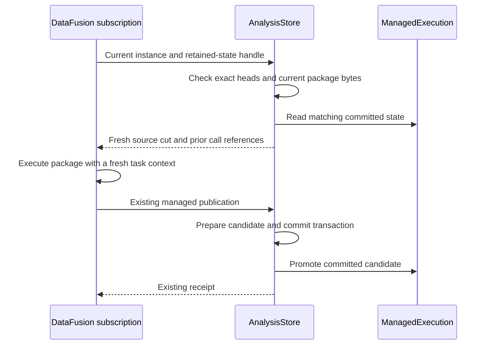

# Araphor retained execution state review

This guide covers the first retained-state change after `80e0a0b`. The change
removes repeated saved-call reads from a running subscription. The parent
plan is [reactive execution latency](../plans/araphor-reactive-execution-latency.md).

## Intended end state

A subscription retains checked package state after each successful commit.
Each invocation receives changes to its input query and the last committed
state. Data remains the durable owner. Native DataFusion operators execute
the input query. Native and Wasm packages use the same checked contract.

The current change implements retained saved state. Generic changed-input
delivery remains **Not done**. Full input query execution, input encoding,
and progress hashing remain in the current path. Complete Graph state uses
the cold path when the retained state is incomplete.

## Implementation review flow

[AnalysisStore::accept_validated_batch](../../crates/araphor-data/src/analysis/mod.rs) Data commits new source rows or a relevant context change
  -> [Runtime::next_event](../../crates/araphor-query/src/stream/physical/runtime.rs) Query wakes subscriptions whose native plans use those inputs
  -> [ManagedPublication::begin](../../crates/araphor-analysis/src/instance/subscription.rs) the subscription supplies its retained state with the current instance
  -> [AnalysisStore::capture_managed](../../crates/araphor-data/src/analysis/managed/capture.rs) Data checks the store, instance, current package bytes, and exact saved-call heads
  -> [ManagedExecution::calls](../../crates/araphor-data/src/analysis/managed/execution.rs) Data borrows matching saved state or uses the existing cold read
  -> Partial [PackageExec::evaluate](../../crates/araphor-query/src/definition/physical.rs) package physical execution computes output changes and tentative state from the complete input selection
  -> [GraphRows::progress_plan](../../crates/araphor-data/src/analysis/graph_rows/progress.rs) the existing Graph writer validates the next progress map
  -> [AnalysisStore::retain_managed](../../crates/araphor-data/src/analysis/managed/execution.rs) Data prepares retained state from checked live inputs, output, and validated progress
  -> [AnalysisStore::commit_managed_projection](../../crates/araphor-data/src/analysis/managed/commit.rs) Data commits output changes, saved state, progress, and replay references
  -> [ManagedExecution::promote](../../crates/araphor-data/src/analysis/managed/execution.rs) Data replaces retained state after the commit succeeds

[AnalysisStore::commit_managed_projection](../../crates/araphor-data/src/analysis/managed/commit.rs) An invocation fails or its authority changes
  -> [PendingProgress::drop](../../crates/araphor-data/src/analysis/managed/execution.rs) Data releases tentative progress on success or failure
  -> [ManagedExecution](../../crates/araphor-data/src/analysis/managed/execution.rs) the last committed state remains available after a failed publication

[Instance::subscribe_on](../../crates/araphor-analysis/src/instance/subscription.rs) The process restarts
  -> [Step](../../crates/araphor-analysis/src/instance/sink.rs) Analysis creates empty retained state for the new subscription
  -> [AnalysisStore::capture_managed](../../crates/araphor-data/src/analysis/managed/capture.rs) the first invocation restores saved state from Data
  -> [ManagedExecution::promote](../../crates/araphor-data/src/analysis/managed/execution.rs) the first successful commit retains state for later invocations

## State and lifetime

Analysis creates one opaque `ManagedExecution` in each subscription's `Step`.
Data alone changes its contents. Each entry contains the last committed
input, output, checkpoint, context, and result reference. Graph continuation
also retains the progress map that the existing writer validates. The cache
does not hold a Query task context, source snapshot, operation control,
execution receipt, database connection, or exchange permit.

Saved evaluations omit their prior checkpoint and previous outputs. This
rule prevents a chain of all earlier invocation states. Arrow batches share
their existing buffer reservations. Analysis reserves retained metadata
through its existing memory owner. If an enabled memory setting rejects
optional retention, Analysis drops retained state and keeps the successful
durable receipt. The next invocation reads state from Data.

The existing attempt transaction and final authority checks remain in place.
A call-head, instance, store UUID, schema, or recovery-epoch mismatch uses the
cold path. A clean reopen can reuse matching immutable state. A new process
cannot retain these memory references and restores state from the store.

## Proof and limits

[Data tests](../../crates/araphor-data/src/analysis/managed/tests/execution.rs)
cover failed publication, retry, matching warm and cold values, parameter
changes, call-head changes, current package modification and deletion,
recovery-epoch changes, and a fresh retained-state owner after reopening.
[Pending progress](../../crates/araphor-data/src/analysis/managed/execution.rs)
has a cleanup test for both successful and failed scopes.

The [managed Graph tests](../../crates/araphor-analysis/src/graph/native/tests/managed.rs)
and their history, notices, and restart modules exercise the production
subscription, Wasm calls, proof changes, empty input, historical output,
rollback, reopen, and memory release. Run results and the existing incident
measurement are recorded in the parent plan. This guide does not claim
completion of generic change inputs or millisecond event latency.
