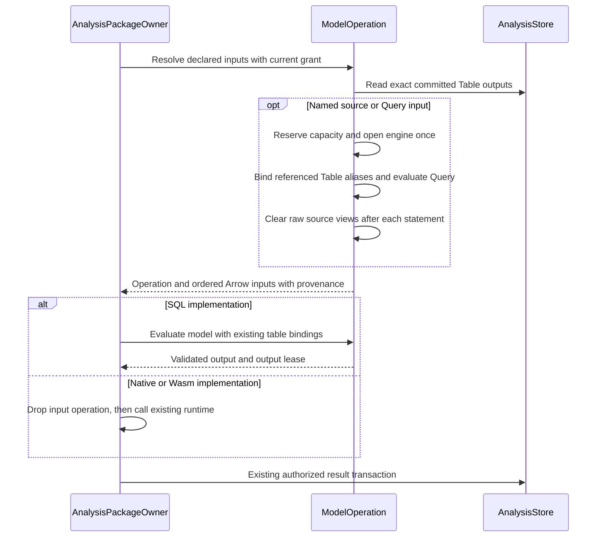
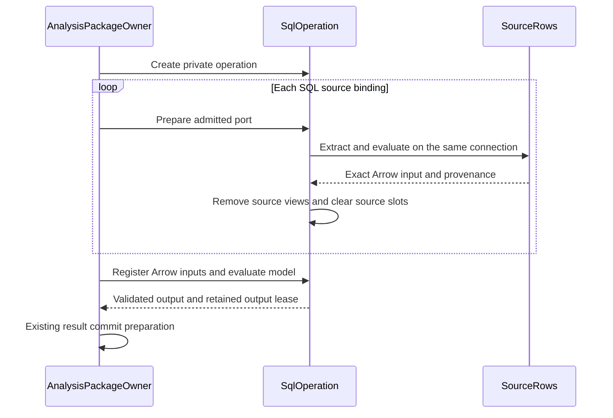

# Araphor SQL Operation Review

This guide covers the single SQL operation implementation at source head
`cffde410`. Focused verification is complete. The final Rust procedure passes.
The [approved plan](../plans/araphor-production-dataflow-simplification.md)
defines the SQL execution scope.

The user now approves table and query input resolution under `QueryOwner`.
The current change is based on `bf13d846`. Implementation and the full Rust
procedure are **Done**. Native qualification is **Done** on Linux x86_64 GNU.
The sections after the current input flow retain the earlier SQL operation
record. Read the
[current relation plan](../plans/araphor-production-dataflow-simplification.md#operation-owned-table-and-query-inputs)
for the approved change and its current result.

## Current table and query input flow

The SDK declares each input as `Table(TableRef)` or `Query(String)`.
`TableRef::Named` names a source table. `TableRef::Output` names an exact
package revision, export, and output. An input port supplies its local name
and Arrow schema. Separate ports remain separate datasets; the caller must
write SQL when it needs a join or union.

[AnalysisPackageOwner::prepare_at](../../crates/araphor-data/src/package/evaluation/preparation.rs) checks the installed context and selects the implementation
  -> [QueryOwner::model_operation](../../crates/araphor-data/src/query/model/operation.rs) creates an operation without opening an engine
  -> [ModelOperation::inputs](../../crates/araphor-data/src/query/model/operation.rs) admits sources, checks authority, and resolves Table inputs before Query inputs
  -> [QueryOwner::output_table](../../crates/araphor-data/src/query/model/source/table.rs) reads exact committed package output and checks the retained grant
  -> [ModelOperation::read_input](../../crates/araphor-data/src/query/model/source/read.rs) evaluates admitted source SQL against built-in tables and declared Table aliases
  -> [SourceRows::finish](../../crates/araphor-data/src/query/model/source.rs) retains direct provenance and hashes inherited table revisions into Query identity
  -> [ModelInputs::finish](../../crates/araphor-data/src/query/model/source.rs) normalizes evidence after the operation restores declared input order
  -> [ModelOperation::evaluate](../../crates/araphor-data/src/query/model/operation.rs) runs a SQL model on the same engine and reuses imported ports
  -> [ModelRun::commit](../../crates/araphor-data/src/package/evaluation/preparation.rs) prepares the result for the existing package commit owner

Output-only input resolution opens no SQL engine and takes no SQL evaluation
slot. An engine and its reservation belong to the operation. Input preparation
consumes the operation; errors release its connection, bindings, and leases
through Rust ownership. Raw source views are cleared after each statement.
Only declared Table aliases remain for later Query inputs and model execution.
Query inputs cannot refer to other Query inputs. Built-in names cannot be
replaced by package output aliases.

Each original Table input retains its evidence and exact dependency once.
A derived Query input combines inherited coverage and hashes the inherited
input revisions, including when SQL returns zero rows. Witness normalization
precedes duplicate removal, so a raw witness cannot hide expired retained
evidence. Freshness inspection uses this same input owner. Native and Wasm
execution release any SQL preparation slot before their runtime acquires one.
Resolved sources return validated result references directly. The package
owner no longer reads those references again or keeps a second input copy.

The operation checks imported table bytes, including the internal row index,
before each import. Tables from earlier queries remain charged. Raw extraction
and query output use the remaining operation byte budget. The returned Arrow
inputs retain separate leases. These checks use the existing host limits.

Arrow datasets and source declarations contain no DuckDB type. The engine
adapter, SQL admission, and source authority remain separate owners. This
permits later DataFusion work without adding an engine, provider framework,
or compatibility layer in this change. Dataset-only SQL uses the existing
dataset validators directly; it creates no synthetic package or evaluation.

The following receipt covers the earlier table and query implementation. The
[performance review](araphor-performance-simplification-review.md) covers the
later projection, relation registration, and dependency-reuse changes.

The full Rust procedure is **Done** with unchanged source: 2,146 passes, zero
failures, and 568 existing ignored cases across 90 harnesses. The new
[relation integration cases](../../crates/araphor-data/src/package/tests/relations.rs)
and [operation cases](../../crates/araphor-data/src/query/model/operation/tests.rs)
pass in that run. All 12 selected native Data cases and the installed native
detector E2E case also pass. The E2E case runs with `PATH` empty. Native
qualification covers Linux x86_64 GNU with glibc 2.39. Source, library, and test
binary hashes remain unchanged. Rust evidence:
`/tmp/araphor-relations-final-ci-source.json`,
`/tmp/araphor-relations-final-ci.log`, and
`/tmp/araphor-relations-final-ci-report.json`. Run
`bash .github/scripts/verify-rust-ci.sh` for the complete Rust gate. The
native records are `/tmp/araphor-relations-native-build2.json` and
`/tmp/araphor-relations-native-qualification.json`, with matching `.log` files.
The remaining sections retain the earlier SQL operation record.

## Intended end state

Use one private SQL engine for a package operation's source bindings and model.
Keep exact input revisions, schema validation, source authority, memory bounds,
output validation, and the existing package commit owner.

## Implementation review flow

[AnalysisPackageOwner::prepare_at](../../crates/araphor-data/src/package/evaluation/preparation.rs) The package owner selects the declared SQL implementation
  -> [QueryOwner::sql_operation](../../crates/araphor-data/src/query/model/operation.rs) the query owner creates one bounded private operation engine
  -> `AnalysisPackageOwner::inputs_with_sql` existing source admission and extraction select each input port
  -> [SqlOperation::model_input](../../crates/araphor-data/src/query/model/operation.rs) each admitted binding produces the existing Arrow input and provenance
  -> [SourceRows::finish](../../crates/araphor-data/src/query/model/source.rs) schema, bounds, revisions, coverage, and witnesses are recorded
  -> [ScopedSources::clear](../../crates/araphor-data/src/query/input.rs) source-only relations are removed before model execution
  -> [ModelExecution::register](../../crates/araphor-data/src/query/model/input.rs) the model reads only admitted ports, parameters, and checkpoint relations
  -> [QueryOwner::evaluate_model_reserved](../../crates/araphor-data/src/query/model.rs) output validation and the existing package commit complete the operation
  -> [SqlOperation](../../crates/araphor-data/src/query/model/operation.rs) the operation closes its engine on success, error, or cancellation

## Owners and lifetime

`AnalysisPackageOwner` creates the operation for a declared SQL implementation
with at least one SQL source binding. With no SQL source bindings, the existing
evaluation path opens an engine only when the model must run. `SqlOperation`
owns one DuckDB connection, its evaluation reservation, and scoped source
slots. Its lifetime is
one package preparation. It adds no pool, cache, process, or durable table.
Standalone query APIs keep their existing connection lifetime. Native and Wasm
use their existing SDK input and execution boundaries.

The operation rejects source requests for another tenant before extraction.
Source evaluation produces the existing normalized Arrow batches. Revision
hashing still uses those batches and their original IPC boundaries. Each
source dataset is imported once when `ModelExecution::register` runs. An
automatic operation that needs no new result does not import model inputs.
The structural change removes separate engine setup; it does not remove that
Arrow conversion or import.

The connection closes after model computation, before its aggregate input
reservation is released. The returned output lease and
input leases remain through result encoding in `ModelRun::commit`. That method
prepares a commit request. [AnalysisPackageOwner::evaluate_active](../../crates/araphor-data/src/package/evaluation.rs)
then checks commit authority and calls the existing store transaction. Prepared
results are not durable results until that transaction succeeds.

## Source access and failure

[InputSource](../../crates/araphor-data/src/query/adapter.rs) holds the current
source projection. Each table-function bind takes an immutable `Arc` for that
query. `ScopedSources` removes source views and clears their slots after each
statement, including a failed statement. Empty slots reject table-function
calls. Model registration creates only the declared input, parameter, and
checkpoint relations after source cleanup.

[ModelSchema](../../crates/araphor-data/src/query/model/schema.rs) and SQL
admission still restrict model relations. A private table name alone does not
authorize access. A failed input does not execute the model or commit state.
Dropping the operation closes its connection and releases its reservations.

## Memory, deadlines, and verification

The existing evaluation reservation covers one aggregate model input bound.
Arrow inputs retain their own existing leases. Preparation creates no model
input tables. Output capacity is reserved before model registration. The
already-held aggregate input reservation covers model tables during execution.
There is no nested evaluation acquisition; tenant capacity one remains usable.

The engine preserves separate extraction and evaluation deadlines for each
stage. Cancellation and row, byte, checkpoint, scan, and output bounds remain
at their existing owners. Retained Arrow inputs consume their existing input
capacity during preparation. The code does not increase configured capacity.

[Operation tests](../../crates/araphor-data/src/query/model/operation/tests.rs)
compare exact inputs, revisions, provenance, and encoded output with standalone
execution. They check source cleanup, tenant capacity one, retained Arrow
charges, output reservation failure, budget reuse, name collisions, and hidden
source rejection.
[Existing model tests](../../crates/araphor-data/src/query/model/tests.rs) check
checkpoint, parameters, provenance, and source bounds.
[Package lifecycle tests](../../crates/araphor-data/src/package/tests/lifecycle.rs)
check historical scope, retry, cancellation, and capacity.

**Done** for focused qualification. The SQL parity, source cleanup, budget
reuse, and hidden-source cases pass. The combined focused Data qualification
covers 71 distinct cases: 70 pass in the first run, and the corrected parity
fixture passes in its exact retry. All 66 selected SDK cases pass.

Evidence: `/tmp/araphor-production-fresh-focused-araphor_data.log`,
`/tmp/araphor-production-final-focused.json`,
`/tmp/araphor-production-final-focused-araphor_data.log`, and
`/tmp/araphor-production-final-focused-araphor_analysis_sdk.log`.
The evidence records the tested working-tree source before the original
production commits `6b6d5ebb`, `efac8911`, and `78f80579`.

The first full Rust procedure at `78f80579` reports 616 Data passes, three
failures, and 19 ignored cases. The first attempt's logs and source capture
remain retained. Correction `9b3cbab8` restores the original 32 MiB finding
read budgets separately from the 16 MiB canonical result bound. Correction
`9f1f4ffa` fixes the retained-memory fixture. Correction `cffde410` makes the
query fixture use current canonical graph bytes.

Seven targeted correction cases pass in 214.15 seconds. The targeted clippy
check passes in 17.53 seconds. The unified workspace test build passes in
469.20 seconds. The source remains unchanged during those checks. Evidence:
`/tmp/araphor-production-targeted-fixes.json` and
`/tmp/araphor-production-targeted-fixes-tests.log`. The original graph bounds
case reproduces its default read-deadline failure in isolation, then passes
after the read-budget correction. These checks use the existing deadlines.
The committed source head is `cffde410`. The final Rust procedure passes with
90 outer test harnesses: 2,121 passed, zero failed, and 568 existing ignored.
The source remains unchanged. Total elapsed time is 1,666.48 seconds. Data has
620 passes and 19 ignored cases in 889.53 seconds. SDK has 66 passes. Control
has 188 passes and two ignored cases in 106.65 seconds. E2e has 191 passes and
528 ignored cases in 488.20 seconds. Node has 282 passes and one ignored case
in 7.46 seconds. These are ordinary functional run times. They do not prove
a speed change caused by this implementation.

Final evidence: `/tmp/araphor-production-final-ci-source.json`,
`/tmp/araphor-production-final-ci.log`, and
`/tmp/araphor-production-final-ci-report.json`.

The separate native regression qualification at `cffde410` also passes:
six current Rust libraries build in 30.79 seconds, and all 12 parent cases
pass in 255.98 seconds with no failures or ignored cases. The runner records
256.00 seconds. The source remains unchanged. The platform is Linux x86_64
GNU with glibc 2.39. Evidence:
`/tmp/araphor-production-native-qualification.json`,
`/tmp/araphor-production-native-qualification-build.log`, and
`/tmp/araphor-production-native-qualification-tests.log`. This evidence checks the unchanged
native path alongside the SQL change. It does not measure a SQL speed change.

**Done** for the approved SQL scope and the final shared Rust procedure.
No speed benchmark is run.
No runtime improvement is measured by this guide.
