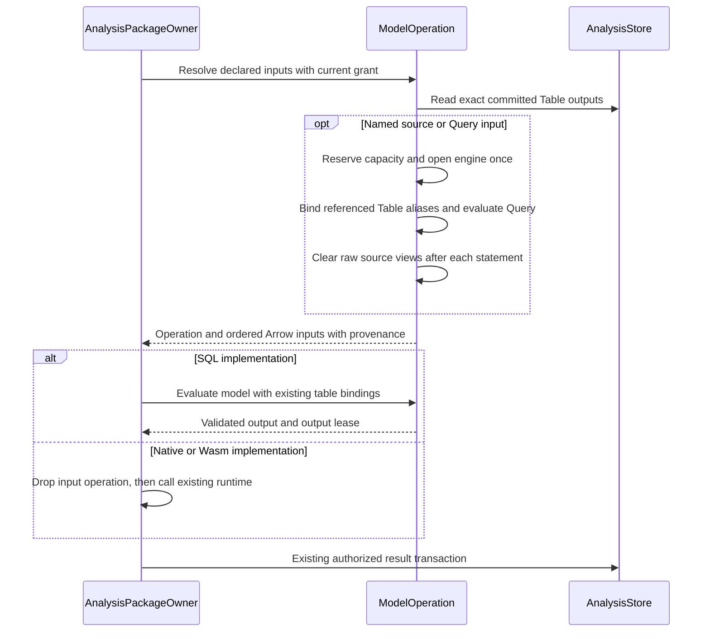

# Araphor SQL Operation Review

The [approved plan](../plans/araphor-production-dataflow-simplification.md)
defines input ownership. The [current verification](../plans/araphor-performance-simplification-todo.md)
records the source and checks. Earlier qualification does not cover later edits.

## Current table and query input flow

The SDK declares each input as `Table(TableRef)` or `Query(String)`.
`TableRef::Named` names a source table. `TableRef::Output` names an exact
package revision, export, and output. An input port supplies its local name
and Arrow schema. Separate ports remain separate datasets; the caller must
write SQL when it needs a join or union.

[AnalysisPackageOwner::prepare_at](../../crates/araphor-data/src/package/evaluation/preparation.rs) checks the installed context and selects the implementation
  -> [QueryOwner::model_operation](../../crates/araphor-data/src/query/model/operation.rs) creates an operation without opening an engine
  -> [ModelOperation::inputs](../../crates/araphor-data/src/query/model/operation.rs) admits sources, checks authority, and resolves Table inputs before Query inputs
  -> [QueryOwner::output_table](../../crates/araphor-data/src/query/model/source/table.rs) reads exact committed package output and checks the retained grant
  -> [ModelOperation::read_input](../../crates/araphor-data/src/query/model/source/read.rs) evaluates admitted source SQL against built-in tables and declared Table aliases
  -> [SourceRows::finish](../../crates/araphor-data/src/query/model/source.rs) retains direct provenance and hashes inherited table revisions into Query identity
  -> [ModelInputs::finish](../../crates/araphor-data/src/query/model/source.rs) normalizes evidence after the operation restores declared input order
  -> [ModelOperation::evaluate](../../crates/araphor-data/src/query/model/operation.rs) runs a SQL model on the same engine and reuses imported ports
  -> [ModelRun::evaluate](../../crates/araphor-data/src/package/evaluation/preparation.rs) prepares the result for the existing package commit owner

Output-only input resolution opens no SQL engine and takes no SQL evaluation
slot. An engine and its reservation belong to the operation. Input preparation
consumes the operation; errors release its connection, bindings, and leases
through Rust ownership. Raw source views are cleared after each statement.
Only declared Table aliases remain for later Query inputs and model execution.
Query inputs cannot refer to other Query inputs. Built-in names cannot be
replaced by package output aliases.

Each original Table input retains its evidence and exact dependency once.
A derived Query input combines inherited coverage and hashes the inherited
input revisions, including when SQL returns zero rows. Witness normalization
precedes duplicate removal, so a raw witness cannot hide expired retained
evidence. Freshness inspection uses this same input owner. Native and Wasm
execution release any SQL preparation slot before their runtime acquires one.
Resolved sources return validated result references directly. The package
owner no longer reads those references again or keeps a second input copy.

The operation checks imported table bytes, including the internal row index,
before each import. Tables from earlier queries remain charged. Raw extraction
and query output use the remaining operation byte budget. The returned Arrow
inputs retain separate leases. These checks use the existing host limits.

Arrow datasets and source declarations contain no DuckDB type. The engine
adapter, SQL admission, and source authority remain separate owners. This
permits later DataFusion work without adding an engine, provider framework,
or compatibility layer in this change. Dataset-only SQL uses the existing
dataset validators directly; it creates no synthetic package or evaluation.

## Source access and failure

[InputSource](../../crates/araphor-data/src/query/adapter.rs) holds the current
source projection. Each table-function bind takes an immutable `Arc` for that
query. `ScopedSources` removes source views and clears their slots after each
statement, including a failed statement. Empty slots reject table-function
calls. Model registration creates only the declared input, parameter, and
checkpoint relations after source cleanup.

[ModelSchema](../../crates/araphor-data/src/query/model/schema.rs) and SQL
admission still restrict model relations. A private table name alone does not
authorize access. A failed input does not execute the model or commit state.
Dropping the operation closes its connection and releases its reservations.

## Execution and verification

Client and model evaluation use one SQL prepare and Arrow execution path.
Client rows read that result through the existing DuckDB row converter. Model
outputs retain the existing Arrow normalization. Input types and null handling
remain on the native adapter. The operation owns its connection, scoped source
registry, aggregate input reservation, stage deadline, and cancellation guard.
The result and its retained input leases survive until commit preparation ends.
A prepared result becomes durable only after the authorized store transaction.

[Operation tests](../../crates/araphor-data/src/query/model/operation/tests.rs)
compare exact inputs, revisions, provenance, and encoded output with standalone
execution. They check source cleanup, tenant capacity one, retained Arrow
charges, output reservation failure, budget reuse, name collisions, and hidden
source rejection.
[Existing model tests](../../crates/araphor-data/src/query/model/tests.rs) check
checkpoint, parameters, provenance, and source bounds.
[Package lifecycle tests](../../crates/araphor-data/src/package/tests/lifecycle.rs)
check historical scope, retry, cancellation, and capacity.

The complete earlier receipts remain at
`7b7b407adf347d389984553a4d212bfce37b75b5:docs/guides/araphor-sql-operation-review.md`.
They include failed attempts, corrections, source hashes, and Linux x86_64 GNU
native qualification. They establish no causal SQL speed improvement. A new
performance workload is not part of this deletion work.
