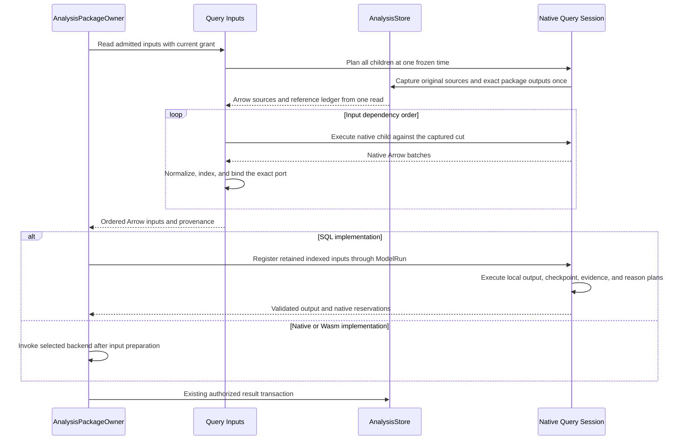
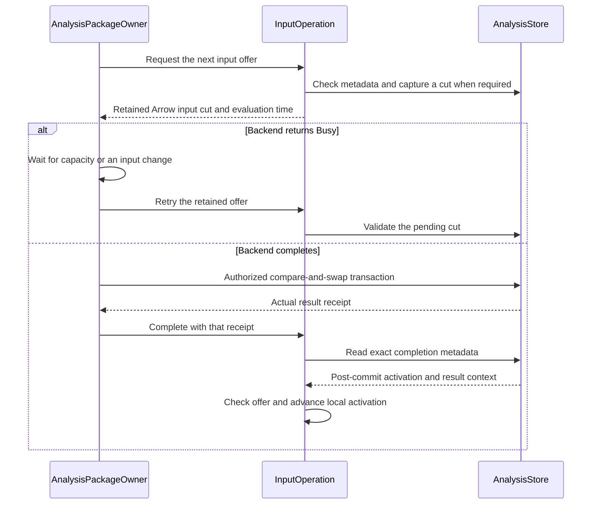

# Araphor SQL Operation Review

The [approved plan](../plans/araphor-production-dataflow-simplification.md)
defines input ownership. The [current verification](../plans/araphor-performance-simplification-todo.md)
records the source and checks. The
[component redesign](../plans/araphor-component-redesign.md) defines the current
engine replacement. Earlier qualification does not cover later edits.

This guide covers the current working-tree DataFusion rewrite. The parser
returns a native statement. The planner returns a native logical plan through
the standard session catalog. The user approves native SQL behavior and
visible dataset row indices. Complete qualification is **Not done**. The
earlier receipts below apply only to their recorded source.

## Intended end state

One admitted logical plan reads authorized Arrow sources and produces native
Arrow batches. Each run owns its source batches, physical plan, stream,
control, and reservations. Control converts client results at the protocol
boundary. Analysis checks declared model outputs. Data remains the durable
result and progress owner. Current source tests define the required checks.

## Current table and query input flow

The SDK declares each input as `Table(TableRef)` or `Query(String)`.
`TableRef::Named` names a source table. `TableRef::Output` names an exact
package revision, export, and output. An input port supplies its local name
and Arrow schema. Separate ports remain separate datasets; the caller must
write SQL when it needs a join or union.

| Crate owner | State and behavior | Dependencies in this route |
| --- | --- | --- |
| [Data](../../crates/araphor-data/src/lib.rs) | Durable records, package formats, transactions, retention, source revisions, and read control. | SDK, shared built-in contracts, and DuckDB. No Query or Analysis dependency. |
| [Query](../../crates/araphor-query/src/lib.rs) | Native parsing, planning, catalogs, source capture, Arrow execution, reservations, follow, and subscription delivery. | Data, SDK, DataFusion, and Arrow. |
| [Analysis](../../crates/araphor-analysis/src/lib.rs) | Package lifecycle, admitted model programs, ModelRun, native/Wasm execution, and domain execution. | Query, Data, SDK, and existing execution backends. |

Control imports these owners directly. The dependency graph has no facade
crate. SDK owns declarations and native/Wasm application binary interfaces.

[AdmittedExport::admit](../../crates/araphor-analysis/src/model.rs) admits the installed export
  -> [Inputs::admit](../../crates/araphor-query/src/inputs/mod.rs) retains native plans, original provider origins, and input dependency order

[AnalysisPackageOwner::prepare_model](../../crates/araphor-analysis/src/package/evaluation/preparation.rs) checks current authority and reads the admitted Inputs directly
  -> [Inputs::execute](../../crates/araphor-query/src/inputs/physical.rs) plans all physical children at one frozen time
  -> [SourceSnapshot::capture](../../crates/araphor-query/src/sources/mod.rs) combines the prepared source columns and time ranges in one capture
  -> [AnalysisStore::read_tables](../../crates/araphor-data/src/analysis/extraction.rs) fixes one Data read transaction for the original source receipts
  -> [AnalysisStore::extract_packages](../../crates/araphor-data/src/analysis/extraction/package.rs) reads exact package outputs and their references in that same transaction
  -> [Capture::finish](../../crates/araphor-data/src/analysis/extraction/tables/mod.rs) returns requested native Arrow tables with the complete read receipt
  -> [SourceSnapshot::read](../../crates/araphor-query/src/sources/rows.rs) claims those arrays and binds their exact native schemas to the source origins
  -> [Dataset::normalize_batch](../../crates/araphor-analysis-sdk/src/batch.rs) applies the declared SDK schema after conversion preflight
  -> [Inputs::execute](../../crates/araphor-query/src/inputs/physical.rs) materializes each completed port with one dataset-global row index before dependent SQL runs
  -> [Inputs::input](../../crates/araphor-query/src/inputs/receipt.rs) assigns per-port revisions and coverage from the original source scopes and reference origins
  -> [InputSet](../../crates/araphor-query/src/inputs/physical.rs) returns declared input order, retained tables, and complete provenance
  -> [ModelRun::prepared](../../crates/araphor-analysis/src/model/operation.rs) supplies the retained input set to model execution
  -> [AnalysisPackageOwner::execute_model](../../crates/araphor-analysis/src/package/execution.rs) selects SQL, native, or Wasm execution
  -> [AnalysisPackageOwner::prepare_model](../../crates/araphor-analysis/src/package/evaluation/preparation.rs) prepares one result contract
  -> [AnalysisStore::commit_package](../../crates/araphor-data/src/analysis/packages/commit.rs) checks the authorized durable transaction

Inputs and ModelRun derive store access from the existing Engine. The package
owner derives its retained store Arc from that Engine. The constructors accept
no independent store argument. A nonempty resolved input cut holds one SQL
evaluation permit through planning, capture, and all native child streams.
The input permit is released before the selected backend acquires its permit.

[Inputs::execute](../../crates/araphor-query/src/inputs/physical.rs) adds one
dataset-global `__row_index` across each completed port's batches. The column
is an ordinary visible table field. Native `SELECT *` includes the field.
[InputSet::register](../../crates/araphor-query/src/inputs/physical.rs) gives SQL
ModelRun those same indexed tables. ModelRun does not build those indices
again. [ModelRun::table](../../crates/araphor-analysis/src/model/input.rs)
still builds indices for host-prepared inputs, parameters, prior checkpoints,
and completed model outputs. Canonical Data tables keep their declared fields.
Local registrations can replace a canonical table name. Provider origins keep
those local bindings separate from the durable source inventory. Table lookup
applies no `__araphor_` prefix ban.

[AdmittedModel](../../crates/araphor-analysis/src/model.rs) stores raw native
logical plans for output and checkpoint queries in descriptor order. Each
reason plan retains checked output and reason indices. InstalledBundle retains
the exact descriptor, implementation, and admitted-program pairing. Public
transient calls perform their own admission. Known retained vectors and
declarations have native memory reservations; native plan allocation has no
complete upstream size measurement.

[AdmittedExport](../../crates/araphor-analysis/src/model.rs) retains one
`Arc<Inputs>`. Inputs stores native plans and orders dependent ports before
their readers. Native `SessionState::resolve_table_references` supplies the
original table references, including unused common table expressions (CTEs).
SourceOrigin distinguishes canonical durable sources, materialized port slots,
and exact package-output slots. Port and package providers have unknown native
statistics before capture. A later materialization therefore cannot be folded
as an empty admission table. The run restores descriptor order after execution.
Exact names, current grants, freshness, capture, and resource limits remain
checks for each run.

Each original Table input retains its evidence and exact dependency once.
A derived Query input combines inherited coverage and hashes the inherited
input revisions, including when SQL returns zero rows. Witness normalization
precedes duplicate removal, so a raw witness cannot hide expired retained
evidence. Freshness inspection uses this same finite input owner. Data records
context and result references once, with their source origins, in the extraction
reference ledger. Query selects each port's exact facts from that ledger.
Data checks exact dependency revisions again at the durable commit boundary.
The old Analysis source readers and their post-capture reference reads are
deleted. No SourceBatch or LocalTable binding owner remains.

[Engine::blocking](../../crates/araphor-query/src/execution.rs) keeps one
cancellation guard until the actual blocking read ends. A completed Data error
does not cancel the caller. A timeout or dropped read cancels unfinished work.
[InputSet::check](../../crates/araphor-query/src/inputs/physical.rs) checks current
trace-read authority before and after backend execution. The input owner checks
indexed bytes and aggregate references before it offers an InputSet. Missing
input errors keep their typed cause through native DataFusion error wrappers.
Install preserves MissingInput readiness. Inspect marks the retained result stale.

The [live detector input lifecycle](#live-detector-input-lifecycle) uses this
finite input execution. Query now owns input change checks, time checks,
retained Busy retry, and commit-completion feedback. Analysis retains package
lifecycle, backend admission, checkpoint selection, current authority, and
the authorized Data compare-and-swap transaction.

Native execution calls the actual
[NativeLibrary](../../crates/araphor-analysis/src/package/native/loading.rs)
owner. The stateless NativeExecution wrapper is deleted. The loader checks the
qualification against its pinned files. Execution does not repeat artifact
inspection and system-library reads before loading. Native admission remains
a separate trust boundary. The native options remain on AnalysisPackageOwner.
The library creates a fresh SDK Invocation and keeps all code and file pins
through output copying and producer release callbacks. The caller checks
cancellation after loading; the library checks it before and after the call.

The Wasm branch also calls its actual
[invoke owner](../../crates/araphor-analysis/src/package/wasm/execution.rs)
directly. The duplicate prepared-input and optional-input wrappers are deleted.
Package execution retains the checked evaluation and encoded input reservation
through invocation and output decoding. Invoke owns the VM permit, engine
identity check, Store, quotas, interruption, and code pin. The outer Query
evaluation permit remains held through SDK output validation and retention.

Wasm preparation uses the caller deadline and the compiler's existing
45-second maximum. The configured Query evaluation timeout starts after
preparation. Encode, invoke, decode, and output validation use that evaluation
control. Native loading keeps its existing evaluation control. The
[deadline case](../../crates/araphor-analysis/src/package/wasm/tests/runtime/prepared.rs)
proves that cold preparation completes before a one-nanosecond evaluation
deadline rejects execution.

[CheckedEvaluation](../../crates/araphor-analysis-sdk/src/validation.rs)
retains the validated package, model, and input by borrow. Its
[encode](../../crates/araphor-analysis-sdk/src/wire/evaluation.rs) method
retains the IPC allocation checks. Native
[Invocation](../../crates/araphor-analysis-sdk/src/native/mod.rs) borrows the
same proof for input exchange and output validation. These paths do not repeat
the input contract checks. The foreign guest decoders still validate raw input.
The raw wire output decoder retains its error order. The wire bytes, WIT, native
ABI, and producer release callbacks do not change.

The Session checks retained local table bytes, including the dataset row
index, before registration. Earlier local tables remain charged. Source
capture and model-input results use the native input category. Client and
model-output batches use the native output category. Borrowed Arrow buffers
retain their charges after the producer closes.
Registration uses existing buffer claims. It does not reserve the shared
payload a second time. The logical local-input limit still applies.

Source declarations and datasets use canonical Arrow 58 schemas and batches.
The [canonical schemas](../../crates/araphor-data/src/analysis/extraction/tables/schema.rs)
supply source fields, catalog rows, and result metadata. Field metadata defines
owner, units, null meaning, join keys, readiness, and description. Native
projections preserve the selected Field metadata. One immutable schema map is
shared across engines and reads. Capture does not build another schema map.
The query engine is
DataFusion 53.1.0. Dataset-only SQL uses the existing validators and ModelRun.
It creates no synthetic package or evaluation. DuckDB remains the durable
storage engine. Client transport reads native Arrow values in Control; the
transport path opens no DuckDB query connection.

## Live detector input lifecycle

[AnalysisPackageOwner::supervise](../../crates/araphor-analysis/src/package/supervision.rs) registers current installed activations
  -> [Inputs::watch](../../crates/araphor-query/src/inputs/live.rs) creates one InputOperation for the exact activation and grant
  -> [InputOperation::next](../../crates/araphor-query/src/inputs/live.rs) checks the current activation and saved result before input capture
  -> [Inputs::execute](../../crates/araphor-query/src/inputs/physical.rs) executes the admitted native input plans at one frozen time
  -> [InputOperation::next](../../crates/araphor-query/src/inputs/live.rs) offers one retained Arc<InputSet> with its evaluation time
  -> [AnalysisPackageOwner::evaluate_offer](../../crates/araphor-analysis/src/package/supervision.rs) checks authority and invokes the selected backend
  -> [AnalysisPackageOwner::authorize_commit](../../crates/araphor-analysis/src/package/owner.rs) checks current authority for the result transaction
  -> [AnalysisStore::commit_package](../../crates/araphor-data/src/analysis/packages/commit.rs) checks the activation, checkpoint, source revisions, and exact references in one transaction
  -> [AnalysisStore::package_completed](../../crates/araphor-data/src/analysis/packages/input.rs) verifies the actual result head and stored activation precondition
  -> [InputOperation::complete](../../crates/araphor-query/src/inputs/live.rs) checks the offered revisions, coverage, and evaluation time before it advances the local activation

[AnalysisPackageOwner::serve_activation](../../crates/araphor-analysis/src/package/supervision.rs) receives a typed Busy failure
  -> [AnalysisPackageOwner::wait_inputs](../../crates/araphor-analysis/src/package/supervision.rs) waits for the actual blocked resource or an input change
  -> [InputOperation::retry](../../crates/araphor-query/src/inputs/live.rs) retains the offered input cut
  -> [AnalysisStore::package_input_current](../../crates/araphor-data/src/analysis/packages/input.rs) checks that cut against current metadata and retained evidence
  -> [InputOperation::next](../../crates/araphor-query/src/inputs/live.rs) offers the same Arc when the cut is valid, or captures a new cut when it is invalid

[InputOperation::changed](../../crates/araphor-query/src/inputs/live.rs) waits for a source notice, a clock change, or a due deadline
  -> [InputOperation::next](../../crates/araphor-query/src/inputs/live.rs) checks current state before it offers another input

[AnalysisPackageOwner::serve_activation](../../crates/araphor-analysis/src/package/supervision.rs) receives stop, authority change, or grant expiry
  -> [AnalysisReadControl::cancel](../../crates/araphor-data/src/analysis/read.rs) cancels the shared operation token
  -> [AnalysisPackageOwner::serve_activation](../../crates/araphor-analysis/src/package/supervision.rs) waits for the actual blocking worker before it releases the task

The Query operation owns its pending cut, source receiver, clock receiver,
deadlines, and memory scope. Data remains the durable activation and checkpoint
owner. The pending cut stays alive during a Busy wait. A successful backend
call does not acknowledge the cut. Completion requires the actual Data receipt.
A reader Busy failure during completion retries that metadata read. The retry
does not execute the backend or commit the result again.

[InputOperation::changed](../../crates/araphor-query/src/inputs/live.rs) uses
the existing Data revision receiver. The operation also records the next source
change and live witness expiry. Model time uses 500-millisecond ticks. A model
tick can reuse a completed input cut. After completion, an input query that
reads the clock requires a new cut at the new tick. Equal input revisions and
coverage suppress another backend offer when the model does not read time.
A Busy retry retains the
offered time with its valid cut. The InputSet retains its frozen input time.
The operation supplies the model evaluation time separately. A fresh capture with
expired evidence keeps Unknown coverage and excludes that evidence from the
commit witnesses. A witness that expires after capture invalidates a pending
cut before retry.

[AnalysisStore::package_input_current](../../crates/araphor-data/src/analysis/packages/input.rs)
uses one controlled metadata transaction. The check retains the existing
global relation-revision rule, including notices from an unselected tenant.
It checks store identity, schema, recovery epoch, current activation, exact
dependencies, context references, trace authority, and retained live witnesses.
The check reads no Arrow payload. The saved-result check also avoids input
capture when the durable result remains current. Manual Inspect and Run keep
the finite input entry point and their existing authority checks.

[AnalysisPackageOwner::prepare_model](../../crates/araphor-analysis/src/package/evaluation/preparation.rs)
uses the offered InputSet to select the deterministic live result ID. There
is no automatic flag or Analysis input deadline calculation.
[AnalysisPackageOwner::evaluate_active](../../crates/araphor-analysis/src/package/evaluation.rs)
retains the manual request-ID retry check. Inspect alone rounds the read time
and checks the saved result before input capture. The follow-up selection
passes 13 Analysis cases and two explicit native checkpoint cases. Its source
scope is `/tmp/araphor-obsolete-run-qualification1.json`.

[Memory::scope](../../crates/araphor-query/src/memory.rs) creates operation
consumers on the existing shared pools. Native buffer claims remain shared
within the same pool family. A scope does not charge the same buffer twice in
one category. Its capacity wait excludes releases from its own consumers.
The native MemoryPool hooks publish actual releases. These hooks add no pool
or capacity limit. The scope's actual native allocation total distinguishes
an impossible retained working set from temporary shared pressure.
[AnalysisStore::wait_capacity](../../crates/araphor-data/src/analysis/connection.rs)
checks the actual shared reader semaphore before it waits. An advisory wake
does not admit another read while all slots remain held.

[AnalysisReadControl::cancelled](../../crates/araphor-data/src/analysis/read.rs)
waits for the shared cancellation token without a stage deadline. Each new
read or backend stage retains that token and applies its bounded deadline.
Registration and orphan cleanup use the supplied controlled Data reads.
Analysis cancels and joins workers on stop or authority change. The registry
stops changed or removed tasks before it loads replacement bundles.

[AnalysisStore::subscribe_activations](../../crates/araphor-data/src/analysis/mod.rs)
wakes the Analysis lifecycle registry for activation changes. Ordinary source
and result-checkpoint commits do not send that wake. After recovery restores
trusted connections, a newly discovered accepted revision also sends one
registry invalidation. A no-op recovery sends none. The next input operation
uses the actual activation and durable result head.

The [Query live tests](../../crates/araphor-query/src/inputs/live/tests.rs)
cover the same-cut Busy retry, model and input clock ticks, exact completion,
quiet cancellation, durable-head restart, global notices, and expired evidence.
The [Data metadata tests](../../crates/araphor-data/src/analysis/packages/tests/input.rs)
cover exact references, forged completion, controlled registration, reader
capacity, activation notices, and uncertain-commit recovery.

The live-input delivery passes 267 distinct selected cases across the affected
runs: 57 Data, 162 Query, 47 Analysis, and one package E2E case. The final
connected check passes all 16 live Query cases, the Wasm readiness case, and
the package E2E contract. Strict Clippy passes for all six affected crates and
their test targets. Formatting passes for 53 changed Rust files. The record is
`/tmp/araphor-live-input-qualification1.json`.

The source count is `/tmp/araphor-live-input-count1.json`. This delivery adds
1,637 nonblank production Rust lines. The complete change adds 1,167 from
7b7b407a. The 6,000-line reduction and general maintained SQL remain **Not done**.
The separate native execution pool needs a contention review. Full workspace
CI and benchmarks are not run. Earlier records below retain their original
source scope.

## Source access and failure

Analysis source queries follow the retained-plan route below.
[Engine::prepare](../../crates/araphor-query/src/execution/admission.rs) owns
native parsing, original table-reference resolution, and planning for client
and E2E preparation. [Engine::subscribe](../../crates/araphor-query/src/execution/admission.rs)
uses that route and creates the native Subscription. E2E keeps the prepared
native plan for independent snapshot comparisons. E2E retains its result,
paging, cursor, health, and cleanup assertions.

[Parser::parse](../../crates/araphor-query/src/parser/mod.rs) returns one bounded native DataFusion statement
  -> [Engine::catalog](../../crates/araphor-query/src/execution.rs) registers canonical and declared local providers in the standard memory catalog
  -> [Inputs::admit](../../crates/araphor-query/src/inputs/mod.rs) retains original provider origins from native table-reference resolution
  -> [Planner::build](../../crates/araphor-query/src/planner/mod.rs) calls SessionState.statement_to_plan and binds parameters once
  -> [Planner::check](../../crates/araphor-query/src/planner/mod.rs) checks projection, join, and window resource rules on the native logical plan
  -> [Inputs::read](../../crates/araphor-query/src/inputs/physical.rs) executes the retained input definition with the current authorized selection

[Planner::build](../../crates/araphor-query/src/planner/mod.rs) rejects an invalid statement, parameter, or plan
  -> [Query Error](../../crates/araphor-query/src/error.rs) preserves the native or Data error source
  -> [Query::Failure](../../crates/araphor-query/src/error.rs) classifies the structured error cause
  -> [ClientGrpcOwner::query_failure](../../crates/mithril-control/src/client_grpc/query.rs) maps the failure to a redacted client status

Parser limits SQL to 16 KiB, one statement, and recursion depth 64. The native
parser uses an 8 MiB stack region through the existing stacker dependency.
Planner accepts a read query and at most 256 parameters with a 1 MiB bound.
The standard function registry contains the admitted native scalar, aggregate,
and window functions. Standard memory catalogs perform table lookup. No
custom ContextProvider, SQL scope walker, or second binder remains.

DataFusion owns names, types, CTE scope, aliases, wildcard expansion, and
numeric behavior. Araphor checks the resulting native plan before physical
optimization. An unused CTE remains in the original source inventory. Native
expressions supply follow clock facts. Physical scans supply requested source
columns and supported time intervals.

Native expression names and numeric types reach the result schema. Integer
division stays integer division. Floating literals use Float64. An unqualified
SQL TIMESTAMP uses nanoseconds; declared source timestamps keep their Arrow
units. Quoted names use exact lookup. Duplicate projections need distinct
aliases. Native CTE alias counts and HAVING resolution apply.

[Inputs::admit](../../crates/araphor-query/src/inputs/mod.rs) supplies the
source catalog from canonical providers and declared Table aliases.
[ModelSchema](../../crates/araphor-analysis/src/model/schema.rs) supplies the
local Arrow schema map for model execution. Output SQL sees model inputs,
parameters, and prior checkpoint tables. Checkpoint, evidence, and reason SQL
also see completed output tables. The declared catalog defines local visibility.
The authorized Data selection defines durable source scope.

[SourceProvider::scan](../../crates/araphor-query/src/sources/mod.rs) returns a
native DataSourceExec with an immutable SourceData descriptor. The descriptor
contains its provider origin, exact projected schema and indices, conservative
time interval, and fetch limit. Only durable origins supply canonical source
requests, time pruning, journal capability, and raw positions. Planning reads
no SourceSnapshot and changes
no projection or interval registry. Capture collects those facts from the
optimized physical tree. A retained plan has no tenant snapshot or Arrow rows.

[SourceData::open](../../crates/araphor-query/src/sources/mod.rs) reads the
actual captured SourceSnapshot from TaskContext. Native MemoryStream supplies
cooperative batch execution and fetch handling. Native MemorySourceConfig
requires batches at plan construction, so it cannot supply this run binding.
The returned native stream retains that same snapshot until stream drop.
DataSourceExec does not retain TaskContext for this lifetime. The snapshot
therefore keeps source metadata charged while the stream owns batch headers.
The former SnapshotPartition and both planning mutexes are deleted.
SourceData keeps native logical projection and residual filters. Its required
physical projection hook returns None, so native ProjectionExec remains above
the source. This preserves the exact source and journal schema pair.

The current source change passes all 104 Query cases, 37 model cases, and the
E2E query-follow contract. Strict Query Clippy and scoped formatting pass.
The exact source record is `/tmp/araphor-source-descriptor-qualification1.json`.
The change removes 25 nonblank production Rust lines. The corrected complete
count is `/tmp/araphor-native-rewrite-count12.json`. Wider runtime suites and
full workspace CI are not repeated. No general physical-plan reuse is claimed.

Local admission uses empty native MemTables. Before native optimization,
Session uses the native logical transformation API to bind those scans to the
current run's MemTables. It checks the complete Arrow schema, including field
metadata and nullability. This transformation does not change the retained
logical plan or replace durable SourceProvider scans. The custom LocalTable
provider and its separate SessionConfig lookup are deleted.

[SourceSnapshot::read](../../crates/araphor-query/src/sources/rows.rs) captures
requested Arrow rows and all original source receipts in one Data snapshot.
Original sources removed by optimization still supply receipts, coverage,
context references, and result references. Data bounds keys, scanned bytes,
retained input, and graph traversal. Source selection keeps explicit profile,
notification, node, binding, and time bounds. Disabled source capabilities
return a structured unavailable error.

[AnalysisStore::read_tables](../../crates/araphor-data/src/analysis/extraction.rs)
returns requested native Arrow tables and the existing read receipt from one
transaction. Package outputs use that transaction too. Query removes tables,
package payloads, and raw retirements before it retains the public receipt.
The public row callback protocol, Query scalar scratch rows, and second Arrow
builder are deleted.

DataFusion does not decode the retained evidence, context, graph, profile,
notification, or trace formats. Data must validate those formats and produce
Arrow arrays. Its private
[Capture](../../crates/araphor-data/src/analysis/extraction/tables/mod.rs)
uses native typed builders for requested fields. One cached projection map
replaces field-name lookup for each row. The private
[ReadBudget](../../crates/araphor-data/src/analysis/extraction.rs) checks the
complete row and page fanout before any builder changes. These owners add no
SQL parser, planner, expression evaluator, or aggregation implementation.

The event provider uses DataFusion interval analysis for supported physical
filters. The provider narrows the intake-time read conservatively and leaves
the SQL filter in the native plan. An unsupported filter keeps the full
authorized selection. Declared microsecond timestamps remain microseconds;
the separate exact nanosecond field retains its full range.

The private captured owner retains source batches for physical execution.
Public ArrowSnapshot retains Data facts and its metadata reservation. A
retained receipt therefore does not retain the entire source batch cache.
A failed source read does not execute the model or commit a result. Rust
ownership releases local state and permits. Borrowed buffers retain their
native allocation claims through their last consumer.

## Execution and verification

[Engine::new](../../crates/araphor-query/src/execution.rs) creates the owned
Tokio runtime and native SessionState. Native execution uses one target
partition, planning concurrency one, a batch size of 200, a 64 MiB operator
memory pool, and disabled spill storage. Engine supplies selected standard
scalar, aggregate, and window functions. The engine registers no private
numeric or time-bucket function. Fixed buckets use native `date_bin`.

[Session::start](../../crates/araphor-query/src/execution.rs) supplies the
run's local tables and captured execution time
  -> [Session::physical](../../crates/araphor-query/src/execution.rs) calls native SessionState.create_physical_plan
  -> [SourceProvider::scan](../../crates/araphor-query/src/sources/mod.rs) returns immutable native source descriptors
  -> [SourceSnapshot::capture](../../crates/araphor-query/src/sources/mod.rs) collects optimized projections and interval unions, then fixes all original source receipts and requested batches
  -> [Session::start_physical](../../crates/araphor-query/src/execution.rs) binds the captured snapshot to TaskContext and calls native execute_stream with the same physical plan
  -> [Session::bounded](../../crates/araphor-query/src/execution.rs) checks output rows and bytes before it emits each batch

Replacement output and maintained COUNT use one completion owner.

[State::evaluate](../../crates/araphor-query/src/follow/mod.rs) selects replacement execution
  -> [Session::complete](../../crates/araphor-query/src/execution.rs) starts the native physical stream
  -> [Cursor::check_store](../../crates/araphor-query/src/follow/cursor.rs) checks the captured receipt before stream polling
  -> [Output::complete](../../crates/araphor-query/src/stream/physical/output.rs) consumes the cooperative native stream through Session::bounded
  -> [Output::fingerprint](../../crates/araphor-query/src/stream/physical/output.rs) hashes the native schema, total row count, and ordered native values after the final read check
  -> [State::finish](../../crates/araphor-query/src/follow/mod.rs) updates the cursor and source wake facts

[Outputs::next](../../crates/araphor-query/src/stream/physical.rs) supplies
the COUNT post-plan stream to that same Output::complete method. The intermediate
input reservation remains held through post-plan completion. COUNT retains only
the prior digest. It no longer retains a second batch vector and its metadata
reservation to compare results.

The completion owner uses the existing output reservation for buffer claims,
geometric batch-vector growth, retained headers, and hash scratch. Empty batches
pass the cumulative backing-buffer check before collection skips them. This
corrects the former replacement collector's empty-batch quota bypass. Native
cooperative polling permits cancellation even for an endless empty stream.
Batch boundaries and empty batches do not change result identity. Schema
metadata and zero-column row counts remain part of that identity. The prior
digest changes only after all completion checks pass. Error or drop releases
the native stream and permit. Borrowed arrays retain their own buffer charges.

Physical planning has a separate bounded stage. The extraction allowance
starts at the actual store read. Stream consumption has its own evaluation
stage within the full operation control. The synchronous API uses Engine's
runtime bridge. Async callers can use the native stream directly. Native
operators determine row order. Use `ORDER BY` when the result needs order.

[Planner::check](../../crates/araphor-query/src/planner/mod.rs) accepts the
native Subquery container and checks its inner plan through DataFusion's
visitor. Native decorrelation and planning implement scalar, EXISTS, and IN
subqueries. The explicit join check applies before optimization. It does not
constrain every join that native decorrelation creates.
[Subscribe::appendable](../../crates/araphor-query/src/planner/subscription.rs) selects
Replace for expression subqueries before optimization. An earlier row can
qualify after the subquery's source changes. The
[subquery regressions](../../crates/araphor-query/src/follow/tests.rs) check
both SQL and retained-plan entry points against a complete native snapshot.

[Inputs::execute](../../crates/araphor-query/src/inputs/physical.rs) retains
resolved model inputs in the native input category. All input children share
one captured source owner and TaskContext. [Session::execute_input](../../crates/araphor-query/src/execution.rs)
remains the finite single-query input API. [Session::execute_local](../../crates/araphor-query/src/execution.rs)
executes model-local plans without a durable source binding or store read.
The `local_skips_store`, `local_output_bounds`, and `local_producer_cancel`
tests cover that correction. Qualification against the final shared delivery
source remains **Not done**. ModelRun uses the local route for outputs,
checkpoints, evidence, reasons, and dataset-only queries. The correction does
not add a second SQL executor.

[Dataset::normalize_batch](../../crates/araphor-analysis-sdk/src/batch.rs)
checks declared result names and types at the SDK boundary. Native string
views can become declared Utf8 arrays at that boundary. The SDK checks
permitted conversions, nested nulls, and fixed binary widths. It preserves
declared Arrow metadata. The native planner applies no output-name repair or
numeric-width emulation. The former Analysis ModelArrays and normalization
owner are deleted.

The SDK calls Arrow's cast kernel for ordinary conversions. It rebuilds nested
arrays only when the native cast does not support the declared type. Before
conversion, it checks visible values for a declared Null type. Parent null
masks and list slices exclude hidden values. The native cast alone does not
preserve that rule. Dataset::conversion_bytes supplies the allocation bound
before Query or ModelRun reserves conversion memory. Binary to FixedSizeBinary
includes the target width for null rows. The
[SDK batch tests](../../crates/araphor-analysis-sdk/src/batch/tests.rs) retain
the sliced, masked, metadata, and fixed-width assertions. The
[model reservation regression](../../crates/araphor-analysis/src/model/execute.rs)
requires reservation failure before casting and checks capacity recovery.

[Memory](../../crates/araphor-query/src/memory.rs) uses native memory pools
and MemoryReservation values for retained input and output. The default
shared capacities are 128 MiB input and 16 MiB output. An Arrow allocation
claim retains its charge through cloned columns, slices, child arrays, and
validity buffers. The registry holds weak allocation references. A completed
or cancelled producer releases its evaluation permit independently of those
borrowed buffers. Known metadata retains separate reservations.

These limits do not account for every temporary Arrow allocation. Native
operators account for registered allocations through their execution pool.
The buffer claims account for retained allocations. Native plan allocation
also has no complete size API. This guide makes no complete heap-bound claim.

[Subscription](../../crates/araphor-query/src/follow/mod.rs) retains a raw
native plan, the original durable source names, authorized selection, clock,
and cursor binding. Append plans use bounded Data position pages. Replacement
plans use the maintained COUNT path below when that path supports the plan.
Other replacement plans compute the complete captured input for each update.
Native expressions define supported moving windows. Notification source facts
supply the next obligation deadline. Commit changes and due deadlines wake
the subscription. A metadata-only health update takes no SQL evaluation
permit and preserves the last SQL cursor and evaluation time. Notification
metadata can require decoding the retained obligation context.

### Native physical append pages

[Subscribe::appendable](../../crates/araphor-query/src/planner/subscription.rs) selects a projection with filters and aliases over one durable events or trace_output source
  -> [State::evaluate](../../crates/araphor-query/src/follow/mod.rs) acquires the evaluation permit before the clock read and physical planning
  -> [Session::subscribe](../../crates/araphor-query/src/execution.rs) registers the actual permit and run facts in the native task configuration
  -> [Subscribe::page](../../crates/araphor-query/src/planner/subscription.rs) retains the public native SQL schema
  -> DataFusion runs its default logical and physical optimizer rules
  -> the late registered [PageLineage](../../crates/araphor-query/src/planner/subscription.rs) extends the actual native physical child with its real source positions
  -> native SanityCheckPlan checks the completed physical tree
  -> [SubscribeExec::execute_committed](../../crates/araphor-query/src/stream/physical.rs) opens the planned page child through shared Session.start_physical
  -> [Output::page](../../crates/araphor-query/src/stream/physical/page.rs) selects and compacts the disclosed prefix
  -> [State::finish](../../crates/araphor-query/src/follow/mod.rs) checks the store binding and creates Update from the completed physical output

The public append result requires a raw position for each disclosed row. A
native SQL projection can discard those fields. RecordBatchStream supplies no
separate per-row position channel. PageLineage carries the real fields through
physical execution to preserve that existing result contract.

The logical SQL plan has no added position alias or Sort. The physical source
adds its real commit_revision and ordinal columns after its existing scan
columns. Native ProjectionExec keeps its bound expressions and carries those
positions. Native FilterExec applies its mask to the complete Arrow row. An
embedded native filter projection retains its original fields and both position
fields. SourceData capture reads the final descriptor, including those fields.
Output removes the two physical fields before disclosure. The public schema,
field metadata, aliases, and values remain the native SQL result.

PageLineage runs after all default rewrite rules and before the existing final
sanity check. The complete native rule order remains intact. No duplicate sanity
check is added. Ordinary and COUNT plans need only a root check for this rule.
No name-based projection or filter rewrite runs after this rule. Public aliases can therefore equal the
position field names. The final sanity check does not rewrite expressions.
The events provider keeps its Inexact filter promise. SQL predicates remain native;
the source adds no separate filter implementation or matched-position registry.

The admitted physical path has one canonical scan and native projection,
filter, cooperative, or single-partition coalescing operators. Data emits raw
positions in global revision and ordinal order. These operators preserve that
row order. An optimizer-eliminated empty scan stays empty. The original source
inventory still supplies receipts and page progress before SQL filtering.
This rule does not establish order for joins, unions, or multiple partitions.

The page collector retains the prior logical-byte, row, staging, scratch, and
actual Arrow allocation checks. Native interleave copies the selected prefix;
view garbage collection drops undisclosed variable buffers. An output limit
keeps the last disclosed raw position. At complete SQL EOF, the cursor uses
the raw scanned-through position. A first row that cannot fit fails without
a new checkpoint. Empty filtered pages can advance raw progress.

Finite sessions and physical pages share Session.start_physical. This method
keeps the actual native task identity, configuration, function maps, and runtime.
Only the captured SourceSnapshot extension changes. Its worker keeps the
operation permit until the blocking read exits. Cancellation retains
that rule. Page execution checks the current read before returning Output.
Follow consumes that completed output and its actual reservation. One shared
State.finish method updates the cursor and wake state for bounded, maintained,
and page results. The Query owner retains source watches and health handling.
The page physical stream is one bounded read; general maintained SQL remains
**Not done**.

Selected host verification is **Done** for 150 distinct Rust cases: 112 Query,
37 Analysis model, and the E2E query-follow contract. That E2E test retains eight
behavior cases. The final Query run passes all 112 cases in 12.46 seconds.
An earlier new view fixture needs an explicit native VARCHAR cast; the corrected
fixture passes without a production workaround. Strict Query Clippy and scoped
formatting pass. The exact source and binary
record is `/tmp/araphor-physical-page-qualification1.json`.

The new checks include real trace interleaving and resume between a data frame
and terminal frame in one commit. Other checks cover NULLs, parameters,
colliding aliases, zero-column output, byte-limited view compaction, an oversized
first undisclosed row, borrowed buffers, and native task-context preservation.
Full workspace CI is not run, as instructed. These functional checks do not
establish a performance improvement.

This slice adds 227 nonblank production Rust lines. Collector relocation gives
no deletion credit. The complete count adds 1,155 from `537f9de3` and removes
1,074 from `7b7b407a`: `/tmp/araphor-native-rewrite-count15.json`. The required
6,000-line reduction still needs 4,926 net deletions. The complete redesign
remains **Not done**.

The current maintained path supports ordinary global `COUNT` over one durable
`events` source. The input contains native scan, filter, projection, or alias
nodes. The output contains projection or alias nodes above the aggregate.
Native COUNT arguments, null behavior, and aggregate `FILTER` remain native.
Grouped or distinct counts, other aggregates, and clock expressions do not
use this path.

[State::evaluate](../../crates/araphor-query/src/follow/mod.rs) requests a subscription session
  -> [Session::subscribe](../../crates/araphor-query/src/execution.rs) wraps the admitted native SQL plan with [Subscribe](../../crates/araphor-query/src/planner/subscription.rs)
  -> native SessionState runs its logical optimizer and physical planner
  -> [SourceProvider::scan](../../crates/araphor-query/src/sources/mod.rs) supplies the native execution plan with its immutable projection and time bounds
  -> [SubscriptionPlanner](../../crates/araphor-query/src/planner/subscription.rs) creates JournalExec from the actual native scan
  -> the registered ExtensionPlanner returns [SubscribeExec](../../crates/araphor-query/src/stream/physical.rs) with the native SQL child and the journal child
  -> native physical optimizers process that plan and both children

SubscribeExec retains the native input and output execution plans. Its physical
execution binds Arrow change batches through native MemorySourceConfig and
`with_new_children`. It binds all before batches once and all after batches
once for each complete source cut. Native FilterExec and ProjectionExec keep
their compiled expressions. No second SQL parser or expression compiler runs for a change.
The former Processor and standalone aggregate helper are deleted.

The native SQL child remains bounded. Its DataSourceExec and SourceData
supply the finite source schema. Native operators retain compiled expressions.
Native global AggregateExec finishes at end of input. The unbounded journal
therefore remains a separate physical child. The journal stores the exact
native projected schema, canonical indices, and capture request once. Each
execute_committed call creates its own watch, live beforeimages,
and reservations from the actual TaskContext. The hidden Source factory and
its separate stream module are deleted.

[State::advance](../../crates/araphor-query/src/follow/mod.rs) consumes the next completed physical result
  -> [JournalExec::execute_committed](../../crates/araphor-query/src/sources/journal.rs) reads the initial snapshot or waits for a later committed revision
  -> [AnalysisStore::read_tables](../../crates/araphor-data/src/analysis/extraction.rs) reads raw inserts and retirements through one captured revision
  -> [Changes::capture](../../crates/araphor-query/src/sources/journal.rs) offers one complete Change with before and after batches, the receipt, frontier, evaluation control, permit, and metadata reservation
  -> [SubscribeExec::bind](../../crates/araphor-query/src/stream/physical.rs) supplies one native batch stream for each sign
  -> the private [physical kernel](../../crates/araphor-query/src/stream/physical/kernel.rs) calls native COUNT accumulators
  -> [State::next](../../crates/araphor-query/src/stream/physical/kernel.rs) finishes the complete frontier before native output plans run
  -> [Outputs::next](../../crates/araphor-query/src/stream/physical.rs) retains the exact receipt, deadline, and evaluation permit
  -> [State::advance](../../crates/araphor-query/src/follow/mod.rs) returns Update with the receipt and cursor

The change read uses the existing raw journal and
[expired_ranges](../../crates/araphor-data/src/analysis/extraction/changes.rs).
It requires a complete source frontier `(R, u32::MAX)`. It does not emit
context, result, or trace-state changes. No query journal is added to Data.

The physical source retains projected batches and raw identity, cursor, and
position keys before SQL filters. A retirement removes those contributions.
The physical kernel retracts their filtered values. Each result receipt keeps
witnesses for all retained input, including rows removed by SQL filters.
The shared physical output fingerprint suppresses an unchanged COUNT result.

The private [Change](../../crates/araphor-query/src/stream/mod.rs) is the
completed source read. It carries signed batches and the exact receipt that a
native RecordBatchStream cannot carry. The former Begin, Insert, Delete, and
Commit queue is deleted. The separate physical Inputs adapter is deleted.
The kernel validates the complete advancing frontier before accumulator
updates. It checks cumulative transformed bytes across both signs and retains
native array claims. It publishes no result if any later native batch fails.
The input producer is not polled again until the current post-plan completes.
SubscribeExec::compile owns maintained COUNT eligibility. The kernel receives
that compiled native aggregate. Native child replacement repeats compilation;
the kernel does not repeat the eligibility checks.

Change retains its before and after vector metadata through native pre-plan
execution. Its reservation also covers the native MemorySourceConfig and
MemoryStream header copies. Shared payload buffers keep their existing claims.
Journal capture uses Engine::blocking; its closure keeps the actual permit
until the worker stops. The parent operation control governs source waits.
Each complete change keeps one evaluation control through native pre-plan,
accumulator updates, post-plan, and final read checks.

The event provider keeps its Inexact filter promise. Native residual filters
process both inserted rows and retired beforeimages. If native optimization
removes the scan, no journal child is created. The existing complete snapshot
route returns the native result with all original source receipts. The
`journal_keeps_residual_filter` and `empty_scan_keeps_receipts` tests cover
these cases.

JournalExec declares unbounded incremental output with finite live state.
Data admits raw evidence under finite byte quotas. Each raw record has a
positive encoded size. On reopen, the bound includes the initially retained
bytes if a new quota is lower. Exact retirements remove live keys and drop
empty chunks. The journal retains one pending capture and no history ledger.
This bound applies to the admitted events source. It is not a complete heap
size measurement or a bound for other maintained operators.

The native EnsureCooperative and SanityCheckPlan rules remain enabled.
Each journal stream step uses Tokio's cooperative future wrapper. The existing
`native_subscribe_execution` test checks both rules and the real physical
children. It consumes one complete change, commits a second selected event,
and exhausts the Tokio task budget before polling that change. The poll yields,
then returns the complete second change after the budget is renewed.
The wrapper does not preempt synchronous work inside a capture.

DataFusion RecordBatchStream carries Arrow batches and a schema. It does not
carry a commit frontier or Araphor read receipt. The actual planned SubscribeExec
therefore supplies `execute_committed` for Query cursors. Its standard native
`execute` delegates to the same execution and returns the Arrow batches.
JournalExec rejects unsigned execute with native NotImplemented. Signed
inserts and deletes require the committed route through SubscribeExec.
The registered planner delegates ordinary planning to DataFusion.

Physical Output now carries its actual native reservation into Update.
Follow's advance method does not repeat output size checks or buffer claims.
The native Arrow iterator keeps the output metadata reservation until EOF or
drop. It releases the completed SQL permit at the original boundary. The
`native_subscribe_execution` regression checks that separation and borrowed
buffer lifetime through a second commit and cancellation. All 102 Query cases
and strict Query Clippy pass. The exact source record is
`/tmp/araphor-output-owner-qualification1.json`. Wider runtime suites and full
workspace CI are not repeated for this private ownership change.

Each State currently owns one physical execution stream. A shared maintained
query owner is **Not done**. Other plans still use State::evaluate and physical
completion of the complete result. Broader maintained operators and clock processing are
**Not done**. The selected host qualification passes 195 distinct cases. Wider qualification
is **Not done**.
The complete redesign is **Not done**.

The current journal ownership change passes all 102 Query cases and the
E2E query-follow contract. Strict Query Clippy and scoped formatting pass.
The exact source hashes and checks are in
`/tmp/araphor-journal-owner-qualification1.json`. This change adds 139 nonblank
production Rust lines. It removes a hidden source owner; it does not meet the
complete reduction target. Full workspace CI is not run, as instructed.

The later complete-Change implementation passes all 18 affected Query cases
and the E2E query-follow contract. Test execution takes 2.08 seconds and
16.25 seconds respectively. The E2E contract retains eight behavior cases.
The kernel cases include a native later-batch error and cumulative transformed
byte limits across both signs. Unsupported aggregates use the actual compile
check in their tests. Strict Clippy passes for Query, Control, E2E, and their
test targets. Scoped formatting and local document links pass. The record is
`/tmp/araphor-committed-input-qualification1.json`.

This change removes 127 nonblank production Rust lines. The complete redesign
removes 13 from `7b7b407a`; another 5,987 must be removed for the required target.
The count record is `/tmp/araphor-committed-input-count1.json`. The complete
redesign remains **Not done**. Full workspace CI and benchmarks are not run.

[ClientGrpcOwner::query_request](../../crates/mithril-control/src/client_grpc/query.rs) supplies QueryEncoder and the request duration
  -> [Delivery::new](../../crates/araphor-query/src/follow/delivery.rs) retains the native Subscription, adapter, control, deadlines, and conversion reservation

[ClientGrpcOwner::watch](../../crates/mithril-control/src/client_grpc/trace.rs) supplies TraceEncoder and the trace deadline
  -> [Delivery::new](../../crates/araphor-query/src/follow/delivery.rs) uses the same delivery owner for the trace route

[Delivery::poll_next](../../crates/araphor-query/src/follow/delivery.rs) accepts caller demand
  -> [Consumer::authorize](../../crates/araphor-query/src/follow/delivery.rs) checks current client authority
  -> [Subscription](../../crates/araphor-query/src/follow/mod.rs) supplies a native update when no disclosure is pending
  -> [Engine::check_read](../../crates/araphor-query/src/execution.rs) checks the receipt read scope
  -> [Consumer::encode](../../crates/araphor-query/src/follow/delivery.rs) converts one borrowed Action and Update into the adapter's protocol value
  -> [Consumer::authorize](../../crates/araphor-query/src/follow/delivery.rs) checks current authority again
  -> [Delivery::poll_next](../../crates/araphor-query/src/follow/delivery.rs) commits the cursor only for a completed checkpoint
  -> [Delivery::poll_next](../../crates/araphor-query/src/follow/delivery.rs) returns the encoded item

[QueryEncoder](../../crates/mithril-control/src/client_grpc/query.rs) and
[TraceEncoder](../../crates/mithril-control/src/client_grpc/trace.rs) implement
Consumer. Their authority methods use ClientAccess and supply authorization
changes and expiry. Query Delivery owns disclosure phases, pending rows, the
last completed cursor, read checks, duration, output wait, conversion
reservations, and cleanup. Control supplies protocol encoding, trace
terminal validation, and per-target result assembly. Query Delivery serves
both protocol routes.

Delivery retains the original native update through Metadata, rows, and
Checkpoint. A completed checkpoint releases the Arrow batches. The retained
receipt contains Data facts for later disclosure checks. A later failure
keeps the last completed cursor. A successful item keeps its conversion
reservation until the next poll or drop. A failed conversion releases its
reservation immediately. Output wait applies when the caller requests the
next item; waiting for a source change does not consume that allowance.

[Wire](../../crates/mithril-control/src/client_grpc/wire.rs) reads native Arrow
scalars and Field metadata. Timestamp parameters keep their declared units.
Native decimals keep their precision, scale, and unscaled value within
protocol limits. Native failures return typed, redacted errors. Query owns
no protocol frame type or DuckDB scalar conversion layer. The borrowed Action
is an encoding instruction, not a retained query or result wrapper.

The run retains control, reservations, and backend handles while work runs.
Output tables keep one dataset-global row index across batches. Checkpoint,
evidence, and reason plans reuse those tables. Native foreign output remains
validated and copied into host-owned storage before the library is released.
A completed model result becomes durable only after the existing authorized
Data transaction.

The current source reading route is:

- [Planner tests](../../crates/araphor-query/src/planner/tests.rs): native names, CTE scope, parameters, visible row indices, joins, windows, and rejection of writes.
- [Source tests](../../crates/araphor-query/src/sources/tests.rs): `unused_source_receipts`, `empty_filter_progress`, zero-column counts, native interval pruning, timestamp precision, and `native_stream_keeps_metadata`.
- [Native table tests](../../crates/araphor-data/src/analysis/extraction/tables/tests.rs): whole-row admission, zero-column counts, page fanout, omitted JSON, native capacity, and projection order.
- [Native field fixtures](../../crates/araphor-data/src/analysis/extraction/tables/tests/native.rs) and [profile fixture](../../crates/araphor-data/src/analysis/progress/profile/tests/native.rs): complete native schemas, values, NULLs, source receipts, references, witnesses, and tenant scope through actual Data commits.
- [Input definition](../../crates/araphor-query/src/inputs/mod.rs), [native execution](../../crates/araphor-query/src/inputs/physical.rs), and [receipt attribution](../../crates/araphor-query/src/inputs/receipt.rs): original provider origins, dependency order, one captured cut, shared indexed ports, and declared input order.
- [Input tests](../../crates/araphor-query/src/inputs/tests.rs): `dependent_ports_share_indices`, `materialized_name_is_not_durable`, `port_receipts_stay_scoped`, `pruned_source_keeps_witness_scope`, `disjoint_ports_exclude_gap_witness`, `native_clocks_share_time`, and failure cleanup.
- [Data package extraction](../../crates/araphor-data/src/analysis/extraction/package.rs) and [package-output tests](../../crates/araphor-data/src/analysis/packages/tests/output.rs): same-reader output resolution, historical scope, payload admission, current refs, and reference-origin merging.
- [SDK normalization tests](../../crates/araphor-analysis-sdk/src/batch/tests.rs): preallocation, exact declared metadata, sliced and masked nulls, and schema rejection.
- [Execution tests](../../crates/araphor-query/src/execution/tests.rs): repeated native plans, local bindings, runtime entry modes, cancellation, permits, and input/output category separation.
- [Native loader tests](../../crates/araphor-analysis/src/package/native/loading.rs) and [native package cases](../../crates/araphor-analysis/src/package/tests/native/mod.rs): pinned files, ABI and dependency errors, invalid paths, disabled options, cancellation, checkpoints, lifecycle, and host fault recovery.
- [Prepared Wasm tests](../../crates/araphor-analysis/src/package/wasm/tests/runtime/prepared.rs): engine identity, cancellation, code pins, and retained prepared execution after cache removal.
- [Memory tests](../../crates/araphor-query/src/memory.rs): shared buffers, nested children, borrowed aliases, capacity denial, and producer cancellation.
- [Native template tests](../../crates/araphor-query/src/stream/tests.rs) and [physical kernel tests](../../crates/araphor-query/src/stream/physical/kernel/tests.rs): native parameters, NULL filters, zero-column row counts, native COUNT updates and retractions, aliases, errors, exact metadata, borrowed arrays, and schema checks.
- [Output completion tests](../../crates/araphor-query/src/stream/physical/output/tests.rs): `logical_rows_ignore_batches`, `zero_columns_keep_rows`, `later_error_releases_output`, `borrowed_output_keeps_charge`, `empty_prefix_yields_cancel`, and `empty_backing_obeys_limit` prove identity, error classification, cancellation, retained limits, and cleanup.
- [Raw change tests](../../crates/araphor-data/src/analysis/extraction/changes/tests.rs): existing-journal replay, retirement ranges, complete frontiers, scope, and resource bounds.
- [Follow tests](../../crates/araphor-query/src/follow/tests.rs): append positions, `health_keeps_cursor`, `count_consumes_committed_changes`, `moving_window_nanoseconds`, `notification_follow_deadline`, and cursor binding. The COUNT case checks later insert scans, full retained witnesses, retraction after retention, and released reservations.
- [Delivery tests](../../crates/araphor-query/src/follow/delivery/tests.rs): disclosure phases, conversion lifetime, immediate failure cleanup, renewed output demand, native waits, and authority changes during native waits or read checks.
- [Model operation tests](../../crates/araphor-analysis/src/model/operation/tests.rs): exact input order, revisions, original provenance, retained capacity, and local source scope.
- [Model tests](../../crates/araphor-analysis/src/model/tests.rs) and [package lifecycle tests](../../crates/araphor-analysis/src/package/tests/lifecycle.rs): checkpoints, parameters, evidence, source bounds, retries, and installed revisions.
- [Interruption tests](../../crates/araphor-analysis/src/package/tests/interruption.rs): authority change, cancellation, stop before commit, Busy, and preservation of committed state.
- [Control tests](../../crates/mithril-control/src/client_grpc/tests.rs) and [follow E2E cases](../../crates/mithril-e2e/src/discovery/query_follow.rs): actual protocol frames and native subscription behavior across owners.

### Shared output verification

The shared physical completion source passes 139 distinct Query cases, 33
Analysis cases, and the E2E query-follow contract. The first Query run passes
138 cases and fails one new direct-error assertion. The final six-case output
check passes with an exact native root-cause and failure-category assertion.
The E2E contract retains all eight behavior cases. Strict Clippy passes for
Query, Analysis, Control, E2E, and their test targets. Scoped formatting passes
for all 18 changed Rust files.

The records are `/tmp/araphor-output-completion-qualification1.json` and
`/tmp/araphor-output-completion-count1.json`. The slice removes 40 nonblank
production lines. The complete redesign removes 470 from `7b7b407a`; another
5,530 must be removed for the required target. These host checks cover Linux
x86_64 with the GNU target. Full workspace CI, benchmarks, physical Kubernetes
qualification, and unchanged native/Wasm runtime suites are not repeated.
General maintained SQL and Query-owned live detector scheduling remain
**Not done**. The complete redesign remains **Not done**.

### Native table-read verification

The native table read deletes the public Data row callback protocol, Query
scalar scratch rows, and the separate Arrow builder. The new producer uses
native typed arrays under one Data transaction. Package IPC is decoded once
at that durable owner. The public receipt retains no table payload.

Selected host checks pass 133 distinct Query cases, 41 Data cases, 32 Analysis
cases, and three E2E contracts. The Data release-history case remains ignored.
The source lifetime regression calls native execute_stream, drops the task
and snapshot owners, and checks that metadata stays charged through EOF until
stream drop. It then checks separate borrowed-buffer charges and final capacity
recovery. The full-column fixtures use real retained Data commits.

The records are `/tmp/araphor-native-tables-qualification1.json` and
`/tmp/araphor-native-tables-count1.json`. Strict Clippy passes for Data, Query,
Analysis, Control, E2E, and their test targets. Full workspace CI, benchmarks,
physical Kubernetes qualification,
general maintained SQL, and live detector scheduling are not covered here.
The complete production reduction remains **Not done**.

### Finite input verification

The finite resolved-input source and selected host verification are **Done**.
An earlier Query library run passes 124 cases in 12.57 seconds. The checks
below cover the later metadata, read-control, and registration changes.

| Required record | Current result |
| --- | --- |
| Query, Data, and SDK checks | 129 distinct Query cases, 61 Data cases, and 65 SDK cases pass. One Data release-history case remains ignored. The final affected Query selection passes all 40 cases. |
| Analysis and affected caller checks | 57 distinct Analysis cases pass, including eight explicit native cases. The package E2E contract passes after the cold-compilation deadline fix. Strict Clippy passes for all affected crate and caller test targets. |
| Production source count at `b80e274b` | This change adds 1,188 nonblank production lines. At that commit, the complete redesign adds 114 from `7b7b407a`; another 6,114 must be removed for the required target. |
| Live input operation and shared watch/retry replacement | Not done. The existing Analysis lifecycle still drives automatic work. |

The records are `/tmp/araphor-native-input-qualification1.json` and
`/tmp/araphor-native-rewrite-count18.json`. The Query total combines the
corrected checks; it is not one complete final library run. The final 40-case
selection covers execution, inputs, and memory. The package E2E contract first
fails at the compiler deadline, then passes after the preparation lifetime
fix. The deadline test preserves the configured evaluation limit. Native
qualification covers Linux x86_64 with the GNU target. Formatting and local
document links pass. Full workspace CI and benchmarks are not run.

The finite change establishes no benchmark or speed result. The complete
redesign and required production reduction remain **Not done**.

An earlier source state is the uncommitted rewrite on 2026-10-16. The recorded Query
library run passes 60 tests in 9.12 seconds. The Analysis library run reports
303 passed, 9 failed, and 16 ignored tests in 357.51 seconds; its build takes
52.46 seconds. Control and E2E test targets compile in 40.33 seconds. Their
runtime checks remain **Not done**. Fixes after these runs, including local
execution, need new qualification. Those runs do not qualify the later shared
Delivery, maintained COUNT, or current caller edits. Their qualification
remains **Not done**.
The complete production reduction remains **Not done**. No performance
improvement is claimed.

### Earlier qualification records

The [mixed package retry case](../../crates/araphor-analysis/src/package/tests/wasm/metadata.rs)
uses two valid native queries with different source text. The changed query
keeps the declared binary schema. The case checks revision conflict and the
unchanged retained revision after repeated encoding and reopen. Unsupported
`BLOB` syntax previously stopped admission before the conflict check. The
corrected case and 48 admission cases pass on the final Data build. Strict
Clippy and scoped formatting pass. The record is
`/tmp/araphor-native-sql-fixture-qualification1.json`. This result covers the
fixture correction and test imports only.

At engine commit `34a8199c`, the
affected build and strict Clippy pass. All 460 distinct selected cases pass: 439 ordinary Data cases,
12 native Data cases, six Control cases, and three E2E cases. The native
detector E2E case runs with PATH empty. Qualification covers Linux,
x86_64-unknown-linux-gnu, and glibc 2.39. Other targets remain unqualified.

The first native checkpoint replay correctly reports Busy while the test
retains a checkpoint alias from its prior output. The corrected test proves
that denial, then reloads checkpoint bytes through the standard wire codec
and proves replay. Production already uses stored checkpoint bytes. All
ordinary Data cases and eight caller cases pass before that test-only edit.
Production source and manifests stay identical. The final build covers the
corrected native case and native E2E. The result record is
`/tmp/araphor-arrow-engine-qualification-final.json`. The
[plan result](../plans/araphor-component-redesign.md#qualification-and-acceptance)
lists the source, test, artifact, and platform receipts.

The following direct plan change passes the affected Data build and 262
selected cases: 256 query cases, four package cases, and two explicit native
error/checkpoint cases. The first query run reaches the host filesystem
reserve. Only its 88 failed cases run again after obsolete generated binaries
are removed; all pass. Strict Clippy passes for Data, Control, and E2E test
targets. Their runtime integration cases are not repeated for this change.
The [plan result](../plans/araphor-component-redesign.md#qualification-and-acceptance)
lists those separate receipts and the current production count.

The source scan change prepares one optimized plan before extraction and
executes that same plan with admitted MemTables. All 263 selected cases pass:
259 query cases and four package cases. The final build and strict Clippy for
Data and its callers pass. Only two test files change after the first
258-query and three-package pass. Both corrected cases pass on the final
build. The count case checks retained real source buffers with a zero-column
scan. The budget cases keep both narrow-query success and wide-query denial
at unchanged limits. The unused-CTE case keeps full witnesses and the existing
content-based revision rule. The result record is
`/tmp/araphor-source-plan-qualification1.json`.

The canonical source-field and table-map changes pass the affected Data build,
260 query cases, six package cases, and strict Clippy for Data and its callers.
The metadata tests check exact dictionaries and shared Schema and Field
allocations. Operation and package cases preserve alias scope, source
provenance, capacity denial, and cleanup. A broad package selection is stopped
before the six affected cases run. The interrupted run is not counted as
qualification. Native and caller runtime cases are not repeated. The result
record is `/tmp/araphor-canonical-fields-qualification1.json`.

The admitted SQL model execution change passes 52 affected cases. The first
run passes 51 cases and rejects the new test's invalid reason namespace. Only
that test file then changes. The final test uses the required namespace and
a shorter name. It passes against the final affected build. Strict Clippy for
Data and its callers passes. Production and manifests remain unchanged.
The cases check descriptor order, independent admitted execution, reason
bindings, vector capacity, installed pairing, current grants, snapshot reuse,
invalid indices, and cleanup. Native and caller runtime cases are not repeated.
The result record is `/tmp/araphor-admitted-runtime-qualification1.json`.

The admitted input-program change passes the affected Data build and all 53
selected cases. The first run passes 32 cases and reaches the host filesystem
reserve in 21 cases. After two obsolete generated test binaries are removed,
only those 21 cases run again. All pass with unchanged production, limits,
and test binary. Strict Clippy for Data and its callers passes. The new case
checks declaration order, mixed-case aliases, unused CTE dependencies, exact
wire bytes, revisions, evidence, retained capacities, and cleanup. Native and
caller runtime cases are not repeated. The result record is
`/tmp/araphor-input-program-qualification1.json`. The change adds 54 production
lines. The complete reduction remains open.

The complete earlier receipts remain at
`7b7b407adf347d389984553a4d212bfce37b75b5:docs/guides/araphor-sql-operation-review.md`.
They include failed attempts, corrections, source hashes, and Linux x86_64 GNU
native qualification. They establish no causal SQL speed improvement. They
do not qualify the current DataFusion integration. The complete production reduction remains **Not done**.
A new performance workload is not part of this deletion work.
