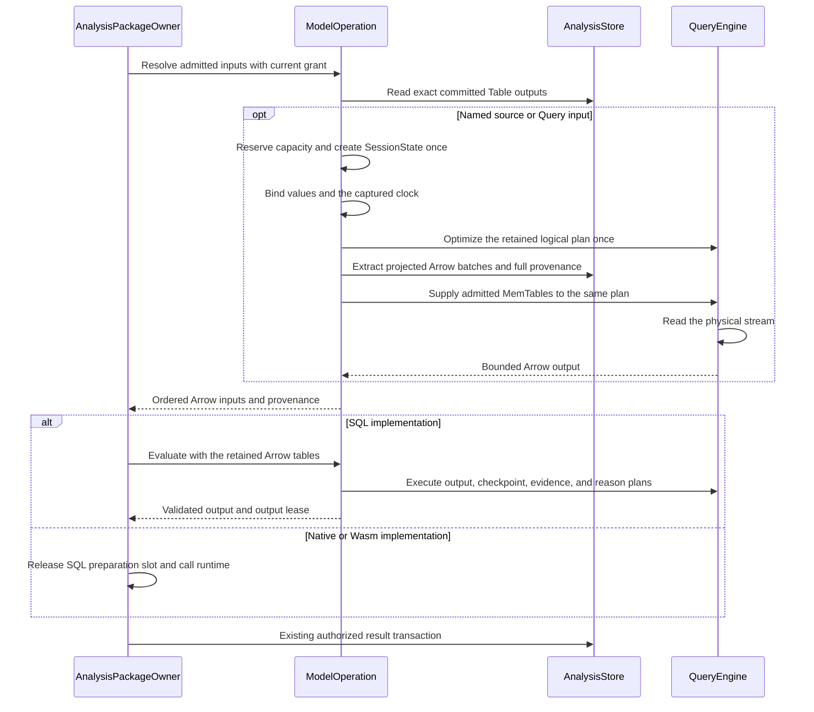

# Araphor SQL Operation Review

The [approved plan](../plans/araphor-production-dataflow-simplification.md)
defines input ownership. The [current verification](../plans/araphor-performance-simplification-todo.md)
records the source and checks. The
[component redesign](../plans/araphor-component-redesign.md) defines the current
engine replacement. Earlier qualification does not cover later edits.

This guide covers engine commit `34a8199c` and the following plan changes.
The source contains
the DataFusion route below. Affected compilation and functional qualification
pass on Linux x86_64 GNU. The whole-code reduction is **Not done**.

## Intended end state

One admitted logical plan reads authorized Arrow sources and produces client
values or model datasets. Each run owns its source batches, physical plan,
stream, control, and leases. The existing store remains the durable result and
progress owner. The host checks below qualify the current engine route.

## Current table and query input flow

The SDK declares each input as `Table(TableRef)` or `Query(String)`.
`TableRef::Named` names a source table. `TableRef::Output` names an exact
package revision, export, and output. An input port supplies its local name
and Arrow schema. Separate ports remain separate datasets; the caller must
write SQL when it needs a join or union.

[AnalysisPackageOwner::prepare_at](../../crates/araphor-data/src/package/evaluation/preparation.rs) checks the installed context and selects the implementation
  -> [QueryOwner::model_operation](../../crates/araphor-data/src/query/model/operation.rs) creates an operation without opening an engine
  -> [ModelOperation::inputs_admitted](../../crates/araphor-data/src/query/model/operation.rs) uses retained source plans, checks authority, and resolves Table inputs before Query inputs
  -> [QueryOwner::output_table](../../crates/araphor-data/src/query/model/source/table.rs) reads exact committed package output and checks the retained grant
  -> [ModelOperation::read_input](../../crates/araphor-data/src/query/model/source/read.rs) evaluates admitted source SQL against built-in tables and declared Table aliases
  -> [SourceRows::finish](../../crates/araphor-data/src/query/model/source.rs) retains direct provenance and hashes inherited table revisions into Query identity
  -> [ModelInputs::finish](../../crates/araphor-data/src/query/model/source.rs) normalizes evidence after the operation restores declared input order
  -> [ModelOperation::evaluate_admitted](../../crates/araphor-data/src/query/model/operation.rs) runs the retained SQL model plans and reuses admitted Arrow tables
  -> [ModelRun::evaluate](../../crates/araphor-data/src/package/evaluation/preparation.rs) prepares the result for the existing package commit owner

Output-only input resolution creates no SQL state and takes no SQL evaluation
slot. ModelOperation creates SessionState and its query lease on first SQL
use. The operation owns one map of admitted Table aliases as MemTables. Each
source statement takes that map and adds its leased built-in batches as
ordinary MemTables. Built-in tables receive no model row index. Dataset
aliases retain their dataset-global row indices. The statement removes its
temporary built-in tables before it returns the map. Final model execution
consumes the same map. Running execution retains
its source owners and leases. Query inputs cannot refer to other Query inputs. Built-in names cannot be replaced
by package output aliases. Errors release the operation state and leases
through Rust ownership.

[SqlModelV1::admit](../../crates/araphor-data/src/query/model.rs) stores output
and checkpoint plans in descriptor order. Each reason plan retains its checked
output and reason descriptor indices. ModelExecution consumes only this
admitted program. It does not receive the raw SQL blueprint. QueryOwner passes
the exact model from SDK CheckedEvaluation into execution. The runtime checks
vector widths and reason indices. InstalledBundle retains the exact package,
descriptor, and admitted-program pairing. Public transient calls still perform
admission. Retained memory includes vector capacity and every admitted query.

Each original Table input retains its evidence and exact dependency once.
A derived Query input combines inherited coverage and hashes the inherited
input revisions, including when SQL returns zero rows. Witness normalization
precedes duplicate removal, so a raw witness cannot hide expired retained
evidence. Freshness inspection uses this same input owner. Native and Wasm
execution release any SQL preparation slot before their runtime acquires one.
Resolved sources return validated result references directly. The package
owner no longer reads those references again or keeps a second input copy.

The operation checks admitted table bytes, including the internal row index,
before it creates each MemTable. Earlier Table aliases remain charged. Raw
extraction and query output use the remaining operation byte budget. The
returned Arrow inputs retain their buffer leases. These checks use the
existing host limits.

Source declarations and datasets use canonical Arrow 58 schemas and batches.
Emission, SQL binding, projection, catalog rows, and result metadata read the
same Arrow fields. InputSchema retains relation facts and ordered absence
text. It stores no parallel field name, type, or unit descriptors. Each source
keeps one static Schema Arc. Full projection shares that schema; reduced
projection shares its Field Arcs. Field metadata keeps its existing four keys
and values. Canonical source schema metadata remains empty.
The query engine is DataFusion 53.1.0. Dataset-only SQL uses the existing
dataset validators and ModelExecution directly. It creates no synthetic
package or evaluation. DuckDB remains the durable storage engine. Public
client values still use the existing DuckDB value types; this interface does
not open a DuckDB query connection.

## Source access and failure

[QuerySql](../../crates/araphor-data/src/query/admission.rs) shares one immutable
program with its SQL, parameters, labels, dependencies, and logical plan.
The plan retains schema-only EmptyTable sources. Binder checks the original abstract
syntax tree (AST). It records every base source, including sources in unused
common table expressions (CTEs). PlannerContext
holds each bound CTE and derived-query plan. SqlToRel plans each full SELECT
directly. Binder uses the admitted source schemas for policy and compatibility
checks. It checks joins before optimizer pruning. Binder also checks unused windows and
excludes the model row index during wildcard expansion. The original AST
supplies time bounds, source-column facts, and append facts. Optimized
TableScan projections supply the fields to allocate. The separate event-field
AST collector is removed.

[ModelSchema](../../crates/araphor-data/src/query/model/schema.rs) supplies the
allowed Arrow schema map for each stage. Source SQL sees authorized built-in
sources and declared Table aliases. Output SQL sees model inputs, parameters,
and prior checkpoint tables. Checkpoint, evidence, and reason SQL also see
completed output tables. A private table name alone does not authorize access.
The retained plan can reference only its admitted sources.

[QueryEngine::prepare](../../crates/araphor-data/src/query/engine/batches.rs)
optimizes a plan clone before extraction. InputProjection derives canonical
column sets from its standard TableScan projections. QueryEngine::bind_sources
consumes that same plan and supplies admitted MemTables. The replacement maps
requested columns by exact field name and checks their types. QuerySql keeps
the original source inventory. SourceRows captures that full provenance,
including unused CTEs and sources removed by optimizer pruning. The optimized
plan does not define source authority or evidence scope. A failed source read does not execute the model or commit
state. Dropping the operation releases its state and
reservations. Returned batches retain the leases for their buffers.

## Execution and verification

[QuerySql::bind_complete](../../crates/araphor-data/src/query/admission.rs)
supplies parameter values, one captured clock, and a shared retained plan.
QueryBinding::plan substitutes those values once before logical optimization.
Name and type binding does not repeat for admitted queries. QueryPlan::new
admits each code-owned template once. Repeated evaluations share that plan
and supply fresh values.

[QueryEngine::state](../../crates/araphor-data/src/query/engine.rs) configures
the function registry, one execution partition, planning concurrency one, a
64 MiB memory pool, and disabled spill storage. QueryOwner owns the lazy Tokio
execution runtime. QueryEngine::run dispatches physical planning and stream
consumption to that runtime. The public query methods remain synchronous.

[QueryEngine::stream](../../crates/araphor-data/src/query/engine/batches.rs)
calls the public physical planner after logical optimization and source
replacement. It calls execute_stream_partitioned and reads the returned
final output partitions in partition order. The optimizer retains Union
instead of replacing it with Interleave. This route preserves branch order
for the qualified model fixture. Internal physical operators can merge
partitions. Use ORDER BY when result order is required. The planner does not
repeat logical optimization.
[QueryEvaluation](../../crates/araphor-data/src/query/evaluation.rs)
checks client row and byte limits while it reads batches.
[QueryValues](../../crates/araphor-data/src/query/values.rs) reads Arrow scalars
into the existing public values and type labels. ModelExecution checks model
row, byte, and batch limits during one stream traversal. It checks raw and
normalized bytes before it retains each output batch. ModelSchema validates
declared output names and types, then shares the declared Arrow schema and metadata.

The operation retains its control, reservations, and input leases while work
runs. Output tables receive one dataset-global row index across all batches.
Checkpoint, evidence, and reason plans reuse those tables. A completed stream
becomes durable only after the existing authorized store transaction.

[Operation tests](../../crates/araphor-data/src/query/model/operation/tests.rs)
compare exact inputs, revisions, provenance, and encoded output with standalone
execution. They check source cleanup, tenant capacity one, retained Arrow
charges, output reservation failure, budget reuse, name collisions, and hidden
source rejection.
[Existing model tests](../../crates/araphor-data/src/query/model/tests.rs) check
checkpoint, parameters, provenance, and source bounds.
[Package lifecycle tests](../../crates/araphor-data/src/package/tests/lifecycle.rs)
check historical scope, retry, cancellation, and capacity.
[Admission tests](../../crates/araphor-data/src/query/admission_tests.rs) and
the [engine cases](../../crates/araphor-data/src/query/admission.rs) cover
CTE scope, unused windows, aliases, source inventory, and public labels.
[Runtime and lease cases](../../crates/araphor-data/src/query/owner_tests.rs)
cover source retention and cancellation. At engine commit `34a8199c`, the
affected build and strict Clippy pass. All 460 distinct selected cases pass: 439 ordinary Data cases,
12 native Data cases, six Control cases, and three E2E cases. The native
detector E2E case runs with PATH empty. Qualification covers Linux,
x86_64-unknown-linux-gnu, and glibc 2.39. Other targets remain unqualified.

The first native checkpoint replay correctly reports Busy while the test
retains a checkpoint alias from its prior output. The corrected test proves
that denial, then reloads checkpoint bytes through the standard wire codec
and proves replay. Production already uses stored checkpoint bytes. All
ordinary Data cases and eight caller cases pass before that test-only edit.
Production source and manifests stay identical. The final build covers the
corrected native case and native E2E. The result record is
`/tmp/araphor-arrow-engine-qualification-final.json`. The
[plan result](../plans/araphor-component-redesign.md#qualification-and-acceptance)
lists the source, test, artifact, and platform receipts.

The following direct plan change passes the affected Data build and 262
selected cases: 256 query cases, four package cases, and two explicit native
error/checkpoint cases. The first query run reaches the host filesystem
reserve. Only its 88 failed cases run again after obsolete generated binaries
are removed; all pass. Strict Clippy passes for Data, Control, and E2E test
targets. Their runtime integration cases are not repeated for this change.
The [plan result](../plans/araphor-component-redesign.md#qualification-and-acceptance)
lists those separate receipts and the current production count.

The source scan change prepares one optimized plan before extraction and
executes that same plan with admitted MemTables. All 263 selected cases pass:
259 query cases and four package cases. The final build and strict Clippy for
Data and its callers pass. Only two test files change after the first
258-query and three-package pass. Both corrected cases pass on the final
build. The count case checks retained real source buffers with a zero-column
scan. The budget cases keep both narrow-query success and wide-query denial
at unchanged limits. The unused-CTE case keeps full witnesses and the existing
content-based revision rule. The result record is
`/tmp/araphor-source-plan-qualification1.json`.

The canonical source-field and table-map changes pass the affected Data build,
260 query cases, six package cases, and strict Clippy for Data and its callers.
The metadata tests check exact dictionaries and shared Schema and Field
allocations. Operation and package cases preserve alias scope, source
provenance, capacity denial, and cleanup. A broad package selection is stopped
before the six affected cases run. The interrupted run is not counted as
qualification. Native and caller runtime cases are not repeated. The result
record is `/tmp/araphor-canonical-fields-qualification1.json`.

The admitted SQL model execution change passes 52 affected cases. The first
run passes 51 cases and rejects the new test's invalid reason namespace. Only
that test file then changes. The final test uses the required namespace and
a shorter name. It passes against the final affected build. Strict Clippy for
Data and its callers passes. Production and manifests remain unchanged.
The cases check descriptor order, independent admitted execution, reason
bindings, vector capacity, installed pairing, current grants, snapshot reuse,
invalid indices, and cleanup. Native and caller runtime cases are not repeated.
The result record is `/tmp/araphor-admitted-runtime-qualification1.json`.

The complete earlier receipts remain at
`7b7b407adf347d389984553a4d212bfce37b75b5:docs/guides/araphor-sql-operation-review.md`.
They include failed attempts, corrections, source hashes, and Linux x86_64 GNU
native qualification. They establish no causal SQL speed improvement. They
do not qualify the current DataFusion integration. The complete production reduction remains **Not done**.
A new performance workload is not part of this deletion work.
