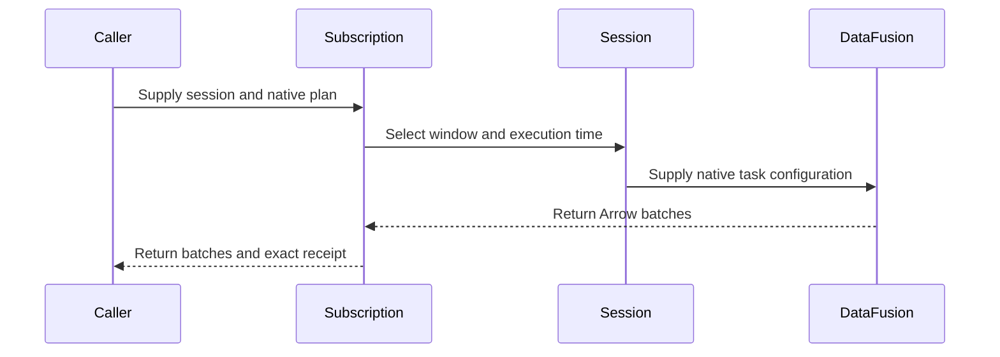
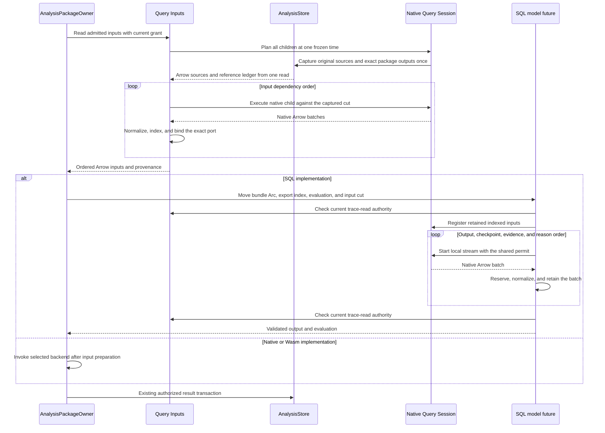
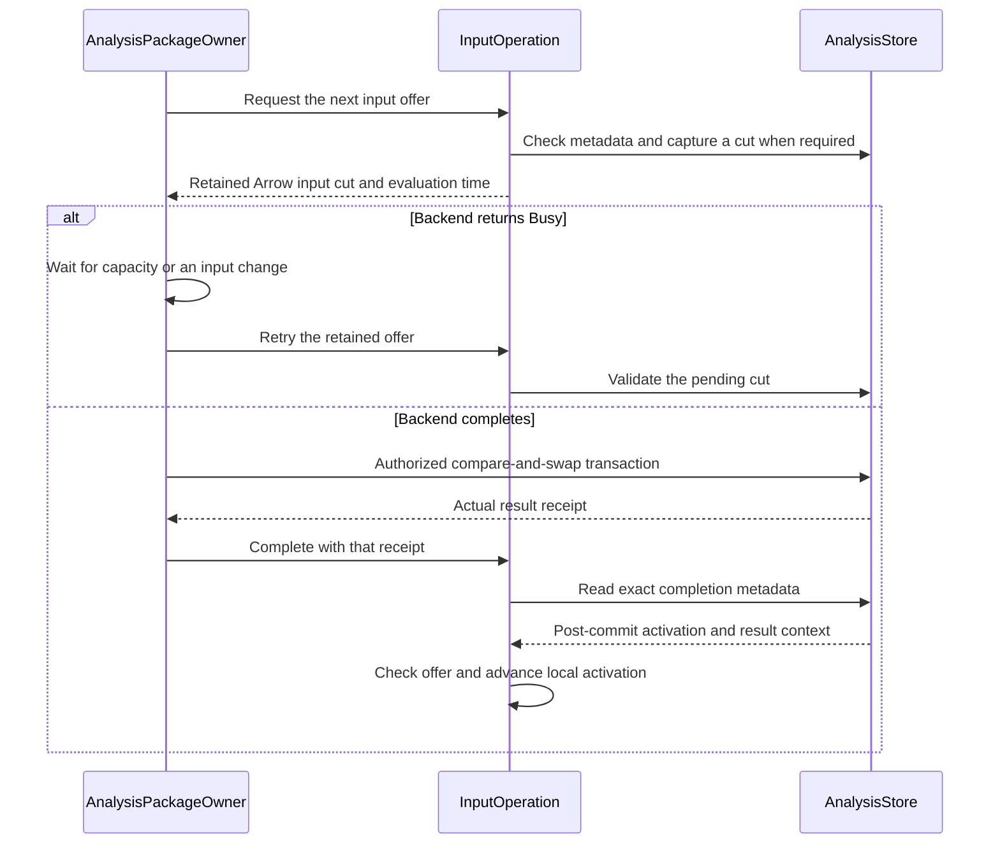
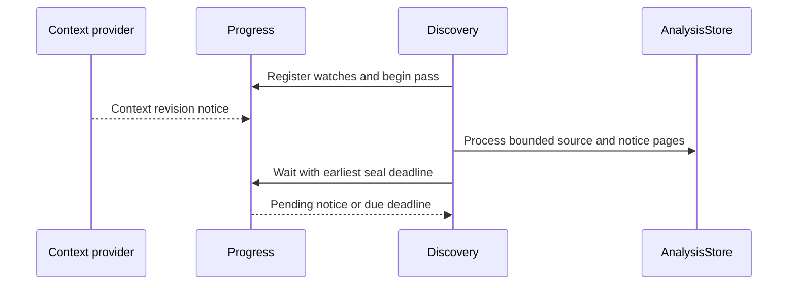

# Araphor SQL Operation Review

The [approved plan](../plans/araphor-production-dataflow-simplification.md)
defines input ownership. The [current verification](../plans/araphor-performance-simplification-todo.md)
records the source and checks. The
[component redesign](../plans/araphor-component-redesign.md) defines the current
engine replacement. Earlier qualification does not cover later edits.

This guide covers the current working-tree DataFusion rewrite. The parser
returns a native statement. The planner returns a native logical plan through
the standard session catalog. The user approves native SQL behavior and
visible dataset row indices. Complete qualification is **Not done**. The
earlier receipts below apply only to their recorded source.

## Intended end state

One admitted logical plan reads authorized Arrow sources and produces native
Arrow batches. Each run owns its source batches, physical plan, stream,
control, and reservations. Control converts client results at the protocol
boundary. Analysis checks declared model outputs. Data remains the durable
result and progress owner. Current source tests define the required checks.

## Native SQL admission

Read [Parser](../../crates/araphor-query/src/parser/mod.rs),
[Engine admission](../../crates/araphor-query/src/execution/admission.rs), and
[Planner](../../crates/araphor-query/src/planner/mod.rs) in that order. Parser
returns the native statement. Planner uses the native session catalog and
SQLOptions. Read-only admission applies inside subqueries. A non-query
statement is rejected before DDL planning can read external metadata.

Parser bytes and depth quotas default to None. The parameter count, parameter
bytes, projection width, and window bound quotas in Query Limits also default
to None. The same Limits Arc is registered in native session configuration.
Native SQL defines join and window behavior when these quotas are disabled.
Control validates and moves transport values once before native binding.

## Subscription execution triggers

Read [Progress](../../crates/araphor-query/src/stream/progress.rs) and the
[physical Runtime](../../crates/araphor-query/src/stream/physical/runtime.rs).
Runtime waits for source and clock notices or the recorded window deadline.
There is no periodic metadata read or replacement delay. A metadata-only
update preserves the completed cursor. The tests beside Follow and live
Inputs cover source changes, window expiry, capacity, and cancellation.

Discovery still calls this wake helper from a separate source sweep. This
is **Not done** against the required architecture. The replacement must
consume the actual Query input batches for live execution, finite execution,
and manual refresh. An identity-only query must not invoke the old reader.

## Native Discovery SQL package

The new [ObservedEffects](../../crates/araphor-discovery-effects/src/effects.rs)
relation planner binds one subquery to the checked-in
[SQL body](../../crates/araphor-discovery-effects/src/observed_effects.sql).
The body uses native projection, GROUP BY, COUNT, MIN, and MAX. There is no
package logical operator, physical operator, executor, or retained result cache.
The relation hook is required because a native table function accepts scalar
expressions, not an input relation. The hook delegates the bound derived table
to the native planner. It does not parse a second SQL grammar.

```sql
SELECT source_id, binding_id, event_count, first_cursor, last_cursor
FROM discovery.observed_effects((
    SELECT * FROM events
    WHERE received_at >= now() - INTERVAL '60 seconds'
))
```

[ControlPlane::analysis_packages](../../crates/mithril-control/src/service/packages.rs) registers the native relation hook
  -> [Engine::prepare](../../crates/araphor-query/src/execution/admission.rs) parses SQL and records the original sources
  -> [ObservedEffects::plan_relation](../../crates/araphor-discovery-effects/src/effects.rs) binds the input subquery to the native SQL body
  -> DataFusion plans and optimizes the ordinary logical operators
  -> [SourceSnapshot](../../crates/araphor-query/src/sources/mod.rs) captures authorized input for physical execution
  -> native physical operators return Arrow batches
  -> [Subscription](../../crates/araphor-query/src/follow/mod.rs) returns the batches and their captured receipts

The existing Progress owner starts replacement execution on a source notice
or an exact supported window boundary. The package has no private wake loop.
Each result describes the supplied relation. Projected source keys are data;
the authorized selection and snapshot witnesses supply evidence provenance.
The received-time bounds use receipt time with microsecond precision.

This is a built-in SQL package. It does not establish OCI admission, persisted
managed jobs, complete coverage, or old behavior-profile parity. Existing
Discovery packages and entry points remain available. The Data lock wait and
native interrupt monitor still poll. The complete no-polling requirement is
**Not done**.

Read the [package tests](../../crates/araphor-discovery-effects/src/tests.rs),
[subscription tests](../../crates/araphor-query/src/follow/tests/discovery.rs),
and [Control RPC tests](../../crates/mithril-control/src/client_grpc/tests/discovery.rs)
in that order. They cover native SQL plans, split batches, repeated evaluation,
NULL dimensions, aliases, invalid arguments, retained input, source and tenant
scope, window expiry without intake, idle waits, and joined cancellation.
The plan records the final verification result.

## Discovery record input contract

[Record::port](../../crates/araphor-analysis-builtins/src/discovery/record.rs)
declares native Arrow fields for source identity, cursor, effect, source
lifetime, and original frame bytes. The static port owns the schema. Each
package declaration shares its field allocations. serde_arrow uses this
schema for encoding and decoding. The source identifiers use serde_bytes.
Their JSON schema remains an array of sixteen bytes.

[DiscoveryOwner::derive_page](../../crates/araphor-analysis/src/discovery/sdk/atoms.rs) prepares a record input
  -> [Adapter::observation](../../crates/araphor-analysis/src/discovery/sdk/atoms.rs) borrows each original frame and supplies its parsed fields
  -> [Record::encode](../../crates/araphor-analysis-builtins/src/discovery/record.rs) creates the native Arrow dataset
  -> [Package::check_evaluation](../../crates/araphor-analysis-sdk/src/validation.rs) checks the declared input contract
  -> [Record::read](../../crates/araphor-analysis-builtins/src/discovery/record.rs) borrows frame bytes from the checked input batches
  -> [Discovery::atoms](../../crates/araphor-analysis-builtins/src/discovery/atoms.rs) checks duplicates and resolves actual source coordinates against coverage
  -> [Atoms::record](../../crates/araphor-analysis-builtins/src/discovery/atoms.rs) updates the domain result

The input batches own the frame buffers until the evaluation ends. Record
does not retain a host coverage index. The builtin makes one coverage map.
The old host range search, per-record JSON digest, and redundant record sort
are deleted. Context and snapshot ports still use their existing JSON codec.

The [record tests](../../crates/araphor-analysis-builtins/src/discovery/tests.rs)
check borrowed frame addresses, empty input, nullable fields, UInt64 precision,
malformed identifiers, cross-batch duplicates, conflicts, and source ranges.
The [native query test](../../crates/araphor-analysis/src/discovery/sdk/atoms/tests.rs)
reads retained events through a finite Subscription. Native named_struct and
CASE expressions produce the declared record fields. The existing SDK
normalizer supplies field metadata and nullability. Complete batch equality
checks the native projection against the codec. The test retains the source
receipt and checks subscription completion.

The selected final checks pass 66 SDK cases, 20 builtin cases, and 15 distinct
Analysis cases, including both source-built native/Wasm parity cases. Strict
Clippy and scoped formatting pass. Twelve selected cases first fail at the
filesystem reserve. All twelve pass with the same source after obsolete
generated binaries are removed. The current source and artifact record is
`/tmp/araphor-typed-record-qualification1.json`. No full workspace CI or
benchmark is run.

**Partial:** Discovery still uses its host record adapter, source sweep, replay
reader, and seal scheduler. The production Query subscription replacement is
**Not done**. This contract and its query test do not complete that work or the
production reduction target.

## Frozen Discovery query inputs

[DiscoveryOwner::new](../../crates/araphor-analysis/src/discovery/mod.rs)
derives the durable store from its Query engine. Callers cannot supply a second
store. Discovery state and source queries use that same owner.

[DiscoveryOwner::replay](../../crates/araphor-analysis/src/discovery/replay.rs) requests frozen input
  -> [replay_input](../../crates/araphor-analysis/src/discovery/replay.rs) keeps the recorded coverage and context facts
  -> [replay_records](../../crates/araphor-analysis/src/discovery/replay.rs) supplies exact source and cursor bounds to a finite Subscription
  -> [Engine::prepare](../../crates/araphor-query/src/execution/admission.rs) uses native SQL admission and planning
  -> [SubscribeExec](../../crates/araphor-query/src/stream/physical.rs) runs the native projection and sort
  -> [SourceData::open](../../crates/araphor-query/src/sources/mod.rs) returns retained event batches
  -> [replay_records](../../crates/araphor-analysis/src/discovery/replay.rs) reads the projected record fields with serde_arrow
  -> [replay_input](../../crates/araphor-analysis/src/discovery/replay.rs) rejects missing cursors and checks frozen attribution
  -> [replay](../../crates/araphor-analysis/src/discovery/replay.rs) checks the exact recomputed snapshot

[refresh_profile](../../crates/araphor-analysis/src/discovery/live.rs) uses the
same frozen input path before it resolves missing facts. It no longer reads
raw store pages. [refresh_source](../../crates/araphor-analysis/src/discovery/live.rs)
owns one installed-package snapshot and reference set for the refresh batch.
Each profile borrows this snapshot. The commit still checks current authority.
An empty notice set does not load a new package snapshot.

The finite Query session uses the configured record allowance and Query memory
capacity. The client result-page row limit does not define a detector input
window. A partial result or an expired cursor cannot become complete frozen
input. The operation control uses the Query extraction timeout.

[Output::complete](../../crates/araphor-query/src/stream/physical/output.rs)
accepts comparison state only for a live replacement query.
[Runtime](../../crates/araphor-query/src/stream/physical/runtime.rs) supplies no
comparison state for a finite query. Finite completion therefore skips the
row fingerprint. Both modes retain output limits, cancellation, read checks,
producer drop, and buffer reservations. The
[ListView case](../../crates/araphor-query/src/stream/physical/output/tests.rs)
returns a native Arrow array that ScalarValue cannot represent. It also checks
that the returned array keeps the original Arc.

The [range case](../../crates/araphor-analysis/src/discovery/replay.rs) checks
258 records, exact cursor order, source isolation, original unknown protobuf
bytes, later intake, and an explicit record limit. The complete selected
Discovery lifecycle run passes 23 cases. The selected Query run passes 62
cases. Strict Clippy, formatting, and guide links pass. An earlier notice-page
timeout passes unchanged in isolation and remains in the evidence. The source
record is `/tmp/araphor-replay-query-qualification1.json`. No full workspace
CI or benchmark is run. Native plugin ABI qualification is not repeated.

**Partial:** Live intake still reads raw pages and owns its source sweep and
seal scheduler. Recorded manifest execution still uses RecordedPages and host
input preparation. These paths still need actual Query input subscriptions.
Remaining quota defaults and the production reduction target are **Not done**.

## Runtime table binding

[AdmittedModel::relation](../../crates/araphor-analysis/src/model.rs) declares
[SourceProvider::local](../../crates/araphor-query/src/sources/mod.rs).
[Session::state](../../crates/araphor-query/src/execution.rs) registers the
current Arc map of native MemTables in session configuration. The provider
checks the declared schema and calls the native MemTable scan. The original
logical plan goes directly to native physical planning. No table-scan rewrite
is required. Session clones share the map; a later registration creates a new
map when an earlier session still holds the old map.

[Planner::sources](../../crates/araphor-query/src/planner/mod.rs) records
original retained sources for Query and input admission. It uses native AST
visitation to separate plain tables from table functions. Native resolution
still handles CTE scope and identifier case. The native resolver alone returns
function names as relation names. Without this distinction, a generated input
can inherit an unrelated input table's provenance. The collision test also
checks that a table in an unused CTE remains a dependency.

## Subscription session ownership

[Subscription::new](../../crates/araphor-query/src/follow/mod.rs) accepts the
caller's [Session](../../crates/araphor-query/src/execution.rs). Session owns
the authorized selection, control, memory scope, local tables, and output
settings. The subscription and delivery retain that same session.

[Engine::subscribe](../../crates/araphor-query/src/execution/admission.rs) admits SQL
  -> [Subscription::new](../../crates/araphor-query/src/follow/mod.rs) retains the session and original source requests
  -> [SubscribeExec::open](../../crates/araphor-query/src/stream/physical.rs) supplies the session to native physical planning
  -> [Runtime::evaluate](../../crates/araphor-query/src/stream/physical/runtime.rs) changes the selected window and execution time on the retained session
  -> [Journal](../../crates/araphor-query/src/sources/journal.rs), [Kernel](../../crates/araphor-query/src/stream/physical/kernel.rs), and [page output](../../crates/araphor-query/src/stream/physical/page.rs) use that session's memory scope
  -> [Delivery](../../crates/araphor-query/src/follow/delivery.rs) retains the session for conversion and cancellation



Metadata reads also use the session's memory scope. A cursor-expiry receipt
uses a fresh control and the same scope. This read does not reuse a cancelled
control. Local tables remain available during native planning. Session output
settings apply to append pages and replacement output.

The tests `subscription_keeps_memory_scope` and `subscription_keeps_bindings`
check these contracts. The first test covers append, maintained COUNT,
replacement SUM, metadata updates, borrowed output, and full capacity release.
The second test uses native SQL and a registered local provider. It checks
local values and an explicit output quota. Discovery still needs a complete
subscription lifecycle replacement. This change does not implement that work.

The final source passes all 214 distinct Query cases across the recorded
checks, and the E2E query-follow contract passes. Strict Query and E2E Clippy
passes. The source records are
`/tmp/araphor-discovery-subscription-session-query2.json`,
`/tmp/araphor-discovery-subscription-session-query3.json`,
`/tmp/araphor-discovery-subscription-session-idle1.json`,
`/tmp/araphor-discovery-subscription-session-e2e2.json`, and
`/tmp/araphor-discovery-subscription-session-lint3.json`.
The first Query run reaches the filesystem reserve. One idle-clock assertion
then fails and passes unchanged in isolation. These checks do not establish
one complete passing Query run or a performance result. Full workspace CI and
benchmarks are not run, as instructed.

## Current table and query input flow

The SDK declares each input as `Table(TableRef)` or `Query(String)`.
`TableRef::Named` names a source table. `TableRef::Output` names an exact
package revision, export, and output. An input port supplies its local name
and Arrow schema. Separate ports remain separate datasets; the caller must
write SQL when it needs a join or union.

| Crate owner | State and behavior | Dependencies in this route |
| --- | --- | --- |
| [Data](../../crates/araphor-data/src/lib.rs) | Durable records, package formats, transactions, retention, source revisions, and read control. | SDK, shared built-in contracts, and DuckDB. No Query or Analysis dependency. |
| [Query](../../crates/araphor-query/src/lib.rs) | Native parsing, planning, catalogs, source capture, Arrow execution, reservations, follow, and subscription delivery. | Data, SDK, DataFusion, and Arrow. |
| [Analysis](../../crates/araphor-analysis/src/lib.rs) | Package lifecycle, admitted model programs, ModelRun, native/Wasm execution, and domain execution. | Query, Data, SDK, and existing execution backends. |

Control imports these owners directly. The dependency graph has no facade
crate. SDK owns declarations and native/Wasm application binary interfaces.

[AdmittedExport::admit](../../crates/araphor-analysis/src/model.rs) admits the installed export
  -> [Inputs::admit](../../crates/araphor-query/src/inputs/mod.rs) retains native plans, original provider origins, and input dependency order

[AnalysisPackageOwner::prepare_model](../../crates/araphor-analysis/src/package/evaluation/preparation.rs) checks current authority and reads the admitted Inputs directly
  -> [Inputs::execute](../../crates/araphor-query/src/inputs/physical.rs) plans all physical children at one frozen time
  -> [SourceSnapshot::capture](../../crates/araphor-query/src/sources/mod.rs) combines the prepared source columns and time ranges in one capture
  -> [AnalysisStore::read_tables](../../crates/araphor-data/src/analysis/extraction.rs) fixes one Data read transaction for the original source receipts
  -> [AnalysisStore::extract_packages](../../crates/araphor-data/src/analysis/extraction/package.rs) reads exact package outputs and their references in that same transaction
  -> [Capture::finish](../../crates/araphor-data/src/analysis/extraction/tables/mod.rs) returns requested native Arrow tables with the complete read receipt
  -> [SourceSnapshot::read](../../crates/araphor-query/src/sources/rows.rs) claims those arrays and binds their exact native schemas to the source origins
  -> [Dataset::normalize_batch](../../crates/araphor-analysis-sdk/src/batch.rs) applies the declared SDK schema after conversion preflight
  -> [Inputs::execute](../../crates/araphor-query/src/inputs/physical.rs) materializes each completed port with one dataset-global row index before dependent SQL runs
  -> [Inputs::input](../../crates/araphor-query/src/inputs/receipt.rs) assigns per-port revisions and coverage from the original source scopes and reference origins
  -> [InputSet](../../crates/araphor-query/src/inputs/physical.rs) returns declared input order, retained tables, and complete provenance
  -> [AnalysisPackageOwner::evaluate_artifact](../../crates/araphor-analysis/src/package/execution.rs) receives the owned evaluation and retained input set for the exact installed export
  -> [AnalysisPackageOwner::evaluate_artifact](../../crates/araphor-analysis/src/package/execution.rs) dispatches SQL to one Engine::wait future or invokes the selected synchronous native or Wasm owner
  -> [AnalysisPackageOwner::prepare_model](../../crates/araphor-analysis/src/package/evaluation/preparation.rs) prepares one result contract
  -> [AnalysisStore::commit_package](../../crates/araphor-data/src/analysis/packages/commit.rs) checks the authorized durable transaction



Inputs and ModelRun derive store access from the existing Engine. The package
owner derives its retained store Arc from that Engine. The constructors accept
no independent store argument. A nonempty resolved input cut holds one SQL
evaluation permit through planning, capture, and all native child streams.
The input permit is released before the selected backend acquires its permit.

[Inputs::execute](../../crates/araphor-query/src/inputs/physical.rs) adds one
dataset-global `__row_index` across each completed port's batches. The column
is an ordinary visible table field. Native `SELECT *` includes the field.
[InputSet::register](../../crates/araphor-query/src/inputs/physical.rs) gives SQL
ModelRun those same indexed tables. ModelRun does not build those indices
again. [ModelRun::table](../../crates/araphor-analysis/src/model/input.rs)
still builds indices for host-prepared inputs, parameters, prior checkpoints,
and completed model outputs. Canonical Data tables keep their declared fields.
A model can use a canonical Data table name for a supplied relation. Provider
origins keep that local binding separate from the durable source inventory.
Table lookup applies no `__araphor_` prefix ban.

[AdmittedModel](../../crates/araphor-analysis/src/model.rs) stores raw native
logical plans for output and checkpoint queries in descriptor order. Each
reason plan retains checked output and reason indices. InstalledBundle retains
the exact descriptor, implementation, and admitted-program pairing.
[ModelRun::evaluate](../../crates/araphor-analysis/src/model/execute.rs)
executes those retained plans. The package caller moves the evaluation and
an `Arc<InstalledBundle>` into one SQL future. The future keeps the exact
export index and borrows its descriptor and admitted plans from that bundle.
The production route does not clone the descriptor or evaluation for dispatch.
The raw model admission and evaluation entry points remain deleted. Invalid
input bindings fail admission before execution. Known retained vectors and
declarations have native memory reservations; native plan allocation has no
complete upstream size measurement.

[AnalysisPackageOwner::evaluate_artifact](../../crates/araphor-analysis/src/package/execution.rs) selects the SQL implementation for the exact installed export
  -> [Engine::wait](../../crates/araphor-query/src/execution.rs) executes one owned future on the existing runtime
  -> [InputSet::check_async](../../crates/araphor-query/src/inputs/physical.rs) checks retained trace-read authority without synchronous runtime entry
  -> [ModelRun::new](../../crates/araphor-analysis/src/model/operation.rs) constructs the complete Session, control, shared evaluation permit, and output reservation
  -> [ModelRun::evaluate_output](../../crates/araphor-analysis/src/model/execute.rs) runs outputs, checkpoint, evidence, and reason plans in their admitted order
  -> [Session::stream_local](../../crates/araphor-query/src/execution.rs) creates each native physical stream with the same evaluation permit
  -> [ModelRun::query](../../crates/araphor-analysis/src/model/execute.rs) reserves conversion and vector growth before it normalizes and retains each batch
  -> [ModelRun::evaluate](../../crates/araphor-analysis/src/model/execute.rs) checks the complete SDK output, control, and current trace-read authority
  -> [SqlModelOutputV1::retain](../../crates/araphor-analysis/src/model.rs) transfers retained metadata and buffer claims to the returned output

Input capture completes before this SQL future starts. The SQL stages do not
call the synchronous runtime bridge again. ModelRun has no partial public
construction or preparation API. Output datasets remain materialized for
`output_*` tables and dataset-global row references. The run does not collect
a separate raw batch vector before normalization.

[AdmittedExport](../../crates/araphor-analysis/src/model.rs) retains one
`Arc<Inputs>`. Inputs stores native plans and orders dependent ports before
their readers. Native `SessionState::resolve_table_references` supplies the
original table references, including unused common table expressions (CTEs).
SourceOrigin distinguishes canonical durable sources, materialized port slots,
and exact package-output slots. Port and package providers have unknown native
statistics before capture. A later materialization therefore cannot be folded
as an empty admission table. The run restores descriptor order after execution.
Exact names, current grants, freshness, capture, and resource limits remain
checks for each run.

Each original Table input retains its evidence and exact dependency once.
A derived Query input combines inherited coverage and hashes the inherited
input revisions, including when SQL returns zero rows. Witness normalization
precedes duplicate removal, so a raw witness cannot hide expired retained
evidence. Freshness inspection uses this same finite input owner. Data records
context and result references once, with their source origins, in the extraction
reference ledger. Query selects each port's exact facts from that ledger.
Data checks exact dependency revisions again at the durable commit boundary.
The old Analysis source readers and their post-capture reference reads are
deleted. No SourceBatch or LocalTable binding owner remains.

[Engine::blocking](../../crates/araphor-query/src/execution.rs) keeps one
cancellation guard until the actual blocking read ends. A completed Data error
does not cancel the caller. A timeout or dropped read cancels unfinished work.
[InputSet::check_async](../../crates/araphor-query/src/inputs/physical.rs) checks
current trace-read authority before and after SQL model execution. The returned
future owns its snapshot and child control. SQL awaits that future on the
existing runtime. [InputSet::check](../../crates/araphor-query/src/inputs/physical.rs)
keeps the synchronous bridge for native, Wasm, and other synchronous callers.
Both routes preserve cancellation and typed read denial. The input owner checks
indexed bytes and aggregate references before it offers an InputSet. Missing
input errors keep their typed cause through native DataFusion error wrappers.
Install preserves MissingInput readiness. Inspect marks the retained result stale.

The [retained trace case](../../crates/araphor-query/src/inputs/tests.rs)
checks both read-check entry points. The case checks cancellation before the
async future is polled and denial after retained trace access is revoked.
The caller control remains usable after denial. The `quiet_check_skips_runtime`
case calls both entry points from Engine's runtime without a trace snapshot.

The [live detector input lifecycle](#live-detector-input-lifecycle) uses this
finite input execution. Query now owns input change checks, time checks,
retained Busy retry, and commit-completion feedback. Analysis retains package
lifecycle, backend admission, checkpoint selection, current authority, and
the authorized Data compare-and-swap transaction.

Native execution calls the actual
[NativeLibrary](../../crates/araphor-analysis/src/package/native/loading.rs)
owner. The stateless NativeExecution wrapper is deleted. The loader checks the
qualification against its pinned files. Execution does not repeat artifact
inspection and system-library reads before loading. Native admission remains
a separate trust boundary. The native options remain on AnalysisPackageOwner.
The library creates a fresh SDK Invocation and keeps all code and file pins
through output copying and producer release callbacks. The caller checks
cancellation after loading; the library checks it before and after the call.

The Wasm branch also calls its actual
[invoke owner](../../crates/araphor-analysis/src/package/wasm/execution.rs)
directly. The duplicate prepared-input and optional-input wrappers are deleted.
Package execution retains the checked evaluation and encoded input reservation
through invocation and output decoding. Invoke owns the VM permit, engine
identity check, Store, quotas, interruption, and code pin. The outer Query
evaluation permit remains held through SDK output validation and retention.

Wasm preparation uses the caller deadline and the compiler's existing
45-second maximum. The configured Query evaluation timeout starts after
preparation. Encode, invoke, decode, and output validation use that evaluation
control. Native loading keeps its existing evaluation control. The
[deadline case](../../crates/araphor-analysis/src/package/wasm/tests/runtime/prepared.rs)
proves that cold preparation completes before a one-nanosecond evaluation
deadline rejects execution.

[CompilerChild::capture](../../crates/araphor-analysis/src/package/wasm/compiler.rs) starts compilation
  -> [CompilerChild::capture](../../crates/araphor-analysis/src/package/wasm/compiler.rs) starts one scoped I/O thread for synchronous callers
  -> [CompilerChild::run](../../crates/araphor-analysis/src/package/wasm/compiler.rs) waits for Tokio process completion and both pipes in one runtime
  -> [CompilerInput::write](../../crates/araphor-analysis/src/package/wasm/compiler/input.rs) sends the CBOR header and borrowed source bytes
  -> [CompilerImage::read](../../crates/araphor-analysis/src/package/wasm/compiler/image.rs) receives the reply

[AnalysisReadControl::query_async](../../crates/araphor-data/src/analysis/read.rs) reports cancellation or deadline expiry
  -> [CompilerChild::capture](../../crates/araphor-analysis/src/package/wasm/compiler.rs) kills and reaps the child before returning
  -> [WasmExecution::compiled](../../crates/araphor-analysis/src/package/wasm/cache.rs) keeps the compiler unavailable when reaping fails

The scoped thread permits synchronous calls from an async application. The
compiler has no process-status loop or sleep interval. A caught I/O-task panic
uses the same kill and reap path. Tokio kill_on_drop also protects child drop.
The request bytes and reply integrity checks do not change. The compiler's
existing CPU, wall-time, source, and reply quotas remain.

The [compiler lifecycle cases](../../crates/araphor-analysis/src/package/wasm/compiler/tests.rs)
check cancellation, expiry, reaping, later compilation, OS limits, and calls
from an async application. The [request codec cases](../../crates/araphor-analysis/src/package/wasm/compiler/input/tests.rs)
compare async output with native CBOR encoding at each byte-length boundary.
The cases also check source overflow and a closed pipe. These changes do not
replace the separate Discovery source sweep.

[CheckedEvaluation](../../crates/araphor-analysis-sdk/src/validation.rs)
retains the validated package, model, and input by borrow. Its
[encode](../../crates/araphor-analysis-sdk/src/wire/evaluation.rs) method
retains the IPC allocation checks. Native
[Invocation](../../crates/araphor-analysis-sdk/src/native/mod.rs) borrows the
same proof for input exchange and output validation. These paths do not repeat
the input contract checks. The foreign guest decoders still validate raw input.
The raw wire output decoder retains its error order. The wire bytes, WIT, native
ABI, and producer release callbacks do not change.

The Session checks retained local table bytes, including the dataset row
index, before registration. Earlier local tables remain charged. Source
capture and model-input results use the native input category. Client and
model-output batches use the native output category. Borrowed Arrow buffers
retain their charges after the producer closes.
Registration uses existing buffer claims. It does not reserve the shared
payload a second time. The logical local-input limit still applies.

Source declarations and datasets use canonical Arrow 58 schemas and batches.
The [canonical schemas](../../crates/araphor-data/src/analysis/extraction/tables/schema.rs)
supply source fields, catalog rows, and result metadata. Field metadata defines
owner, units, null meaning, join keys, readiness, and description. Native
projections preserve the selected Field metadata. One immutable schema map is
shared across engines and reads. Capture does not build another schema map.
The query engine is
DataFusion 53.1.0. The synchronous
[SqlDatasetOutputV1::query](../../crates/araphor-analysis/src/model/datasets.rs)
entry point validates supplied datasets and admits SQL against those schemas.
It registers those datasets, then moves a complete private ModelRun into one
Engine::wait future. The returned dataset keeps its metadata reservation.
This route creates no synthetic package or evaluation. DuckDB remains the durable
storage engine. Client transport reads native Arrow values in Control; the
transport path opens no DuckDB query connection.

## Live detector input lifecycle

[AnalysisPackageOwner::supervise](../../crates/araphor-analysis/src/package/supervision.rs) registers current installed activations
  -> [Inputs::watch](../../crates/araphor-query/src/inputs/live.rs) creates one InputOperation for the exact activation and grant
  -> [InputOperation::next](../../crates/araphor-query/src/inputs/live.rs) checks the current activation and saved result before input capture
  -> [Inputs::execute](../../crates/araphor-query/src/inputs/physical.rs) executes the admitted native input plans at one frozen time
  -> [InputOperation::next](../../crates/araphor-query/src/inputs/live.rs) offers one retained Arc<InputSet> with its evaluation time
  -> [AnalysisPackageOwner::evaluate_offer](../../crates/araphor-analysis/src/package/supervision.rs) checks authority and invokes the selected backend
  -> [AnalysisPackageOwner::authorize_commit](../../crates/araphor-analysis/src/package/owner.rs) checks current authority for the result transaction
  -> [AnalysisStore::commit_package](../../crates/araphor-data/src/analysis/packages/commit.rs) checks the activation, checkpoint, source revisions, and exact references in one transaction
  -> [AnalysisStore::package_completed](../../crates/araphor-data/src/analysis/packages/input.rs) verifies the actual result head and stored activation precondition
  -> [InputOperation::complete](../../crates/araphor-query/src/inputs/live.rs) checks the offered revisions, coverage, and evaluation time before it advances the local activation

[AnalysisPackageOwner::serve_activation](../../crates/araphor-analysis/src/package/supervision.rs) receives a typed Busy failure
  -> [AnalysisPackageOwner::wait_inputs](../../crates/araphor-analysis/src/package/supervision.rs) waits for the actual blocked resource or an input change
  -> [InputOperation::retry](../../crates/araphor-query/src/inputs/live.rs) retains the offered input cut
  -> [AnalysisStore::package_input_current](../../crates/araphor-data/src/analysis/packages/input.rs) checks that cut against current metadata and retained evidence
  -> [InputOperation::next](../../crates/araphor-query/src/inputs/live.rs) offers the same Arc when the cut is valid, or captures a new cut when it is invalid

[Progress::new and begin](../../crates/araphor-query/src/stream/progress.rs) register the source and clock watches before physical planning or capture
  -> [Runtime](../../crates/araphor-query/src/stream/physical/runtime.rs) or [Inputs::execute](../../crates/araphor-query/src/inputs/physical.rs) completes its native capture
  -> [Progress::captured](../../crates/araphor-query/src/stream/progress.rs) records the captured revision and next source deadline
  -> [Progress::next](../../crates/araphor-query/src/stream/progress.rs) waits for a source notice, an explicit clock notice, or a due deadline
  -> Runtime returns a SQL update, or InputOperation checks and offers the complete package input

[AnalysisPackageOwner::serve_activation](../../crates/araphor-analysis/src/package/supervision.rs) receives stop, authority change, or grant expiry
  -> [AnalysisReadControl::cancel](../../crates/araphor-data/src/analysis/read.rs) cancels the shared operation token
  -> [AnalysisPackageOwner::serve_activation](../../crates/araphor-analysis/src/package/supervision.rs) waits for the actual blocking worker before it releases the task



The shared [Progress](../../crates/araphor-query/src/stream/progress.rs)
owner serves Runtime, InputOperation, and Discovery. Its constructor registers
Data and explicit clock watches. Discovery also supplies an optional provider
context watch. Its begin method returns the observed time to the caller.
Runtime and InputOperation use that time for capture. A metadata-only health
read acknowledges clock notices and
keeps pending source notices. It records the last checked source revision, the captured source deadline,
and the deadlines that have already fired. Notices received during planning or
capture remain pending. Each recorded source deadline fires once. A later grant or witness deadline
remains active. A new capture records the next source deadline.

| Owner | Retained state and output |
| --- | --- |
| Progress | Data, clock, and optional context watches; watch admission; last checked source revision; and recorded deadlines. Runtime, InputOperation, and Discovery use this owner. |
| Runtime | SQL plan, captured Arrow output, source frontier, and client cursor progress. |
| InputOperation | Complete admitted input graph, exact activation and grant, retained Arc<InputSet>, evaluation time, memory scope, and commit completion. |
| Discovery | Source-pass cursor, pass-start time, earliest open-profile seal deadline, and installed execution memory scope. Data retains committed profiles and notices. |
| Analysis and Data | Current authority, selected backend, durable activation, checkpoint, result, and transaction. |

A package offer contains the complete input graph. A generic batch stream or
client cursor does not replace its commit protocol. The pending cut stays alive
during a Busy wait. A successful backend call does not acknowledge the cut.
Completion requires the actual Data receipt. A reader Busy failure during
completion retries that metadata read without another backend call or result
commit.

Live package execution has no 500-millisecond polling timer and does not round
its evaluation time to a tick. Source notices, explicit clock notices, and
actual deadlines cause work. Native and Wasm models remain clock-dependent,
but their backend type does not arm a timer. An arbitrary now() expression
runs again only after a source notice, explicit clock notice, or another actual
deadline. A model clock change can reuse a completed input cut. An input clock
change requires a new cut after completion. Equal input revisions and coverage
suppress another backend offer when the model does not read time. The client
subscription can request its existing health deadline. Package execution
supplies no health deadline.

[Inputs::execute](../../crates/araphor-query/src/inputs/physical.rs) uses the
shared [Window](../../crates/araphor-query/src/follow/window.rs) rules to compute
the next supported event-window expiry. Each input port uses its own source
range. The complete input graph supplies the earliest port or source deadline.
SourceSnapshot reads the required canonical received_utc_ns column from the
same captured tables. The extra column uses the existing input quotas. This calculation keeps original selection and evidence
scope.

The native received_at timestamp uses microseconds. DataFusion 53 converts the
nanosecond time expression to this unit with truncation toward zero. Window
selection and expiry use the same rule. For example, a row in the zero
microsecond bucket with a strict 1,001-nanosecond window expires at time 2
nanoseconds. The threshold is then -999 nanoseconds and converts to zero. The
inclusive form expires at time 2,001 nanoseconds. Native finite SQL supplies
the expected result at each boundary.

A Busy retry retains the offered time with its valid cut. The InputSet retains
its frozen input time. The operation supplies model evaluation time separately.
A fresh capture with expired evidence keeps Unknown coverage and excludes that
evidence from commit witnesses. A witness that expires after capture invalidates
a pending cut before retry.

[AnalysisStore::package_input_current](../../crates/araphor-data/src/analysis/packages/input.rs)
uses one controlled metadata transaction. The check retains the existing
global relation-revision rule, including notices from an unselected tenant.
It checks store identity, schema, recovery epoch, current activation, exact
dependencies, context references, trace authority, and retained live witnesses.
The check reads no Arrow payload. The saved-result check also avoids input
capture when the durable result remains current. Manual Inspect and Run keep
the finite input entry point and their existing authority checks.

[AnalysisPackageOwner::prepare_model](../../crates/araphor-analysis/src/package/evaluation/preparation.rs)
uses the offered InputSet to select the deterministic live result ID. There
is no automatic flag or Analysis input deadline calculation.
[AnalysisPackageOwner::evaluate_active](../../crates/araphor-analysis/src/package/evaluation.rs)
retains the manual request-ID retry check. Inspect alone rounds the read time
and checks the saved result before input capture. The follow-up selection
passes 13 Analysis cases and two explicit native checkpoint cases. Its source
scope is `/tmp/araphor-obsolete-run-qualification1.json`.

[Memory::scope](../../crates/araphor-query/src/memory.rs) creates operation
consumers on the existing shared pools. Native buffer claims remain shared
within the same pool family. A scope does not charge the same buffer twice in
one category. Its capacity wait excludes releases from its own consumers.
The native MemoryPool hooks publish actual releases. These hooks add no pool
or capacity limit. The scope's actual native allocation total distinguishes
an impossible retained working set from temporary shared pressure.
[AnalysisStore::wait_capacity](../../crates/araphor-data/src/analysis/connection.rs)
checks the actual shared reader semaphore before it waits. An advisory wake
does not admit another read while all slots remain held.

[AnalysisReadControl::cancelled](../../crates/araphor-data/src/analysis/read.rs)
waits for the shared cancellation token without a stage deadline. Each new
read or backend stage retains that token and applies its bounded deadline.
Registration and orphan cleanup use the supplied controlled Data reads.
Analysis cancels and joins workers on stop or authority change. The registry
stops changed or removed tasks before it loads replacement bundles.

[AnalysisStore::subscribe_activations](../../crates/araphor-data/src/analysis/mod.rs)
wakes the Analysis lifecycle registry for activation changes. Ordinary source
and result-checkpoint commits do not send that wake. After recovery restores
trusted connections, a newly discovered accepted revision also sends one
registry invalidation. A no-op recovery sends none. The next input operation
uses the actual activation and durable result head.

The [Query live tests](../../crates/araphor-query/src/inputs/live/tests.rs)
cover the same-cut Busy retry, model and input clock changes, exact completion,
quiet cancellation, durable-head restart, global notices, and expired evidence.
The added cases check idle clock-dependent models without repeated reads,
one-shot source expiry, later witness expiry, window expiry without a commit,
stage renewal after an idle wait, clock notices during capture or Busy, and
closed clock watches.
[Input window tests](../../crates/araphor-query/src/inputs/tests.rs) check each
port's expiry and an exact nanosecond grant bound.
[Native window tests](../../crates/araphor-query/src/follow/tests.rs) compare
inclusive and strict selection and expiry with finite native SQL, including
mixed strict and inclusive predicates and the negative threshold that converts
to zero. The Query run passes all 198 cases. After a test-only clock-counter
change, all 22 live-input cases pass again. Ten Analysis cases and three E2E
contracts pass. Strict Clippy and formatting pass. The
[component record](../plans/araphor-component-redesign.md#shared-source-progress-and-exact-window-deadlines)
gives the commands, source hashes, initial failures, and qualification limits.
The [Data metadata tests](../../crates/araphor-data/src/analysis/packages/tests/input.rs)
cover exact references, forged completion, controlled registration, reader
capacity, activation notices, and uncertain-commit recovery.

The live-input delivery passes 267 distinct selected cases across the affected
runs: 57 Data, 162 Query, 47 Analysis, and one package E2E case. The final
connected check passes all 16 live Query cases, the Wasm readiness case, and
the package E2E contract. Strict Clippy passes for all six affected crates and
their test targets. Formatting passes for 53 changed Rust files. The record is
`/tmp/araphor-live-input-qualification1.json`.

The source count is `/tmp/araphor-live-input-count1.json`. This delivery adds
1,637 nonblank production Rust lines. The complete change adds 1,167 from
7b7b407a. The 6,000-line reduction and general maintained SQL remain **Not done**.
The separate native execution pool needs a contention review. Full workspace
CI and benchmarks are not run. Earlier records below retain their original
source scope.

### Discovery source passes

The intended result is an idle Discovery service that waits for processing
input. Discovery uses the same Progress owner as SQL follow and live package
inputs. The source below replaces the one-second Discovery poll.
Qualification for this working-tree change is **Pending**.

[DiscoveryOwner::run_clock](../../crates/araphor-analysis/src/discovery/live.rs) Discovery starts the service
  -> [Progress::new](../../crates/araphor-query/src/stream/progress.rs) Progress registers Data, explicit clock, and optional provider context watches
  -> [Progress::begin](../../crates/araphor-query/src/stream/progress.rs) Progress observes those watches before one complete source pass
  -> [DiscoveryOwner::sources](../../crates/araphor-analysis/src/discovery/live.rs) Discovery returns each bounded source page until the source pass is complete
  -> [DiscoveryOwner::process_source](../../crates/araphor-analysis/src/discovery/live.rs) Discovery retains the earliest open-profile seal deadline
  -> [DiscoveryOwner::refresh_source](../../crates/araphor-analysis/src/discovery/live.rs) Discovery drains context-notice pages, including metadata-only progress
  -> [Progress::next](../../crates/araphor-query/src/stream/progress.rs) Progress waits for Data, context, clock, or the recorded seal deadline

[DiscoveryOwner::run_clock](../../crates/araphor-analysis/src/discovery/live.rs) Discovery receives Busy from a source page
  -> [DiscoveryOwner::process_source](../../crates/araphor-analysis/src/discovery/live.rs) Discovery keeps seal deadlines from completed sources and the failed source
  -> [AnalysisPackageOwner::wait_capacity](../../crates/araphor-analysis/src/package/supervision.rs) Analysis waits for the actual blocked resource with the source pass memory scope
  -> [DiscoveryOwner::run_clock](../../crates/araphor-analysis/src/discovery/live.rs) Discovery also accepts progress, authority changes, and stop while it waits

[DiscoveryOwner::run_clock](../../crates/araphor-analysis/src/discovery/live.rs) Discovery receives stop during a blocking page
  -> [DiscoveryOwner::run_clock](../../crates/araphor-analysis/src/discovery/live.rs) Discovery joins that page before the service returns



Discovery holds one observed time for the complete source pass. It visits the
next source page even when the current page consumes no records. Discovery
does not call captured with an end-of-pass Data revision. Data or context
notices that arrive during the pass remain pending. A later pass can therefore
check an earlier source again. SQL follow and package input capture retain
their existing captured-revision protocol.

The [provider contract](../../crates/araphor-analysis/src/discovery/mod.rs)
returns None only when context changes already produce a Data notice.
[ControlStore::changes](../../crates/mithril-control/src/store/discovery_context.rs)
uses the existing Control revision watch. A Control context change can wake
Discovery without a Data projection commit. A closed supplied watch returns an
explicit context-progress error. None adds no timer.

[AnalysisStore::profile_notices](../../crates/araphor-data/src/analysis/dependencies.rs)
returns at most sixteen notices. Acknowledgement through
[mark_notice](../../crates/araphor-data/src/analysis/progress/notices.rs) can
change metadata without a Data revision notice. refresh_source reads further
pages until none remain. An unchanged page ends the attempt instead of a busy
loop. The seventeen-profile case covers a complete metadata-only drain.

[DiscoveryOwner::new](../../crates/araphor-analysis/src/discovery/mod.rs)
assigns an operation Memory scope to its installed execution handle.
[InstalledAnalysis](../../crates/araphor-analysis/src/package/installed.rs),
[snapshot loading](../../crates/araphor-analysis/src/package/installed/snapshot.rs),
and [evaluate_artifact](../../crates/araphor-analysis/src/package/execution.rs)
pass that owner group through retained bundles, inputs, backend transfer,
[SQL ModelRun](../../crates/araphor-analysis/src/model/operation.rs), and
retained output. Memory.child supplies separate consumer IDs for each finite
evaluation and keeps the owner's release counter. A prior retained result
therefore causes temporary Busy pressure for the next evaluation. The existing
[retained descriptor case](../../crates/araphor-analysis/src/package/installed/read/tests/descriptors.rs)
keeps both borrowed-buffer assertions. The
[child scope case](../../crates/araphor-query/src/memory.rs) checks separate
working sets and shared release notices. The Memory capacity epoch excludes
releases from the owner group. The service therefore does not treat its own
completed allocations as external capacity. Existing pools, buffer claims,
limits, authority checks, and profile transactions remain in use.

Stop joins the current blocking page. This change does not pass a new parent
cancellation token through every domain helper. An already running page can
still commit. A deadline error now leaves run as an error instead of selecting
a periodic retry. The existing
[Control task](../../crates/mithril-control/src/main.rs) logs the error and
stops optional Discovery. The policy service remains active.

The [Discovery event tests](../../crates/araphor-analysis/src/discovery/live/tests/events.rs)
cover idle waits, context revision changes without intake, exact sealing while evaluation capacity is held,
source-page progress, capacity release, joined stop, and seventeen metadata-only
notices. The [Progress tests](../../crates/araphor-query/src/follow/tests/progress.rs)
cover context notices during begin and capture, concurrent watches, closed
watches, None, cancellation, and consumed deadlines. The
[Control context test](../../crates/mithril-control/src/store/context.rs)
checks a context notice without Data projection. All eight new Discovery
cases pass. After the retained-output correction, all 29 affected ownership
cases, eight opted-in native package cases, and 12 Query memory cases pass.
Strict Clippy passes for Query, Analysis, and Control. E2E test callers compile;
full E2E execution is not repeated. The unchanged Control owner sources retain
their six-case context check. The source record is
`/tmp/araphor-discovery-qualification1.json`. This review covers the work after
410ebec8 and the two native-default commits. The complete count still adds
638 nonblank production Rust lines from 7b7b407a. The target is not met.
Other quotas and polling loops remain. General maintained SQL and the complete
redesign remain **Not done**. No speed or complete cancellation result is claimed.

## Source access and failure

Analysis source queries follow the retained-plan route below.
[Engine::prepare](../../crates/araphor-query/src/execution/admission.rs) owns
native parsing, original table-reference resolution, and planning for client
and E2E preparation. [Engine::subscribe](../../crates/araphor-query/src/execution/admission.rs)
uses that route and creates the native Subscription. E2E keeps the prepared
native plan for independent snapshot comparisons. E2E retains its result,
paging, cursor, health, and cleanup assertions.

[Parser::parse](../../crates/araphor-query/src/parser/mod.rs) returns one bounded native DataFusion statement
  -> [Engine::catalog](../../crates/araphor-query/src/execution.rs) registers only the supplied native providers in the standard memory catalog
  -> [Inputs::admit](../../crates/araphor-query/src/inputs/mod.rs) retains original provider origins from native table-reference resolution
  -> [Planner::build](../../crates/araphor-query/src/planner/mod.rs) calls SessionState.statement_to_plan and binds parameters once
  -> [Planner::check](../../crates/araphor-query/src/planner/mod.rs) checks projection, join, and window resource rules on the native logical plan
  -> [Inputs::read](../../crates/araphor-query/src/inputs/physical.rs) executes the retained input definition with the current authorized selection

[Planner::build](../../crates/araphor-query/src/planner/mod.rs) rejects an invalid statement, parameter, or plan
  -> [Query Error](../../crates/araphor-query/src/error.rs) preserves the native or Data error source
  -> [Query::Failure](../../crates/araphor-query/src/error.rs) classifies the structured error cause
  -> [ClientGrpcOwner::query_failure](../../crates/mithril-control/src/client_grpc/query.rs) maps the failure to a redacted client status

Parser limits SQL to 16 KiB, one statement, and recursion depth 64. The native
parser uses an 8 MiB stack region through the existing stacker dependency.
Planner accepts a read query and at most 256 parameters with a 1 MiB bound.
The standard function registry contains the admitted native scalar, aggregate,
and window functions. Standard memory catalogs perform table lookup. No
custom ContextProvider, SQL scope walker, or second binder remains.

DataFusion owns names, types, CTE scope, aliases, wildcard expansion, and
numeric behavior. Araphor checks the resulting native plan before physical
optimization. An unused CTE remains in the original source inventory. Native
expressions supply follow clock facts. Physical scans supply requested source
columns and supported time intervals.

Native expression names and numeric types reach the result schema. Integer
division stays integer division. Floating literals use Float64. An unqualified
SQL TIMESTAMP uses nanoseconds; declared source timestamps keep their Arrow
units. Quoted names use exact lookup. Duplicate projections need distinct
aliases. Native CTE alias counts and HAVING resolution apply.

[Inputs::admit](../../crates/araphor-query/src/inputs/mod.rs) supplies the
source catalog from canonical providers and declared Table aliases.
[AdmittedModel::relations](../../crates/araphor-analysis/src/model.rs) creates
native MemTables for the declared indexed schemas. Output SQL sees model inputs,
parameters, and prior checkpoint tables. Checkpoint, evidence, and reason SQL
also see completed output tables. Dataset SQL receives only its supplied
datasets. Native statement_to_plan resolves these exact catalogs. The schema
overlay, implicit durable providers, second source-membership check, and its
threaded relation-map argument are deleted. Missing tables in unused CTEs
still fail before optimization. The authorized Data selection defines durable
source scope for client and input queries.

[Engine::catalog](../../crates/araphor-query/src/execution.rs) clones native
SessionState and replaces its catalog list with register_catalog_list. It
retains the native configuration, runtime, functions, and planner rules.
Catalog construction no longer rebuilds the native function registries.
[The closed-catalog case](../../crates/araphor-query/src/execution/tests.rs)
checks qualified local execution, case-sensitive names, local schema binding,
and absent durable sources. The [model operation cases](../../crates/araphor-analysis/src/model/operation/tests.rs)
retain all five source-denial variants and check status, retry hint, and
package error code. The qualified model produces the same encoded output.
[The dataset case](../../crates/araphor-analysis/src/model/tests.rs) keeps its
row-index checks and rejects an undeclared source inside an unused CTE.

[Session::indexed_schema](../../crates/araphor-query/src/execution/tables.rs)
checks local field names and adds the ordinary `__row_index` column. It retains
the declared Arrow field and schema metadata.
[Session::index_batches](../../crates/araphor-query/src/execution/tables.rs)
creates the dataset-global index through the existing input reservation.
Resolved inputs, supplied inputs, parameters, checkpoints, and output tables
use this same Query implementation. Analysis retains stage visibility and
checks the complete supplied input set before model execution.

The builder claims existing buffers through the supplied reservation before
it allocates the index. The metadata charge stays separate from the prepaid
payload. The builder prepays eight bytes for each UInt64 index value. Input preparation
releases temporary index-header prepayment before the capture takes ownership
of those same headers. The existing native MemTable registration stays in use.
[The table cases](../../crates/araphor-query/src/execution/tables/tests.rs)
check prepaid capacity, existing claims, batch and empty-batch index continuity,
Arrow metadata, empty tables, and aliases after the session closes.

[AnalysisPackageOwner::evaluate_active](../../crates/araphor-analysis/src/package/evaluation.rs)
reuses the context already decoded by manual Run. A repeated request checks
the same stored request and returns its existing receipt. The
[retry case](../../crates/araphor-analysis/src/package/tests/lifecycle.rs)
also checks that activation, result heads, and store metadata do not change.

The affected selection passes 73 distinct cases: 33 Query, 39 Analysis, and
one explicit native checkpoint case. Its source scope is
`/tmp/araphor-indexed-table-qualification1.json`. The source count is
`/tmp/araphor-indexed-table-count1.json`. General maintained SQL, native
execution pool contention, and the complete redesign remain **Not done**.

[AnalysisTableRequests](../../crates/araphor-data/src/analysis/extraction.rs)
holds original source names and optimized physical projections in one map.
None retains an original reference without a payload scan. Some with an empty
column set retains a real zero-column scan and its rows.
[SourceSnapshot::requests](../../crates/araphor-query/src/sources/mod.rs)
adds only admitted source columns through the native physical plan walk.
[Inputs::scopes](../../crates/araphor-query/src/inputs/receipt.rs) adds each
child scan to that same map and retains its separate evidence selection.
The duplicate per-port and capture request maps are deleted. Data reads the
map keys for provenance and the projected indices for Arrow materialization.
[The source case](../../crates/araphor-query/src/sources/tests.rs) checks
all three map states and rejects a physical source outside the inventory.
[The cursor case](../../crates/araphor-query/src/follow/cursor/tests.rs) checks
the original ordered-key hash and projection-independent cursor binding.
The affected checks pass 287 distinct cases: 169 Query, 53 Data, 63 Analysis,
and two E2E contracts. One existing Data history case remains ignored. The
Analysis run passes 62 cases before an alias-budget fixture correction. The
same fixture fails on b4d9c033. Its final single-case check passes with the
original input limit and all assertions retained. Production code stays fixed
across those Analysis checks. Strict Clippy and scoped formatting pass.
The source record is `/tmp/araphor-source-demand-qualification1.json`.
The count removes one production line from b4d9c033. The full change adds
1,109 from 7b7b407a. The complete redesign remains **Not done**.

[SourceProvider::scan](../../crates/araphor-query/src/sources/mod.rs) returns a
native DataSourceExec with an immutable SourceData descriptor. The descriptor
contains its provider origin, exact projected schema and indices, conservative
time and cursor intervals, and fetch limit. Only durable origins supply canonical source
requests, scan bounds, journal capability, and raw positions. Planning reads
no SourceSnapshot and changes
no projection or interval registry. Capture collects those facts from the
optimized physical tree. A retained plan has no tenant snapshot or Arrow rows.

[SourceData::open](../../crates/araphor-query/src/sources/mod.rs) reads the
actual captured SourceSnapshot from TaskContext. Native MemoryStream supplies
cooperative batch execution and fetch handling. Native MemorySourceConfig
requires batches at plan construction, so it cannot supply this run binding.
The returned native stream retains that same snapshot until stream drop.
DataSourceExec does not retain TaskContext for this lifetime. The snapshot
therefore keeps source metadata charged while the stream owns batch headers.
The former SnapshotPartition and both planning mutexes are deleted.
SourceData keeps native logical projection and residual filters. Its required
physical projection hook returns None, so native ProjectionExec remains above
the source. This preserves the exact source and journal schema pair.

The `events.framed_record` Binary column contains the original evidence frame.
The frame has a big-endian length, protobuf payload, and CRC32C. The source
does not encode a decoded record again. Unknown protobuf fields remain in the
column. The column is last in the source schema. Native `SELECT *` includes it.

[SourceProvider::bounds](../../crates/araphor-query/src/sources/mod.rs) receives native pushed filters
  -> DataFusion analyze returns conservative native intervals
  -> [SourceSnapshot::requests](../../crates/araphor-query/src/sources/mod.rs) unions time and cursor intervals from the physical scans
  -> [SourceSnapshot::prune_selection](../../crates/araphor-query/src/sources/mod.rs) intersects these intervals with the caller's selection
  -> [RawJournal::select_position](../../crates/araphor-data/src/analysis/raw.rs) clips evidence spans before reading their frames
  -> [Capture::event](../../crates/araphor-data/src/analysis/extraction/tables/events.rs) copies the requested original frames into Arrow
  -> [SourceData::open](../../crates/araphor-query/src/sources/mod.rs) returns those batches to native execution

Cursor filters default to Unbounded. They apply to evidence sources. Native
residual filters remain in the plan. An unfiltered scan in a shared capture
keeps the complete cursor range. Package input ports union their scan bounds
for one capture and retain their separate input scopes. Source receipts and
gap records still describe the original captured source cut.

[AnalysisTableRead::needs_event_decode](../../crates/araphor-data/src/analysis/extraction.rs)
checks the requested fields once per capture. Raw frames, stored coordinates,
and zero-column counts do not require evidence decoding. Parsed fields and
binding filters still call EvidenceRecord::try_from. The row builder rejects
a missing value for a required parsed field. The
[projection case](../../crates/araphor-query/src/sources/tests.rs) uses a
validated-input test double that cannot decode. Raw and COUNT queries succeed.
A parsed-field query and a binding-filtered raw query reject that input.

The [frame case](../../crates/araphor-query/src/sources/tests.rs) consumes a
finite Subscription. It checks exact original bytes with an unknown protobuf
field. Its scan budget cannot fit the older records. The
[input case](../../crates/araphor-query/src/inputs/tests.rs) checks two ports
with disjoint cursor predicates, a binary frame, and the original receipt.
The [page cases](../../crates/araphor-query/src/follow/tests.rs) retain empty
page progress and unsupported residual filters. They also check that a native
cursor predicate skips the first raw page. The
[unchanged-result case](../../crates/araphor-query/src/follow/tests/runtime.rs)
checks an advanced source cut without reading an excluded new frame.

Discovery does not yet use these input batches. Its source sweep, input row
codec, replay reader, and seal scheduler remain separate. Their replacement
by Query subscriptions is **Not done**.

The source contract passes 152 Query cases and 16 Data table cases. The E2E
follow contract passes eight behavior cases. Strict affected-crate Clippy and
formatting pass. The E2E proof serializes the actual Limits value. The old
heartbeat and replacement-delay fields are deleted. The verification record
is `/tmp/araphor-query-record-source-qualification1.json`. No full workspace
CI or benchmark is run. This source contract does not close the production
reduction target.

The current source change passes all 104 Query cases, 37 model cases, and the
E2E query-follow contract. Strict Query Clippy and scoped formatting pass.
The exact source record is `/tmp/araphor-source-descriptor-qualification1.json`.
The change removes 25 nonblank production Rust lines. The corrected complete
count is `/tmp/araphor-native-rewrite-count12.json`. Wider runtime suites and
full workspace CI are not repeated. No general physical-plan reuse is claimed.

Local admission uses empty native MemTables. Before native optimization,
Session uses the native logical transformation API to bind those scans to the
current run's MemTables. It checks the complete Arrow schema, including field
metadata and nullability. This transformation does not change the retained
logical plan or replace durable SourceProvider scans. The custom LocalTable
provider and its separate SessionConfig lookup are deleted.

[SourceSnapshot::read](../../crates/araphor-query/src/sources/rows.rs) captures
requested Arrow rows and all original source receipts in one Data snapshot.
Original sources removed by optimization still supply receipts, coverage,
context references, and result references. Data bounds keys, scanned bytes,
retained input, and graph traversal. Source selection keeps explicit profile,
notification, node, binding, and time bounds. Disabled source capabilities
return a structured unavailable error.

[AnalysisStore::read_tables](../../crates/araphor-data/src/analysis/extraction.rs)
returns requested native Arrow tables and the existing read receipt from one
transaction. Package outputs use that transaction too. Query moves tables,
package payloads, and the native retirement map out before it retains the public
receipt. Captured retains Data's map by stream identity. Its input reservation
charges each map entry, identity allocation, and gap vector once. The separate
Removal vector and its identity clones, flattening, and sort are deleted. The
public row callback protocol, Query scalar scratch rows, and second Arrow
builder are deleted.

DataFusion does not decode the retained evidence, context, graph, profile,
notification, or trace formats. Data must validate those formats and produce
Arrow arrays. Its private
[Capture](../../crates/araphor-data/src/analysis/extraction/tables/mod.rs)
uses native typed builders for requested fields. One cached projection map
replaces field-name lookup for each row. The private
[ReadBudget](../../crates/araphor-data/src/analysis/extraction.rs) checks the
complete row and page fanout before any builder changes. These owners add no
SQL parser, planner, expression evaluator, or aggregation implementation.

The item form of [table_row!](../../crates/araphor-data/src/analysis/extraction/tables/builder.rs)
defines field order, native Arrow type, nullability, and the value expression
once. The same declaration generates the Capture method and the fields used by
[the schema owner](../../crates/araphor-data/src/analysis/extraction/tables/schema.rs).
The existing metadata decoration applies after field construction. Context
versions share the nine-field context prefix. Graph declarations share six
common fields. These declarations add no row object or runtime registry.
Setup retains its position before row preparation. A denied output row stops
trace measurement fanout. If trace_output is not requested, measurement
extraction continues. Projection, JSON preparation, complete-row validation,
and native builder admission keep their existing code.

The catalog uses Data's existing Capture and Table owners. One catalog field
declaration supplies native fields, size measurement, and row append. The
separate Query catalog builder and its byte estimator are deleted.

[Capture::finish](../../crates/araphor-data/src/analysis/extraction/tables/mod.rs) completes a Data read with a requested catalog scan
  -> [Capture::metadata](../../crates/araphor-data/src/analysis/extraction/tables/metadata.rs) uses the canonical schemas and captured availability flags
  -> [catalog_size](../../crates/araphor-data/src/analysis/extraction/tables/metadata.rs) measures the requested fields without payload allocation
  -> [Table::reserve](../../crates/araphor-data/src/analysis/extraction/tables/builder.rs) charges native array capacity before it allocates the builders
  -> [catalog_row](../../crates/araphor-data/src/analysis/extraction/tables/metadata.rs) appends the catalog through the same field declaration
  -> [Capture::finish](../../crates/araphor-data/src/analysis/extraction/tables/mod.rs) returns the completed batch and existing read receipt
  -> [SourceSnapshot::read](../../crates/araphor-query/src/sources/rows.rs) checks the native schema and claims the returned arrays

[Table::reserve](../../crates/araphor-data/src/analysis/extraction/tables/builder.rs) rejects capacity or cancellation
  -> [Capture::metadata](../../crates/araphor-data/src/analysis/extraction/tables/metadata.rs) returns the error before catalog append
  -> [AnalysisStore::read_tables](../../crates/araphor-data/src/analysis/extraction.rs) returns no completed page
  -> [SourceSnapshot::read](../../crates/araphor-query/src/sources/rows.rs) returns no source batch for execution

The private Display field measures native UTF-8 output before it writes into
the admitted StringBuilder. An omitted field is not formatted. The catalog
retains one batch, including the row count of a zero-column scan. This batch
preserves the existing detector contract when max_batches is one. A catalog
reference with no physical scan creates no catalog table.

The [builder cases](../../crates/araphor-data/src/analysis/extraction/tables/tests.rs)
check atomic capacity denial, cancellation, omitted formatting, and exact
Boolean buffer capacity for 600 rows. The
[native catalog cases](../../crates/araphor-data/src/analysis/extraction/tables/tests/native.rs)
check values, availability, projection, and zero-column rows. The
[Query source cases](../../crates/araphor-query/src/sources/rows/tests.rs)
check fixed content hashes for all eight availability states and borrowed
buffer charges. The [catalog_keeps_batch_limit case](../../crates/araphor-query/src/inputs/tests.rs)
checks 100 exact ordinal values in one batch, unchanged input identity after
an unrelated commit, source receipts, and final buffer release.

The [schema_contract and declared_row_admission cases](../../crates/araphor-data/src/analysis/extraction/tables/tests.rs)
check all nineteen schemas against hashes captured from the public API before
this change. The hashes include field order, types, nullability, and all
metadata. The declared-row case checks that an unrequested JSON value is not
serialized and that a denied page row does not run its follow-on block.
The [native field cases](../../crates/araphor-data/src/analysis/extraction/tables/tests/native.rs)
retain their independent value, NULL, witness, context, and fanout assertions.
The trace fixture also compares measurement-only batches, receipts, and witnesses
with the full read.

The event provider uses DataFusion interval analysis for supported physical
filters. The provider narrows the intake-time read conservatively and leaves
the SQL filter in the native plan. An unsupported filter keeps the full
authorized selection. Declared microsecond timestamps remain microseconds;
the separate exact nanosecond field retains its full range.

The private captured owner retains source batches for physical execution.
Public ArrowSnapshot retains Data facts and its metadata reservation. A
retained receipt therefore does not retain the entire source batch cache.
A failed source read does not execute the model or commit a result. Rust
ownership releases local state and permits. Borrowed buffers retain their
native allocation claims through their last consumer.

## Execution and verification

[Engine::new](../../crates/araphor-query/src/execution.rs) creates the owned
Tokio runtime and native SessionState. Native execution uses one target
partition, planning concurrency one, a batch size of 200, and disabled spill
storage. Engine uses SessionStateBuilder.with_default_features. Native
DataFusion registers its scalar, aggregate, window, and table functions.
The fixed Araphor function list is deleted. Native table factories, file
formats, expression planners, and optimizer order remain.

Engine construction
  -> [Limits](../../crates/araphor-query/src/execution.rs) validates optional execution_capacity
  -> [RuntimeEnvBuilder](../../crates/araphor-query/src/execution.rs) uses its native unbounded pool when the setting is None
  -> [Engine::new](../../crates/araphor-query/src/execution.rs) applies with_memory_limit for an explicit positive capacity
  -> [SessionStateBuilder](../../crates/araphor-query/src/execution.rs) registers native default functions and the existing subscription planner

An invalid zero capacity fails construction. Drop of a native reservation
returns its operator charge to the native pool. Query input, output, SDK,
and the other compiler quota defaults still require separate changes.

[native_registry_contract](../../crates/araphor-query/src/execution/tests.rs)
compares all registered scalar, aggregate, and window names, aliases, and
signatures with a native default SessionState. It also compares table-function
names. [native_memory_limit_is_optional](../../crates/araphor-query/src/execution/tests.rs)
checks default-unbounded and explicit-limit reservations and release.
[native_functions_are_available](../../crates/araphor-query/src/planner/tests.rs)
executes native scalar, aggregate, window, and generated-table SQL. Existing
source tests retain denial checks for absent, cross-schema, and file sources.
Selected verification passes 206 distinct Query cases across the full run
and the corrected native-function case. Strict Query Clippy and test-caller
checks for Analysis, Control, and E2E pass. The full Query run initially fails
one obsolete random-function denial; the focused correction passes. No full
workspace CI or performance check is run. The source records use the
`/tmp/araphor-discovery-native-defaults-` prefix.

The registry qualification below describes the earlier fixed function set.
[native_registry_contract](../../crates/araphor-query/src/execution/tests.rs)
compares fixed hashes from the prior implementation. The hashes cover registry
keys, canonical names, and signatures. Functional cases provide the separate
SQL behavior checks. Selected host verification passes 202 cases and strict
scoped Clippy. The source record is
`/tmp/araphor-native-functions-qualification1.json`. These checks do not prove
the complete redesign or a speed improvement.

[Session::start](../../crates/araphor-query/src/execution.rs) supplies the
run's local tables and captured execution time
  -> [Session::physical](../../crates/araphor-query/src/execution.rs) calls native SessionState.create_physical_plan
  -> [SourceProvider::scan](../../crates/araphor-query/src/sources/mod.rs) returns immutable native source descriptors
  -> [SourceSnapshot::capture](../../crates/araphor-query/src/sources/mod.rs) collects optimized projections and interval unions, then fixes all original source receipts and requested batches
  -> [Session::start_physical](../../crates/araphor-query/src/execution.rs) binds the captured snapshot to TaskContext and calls native execute_stream with the same physical plan
  -> [Session::bounded](../../crates/araphor-query/src/execution.rs) checks output rows and bytes before it emits each batch

Replacement output and maintained COUNT use one completion owner.

[Runtime::evaluate](../../crates/araphor-query/src/stream/physical/runtime.rs) selects replacement execution
  -> [Session::start_physical](../../crates/araphor-query/src/execution.rs) starts the native physical stream
  -> [Runtime::check_store](../../crates/araphor-query/src/stream/physical/runtime.rs) checks the captured receipt before stream polling
  -> [Output::complete](../../crates/araphor-query/src/stream/physical/output.rs) consumes the cooperative native stream through Session::bounded
  -> [Output::fingerprint](../../crates/araphor-query/src/stream/physical/output.rs) hashes the native schema, total row count, and ordered native values after the final read check
  -> [Runtime::evaluate](../../crates/araphor-query/src/stream/physical/runtime.rs) records the completed frontier and source wake facts
  -> [State::next](../../crates/araphor-query/src/follow/mod.rs) formats the cursor update

[Runtime::evaluate](../../crates/araphor-query/src/stream/physical/runtime.rs) supplies
the COUNT post-plan stream to that same Output::complete method. The intermediate
input reservation remains held through post-plan completion. COUNT retains only
the prior digest. It no longer retains a second batch vector and its metadata
reservation to compare results.

The completion owner uses the existing output reservation for buffer claims,
geometric batch-vector growth, retained headers, and hash scratch. Empty batches
pass the cumulative backing-buffer check before collection skips them. This
corrects the former replacement collector's empty-batch quota bypass. Native
cooperative polling permits cancellation even for an endless empty stream.
Batch boundaries and empty batches do not change result identity. Schema
metadata and zero-column row counts remain part of that identity. The prior
digest changes only after all completion checks pass. Error or drop releases
the native stream and permit. Borrowed arrays retain their own buffer charges.

Physical planning has a separate bounded stage. The extraction allowance
starts at the actual store read. Stream consumption has its own evaluation
stage within the full operation control. The synchronous API uses Engine's
runtime bridge. Async callers can use the native stream directly. Native
operators determine row order. Use `ORDER BY` when the result needs order.

[Planner::check](../../crates/araphor-query/src/planner/mod.rs) accepts the
native Subquery container and checks its inner plan through DataFusion's
visitor. Native decorrelation and planning implement scalar, EXISTS, and IN
subqueries. The explicit join check applies before optimization. It does not
constrain every join that native decorrelation creates.
[Subscribe::appendable](../../crates/araphor-query/src/planner/subscription.rs) selects
Replace for expression subqueries before optimization. An earlier row can
qualify after the subquery's source changes. The
[subquery regressions](../../crates/araphor-query/src/follow/tests.rs) check
both SQL and retained-plan entry points against a complete native snapshot.

[Inputs::execute](../../crates/araphor-query/src/inputs/physical.rs) retains
resolved model inputs in the native input category. All input children share
one captured source owner and TaskContext. This production path calls native
execute_stream and retains input buffers before returning InputSet.
The unused Session::execute_input API and Retention mode are deleted.
[Session::execute and stream](../../crates/araphor-query/src/execution.rs)
share one output path. The physical subscription runtime uses the same output
bounds and buffer claims. The input_output_budget case now calls Inputs::read.
It retains the large-input success, small-output denial, borrowed-buffer charge,
and complete capacity release assertions.
All 186 Query cases pass for this deletion. Strict Query Clippy, scoped
formatting, and added local links pass. The record is
`/tmp/araphor-query-output-only-qualification1.json`. The first run's 76
filesystem reserve failures pass on the same binary after inactive compiler
cache removal. Source stays fixed. No performance result is claimed.
[Session::stream_local](../../crates/araphor-query/src/execution.rs) executes
model-local plans without a durable source binding or store read. The caller
supplies its shared evaluation permit. Session checks the permit's engine and
tenant before physical planning. Each batch passes native output bounds and
retains its buffer claims before Analysis receives the batch. The stream frees
unused output prepayment before Analysis reserves conversion memory. The
ModelRun output reservation prepays conversion growth and retains metadata. All SQL
model stages share the same complete run. Stream drop releases the stream's
permit reference; the run keeps its permit through final output checks.
Borrowed arrays keep their buffer charges after the run ends.

The [local execution cases](../../crates/araphor-query/src/execution/tests.rs)
check absent store reads, output limits, cancellation, foreign permits, unused
prepayment, and capacity recovery. The
[gated model case](../../crates/araphor-analysis/src/model/tests/stream.rs)
requires an invalid first conversion to stop before a later native error is
polled. The case also checks stream drop, permit release, and complete input
and output capacity recovery. The
[model program cases](../../crates/araphor-analysis/src/model/tests.rs)
execute the ordered program outside Tokio, inside both runtime types, and in
a blocking worker. These cases pass in the current-source qualification below.

[Dataset::normalize_batch](../../crates/araphor-analysis-sdk/src/batch.rs)
checks declared result names and types at the SDK boundary. Native string
views can become declared Utf8 arrays at that boundary. The SDK checks
permitted conversions, nested nulls, and fixed binary widths. It preserves
declared Arrow metadata. The native planner applies no output-name repair or
numeric-width emulation. The former Analysis ModelArrays and normalization
owner are deleted.

The SDK calls Arrow's cast kernel for ordinary conversions. It rebuilds nested
arrays only when the native cast does not support the declared type. Before
conversion, it checks visible values for a declared Null type. Parent null
masks and list slices exclude hidden values. The native cast alone does not
preserve that rule. Dataset::conversion_bytes supplies the allocation bound
before Query or ModelRun reserves conversion memory. Binary to FixedSizeBinary
includes the target width for null rows. The
[SDK batch tests](../../crates/araphor-analysis-sdk/src/batch/tests.rs) retain
the sliced, masked, metadata, and fixed-width assertions. The
[model reservation regression](../../crates/araphor-analysis/src/model/execute.rs)
requires reservation failure before casting and checks capacity recovery.

[Memory](../../crates/araphor-query/src/memory.rs) uses native memory pools
and MemoryReservation values for retained input and output. The default
shared capacities are 128 MiB input and 16 MiB output. An Arrow allocation
claim retains its charge through cloned columns, slices, child arrays, and
validity buffers. The registry holds weak allocation references. A completed
or cancelled producer releases its evaluation permit independently of those
borrowed buffers. Known metadata retains separate reservations.

[Dataset::metadata_bytes](../../crates/araphor-analysis-sdk/src/evaluation.rs)
uses the existing SDK allocation calculation and excludes native buffer bytes.
The subtraction keeps each batch and column occurrence. Native allocation
claims separately account for shared buffers. Nested and Null arrays retain
their object and schema charges. Input::metadata_bytes adds revision, window,
and coverage allocations through the same SDK owner. Query retains the outer
input-vector capacity. Dataset-only results retain the Dataset metadata charge.
The separate Query and Analysis metadata estimators are deleted. The SDK
schema allowance includes schema headers, field allocations, and metadata-map
capacity. This allowance raises the retained metadata floor above the former
manual field sum. The [SDK metadata case](../../crates/araphor-analysis-sdk/src/memory/tests.rs)
checks sliced aliases, nested Null values, schema-map capacity, and input
metadata capacity.

These limits do not account for every temporary Arrow allocation. Native
operators account for registered allocations through their execution pool.
The buffer claims account for retained allocations. Native plan allocation
also has no complete size API. This guide makes no complete heap-bound claim.

[Subscription](../../crates/araphor-query/src/follow/mod.rs) checks the request
and binds the cursor. The physical [Runtime](../../crates/araphor-query/src/stream/physical/runtime.rs)
retains the native plan, original source names, selection, and processing
frontier. Its [Progress](../../crates/araphor-query/src/stream/progress.rs)
owner also serves live package inputs and Discovery. Runtime registers the
watches before physical planning and records each completed capture revision
and deadline. Discovery uses the source-pass route described above.
Append plans use bounded Data position pages. Replacement
plans use the maintained COUNT path below when that path supports the plan.
Other replacement plans compute the complete captured input for each update.
Native expressions define supported moving windows. Notification source facts
supply the next obligation deadline. Commit changes and due deadlines wake
the subscription. A metadata-only health update takes no SQL evaluation
permit and preserves the last SQL cursor and evaluation time. A completed
evaluation advances that progress even when its result rows are unchanged.
Metadata reads reserve the available admitted input capacity. Notification
metadata can require decoding the retained obligation context.

### Optional Wasm code memory

[WasmLimits](../../crates/araphor-analysis/src/limits.rs) has optional
cache_bytes, cache_entries, and compiler_bytes settings. All three settings
default to None. The compiler setting counts address-space bytes.

[AnalysisPackageOwner::new_with_limits](../../crates/araphor-analysis/src/package/owner.rs) receives runtime configuration
  -> [WasmExecution::new](../../crates/araphor-analysis/src/package/wasm.rs) creates CodeCache with the optional quotas
  -> [CodeCache::reserve](../../crates/araphor-analysis/src/package/wasm/cache.rs) applies explicit byte and entry quotas
  -> [CompilerChild::restrict](../../crates/araphor-analysis/src/package/wasm/compiler.rs) sets an address-space limit only for Some
  -> [PreparedComponent](../../crates/araphor-analysis/src/package/wasm.rs) retains the code pin through evaluation and error lifetimes

An explicit quota can evict an unpinned entry. Pinned entries keep their
charge until release. A temporary shortage returns Busy and uses the existing
capacity notice. A request that exceeds a configured quota returns Limit.
Fixture runtimes with explicit cache or compiler quotas have separate caches.

Selected verification passes 33 cases and strict Analysis Clippy. Four ignored
compiler worker entry points run through their parent tests. Other compiler,
VM, Query, SDK, and retained-store quotas remain. Polling removal is not complete.
The source records use the `/tmp/araphor-discovery-wasm-memory-` prefix.

### Native append cursor projection

[Subscribe::appendable](../../crates/araphor-query/src/planner/subscription.rs) selects a projection with filters and aliases over one durable events or trace_output source
  -> [SubscribeExec::open](../../crates/araphor-query/src/stream/physical.rs) acquires the evaluation permit before the clock read and physical planning
  -> [SubscribeExec::open](../../crates/araphor-query/src/stream/physical.rs) registers both watches before time is fixed and supplies run facts through native configuration
  -> [Subscribe::runtime](../../crates/araphor-query/src/planner/subscription.rs) retains the public native SQL schema and adds native cursor expressions to its internal projection
  -> DataFusion runs its default logical and physical optimizer rules
  -> DataFusion carries the required source columns through native physical planning
  -> [SubscribeExec::page](../../crates/araphor-query/src/stream/physical.rs) retains the public schema over the widened child
  -> [Runtime::evaluate](../../crates/araphor-query/src/stream/physical/runtime.rs) opens the planned page child through shared Session.start_physical
  -> [Output::page](../../crates/araphor-query/src/stream/physical/page.rs) selects and compacts the disclosed prefix
  -> [State::next](../../crates/araphor-query/src/follow/mod.rs) checks the store binding and creates Update from the completed physical event

The public append result requires a raw position for each disclosed row. A
native SQL projection can discard those fields. RecordBatchStream supplies no
separate per-row position channel. Subscribe retains the original result schema
and source binding. Its internal native Projection also selects commit_revision
and ordinal. Each added expression uses the source qualifier and an alias that
does not match a public result name. The native planner supplies the expressions;
the implementation does not rewrite SQL text or add a Sort.

DataFusion propagates those columns through its own optimizer and physical
planner. Subscribe declares all child columns necessary. SourceData captures
the resulting native scan projection. Output removes the two internal fields
before disclosure. Public names, types, field metadata, aliases, and values
remain the native SQL result. A zero-column public result still carries its
row count. Public aliases can use the internal name prefixes and suffixes.

The complete default optimizer rule order remains intact. There is no custom
physical optimizer rule or recursive physical operator reconstruction.
The events provider keeps its Inexact filter promise. SQL predicates remain native;
the source adds no separate filter implementation or matched-position registry.

The admitted physical path has one canonical scan and native projection,
filter, cooperative, or single-partition coalescing operators. Data emits raw
positions in global revision and ordinal order. These operators preserve that
row order. An optimizer-eliminated empty scan stays empty. The original source
inventory still supplies receipts and page progress before SQL filtering.
This path does not establish order for joins, unions, or multiple partitions.

The current source passes all 89 follow and stream cases and four selected
Control RPC cases. Strict Clippy passes all targets in Query, Analysis, and
Control. Formatting and the diff check pass. The source record is
`/tmp/araphor-native-lineage-verification1.json`. No benchmark or full workspace
CI is run. This change makes no performance claim.

The page collector retains the prior logical-byte, row, staging, scratch, and
actual Arrow allocation checks. Native interleave copies the selected prefix;
view garbage collection drops undisclosed variable buffers. An output limit
keeps the last disclosed raw position. At complete SQL EOF, the cursor uses
the raw scanned-through position. A first row that cannot fit fails without
a new checkpoint. Empty filtered pages can advance raw progress.

Finite sessions and physical pages share Session.start_physical. This method
keeps the actual native task identity, configuration, function maps, and runtime.
Only the captured SourceSnapshot extension changes. Its worker keeps the
operation permit until the blocking read exits. Cancellation retains
that rule. Page execution checks the current read before returning Output.
Follow consumes that completed output and its actual reservation. Runtime
records the source frontier and wake state for bounded, maintained, and page
results. Follow formats each event as a cursor update.
Each capture and append page is bounded. When follow is enabled, the physical
subscription stream can emit more pages and wait for later commits. General
maintained SQL remains **Not done**.

Selected host verification is **Done** for 150 distinct Rust cases: 112 Query,
37 Analysis model, and the E2E query-follow contract. That E2E test retains eight
behavior cases. The final Query run passes all 112 cases in 12.46 seconds.
An earlier new view fixture needs an explicit native VARCHAR cast; the corrected
fixture passes without a production workaround. Strict Query Clippy and scoped
formatting pass. The exact source and binary
record is `/tmp/araphor-physical-page-qualification1.json`.

The new checks include real trace interleaving and resume between a data frame
and terminal frame in one commit. Other checks cover NULLs, parameters,
colliding aliases, zero-column output, byte-limited view compaction, an oversized
first undisclosed row, borrowed buffers, and native task-context preservation.
Full workspace CI is not run, as instructed. These functional checks do not
establish a performance improvement.

This slice adds 227 nonblank production Rust lines. Collector relocation gives
no deletion credit. The complete count adds 1,155 from `537f9de3` and removes
1,074 from `7b7b407a`: `/tmp/araphor-native-rewrite-count15.json`. The required
6,000-line reduction still needs 4,926 net deletions. The complete redesign
remains **Not done**.

The current maintained path supports ordinary global `COUNT` over one durable
`events` source. The input contains native scan, filter, projection, or alias
nodes. The output contains projection or alias nodes above the aggregate.
Native COUNT arguments, null behavior, and aggregate `FILTER` remain native.
Grouped or distinct counts, other aggregates, and clock expressions do not
use this path.

[SubscribeExec::open](../../crates/araphor-query/src/stream/physical.rs) starts the subscription
  -> [Subscribe::runtime](../../crates/araphor-query/src/planner/subscription.rs) wraps the admitted native SQL plan
  -> native SessionState runs its logical optimizer and physical planner
  -> [SourceProvider::scan](../../crates/araphor-query/src/sources/mod.rs) supplies the native execution plan with its immutable projection and scan bounds
  -> [SubscriptionPlanner](../../crates/araphor-query/src/planner/subscription.rs) creates JournalExec from the actual native scan
  -> the registered ExtensionPlanner returns [SubscribeExec](../../crates/araphor-query/src/stream/physical.rs) with the native SQL child and the journal child
  -> native physical optimizers process that plan and both children

SubscribeExec retains the native input and output execution plans. Its physical
execution binds Arrow change batches through native MemorySourceConfig and
`with_new_children`. It binds all before batches once and all after batches
once for each complete source cut. Native FilterExec and ProjectionExec keep
their compiled expressions. No second SQL parser or expression compiler runs for a change.
The former Processor and standalone aggregate helper are deleted.

Subscribe::necessary_children_exprs keeps all output columns of its input and lets
native projection pruning visit the child. The pinned DataFusion 53.1.0 rule
stops at an extension without this hook. Native pruning selects the required
scan columns. The moving COUNT regression compares those columns with an
ordinary native query and executes within the same 64 KiB input bound.

The native SQL child remains bounded. Its DataSourceExec and SourceData
supply the finite source schema. Native operators retain compiled expressions.
Native global AggregateExec finishes at end of input. The unbounded journal
therefore remains a separate physical child. The journal stores the exact
native projected schema, canonical indices, and capture request once. Each
execute_committed call creates one Runtime with the shared Progress owner.
JournalExec::open creates its live beforeimages and reservations
from the actual TaskContext. The hidden Source factory and
its separate stream module are deleted.

[Runtime::next](../../crates/araphor-query/src/stream/physical/runtime.rs) selects the initial read or a relevant committed revision
  -> [Runtime::evaluate](../../crates/araphor-query/src/stream/physical/runtime.rs) acquires one evaluation permit and fixes time
  -> [AnalysisStore::read_tables](../../crates/araphor-data/src/analysis/extraction.rs) reads raw inserts and retirements through one captured revision
  -> [Changes::capture](../../crates/araphor-query/src/sources/journal.rs) offers one complete Change with before and after batches, the receipt, frontier, evaluation control, permit, and metadata reservation
  -> [SubscribeExec::bind](../../crates/araphor-query/src/stream/physical.rs) supplies one native batch stream for each sign
  -> the private [physical kernel](../../crates/araphor-query/src/stream/physical/kernel.rs) calls native COUNT accumulators
  -> [Kernel::apply](../../crates/araphor-query/src/stream/physical/kernel.rs) finishes the complete frontier before native output plans run
  -> [Runtime::evaluate](../../crates/araphor-query/src/stream/physical/runtime.rs) retains the exact receipt, deadline, and evaluation permit
  -> [State::next](../../crates/araphor-query/src/follow/mod.rs) returns Update with the receipt and cursor

The change read uses the existing raw journal and
[expired_ranges](../../crates/araphor-data/src/analysis/extraction/changes.rs).
It requires a complete source frontier `(R, u32::MAX)`. It does not emit
context, result, or trace-state changes. No query journal is added to Data.

The physical source retains projected batches and raw identity, cursor, and
position keys before SQL filters. A retirement removes those contributions.
Journal matches the stream identity and inclusive cursor range in Data's map.
It removes a key only when its commit revision is at or before the gap revision.
A later insertion at the same cursor remains live. Map order does not affect
this check. The physical kernel retracts their filtered values. Each result
receipt keeps witnesses for all retained input, including rows removed by SQL
filters.
The shared physical output fingerprint suppresses an unchanged COUNT result.

The private [Change](../../crates/araphor-query/src/stream/mod.rs) is the
completed source read. It carries signed batches and the exact receipt that a
native RecordBatchStream cannot carry. The former Begin, Insert, Delete, and
Commit queue is deleted. The separate physical Inputs adapter is deleted.
The kernel validates the complete advancing frontier before accumulator
updates. It checks cumulative transformed bytes across both signs and retains
native array claims. It publishes no result if any later native batch fails.
The input producer is not polled again until the current post-plan completes.
SubscribeExec::compile owns maintained COUNT eligibility. The kernel receives
that compiled native aggregate. Native child replacement repeats compilation;
the kernel does not repeat the eligibility checks.

Change retains its before and after vector metadata through native pre-plan
execution. Its reservation also covers the native MemorySourceConfig and
MemoryStream header copies. Shared payload buffers keep their existing claims.
Journal capture uses Engine::blocking; its closure keeps the actual permit
until the worker stops. The parent operation control governs source waits.
Each complete change keeps one evaluation control through native pre-plan,
accumulator updates, post-plan, and final read checks.

The event provider keeps its Inexact filter promise. Native residual filters
process both inserted rows and retired beforeimages. If native optimization
removes the scan, no journal child is created. The existing complete snapshot
route returns the native result with all original source receipts. The
`journal_keeps_residual_filter` and `empty_scan_keeps_receipts` tests cover
these cases.

JournalExec declares unbounded incremental output with finite live state.
Data admits raw evidence under finite byte quotas. Each raw record has a
positive encoded size. On reopen, the bound includes the initially retained
bytes if a new quota is lower. Exact retirements remove live keys and drop
empty chunks. The journal retains one pending capture and no history ledger.
This bound applies to the admitted events source. It is not a complete heap
size measurement or a bound for other maintained operators.

The native EnsureCooperative and SanityCheckPlan rules remain enabled.
Each journal capture uses Tokio's cooperative future wrapper. The existing
`native_subscribe_execution` test checks both rules and the real physical
children. It consumes one complete change, commits a second selected event,
and exhausts the Tokio task budget before polling that change. The poll yields,
then returns the complete second change after the budget is renewed.
The wrapper does not preempt synchronous work inside a capture.

DataFusion RecordBatchStream carries Arrow batches and a schema. It does not
carry a commit frontier or Araphor read receipt. The actual planned SubscribeExec
therefore supplies `execute_committed` for Query cursors. Its standard native
`execute` delegates to the same execution and returns the Arrow batches.
JournalExec rejects unsigned execute with native NotImplemented. Signed
inserts and deletes require the committed route through SubscribeExec.
The registered planner delegates ordinary planning to DataFusion.

Physical Output now carries its actual native reservation into Update.
Follow's formatting method does not repeat output size checks or buffer claims.
The native Arrow iterator keeps the output metadata reservation until EOF or
drop. It releases the completed SQL permit at the original boundary. The
`native_subscribe_execution` regression checks that separation and borrowed
buffer lifetime through a second commit and cancellation. All 102 Query cases
and strict Query Clippy pass. The exact source record is
`/tmp/araphor-output-owner-qualification1.json`. Wider runtime suites and full
workspace CI are not repeated for this private ownership change.

Each physical Runtime owns one subscription execution stream. A shared
maintained query owner is **Not done**. Unsupported maintained plans use native
bounded replacement execution. The first planned child is reused only with its
proven initial time and permit. Later replacements use fresh physical plans;
native joins can retain build data. Direct native fallback also plans a fresh
child before its first read. Broader maintained operators remain **Not done**.
The earlier selected host qualification passes 195 distinct cases. Wider qualification
is **Not done**.
The complete redesign is **Not done**.

The current journal ownership change passes all 102 Query cases and the
E2E query-follow contract. Strict Query Clippy and scoped formatting pass.
The exact source hashes and checks are in
`/tmp/araphor-journal-owner-qualification1.json`. This change adds 139 nonblank
production Rust lines. It removes a hidden source owner; it does not meet the
complete reduction target. Full workspace CI is not run, as instructed.

The later complete-Change implementation passes all 18 affected Query cases
and the E2E query-follow contract. Test execution takes 2.08 seconds and
16.25 seconds respectively. The E2E contract retains eight behavior cases.
The kernel cases include a native later-batch error and cumulative transformed
byte limits across both signs. Unsupported aggregates use the actual compile
check in their tests. Strict Clippy passes for Query, Control, E2E, and their
test targets. Scoped formatting and local document links pass. The record is
`/tmp/araphor-committed-input-qualification1.json`.

This change removes 127 nonblank production Rust lines. The complete redesign
removes 13 from `7b7b407a`; another 5,987 must be removed for the required target.
The count record is `/tmp/araphor-committed-input-count1.json`. The complete
redesign remains **Not done**. Full workspace CI and benchmarks are not run.

[ClientGrpcOwner::query_request](../../crates/mithril-control/src/client_grpc/query.rs) supplies QueryEncoder and the request duration
  -> [Delivery::new](../../crates/araphor-query/src/follow/delivery.rs) retains the native Subscription, adapter, control, deadlines, and conversion reservation

[ClientGrpcOwner::watch](../../crates/mithril-control/src/client_grpc/trace.rs) supplies TraceEncoder and the trace deadline
  -> [Delivery::new](../../crates/araphor-query/src/follow/delivery.rs) uses the same delivery owner for the trace route

[Delivery::poll_next](../../crates/araphor-query/src/follow/delivery.rs) accepts caller demand
  -> [Consumer::authorize](../../crates/araphor-query/src/follow/delivery.rs) checks current client authority
  -> [Subscription](../../crates/araphor-query/src/follow/mod.rs) supplies a native update when no disclosure is pending
  -> [Engine::check_read](../../crates/araphor-query/src/execution.rs) checks the receipt read scope
  -> [Consumer::encode](../../crates/araphor-query/src/follow/delivery.rs) converts one borrowed Action and Update into the adapter's protocol value
  -> [Consumer::authorize](../../crates/araphor-query/src/follow/delivery.rs) checks current authority again
  -> [Delivery::poll_next](../../crates/araphor-query/src/follow/delivery.rs) commits the cursor only for a completed checkpoint
  -> [Delivery::poll_next](../../crates/araphor-query/src/follow/delivery.rs) returns the encoded item

[QueryEncoder](../../crates/mithril-control/src/client_grpc/query.rs) and
[TraceEncoder](../../crates/mithril-control/src/client_grpc/trace.rs) implement
Consumer. Their authority methods use ClientAccess and supply authorization
changes and expiry. Query Delivery owns disclosure phases, pending rows, the
last completed cursor, read checks, duration, output wait, conversion
reservations, and cleanup. Control supplies protocol encoding, trace
terminal validation, and per-target result assembly. Query Delivery serves
both protocol routes.

Delivery retains the original native update through Metadata, rows, and
Checkpoint. A completed checkpoint releases the Arrow batches. The retained
receipt contains Data facts for later disclosure checks. A later failure
keeps the last completed cursor. A successful item keeps its conversion
reservation until the next poll or drop. A failed conversion releases its
reservation immediately. Output wait applies when the caller requests the
next item; waiting for a source change does not consume that allowance.

[Wire](../../crates/mithril-control/src/client_grpc/wire.rs) reads native Arrow
scalars and Field metadata. Timestamp parameters keep their declared units.
Native decimals keep their precision, scale, and unscaled value within
protocol limits. Native failures return typed, redacted errors. Query owns
no protocol frame type or DuckDB scalar conversion layer. The borrowed Action
is an encoding instruction, not a retained query or result wrapper.

The run retains control, reservations, and backend handles while work runs.
Output tables keep one dataset-global row index across batches. Checkpoint,
evidence, and reason plans reuse those tables. Native foreign output remains
validated and copied into host-owned storage before the library is released.
A completed model result becomes durable only after the existing authorized
Data transaction.

The current source reading route is:

- [Planner tests](../../crates/araphor-query/src/planner/tests.rs): native names, CTE scope, parameters, visible row indices, joins, windows, and rejection of writes.
- [Source tests](../../crates/araphor-query/src/sources/tests.rs): `unused_source_receipts`, `empty_filter_progress`, zero-column counts, native interval pruning, timestamp precision, and `native_stream_keeps_metadata`.
- [Native table tests](../../crates/araphor-data/src/analysis/extraction/tables/tests.rs): whole-row admission, zero-column counts, page fanout, omitted JSON, native capacity, and projection order.
- [Native field fixtures](../../crates/araphor-data/src/analysis/extraction/tables/tests/native.rs) and [profile fixture](../../crates/araphor-data/src/analysis/progress/profile/tests/native.rs): complete native schemas, values, NULLs, source receipts, references, witnesses, and tenant scope through actual Data commits.
- [Input definition](../../crates/araphor-query/src/inputs/mod.rs), [native execution](../../crates/araphor-query/src/inputs/physical.rs), and [receipt attribution](../../crates/araphor-query/src/inputs/receipt.rs): original provider origins, dependency order, one captured cut, shared indexed ports, and declared input order.
- [Input tests](../../crates/araphor-query/src/inputs/tests.rs): `dependent_ports_share_indices`, `materialized_name_is_not_durable`, `port_receipts_stay_scoped`, `pruned_source_keeps_witness_scope`, `disjoint_ports_exclude_gap_witness`, `native_clocks_share_time`, and failure cleanup.
- [Data package extraction](../../crates/araphor-data/src/analysis/extraction/package.rs) and [package-output tests](../../crates/araphor-data/src/analysis/packages/tests/output.rs): same-reader output resolution, historical scope, payload admission, current refs, and reference-origin merging.
- [SDK normalization tests](../../crates/araphor-analysis-sdk/src/batch/tests.rs): preallocation, exact declared metadata, sliced and masked nulls, and schema rejection.
- [Execution tests](../../crates/araphor-query/src/execution/tests.rs): repeated native plans, local bindings, runtime entry modes, cancellation, permits, and input/output category separation.
- [Native loader tests](../../crates/araphor-analysis/src/package/native/loading.rs) and [native package cases](../../crates/araphor-analysis/src/package/tests/native/mod.rs): pinned files, ABI and dependency errors, invalid paths, disabled options, cancellation, checkpoints, lifecycle, and host fault recovery.
- [Prepared Wasm tests](../../crates/araphor-analysis/src/package/wasm/tests/runtime/prepared.rs): engine identity, cancellation, code pins, and retained prepared execution after cache removal.
- [Memory tests](../../crates/araphor-query/src/memory.rs): shared buffers, nested children, borrowed aliases, capacity denial, and producer cancellation.
- [Native template tests](../../crates/araphor-query/src/stream/tests.rs) and [physical kernel tests](../../crates/araphor-query/src/stream/physical/kernel/tests.rs): native parameters, NULL filters, zero-column row counts, native COUNT updates and retractions, aliases, errors, exact metadata, borrowed arrays, and schema checks.
- [Output completion tests](../../crates/araphor-query/src/stream/physical/output/tests.rs): `logical_rows_ignore_batches`, `zero_columns_keep_rows`, `later_error_releases_output`, `borrowed_output_keeps_charge`, `empty_prefix_yields_cancel`, and `empty_backing_obeys_limit` prove identity, error classification, cancellation, retained limits, and cleanup.
- [Raw change tests](../../crates/araphor-data/src/analysis/extraction/changes/tests.rs): existing-journal replay, retirement ranges, complete frontiers, scope, and resource bounds.
- [Follow tests](../../crates/araphor-query/src/follow/tests.rs): append positions, `health_keeps_cursor`, `count_consumes_committed_changes`, `moving_window_nanoseconds`, `notification_follow_deadline`, and cursor binding. The COUNT case checks later insert scans, full retained witnesses, retraction after retention, and released reservations.
- [Delivery tests](../../crates/araphor-query/src/follow/delivery/tests.rs): disclosure phases, conversion lifetime, immediate failure cleanup, renewed output demand, native waits, and authority changes during native waits or read checks.
- [Model operation tests](../../crates/araphor-analysis/src/model/operation/tests.rs): exact input order, revisions, original provenance, retained capacity, and local source scope.
- [Model tests](../../crates/araphor-analysis/src/model/tests.rs) and [package lifecycle tests](../../crates/araphor-analysis/src/package/tests/lifecycle.rs): checkpoints, parameters, evidence, source bounds, retries, installed revisions, and the complete SQL program through each supported runtime entry.
- [Model stream test](../../crates/araphor-analysis/src/model/tests/stream.rs): conversion failure before another native poll, stream drop, permit release, and capacity recovery.
- [SDK metadata test](../../crates/araphor-analysis-sdk/src/memory/tests.rs): sliced buffer aliases, nested Null headers, schema-map capacity, and input metadata allocations.
- [Interruption tests](../../crates/araphor-analysis/src/package/tests/interruption.rs): authority change, cancellation, stop before commit, Busy, and preservation of committed state.
- [Control tests](../../crates/mithril-control/src/client_grpc/tests.rs) and [follow E2E cases](../../crates/mithril-e2e/src/discovery/query_follow.rs): actual protocol frames and native subscription behavior across owners.


### SQL program verification

Implementation and selected host verification: **Done**. The source state is
the changed files after a26f15e9. The record contains their hashes, the source
inventory, exact commands, test binary hashes, and native artifact hashes.

All 298 distinct selected cases pass: 13 SDK, 186 Query, 94 Analysis, two
Control, and three E2E cases. The Analysis selection includes all nine explicit
native package cases. The native detector E2E case runs with PATH empty.
Strict Clippy passes for the five affected crate and test targets. Formatting
and local links pass. The records are
`/tmp/araphor-sql-program-qualification1.json` and
`/tmp/araphor-sql-program-count1.json`.

The source removes two nonblank production lines. The complete redesign still
adds 665 from 7b7b407a and requires another 6,665 net deletions. These checks
qualify Linux x86_64 with the GNU target and glibc 2.39. They do not qualify
other targets, physical Kubernetes, general maintained SQL, or shared
maintained query ownership. Full workspace CI and benchmarks are not run.
The complete redesign remains **Not done**. No speed result is claimed.

### Catalog capture verification

The shared catalog capture and selected host checks are **Done**. The checks
pass 307 distinct cases: 60 Data, 182 Query, 29 Analysis model, 34 Control
client, and two E2E contracts. The existing Data release-history case stays
ignored. Fixed hashes cover all eight availability states before and after
the production change. The detector case retains LIMIT 100 and max_batches
set to one. Strict Clippy passes for all five crates and their test targets.
Its first run rejects panic in the new formatting test. Only that function
changes to a call counter and an assertion. The corrected test passes; all
production source and other tests stay fixed. Scoped formatting and local
document links pass. The record is
`/tmp/araphor-catalog-capture-qualification1.json`.

The slice removes 165 nonblank production Rust lines. The complete redesign
adds 667 from 7b7b407a and needs another 6,667 net deletions. The count record
is `/tmp/araphor-catalog-capture-count1.json`. The complete redesign remains
**Not done**. Full workspace CI, benchmarks, physical Kubernetes qualification,
and unchanged native/Wasm backend suites are not run. These checks cover Linux
x86_64 with the checked native artifacts. No speed improvement is claimed.

### Subscription runtime verification

The single physical Runtime and selected host checks are **Done**. The final
checks pass 244 distinct cases: 180 Query, 29 Analysis model, 34 Control client,
and the E2E follow contract. Strict Clippy passes for all four crates and their
test targets. Both new native-hook regressions fail before the fixes and pass
after them. The bounded-window E2E failure passes after native source pruning
is restored. Its 64 KiB input limit is unchanged. Scoped formatting and local
document links pass. The source record is
`/tmp/araphor-subscription-runtime-qualification1.json`. The source count adds
32 production lines for this change and 832 from 7b7b407a. The complete
redesign, general maintained SQL, shared maintained query ownership, and the
required 6,000-line reduction remain **Not done**. Full workspace CI and
benchmarks are not run. No speed improvement is claimed.

### Shared output verification

The shared physical completion source passes 139 distinct Query cases, 33
Analysis cases, and the E2E query-follow contract. The first Query run passes
138 cases and fails one new direct-error assertion. The final six-case output
check passes with an exact native root-cause and failure-category assertion.
The E2E contract retains all eight behavior cases. Strict Clippy passes for
Query, Analysis, Control, E2E, and their test targets. Scoped formatting passes
for all 18 changed Rust files.

The records are `/tmp/araphor-output-completion-qualification1.json` and
`/tmp/araphor-output-completion-count1.json`. The slice removes 40 nonblank
production lines. The complete redesign removes 470 from `7b7b407a`; another
5,530 must be removed for the required target. These host checks cover Linux
x86_64 with the GNU target. Full workspace CI, benchmarks, physical Kubernetes
qualification, and unchanged native/Wasm runtime suites are not repeated.
General maintained SQL and Query-owned live detector scheduling remain
**Not done**. The complete redesign remains **Not done**.

### Native table-read verification

The native table read deletes the public Data row callback protocol, Query
scalar scratch rows, and the separate Arrow builder. The new producer uses
native typed arrays under one Data transaction. Package IPC is decoded once
at that durable owner. The public receipt retains no table payload.

Selected host checks pass 133 distinct Query cases, 41 Data cases, 32 Analysis
cases, and three E2E contracts. The Data release-history case remains ignored.
The source lifetime regression calls native execute_stream, drops the task
and snapshot owners, and checks that metadata stays charged through EOF until
stream drop. It then checks separate borrowed-buffer charges and final capacity
recovery. The full-column fixtures use real retained Data commits.

The records are `/tmp/araphor-native-tables-qualification1.json` and
`/tmp/araphor-native-tables-count1.json`. Strict Clippy passes for Data, Query,
Analysis, Control, E2E, and their test targets. Full workspace CI, benchmarks,
physical Kubernetes qualification,
general maintained SQL, and live detector scheduling are not covered here.
The complete production reduction remains **Not done**.

### Finite input verification

The finite resolved-input source and selected host verification are **Done**.
An earlier Query library run passes 124 cases in 12.57 seconds. The checks
below cover the later metadata, read-control, and registration changes.

| Required record | Current result |
| --- | --- |
| Query, Data, and SDK checks | 129 distinct Query cases, 61 Data cases, and 65 SDK cases pass. One Data release-history case remains ignored. The final affected Query selection passes all 40 cases. |
| Analysis and affected caller checks | 57 distinct Analysis cases pass, including eight explicit native cases. The package E2E contract passes after the cold-compilation deadline fix. Strict Clippy passes for all affected crate and caller test targets. |
| Production source count at `b80e274b` | This change adds 1,188 nonblank production lines. At that commit, the complete redesign adds 114 from `7b7b407a`; another 6,114 must be removed for the required target. |
| Live input operation and shared watch/retry replacement | Not done. The existing Analysis lifecycle still drives automatic work. |

The records are `/tmp/araphor-native-input-qualification1.json` and
`/tmp/araphor-native-rewrite-count18.json`. The Query total combines the
corrected checks; it is not one complete final library run. The final 40-case
selection covers execution, inputs, and memory. The package E2E contract first
fails at the compiler deadline, then passes after the preparation lifetime
fix. The deadline test preserves the configured evaluation limit. Native
qualification covers Linux x86_64 with the GNU target. Formatting and local
document links pass. Full workspace CI and benchmarks are not run.

The finite change establishes no benchmark or speed result. The complete
redesign and required production reduction remain **Not done**.

An earlier source state is the uncommitted rewrite on 2026-10-16. The recorded Query
library run passes 60 tests in 9.12 seconds. The Analysis library run reports
303 passed, 9 failed, and 16 ignored tests in 357.51 seconds; its build takes
52.46 seconds. Control and E2E test targets compile in 40.33 seconds. Their
runtime checks remain **Not done**. Fixes after these runs, including local
execution, need new qualification. Those runs do not qualify the later shared
Delivery, maintained COUNT, or current caller edits. Their qualification
remains **Not done**.
The complete production reduction remains **Not done**. No performance
improvement is claimed.

### Earlier qualification records

The [mixed package retry case](../../crates/araphor-analysis/src/package/tests/wasm/metadata.rs)
uses two valid native queries with different source text. The changed query
keeps the declared binary schema. The case checks revision conflict and the
unchanged retained revision after repeated encoding and reopen. Unsupported
`BLOB` syntax previously stopped admission before the conflict check. The
corrected case and 48 admission cases pass on the final Data build. Strict
Clippy and scoped formatting pass. The record is
`/tmp/araphor-native-sql-fixture-qualification1.json`. This result covers the
fixture correction and test imports only.

At engine commit `34a8199c`, the
affected build and strict Clippy pass. All 460 distinct selected cases pass: 439 ordinary Data cases,
12 native Data cases, six Control cases, and three E2E cases. The native
detector E2E case runs with PATH empty. Qualification covers Linux,
x86_64-unknown-linux-gnu, and glibc 2.39. Other targets remain unqualified.

The first native checkpoint replay correctly reports Busy while the test
retains a checkpoint alias from its prior output. The corrected test proves
that denial, then reloads checkpoint bytes through the standard wire codec
and proves replay. Production already uses stored checkpoint bytes. All
ordinary Data cases and eight caller cases pass before that test-only edit.
Production source and manifests stay identical. The final build covers the
corrected native case and native E2E. The result record is
`/tmp/araphor-arrow-engine-qualification-final.json`. The
[plan result](../plans/araphor-component-redesign.md#qualification-and-acceptance)
lists the source, test, artifact, and platform receipts.

The following direct plan change passes the affected Data build and 262
selected cases: 256 query cases, four package cases, and two explicit native
error/checkpoint cases. The first query run reaches the host filesystem
reserve. Only its 88 failed cases run again after obsolete generated binaries
are removed; all pass. Strict Clippy passes for Data, Control, and E2E test
targets. Their runtime integration cases are not repeated for this change.
The [plan result](../plans/araphor-component-redesign.md#qualification-and-acceptance)
lists those separate receipts and the current production count.

The source scan change prepares one optimized plan before extraction and
executes that same plan with admitted MemTables. All 263 selected cases pass:
259 query cases and four package cases. The final build and strict Clippy for
Data and its callers pass. Only two test files change after the first
258-query and three-package pass. Both corrected cases pass on the final
build. The count case checks retained real source buffers with a zero-column
scan. The budget cases keep both narrow-query success and wide-query denial
at unchanged limits. The unused-CTE case keeps full witnesses and the existing
content-based revision rule. The result record is
`/tmp/araphor-source-plan-qualification1.json`.

The canonical source-field and table-map changes pass the affected Data build,
260 query cases, six package cases, and strict Clippy for Data and its callers.
The metadata tests check exact dictionaries and shared Schema and Field
allocations. Operation and package cases preserve alias scope, source
provenance, capacity denial, and cleanup. A broad package selection is stopped
before the six affected cases run. The interrupted run is not counted as
qualification. Native and caller runtime cases are not repeated. The result
record is `/tmp/araphor-canonical-fields-qualification1.json`.

The admitted SQL model execution change passes 52 affected cases. The first
run passes 51 cases and rejects the new test's invalid reason namespace. Only
that test file then changes. The final test uses the required namespace and
a shorter name. It passes against the final affected build. Strict Clippy for
Data and its callers passes. Production and manifests remain unchanged.
The cases check descriptor order, independent admitted execution, reason
bindings, vector capacity, installed pairing, current grants, snapshot reuse,
invalid indices, and cleanup. Native and caller runtime cases are not repeated.
The result record is `/tmp/araphor-admitted-runtime-qualification1.json`.

The admitted input-program change passes the affected Data build and all 53
selected cases. The first run passes 32 cases and reaches the host filesystem
reserve in 21 cases. After two obsolete generated test binaries are removed,
only those 21 cases run again. All pass with unchanged production, limits,
and test binary. Strict Clippy for Data and its callers passes. The new case
checks declaration order, mixed-case aliases, unused CTE dependencies, exact
wire bytes, revisions, evidence, retained capacities, and cleanup. Native and
caller runtime cases are not repeated. The result record is
`/tmp/araphor-input-program-qualification1.json`. The change adds 54 production
lines. The complete reduction remains open.

The complete earlier receipts remain at
`7b7b407adf347d389984553a4d212bfce37b75b5:docs/guides/araphor-sql-operation-review.md`.
They include failed attempts, corrections, source hashes, and Linux x86_64 GNU
native qualification. They establish no causal SQL speed improvement. They
do not qualify the current DataFusion integration. The complete production reduction remains **Not done**.
A new performance workload is not part of this deletion work.
