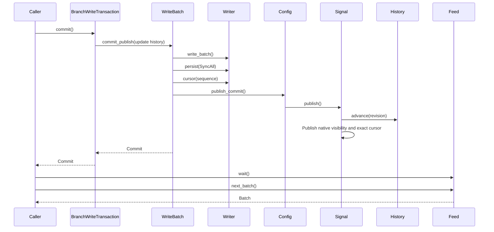

# Fjall versioned storage review

This guide gives the source route for the local Fjall and `lsm-tree` forks.
The engines retain native key versions, sparse branches, and the original
journal. Applications supply key meaning, subscriptions, and retention policy.
Read the [storage plan](../plans/fjall-versioned-storage.md) for the API contract.

## Intended end state

Stable user keys support historical point, prefix, and range reads after
compaction and restart. Writable forks share fixed ancestor state without
copying parent records. Durable commits return an exact revision and cursor.
Consumers resume the original journal and save progress with resulting writes.

The original engine implementation is **Done** at Fjall `bdb1843` and
`lsm-tree` `2e1b5df3`. The user accepted that benchmark on 2026-11-09;
see [its final verification](../../crates/araphor-graph/examples/storage_poc/results/versioned-engine-2026-11-08/finalization/README.md).
The approved simplifications use Fjall `a042865` with the same native tree.
See the [follow-up verification](../../crates/araphor-graph/examples/storage_poc/results/versioned-engine-2026-11-08/simplification/README.md).
The original 4.370 ms combined median target and a repeatable latency gain
are not proved. These PoCs do not measure production DataFusion input or
notification delivery.

## Atomic caller revision references

Fjall `cceaa84` adds exact caller revision references for the approved Data
migration. The production Data caller remains **Not implemented**.

[BranchWriteTransaction::commit_stamped](../../fjall/src/versioned/write.rs) Caller commits changes with revision-reference keys
  -> [BranchWriteTransaction::commit_stamped](../../fjall/src/versioned/write.rs) The transaction rejects duplicate, staged, empty, or over-width stamp keys before sequence allocation.
  -> [WriteBatch::stamp](../../fjall/src/batch/mod.rs) One batch contains data, caller stamps, and the branch head.
  -> [WriteBatch::commit_inner](../../fjall/src/batch/mod.rs) The journal owner writes the allocated revision bytes at each stamp key and completes SyncAll.
  -> [WriteBatch::commit_publish](../../fjall/src/batch/mod.rs) The existing publication boundary advances the branch and exposes the matching receipt and CDC batch.

Ordinary `commit` delegates with no stamp keys. Existing committed stamp values
can be replaced. The consuming API supplies no provisional revision to a read.
An empty write with no stamps remains a no-op. Stamps alone create one batch.
Rollback and pre-write rejection publish no state.

The committed tests `revision_stamps_share_the_commit` and
`revision_stamp_errors_do_not_write` prove these rules. The first inserts a raw
native write between branch capture and commit, then checks the allocated cut,
actual journal items, and historical values through compaction and reopen.
The second checks head, cursor, native sequence, and data after each rejection.
Final focused checks pass: CDC 137/one ignored, default 87/one ignored,
documentation 86, formatting, and library clippy with existing warnings.
This check does not establish a production latency improvement.

## Implementation review flow

[Branch::retain_history and Branch::fork](../../fjall/src/versioned/branch.rs) Caller retains a revision range or forks a retained revision
  -> [Catalogue::pins and Catalogue::update_history](../../fjall/src/versioned/catalogue.rs) Fjall protects the required cuts against concurrent maintenance.
  -> [Catalogue::retain and Catalogue::create](../../fjall/src/versioned/catalogue.rs) One journaled transaction saves the policy or branch descriptor.
  -> [Catalogue::retain and Catalogue::create](../../fjall/src/versioned/catalogue.rs) Fjall publishes the new handle after durable completion.

[Branch::read_at](../../fjall/src/versioned/branch.rs) Caller reads branch B at revision R
  -> [Catalogue::snapshot](../../fjall/src/versioned/catalogue.rs) Fjall captures one revision, ancestor chain, and retention protection.
  -> [ReadView::get](../../lsm-tree/src/read_view.rs) Native indexes select B's visible value or strong deletion marker.
  -> [Catalogue::snapshot](../../fjall/src/versioned/catalogue.rs) [BranchSnapshot::get](../../fjall/src/versioned/read.rs) A missing override reads the parent at min(R, B's fork revision).
  -> [BranchIterator::advance](../../fjall/src/versioned/scan.rs) Native ordered iterators merge child and ancestor results.

[BranchWriteTransaction::commit](../../fjall/src/versioned/write.rs) Caller commits changes through a branch transaction
  -> [WriteBatch::commit_inner](../../fjall/src/batch/mod.rs) The existing single writer allocates one commit sequence.
  -> [BranchWriteTransaction::commit](../../fjall/src/versioned/write.rs) One batch contains changes, branch heads, and caller-supplied state.
  -> [WriteBatch::commit_inner](../../fjall/src/batch/mod.rs) SyncAll completes before visibility, receipt, and CDC publication.
  -> [Commit](../../fjall/src/commit.rs) The caller receives that batch's revision and cursor.

[Database::journal_feed](../../fjall/src/cdc.rs) Caller opens a journal feed after its saved cursor
  -> [branch_history_and_original_cdc_continue_together](../../fjall/src/versioned/branch_tests.rs) The application's floor coordinator protects that consumer's start.
  -> [Feed::open_segment](../../fjall/src/cdc.rs) The reader seeks the original journal file and byte offset.
  -> [Feed::next_batch](../../fjall/src/cdc.rs) The native decoder returns one complete durable batch at a time.
  -> [BranchWriteTransaction::commit](../../fjall/src/versioned/write.rs) The application saves consumed progress with its resulting writes.
  -> [Database::retain_after](../../fjall/src/cdc.rs) The application advances the log floor to its minimum saved consumer cursor.

[SingleWriterTxDatabase::delete_branch](../../fjall/src/versioned/branch.rs) Caller removes a branch name and later requests journal collection
  -> [Catalogue::delete](../../fjall/src/versioned/catalogue.rs) One journaled transaction removes the public name and prevents new writes.
  -> [JournalManager::maintenance](../../fjall/src/journal/manager.rs) The journal manager reclaims acknowledged and persisted segments.
  -> [Catalogue::collect](../../fjall/src/versioned/retire.rs) Fjall keeps identities required by readable CDC, children, policies, or views.
  -> [Catalogue::collect](../../fjall/src/versioned/retire.rs) One journaled transaction removes unreferenced branch descriptors.
  -> [Catalogue::remove_orphans](../../fjall/src/versioned/retire.rs) Native metadata removes orphan trees; recovery retries interrupted cleanup.

[Database::create_or_recover](../../fjall/src/db.rs) Process restarts, or an operation fails
  -> [recover_keyspaces](../../fjall/src/recovery.rs) [recover_sealed_memtables](../../fjall/src/recovery.rs) Recovery opens current manifests and replays only required recovery data.
  -> [Catalogue::install](../../fjall/src/versioned/catalogue.rs) Recovery restores branch records and retention before maintenance starts.
  -> [History::pin](../../fjall/src/versioned/history.rs) [Feed::open_segment](../../fjall/src/cdc.rs) Expired history or log positions return an error.
  -> [WriteBatch::commit_inner](../../fjall/src/batch/mod.rs) Aborted and empty writes publish no change; uncertain I/O stops publication.

The floor coordinator is caller-owned. The lifecycle test supplies its mutex
and registration state. The engine does not create a subscription registry.
`retain_after` receives the minimum cursor that the caller has durably saved.
That minimum cannot move backward. After restart, the caller restores consumer
progress before it advances the floor.

## Owners and lifetimes

| Owner | State, inputs, outputs, and lifetime | Proof |
| --- | --- | --- |
| [Catalogue](../../fjall/src/versioned/catalogue.rs) | Database recovery creates the private journaled catalogue. Branch descriptors, names, heads, and policies use native records. The single writer and catalogue mutex serialize structural mutations. Ordinary data commits release the catalogue before I/O. Database shutdown closes the owner. | `catalogue_recovers_from_original_journal`; `creation_heads_and_progress_share_native_batches` |
| [History and Pin](../../fjall/src/versioned/history.rs) | Each branch entry creates one per-tree history owner. Policies, fork bases, current head, and active views protect native cuts. Scope destruction releases pins. Policy release does not remove a live reader's protection. | `fork_and_reader_pins_do_not_retain_unrelated_versions`; `history_admission_rejects_gaps_and_future_reads` |
| [Protection](../../fjall/src/versioned/history.rs) | Each policy or fork owns its projected interval in each affected tree. Recovery derives these maps from the durable catalogue. Runtime updates visit only that source's ancestry. A pin count change publishes protection only when the range first appears or its final owner leaves. | `contributions_keep_their_owners`; `changes_skip_other_branches`; `shared_pins_preserve_cuts` |
| [Signal and Publication](../../fjall/src/cdc.rs) | One mutex protects the committed revision and optional exact cursor. Branch capture installs its pins under this boundary. Commit updates the existing History head and native visibility before publishing the matching cursor. Recovery restores the durable CLOCK cut even when no journal cursor remains. | `captures_skip_pending_sync`; `publication_failure_stays_invisible`; `cut_survives_empty_journal` |
| [Retention](../../lsm-tree/src/retention.rs) | Fjall replaces normalized native cut intervals. Flush and compaction capture immutable interval state. Native collection retains each interval's required versions and predecessor. Released versions remain subject to collection. | `retained_cuts_survive_native_maintenance`; `policy_snapshot_survives_merge`; `retention_stays_per_tree` |
| [ReadView and RecordGuard](../../lsm-tree/src/read_view.rs) | A captured native structure carries a separate exclusive value cut. Point reads distinguish missing, value, and deletion. Standard scan guards own decoded slices. Blob guards retain the tree and disk version until resolution or drop. | `pinned_records_keep_deletion_and_blob_state`; `overlay_cut_stays_with_each_read` |
| [BranchSnapshot and BranchIterator](../../fjall/src/versioned/read.rs) | A snapshot owns its fixed lineage, native views, and pins. An iterator holds the snapshot until drop. Nearest child values and deletions override ancestors. Both scan directions use the same captured state. | `branch_history_survives_compaction_and_reopen`; `single_branch_scan_visibility` |
| [BranchWriteTransaction](../../fjall/src/versioned/write.rs) | `write_tx` acquires the existing database writer lock and captures a snapshot. The native WriteSet stages values and strong deletes. Commit consumes staging; rollback drops staging. Held range iterators keep their earlier local cut. | `branch_history_survives_compaction_and_reopen`; [raw staged reads](../../fjall/src/tx/write_tx.rs) `staged_point_reads` |
| [Feed and Cancel](../../fjall/src/cdc.rs) | Database configuration creates the commit signal. Each feed owns a cursor and at most one native reader. Commit publication wakes `wait` through a condition variable. Cancellation wakes the same wait. Feed drop releases the current file and lease. | `one_batch_resume_and_active_extension_cross_empty_segments`; `poison_wakes_blocked_reader` |
| [Segment and SegmentStats](../../fjall/src/journal/segment.rs) | The active writer records numeric sequence bounds and physical-tree watermarks. Rotation saves immutable seal metadata. Recovery validates metadata or rebuilds missing metadata with the original decoder. The manager retains unlinked metadata while a reader lease exists. | `persisted_sealed_payload_is_not_decoded_on_reopen`; `active_reader_keeps_unlinked_segment_identity_until_drop` |
| [Retired collection](../../fjall/src/versioned/retire.rs) | Explicit journal collection examines readable log bounds and history owners. It journals descriptor deletion before physical tree removal. Native metadata removes orphan trees. Startup and repeated collection retry cleanup. | `retirement_waits_for_journal`; `retirement_respects_history_owners`; `retired_orphans_retry_recovery` |

Read the linked tests in [branch tests](../../fjall/src/versioned/branch_tests.rs),
[native read-view tests](../../lsm-tree/tests/read_view.rs),
[native history tests](../../lsm-tree/tests/retained_history.rs),
[seal tests](../../fjall/src/journal/segment/tests.rs), and
[retirement tests](../../fjall/src/versioned/retire/tests.rs).

[JournalManager](../../fjall/src/journal/manager.rs) stores sealed segments in
an ordered native queue. Feed transitions use binary search on the numeric
segment ID. Collection removes the front without shifting the remaining
segments. `retained_segment_order` checks replay after collection, append,
empty rotations, expiry, and reopen. Historical cursor lookup still selects
sequence bounds with one linear search. Empty segment bounds are not ordered
by sequence; no second index is added.

[TreeIter::create_filtered](../../lsm-tree/src/range.rs) sends the single active
memtable iterator through the existing MVCC stream without a merge heap.
The active-only iterator cannot return an I/O error. Table, sealed-memtable,
and transaction-overlay cases keep the existing native merge path. The
`active_records_keep_mvcc_visibility` test checks old and current cuts, empty
values, strong and weak deletions, and mixed scan directions for standard and
blob trees.

[Memtable::get](../../lsm-tree/src/memtable/mod.rs) uses Crossbeam's native
`lower_bound` with a borrowed tuple of caller bytes and `cut - 1`. A private
comparison interface preserves byte-ascending and sequence-descending order;
stored `InternalKey` ordering remains. Cut zero returns before validation.
Other cuts keep the existing key-length assertion. The method rejects a
different user key before it clones the selected entry. It creates neither
an owned search key nor a range iterator. `borrowed_point_queries` compares
ordering with the stored key and checks all four result fields against a
linear version oracle, including length limits and deletion types.

[Table::point_read and Table::read_index](../../lsm-tree/src/table/mod.rs)
borrow native index blocks during point reads. Full, volatile, and two-level
indexes keep their sequence-aware search, block cache, and error behavior.
An exhausted child index permits the next two-level child. An exact value,
deletion, or terminal miss stops the search. Lazy range iterators retain their
owned index state. The native table checks cover block boundaries, old cuts,
empty values, strong and weak deletions, and missing keys.

`IndexBlockParsedItem::handle` checks the optional prefix first and the suffix
next, then returns the existing block offset and size. Three point-read loads
use it before I/O or cache access. They no longer materialize unused owned
end keys. The terminal-miss comparison uses checked borrowed bytes.
`borrowed_handles_keep_bounds` checks valid prefix/no-prefix parity and six
malformed ranges against legacy materialization. Data-record materialization
and public range iterators remain.

[DataBlock::point_read](../../lsm-tree/src/table/data_block/mod.rs) constructs
the native decoder directly. A hash free marker returns before construction.
A direct hash hit sets the same native restart offset. A conflict or absent
hash index uses the existing restart search. The existing loop checks the
user key and exclusive value cut, then materializes only the selected record.
This removes the point-read iterator wrapper and its positioning loop.
Public range iterators remain. The committed `point_read_matches_oracle`
case compares all four fields with an independent linear search. It requires
all hash outcomes, both native offset widths, and exact cut boundaries.

The [data-block parsers](../../lsm-tree/src/table/data_block/mod.rs) and
[index-block parsers](../../lsm-tree/src/table/index_block/block_handle.rs)
expose five existing method bodies to compiler optimization with `#[inline]`.
Parser logic, interfaces, search rules, and stored bytes remain. The retained
Callgrind evidence checks complete neighbor-query instruction counts. Parser
symbol disappearance alone does not establish less work.

[BranchIterator](../../fjall/src/versioned/scan.rs) holds one native scan directly
when the branch has one source. Multiple sources retain the existing ordered
merge and lookahead buffers. Both cases keep the snapshot and use the same
deletion filter and record resolution. The single-branch check also covers an
empty root, an empty parent/child view, and native error forwarding.

[JournalReader::offset](../../fjall/src/journal/reader.rs) obtains the absolute
decoded position from the native `Take<File>` read limit, minus unread
`BufReader` bytes. This removes a file-position syscall after each entry.
For a saved nonzero start, the limit begins at `u64::MAX - start`. The decoder,
checksum, captured end, and cursor remain. Recovery truncates and syncs the
same underlying file. The buffered reader stays private so callers cannot
change its file offset outside this owner. The focused
`positions_survive_buffering_and_partial_tail` case checks large direct reads,
buffered headers, empty values, nonzero resume, and partial-tail recovery.

[serialize_marker_item](../../fjall/src/journal/entry.rs) compresses items into
the journal writer's existing byte buffer. The temporary compressed vector
and its copy are removed. The codec, threshold, and stored bytes remain.
The `compressed_items_keep_original_bytes` case compares both codecs against
the previous encoding with empty, repeated, and incompressible values.
The generic entry encoder keeps its `Write` interface and uses a local
`Cursor<Vec<u8>>` for Item encoding. Production item writes reuse the writer buffer directly.
That buffer can retain the largest uncompressed compression bound until
journal rotation. Highly compressible values can increase retained memory.

[Writer::write_buffer](../../fjall/src/journal/writer.rs) writes, hashes, and
counts only the cursor's logical prefix. The initialized vector length stays
at its largest Item bound. Position resets replace the previous vector clears
at the same points. The serializer grows storage only when needed. It fills
the fixed 21-byte header with the existing encoders on the stack, then writes
the header once. Native LZ4 uses the same bound. Its actual output end sets
the logical position. The exact-wire case also checks initialized storage
through large-to-small reuse and a nonzero prefix. File buffering, error
handling, marker counts, and durability remain.

[ChecksumRead::read_exact](../../fjall/src/journal/reader.rs) uses bytes already
in the native `BufReader` when they cover the complete request. It copies and
hashes the exact wire bytes before consumption. Other requests use the
standard `Take` read loop through the existing checksum `read` method.
This preserves partial-read hashing, interruption retries, and error behavior.
The `checksum_exact_reads_keep_errors` test also checks empty requests before
and after errors. The reader lifetime and captured durable boundary remain.

[Entry::decode_body](../../fjall/src/journal/entry.rs) checks the Item tags,
then reads the four fixed fields in one 18-byte stack buffer. The existing
native little-endian decoder reads those fields from the buffer. This removes
three checksum updates per Item. Key and value decoding follow the header.
The `item_header_truncation` case checks every incomplete prefix and its exact
existing error wrapper, then checks all fields and complete consumption.

## Commit and change flow



`publish_commit` is the database configuration call inside the batch owner.
After durable sync and native application, its private callback advances the
branch History head and native visibility under the signal boundary. The signal
then publishes the matching revision and cursor and wakes readers. A callback
error leaves visibility and the signal unchanged, then poisons the database.
The receipt identifies this exact batch, even with concurrent raw writers.
The branch commit adds its head stamp to the same batch as caller data.
Caller progress is an ordinary key in that batch.

Branch writes hold the existing database writer lock. Preparation briefly
takes the catalogue lock, then releases it before journal I/O and backpressure.
Publication takes journal, signal, then per-tree History protection. Capture
and branch-info reads take catalogue, signal, then History protection. Capture
releases the signal after installing pins and before native view construction.
No signal-owned operation acquires the journal or catalogue. A capture during
sync can return the prior complete revision. Structural metadata operations
retain their catalogue serialization.
Journal file selection uses journal then journal-manager protection. The feed
opens its file under that protection and decodes outside those locks.
`collect_journals` releases the manager lock before it acquires the catalogue.
Pin destruction takes the per-tree history lock and does not acquire the
catalogue lock.

## Storage boundaries and recovery

| Value or file | Encoding and validity |
| --- | --- |
| [Revision](../../fjall/src/commit.rs) | Eight bytes, big endian. Revision R is an exclusive cut: sequence < R. A batch at sequence S returns revision S + 1. Historical reads also check admission. |
| [BranchId](../../fjall/src/versioned/branch.rs), [RetentionId](../../fjall/src/versioned/history.rs) | Eight bytes, big endian. Decoding an ID does not prove that a retained owner exists. Catalogue lookup resolves the owner. |
| [Cursor](../../fjall/src/commit.rs) | Journal ID, batch-end byte offset, and native sequence are public Rust fields. The Rust layout is not a storage ABI. The caller owns cursor encoding. The lifecycle test encodes three big-endian u64 values. |
| [Database version](../../fjall/src/version.rs) | Flat mode keeps FJL3. Journal and versioned modes use FJL6 plus the mode byte. Earlier FJL4/FJL5 prototypes have no migration. Unsupported openers reject the marker before recovery cleanup. |
| [Catalogue records](../../fjall/src/versioned/entry.rs) | Branch keys contain a record prefix and big-endian ID. The descriptor contains a checked deletion byte, parent ID, fork cut, and UTF-8 name. Separate native records store creation and head cuts. Recovery rejects malformed or missing established state. |
| [Seal metadata](../../fjall/src/journal/segment.rs) | `N.jnl.meta` starts with FJS1. Numeric fields use little endian. Fields include journal ID, end offset, physical byte count, optional first/last sequences, and physical-tree watermarks. The final xxh3 checksum covers preceding bytes. The loader checks lengths, tags, IDs, sequence bounds, and the native end marker. No application values are copied. |

Native sorted-string-table (SST) and journal entry formats remain unchanged.
The seal checksum verifies metadata integrity; it does not detect application
changes or wake subscriptions. Native journal batches supply change data capture
(CDC). The engine creates no second change archive.

Value history and journal retention are independent. A historical view can
remain readable after its original journal segment is reclaimed. Current
snapshots capture a cursor with their cut. Historical `cursor()` performs lazy
exact lookup; it returns no cursor for an expired segment or a cut without a
batch. Decoder or I/O failure returns an error. Point and range reads do not
decode journals.

Recovery reads `CURRENT` and restores native retained versions from that
structure. It does not open one manifest per revision. Catalogue installation
restores protection before maintenance starts. Current SST watermarks permit
recovery to skip a sealed payload only when every actual write is persisted.
Missing seal metadata uses the original decoder. Invalid metadata causes open to fail.
Uncertain journal I/O poisons publication and wakes waiting readers with failure.

Deleting a branch removes its public name. A retained deleted identity remains
resolvable by ID. Name reuse creates a different permanent ID. Collection waits
for children, policies, views, and readable CDC to release the old identity.
Descriptor deletion is durable before native physical cleanup. The persistent
physical-ID counter survives deletion and prevents relabeling old journal items.

## Verification and limits

All 11 final focused commands pass on Fjall `a042865` and native `2e1b5df3`. Native
default/LZ4 libraries pass 244/247 cases, and eight selected integrations pass
19 cases in each configuration. Fjall CDC/without CDC libraries pass 135/87
cases. Documentation tests pass 23 native and 86 Fjall cases. Production
without default features, library clippy, and formatting pass. Existing ignored
cases and clippy warnings remain. All 16 follow-up PoC summaries reproduce.
The [follow-up record](../../crates/araphor-graph/examples/storage_poc/results/versioned-engine-2026-11-08/simplification/README.md)
contains commands and logs. The existing workloads run unchanged. Pooled
combined median/p95/maximum values are 4.672/8.056/11.852 before and
4.655/7.668/8.171 ms after. Stable medians are 28.413 before and 28.321 ms
after. Individual passes are mixed; no consistent regression is observed.
No repeatable latency gain is proved. Full workspace CI is not run, as the
user requires.

The records below preserve earlier verification and performance decisions.

The focused commands use the native crate owners:

```sh
cargo test --manifest-path fjall/Cargo.toml --features journal-cdc --lib --locked --offline
cargo test --manifest-path fjall/Cargo.toml --lib --locked --offline
cargo check --manifest-path fjall/Cargo.toml --no-default-features --lib --locked --offline
cargo clippy --manifest-path fjall/Cargo.toml --features journal-cdc --lib --locked --offline
cargo fmt --manifest-path fjall/Cargo.toml --check
cargo test --manifest-path lsm-tree/Cargo.toml --lib --test read_view --test retained_history --locked --offline
cargo test --manifest-path lsm-tree/Cargo.toml --features lz4 --lib --test read_view --test retained_history --locked --offline
```

Fjall `42be11f` passes 125 CDC library cases and 84 cases without CDC, with one
existing ignored case in each run. The production check without default
features, library clippy, and formatting pass. Library clippy reports existing
warnings. The earlier broader clippy run at `66d821e`, with `--tests`, fails on
65 existing test lints. That command was not repeated at `42be11f`.
The existing no-default-features test error remains in `keyspace/options.rs`;
the production check does not prove that test configuration.

`lsm-tree` `aed3e47a` passes 241 default library cases and 244 LZ4 library cases,
with two existing ignored cases in each run. Three read-view and three history
cases pass in each configuration. The [retained result directory](../../crates/araphor-graph/examples/storage_poc/results/versioned-engine-2026-11-08/)
records source IDs, locks, frozen comparisons, and raw reports. Local frozen
binaries remain under `output/storage-engine-baseline-20261108/`.

Fjall `e2c23cb` adds the concurrent bootstrap and floor-advancement proof to the
combined lifecycle case. The focused case, full 123-case CDC library suite, and
formatting pass. Fjall `3f684ab` also removes single-source lookahead buffers.
Fjall `8cb06c8` adds native byte-position accounting. The
[retained comparison](../../crates/araphor-graph/examples/storage_poc/results/versioned-engine-2026-11-08/reader-position/README.md)
separates the reader change, disk cleanup, and traced diagnostics. The complete
performance target remains unmet.

Fjall `f2034d0` adds rollback and pre-creation historical-read assertions to the
same combined lifecycle case. Actual output and its consumed cursor are staged
and rolled back before the successful commit. The case checks unchanged head,
journal, output, and progress. Both reopen stages check the inherited parent
value at the retained cut before child creation.

`lsm-tree` `29549fd7` adds borrowed point-index ownership. Fjall `42be11f` adds
direct journal compression. The [retained comparisons](../../crates/araphor-graph/examples/storage_poc/results/versioned-engine-2026-11-08/native-index-compression/README.md)
contain all 24 reports and reproduced summaries, source patches, binary hashes,
and ordinary-cycle percentiles. Current combined medians are 4.836 and
4.551 ms; maxima are 7.039 and 7.869 ms. Stable medians are 26.240 and
25.748 ms. Both combined medians exceed their target. Complete performance
qualification remains **Not done**. The cause of earlier higher maxima is not
established.

`lsm-tree` `aed3e47a` adds the five parser annotations. All focused native and
Fjall gates above pass with this commit. The [retained comparison](../../crates/araphor-graph/examples/storage_poc/results/versioned-engine-2026-11-08/parser-inlining/README.md)
records 5.70% fewer complete neighbor-query instructions across the same 28
ordinary fixed-key evaluations and 92 query calls. Presence calls collect no
instructions in this diagnostic. All profiled timings remain excluded.
The two unchanged untraced comparisons have combined medians of 4.550 and
4.483 ms. Stable medians are 25.670 and 26.764 ms. Wall-time changes are mixed;
no overall latency gain is proved. Both combined medians exceed their target.
Complete performance qualification remains **Not done**.

The [unapplied index-seek experiment](../../crates/araphor-graph/examples/storage_poc/results/versioned-engine-2026-11-08/index-end-experiment/README.md)
retains the rejected patch and all measurements. Its instruction results and
wall-time results are mixed; the code section grows. Source remains at the
engine commits above. Fresh retained-source combined median/p95/maximum values
are 4.876/7.041/7.316 and 4.826/7.516/7.720 ms. Both combined medians exceed
their target. Earlier higher maxima have no established cause.

The [unapplied visibility-aware point-seek experiment](../../crates/araphor-graph/examples/storage_poc/results/versioned-engine-2026-11-08/sequence-seek-experiment/README.md)
also retains its exact source and measurements. Query instructions increase
by 1.66%, with a higher median at every collected revision. All correctness
checks pass, but the reviewer and implementer agree to remove the experiment.
Accepted engine commits remain unchanged.

The [unapplied cached-index experiments](../../crates/araphor-graph/examples/storage_poc/results/versioned-engine-2026-11-08/cached-index-experiment/README.md)
retain both source patches, 17 reproduced summaries, and raw profiles.
Complete query instructions change by +0.00444%; the draft adds metadata
memory without measured net query savings. The additional compiler attribute
changes no standalone native or query-method code bytes. Both drafts pass
their focused correctness checks and are removed. Metrics library clippy
fails on the existing eight-argument `Iter::new`; default library clippy passes.
Accepted engine commits remain unchanged.

The
[buffered-checksum evidence](../../crates/araphor-graph/examples/storage_poc/results/versioned-engine-2026-11-08/checksum-buffered/README.md)
records 9.085% fewer native feed instructions for identical work across both
layouts and all workers.

The
[Item header evidence](../../crates/araphor-graph/examples/storage_poc/results/versioned-engine-2026-11-08/header-group/README.md)
for Fjall `ee3ea07` records another 12.654% reduction for identical feed work. All 127 CDC and 86
non-CDC library cases pass, with one existing ignored case in each run.
Production without default features, library clippy, formatting, and the
release PoC build pass. Combined medians are 4.517 and 4.990 ms; both exceed
their target and both increase in these comparisons. Stable medians are
26.194 and 26.502 ms; both also increase. No sustained latency change is proved.
A separate writer diagnostic confirms that the existing buffer combines
writes. It has no syscall durations; no writer change is added. Earlier
records describe their recorded source states. The whole-cycle CPU attempt
is excluded because its reset function was inlined in one executable.

Fjall `04c304a` uses the initialized journal buffer. The
[initialized-buffer evidence](../../crates/araphor-graph/examples/storage_poc/results/versioned-engine-2026-11-08/journal-buffer/README.md)
records 1.430% fewer complete apply instructions across 72 calls in both
layouts, including rollback. Compression counters and reported domain work
match. Both intermediate and final drafts remain in the evidence. Native
CDC/without CDC: 127/86 passed, one existing ignored each. Production without
default features, library clippy, formatting, and release builds pass. Final
combined medians are 4.561 and 4.597 ms; both exceed their target. Stable
medians are 25.816 and 25.175 ms. Wall-time changes remain mixed. No sustained
latency gain is proved.

The preceding accepted source is Fjall `04c304a` and `lsm-tree` `5c005a47`. The
[direct point-read evidence](../../crates/araphor-graph/examples/storage_poc/results/versioned-engine-2026-11-08/point-decoder/README.md)
records 6.041% fewer complete native point-read instructions across the same
105,692 calls. This scope includes both layouts and all verification, history,
and maintenance stages. It does not establish ordinary-cycle CPU or latency.
Native default/LZ4 libraries pass 242/245 cases, with two existing ignored
cases each. Eight selected integrations pass 19 cases, with one existing
ignored case, per configuration. Fjall CDC/without CDC pass 127/86 cases,
with one existing ignored case each. Other focused gates and the release
build pass. All eight unchanged PoC summaries pass. Current combined
median/p95/maximum values are 4.751/7.066/7.091 and 4.709/7.130/7.805 ms.
Both medians increase in these calls and exceed their target. Stable medians
are 26.278 and 25.630 ms. No sustained latency change is established.

The [ordinary execution comparison](../../crates/araphor-graph/examples/storage_poc/results/versioned-engine-2026-11-08/ordinary-gap/README.md)
compares that accepted source with the original frozen control. Current
combined median/p95/maximum values are 4.590/7.112/7.269 and
4.839/7.214/7.535 ms; stable medians are 25.989 and 26.386 ms. All eight
untraced summaries pass. Exact ordinary neighbor-query, result-inspection,
and complete-package instructions decrease by 3.519%, 8.115%, and 1.725%.
Those counts overlap; they are not additive. All six profiled summaries pass.
Profiled timings are excluded. The elapsed package gap remains unexplained.
No native source changes follow from these counts alone.

The [native execution cost diagnostic](../../crates/araphor-graph/examples/storage_poc/results/versioned-engine-2026-11-08/execution-cost/README.md)
adds conserved cache, branch, and atomic-operation counters for the same 28
ordinary evaluations. Atomic and indirect-branch operations decrease. Cache
misses remain simulated. The separate whole-driver stack samples retain full
Rust names and unresolved-frame counts. They have no thread labels; their
historical work differs. Four unchanged summaries pass. All profiled timings
are excluded. No engine source changes follow from this evidence.

This guide covers those engine commits. The engine API is generic. Araphor production migration, distributed
storage, branch merge, and production notification latency remain outside this
implementation. Full workspace CI was not run during this iteration, as the
user requires. Complete performance qualification remains **Not done**.

The checked point-block source is Fjall `04c304a` and `lsm-tree` `1918e262`. The
[checked point-block evidence](../../crates/araphor-graph/examples/storage_poc/results/versioned-engine-2026-11-08/checked-handles/README.md)
retains both drafts and all elapsed results. The corrected source uses
0.316% fewer complete-package instructions and 2.099% fewer nested native
lookup instructions across 28 ordinary evaluations and 14,096 actual calls.
All 144 dumps conserve counters; residual and worker counts are zero.
Native default/LZ4 libraries pass 243/246 cases; all other selected gates pass.
All 16 untraced summaries pass. Current combined median/p95/maximum values
are 4.211/6.674/7.126 and 4.950/6.800/9.635 ms. Stable medians are 25.509 and
25.764 ms. The longer source commit in the second pass has no established
cause. Profiled timings and the method-only counter mismatch are excluded.
The initial unchecked draft is superseded. No repeatable elapsed gain is
proved. Complete performance qualification remains **Not done**.

Fjall `bdb1843` now consumes a unique staging memtable through its existing
native owning iterator. A held native scan retains an `Arc` and uses the
borrowed fallback. One append closure keeps latest-key selection and
`Item::new` validation for both paths, then moves owned fields into the batch.
The owned keyspace handle moves into the set used for maintenance after publication.
`consume_staging` checks both ownership paths, latest strong and weak deletes,
empty values, two keyspaces, held rows after commit, and held rollback rows.

The owned staging source is Fjall `bdb1843` and `lsm-tree` `1918e262`. The
[owned staging evidence](../../crates/araphor-graph/examples/storage_poc/results/versioned-engine-2026-11-08/owned-staging/README.md)
records 1.015% fewer complete ordinary apply instructions across 28 exact
transactions. All 144 dumps conserve counters. Non-time reports and physical
cursors match. CDC/without CDC pass 128/87 cases; other focused gates and
the release build pass. All eight untraced summaries pass. Combined
median/p95/maximum values are 4.734/7.322/7.837 and 4.774/6.947/7.247 ms;
stable medians are 25.879 and 25.860 ms. Profiled timings are excluded.
Wall results remain mixed. Both combined medians exceed their target.
Complete performance qualification remains **Not done**.

Source at the original acceptance was Fjall `bdb1843` and `lsm-tree` `2e1b5df3`. The
[borrowed point-lookup evidence](../../crates/araphor-graph/examples/storage_poc/results/versioned-engine-2026-11-08/borrowed-lookup/README.md)
records 1.289% fewer complete ordinary package instructions across 28 exact
evaluations. Added query dispatch is included; some revision medians increase.
All 144 dumps conserve counters. Non-time reports and physical cursors match.
Native default/LZ4 libraries pass 244/247 cases; Fjall CDC/without CDC pass
128/87. Other focused gates and the release build pass. All eight untraced
summaries pass. Combined median/p95/maximum values are 4.653/7.187/8.332 and
4.568/7.080/7.223 ms; stable medians are 25.042 and 25.939 ms. Profiled
timings are excluded. Both combined medians exceed their target and their
fresh controls. The user accepted these measured results on 2026-11-09.
Final implementation acceptance is **Done**; the original combined median
target and a repeatable elapsed gain remain unproved.

Current source is Fjall `a042865` and `lsm-tree` `2e1b5df3`. The four approved
journal/history changes and their verification are described above. The
[complete follow-up record](../../crates/araphor-graph/examples/storage_poc/results/versioned-engine-2026-11-08/simplification/README.md)
preserves every comparison and the exact source patches. Observed pooled
PoC timings do not regress. Individual comparisons remain mixed; no repeatable
latency gain or universal performance guarantee is established.
