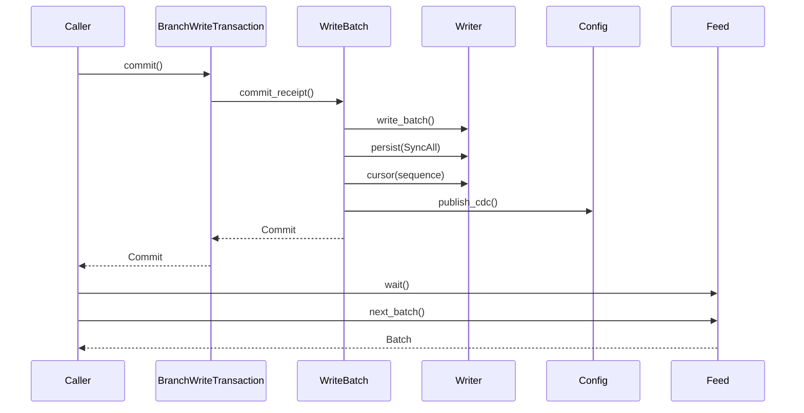

# Fjall versioned storage review

This guide gives the source route for the local Fjall and `lsm-tree` forks.
The engines retain native key versions, sparse branches, and the original
journal. Applications supply key meaning, subscriptions, and retention policy.
Read the [storage plan](../plans/fjall-versioned-storage.md) for the API contract.

## Intended end state

Stable user keys support historical point, prefix, and range reads after
compaction and restart. Writable forks share fixed ancestor state without
copying parent records. Durable commits return an exact revision and cursor.
Consumers resume the original journal and save progress with resulting writes.

The existing PoCs must reach 4.370 ms median and 8.717 ms maximum for the
combined ordinary cycle, and 26.985 ms median for the stable eight-cycle run.
Performance qualification remains **Not done**. These PoCs do not measure
production DataFusion input or notification delivery.

## Implementation review flow

[Branch::retain_history and Branch::fork](../../fjall/src/versioned/branch.rs) Caller retains a revision range or forks a retained revision
  -> [Catalogue::pins and Catalogue::protect](../../fjall/src/versioned/catalogue.rs) Fjall protects the required cuts against concurrent maintenance.
  -> [Catalogue::retain and Catalogue::create](../../fjall/src/versioned/catalogue.rs) One journaled transaction saves the policy or branch descriptor.
  -> [Catalogue::retain and Catalogue::create](../../fjall/src/versioned/catalogue.rs) Fjall publishes the new handle after durable completion.

[Branch::read_at](../../fjall/src/versioned/branch.rs) Caller reads branch B at revision R
  -> [Catalogue::snapshot](../../fjall/src/versioned/catalogue.rs) Fjall captures one revision, ancestor chain, and retention protection.
  -> [ReadView::get](../../lsm-tree/src/read_view.rs) Native indexes select B's visible value or strong deletion marker.
  -> [Catalogue::snapshot](../../fjall/src/versioned/catalogue.rs) [BranchSnapshot::get](../../fjall/src/versioned/read.rs) A missing override reads the parent at min(R, B's fork revision).
  -> [BranchIterator::advance](../../fjall/src/versioned/scan.rs) Native ordered iterators merge child and ancestor results.

[BranchWriteTransaction::commit](../../fjall/src/versioned/write.rs) Caller commits changes through a branch transaction
  -> [WriteBatch::commit_inner](../../fjall/src/batch/mod.rs) The existing single writer allocates one commit sequence.
  -> [BranchWriteTransaction::commit](../../fjall/src/versioned/write.rs) One batch contains changes, branch heads, and caller-supplied state.
  -> [WriteBatch::commit_inner](../../fjall/src/batch/mod.rs) SyncAll completes before visibility, receipt, and CDC publication.
  -> [Commit](../../fjall/src/commit.rs) The caller receives that batch's revision and cursor.

[Database::journal_feed](../../fjall/src/cdc.rs) Caller opens a journal feed after its saved cursor
  -> [branch_history_and_original_cdc_continue_together](../../fjall/src/versioned/branch_tests.rs) The application's floor coordinator protects that consumer's start.
  -> [Feed::open_segment](../../fjall/src/cdc.rs) The reader seeks the original journal file and byte offset.
  -> [Feed::next_batch](../../fjall/src/cdc.rs) The native decoder returns one complete durable batch at a time.
  -> [BranchWriteTransaction::commit](../../fjall/src/versioned/write.rs) The application saves consumed progress with its resulting writes.
  -> [Database::retain_after](../../fjall/src/cdc.rs) The application advances the log floor to its minimum saved consumer cursor.

[SingleWriterTxDatabase::delete_branch](../../fjall/src/versioned/branch.rs) Caller removes a branch name and later requests journal collection
  -> [Catalogue::delete](../../fjall/src/versioned/catalogue.rs) One journaled transaction removes the public name and prevents new writes.
  -> [JournalManager::maintenance](../../fjall/src/journal/manager.rs) The journal manager reclaims acknowledged and persisted segments.
  -> [Catalogue::collect](../../fjall/src/versioned/retire.rs) Fjall keeps identities required by readable CDC, children, policies, or views.
  -> [Catalogue::collect](../../fjall/src/versioned/retire.rs) One journaled transaction removes unreferenced branch descriptors.
  -> [Catalogue::remove_orphans](../../fjall/src/versioned/retire.rs) Native metadata removes orphan trees; recovery retries interrupted cleanup.

[Database::create_or_recover](../../fjall/src/db.rs) Process restarts, or an operation fails
  -> [recover_keyspaces](../../fjall/src/recovery.rs) [recover_sealed_memtables](../../fjall/src/recovery.rs) Recovery opens current manifests and replays only required recovery data.
  -> [Catalogue::install](../../fjall/src/versioned/catalogue.rs) Recovery restores branch records and retention before maintenance starts.
  -> [History::pin](../../fjall/src/versioned/history.rs) [Feed::open_segment](../../fjall/src/cdc.rs) Expired history or log positions return an error.
  -> [WriteBatch::commit_inner](../../fjall/src/batch/mod.rs) Aborted and empty writes publish no change; uncertain I/O stops publication.

The floor coordinator is caller-owned. The lifecycle test supplies its mutex
and registration state. The engine does not create a subscription registry.
`retain_after` receives the minimum cursor that the caller has durably saved.
That minimum cannot move backward. After restart, the caller restores consumer
progress before it advances the floor.

## Owners and lifetimes

| Owner | State, inputs, outputs, and lifetime | Proof |
| --- | --- | --- |
| [Catalogue](../../fjall/src/versioned/catalogue.rs) | Database recovery creates the private journaled catalogue. Branch descriptors, names, heads, and policies use native records. The single writer and catalogue mutex serialize mutations. Database shutdown closes the owner. | `catalogue_recovers_from_original_journal`; `creation_heads_and_progress_share_native_batches` |
| [History and Pin](../../fjall/src/versioned/history.rs) | Each branch entry creates one per-tree history owner. Policies, fork bases, current head, and active views protect native cuts. Scope destruction releases pins. Policy release does not remove a live reader's protection. | `fork_and_reader_pins_do_not_retain_unrelated_versions`; `history_admission_rejects_gaps_and_future_reads` |
| [Retention](../../lsm-tree/src/retention.rs) | Fjall replaces normalized native cut intervals. Flush and compaction capture immutable interval state. Native collection retains each interval's required versions and predecessor. Released versions remain subject to collection. | `retained_cuts_survive_native_maintenance`; `policy_snapshot_survives_merge`; `retention_stays_per_tree` |
| [ReadView and RecordGuard](../../lsm-tree/src/read_view.rs) | A captured native structure carries a separate exclusive value cut. Point reads distinguish missing, value, and deletion. Standard scan guards own decoded slices. Blob guards retain the tree and disk version until resolution or drop. | `pinned_records_keep_deletion_and_blob_state`; `overlay_cut_stays_with_each_read` |
| [BranchSnapshot and BranchIterator](../../fjall/src/versioned/read.rs) | A snapshot owns its fixed lineage, native views, and pins. An iterator holds the snapshot until drop. Nearest child values and deletions override ancestors. Both scan directions use the same captured state. | `branch_history_survives_compaction_and_reopen`; `single_branch_scan_visibility` |
| [BranchWriteTransaction](../../fjall/src/versioned/write.rs) | `write_tx` acquires the existing database writer lock and captures a snapshot. The native WriteSet stages values and strong deletes. Commit consumes staging; rollback drops staging. Held range iterators keep their earlier local cut. | `branch_history_survives_compaction_and_reopen`; [raw staged reads](../../fjall/src/tx/write_tx.rs) `staged_point_reads` |
| [Feed and Cancel](../../fjall/src/cdc.rs) | Database configuration creates the commit signal. Each feed owns a cursor and at most one native reader. Commit publication wakes `wait` through a condition variable. Cancellation wakes the same wait. Feed drop releases the current file and lease. | `one_batch_resume_and_active_extension_cross_empty_segments`; `poison_wakes_blocked_reader` |
| [Segment and SegmentStats](../../fjall/src/journal/segment.rs) | The active writer records numeric sequence bounds and physical-tree watermarks. Rotation saves immutable seal metadata. Recovery validates metadata or rebuilds missing metadata with the original decoder. The manager retains unlinked metadata while a reader lease exists. | `persisted_sealed_payload_is_not_decoded_on_reopen`; `active_reader_keeps_unlinked_segment_identity_until_drop` |
| [Retired collection](../../fjall/src/versioned/retire.rs) | Explicit journal collection examines readable log bounds and history owners. It journals descriptor deletion before physical tree removal. Native metadata removes orphan trees. Startup and repeated collection retry cleanup. | `retirement_waits_for_journal`; `retirement_respects_history_owners`; `retired_orphans_retry_recovery` |

Read the linked tests in [branch tests](../../fjall/src/versioned/branch_tests.rs),
[native read-view tests](../../lsm-tree/tests/read_view.rs),
[native history tests](../../lsm-tree/tests/retained_history.rs),
[seal tests](../../fjall/src/journal/segment/tests.rs), and
[retirement tests](../../fjall/src/versioned/retire/tests.rs).

[TreeIter::create_filtered](../../lsm-tree/src/range.rs) sends the single active
memtable iterator through the existing MVCC stream without a merge heap.
The active-only iterator cannot return an I/O error. Table, sealed-memtable,
and transaction-overlay cases keep the existing native merge path. The
`active_records_keep_mvcc_visibility` test checks old and current cuts, empty
values, strong and weak deletions, and mixed scan directions for standard and
blob trees.

[Memtable::get](../../lsm-tree/src/memtable/mod.rs) uses Crossbeam's native
`lower_bound` for point lookup. The owned search key and exclusive cut remain.
The method rejects a different user key before it clones the selected entry.
It no longer creates a range iterator for that single entry.

[BranchIterator](../../fjall/src/versioned/scan.rs) holds one native scan directly
when the branch has one source. Multiple sources retain the existing ordered
merge and lookahead buffers. Both cases keep the snapshot and use the same
deletion filter and record resolution. The single-branch check also covers an
empty root, an empty parent/child view, and native error forwarding.

## Commit and change flow



`publish_cdc` is the database configuration call inside the batch owner.
It runs after the native memtables and published revision become visible.
The receipt identifies this exact batch, even with concurrent raw writers.
The branch commit adds its head stamp to the same batch as caller data.
Caller progress is an ordinary key in that batch.

The lock order for branch writes is database writer, catalogue, then journal.
Journal file selection uses journal then journal-manager protection. The feed
opens its file under that protection and decodes outside those locks.
`collect_journals` releases the manager lock before it acquires the catalogue.
Pin destruction takes the per-tree history lock and does not acquire the
catalogue lock.

## Storage boundaries and recovery

| Value or file | Encoding and validity |
| --- | --- |
| [Revision](../../fjall/src/commit.rs) | Eight bytes, big endian. Revision R is an exclusive cut: sequence < R. A batch at sequence S returns revision S + 1. Historical reads also check admission. |
| [BranchId](../../fjall/src/versioned/branch.rs), [RetentionId](../../fjall/src/versioned/history.rs) | Eight bytes, big endian. Decoding an ID does not prove that a retained owner exists. Catalogue lookup resolves the owner. |
| [Cursor](../../fjall/src/commit.rs) | Journal ID, batch-end byte offset, and native sequence are public Rust fields. The Rust layout is not a storage ABI. The caller owns cursor encoding. The lifecycle test encodes three big-endian u64 values. |
| [Database version](../../fjall/src/version.rs) | Flat mode keeps FJL3. Journal and versioned modes use FJL6 plus the mode byte. Earlier FJL4/FJL5 prototypes have no migration. Unsupported openers reject the marker before recovery cleanup. |
| [Catalogue records](../../fjall/src/versioned/entry.rs) | Branch keys contain a record prefix and big-endian ID. The descriptor contains a checked deletion byte, parent ID, fork cut, and UTF-8 name. Separate native records store creation and head cuts. Recovery rejects malformed or missing established state. |
| [Seal metadata](../../fjall/src/journal/segment.rs) | `N.jnl.meta` starts with FJS1. Numeric fields use little endian. Fields include journal ID, end offset, physical byte count, optional first/last sequences, and physical-tree watermarks. The final xxh3 checksum covers preceding bytes. The loader checks lengths, tags, IDs, sequence bounds, and the native end marker. No application values are copied. |

Native sorted-string-table (SST) and journal entry formats remain unchanged.
The seal checksum verifies metadata integrity; it does not detect application
changes or wake subscriptions. Native journal batches supply change data capture
(CDC). The engine creates no second change archive.

Value history and journal retention are independent. A historical view can
remain readable after its original journal segment is reclaimed. Current
snapshots capture a cursor with their cut. Historical `cursor()` performs lazy
exact lookup; it returns no cursor for an expired segment or a cut without a
batch. Decoder or I/O failure returns an error. Point and range reads do not
decode journals.

Recovery reads `CURRENT` and restores native retained versions from that
structure. It does not open one manifest per revision. Catalogue installation
restores protection before maintenance starts. Current SST watermarks permit
recovery to skip a sealed payload only when every actual write is persisted.
Missing seal metadata uses the original decoder. Invalid metadata causes open to fail.
Uncertain journal I/O poisons publication and wakes waiting readers with failure.

Deleting a branch removes its public name. A retained deleted identity remains
resolvable by ID. Name reuse creates a different permanent ID. Collection waits
for children, policies, views, and readable CDC to release the old identity.
Descriptor deletion is durable before native physical cleanup. The persistent
physical-ID counter survives deletion and prevents relabeling old journal items.

## Verification and limits

The focused commands use the native crate owners:

```sh
cargo test --manifest-path fjall/Cargo.toml --features journal-cdc --lib --locked --offline
cargo test --manifest-path fjall/Cargo.toml --lib --locked --offline
cargo check --manifest-path fjall/Cargo.toml --no-default-features --lib --locked --offline
cargo clippy --manifest-path fjall/Cargo.toml --features journal-cdc --lib --locked --offline
cargo fmt --manifest-path fjall/Cargo.toml --check
cargo test --manifest-path lsm-tree/Cargo.toml --lib --test read_view --test retained_history --locked --offline
cargo test --manifest-path lsm-tree/Cargo.toml --features lz4 --lib --test read_view --test retained_history --locked --offline
```

Fjall `3f684ab` passes 123 CDC library cases and 83 cases without CDC, with one
existing ignored case in each run. The production check without default
features, library clippy, and formatting pass. Library clippy reports existing
warnings. The earlier broader clippy run at `66d821e`, with `--tests`, fails on
65 existing test lints. That command was not repeated at `3f684ab`.
The existing no-default-features test error remains in `keyspace/options.rs`;
the production check does not prove that test configuration.

`lsm-tree` `4aeaf8d4` passes 241 default library cases and 244 LZ4 library cases,
with two existing ignored cases in each run. Three read-view and three history
cases pass in each configuration. The [retained result directory](../../crates/araphor-graph/examples/storage_poc/results/versioned-engine-2026-11-08/)
records source IDs, locks, frozen comparisons, and raw reports. Local frozen
binaries remain under `output/storage-engine-baseline-20261108/`.

Fjall `e2c23cb` adds the concurrent bootstrap and floor-advancement proof to the
combined lifecycle case. The focused case, full 123-case CDC library suite, and
formatting pass. Fjall `3f684ab` also removes single-source lookahead buffers.

This guide covers those engine commits. The engine API is generic. Araphor production migration, distributed
storage, branch merge, and production notification latency remain outside this
implementation. Full workspace CI was not run during this iteration, as the
user requires. Complete performance qualification remains **Not done**.
