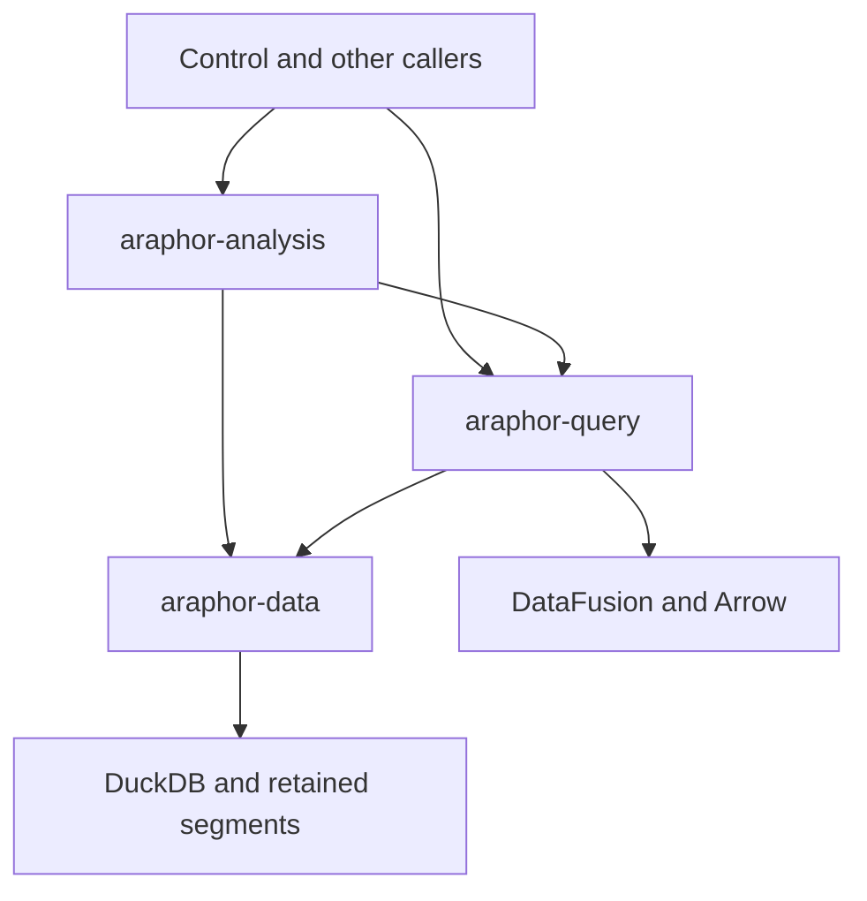

# Araphor Component Redesign Proposal

Source study: **Done**. Implementation: **Not done**. The user approves
implementation of this redesign and requires a commit for each deliverable.
The source baseline is `537f9de3`. DataFusion and Mangroves supply the source
lessons below. The complete redesign must reduce real production Rust code.

The required route is SQL parser, logical planner, optimizer, physical planner,
and execution. Use native DataFusion stages and registered table providers.
Add an extension only for a required Araphor behavior that the native stage
does not supply.

This proposal supports the
[performance simplification TODO](araphor-performance-simplification-todo.md).

Before this redesign, the committed code removes 2,229 nonblank production
Rust lines from `7b7b407a`. The remaining target at that baseline is 3,771.
None of the source inventories below is a net reduction. Count the complete
replacement before a completion claim.

The user rejects the implementation that retains `QuerySql`. The complete
`araphor-query/src` tree from that implementation is deleted. The replacement
starts with native parser, catalog, planner, source, and execution modules.
Caller migration compiles across Query, Analysis, Control, and E2E. Functional
qualification is **Not done**. The checks below apply to their recorded
source states.

### Replacement checks on 2026-10-16

| Check | Result |
| --- | --- |
| `cargo test --offline -p araphor-query --lib -- --nocapture` | 60 passed. Test execution took 9.12 seconds. This check covers native parsing, planning, sources, memory, sessions, follow, and cursor bindings. |
| `cargo check --offline -p mithril-control -p mithril-e2e --tests --message-format=short` | Passed in 40.33 seconds. This check compiles test callers; it does not execute them. |
| `ARAPHOR_NATIVE_DIR=/tmp/araphor-engine-native-final cargo test --offline -p araphor-analysis --lib -- --nocapture` | 303 passed, 9 failed, and 16 ignored. Build time was 52.46 seconds. Test execution took 357.51 seconds. Fixture corrections and isolated failure checks remain open. Ignored native cases require a separate explicit run. |

The Analysis check includes the sliced and masked NULL conversion cases and
the reused-session deadline case. These cases pass. The nine failures prevent
qualification of the complete Analysis replacement. Later edits require new
affected checks.

The follow-up Analysis selection passes all 40 cases in 71.40 seconds. This
selection includes all model cases and the five remaining failed cases. The four
deadline failures pass without source changes when run separately. Their test
execution takes 96.94 seconds. The complete Analysis suite has not run again.

The Data library check reports 213 passed, one deadline failure, and three
ignored cases in 322.59 seconds. The unchanged deadline case passes in a
separate run after the native build ends. The two new exact-selection cases
pass in 3.67 seconds. Only `Selection::All` now enumerates records. An exact
selection of profiles, graph results, or notifications retains its exact keys.
One enum replaces each former boolean and key-vector pair.

The later Query check passes all 63 cases in 14.95 seconds. This check includes
local SQL without a Data read, local output bounds, and local cancellation.
It precedes the append compaction change. Append now uses native Arrow
`interleave_record_batch` in place of fragments, concatenation, and an identity
take. Its admitted source, filter, alias, and projection shapes produce at
most one output row per raw position. Other shapes use replacement. Actual
allocation checks, view compaction, and cursor progress remain. Qualification
of this change is **Not done**.

The last complete source count removes 3,037 nonblank production Rust lines
from `7b7b407a`, 1,884 from `aa390d9f`, and 808 from `537f9de3`. The record is
`/tmp/araphor-native-rewrite-count3.json`. This count includes standard Cargo
formatting of the replacement crates. Later edits are not included in this
count. The required 6,000-line reduction is **Not done**.

### Native physical append pages

Implementation and selected host verification: **Done**. The
logical append SQL rewrite and its Sort are deleted. The native Subscribe
extension now supplies bounded page execution as well as maintained COUNT.
A late registered physical optimizer rule carries the two real source-position
fields through native projection and filter operators. Default DataFusion
optimizers stay enabled. Native SanityCheckPlan runs after the late rule.
Public SQL names, types, field metadata, and result values remain native.
The complete default rule order stays intact. PageLineage runs before the
existing final sanity check. No duplicate sanity pass or ordinary-plan walk
is added. A regression compares the full native rule order.

The physical page owner completes output limits, compaction, positions, read
checks, and reservations. Follow consumes that completed output. The page
collector keeps its existing bounds; moving that collector gives no deletion
credit. Session.start_physical supplies one capture worker for finite and page
execution. The actual native task identity, configuration, function maps, and
runtime remain intact. One State.finish method updates cursor and wake facts for each
completed result. Source watches and health handling remain in Query.

The page path has one events or trace_output scan. Native filters carry each
row's actual position. No separate source filter or matched-position registry
is added. Original receipts and raw progress remain independent of SQL output.
An empty optimized scan remains empty. Other SQL shapes keep their existing
replacement behavior. General maintained SQL, clock epochs, shared maintained
query ownership, and the complete reduction target remain **Not done**.

The selected checks pass 150 distinct Rust cases: 112 Query, 37 model, and
the E2E query-follow contract with its eight behavior cases. The final Query
run passes all 112 cases in 12.46 seconds. An earlier new view fixture needs
an explicit native VARCHAR cast; the correction requires no production change.
Strict Query Clippy, scoped formatting, and guide link checks pass. The qualification record is
`/tmp/araphor-physical-page-qualification1.json`.

The new source proofs cover trace interleaving, resume within one commit,
parameters, NULLs, colliding aliases, zero-column output, view compaction,
oversized-row failure, borrowed output, and actual native task context.
No performance improvement is claimed. Full workspace CI is not run, as
instructed.

This slice adds 227 nonblank production Rust lines. Collector relocation gives
no deletion credit. The complete count adds 1,155 from `537f9de3`, removes
1,074 from `7b7b407a`, and adds 79 from `aa390d9f`. The record is
`/tmp/araphor-native-rewrite-count15.json`. The 6,000-line target still needs
4,926 net production deletions. The complete redesign remains **Not done**.

### Complete source changes in physical execution

Implementation and selected host verification: **Done**.
The atomic journal read no longer creates a synthetic Begin, Insert, Delete,
and Commit queue. One private Change owns its complete before and after Arrow
batches, exact receipt, complete frontier, evaluation control, permit, and
metadata reservation. The separate physical Inputs adapter is deleted.

Data completes one authorized snapshot or change read
  -> Journal applies exact raw retirements and retains full input witnesses
  -> Journal offers one complete Change through its cooperative stream
  -> physical execution checks the exact advancing `(R, u32::MAX)` frontier
  -> native MemorySourceConfig binds all before batches once
  -> native FilterExec and ProjectionExec stream into native COUNT retractions
  -> native MemorySourceConfig binds all after batches once
  -> native operators stream into native COUNT updates
  -> physical execution finishes the aggregate and native post-plan
  -> the final read check completes before output and progress are offered

A source or native batch fails
  -> the physical stream drops the source and accumulator state
  -> the stream returns one error and then ends
  -> no output or frontier is offered for that change

Native input streams retain cumulative byte checks across both signs. Change
metadata stays charged through native pre-plan completion, including the two
native batch-header copies. Payload buffers keep their existing native claims.
Journal uses Engine::blocking instead of a second blocking-worker guard.
The actual worker retains its permit. Source waits use the parent control;
native pre-plan, accumulator, post-plan, and final checks share one evaluation
control. The next source item is not polled before that output completes.

SubscribeExec::compile remains the single owner of maintained COUNT eligibility.
The repeated kernel checks are deleted. Native child replacement runs the same
compile check. Unsupported aggregate tests now call that production owner.
The tests retain positive COUNT, SUM, DISTINCT, GROUP BY, and partial-mode cases.

The final affected Query check passes all 18 cases in 2.08 seconds. The cases
cover native multi-batch filtering and projection, NULLs, aggregate FILTER,
later-batch failure, source failure, complete frontiers, independent execution
state, raw retirement, full witnesses, and cooperative source polling. The
replacement-limit case checks cumulative transformed bytes across both signs.
The E2E query-follow contract passes in 16.25 seconds and retains its eight
behavior cases. Strict Clippy passes for Query, Control, E2E, and their test
targets in 97 seconds. Scoped formatting and local guide links pass.

This change removes 127 nonblank production Rust lines. The complete redesign
removes 13 from `7b7b407a` and adds 2,216 from `537f9de3`. Another 5,987 net
production deletions are required for the 6,000-line target. The records are
`/tmp/araphor-committed-input-qualification1.json` and
`/tmp/araphor-committed-input-count1.json`.

DataFusion owns SQL planning, expressions, and COUNT accumulation. Change
supplies the complete signed input and read proof for physical execution.
General maintained SQL, Query-owned live detector scheduling, and the required
production reduction remain **Not done**. Full workspace CI and benchmarks
are not run, as instructed. No performance improvement is claimed.

### Native Arrow table reads

Implementation and selected host verification: **Done**. Strict Clippy passes
for Data, Query, Analysis, Control, E2E, and their test targets.

The public AnalysisInputV1 and AnalysisProjection protocol is deleted.
AnalysisStore::read_tables accepts original relations, requested canonical
column indices, exact event ranges, package bindings, and one read mode.
AnalysisPositionPageV1 returns Arrow tables with the existing read receipt.
The separate Query ArrowBatch builder and scalar scratch rows are deleted.

Query plans native provider scans
  -> SourceSnapshot supplies original relations and requested columns
  -> Data fixes the authorized selection and read transaction
  -> validated decoders preflight each complete row before native builders change
  -> Data completes tables, reference origins, witnesses, and raw retirements
  -> Query claims the native arrays and separates payload from its retained receipt
  -> DataFusion physical operators consume the captured batches

Canonical schemas now belong to Data. Schema relocation gives no deletion
credit. Evidence, context, graph, discovery, notification, and trace decoders
remain necessary for their retained formats and validation rules. Native
typed Arrow builders replace scalar conversion. No parser or expression
evaluator is added. At that recorded source state, Query builds its own catalog
arrays from native schemas. The current catalog uses Data's shared builder.

The read keeps complete, page, change, and metadata behavior. Metadata mode
skips raw payloads and package IPC. Package outputs and their provenance use
the same transaction. A private ReadBudget retains scan, input, page, and
fanout checks. Test-only read observation keeps deterministic write, rotation,
and cancellation races inside the actual production read path.

SourceData::open retains the existing SourceSnapshot in the returned native
stream. Native DataSourceExec does not retain TaskContext for that lifetime.
The snapshot keeps source metadata charged through stream drop. Borrowed
Arrow buffers keep their separate allocation claims after that drop.

The selected checks pass 209 distinct cases: 133 Query, 41 Data, 32 Analysis,
and three E2E contracts. One existing Data release-history case is ignored.
The complete Query run passes 132 cases before the final source lifetime fix.
The later 49-case source, execution, and memory run passes that fix. The final
four Query row cases and 41 Data cases pass after test helper corrections.
The final Data-load and query-follow E2E contracts pass in 19.51 seconds.
All 32 original selected Data test names remain. Six builder cases and four
full-column fixtures add native schema, value, NULL, and proof checks.

This change removes 417 nonblank production Rust lines. The complete redesign
removes 430 from `7b7b407a` and adds 1,799 from `537f9de3`. It adds 723 from
`aa390d9f`. Another 5,570 net production deletions are required. The records
are `/tmp/araphor-native-tables-qualification1.json` and
`/tmp/araphor-native-tables-count1.json`. General maintained SQL, Query-owned
live detector scheduling, and the required production reduction remain
**Not done**. Full workspace CI and benchmarks are not run, as instructed.
These checks do not establish a performance improvement.

### Shared physical output completion

Implementation and selected host verification: **Done**.
Replacement output and maintained COUNT now use Output::complete. The duplicate
Follow collector, output checks, read check, and content hash are deleted.
Session::bounded retains the existing native row, backing-buffer, cancellation,
and buffer-claim checks. DataFusion keeps all SQL stages and operators.

State selects replacement execution
  -> Session starts the native physical stream
  -> Cursor checks the captured receipt before stream polling
  -> Output consumes that stream through native cooperative polling and Session::bounded
  -> Output completes the final read check and hashes the logical result
  -> State finishes cursor and source progress

COUNT post-plan execution uses that same completion owner. COUNT keeps only
the prior digest. Its retained comparison batches and metadata reservation
are deleted. The intermediate input reservation remains held until the native
post-plan finishes. The shared fingerprint includes native schema metadata,
total row count, and ordered native values. Batch boundaries and empty batches
do not affect result identity. The digest changes only after all checks pass.

The existing output prepayment covers native buffer claims, geometric vector
growth, retained headers, and hash scratch. Empty batches pass the existing
backing-buffer check before collection skips them. This corrects the former
replacement collector's empty-batch quota bypass. An endless ready stream
of empty batches yields through native cooperative polling. Error or drop
releases its stream, permit, and reservations. Borrowed arrays keep their
separate buffer charges.

The Query checks pass 139 distinct cases. The first run passes 138 and fails
one new test that expects a direct error. The native stream preserves that
error inside its typed source chain. The corrected assertion checks the exact
native root cause and EvaluationFailed category. All six output cases pass
after that test correction. All 31 Analysis model cases and both selected
host-prepared package cases pass. The E2E query-follow contract passes in
18.68 seconds and retains all eight behavior cases. These checks pass 173
distinct cases. Strict Clippy passes for Query, Analysis, Control, E2E, and
their test targets. Formatting passes for all 18 changed Rust files.
The qualification record is `/tmp/araphor-output-completion-qualification1.json`.

This change removes 40 nonblank production Rust lines. The complete redesign
removes 470 from `7b7b407a`, adds 1,759 from `537f9de3`, and adds 683 from
`aa390d9f`. Another 5,530 net production deletions are required. Fingerprint
relocation gives no deletion credit. The count checks 695 Rust hashes:
`/tmp/araphor-output-completion-count1.json`. General maintained SQL,
Query-owned live detector scheduling, and the required production reduction
remain **Not done**. Full workspace CI and benchmarks are not run, as instructed.
No performance improvement is claimed.

### Live detector input ownership

Implementation and selected host verification: **Done**.
Query InputOperation now owns source notices, input and model clocks, witness
expiry, retained input offers, and actual commit-completion checks. Analysis
retains activation registration, current authority, backend execution, and
the authorized Data transaction. Analysis no longer scans source revisions or
uses a retry interval to schedule automatic detector work.

An input tick captures the admitted native input plans again. Equal input
revisions and coverage suppress another backend offer. A model tick can reuse
that cut with a new evaluation time. Busy retains the exact offered Arc and
time until the original source proof fails. Completion reads the actual saved
result head and activation precondition. A reader Busy failure retries that
read without another backend call or transaction.

Data checks the cut in one controlled metadata transaction. The check retains
global relation notices, exact dependencies and context references, trace
read authority, witness expiry, store identity, and recovery epoch. Raw
witness checks use the retained journal index without decoding Arrow payload.
Activation notices exclude ordinary source and result-checkpoint commits.
Recovery sends one registry invalidation when it discovers a newer accepted
revision after it restores trusted connections.

Each live operation has native consumers on the existing shared pools.
Buffer aliases retain one charge per category. Shared capacity waits ignore
the operation's own cleanup. A retained operation that cannot fit its required
allocations returns a permanent limit. Reader, evaluation, compiler, and code
cache waits check their actual resource. Stop and authority changes cancel the
shared token and wait for the blocking worker. Orphan cleanup uses the same
registration control. Changed workers release their old bundles before
replacement admission. Unchanged running registrations skip admission work.

The [source review](../guides/araphor-sql-operation-review.md#live-detector-input-lifecycle)
gives the reading route and ownership checks. The affected checks pass 267
distinct Rust cases: 57 Data, 162 Query, 47 Analysis, and one package E2E case.
The final connected check passes all 16 live Query cases, the Wasm readiness
case, and the package E2E contract on the final source. The E2E case takes
142.18 seconds. The earlier full Query check passes 161 cases before the last
clock correction. The final live selection covers that correction. The
explicit native cancellation, revocation, and expiry case also passes.

The first Analysis selection passes 30 of 31 cases. Its clock fixture drops a
pending next future during a quiet probe and cancels its own shared token.
The corrected fixture retains that future and preserves the same 100-millisecond
quiet interval. This check also finds a production clock error: stable input
values must suppress backend work after recapture. The corrected guard checks
model time only after input revisions and coverage match. A new Query case
proves recapture at two ticks, no extra offer, and a later source-driven offer.
Its first SQL fixture uses an unavailable function. The supported date_bin
fixture passes with the same assertions.

The next Analysis selection passes 18 of 19 cases. One lifecycle fixture reuses
a one-second control across an update and separate inspections. Each inspection
now gets its own one-second control. The failed case passes on its focused
rerun. The Data fixture correction supplies a nonempty evidence record. No
production timeout, memory capacity, or test assertion is weakened.

Strict Clippy passes for Data, Query, Analysis, CLI, Control, E2E, and their
test targets. Formatting passes for all 53 changed Rust files. The source
count checks 699 Rust hashes. The records are
`/tmp/araphor-live-input-qualification1.json` and
`/tmp/araphor-live-input-count1.json`.

This delivery adds 1,637 nonblank production Rust lines from dc2869ed. The
complete redesign adds 3,396 from 537f9de3, 1,167 from 7b7b407a, and 2,320 from
aa390d9f. Another 7,167 net production deletions are required. This delivery
corrects ownership; it does not establish the required reduction. General
maintained SQL and the complete redesign remain **Not done**. The separate
native execution pool still needs a contention review. Full workspace CI and
benchmarks are not run, as instructed. No performance improvement is claimed.

### Remove the obsolete automatic execution path

Implementation and selected host verification: **Done**. Analysis no longer
passes an automatic flag through manual Run, installation, or Inspect. Query
supplies retained inputs for live execution. Their presence selects the same
deterministic result ID. Inspect retains its saved-result check and clock
rounding. Manual Run retains request-ID retry checks. The unused Analysis
input deadline calculation is deleted.

The affected Analysis selection passes 13 cases in 47.98 seconds. The explicit
native checkpoint selection passes two cases in 52.29 seconds. The first run
fails 13 cases at the filesystem reserve check. The same cases pass after
obsolete Cargo caches are removed. No source limit or assertion changes.
Strict Analysis Clippy, formatting of the eight changed Rust files, and all
249 local document links pass.
The records are `/tmp/araphor-obsolete-run-qualification1.json` and
`/tmp/araphor-obsolete-run-count1.json`.

This delivery removes 35 nonblank production Rust lines from 741f53e7. The
complete redesign still adds 1,132 from 7b7b407a. Another 7,132 net production
deletions are required. The complete redesign remains **Not done**. Full
workspace CI and benchmarks are not run, as instructed.

### One Query owner for indexed tables

Implementation and selected host verification: **Done**.
Query Session now checks indexed schemas and creates the dataset-global
__row_index column for resolved inputs, supplied inputs, parameters,
checkpoints, and output tables. The duplicate ModelSchema production owner,
Analysis index loop, and Inputs schema builder are deleted. Analysis retains
stage visibility and the complete supplied-input check. Native Arrow batches
and the existing native MemTable registration remain the table representation.

The builder reuses the caller's actual reservation. It claims existing buffers
before it allocates index values. It keeps the retained metadata charge separate
from prepaid payload bytes. Analysis no longer prepays an already claimed
payload. Input preparation releases its temporary index-header charge when
the capture takes those same headers. The builder prepays eight bytes for each
UInt64 index value. No new limit, provider, table wrapper, or pool is added.

Manual Run also reuses its decoded activation context. The prepare_at wrapper
and its second decode are deleted. Manual evaluation returns its required
receipt. Inspect keeps its optional preparation result and existing checks.

The affected checks pass 73 distinct cases: 33 Query, 39 Analysis, and one
explicit native checkpoint retry and restart case. The final Query run takes
5.11 seconds. Analysis takes 49.77 seconds; the native case takes 50.06 seconds.
Strict Query and Analysis Clippy passes in 11.13 seconds. Formatting passes
for all 14 changed Rust files. All 254 local document links pass.
The qualification record is `/tmp/araphor-indexed-table-qualification1.json`.

The source count removes 22 nonblank production Rust lines from 97909397. The
complete redesign still adds 1,110 from 7b7b407a; another 7,110 net production
deletions are required. The counter checks 701 Rust hashes. A file-level
cfg(test) attribute excludes the complete current schema test file from
production. Its earlier production contents remain in the before count.
The record is `/tmp/araphor-indexed-table-count1.json`. The complete redesign
remains **Not done**. Full workspace CI and benchmarks are not run, as instructed.

### One source request map

Implementation and selected host verification: **Done**.

Native admission resolves the original source names
  -> Query retains one AnalysisTableRequests map with no projected columns
  -> the optimized physical scans add their canonical column indices to that map
  -> a physical source outside the original inventory fails before capture
  -> Data uses the map keys for source observations and its values for Arrow columns

A value of None means an original source has no surviving physical scan.
Some with an empty column set means a real zero-column scan. Such a scan
retains its row count. Some with indices selects those canonical columns.
Unused CTEs retain their source observations. Per-port selections and exact
event ranges remain separate because they define different evidence scopes.

The separate Data relation set, PortScope request map, and InputCapture
request map and trace flag are deleted. Input preparation adds each native
scan directly to the shared map. It no longer merges per-port request maps.
Cursor binding hashes the ordered original keys without another allocation.
Projection values do not change that binding.

The affected checks pass 287 distinct cases: 169 Query, 53 Data, 63 Analysis,
and two E2E contracts. One existing Data release-history case remains ignored.
The Analysis run passes 62 cases and finds one alias-budget fixture failure.
That same case also fails on b4d9c033. The corrected fixture keeps the original
input limit and every assertion. Its wide query requests three catalog string
columns. The final single-case check passes. No production code changes
between the 62 passing Analysis cases and that final check.

The graph traversal fixture now calls Engine::prepare instead of repeating
native parsing and planning. Its affected cases pass. Strict Clippy passes
for Data, Query, Analysis, Control, E2E, and their test targets. Formatting
passes for all 46 changed Rust files. The record is
`/tmp/araphor-source-demand-qualification1.json`. The record retains the
initial compile failure, the baseline comparison, and the fixture retries.

The source count removes one nonblank production Rust line from b4d9c033.
The complete change still adds 1,109 from 7b7b407a. Another 7,109 net deletions
are required. The count checks 701 Rust hashes in
`/tmp/araphor-source-demand-count1.json`. This change removes duplicate state
and work. It does not establish a large code reduction or a speed improvement.
The complete redesign remains **Not done**. Full workspace CI and benchmarks
are not run, as instructed.

### One native source field declaration

Implementation and selected host verification: **Done**. Data declares each
source field once in the existing table_row macro. The item form creates the
native Arrow fields and the actual Capture append method from that declaration.
The separate schema field lists are deleted. The metadata decoration and the
shared native schema map remain. Context versions share nine fields with
context. Graph declarations share six fields. At that recorded source state,
catalog retains its eleven schema-only fields. Its current declaration also
supplies row values. No row object, provider, or runtime registry is added.

Data decodes a retained record
  -> the Capture declaration supplies ordered field values and native schema fields
  -> the existing projection gate skips unrequested values and JSON encoding
  -> complete-row validation and budget admission run before native builders change
  -> a denied output row stops trace measurement fanout
  -> measurement-only reads continue when trace_output is not requested
  -> DataFusion source scans consume the resulting native Arrow batches

The public schema contract is captured before the production change. The
committed schema_contract case compares all nineteen schemas with those fixed
hashes. The hashes include field order, types, nullability, and metadata.
Static comparison also checks 431 expanded fields and 375 value expressions.
The existing row preparation and append code is unchanged. The declared-row
case checks projection before JSON and the denied-row follow-on boundary.
The trace fixture compares measurement-only batches, receipts, and witnesses
with the full read. All previous assertions remain.

Selected host checks pass 289 distinct cases: 55 Data, 169 Query, 63 Analysis,
and two E2E contracts. One existing Data release-history case remains ignored.
Strict Clippy passes for Data, Query, Analysis, Control, E2E, and their test
targets. Formatting and local document link checks pass. These checks cover
Linux x86_64 with the checked native artifacts. The records are
`/tmp/araphor-canonical-tables-qualification1.json` and
`/tmp/araphor-canonical-tables-count1.json`.

This change removes 237 nonblank production Rust lines and adds 169 test lines.
The complete redesign adds 872 production lines from 7b7b407a, 3,101 from
537f9de3, and 2,025 from aa390d9f. Another 6,872 net production deletions are
required. The count excludes tests, documents, blank lines, and file movement.
The complete redesign, general maintained SQL, native pool contention review,
and the required reduction remain **Not done**. Full workspace CI and
benchmarks are not run, as instructed. No speed improvement is claimed.

### Native catalogs define model table visibility

Implementation and selected host verification: **Done**. Engine::catalog takes
only native table providers. The schema-overlay method and catalog_tables
method are deleted. Each catalog clones native SessionState and replaces its
catalog list through register_catalog_list. The native function registries are
not rebuilt during catalog construction. Public query preparation explicitly
supplies canonical durable providers. Input admission supplies its existing
durable and declared-port providers.

Analysis admits a SQL model
  -> AdmittedModel creates native MemTables from declared indexed schemas
  -> output SQL receives only inputs, parameters, and prior checkpoint tables
  -> native statement_to_plan resolves the actual supplied providers
  -> later checkpoint, evidence, and reason SQL also receive completed outputs
  -> runtime physical planning binds those exact local schemas to current data

Analysis queries supplied datasets
  -> the native catalog contains only the supplied datasets
  -> an undeclared table fails native planning, including inside an unused CTE
  -> no durable source provider is available as a fallback

The manual source-membership walk and its threaded relation-map argument are
deleted. Original source inventory and provenance resolution remain in client
and detector-input admission. Collision checks, quoted names, native stage
visibility, schema validation, resource limits, and buffer leases remain.
Native planning errors replace the private model-undeclared-input error.
Invalid-argument status, non-retryable classification, and invalid package
code remain. The five original denial cases pass with these stronger checks
before and after the production change.

Selected host checks pass 235 distinct cases: 170 Query, 63 Analysis, and two
E2E contracts. The added native catalog case checks qualified local execution,
case-sensitive names, local schemas, and missing durable providers. Existing
model output bytes match for qualified local names. The dataset case retains
its row-index assertions and adds unused-CTE source denial. No existing
assertion is removed. Strict Clippy passes for Query, Analysis, Control, E2E,
and their test targets. Formatting and local document links pass. These checks
cover Linux x86_64 with the checked native artifacts. The records are
`/tmp/araphor-closed-catalog-qualification1.json` and
`/tmp/araphor-closed-catalog-count1.json`.

This change removes 23 nonblank production Rust lines and adds 101 test lines.
The complete redesign adds 849 production lines from 7b7b407a, 3,078 from
537f9de3, and 2,002 from aa390d9f. Another 6,849 net production deletions are
required. The count excludes tests, documents, blank lines, and file movement.
The complete redesign, general maintained SQL, native pool contention review,
and the required reduction remain **Not done**. Full workspace CI and
benchmarks are not run, as instructed. No speed improvement is claimed.

### Native function construction

Implementation and selected host verification: **Done**. Engine::new builds
one native SessionState from the admitted native function factories. The
build-all, filter, and rebuild sequence is deleted. Native aliases, function
signatures, configuration updates, table factories, file formats, expression
planners, and optimizer order remain. No table function is registered.

The fixed registry hashes match the prior implementation's keys, canonical
names, and signatures. Existing functional cases check SQL behavior. Selected
host checks pass 202 cases: 171 Query, 29 Analysis model cases, and two E2E
contracts. Strict Clippy passes for Query, Analysis, Control, E2E, and their
test targets. The records are
`/tmp/araphor-native-functions-qualification1.json` and
`/tmp/araphor-native-functions-count1.json`.

The change removes 15 nonblank production Rust lines and adds 52 test lines.
The complete redesign adds 834 production lines from 7b7b407a. Another 6,834
net production deletions are required. Complete redesign: **Not done**.
Full workspace CI and benchmarks are not run, as instructed. No speed
improvement is claimed.

### Remove raw model evaluation

Implementation and selected host verification: **Done**. The public
ModelRun::evaluate_model and ModelRun::admit_model entry points are deleted.
ModelRun::evaluate_admitted executes the retained native logical plans.
The separate evaluate_program method is deleted. Package execution retains
its existing admission, authority, input proof, and output lease checks.

The migrated tests use real AdmittedExport values. All existing assertions
remain. The invalid resolved-input descriptor still fails admission. Supplied
array results use the valid admitted package; the deleted raw entry point
cannot bypass input admission. Selected host checks pass 45 model, package
relation, and retained-package cases. The verification and count records are
`/tmp/araphor-retained-sql-qualification1.json` and
`/tmp/araphor-retained-sql-count1.json`.
Strict Clippy passes for Analysis, Control, E2E, and their test targets.

The change removes 34 nonblank production Rust lines and adds 17 test lines.
The complete redesign adds 800 production lines from 7b7b407a. Another 6,800
net production deletions are required. Complete redesign: **Not done**.
Full workspace CI and benchmarks are not run, as instructed.

### One physical subscription runtime

Implementation and selected host verification: **Done**. One physical Runtime
owns source watches, clock changes, expiry, health, evaluation, and completed
progress. Follow formats cursor updates. Journal capture keeps beforeimages
and returns one complete change. The separate Follow scheduler, journal wait
loop, Session subscription methods, and post-plan Outputs adapter are deleted.
The physical kernel continues to use native COUNT accumulators.

A completed evaluation advances progress even when its result is unchanged.
A metadata health update preserves the completed cursor and evaluation time.
Health capture uses the remaining admitted input capacity. Store identity,
schema, recovery epoch, revision, read checks, permits, and buffer leases remain
checked across execution. Initial watches precede frozen time and planning.
Bounded replacement reuses only a child with the proven initial time. Later
replacements build fresh physical plans because native joins can cache inputs.

Subscribe supplies the native necessary_children_exprs hook. The pinned
DataFusion 53.1.0 projection rule otherwise stops before visiting its child.
The hook preserves the subscription output schema and lets native pruning
select the required scan columns. The new moving COUNT case matches the
ordinary native scan schema and runs within the unchanged 64 KiB input bound.
Page subscription properties declare potentially unbounded incremental
execution. Each source capture and append page remains bounded.

Selected host checks pass 244 distinct Rust cases: 180 Query, 29 Analysis model,
34 Control client, and the E2E follow contract. Strict Clippy passes for Query,
Analysis, Control, E2E, and their test targets. Nine new runtime cases cover
progress, capacity, native clocks, joins, source pruning, pages, and cleanup.
The two native-hook regressions fail before the fixes and pass after them.
The E2E bounded-window failure also passes after native pruning is restored.
Formatting and local document links pass. The exact source records are
`/tmp/araphor-subscription-runtime-qualification1.json` and
`/tmp/araphor-subscription-runtime-count1.json`.

This change adds 32 nonblank production Rust lines and 684 test lines.
The complete redesign adds 832 production lines from 7b7b407a. Another 6,832
net production deletions are required. General maintained SQL, shared
maintained query ownership, the complete redesign, and the required reduction
remain **Not done**. Full workspace CI and benchmarks are not run, as
instructed. No speed improvement is claimed.

### Shared catalog table capture

Implementation and selected host verification: **Done**. Data's
[Capture::metadata](../../crates/araphor-data/src/analysis/extraction/tables/metadata.rs)
creates catalog rows through the existing
[Table](../../crates/araphor-data/src/analysis/extraction/tables/builder.rs).
One field declaration supplies native fields, size measurement, and row append.
Query's separate catalog byte estimator and Arrow builder are deleted.

Data completes a read with a requested catalog scan
  -> the canonical schemas and captured availability flags supply the catalog values
  -> the shared field declaration measures only the requested columns
  -> Table charges array capacity before it allocates native builders
  -> the shared declaration appends one complete catalog batch
  -> Query checks native schemas, retains the read receipt, and claims the arrays
  -> DataFusion consumes those arrays through the existing native source plan

The catalog keeps one batch, including zero-column row counts. The detector
input with LIMIT 100 still succeeds with max_batches set to one. Omitted
columns do not format values. Native schema metadata, readiness text, row
order, source receipts, input limits, and borrowed-buffer charges remain.
Data still supplies retained-format decoding; DataFusion owns every SQL stage.
The [review route](../guides/araphor-sql-operation-review.md#current-table-and-query-input-flow)
links the actual owners and failure paths.

The selected checks pass 307 distinct Rust cases: 60 Data, 182 Query, 29
Analysis model, 34 Control client, and two E2E contracts. The existing Data
release-history case remains ignored. Eight fixed catalog content hashes and
the one-batch detector case pass before and after the production change.
New cases check atomic reservation, cancellation, omitted formatting, and
600-row Boolean buffer capacity. Strict Clippy passes for all five crates
and their test targets. Its first run rejects panic in the new formatting
test. Only that test function changes to a call counter and an assertion.
The corrected case and Clippy pass; production and all other tests stay fixed.
Scoped formatting and local document links pass. The exact records are
`/tmp/araphor-catalog-capture-qualification1.json` and
`/tmp/araphor-catalog-capture-count1.json`.

This change removes 165 nonblank production Rust lines and adds 557 test
lines. The complete redesign adds 667 production lines from 7b7b407a.
Another 6,667 net production deletions are required. The complete redesign,
general maintained SQL, shared maintained query ownership, and the required
reduction remain **Not done**. Full workspace CI and benchmarks are not run,
as instructed. These host checks cover Linux x86_64 with the checked native
artifacts. No speed improvement is claimed.

### Complete SQL model program

Implementation and selected host verification: **Done**. Each SQL model
program runs in one existing
[Engine::wait](../../crates/araphor-query/src/execution.rs) future. Earlier
qualification records remain attached to their recorded source.

[AnalysisPackageOwner::evaluate_artifact](../../crates/araphor-analysis/src/package/execution.rs) selects the exact installed SQL export
  -> [AnalysisPackageOwner::evaluate_artifact](../../crates/araphor-analysis/src/package/execution.rs) moves its bundle Arc, export index, evaluation, retained input set, and child control into the future
  -> [ModelRun::evaluate](../../crates/araphor-analysis/src/model/execute.rs) awaits current trace-read checks and validates the SDK evaluation
  -> [ModelRun::new](../../crates/araphor-analysis/src/model/operation.rs) creates the complete Session, shared evaluation permit, and output reservation
  -> [Session::stream_local](../../crates/araphor-query/src/execution.rs) executes each admitted output, checkpoint, evidence, and reason plan in stage order
  -> [ModelRun::query](../../crates/araphor-analysis/src/model/execute.rs) reserves conversion growth and normalizes each native batch before the next poll
  -> [ModelRun::evaluate](../../crates/araphor-analysis/src/model/execute.rs) checks complete output, control, and current trace-read authority
  -> [SqlModelOutputV1::retain](../../crates/araphor-analysis/src/model.rs) retains the output metadata and buffer claims for the caller

The per-stage synchronous dispatch and raw result vector are deleted. Native
local streams share the run's permit. Each stream releases unused output
prepayment before Analysis reserves conversion memory. Normalized output
batches remain available for row references and output tables. The SQL future
borrows the descriptor and admitted program from its owned bundle. Native and
Wasm invocation remain synchronous under their existing guards.

[SqlDatasetOutputV1::query](../../crates/araphor-analysis/src/model/datasets.rs)
keeps the checked synchronous dataset-only API. The
[SDK metadata owner](../../crates/araphor-analysis-sdk/src/evaluation.rs) replaces
the separate input and dataset-result metadata estimators. Its schema headers,
fields, and metadata-map capacity raise the retained metadata floor. Native
buffer claims retain their separate allocation charges.

The [review route](../guides/araphor-sql-operation-review.md#execution-and-verification)
links the current source and regression cases. The complete redesign and the
required production reduction remain **Not done**. No performance result is
claimed.


The selected checks pass 298 distinct cases: 13 SDK, 186 Query, 94 Analysis,
two Control, and three E2E cases. The nine native package cases run explicitly.
The native detector E2E case runs with PATH empty. The model cases cover the
complete program from both Tokio runtime types, a blocking worker, and outside
Tokio. The producer case proves conversion failure before another native poll.
Strict Clippy passes for SDK, Query, Analysis, Control, E2E, and their test targets.
Formatting and local links pass. Rust source stays fixed during these checks.

This change removes two nonblank production Rust lines. The complete redesign
adds 2,894 from 537f9de3, 665 from 7b7b407a, and 1,818 from aa390d9f.
Another 6,665 net production deletions are required. The count excludes tests,
documents, and blank lines. The records are
`/tmp/araphor-sql-program-qualification1.json` and
`/tmp/araphor-sql-program-count1.json`. The checked platform is Linux x86_64,
x86_64-unknown-linux-gnu, and glibc 2.39. Other targets and physical Kubernetes
are not qualified here. Full workspace CI and benchmarks are not run, as
instructed. General maintained SQL, shared maintained query ownership, and the
required production reduction remain **Not done**. No speed result is claimed.

### Shared package OCI persistence

Implementation and selected host verification: **Done**. Earlier results remain attached to their recorded source.

[PackageArtifactV1::encode and from_bytes](../../crates/araphor-data/src/package/bundle.rs)
use the existing [PackageOci](../../crates/araphor-data/src/package/oci.rs)
metadata and raw-layer codec. The separate StoredArtifact CBOR codec is deleted.
Complete bundle transport and retained artifacts use the same SDK OCI owner.
The retained artifact contains its descriptor. Install, decode, and recovery
compare it with the separate descriptor column. Raw executable, native
dependency, and fixture buffers keep their exact bytes and order. Standalone
artifact decode permits external references; complete bundle validation checks
the dependency closure after loading. Existing trust, native qualification,
immutable revision, transaction, retention, backup, and usage owners remain.
There is no old artifact-format reader or migration.

The [storage review](../guides/araphor-binary-package-storage-review.md)
links the current source and focused cases. The fixed bundle fixture retains
its prechange manifest digest and archive length. Install and recovery now
allocate owned raw layers and recompute hashes through the shared codec.
Canonical reconstruction hashes the layers again. This tradeoff does not prove
lower allocation, lower peak memory, or faster validation.

The syntax-count record reports 133 fewer nonblank production Rust lines and
206 more test lines. The complete redesign adds 2,761 production lines from
537f9de3, 532 from 7b7b407a, and 1,685 from aa390d9f. Another 6,532 net
production deletions are required. Tests, documents, and blank lines are excluded
from production counts. The record is `/tmp/araphor-package-oci-count1.json`.

The selected checks pass 254 distinct cases: five SDK, 72 Data, 30 Query,
139 Analysis, six Control, and two E2E cases. All nine native package cases run
explicitly. Native E2E runs with PATH empty. Strict Clippy passes for the six
crates and their test targets. Formatting passes for all 16 changed current
Rust files. All 35 added local document links pass. Unchanged missing links in
the older performance review are outside this link check.

The first Data selection passes 71 cases and finds a fixture that changes only
the separate descriptor. The corrected fixture encodes the same descriptor in
both places; its exact case passes. Analysis passes 129 cases and finds two
failures. The native loader case passes alone without source changes. The old
committed binary reproduces the renewal fixture's stale error pattern. Its
corrected Query error pattern retains all fence assertions; both fence cases
pass. Clippy then rejects one outer Vec in the new fixture assertion. The array
correction retains the same bytes, and its exact case and Clippy pass. Production
source stays fixed through these checks. The records retain the failed attempts.

The qualification record is `/tmp/araphor-package-oci-qualification1.json`.
It checks 707 Rust hashes and records the test binary and native artifact hashes.
The checked host is Linux x86_64 with glibc 2.39. Other targets and physical
Kubernetes are not qualified. Full workspace CI and benchmarks are not run,
as instructed. The complete redesign, general maintained SQL, shared maintained
query ownership, and the required production reduction remain **Not done**.
No speed result is claimed.

### Analysis build inputs

Implementation and selected host verification: **Done**.
[build.rs](../../crates/araphor-analysis/build.rs) reads only Cargo's TARGET.
Its rerun declaration now names build.rs. Cargo no longer scans the complete
Analysis package for build-script inputs. The checked Cargo fingerprint names
only build.rs; the emitted native target stays x86_64-unknown-linux-gnu.
Strict Analysis Clippy passes for the library and tests. Formatting and
whitespace checks pass. Runtime tests are not repeated for this declaration.
The record is `/tmp/araphor-analysis-build-input-qualification1.json`.

This change adds one nonblank production Rust line. The complete redesign adds
533 lines from 7b7b407a; another 6,533 net deletions remain. The count record is
`/tmp/araphor-analysis-build-input-count1.json`. Full workspace CI and benchmarks
are not run. No speed result is claimed. Complete redesign: **Not done**.

### Remove unused input execution

Implementation and selected host verification: **Done**.
[Session](../../crates/araphor-query/src/execution.rs) no longer owns the unused
execute_input API, Retention mode, or separate collect and emit wrappers.
Production callers all selected output retention. Finite output and physical
subscriptions now use the output reservation and buffer claim directly.
[Inputs::read](../../crates/araphor-query/src/inputs/physical.rs) remains the
production detector input owner. It calls native execute_stream and retains
input buffers. The existing input_output_budget case now calls that owner and
keeps every distinct value, output-denial, capacity, and alias-lifetime assertion.
The [SQL review](../guides/araphor-sql-operation-review.md) links these owners.

The slice removes 70 nonblank production Rust lines and adds 14 test lines.
The complete redesign adds 463 lines from 7b7b407a; another 6,463 net deletions
remain. The count record is `/tmp/araphor-query-output-only-count1.json`.
All 186 Query library cases pass. The first run passes 110 cases and stops
76 cases at the unchanged filesystem reserve check. After removal of two
inactive generated compiler caches, only those 76 cases run again. All pass
on the same binary without source changes. The migrated input budget case
passes in the first run. Strict Query Clippy, scoped formatting, whitespace,
and added local document links pass. The record is
`/tmp/araphor-query-output-only-qualification1.json`. It checks 707 Rust hashes.
Native and Wasm backend suites, caller runtime suites, full workspace CI, and
benchmarks are not repeated for this internal deletion. Complete redesign:
**Not done**. No speed result is claimed.

## Intended end state

### RisingWave source correction

Source study on 2026-10-16: **Done**. Implementation: **Not done**. The user
requires the local RisingWave source to guide subscription and stream
processing ownership. The reference checkout is `risingwave/` at
`bbcb64604a47f4ef31b01fbfdda48764091baa43`.

RisingWave separates maintained query execution from subscription cursors.
Its streaming planner produces operators with output keys and change
properties. Operators process row changes and retain state. A subscription
catalog entry names a maintained table. Its cursor reads a pinned initial
snapshot, then exact committed change-log epochs. The protocol consumes the
cursor's output. The cursor can start a bounded log-read query for each epoch;
this does not execute the original relational query again.

| Source | Required lesson |
| --- | --- |
| [Stream conversion](../../risingwave/src/frontend/src/optimizer/plan_node/convert.rs) and [stream metadata](../../risingwave/src/frontend/src/optimizer/plan_node/stream.rs) | Stream planning must establish keys, change kinds, and time progress before execution. A page-shape test cannot supply these properties. |
| [Executor contract and messages](../../risingwave/src/stream/src/executor/mod.rs) and [filter](../../risingwave/src/stream/src/executor/filter.rs) | Operators consume upstream change chunks and propagate progress. Inserts, deletes, and updates remain explicit. |
| [Hash aggregation](../../risingwave/src/stream/src/executor/aggregate/hash_agg.rs) and [barrier alignment](../../risingwave/src/stream/src/executor/barrier_align.rs) | Stateful operators apply changes and finish the same input frontier before output progress advances. |
| [Time-dependent filter planning](../../risingwave/src/frontend/src/optimizer/rule/stream/filter_with_now_to_join_rule.rs) and [dynamic filter](../../risingwave/src/stream/src/executor/dynamic_filter.rs) | Time progress is a processing input. Window expiry belongs to the query runtime. |
| [Subscription catalog](../../risingwave/src/frontend/src/catalog/subscription_catalog.rs) and [cursor manager](../../risingwave/src/frontend/src/session/cursor_manager.rs) | A subscriber owns its snapshot-to-change-log position, buffered rows, and lifetime. It consumes maintained output. |
| [Snapshot notification](../../risingwave/src/frontend/src/scheduler/snapshot.rs) and [FETCH handler](../../risingwave/src/frontend/src/handler/fetch_cursor.rs) | The query owner registers a notification before checking progress, waits on change or cancellation, and returns rows through the normal protocol response. |

At the initial source study, Araphor State::evaluate started a bounded native
query after a source or time change. Replacement suppression hashed complete
results. The former page_plan selected append paging for a small set of source
shapes. Those mechanisms retained no aggregate or join state between changes.
Delivery removed duplicate Control lifecycle code. Later physical COUNT and
page changes are recorded above. General stream processing remains **Not done**.

The corrected owner flow is:

Data committed changes and time progress
  -> Query stream planning and retained operator state
  -> maintained output and a committed output frontier
  -> Query snapshot-to-change-log cursor
  -> Control encoding or an Analysis detector consumer

Data remains the durable owner of source changes, retention, and transactions.
Query owns processing, windows, output progress, and subscription cursors.
Source revision watches are wake signals; retained changes establish replay
truth. Preserve exact authorized selection, original source provenance,
current grants, native reservations, and commit checks across this flow.
Clients consume the returned stream. They do not schedule source checks,
query evaluation, window expiry, or subscription progress.

Use DataFusion's native plans, expressions, Arrow arrays, and supported
accumulator operations. A native `RecordBatchStream` alone does not carry
row-change operations, a commit frontier, or a watermark. Native boundedness
and emission properties do not establish incremental aggregate or join
semantics. Justify each required extension against that actual API gap.
Do not add RisingWave's distributed actor, exchange, or storage services.
The local design needs the owner boundaries and processing semantics above.

### Native pipeline correction

Implementation: **Not done**. The user requires the standard SQL parser,
logical planner, optimizer, physical planner, and execution sequence. DataFusion
owns the ordinary SQL stages. Araphor uses registered table providers and
extension hooks for its source and subscription requirements.

The working tree adds one native Subscribe logical extension. The registered
QueryPlanner delegates to DefaultPhysicalPlanner with an ExtensionPlanner for
that node. The native logical and physical optimizers remain in the path.
SubscribeExec owns physical execution. Its private kernel calls native COUNT
accumulators only during that execution. Native MemorySourceConfig supplies
Arrow input to the compiled native filter and projection plans.

The direct Processor path, standalone aggregate helper, and SourceBatch bridge
are deleted. SourceBatch duplicated source binding and had no required role.
The source partition now resolves its snapshot from the actual TaskContext.
DataFusion RecordBatchStream has no commit or Araphor receipt item. The actual
planned SubscribeExec supplies one committed output stream for those values;
its native execute delegates to that same execution.

The physical source registers its revision watch before capture. It waits for
a later revision before another capture. One evaluation permit remains held
through the blocking read, native processing, and completed output. One deadline
covers all native processing for the commit. The first maintained operator
remains ordinary global COUNT over events. Other maintained operators, shared
query ownership, and clock processing remain **Not done**.

The native pipeline and count execution checks are **Done** for the selected
host cases. The Query run passes 96 cases in 16.60 seconds. A later test calls
the actual native ExecutionPlan::execute entry; it passes in 1.96 seconds.
It proves a pending read between commits, a changed count after a commit,
release of the evaluation slot while idle, cancellation, and full input and
output capacity recovery before stream EOF.

The affected checks also pass 25 Data extraction cases, 35 Analysis model
cases, one Analysis discovery transaction case, 34 Control cases, and three
E2E cases. The Data run ignores one release-history case. The E2E cases cover
query follow, owner isolation, and the Data load contract. These checks pass
195 distinct selected cases. They do not constitute a complete Analysis or
workspace test run. Existing native backend records remain separate evidence.
Functional execution times do not establish a performance improvement.
The qualification record is `/tmp/araphor-native-pipeline-qualification1.json`.

Strict Clippy passes for the six affected crates and their test targets.
The final targeted Query lint check also passes in 16.87 seconds. The affected
runtime source stays fixed during each test run. Later harness edits change
only error boxing and a conditional with the same inputs and results.

The last source count adds 1,008 nonblank production Rust lines from
`537f9de3`. It removes 1,221 from `7b7b407a` and 68 from `aa390d9f`.
The record is `/tmp/araphor-native-rewrite-count7.json`. The complete redesign
still requires 4,779 more net production deletions. It is **Not done**.

### Native input ownership

Implementation and selected host verification: **Done**. Local admission uses
native MemTables. Before native optimization, Session binds only declared local
scans to the current run's exact-schema MemTables. The custom LocalTable provider
and its SessionConfig map are deleted. Native SQL, CTE, and parameter planning
remain with DataFusion. A local table with a canonical source name does not
replace an already admitted durable source scan.

One immutable canonical schema map supplies all source providers, captures,
and catalog rows. Each read no longer builds every field and metadata map.
Data no longer declares the unused Behavior, DiscoveryContext, Target, or
TraceMeasurement input variants. Query calls the trace measurement table
adapter directly from the retained trace frame.

The Query check passes all 98 cases in 13.46 seconds. The new COUNT case proves
binding before native optimization, exact quoted names, separate tenants,
separate clocks, empty input, and later rebinding. Existing schema checks now
also reject changed nullability, field metadata, and schema metadata. Data
extraction passes 25 cases in 8.65 seconds; one release-history case is ignored.
Analysis model checks pass all 35 cases in 47.39 seconds. Strict Clippy passes
for Query, Data, Analysis, CLI, Control, and E2E library and test targets.
The combined record is `/tmp/araphor-native-owners-qualification1.json`.
These times describe functional checks. They do not prove a speed improvement.

### Native invocation ownership

Implementation and selected host verification: **Done**. NativeExecution and
the package owner's matching field are deleted. Admission validates the owned
native options and artifact. Execution validates the options, loads the pinned
NativeLibrary, and calls it with a fresh SDK Invocation. The library owns its
ABI table, file pins, dependency handles, invocation, and producer release
callbacks. The caller checks cancellation before it returns a load error.
The library checks cancellation before and after the native call.

Execution no longer performs a separate artifact inspection and system-library
read before loading. The loader validates the complete qualification against
the same system files that it pins. The required library-name check now runs
inside system_path before file lookup. Invalid absolute and parent paths retain
their typed denial. No native option default or configured limit changes.

All 18 native admission and loader cases pass in 1.02 seconds. All nine actual
native package cases pass in 218.55 seconds, including the eight opt-in cases.
They cover lifecycle, checkpoints, failed output, interruption, expiry,
configured limits, and recovery after a host fault. The selected checks pass
185 distinct cases. Strict Clippy passes for the six affected crates in
82 seconds. Full workspace CI is not run, as the user instructs. The record is
`/tmp/araphor-native-owners-qualification1.json`.

This slice removes 90 nonblank production Rust lines: 56 from input ownership
and 34 from native invocation ownership. Tests and documentation are excluded.
The complete count adds 918 production lines from `537f9de3`, removes 1,311
from `7b7b407a`, and removes 158 from `aa390d9f`. The record is
`/tmp/araphor-native-rewrite-count9.json`. The 6,000-line target still requires
4,689 more net deletions. The complete redesign remains **Not done**.

### Wasm invocation ownership

Implementation and selected host verification: **Done**. The production
evaluate_prepared and evaluate_input wrappers are deleted. The package dispatch
already owns the checked evaluation, normalized limits, encoded input, and
reservations. It calls the existing invoke method and decodes the output under
those reservations. Invoke owns the VM permit and engine check before Store
creation. Fuel, stack, epoch, memory, host-call, and code-pin checks remain with
the same runtime owner. The query evaluation permit covers output decoding.

All 18 Wasm runtime cases, 12 Wasm package cases, and six component reservation
cases pass. Their execution times are 105.65, 112.42, and 41.06 seconds.
The prepared-handle case retains foreign-engine, cache, code-pin, and compiler
checks. It also checks cancellation before a foreign-engine denial. Strict
Analysis Clippy passes in 24.53 seconds. The record is
`/tmp/araphor-wasm-owner-qualification1.json`. The unchanged native and Query
runtime suites are not repeated. Full workspace CI is not run.

This change removes 49 nonblank production Rust lines. The count checks all
666 Rust file hashes from the prior complete record and applies the syntax-span
delta for the four changed files. Tests and blank lines are excluded. The
records are `/tmp/araphor-wasm-owner-count1.json` and
`/tmp/araphor-wasm-owner-count2.json`. The complete result adds 869 production
lines from `537f9de3` and removes 1,360 from `7b7b407a`. Another 4,640 must be
removed for the 6,000-line target. The complete redesign remains **Not done**.

The obsolete Data extraction row-page framework is also deleted. Query already
owns Arrow batches through its actual projection callback. Data retains atomic
snapshots, receipts, read guards, byte bounds, and complete source frontiers.
The first affected Data extraction run passes 25 cases and ignores one release
history case. Test execution takes 7.03 seconds. Later test-only frontier
assertions and the new physical pipeline still require qualification.

### Checked input ownership

Implementation and selected host verification: **Done**. CheckedEvaluation
owns input encoding. The old raw Evaluation encoder is deleted. The native
Invocation borrows the same checked input for exchange and output validation.
The package dispatch reuses its existing proof. These paths no longer repeat
the input contract checks. IPC allocation checks, raw guest decoding, native
pointer checks, output checks, and release callbacks remain. The raw wire output
decoder retains its error order. The wire format, WIT, and native ABI do not
change. All Rust callers use the new checked-input API.

The selected checks pass 125 distinct cases: 74 SDK, three component fixture,
six component reservation, 18 Wasm runtime, 12 Wasm package, nine native package,
two native discovery, and one native detector parity case. The runtime, package,
and component runs take 122.01, 135.92, and 47.58 seconds. The native package
run takes 221.22 seconds and includes all eight opt-in cases. All six native
fixtures are rebuilt from the changed SDK. Strict Clippy passes for SDK,
Analysis, and the component fixture, including their test targets. The record
is `/tmp/araphor-checked-input-qualification1.json`. Unchanged Query runtime
checks and full workspace CI are not repeated.

This change removes two nonblank production Rust lines. Tests and blank lines
are excluded. The complete count adds 867 lines from `537f9de3`, removes 1,362
from `7b7b407a`, and removes 209 from `aa390d9f`. The records are
`/tmp/araphor-checked-input-count1.json` and
`/tmp/araphor-native-rewrite-count10.json`. Another 4,638 production lines must
be removed for the 6,000-line target. The complete redesign is **Not done**.
These functional checks do not establish a performance improvement.

### Native subquery admission

Implementation and selected host verification: **Done**. The plan check now
accepts DataFusion's structural Subquery node. The native visitor continues into
the inner plan. The existing source, function, projection, explicit join,
parameter, and window checks remain. Native parsing, decorrelation,
optimization, physical planning, and execution handle the subquery. Native
optimization can create joins from correlated predicates. The explicit join
check does not establish equality keys for every optimized join.

Follow checks native expression subqueries before optimization and selects
Replace. A subquery can make an earlier row qualify after a later commit.
Append cannot represent that change. The regression covers both the normal
SQL entry and an independently supplied native plan. It compares rows, schema,
and the current source receipt with an independent complete snapshot.
Additional cases cover scalar, EXISTS, IN, inner parameters, original table
references, and nested policy checks.

All 100 Query cases, 35 Analysis model cases, and the E2E query-follow contract
pass. The new Query cases take 2.18 seconds; the other 98 take 21.45 seconds.
The model cases take 56.10 seconds. The E2E case takes 17.85 seconds and retains
its eight behavior checks. Strict Query Clippy and scoped formatting pass.
The record is `/tmp/araphor-native-subquery-qualification1.json`.
Full workspace CI is not run, as instructed.

This correctness change adds 14 nonblank production Rust lines. It removes no
owner and establishes no performance improvement. The verified count chain
checks 668 Rust file hashes. The complete result adds 881 lines from
`537f9de3` and removes 1,348 from `7b7b407a`. Another 4,652 production lines
must be removed for the 6,000-line target. The count records are
`/tmp/araphor-native-subquery-count1.json` and
`/tmp/araphor-native-subquery-count2.json`. Complete redesign: **Not done**.

### Native cast allocation

Implementation and selected host verification: **Done**. ModelArrays already
uses Arrow's cast kernel for ordinary conversions. Its preflight now reserves
the target width for each Binary to FixedSizeBinary row, including null rows.
The estimate includes buffer alignment and validity storage. Checked arithmetic
rejects overflow before allocation. The native cast, strict width check, and
visible-null checks retain their behavior.

Both new regressions fail on the old estimator. With the fix, all 12 selected
array, schema, and model execution cases pass. The model regression requires
the reservation failure before casting. It also checks that the output pool
and evaluation slot are available after failure. Strict Analysis Clippy and
scoped formatting pass. The record is
`/tmp/araphor-fixed-binary-qualification1.json`. Unchanged package and Query
runtime suites and full workspace CI are not repeated.

This correctness fix adds eight nonblank production Rust lines. It establishes
no code reduction or performance improvement. The verified count chain checks
668 Rust file hashes. The complete result adds 889 lines from `537f9de3` and
removes 1,340 from `7b7b407a`. Another 4,660 production lines must be removed
for the 6,000-line target. The records are
`/tmp/araphor-fixed-binary-count1.json` and
`/tmp/araphor-fixed-binary-count2.json`. Complete redesign: **Not done**.

### Native journal source ownership

Implementation and selected host verification: **Done**. The registered
subscription planner creates JournalExec from the actual native source scan.
SubscribeExec retains the bounded native SQL child and the unbounded journal
child. Native physical optimizers see both children. The journal checks the
exact projected schema, including metadata. It computes canonical indices
and the capture request once. Each execution owns its source watch, live
beforeimages, pending changes, and reservations. The hidden Source factory
and its stream module are deleted. The native bounded StreamingTableExec and
SnapshotPartition remain.

The journal carries signed Arrow changes and complete commit receipts.
Native RecordBatchStream cannot carry those values. JournalExec therefore
rejects unsigned execution. SubscribeExec is the native Arrow execution entry
and uses the same committed execution path. Native global AggregateExec
remains in the bounded SQL child. The maintained path still supports ordinary
global COUNT over one admitted events source.

The first patch fails two cases because native EnsureCooperative wraps its
noncooperative journal. Each journal step now uses Tokio's cooperative future
wrapper. The native optimizer remains enabled. A test exhausts the task budget
and proves that a queued Insert yields before delivery. SanityCheckPlan also
remains enabled. Finite raw admission quotas and exact retirement bound the
journal's live source state. This proof does not apply to arbitrary operators.
Watch ordering, read guards, stage deadlines, permits, full witnesses, and
complete source frontiers retain their owners.

All 102 Query cases and the E2E query-follow contract pass. The latter retains
eight behavior checks. The remaining 100 Query cases take 18.39 seconds; the
two focused physical cases take 0.54 and 0.71 seconds. The E2E case takes
16.15 seconds. Strict Query Clippy and scoped formatting pass. The record is
`/tmp/araphor-journal-owner-qualification1.json`. The event provider retains
Inexact pushdown and native residual filters. The tests cover insertion,
retirement, and original receipts when native optimization removes the scan.
Full workspace CI is not run, as instructed.

This change adds 139 nonblank production Rust lines. Code relocation gives no
reduction credit. The complete count adds 1,028 lines from `537f9de3` and
removes 1,201 from `7b7b407a`. Another 4,799 must be removed for the 6,000-line
target. The record is `/tmp/araphor-native-rewrite-count11.json`. General
maintained SQL, clock epochs, shared maintained-query ownership, and the append
source replacement remain **Not done**. Complete redesign: **Not done**.
These functional checks establish no performance improvement.

### Physical output ownership

Implementation and selected host verification: **Done**. Physical Output
transfers its native reservation to Update. Follow no longer repeats output
size checks, buffer claims, and metadata charges. The native Arrow iterator
keeps its metadata charge until EOF or drop. Completed SQL releases its permit
at the original boundary. Borrowed buffers retain their own native claims.

The lifetime regression fails on the old code and passes with this change.
All 102 Query cases pass. Strict Query Clippy and scoped formatting pass.
The record is `/tmp/araphor-output-owner-qualification1.json`. Unchanged
cross-crate runtime suites and full workspace CI are not repeated.

This change removes 23 nonblank production Rust lines. The verified count
checks 668 prior Rust file hashes. The complete result adds 1,005 lines from
`537f9de3` and removes 1,224 from `7b7b407a`. Another 4,776 must be removed
for the 6,000-line target. The records are
`/tmp/araphor-output-owner-count1.json` and
`/tmp/araphor-output-owner-count2.json`. Complete redesign: **Not done**.

### Native source descriptors

Implementation and selected host verification: **Done**. SourceProvider returns
native DataSourceExec with an immutable SourceData descriptor. Capture reads
projections and time bounds from the optimized physical tree. The requested
column and received interval mutexes are deleted. SnapshotPartition is deleted.
SourceData reads the captured snapshot from TaskContext and opens native
cooperative MemoryStream. Planning stores no tenant snapshot or source rows.
The journal takes exact indices, schema, and bounds from that same descriptor.

The event provider retains Inexact support and native residual filters. Native
logical scan projection remains active. The source adds no physical projection
rewrite that could change its paired journal schema. No general physical-plan
cache is added. Native reset_plan_states does not support all dynamic-filter
plans. Join and TopK operators can retain that state even when a source rejects
filter pushdown. Native optimizer features remain enabled.

All 104 Query cases, 37 Analysis model cases, and the E2E query-follow contract
pass. Their execution times are 20.36, 50.13, and 16.80 seconds. Strict Query
Clippy and scoped formatting pass. The new tests check physical projection
unions, immutable bounds, and tenant isolation through actual TaskContexts.
The record is `/tmp/araphor-source-descriptor-qualification1.json`.
Full workspace CI is not run, as instructed.

This change removes 25 nonblank production Rust lines. The corrected complete
count adds 928 lines from `537f9de3` and removes 1,301 from `7b7b407a`.
Another 4,699 must be removed for the 6,000-line target. The records are
`/tmp/araphor-source-descriptor-count3.json` and
`/tmp/araphor-native-rewrite-count12.json`. The count excludes three external
test modules through their parent cfg(test) gates. Earlier complete totals
counted helper imports and fixtures in those modules as production. The old
and new native-test modules cancel; the current bounds helper correction is
43 lines. This correction is not implementation deletion credit.
The earlier count records remain for source history. Complete redesign:
**Not done**. General maintained SQL and the append source replacement remain
**Not done**. These functional checks establish no performance improvement.

### Finite resolved input ownership

The finite source path and selected host verification are **Done**. This change
replaces Analysis's per-port input admission and
execution with Query-owned Inputs and InputSet. Package lifecycle, executable
admission, backend execution, checkpoint selection, authority, and the Data
commit compare-and-swap checks keep their existing owners.

[AdmittedExport::admit](../../crates/araphor-analysis/src/model.rs) admits the installed export
  -> [Inputs::admit](../../crates/araphor-query/src/inputs/mod.rs) retains native plans, original provider origins, and input dependency order

[AnalysisPackageOwner::prepare_model](../../crates/araphor-analysis/src/package/evaluation/preparation.rs) checks current authority and reads the admitted Inputs directly
  -> [Inputs::execute](../../crates/araphor-query/src/inputs/physical.rs) plans all physical children at one frozen time
  -> [SourceSnapshot::capture](../../crates/araphor-query/src/sources/mod.rs) combines the prepared source columns and time ranges in one capture
  -> [AnalysisStore::extract_mode](../../crates/araphor-data/src/analysis/extraction.rs) fixes one Data read transaction for the original source receipts
  -> [AnalysisStore::extract_packages](../../crates/araphor-data/src/analysis/extraction/package.rs) reads exact package outputs and their references in that same transaction
  -> [Dataset::normalize_batch](../../crates/araphor-analysis-sdk/src/batch.rs) applies the declared SDK schema after conversion preflight
  -> [Inputs::execute](../../crates/araphor-query/src/inputs/physical.rs) materializes each completed port with one dataset-global row index before dependent SQL runs
  -> [Inputs::input](../../crates/araphor-query/src/inputs/receipt.rs) assigns per-port revisions and coverage from the original source scopes and reference origins
  -> [InputSet](../../crates/araphor-query/src/inputs/physical.rs) returns declared input order, retained tables, and complete provenance
  -> [ModelRun::prepared](../../crates/araphor-analysis/src/model/operation.rs) supplies the retained input set to model execution

SourceOrigin distinguishes durable canonical tables, materialized port slots,
and exact package-output slots. Typed port providers have unknown native
statistics before execution. Native optimization cannot treat an unbound port
as an empty MemTable. A declared table named events remains a materialized port;
it does not acquire durable source, journal, or append capability.

All physical input children use one SourceSnapshot and the same TaskContext.
Capture unions canonical column requests and event-time ranges. Original
references remain separate from surviving scans. An eliminated event scan keeps
its original receipt scope. Trace reads retain the authorized time range.
Data reads package outputs with the original authorized selection and checks
their retained grants. One reference ledger records exact context and result
refs with their origins. Per-port attribution does not assign every union ref
to every input.

The SDK owns conversion preflight and batch normalization. InputSet retains
the normalized datasets and one indexed materialization of each port. SQL
ModelRun registers those same indexed tables. The old AdmittedInput dispatcher,
Analysis source readers, separate package-output resolver, and post-capture
reference reads are deleted. No SourceBatch or LocalTable bridge is added.
Native memory claims retain the input arrays and metadata through aliases.

The [input tests](../../crates/araphor-query/src/inputs/tests.rs),
[SDK batch tests](../../crates/araphor-analysis-sdk/src/batch/tests.rs), and
[Data output tests](../../crates/araphor-data/src/analysis/packages/tests/output.rs)
define the finite cut, index, provenance, conversion, and same-reader checks.
An earlier Query run passes 124 cases in 12.57 seconds. That run precedes the
final metadata and read-control changes. The final affected checks are below.

| Required record | Current result |
| --- | --- |
| SDK | 65 cases pass. |
| Data | 61 cases pass. One release-history case remains ignored. |
| Query | 129 distinct selected cases pass across the corrected checks. The final execution, input, and memory selection passes all 40 cases in 5.46 seconds. |
| Analysis | 57 distinct selected cases pass, including eight native cases run explicitly with their ignore flags. The final native cancellation, revocation, and expiry check passes. |
| Affected callers | The package E2E contract passes in 139.88 seconds on the final source. The earlier query-follow contract passes before the final registration and backend deadline fixes. |
| Strict Clippy | SDK, Data, Query, Analysis, CLI, Control, and E2E test targets pass with warnings denied in 25.15 seconds. |
| Source checks | Formatting passes for all 53 changed Rust files. All 679 Rust hashes match the production count. Local document links and whitespace checks pass. |

Earlier Query checks find a cancellation-guard ownership error and two invalid
test expectations. The corrected checks pass. Two new Analysis cases first
use invalid fixture state; both pass after fixture corrections. The assertions
for current authority, missing input, stale results, limits, and cleanup remain.
The qualification record preserves these failed attempts and their corrections.

The package E2E check first fails during cold Wasm compilation after restart.
The typed deadline points to the compiler wait. Preparation now uses the caller
deadline and the existing compiler deadline. The unchanged query evaluation
timeout starts after preparation. A cold-owner test with a one-nanosecond
evaluation timeout proves that preparation fills the cache and execution still
fails at its deadline. Compiler interruption, code pins, guest interruption,
and native cancellation checks pass. No timeout is increased.

Session registration now uses existing Arrow allocation claims without a
second full-payload reservation. The new case fills the input pool, registers
the shared payload, rejects a new allocation, and preserves the old binding.
The existing logical input-byte limit and complete capacity recovery remain.

The record is `/tmp/araphor-native-input-qualification1.json`. The source count
is `/tmp/araphor-native-rewrite-count18.json`. This deliverable adds 1,188
nonblank production Rust lines from `1632f791`. The complete count adds 2,343
from `537f9de3`, 114 from `7b7b407a`, and 1,267 from `aa390d9f`. Another 6,114
net production lines must be removed for the required target. Tests, documents,
blank lines, and code movement give no production deletion credit. Later
documentation edits do not change the counted Rust source. Full workspace CI
and benchmarks are not run, as instructed.

The finite delivery did not include a live InputOperation or actual
commit-completion feedback. The live detector input ownership record above
supplies that work. General maintained SQL and the complete redesign remain
**Not done**. No benchmark or speed result is claimed. The finite source
change does not establish the required 6,000-line reduction.

### Shared subscription owner

The user requires Query to own subscription behavior used by Control and
E2E. Implementation: **Not done**. Native SQL preparation and source
capability checks belong to Query. The existing native `Subscription` remains
a stream of Arrow updates. Direct callers can consume that stream.

Query must also own shared delivery state: pending update, delivery stages,
last complete checkpoint, read checks, cancellation, authorization changes
and expiry, duration, output wait, and conversion reservations. Control
supplies current client authorization and protobuf encoding. Trace terminal
validation and per-target result assembly remain at their trace owner. An
encoding adapter returns its protocol value directly; add no query frame or
query program wrapper.

Check authorization after each asynchronous read and before each frame.
Advance the complete checkpoint only when its frame is returned. Keep the
pending Arrow update until its checkpoint. Release a failed conversion
immediately. A successful frame keeps its conversion charge until the next
poll or drop. Apply output wait on renewed demand, not while waiting for
source changes. Preserve the existing Control assertions for these cases.
E2E retains its independent result, cursor, paging, health, and cleanup
assertions; its repeated preparation calls use the Query entry point.

Use one Arrow schema and one columnar query operation from authorized source
selection to SQL output. The existing package owner retains one immutable
admitted program per exact installed closure. Each run owns its mutable inputs,
checkpoint, control, and resource leases. The existing store remains the only
durable owner of evidence, progress, results, references, and quotas.

The user approves the SQL engine replacement through the implementation
request. This approval replaces the earlier DuckDB-only constraint for query
execution. The working tree selects DataFusion 53.1.0 and Arrow 58.4.0 in
Cargo.lock. Qualification of the replacement is **Not done**.
DuckDB continues to own retained metadata and graph tables. This proposal
changes the private in-memory SQL engine only. The native and Wasm execution
backends do not change.

Coherence review: **Done for owner boundaries**. The review found missing
parser, SQL binding, caller, resource, and execution-boundary requirements.
The sections below record them. The replacement includes a native execution
owner and a synchronous entry point. Tests for the new stages and execution
owner are written but have not run. The complete production reduction remains
**Not done**. No performance result is claimed for the replacement.

## Proposed crate ownership correction

Status on 2026-10-16: **Approved. Implementation not done.** The user explicitly
requires separate crate owners and a query engine written from the start
with the native DataFusion parser, planner, catalog, and execution APIs.
Moving the old query modules does not satisfy this requirement.

Before each change to `araphor-query`, answer: Is this a new implementation
that uses DataFusion directly, or a change to the old design? State the
native API and the old mechanism that it replaces. Stop a change that only
adapts the old design. Do not retain compatibility wrappers for the old
query plan, binding, frame, or scalar result types.

The rejected implementation kept query, model execution, package execution,
and storage in `araphor-data`. Its later file moves also did not complete
the redesign. The earlier checks do not qualify the replacement. The
existing code and receipts remain implementation history.

### Crates and dependencies

| Crate | State and behavior it owns | Dependencies within this design |
| --- | --- | --- |
| `araphor-data` | Durable evidence, records, retained package format, source revisions, context references, progress, transactions, recovery, retention, quotas, and storage read control. | Existing SDK, built-in contracts, and DuckDB. No dependency on Query or Analysis. |
| `araphor-query` | Native SQL parsing and planning, authorized source catalog, bounded Arrow source capture, execution sessions, native memory reservations, and commit-driven follow. | Data and the existing SDK. DataFusion supplies the statement, logical plan, optimizer, physical planner, and streams. |
| `araphor-analysis` | Package admission and lifecycle, retained executable programs, detector input bindings, model output/checkpoint/evidence/reason execution, scheduling, native and Wasm execution, and discovery/graph/notification execution. | Query, Data, the existing SDK, and existing execution backends. |

The existing SDK continues to own plugin declarations, Arrow contracts, and
native/Wasm ABI contracts. Control and E2E import each actual owner. Data
does not re-export Query or Analysis. This design adds no facade crate.



Query uses `parser`, `planner`, `execution`, and `follow` module families and
standard DataFusion catalogs. Follow uses native logical plans, Arrow batches,
source revision notifications, and recorded deadlines. These owners use native
DataFusion types. A module name does not
justify another parser, logical-plan type, table trait, or batch type.
Ordinary SQL uses the native parser and `SqlToRel`. Use a public extension
hook only when an approved operation requires behavior that native SQL and
standard plan composition cannot supply.

### Runtime flow and removed mechanisms

A client submits SQL or Analysis selects a detector input query
  -> the caller checks its current authority and supplies an authorized selection
  -> Parser returns a native DataFusion statement
  -> Planner calls native statement_to_plan against registered providers and binds parameters once
  -> the caller retains the native LogicalPlan and original resolved source names

A run starts for a native logical plan
  -> Session supplies its selection, clock, control, and local Arrow tables
  -> native logical transformation binds declared local scans to this run's MemTables
  -> create_physical_plan performs native optimization and physical planning once
  -> native TableProvider scans return immutable DataSourceExec descriptors
  -> capture collects canonical columns and time bounds from the optimized physical plan
  -> Data captures all original source receipts and requested rows in one bounded snapshot
  -> native TaskContext supplies that captured source snapshot
  -> the native physical stream reads the fixed Arrow batches
  -> native reservations retain input and output buffers through borrowed aliases

The parser does not walk SQL scopes or collect table names. Native
`SessionState::resolve_table_references` supplies the original source
inventory, including unused CTEs. Native `statement_to_plan` resolves actual
table providers through the standard memory catalog and schema providers.
The custom Araphor `ContextProvider` implementation is deleted. Registered
table names, including `__araphor_` names, have no additional name ban.
The plan does not retain source data, a tenant, a store handle, SQL text,
or a second parameter vector.

### Justification of custom implementations

A custom implementation needs a current requirement, a reason that the
standard API is insufficient, and a test of the required behavior. A trait
implementation in another project is not sufficient justification. A future
subscription extension does not justify a second ordinary-SQL context now.

| Implementation | Current requirement and reason | Verification state |
| --- | --- | --- |
| `SourceProvider` and `SourceData` | Data needs canonical projections and time bounds from the optimized physical tree. The descriptor stores these facts without a planning registry. Native MemorySourceConfig requires rows at plan construction; SourceData instead reads the run's captured TaskContext snapshot. Native DataSourceExec and cooperative MemoryStream supply execution. | All 104 Query cases pass. They include actual tenant isolation, immutable bounds and projection unions, original receipts, NULLs, zero-column counts, borrowed buffers, and native optimizer checks. |
| Physical page positions | The public append result needs the raw position of each disclosed row. Native SQL projections can discard those fields, and RecordBatchStream has no separate position channel. A late native physical rule carries the real fields through native row operators. The physical output removes them before disclosure. | The page cases check native execution, filters, aliases, zero-column output, raw trace order, exact resume, and borrowed buffer lifetime. |
| Local table binding | Admission registers empty native MemTables. Before native optimization, Session replaces only declared MemTable scan sources with this run's exact-schema MemTables. The custom LocalTable provider and its SessionConfig map are deleted. Durable SourceProvider scans keep their original authority. | All 98 Query cases pass. They include COUNT over changed and empty input, separate tenants and clocks, quoted names, source-name collisions, exact metadata, and buffer lifetime. |
| Native Arrow reservation bridge | A borrowed Arrow buffer must retain its capacity charge after its producer closes. Arrow buffer claims hold one reservation; separate input and output consumers must retain their own allocation charges. Native memory pools enforce capacity. The allocation registry holds weak references only. | Six memory tests pass for aliases, nested buffers, separate engine consumers, cancellation, capacity pressure, and cleanup. |
| Parser and planner boundary | Admit one bounded read statement, native parameters, and the existing resource policy. DataFusion owns syntax, names, types, functions, catalogs, and plans. Policy checks belong at admission; source lookup does not enforce spelling rules. | Native stage tests pass for names, CTE scope, parameters, functions, joins, windows, writes, and redacted errors. |

The pinned native parser has no stack growth checkpoint in its nested-expression
cycle. On a default test thread, a query with 65 nested parentheses exhausted
the stack before the configured recursion limit returned an error. The same
test passed with an 8 MiB thread stack. The parser boundary now uses the existing
`stacker` dependency to supply that stack space on the same thread. It keeps the
native parser and the recursion limit of 64. The unchanged test passes on the
default test thread.

The current core check is `cargo test --offline -p araphor-query --lib`:
39 passed, 0 failed, with 7.86 seconds of test execution. This check covers
the parser, planner, source, memory, and session code before the follow module
is added. It does not qualify follow, Analysis, Control, or the complete redesign.

Output preparation reserves the currently available part of the configured
output bound. It does not require the complete maximum to be free before each
query. A prior output can share a buffer with a retained input; that buffer
must keep its output charge while an alias exists. Native buffer claims charge
new retained allocations before disclosure. The logical output bound and the
shared retained-output capacity do not change.

This resource contract does not intercept all temporary Arrow allocations.
The native execution pool accounts for registered operators. Arrow buffer
claims account for retained input and output. Native compute calls can make
temporary allocations before a returned batch is checked. Do not describe
these checks as complete allocation interception.

The review found three incorrect adaptations: a table-name prefix ban,
timestamp parameter restrictions inherited from DuckDB microseconds, and a
function registration filter that omitted native `character_length` and
its `length` alias. The source corrects these cases, and their new tests pass.
The review also found temporary projection allocations charged to retained
receipts. The corrected receipt retains its metadata charge. Borrowed binary
buffers retain their separate allocation charges until their last owner drops.

The [ToyDB SQL session](https://github.com/erikgrinaker/toydb/blob/main/src/sql/execution/session.rs)
uses separate parse, plan, optimize, and execute stages. Its catalog supplies
planning facts. The Mangroves parser and planner below use the same division
with DataFusion for ordinary SQL. These source examples define the owner
boundaries. They do not justify a new Araphor statement or logical-plan type.
  -> the result retains Arrow batches and their buffer leases

A source disappears from the optimized plan
  -> its original dependency remains subject to authorization and source observation
  -> its provenance does not depend on a physical scan that will never execute

Analysis runs an admitted detector
  -> one runtime operation resolves its declared inputs in dependency order
  -> source SQL uses the same Query run interface as client SQL
  -> completed input and output datasets enter that operation's catalog
  -> native, Wasm, or SQL execution produces the selected model output
  -> checkpoint, evidence, and reason queries read the materialized output once
  -> Analysis checks current authority and prepares one commit
  -> Data checks activation, dependencies, cancellation, and checkpoint revision before commit

Data reports a relevant source change or an existing window deadline arrives
  -> Query follow or the Analysis scheduler selects the affected operation
  -> the owner checks current authority and source progress
  -> the owner starts a fresh run when its existing window policy requires one
  -> the owner waits on the next source notification or recorded deadline

A transport renders a result
  -> the transport reserves response and conversion memory through the shared output lease
  -> the transport converts Arrow values to the existing response format once
  -> the transport preserves the current value, metadata, and error contracts
  -> the final consumer releases the result leases

The source provider stores immutable source identity and schema. A run supplies
its own fixed data through the native `SessionConfig` extension mechanism.
A provider does not refresh a global catalog or read a newer source revision
after the run fixes its input. Repeated scans within one query run use the
same captured source. Different selections remain distinct. Before sharing
an extraction across statements, prepare those statements and combine their
required canonical fields. A narrow result from one statement cannot serve
a later statement that needs another field. Do not add cache backfill or
claim shared extraction when the complete required field set is not known.

Keep projection before Arrow materialization. Eagerly building every column
would break existing narrow-projection input budgets. Full original source
inventory does not mean full column materialization. Keep record fanout
admission, latest-finding selection, zero-column row counts, and empty-output
cursor progress in the source read owner. An extraction result fixes the
data it returns; this proposal does not claim a new atomic snapshot across
all durable tables.

The provider route replaces the current schema-only `EmptyTable` plan,
runtime `MemTable` substitution, and `TableScan` rewrite. Standard in-memory
execution can remain inside a provider. Do not retain both source binding
routes. Add no custom physical operator when the standard scan can execute
the admitted Arrow batches.

Each statement retains the stage-specific relation set in
[Statement scope and output rows](#statement-scope-and-output-rows). A shared
operation does not expose every completed table to every statement. An output
dataset has one fixed batch order and one dataset-global `__row_index`.
Each statement fixes its table view before execution. Different selections
have distinct source bindings. Concurrent runs share no mutable bindings.
Retained source providers report unknown data statistics. They never retain
one run's row counts for another run's optimization. Source filter and limit
pushdown cannot bypass provenance or complete-record admission. A missing
run extension or source binding fails closed.

Native scan projections index the provider's full canonical schema.
Extraction can return fewer columns. The provider maps requested fields to
those batches by exact name and type before the standard scan executes.
This field mapping remains necessary. The logical-plan rewrite does not.

Arrow remains the query data format through the result boundary. Remove
internal `Vec<Vec<duckdb::Value>>`, reverse type normalization, and
`QueryValues`. Query parameters use native `ScalarValue`. DuckDB remains in
Data for storage. The existing transport format remains a transport concern.
Update frame validation, content hashing, append positions, and checkpoint
handling to read the same Arrow result. Keep deterministic content identity.
Do not add another retained scalar result for these operations. Preserve row,
retained-buffer, and response limits. Reserve conversion growth before
allocation or publication through the same output lease.

Move model and backend orchestration out of `QueryOwner`. Query exposes one
concrete operation for admitted SQL, source inputs, and local Arrow tables.
Analysis composes that operation with plugin execution. Query does not select
native/Wasm backends or apply backend-specific limits. Analysis uses the same
budget owner and leases; it does not create a second admission pool.

Replace the current `ModelRun`, `ModelOperation`, and `ModelExecution`
coordination with one model run and its Query operation. Remove the
`(operation, inputs)` return protocol and table-map transfers between those
owners. Select the executable implementation once for the admitted export.
Keep SQL output validation and native/Wasm boundary validation at their
respective owners.

### Dependency cycles to remove

| Current coupling | Required owner change |
| --- | --- |
| `analysis/packages/{model,revisions,recovery}.rs` calls `package/storage.rs`. | Keep the retained artifact codec and serialized descriptor types in Data. These types include `SqlModelV1`, `SqlReasonV1`, native `Qualification` and `Dependency`, and `InstalledRefV1`. Keep executable admission and loading in Analysis. Recovery still validates the retained format. |
| `InstalledRefV1::validate_parameters` calls `QueryOwner::model_parameters`. | Keep the retained reference and shared parameter contract validation below execution in Data or the existing SDK. Query and Analysis call that same validation owner. |
| `QueryOwner::component_limits` calls `WasmExecution::limits`. | Analysis owns native/Wasm configuration and backend validation. Query owns only its query configuration. |
| Discovery and graph execution owners contain `InstalledAnalysis`. | Move these execution owners into Analysis. Keep their durable records and store commit methods in Data. Apply the same rule to notification execution. |
| One `Error` enum imports DataFusion and Wasmtime errors. | Data owns store and format errors. Query owns SQL and engine errors. Analysis owns package and backend errors. Preserve structured sources and existing `ErrorExt` status and retry categories. |
| Store and runtime share private lifecycle state. | Expose the required concrete store operations. Preserve one lifecycle lock and the final transactional checks. Add no general host trait. |
| `AnalysisReadControl::query_async` accepts a future with the current Data result type. | Keep storage interruption in Data. Give Query's execution wrapper a narrow control API that preserves typed cancellation and Query errors without a dependency from Data to Query. |

Separate data definitions from executable admission methods during this move.
Rust does not permit another crate to add inherent methods to a Data-owned
type. Put executable admission on the runtime program that owns its result.
Do not make storage depend on a runtime type to preserve an old method path.
Preserve structured cancellation, deadline, busy, and source errors when a
native stream wraps them in `DataFusionError::External` or `Context`. Do not
map every wrapped domain failure to one engine-error category.

### Source basis for this correction

GreptimeDB source was read at
`095c288f16f4ee359a515c9a30cc355d6f6f8310`. Its
[query interface](https://github.com/GreptimeTeam/greptimedb/blob/095c288f16f4ee359a515c9a30cc355d6f6f8310/src/query/src/query_engine.rs#L59)
accepts native logical plans. Its
[planner](https://github.com/GreptimeTeam/greptimedb/blob/095c288f16f4ee359a515c9a30cc355d6f6f8310/src/query/src/planner.rs#L258)
delegates ordinary SQL to `SqlToRel`. Its
[context provider](https://github.com/GreptimeTeam/greptimedb/blob/095c288f16f4ee359a515c9a30cc355d6f6f8310/src/query/src/datafusion/planner.rs#L63)
supplies resolved source tables. Its
[session construction](https://github.com/GreptimeTeam/greptimedb/blob/095c288f16f4ee359a515c9a30cc355d6f6f8310/src/query/src/datafusion.rs#L554)
uses native session state and typed extensions. Apply these owner boundaries.
Do not copy its separate SQL extensions or table adapters without a local
requirement.

The Mangroves reading route below shows the same direct ordinary-SQL
delegation, fresh execution state, and source notifications. The selected
DataFusion 53.1.0 source supplies `TableProvider::scan` and
`SessionConfig::{with_extension,get_extension}`. These are the proposed
integration seams. No dependency upgrade is part of this correction.

### Delivery and acceptance

1. Remove store-to-runtime dependencies. Extract Query and Analysis with
   their actual state and callers. Verify the dependency graph and owner
   errors. Count file movement as zero reduction.
2. Replace source substitution with one run catalog and native providers.
   Remove the old binding route. Prove source scope, pruning, projection,
   fanout, progress, cancellation, and returned-buffer lifetime.
3. Keep Arrow at the result boundary and migrate each transport and caller.
   Remove scalar query storage and reverse normalization. Preserve each
   distinct value, resource, checkpoint, and evidence assertion.
4. Compose detector execution in Analysis. Remove package/backend methods
   from QueryOwner and parallel source/result representations. Qualify SQL,
   native, and Wasm execution against the same declared input and output
   contracts. Preserve producer release and native library lifetime.
5. Verify the complete affected source and update the review guide. Count all
   new crates, callers, resource code, and transport conversion in the same
   production Rust total. Meet the user's 6,000-line nonblank production Rust
   reduction from `7b7b407a` before a complete redesign claim.

Use relevant builds and tests during each delivery. Commit each qualified
delivery. Do not add a benchmark or use file movement, deleted tests,
documentation, or blank lines as production reduction.

Snapshot `d20ee0fd` contains the native SQL source changes. Its package check
reports 134 passed, one failed, and 12 ignored in
`/tmp/araphor-native-sql-packages1.json`. The failed case is
`package::tests::wasm::metadata::mixed_metadata_install_retry`. Its changed
fixture query uses unsupported `BLOB` syntax. SQL admission stops before the
revision-conflict check. The corrected fixture uses a different valid query
with the same binary schema. The conflict and retained-revision assertions
remain. Current-source qualification and the crate redesign are **Not done**.
Do not treat earlier successful subsets as qualification for either complete
change.

The fixture correction is **Done** at `00a821f5`. The final Data test build passes in
123.60 seconds. All 49 selected admission and fixture cases pass in 58.86
seconds. Strict Clippy for the Data library and test targets passes in 11.91
seconds. Scoped formatting passes. Source and binary hashes stay fixed during
the checks. The records are `/tmp/araphor-native-sql-build5.json`,
`/tmp/araphor-native-sql-fixture-final1.json`,
`/tmp/araphor-native-sql-fixture-clippy2.json`, and
`/tmp/araphor-native-sql-fixture-qualification1.json`. These checks qualify
the fixture correction and test import placement. They do not qualify the
complete native SQL replacement or the proposed crate design.

The current Rust count is unchanged by this correction. The complete redesign
adds 404 nonblank production Rust lines from `537f9de3`. The tree removes
1,825 from `7b7b407a`; another 4,175 must be removed to meet the production
target. The count record is `/tmp/araphor-arrow-engine-count15.json`. The
record excludes tests, documentation, and blank lines from production totals.
The user now requires this crate design and a new native query engine.
Implementation and verification remain **Not done**. The count above
applies to the earlier source. Count all replacement crates before the next
reduction claim.

## Columnar query operation

The user approves native DataFusion SQL behavior on 2026-10-16. This approval
supersedes the earlier name, numeric, scope, wildcard, and function compatibility
requirements in this document. DataFusion expands `SELECT *` from the table
schema. Model and dataset tables include `__row_index` as an ordinary column.
No engine extension or hidden-column rule is required.

One whole-query `SqlToRel` call replaces the recursive Araphor binder. The
original AST still supplies syntax policy, source dependencies, parameters,
clock use, source selection, and append facts. Current grants, provenance,
limits, cancellation, buffer leases, and durable commit checks remain required.
Use native generated names, numeric types, arithmetic, CTE scope, quoted names,
aliases, HAVING precedence, and unused-window binding. Code-owned bucket
queries use `date_bin`. Fixed SDK outputs select their declared fields.
The standard engine setting keeps SQL strings as Arrow Utf8 for SDK schemas.

Native planner implementation and qualification are **Not done** until the
result below records the final source and affected checks. Earlier engine
qualification does not qualify this replacement.

A caller submits client SQL or a package input/output query
  -> QueryOwner checks the request grant and constructs its authorized source scope
  -> SqlPolicy checks SQL length, parameters, recursion, statements, and functions
  -> SqlToRel resolves names and types against canonical Arrow schemas
  -> QuerySql retains the logical plan and full-query source dependencies
  -> source scans capture exact revisions, witnesses, context references, and coverage
  -> source scans admit bounded Arrow batches before buffer growth
  -> one query operation executes input and output plans over those batches
  -> the caller receives the result with its retained resource leases

A row matches no SQL predicate
  -> provenance retains required source observations before predicate pruning
  -> append progress can advance across the empty output

One source record produces several rows
  -> source admission accepts or rejects that whole record
  -> the next cursor cannot omit part of its output

Authorization changes, a deadline expires, or execution fails
  -> the operation requests cancellation and drops its query streams
  -> running tasks retain input buffers, leases, and backend pins until they finish
  -> running native calls retain their guards until return and producer release
  -> cancellation observed at the final store check rejects the transaction

A transaction passes its final cancellation check
  -> the store can commit before a concurrent cancellation takes effect
  -> the committed result and checkpoint remain durable
  -> recovery and retry use the exact immutable commit identity

A returned batch outlives its run
  -> its transferred or shared leases cover owned and aliased input buffers
  -> the final consumer releases those leases with the batch

### Existing DataFusion composition

The working tree uses the standard `EmptyTable` and `MemTable` owners. It
adds no Araphor table-provider framework or physical operator.

A query needs admission
  -> SqlPolicy walks every original common table expression (CTE), derived query, and source relation
  -> SqlContext supplies schema-only EmptyTable sources
  -> SqlToRel binds the complete query with native scope, names, types, and projections
  -> QuerySql retains the logical plan, dependencies, and clock facts

A run prepares its fixed source selection
  -> QuerySql::bind_complete binds parameter values and the captured clock
  -> QueryEngine::prepare optimizes the logical plan once
  -> InputProjection selects canonical fields from the optimized TableScan projections
  -> the current extraction owner supplies qualified batches and full source provenance
  -> QueryEngine::bind_sources consumes that same plan and supplies admitted MemTables
  -> QueryEngine::stream creates the physical plan and its batch stream

EmptyTable has no data statistics. Treat a schema-only scan as an unknown
source during planning. SqlPolicy records base relations while it walks the full
original abstract syntax tree (AST), including unused CTEs. A constant-false predicate can remove a
scan during optimization. The retained source inventory therefore supplies
dependency and witness scope before pruning. The original AST also supplies
time bounds, source-column facts, and append cursor facts.
The transient planning AST does not replace those facts.

Field selection comes from standard optimized scans for all built-in tables.
The source no longer retains a separate event-field AST collector. Extraction
still uses every original admitted dependency, including unused CTEs and
sources removed by optimizer pruning. A source with no requested column keeps
one existing canonical field so its real buffer retains the source lease.
Its physical scan can still project zero columns. Finding inputs also retain
the keys required to select their latest revision before SQL filtering.

SqlToRel owns child planning, wildcard expansion, and output names. SqlPolicy
checks the original ON expression shape. The final unoptimized plan supplies
join-side and output-width checks before constant pruning. The retained
logical plan contains real source scans. No Araphor child-plan registry or
parallel schema binder remains.

After scan replacement, QueryEngine::stream calls
`query_planner().create_physical_plan`. It does not call
`SessionState::create_physical_plan`, which repeats logical optimization in
DataFusion 53.1.0. The public planner still performs physical planning and
physical optimization.

Physical execution uses execute_stream_partitioned and reads the final
output partitions in partition order. The optimizer retains Union instead
of replacing it with Interleave. This route preserves branch order for the
model fixture whose final plan is Union. Internal physical operators can
merge partitions. Use ORDER BY when result order is required. The route
uses standard stream composition and adds no physical operator.

A TableScan projection indexes its original source schema. QueryEngine::bind_sources
maps each requested field to the admitted MemTable by exact field name. It
checks the field type and builds a new TableScan with the mapped indices.
The scan keeps its filters and fetch bound. Replacing only the provider Arc
would leave incorrect indices when extraction supplies a reduced schema.

Each source declaration creates one canonical Arrow schema. Emission, SQL
binding, projection, catalog rows, and result metadata read its fields. The
source no longer stores a parallel InputField name, type, and unit descriptor.
InputSchema retains relation facts and ordered absence text. The Arrow field
metadata keeps the same four keys and values. A static schema owner preserves
borrowed field metadata and shared Schema and Field allocation identities.

ModelOperation owns one map of admitted Table aliases. Each source statement
moves that map into ModelExecution. The statement removes its temporary
built-in tables before it returns the map. Final model execution consumes the
same map. Failure drops the transferred map and operation lease handles.
Shared buffer reservations remain until their last owner drops. This route
removes registry copies between source and output stages.

### Owners to replace

| Before-redesign owner | Baseline production nonblank lines | Complete replacement responsibility |
| --- | ---: | --- |
| `query/admission.rs` | 1,564 | Keep SQL policy, parameter bounds, frozen time, append shape, source scope, and the compatibility checks below. Use engine name and type binding where it preserves those checks. |
| `query/input.rs` | 2,008 | Keep public relation names, column metadata, event decoding, coverage, catalog, recipes, and exact projection semantics. Produce canonical Arrow batches directly. |
| `query/adapter.rs` | 206 | Remove the scalar InputTable/InputColumn contract. DataFusion consumes canonical Arrow batches directly. |
| `query/model/schema.rs` and `arrays.rs` | 337 | Remove DuckDB physical-type copies and reverse normalization if SQL runs on canonical Arrow types. Keep output field and metadata validation. |
| `query/model/input.rs` | 144 | Remove temporary SQL table creation and Arrow append when the engine consumes registered Arrow sources directly. Keep row indices and input limits. |
| `query/analysis/rows.rs` | 154 | Remove the second scalar-to-Arrow conversion for graph inputs. Keep graph selection, traversal receipts, and pre-admission bounds. |
| `query/evaluation.rs`, `model/execute.rs`, and `model/operation.rs` | 625 | Compose one operation for client output, model inputs, datasets, checkpoint, evidence, and reasons. Keep each output contract and lease lifetime. |

These owners contain 5,038 nonblank production Rust lines in total, including
source comments. The current syntax counter excludes test-only spans. The
file-level count record is `/tmp/araphor-datafusion-owner-inventory.json`.
Most domain field mappings and policy checks still need code. This number
is the source scope, not a promised deletion. A design that only moves those
mappings does not meet the target. If all 5,038 lines are removed, with no
other deletions, the complete replacement can add at most 1,267 production
lines to meet the remaining 3,771-line target. This budget is not proved.

Check the complete replacement budget before routing callers to the new
engine. Include retained-program additions, SQL normalization, UDFs, runtime
execution, resource guards, source builders, extraction, and caller changes.
Include public result conversion. A component can grow when the complete
redesign removes more representations, repeated work, or ownership paths.
Apply the reduction target to the complete redesign, not to each file or
deliverable. Check coherence and correctness with that total.

The measured subset excludes these connected owners. Count their complete
changes in the replacement; do not treat the subset as the full migration:

| Connected owner | Required behavior |
| --- | --- |
| `query/mod.rs`, `query/plan.rs`, and `query/frame.rs` | Preserve client columns, values, timestamps, Decimal, and integer ranges at the public result boundary. These types currently depend on DuckDB values. |
| `mithril-control/src/client_grpc/wire.rs` | Preserve the existing wire values and column type names. Arrow `UInt32` does not by itself preserve the current `UInteger` metadata. |
| `analysis/read.rs` and `error.rs` | Keep storage interruption. Add query-stream cancellation to the existing operation control. Preserve cancellation, deadline, admission, limit, and execution error categories. |
| `analysis/extraction.rs` | Keep source selection, page admission, record fanout, and cursor advancement. Return the Arrow accumulator only when extraction succeeds. |
| `package/evaluation.rs`, `freshness.rs`, and installed callers | Use the same admitted package program for manual execution, freshness, supervision, and snapshots. |
| `query/model/datasets.rs` and `package/inspect.rs` | Preserve checked transient dataset SQL, including result inspection. This path has no installed package program to reuse. |

For example, a detector that reads `events` and an earlier package output
should obtain two Arrow sources in one operation. Its SQL input query returns
another batch in that same operation. The model output, checkpoint, and reason
queries read those sources without rebuilding DuckDB physical schemas or
copying the batches into temporary native tables.

Use the existing InputProjection to accumulate standard Arrow builders and
batches. Keep row admission in Data ReadBudget before the builders change. If
the first row of a source record does not fit the remaining page, retain the
cursor before that record. If a later row from that record fails admission,
return the error and drop the operation's accumulated buffers. Do not return
partial output or add a rollback buffer.

Keep relation semantics before SQL predicate pushdown. The current `findings`
view selects the greatest commit revision for each tenant and finding. For
example, an old `high` finding followed by a current `low` finding must produce
no row for `WHERE severity = 'high'`. Registering all revisions as a bare
MemTable would change this result. Use the existing source owner or standard
engine composition for this selection.

Capture accepted row counts and the earliest selected event receipt time
before column pruning. Follow uses that time to schedule idle window expiry.
A zero-column Arrow batch must retain its row count for `COUNT(*)`.

### Statement scope and output rows

One operation does not grant every statement access to every relation. Keep
the current stage-specific relation sets from
[model relation construction](../../crates/araphor-analysis/src/model.rs)
and [model evaluation](../../crates/araphor-analysis/src/model/execute.rs):

| Statement | Allowed relations |
| --- | --- |
| Source SQL | Authorized built-in sources and declared Table aliases. A Query input is not a Table alias. |
| Model output SQL | Declared model inputs, `parameters`, and `prior_*` checkpoint relations. Other `output_*` relations are not available. |
| Checkpoint, evidence, and reason SQL | The model relations plus the completed `output_*` relations. |

The run executes a model output query
  -> the operation materializes that output once and fixes its batch order
  -> it assigns zero-based `__row_index` across the complete dataset
  -> it registers the same batches as the corresponding output relation
  -> checkpoint, evidence, and reason queries read those batches
  -> SDK row references select the same rows in every stage

Keep dataset-global ordinals across batch boundaries. A new batch must not
restart the row index. Preserve source cleanup between statements and denial
of undeclared sources. Do not re-execute a model output to serve a later query.

### Previous binding requirements

This section records the contract before the native SQL approval above. These
compatibility requirements no longer define the target. Full-AST source,
function, syntax, and stage policy still applies before optimizer pruning.

DuckDB's binder skips unused CTEs and removes duplicate derived column names.
Araphor's current tests reject an invalid unused CTE and duplicate aliases.
For example, this input must still fail before a source read:

```sql
WITH unused AS (SELECT missing_field FROM events)
SELECT operation FROM events
```

A replacement must preserve current checks across the full admitted query
closure. Engine dependency extraction alone is insufficient. Hidden columns,
external functions, tenant selection, and evidence capture before pruning
remain Araphor responsibilities.

DataFusion 53.1.0 rejects a nested CTE that uses an outer CTE's name. Current
Araphor permits that scope. For example, both definitions of `t` below are
valid in the current contract:

```sql
WITH t AS (SELECT operation FROM events)
SELECT operation FROM (
  WITH t AS (SELECT operation FROM events)
  SELECT operation FROM t
) x
```

The working tree resolves each child query with a cloned PlannerContext.
Binder inserts a completed CTE plan under that query's name. A nested context
can replace an inherited CTE name. The outer context keeps its own binding.
This route replaces the proposed AST CTE renaming pass. Exact Expr::Column
projections preserve partial column aliases and declared names. Keep the
existing shadowing and duplicate-alias tests.

DataFusion also leaves an unused named window unresolved. Current Araphor
rejects this query because `missing_field` does not exist:

```sql
SELECT operation FROM events
WINDOW unused AS (ORDER BY missing_field)
```

Binder keeps the full-AST checks for window names, shape, and functions. It
also calls SqlToRel::sql_to_expr for unused window partition and ordering
expressions against the bound FROM schema. Normal wildcard expansion uses
that same schema and removes the model row index before SELECT binding.
DataFusion TableSource has no hidden-column rule for this contract.
The affected compilation and functional checks pass in the receipts below.
Do not infer a stronger type-validation guarantee for every unused expression.

Preserve HAVING name precedence from `query_admission_having_aliases`: a
grouped source column takes precedence over an output alias; otherwise use
the alias. DataFusion can select an ungrouped base column instead. Preserve
unnamed duplicate expressions such as `SELECT 1, 1`; DataFusion rejects their
duplicate generated projection names. Resolve these cases in the same
admission path and count that code in the replacement.

## Local DataFusion source basis

The source study read `datafusion/` at commit `cdc2fc041`. The implementation
uses the local `53.1.0` tag as its API source. The table below names paths in
that tag:

| Source | Rule to apply |
| --- | --- |
| `datafusion/catalog/src/table.rs`, `TableProvider::schema` and `scan` | A source supplies one Arrow schema and a scan plan. Planning does not require scalar rows. |
| `datafusion/common/src/dfschema.rs`, `DFSchema` | Add qualifiers to the canonical Arrow schema. Do not maintain another field-type model. |
| `datafusion/physical-plan/src/execution_plan.rs`, `ExecutionPlan::execute` | Keep executable plan nodes separate from output streams. Create fresh execution state for each run. Do not assume a physical plan is immutable or reusable. |
| `datafusion/execution/src/stream.rs`, `RecordBatchStream` | Pass Arrow batches between execution stages with one schema, including an empty result. |
| `datafusion/execution/src/memory_pool/mod.rs`, `MemoryReservation` | A run owns reservations. Drop releases them. The pool does not account for all input and output batches. |
| `datafusion/physical-plan/src/windows/bounded_window_agg_exec.rs` | Window execution retains and removes bounded state. This owner does not replace durable replay or commit authorization. |

The study checkout declares DataFusion 55.1.0, Rust 1.95, and Arrow 60. That
checkout is not the selected engine dependency. Cargo.lock now selects
DataFusion 53.1.0, Arrow 58.4.0, and sqlparser 0.61.0. Admission imports the
parser through DataFusion. The separate workspace sqlparser 0.63.0 dependency
is removed. The crate enables `sql`, `unicode_expressions`, and
`recursive_protection`. Compilation and functional qualification remain
pending. Keep one Arrow version at the SDK and engine boundary.

### Execution and resource gates

The current `query_at`, `query_cancel`, `evaluate_model`, and `query_datasets`
APIs are synchronous. Ordinary Rust tests call them without a Tokio runtime.
Production result inspection also calls `query_datasets`. QueryOwner now
owns QueryEngine, which creates one Tokio execution runtime on first use.
ModelOperation creates SessionState and its query lease on first SQL use.
Client evaluation creates SessionState for that evaluation. The authority
watch retains its separate notification runtime.

DataFusion SQL-to-logical planning is synchronous. Physical planning and
stream consumption are asynchronous. Some physical
operators spawn Tokio tasks. A future executor alone does not prove that
these plans can run outside Tokio. `RuntimeEnv` configures engine resources;
it is not a Tokio executor.

QueryEngine::run dispatches physical planning and stream consumption to its
owned runtime. It returns the result through a synchronous channel. The
operation retains its control and leases while the dispatched work runs.
Qualify this boundary for all four synchronous APIs and their callers.
Preserve their supported contract. An API change requires an explicit decision. Require cases outside Tokio,
inside current-thread and multithread runtimes, and through the current
blocking-worker path. Exercise a plan that starts child work, cancellation,
and final lease release. Do not assume nested `block_on` calls work. Do not
add a per-query runtime or another runtime/pool framework to hide this gap.
This gate is **Not done**.

The current
[engine configuration](../../crates/araphor-query/src/execution.rs)
sets a 64 MiB memory pool, one execution partition, planning concurrency one,
and disabled spill storage. SqlContext exposes only admitted relations and
registered functions. DataFusion's defaults
use an unbounded memory pool, operating-system temporary storage, and
CPU-count concurrency. Those defaults do not preserve current behavior.

Configure bounded engine reservations, disabled spill storage, and execution
and planning parallelism in the existing operation. Keep external stores,
file reads, and unapproved functions unavailable. Preserve the current
resource policy; add no new user option or package cap. Keep QueryLease
charges for input, output, schema, and aliased buffers. The engine pool omits
some streamed allocations and cannot replace those charges. Prove that
exhaustion returns the existing structured failure, writes no spill files,
and releases reservations. The affected resource cases pass in the
qualification below. Other platforms remain unqualified.

Retain the original full buffer allocation charge through Arrow clones,
slices, nested children, and validity buffers. A result wrapper or TaskContext
alone does not own all these lifetimes. Test a small slice and cancelled child
work after their parent operation drops. Keep evaluation-slot release separate
from final input-buffer release. Extend QueryLease; add no second budget owner.

Also test a small aliased output under a tight existing output-byte limit.
SDK validation counts retained array allocations; a short slice can retain
a large input buffer. Shared input charges alone do not preserve that output
contract. Use standard Arrow compaction only where the contract requires it.

Keep canonical SDK field types at the result boundary. DataFusion 53.1.0
maps strings to `Utf8View` by default; the current SDK declares `Utf8`.
Configure the supported type or perform the minimum required normalization.
Preserve field names, metadata, nullability, and current wire type labels.
Add no engine-neutral value or cancellation framework. Count the required
boundary conversion and error mapping in the replacement.

## Mangroves source study

The source root is `/home/navid/go/src/github.com/mangrovesdb/mangroves`.
The checked commit is `abce2ac64b95e80ef18d7b330a0f91a0bf8ba063`.
The checkout has no tracked changes. Its lock file selects DataFusion 15.0.0,
Arrow 28.0.0, and sqlparser 0.27.0. Reuse the owner boundaries below. Use the
selected current APIs for implementation; do not port these old API calls.

### Reading route and plan changes

| Mangroves source | Observed behavior | Araphor plan change |
| --- | --- | --- |
| [SQL planner](/home/navid/go/src/github.com/mangrovesdb/mangroves/src/sql/src/plan/planner.rs:44) | Ordinary SQL goes to `SqlToRel`. Subscribe is a separate top-level operation over the resulting engine plan. | Use engine SQL planning directly. Keep package scheduling, follow checkpoints, and durable commits in their existing Araphor owners. Add no second logical-plan hierarchy. |
| [Chain table](/home/navid/go/src/github.com/mangrovesdb/mangroves/src/chain/src/table.rs:167) and [batch stream](/home/navid/go/src/github.com/mangrovesdb/mangroves/src/chain/src/datastream.rs:84) | A domain table supplies a schema and scan plan. Each execution produces Arrow batches. | Make Arrow the internal query data format. Use standard `EmptyTable` and `MemTable` for this implementation. Keep source admission in the existing extraction owner. |
| [Query execution](/home/navid/go/src/github.com/mangrovesdb/mangroves/src/sql/src/execution/query.rs:30) and [session creation](/home/navid/go/src/github.com/mangrovesdb/mangroves/src/sql/src/context.rs:223) | A query creates fresh session state and calls `execute_stream`. | Reuse immutable admitted programs. Create each run's admitted source map, value bindings, physical plan, streams, clock, and checkpoint state separately. Use public session builders. |
| [Source notification](/home/navid/go/src/github.com/mangrovesdb/mangroves/src/chain/src/schema.rs:117) and [subscription wait](/home/navid/go/src/github.com/mangrovesdb/mangroves/src/sql/src/execution/subscribe.rs:109) | The source reports progress and wakes a waiting query. | Use existing Data and authority revision subscriptions and recorded deadlines. Keep source progress separate from query output. A wake is a reason to check state; it is not a durable acknowledgement. |
| [Source wrapper](/home/navid/go/src/github.com/mangrovesdb/mangroves/src/sql/src/table_source.rs:13) and [physical planner](/home/navid/go/src/github.com/mangrovesdb/mangroves/src/sql/src/execution/planner.rs:394) | A custom logical source retains its schema provider. A local physical planner unwraps that source and implements standard engine operations. | Keep progress subscriptions beside the admitted dependency set. Use standard engine table sources and the standard planner. Add a public UDF or extension hook only for a required operation that standard composition cannot express. |
| [Plan adapters](/home/navid/go/src/github.com/mangrovesdb/mangroves/src/common/query/src/physical_plan.rs:39), [table adapters](/home/navid/go/src/github.com/mangrovesdb/mangroves/src/table/src/table/adapter.rs:52), and [batch adapters](/home/navid/go/src/github.com/mangrovesdb/mangroves/src/common/recordbatch/src/adapter.rs:59) | Separate domain and engine plan, table, schema, and batch types require adapters in both directions. | Retain canonical Arrow schemas, batches, and engine plans. Add no engine-neutral copies of DataFusion's traits. Keep Araphor metadata only where it supplies authority, evidence, progress, or resource ownership. |
| [Storage writer](/home/navid/go/src/github.com/mangrovesdb/mangroves/src/storage/src/region/writer.rs:354), [snapshot](/home/navid/go/src/github.com/mangrovesdb/mangroves/src/storage/src/snapshot.rs:29), and [flush](/home/navid/go/src/github.com/mangrovesdb/mangroves/src/storage/src/flush.rs:230) | Storage owns WAL ordering, visible sequence, snapshots, SST persistence, and manifest changes. | Keep AnalysisStore as the durable owner. Query execution consumes its qualified inputs. DataFusion does not receive commit, recovery, retention, or quota authority. Add no Mito, WAL, or manifest subsystem for this change. |

The active daemon wires `ChainCatalogFactory` into SQL in
[daemon startup](/home/navid/go/src/github.com/mangrovesdb/mangroves/src/daemon/src/lib.rs:45).
The storage/table adapter family is a separate source path with local tests.
Its existence does not prove that the daemon uses the full storage stack.
Mangroves captures Mito snapshots separately for each region. That does not
prove one atomic revision across all queried tables. Preserve Araphor
source-revision comparisons and dependency checks at commit.

### Source and stream behavior to preserve

An existing source revision changes or a recorded window deadline arrives
  -> the current owner checks affected dependencies and current authority
  -> it selects an exact snapshot or source range for this run
  -> query execution reads bounded Arrow batches from that fixed selection
  -> output preserves source progress, coverage, and evidence captured before pruning
  -> the existing store commits result and progress together where required

The selected range remains immutable during the run. Do not refresh a shared
catalog to change the inputs of a bound plan. A bound TableScan retains its
source Arc. The source schema alone does not establish a snapshot, grant,
retention floor, or memory reservation.

Mangroves' current `DataProviderTable::new` discards its supplied time bounds.
Its scan ignores filters and limits. Projection occurs after `provider.get`
returns a complete batch. Therefore this code supplies a useful source seam,
but it does not prove Araphor's bounds or source qualification. Keep admission
before buffer growth and keep record fanout atomic. Keep all required evidence
when SQL returns no rows. Repeated scans and self-joins need independent read
cursors over the same fixed source selection.

Do not reuse the subscription implementation unchanged. Its
[subscription execution](/home/navid/go/src/github.com/mangrovesdb/mangroves/src/sql/src/execution/subscribe.rs:185)
collects complete results, concatenates arrays, and converts execution errors
into empty output. Araphor must stream bounded batches and return errors.
Running child work retains its resource guards until it finishes. Cancellation
does not promise forced preemption of an in-process native call.

The [single-use scan test](/home/navid/go/src/github.com/mangrovesdb/mangroves/src/table/src/table/scan.rs:94)
executes a scan once and requires a second execution to fail. This is a reason
to retain an admitted program, not a live stream or mutable physical plan, in
InstalledBundle. Each invocation creates fresh execution state.

### Proof added to the proposed replacement

Require normal Rust tests beside the changed owners. Preserve current tests
and every distinct assertion when their implementation changes. Add proof for
these transferred lessons in the affected test groups:

- Bind schema-only tables without reading a source. Replace the actual bound
  scan sources before execution. Keep dependencies from unused CTEs.
- Preserve reordered and non-prefix column projections after replacing a scan
  source. Check column values, names, types, metadata, and output order.
- Preserve both witnesses in the existing
  [pruned source evidence case](../../crates/araphor-analysis/src/model/operation/tests.rs),
  including `operation = 7 AND false`.
- Keep a run's captured revision while new data arrives. Preserve independent
  cursors for repeated scans, joins, and a second invocation.
- Wake on relevant source or authority changes and due deadlines. Preserve
  idle window expiry, bounded source-page draining, and empty append progress.
- Propagate source and execution errors. Preserve cancellation and resource
  charges until child work and the final output consumer release ownership.
- Keep durable result, checkpoint, dependency, and source-progress checks in
  the existing store transactions. A completed query stream is not a commit.

No Mangroves build or test was run. The source tests above explain contracts;
they are not passing qualification results for the proposed Araphor change.
Mangroves' [log-store configuration](/home/navid/go/src/github.com/mangrovesdb/mangroves/src/log-store/src/config.rs:37)
defaults to `sync_write = false`. Its ordering code does not establish a
power-loss durability guarantee for Araphor. The root SQL golden tests import
`toydb`; they do not qualify the active DataFusion query path.

## Immutable installed package program

An exact OCI closure is loaded
  -> the existing InstalledBundle owner verifies its digest and descriptor
  -> it performs each export's policy and declaration admission once
  -> it retains admitted logical plans, scoped dependencies, relation contracts, and clock use
  -> it retains export indices and the exact artifact identity
  -> it charges the complete retained plan through the existing QueryLease

A caller selects an export
  -> the owner pairs the immutable plan with the exact activation and current grant
  -> a run owns inputs, parameters, checkpoint, context, control, and leases
  -> the run binds values and admitted Arrow sources, then creates its physical plan and streams
  -> the existing native, Wasm, or SQL execution owner performs the selected computation
  -> current authority is checked again at the existing commit boundary

Authority or trust membership changes
  -> the existing authority watch cancels affected runs
  -> immutable content does not make an old grant current

An activation changes
  -> selection and commit check exact generation, metadata, and checkpoint revision
  -> an old selection cannot commit after the activation changes
  -> this proposal does not claim an existing activation cancellation watch

The immutable program contains QuerySql values with retained LogicalPlan
objects and admitted declarations. Descriptor schemas and code-owned built-in
schemas define the relation contracts. Admission resolves engine names and
types once for each retained query. The logical plans retain schema-only
EmptyTable sources. They retain no input batches, MemTables, streams, or physical
plans. QuerySql clones share the complete admitted program, including its SQL,
parameters, labels, dependencies, and plan. The existing retained-byte charge
includes that program and its Arc allocation. Each run binds its parameter and clock values, optimizes a plan clone,
and substitutes its admitted Arrow sources. QueryPlan::new admits each
code-owned template once. QueryBinding shares its immutable plan through an
Arc. Each evaluation supplies fresh parameter and clock values. Parameter
substitution occurs once before logical optimization.

AdmittedModel stores output and checkpoint plans in descriptor order. It
binds each reason plan to checked output and reason descriptor indices.
Runtime execution accepts this admitted program and the checked descriptor.
It does not receive the raw SqlModelV1 blueprint. QueryOwner passes the model
from the SDK CheckedEvaluation into execution. ModelOperation does not search
the package exports again. Retained-byte accounting includes vector capacity,
reason indices, and all admitted queries. Public transient admission remains
checked. The signed bundle still retains its original blueprint.

AdmittedExport also retains one ordered input program. Each instruction reads
an admitted query or an exact committed output. Instructions for declared
Table inputs precede instructions for declared Query inputs. The program
stores normalized SQL names, alias bindings,
and inherited source indices. A run uses fresh slots in declared input order.
It does not construct a source-name catalog or resolve those bindings again.
The declared input position selects a slot. Binding and inherited indices
select program instructions. Inherited indices keep original port-name order,
including a completed Query input that shares a lowercase Table alias. Full
AST dependencies remain in this inventory, including unused CTEs. OutputRef,
grant, freshness, source reads, and leases remain per-run checks and state.
The existing MemTable map remains the SQL execution catalog.

Each run supplies its own tenant, grant, source batches, clock, checkpoint,
bindings, and mutable execution state. A historical snapshot does not permit
a current-state commit.

Manual package execution, freshness checks, supervision, and installed
snapshots must consume this same admitted representation. Updating only
InstalledBundle would leave manual execution and freshness on raw bundles
with repeated admission. Keep the admitted representation within the current
bundle owner's lifetime. Add no lookup cache to cover callers that bypass it.
Public transient `evaluate_model` and `query_datasets` calls still need checked
admission. In particular, `query_datasets` derives its schemas from supplied
batches and must bind that call's schemas. Package result inspection uses
this transient path.

Retain this plan inside the existing owner. Add no plan cache service or
second executable cache. Keep the per-invocation native library owner and
Wasm code cache. A historical snapshot retains its exact closure and current
authority rules.

Keep backend handle lifetimes unchanged. Native libraries remain pinned for
one invocation. Strong Wasm component handles are not retained by every
package plan; that would change code-cache eviction. Release statements and
streams before releasing source data, code pins, and reservations. Returned
batches keep their leases through their final consumer, including buffers
that alias input arrays. Foreign native output remains validated and copied
into host-owned storage. Producer release callbacks finish while the native
library remains pinned. No native boundary check or output copy is removed.

The current representation already retains verified identities and shares
bundles. It also already prepares common graph inputs once. Do not claim these
as new savings. The remaining work is to remove repeated source/SQL admission
and derived metadata interpretation across callers.

## Qualification and acceptance

Qualify the engine replacement in this order. Retained package admission is
an independent deliverable and can precede the engine replacement.

1. Resolve one compatible engine, parser, and Arrow dependency set. Compile
   against the selected release, not the newer source-study checkout.
2. Prove the synchronous execution boundary and current resource behavior.
   Stop if either requires an unapproved API or ownership change.
3. Build a complete query slice from admitted sources through public values
   and the wire output. Include nested CTE scope, unused windows, stage
   namespaces, and dataset-global row references. Preserve every distinct
   existing assertion. Check the complete replacement budget before wider
   migration. Do not use a partial engine demo as parity or size proof.
4. Route every package caller through the retained admitted program. Preserve
   checked transient calls, current grants, and per-run value and source binding.
5. Verify that client, model, source, and dataset SQL use one DataFusion
   backend. Remove obsolete query adapters. Keep DuckDB for the existing
   durable storage owners. Add no fallback backend.
6. Count the actual complete production replacement after that deletion with
   the current syntax counter. Include resources, compatibility code, adapters,
   and callers. Exclude tests, documentation, blank lines, and code movement.
   Meet the net reduction target before declaring this redesign complete.

The native SQL approval supersedes the compatibility assertions in the
following paragraphs. Verify native values, result names and types, quoted
scope, CTE aliases, HAVING precedence, visible row indices, and `date_bin`.
Keep each distinct authorization, source, resource, evidence, cursor, and
cleanup assertion. Old compatibility-only cases can change to native results
or native rejection. Do not retain compatibility code to make old results pass.

Run only affected builds and tests in each iteration, as the user requires.
After the final code edit, run the affected build, formatting, strict Clippy,
and functional cases. Run the applicable native and Wasm qualification for
that source. The implementation TODO records the scoped-check override.
Preserve the existing
SQL scope, CTE, alias, join, aggregate, window, time, and parameter cases.
Require exact numeric, timestamp, null, nested-array, output-name, and
`time_bucket` parity. Keep existing SQL function names and their semantics.
DataFusion date_bin uses a different default origin from DuckDB time_bucket.
A rename alone does not preserve behavior. Preserve case-insensitive SQL name lookup, including
quoted names, while keeping declared output names and metadata. Preserve
explicit `__row_index` access and its exclusion from wildcard expansion. Count
all required compatibility code in the replacement budget.
Preserve source cleanup, cancellation, empty append progress, record fanout,
input/output bounds, and source evidence captured before filtering. Preserve
native/Wasm parity, exact package revision, trust revocation, checkpoint retry,
stale dependencies, crash recovery, backup, and all durable commit checks.

Require exact `HUGEINT`, unsigned integer, and Decimal value parity. The
selected DataFusion version does not support every current DuckDB cast name.
Aggregate result widths and overflow behavior also differ. For example,
DataFusion's integer SUM types do not by themselves preserve DuckDB's wider
integer result. Test promotion and overflow as well as cast names. Count
each required rewrite and output conversion in the replacement.

Include function result types in that proof. DataFusion returns UInt64 for
`row_number`, `rank`, and `dense_rank`; the public SQL contract requires BIGINT.
For Utf8 input, DataFusion `length` returns Int32; the public SQL contract
requires BIGINT. Preserve values and public type labels. A final cast cannot repair an
aggregate that already overflowed during execution.
Select the engine features required by the admitted functions. For example,
`length` requires DataFusion's `unicode_expressions` feature. A SQL-only
dependency configuration does not qualify that function.

Keep the existing `operation_source_cleanup` and `operation_source_denial`
assertions. Add one multibatch output case whose checkpoint, evidence, and
reason queries use the same stable row references. Use the existing
`BeforeResultCommit` hook to prove a transaction that wins the cancellation
race. Separately prove rejection when cancellation is observed at the final
check. Preserve the existing authorization lock and activation comparison
at commit.

The query engine choice must pass parity before acceptance. The working tree
now has one query backend, no fallback path, and no older-format reader.
DuckDB value types remain at the public client boundary; QueryValues reads
Arrow arrays directly and does not open a DuckDB query connection. Functional timing is not a performance benchmark.
No performance result is claimed by this source study.

Keeping DuckDB for storage also keeps its build dependency. Adding DataFusion
does not establish a CI or runtime speed improvement. Measure only with an
approved workload after a complete, qualified implementation.

Retained admission: **Done**. InstalledBundle retains each export's admitted
input and model queries. Installed execution borrows them. Standalone model
and dataset calls retain their checked transient boundaries. Current grants,
activation comparisons, backend code lifetimes, and commit owners remain.

The retained-admission Data, Control, and E2E test build passed in 422.31
seconds. Strict Clippy passed in 72.60 seconds. All 57 final selected
functional cases passed.
These include the two corrected owner and capacity cases, long SQL literals,
program reuse, changed source revisions, provenance, clock classification,
current trust, six native Data cases, and the installed native detector E2E
case. The native E2E case runs with PATH empty. Rust source, test binaries,
native artifacts, and native build inputs remain fixed during qualification.
Formatting and whitespace checks pass. The records are
`/tmp/araphor-redesign-program-build2.json`,
`/tmp/araphor-redesign-program-clippy2.json`,
`/tmp/araphor-redesign-program-tests2.json`, and
`/tmp/araphor-redesign-reuse-tests.json`.

The first selection reported 184 passed, two failed, and 12 ignored. The final
checks above resolve those two failures. Ignored native cases are not counted
as passing cases; the named native qualification runs them explicitly.

The retained-admission deliverable added 193 nonblank production Rust lines
from `537f9de3`. Its total reduction from `7b7b407a` was 2,036 lines. Its
remaining target was 3,964 lines. The record is
`/tmp/araphor-redesign-program-count3.json`. This record does not count the
current engine integration.

Engine commit `34a8199c` adds 2,222 nonblank production Rust lines from
`537f9de3`. At that commit, the complete change removes 7 from `7b7b407a`
and adds 1,146 from `aa390d9f`. Another 5,993 must be removed at that point. The
record is `/tmp/araphor-arrow-engine-count8.json`. This count includes the new
query modules, buffer leases, and SQL compatibility code. It excludes tests
and documents. It does not establish a simpler complete redesign.

Engine execution: **Done** for the affected host checks. The Data, Control,
and E2E test build passes in 153.29 seconds. Strict Clippy passes in 12.40
seconds. Formatting passes for all 46 changed Rust files. All 174 local
document links resolve.

All 460 distinct selected cases pass: 439 ordinary Data cases, 12 native
Data cases, six Control cases, and three E2E cases. The ordinary Data run
selects 456 cases and reports 439 passed and 17 ignored. The separate native
checks run all 12 native cases. Four compiler-worker entry points and one
release-history case remain ignored. The native detector E2E case runs with
PATH empty. Native qualification covers Linux, x86_64-unknown-linux-gnu,
and glibc 2.39. It does not qualify other targets.

The first native run reports 11 passed and one failed. The failing test clones
a checkpoint that retains the prior output lease. The next full-capacity
reservation correctly returns Busy. The test now checks that exact denial,
reloads the checkpoint through the standard wire codec, and proves successful
replay. All prior parity assertions and limits remain. Production already
loads checkpoint bytes from storage. Only that test changes after the 439
ordinary Data cases and the first eight caller cases pass. Production source
and manifests remain identical. The corrected native case and native E2E
case pass against the final build. Source, native artifacts, and test binary
hashes remain fixed within each check.

The records are `/tmp/araphor-arrow-engine-qualification-final.json`,
`/tmp/araphor-arrow-engine-testbuild11.json`,
`/tmp/araphor-arrow-engine-clippy8.json`,
`/tmp/araphor-arrow-engine-final-data.json`,
`/tmp/araphor-arrow-engine-integration1-tests.json`,
`/tmp/araphor-engine-native-qualification1.json`,
`/tmp/araphor-engine-native-retry2.json`, and
`/tmp/araphor-arrow-engine-qualified-source-extension.json`.

Complete redesign result: **Not done**. The execution, resource, and parity
checks above do not close the production reduction target. The earlier
retained-admission receipts remain separate evidence. No performance result
is established. Continue removal of custom planning and source stages.

The next deliverable removes the synthetic FROM planning pass. Full SELECT
planning uses SqlToRel directly. Code-owned QueryPlan templates retain their
admitted plans and bind fresh values for each evaluation. Built-in source
tables use ordinary leased MemTables without an inaccessible model row index.
Dataset aliases retain their row indices. Model output validation reuses the
SDK CheckedEvaluation instead of checking the full input a second time.

Direct plan binding: **Done**. The affected Data test build passes in 229.46
seconds. Strict Clippy passes for Data, Control, and E2E test targets in 39.84
seconds. All 262 distinct selected cases pass: 256 query cases, four package
cases, and two explicit native error/checkpoint cases. The first query run
reports 168 passed and 88 failed because the host reaches its filesystem
reserve. After removal of obsolete generated test binaries, only those 88
cases run again and all pass. Production storage checks remain unchanged.
Source and test binary hashes remain fixed during each check. No Control or
E2E runtime test is repeated for this internal change. Their engine-commit
results remain separate evidence.

The records are `/tmp/araphor-df-plan-stage-build2.json`,
`/tmp/araphor-df-plan-stage-query1.json`,
`/tmp/araphor-df-plan-stage-query-failed2.json`,
`/tmp/araphor-df-plan-stage-packages1.json`,
`/tmp/araphor-df-plan-stage-native1.json`, and
`/tmp/araphor-df-plan-stage-callers1.json`.

Direct plan commit `dc2da897` removes 42 nonblank production Rust lines from
`34a8199c`. At that commit, the redesign adds 2,180 from `537f9de3`. The
complete change removes 49 from `7b7b407a` and adds 1,104 from `aa390d9f`.
Another 5,951 must be removed at that point. The records are
`/tmp/araphor-df-plan-stage-count1.json` and
`/tmp/araphor-arrow-engine-count9.json`. Complete redesign: **Not done**.

Source scan projection: **Done**. QueryEngine prepares the optimized logical
plan before extraction. InputProjection derives canonical source fields from
its TableScans. QueryEngine binds the admitted MemTables to that same plan.
Logical optimization still runs once. The source removes the event-field AST
collector and its separate projection rule. Original dependencies retain
authority and evidence scope before pruning.

The final affected Data build passes in 146.22 seconds. Strict Clippy passes
for Data, Control, and E2E test targets in 11.83 seconds. All 263 distinct
selected cases pass: 259 query cases and four package cases. The existing
32 KiB query case now returns all eight rows for a narrow ordered projection.
A query that requires its large catalog payload still rejects at that limit.
The count case proves a zero-column scan with a real canonical source buffer
that retains its charge. Source schema identity, latest finding keys, unused
CTE witnesses, and record fanout checks remain.

The first run reports 258 query cases and three package cases passed. Two
test expectations fail. An added unused-CTE case incorrectly expects a
different revision for identical input content. The corrected case requires
equal revisions and equal full witness vectors. Both original revision cases
remain. The old combined budget case now fits because COUNT(*) reads fewer
columns. The test retains that success at the same limit and adds a query
that needs the large description column. It checks the original exact denial,
public error category, three authorization calls, cleanup, and high-limit
parity. Production source and manifests do not change after that first run.
Only the two corrected cases run again; both pass in 40.77 seconds. Source and
test binary hashes remain fixed within each check. Native and caller runtime
qualification are not repeated for this internal source change.

The records are `/tmp/araphor-source-plan-qualification1.json`,
`/tmp/araphor-source-plan-build4.json`,
`/tmp/araphor-source-plan-clippy2.json`,
`/tmp/araphor-source-plan-query1.json`,
`/tmp/araphor-source-plan-packages1.json`, and
`/tmp/araphor-source-plan-failed2.json`.

This deliverable adds 80 nonblank production Rust lines from `dc2da897`.
The complete redesign adds 2,260 from `537f9de3`. The complete change adds
31 from `7b7b407a` and 1,184 from `aa390d9f`. Another 6,031 must be removed
to meet the required target. The records are
`/tmp/araphor-source-plan-count1.json` and
`/tmp/araphor-arrow-engine-count10.json`. Complete redesign: **Not done**.
The proposed native DataFusion result-name, numeric, and SQL scope changes
have no approval. The current SQL contract remains in effect.

Canonical source fields: **Done**. One Arrow schema replaces 431 parallel
InputField descriptors. Schema and Field allocation sharing remains intact.
Metadata tests check exact key sets, host types, encodings, nullability, and
absence text. Model stages move one imported-table map and remove temporary
built-in tables before the next stage.

The affected Data build passes in 189.42 seconds. All 266 selected cases pass:
260 query cases and six package cases. Strict Clippy passes for Data, Control,
and E2E test targets in 37.19 seconds. Source and test binary hashes remain
fixed. The first package selector starts 147 cases and is stopped. That
interrupted run is not a qualification result. The six affected cases then
pass. The records are `/tmp/araphor-canonical-fields-build1.json`,
`/tmp/araphor-canonical-fields-query1.json`,
`/tmp/araphor-canonical-fields-packages1.json`,
`/tmp/araphor-canonical-fields-packages2.json`,
`/tmp/araphor-canonical-fields-clippy1.json`, and
`/tmp/araphor-canonical-fields-qualification1.json`. Native and caller runtime
cases are not repeated for this change. No speed measurement is made.

This change adds four nonblank production Rust lines from `3fd07cac`. The
complete redesign adds 2,264 from `537f9de3`. The current tree adds 35 from
`7b7b407a`; another 6,035 must be removed to meet the production target. The
count record is `/tmp/araphor-arrow-engine-count11.json`. The count excludes
tests, documents, and blank lines. Complete redesign: **Not done**.

Admitted SQL model execution: **Done**. Runtime execution consumes only the
admitted plans and the checked SDK model. Output and checkpoint plans use
descriptor order. Reason plans use checked descriptor indices. The raw
blueprint remains in the signed bundle. Its names are not bound again during
execution. Retained memory includes each vector's capacity and all queries.

All 52 affected cases pass. The first run passes 51 and rejects the new test
fixture because its reason namespace differs from its package name. Only the
new test file changes after that run. The fixture uses the required namespace,
and the test receives a name that follows the repository rule. The corrected
case passes on the final build. The final affected Data build passes in 114.74
seconds. Strict Clippy for Data, Control, and E2E test targets passes in 10.97
seconds. Production and manifests remain unchanged between these runs. The
cases cover descriptor order, independent admitted execution, reason binding,
vector capacity, exact installed pairing, current grants, snapshot reuse,
invalid indices, and cleanup. Native and caller runtime cases are not repeated.

The records are `/tmp/araphor-admitted-runtime-build1.json`,
`/tmp/araphor-admitted-runtime-build2.json`,
`/tmp/araphor-admitted-runtime-build3.json`,
`/tmp/araphor-admitted-runtime-tests1.json`,
`/tmp/araphor-admitted-runtime-failed2.json`,
`/tmp/araphor-admitted-runtime-final3.json`,
`/tmp/araphor-admitted-runtime-clippy2.json`, and
`/tmp/araphor-admitted-runtime-qualification1.json`.

This change removes 17 nonblank production Rust lines from `ca3b51c3`. The
complete redesign adds 2,247 from `537f9de3`. The current tree adds 18 from
`7b7b407a`; another 6,018 must be removed to meet the production target. The
count record is `/tmp/araphor-arrow-engine-count12.json`. The count excludes
tests, documents, and blank lines. Complete redesign: **Not done**. No speed
measurement is made. The native SQL behavior proposals remain unapproved.

Admitted input bindings: **Done**. One ordered input program replaces the
retained SQL-name map and the per-run source-name map. Admission fixes Table
bindings and inherited provenance indices. Each run supplies fresh declaration
slots, current authorization, source reads, and leases. The existing MemTable
map remains the SQL catalog. The new case checks declaration permutations,
mixed-case aliases, unused CTE dependencies, exact encoded bytes, revisions,
evidence, retained capacity, and cleanup.

The affected Data build passes in 177.98 seconds. All 53 selected cases pass.
The first run passes 32 cases. Its other 21 cases stop at the host filesystem
reserve check. After removal of two obsolete generated test binaries, only
those 21 cases run again. All pass in 51.27 seconds. Production, limits, and
the test binary remain unchanged. Strict Clippy for Data, Control, and E2E
test targets passes in 70.52 seconds. Native and caller runtime cases are not
repeated. The records are `/tmp/araphor-input-program-build2.json`,
`/tmp/araphor-input-program-tests1.json`,
`/tmp/araphor-input-program-failed2.json`,
`/tmp/araphor-input-program-cache-cleanup2.json`,
`/tmp/araphor-input-program-clippy1.json`, and
`/tmp/araphor-input-program-qualification1.json`.

This change adds 54 nonblank production Rust lines from `6b69aab8`. The
complete redesign adds 2,301 from `537f9de3`. The current tree adds 72 from
`7b7b407a`; another 6,072 must be removed to meet the production target. The
count record is `/tmp/araphor-arrow-engine-count13.json`. The count excludes
tests, documents, and blank lines. Complete redesign: **Not done**. This
change removes runtime interpretation but does not prove a smaller complete
architecture. No speed measurement is made.
