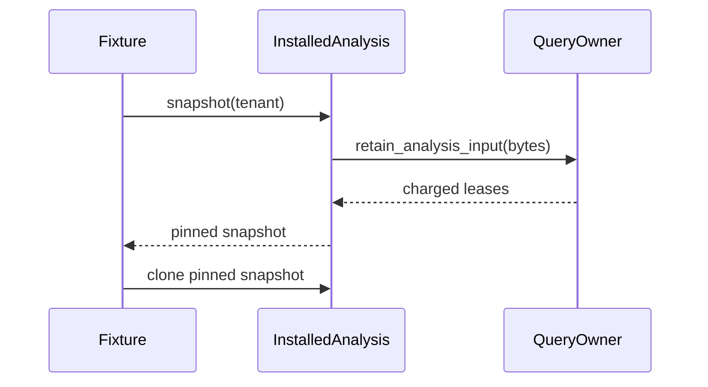

# Araphor Data Test Runtime Review

Review the changes in items 2–5 of the
[runtime reduction plan](araphor-data-test-runtime-reduction.md). The changes
remove repeated fixture preparation and descriptor work. They preserve the
existing test inputs, assertions, production owner calls, and deadlines.

## Intended end state

The complete Data suite runs faster with the same profile and test concurrency.
The complete suite still proves its original contracts. The current source
implements the changes below. Final qualification passed. The complete Data
duration decreased by 767.41 seconds, or 35.56 percent.

## Implementation review flow

[/tmp/araphor-data-diagnostic.json](/tmp/araphor-data-diagnostic.json) An engineer starts the approved diagnostic run
  -> [diagnostic record](/tmp/araphor-data-diagnostic.json) record the source, test binary, host, profile, and selected test names
  -> [cost report](/tmp/araphor-data-cost-report.json) distinguish lock wait from fixture setup and actual evaluation
  -> Partial [cost report](/tmp/araphor-data-cost-report.json) record parent and child costs without counting child time twice
  -> [cost report](/tmp/araphor-data-cost-report.json) rank repeated work by measured cost

[Discovery fixture](../../crates/araphor-data/src/discovery/derive.rs) An engineer changes one read-only fixture
  -> [InstalledAnalysis::snapshot](../../crates/araphor-data/src/package/installed/read.rs) reuse the existing installed snapshot and compiled code facilities
  -> [TraversalFixture](../../crates/araphor-data/src/graph/tests/traversal/fixtures.rs) retain each original computation, input variant, and assertion
  -> [package fixtures](../../crates/araphor-data/src/package/tests/fixture.rs) keep mutable lifecycle and cold-start cases on their original paths
  -> [focused record](/tmp/araphor-data-focused.json) run the affected existing cases before another full workspace run

[focused record](/tmp/araphor-data-focused.json) A fixture change passes focused verification
  -> [descriptor encoding](../../crates/araphor-data/src/package/bundle.rs) select the next correction from the measured cost report
  -> [InstalledSnapshot](../../crates/araphor-data/src/package/installed/snapshot.rs) retain separate authorization, memory accounting, and durable-state owners
  -> [scope boundary](araphor-data-test-runtime-reduction.md) stop if the correction requires a new ownership or trust-boundary design

[current changes](araphor-data-test-runtime-reduction.md) The approved implementation is ready for qualification
  -> [CI source record](/tmp/araphor-data-final-ci-source.json) run the repository Rust CI procedure after the last covered edit
  -> [CI log](/tmp/araphor-data-final-ci.log) obtain the new Data duration from that run
  -> [focused inventory record](/tmp/araphor-data-focused.json) compare the complete test inventory, results, and configuration
  -> [measured result](araphor-data-test-runtime-reduction.md#complete-data-qualification) record the measured improvement and any remaining slow cases

## Owners and lifecycle

The [Discovery fixture](../../crates/araphor-data/src/discovery/derive.rs) and
[graph fixture](../../crates/araphor-data/src/graph/tests.rs) create one pinned
installed snapshot for their immutable package stores. Both fixtures retain
their existing mutexes. The snapshot retains bundles and pins through charged
[query leases](../../crates/araphor-data/src/package/installed/snapshot.rs).
Clones share those leases. Normal evaluation still checks authority and control.
Package update, revocation, freshness, and lifecycle tests keep their separate
fixtures. The changes do not alter quotas or durable store ownership.

The corpus fixture decodes one seed per case, then clones the seed for every
original record. Per-record clocks, identities, variants, and encoding remain
in the loop. The traversal fixture reuses the graph snapshot that
[CommitFixture::new](../../crates/araphor-data/src/graph/tests/native_storage.rs)
already derives for window zero. Traversal still sets the window witness
deadline, replaces subjects and edges, creates the request, and commits every
window. Later windows still derive their distinct inputs.

[Package::descriptor_value](../../crates/araphor-analysis-sdk/src/descriptor.rs)
validates the descriptor and sorts its JSON objects. Both `inspect` and
[interfaces](../../crates/araphor-analysis-sdk/src/bindings.rs) use that value.
Runtime bundle encoding calls `inspect`; author interface generation still
produces WIT and native headers. Descriptor copies remain owned by callers.
Immutable builtin template reuse is not implemented in this slice.

[GraphRows::expected_shape](../../crates/araphor-data/src/analysis/graph_rows/schema.rs)
creates the expected schema with the existing SQL and DuckDB library. A
process-local `OnceLock` stores only successfully decoded immutable rows.
Initialization errors do not enter the cache. Concurrent first callers can
repeat construction. Temporary expected connections close after construction.
Every validation still reads the actual connection and compares its columns
and constraints. Actual store state and validation results are never cached.

## Existing proof route

| Change | Existing Rust tests |
| --- | --- |
| Pinned fixture and seed reuse | `discovery::derive::tests::discovery_derivation_corpus_parity`; the complete Discovery derivation family |
| First traversal window | `graph::tests::traversal::native_traversal_large_graph`; `graph::tests::traversal::recovery::native_traversal_replacement_history`; the traversal family |
| Descriptor encoding | `bindings::tests::declarations_share_descriptor`; `bindings::tests::descriptor_size_is_bounded` in the SDK; `package::tests::wasm::metadata::package_metadata_digest_stable` in Data |
| Expected schema cache | `analysis::graph_rows::tests::schema::native_schema_integrity`; `analysis::graph_rows::tests::schema::native_schema_reopen`; `analysis::graph_migration::tests::recovery::native_recovery_rejects_corruption` |

The integrity test validates a correct connection, rejects its later mutation,
then validates another correct connection. Reopen tests retain their checks
that rejection does not change corrupted database bytes. Final verification
uses [the repository procedure](../../.github/scripts/verify-rust-ci.sh).

## Source and evidence limits

This guide covers HEAD `404d0a78575558975359f6b1dbd886bf70baddeb` plus the
current ten changed Rust files shown in the linked source families. The
[diagnostic record](/tmp/araphor-data-diagnostic.json) covers the frozen
instrumented baseline, not the changed implementation. The
[cost report](/tmp/araphor-data-cost-report.json) has partial child attribution
because child output is captured. One split record retains its numeric fields,
but its thread label is corrupt. Fixture access combines shared initialization
wait and mutex wait when another thread performs initialization. Unmarked work
remains unattributed. Inclusive spans overlap and are not additive suite durations.
Temporary timing markers are removed. No measured savings are claimed.

**Done** for final qualification. The exact source state, complete inventory,
and final CI duration are recorded below.

The focused feature-unified debug run passed 63 SDK tests, six author builder
tests, and 26 Data tests. Data completed in 160.60 seconds. The complete Data
inventory and all 19 ignored classifications are unchanged. The record is
[/tmp/araphor-data-focused.json](/tmp/araphor-data-focused.json).
**Done** for focused qualification. Final repository CI subsequently passed.

The complete Data run passed 614 tests with 19 ignored in 1,390.41 seconds.
The complete inventory remains 633 tests. The baseline was 2,157.82 seconds
with the same debug profile and four test threads. The measured reduction is
767.41 seconds, or 35.56 percent. Host load was not controlled between runs.
The remaining workspace CI subsequently passed. The source recorder confirmed
that covered hashes matched at process exit.

## Final acceptance

The final repository procedure passed with exit 0 at
2026-10-14 17:52:03.212524 UTC. Formatting, workspace checking, strict clippy,
and full workspace tests passed. The 90 parent harnesses reported 2,112 passed,
0 failed, and 568 ignored. Elapsed procedure time was 2,450.85 seconds.
All 1,392 covered Rust, Cargo, and CI file hashes remained unchanged during
the run. The source state remains HEAD `404d0a78575558975359f6b1dbd886bf70baddeb`
plus the ten uncommitted Rust changes.

Read the [source record](/tmp/araphor-data-final-ci-source.json) and
[CI log](/tmp/araphor-data-final-ci.log) for the exact command, hashes, and
results. **Done** for approved changes 1 through 5. Diagnostic child-stage
attribution remains incomplete. No complete-suite speed claim depends on
those missing child records.
