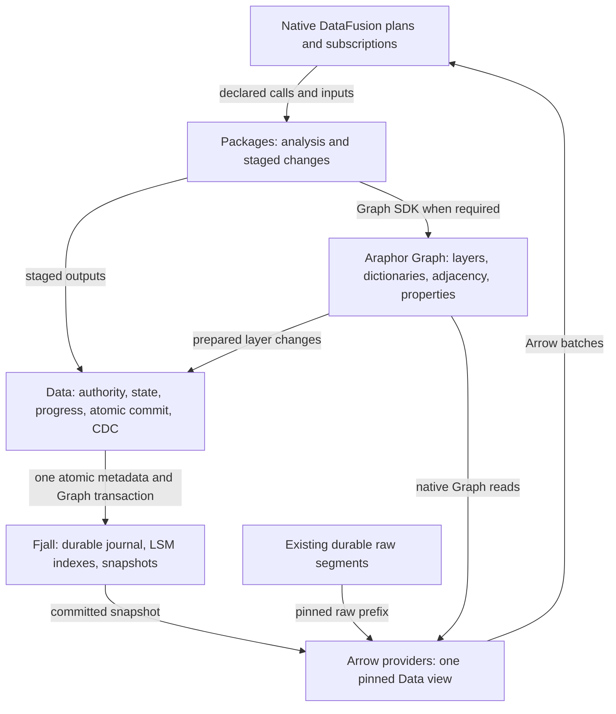

# Log-based Graph storage design

The user selects log-based storage with Graph semantics and native DataFusion
above it. The Graph design must be based on TerminusDB. This selects the
target architecture and supersedes the earlier redb-first recommendation.
This design supports the
[reactive execution plan](araphor-reactive-execution-latency.md#6-select-the-durable-storage-engine).

Architecture direction and implementer/reviewer agreement: **Done**.
Production replacement and performance qualification: **Not done**.
Source review: `87862faa`, 2026-11-05. No new storage code is implemented.

## Intended end state

Data owns one durable log-backed transaction and publishes one committed
view. Araphor Graph owns native Graph layers, dictionaries, membership, and
adjacency. Native DataFusion providers expose the selected view as Arrow
tables. Packages perform analysis and stage Graph changes through the same
SDK whether they are builtin, OCI, or user packages.

Use Fjall as the physical implementation target. It supplies its journal,
LSM storage, snapshots, and atomic transactions. Araphor Graph supplies the
Graph semantics. Keep Graph layer records and property chunks in that same
database transaction as changed heads and Data metadata. This selects one
layout for implementation; no separate Graph head store is required.



## TerminusDB source basis

The checked-out TerminusDB uses `terminus-store` v0.22.0 at
`c72841d6db6045d9b79d8ec1d5cbbe7feac0e962`. Its child layers retain a parent,
new dictionary entries, and sorted additions and removals. The simple builder
resolves temporary dictionary IDs when it seals the layer.
[Layer builder source](https://github.com/terminusdb-org/terminusdb-store/blob/c72841d6db6045d9b79d8ec1d5cbbe7feac0e962/src/layer/simple_builder.rs).

The native builder constructs object and predicate indexes from direct
adjacency. This is the basis for selective traversal in both directions.
Araphor Graph must retain equivalent indexed access for its node and edge
model, including edge identity and typed properties.
[Index builder source](https://github.com/terminusdb-org/terminusdb-store/blob/c72841d6db6045d9b79d8ec1d5cbbe7feac0e962/src/layer/builder.rs).

TerminusDB separates layer construction from named-head publication. Its
named-head operation updates one label; it does not atomically update external
package state or progress. Araphor must retain that separation and make Data's
transaction the only publication boundary.
[Store and head source](https://github.com/terminusdb-org/terminusdb-store/blob/c72841d6db6045d9b79d8ec1d5cbbe7feac0e962/src/store/mod.rs).

Use the layer and index algorithms with Araphor's binary identities, owner
multiplicity, writer scopes, edge IDs, and nested Arrow property schemas.
The complete Terminus triple-store model is not a drop-in representation for
these contracts. Reuse a low-level builder only where it accepts the native
model without another identity or property conversion.

Layer identity does not require hashing for change detection. The pinned
source describes content hashing as a proposal. CDC remains the existing
committed input position.
[Source status](https://github.com/terminusdb-org/terminusdb-store/blob/c72841d6db6045d9b79d8ec1d5cbbe7feac0e962/docs/CONTENT.md).

## Native Graph layout

| Record or index | Owner and meaning |
| --- | --- |
| Layer header | Araphor Graph: immutable layer identity, writer, and parent |
| Dictionary delta | Araphor Graph: new stable node, edge, label, and property identities; parent identities retain their meaning |
| Membership delta | Araphor Graph: owner-scoped additions, updates, and removals; clearing one owner preserves another owner's contribution |
| Property chunks | Araphor Graph: immutable typed Arrow values with stable property coordinates |
| Direct adjacency | Araphor Graph: selected node to outgoing edges and endpoints |
| Reverse adjacency | Araphor Graph: selected node to incoming edges and endpoints |
| Relation and label index | Araphor Graph: selective relation and label access |
| Historical membership index | Araphor Graph: exact membership through the selected writer heads, including application history after restart |
| Published root and result references | Data: the changed Graph heads, metadata state, result references, and input progress that became durable together |

The committed Graph is an indexed layer view. Reading neighbors must use
native adjacency. Applying a layer must validate endpoint and ownership
changes through those indexes. Remove SQL reconstruction from those paths.
Queries must not replay every earlier layer to recover the selected Graph.
Keep logical layer history and indexed membership together.

Generic Graph uses opaque graph, writer, and owner identities. It contains
no package definitions, detector rules, finding selection, notification
routing, or job lifecycle. Data maps admitted package calls to those scopes.
Package code decides which nodes, edges, and properties to change.

Physical keys use stable storage coordinates. Retain original binary keys
and typed properties as values. Complete the dictionary and Arrow chunk
layout before implementation. It must preserve valid existing keys, values,
canonical bytes, and quota behavior without imposing a new public size limit.

## Commit and snapshot flow

```text
An input commits at Data position R
  -> The existing raw owner completes its durable append.
  -> Data publishes the exact committed raw prefix with its metadata root.
  -> Data advances only matching subscription input positions.

A subscription consumes input after its saved position
  -> Query pins one published Data view without acquiring the writer.
  -> Native providers read selected raw, context, or Graph data as Arrow.
  -> The saved DataFusion plan calls the declared packages.
  -> A package can read the pinned Graph and stage changes through its SDK.
  -> Araphor Graph prepares native layer, dictionary, property, and index deltas.

The package step is ready
  -> Data acquires its serialized commit scope.
  -> Data checks live authority, expected state heads, and retained evidence.
  -> Data accepts the recorded input cut; later input remains pending.
  -> One Fjall transaction writes the Graph changes and Data state together.
  -> The transaction completes its required durable sync.
  -> Data publishes the matching native owners and committed view.
  -> Data advances matching CDC input positions.

Commit fails or its durable outcome is uncertain
  -> Data does not acknowledge the input or publish unconfirmed native owners.
  -> Pending Graph changes remain private or roll back.
  -> Recovery restores the exact durable root and step outcome.
  -> Retry uses the recorded committed input position and saved state.
```

The atomic Graph step includes layer records, property chunks, dictionaries,
membership indexes, changed heads, package state, result references, evidence
and context pins, progress, and completion. Package-specific records remain
Data records. Araphor Graph does not acquire package knowledge to store them.

Graph publication and later notification decisions keep their existing
transaction boundaries. Data stores both families in the selected database.
A notification effect still occurs after its durable pending attempt and
outside the writer scope.

Raw-only commits can retain an unchanged metadata root. The existing raw
segments stay authoritative; no second raw payload archive or forced engine
transaction is added to each raw append. A published view binds the metadata
snapshot, exact raw prefix, Graph heads, and file leases. A later metadata
commit publishes the matching new view before it signals consumers.

Engine MVCC protects active snapshots. Durable Graph results still need
application historical keys and references. Subscriptions read retained
application history, not Fjall's internal WAL. Engine maintenance does not
advance a Data input position or decide when evidence expires.

Use `SingleWriterTxDatabase` for the physical transaction scope and explicit
durable persistence. Keep its write transaction inside synchronous Data work.
[Fjall transaction API](https://docs.rs/fjall/latest/fjall/struct.SingleWriterTxDatabase.html),
[write transaction](https://docs.rs/fjall/latest/fjall/struct.SingleWriterWriteTx.html),
[durability](https://docs.rs/fjall/latest/fjall/enum.PersistMode.html).

## DataFusion boundary

SQL parsing, optimization, joins, filters, aggregation, windows, and package
calls stay in native DataFusion. A provider binds the exact Data view and
returns Arrow batches. Provider projection and supported index access reduce
storage work; DataFusion evaluates the remaining query expressions.
[Provider contract](https://datafusion.apache.org/library-user-guide/custom-table-providers.html).

Graph analysis remains package code. A package can use native Graph facilities
without expressing its algorithm in SQL. Builtin and OCI packages receive the
same Graph behavior through the existing SDK and transaction scope.

## Replacement scope and proof

Replace the DuckDB-backed Graph store in
[araphor-graph](../../crates/araphor-graph/src/store.rs), including dictionary,
property, layer, membership, and endpoint SQL. Keep its native public Graph
contracts and stage semantics. Replace the corresponding durable operations
in [Data](../../crates/araphor-data/src/analysis/mod.rs), including managed
state, contexts, finding projections, notification state, source metadata,
validation, retention, backup, and recovery. Remove the old authoritative
path when the selected replacement covers these owners.

The next concrete design work is the binary key/chunk layout and the published
view mechanism. Specify their ownership, memory charges, and recovery before
production edits. Do not add a permanent multi-backend framework or retain a
second Graph head authority to make an incremental cutover appear atomic.

Qualification must preserve new input after capture, shared ownership,
historical reads, exact replay, rollback, uncertain commits, revocation,
retention, backup, and restart. The unchanged incident case remains the
end-to-end timing target. Do not change its inputs, assertions, or timeouts.
This design record adds no benchmark or runtime workload.

The current final later managed commit is about 961 milliseconds; its final
durable commit call is about 52 milliseconds. The implementation must remove
the SQL storage request work as well as replace the engine. No engine gain,
100-millisecond creation result, or 100-fold result is established.

Review evidence: `/tmp/araphor-log-graph-storage-review-20261105.json`.
