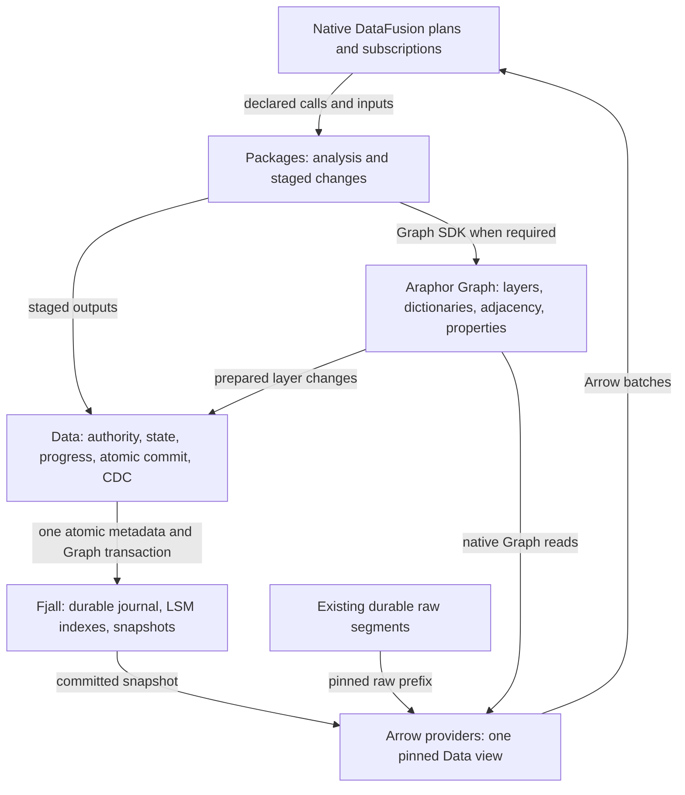

# Log-based Graph storage design

The [2026-11-09 integration research](../research/araphor-fjall-integration.md)
maps this design to the completed engine forks and current production source.
Its native history and original-journal CDC supersede the stock-Fjall limits
below. Production replacement and incident timing proof remain not done.

## Production integration status, 2026-11-09

The active user goal approves the complete production migration described in
the integration research. The full migration and the unchanged incident's
100-fold and sub-100 ms targets remain **Not done**.

The implementer and reviewer agree on exact revision stamping before editing.
Fjall `cceaa84` adds `BranchWriteTransaction::commit_stamped`. Stamped references,
ordinary values, deletes, and the branch head share one durable batch. The two
new native tests check exact receipts, an intervening raw native write, original
journal contents, unchanged state after rejected input, and historical values
after compaction and reopen. The caller can save Data and Graph layer cut indexes
without a second commit. The production Data store does not use the API yet.

Focused checks pass: Fjall with CDC 137 tests and one ignored; without CDC 87
tests and one ignored; 86 documentation tests; formatting; library clippy with
existing warnings. Commands and logs remain under
`output/araphor-fjall-migration-20261109/`. No speed comparison or full workspace CI
runs for this API change. Result: **Done for the engine API; migration not done**.

The unchanged retained incident control is qualified again before migration.
The sandbox attempt stops with `Operation not permitted`. The native rerun
passes in 27.88 harness seconds and 27.918 process seconds. Its three
collector-receipt-to-creation intervals are 1.622800, 2.944508, and 3.279012
seconds. The existing boundary script checks 18 input receipts, three first
durable notifications, and their exact incident revisions. Public notification
receipt takes 1.771028, 3.267507, and 3.628382 seconds; that is a different
boundary. The raw log, command, binary identity, and checked boundary report
remain in that output directory. This is one pre-migration qualification run,
not a performance comparison or a speedup result.

The agreed native Graph participant and its first package PoC caller are
implemented. The optional owner borrows native snapshots and a transaction.
The caller alone commits and publishes. Native historical views replace manual
membership intervals. Scoped dictionaries, property chunks, layer parents,
member and adjacency indexes, endpoint validation, and memory leases stay in
Araphor Graph. The Fjall branch condition now uses that owner. Other benchmark
conditions keep their existing control adapters. The native target has no
active-member pointer duplicate, in-memory revision authority, or copied change
log. Source and output wakes still walk original journals.

The [native Graph qualification](../../crates/araphor-graph/examples/storage_poc/results/native-graph-2026-11-09/README.md)
records six passing owner tests, clippy, feature-off and changed-file format
checks, the unchanged combined cases, and the unchanged stable/history cases.
Four alternating pairs have 112 ordinary target samples per version.
Median/p95/maximum cycle times change from 4.445/7.323/7.766 ms to
7.669/13.697/15.413 ms. This is a slowdown, not a performance improvement.
The new participant performs production Graph checks and reconstructs the
PoC's semantic change assertions from two native historical views.
The complete measured interval retains that result-read work.

Result: **Done for the optional native participant and its PoC caller**.
The production Data caller, complete atomic state replacement, log-reader
routing, notifications, and incident performance acceptance remain **Not done**.
The old production store remains the only authority until all Data transaction
families can switch together. No live dual writes or SQL emulation are used.

The optional native Data metadata owner and its existing package PoC caller are
now [qualified](../../crates/araphor-graph/examples/storage_poc/results/native-data-2026-11-09/README.md).
Data owns the engine, private directory lease, revision allocator, exact cut
index, and published metadata view. All native PoC source, output, and checkpoint
writes use this owner. Physical immutable context records replace its old
separate state records. Initialization uses Data revision 0, as the existing
Data API requires. Graph fixture cuts remain separate from allocated Data
revisions. Failed commits stop captures and writes until reopen.

Five integration cases and the unchanged package PoCs pass. Four alternating
pairs contain 112 ordinary target samples per version. Median/p95/maximum
cycle times change from 7.371/12.702/14.584 ms to 7.225/13.049/13.258 ms.
These small mixed differences establish no repeatable performance gain.
The Data unit-test target fails to build unchanged legacy fixtures. Clippy
stops on unchanged legacy calls. Full CI does not run during iteration.

Result: **Done for the optional native metadata owner and its PoC caller**.
The complete raw/native view, production admission, remaining Data families,
log routing, notifications, retention, backup, and incident targets remain
**Not done**. Read the [source review guide](../guides/araphor-native-data-review.md).

Current Data initialization now uses one complete Graph schema factory. The
previous expected schema omitted seven engine tables and the canonical fact
index. The public `store_schema` regression passes open and reopen, and still
rejects an unexpected Graph table. The table definitions and strict comparison
stay unchanged. Result: **Done for the initialization correction**. This is
not an engine migration or a measured performance improvement.

The shared raw metadata root is now qualified. `RawJournal` uses persistent
ordered maps and publishes a prepared root after the existing durable append.
Source-range reads scan captured roots outside the raw lock. Three public raw
cases, five native cases, and the strict schema case pass. The feature-off build
also passes. The unchanged incident passes in 23.90 harness seconds. Collector
receipt to durable creation takes 683.475, 1,161.203, and 1,432.475 milliseconds.
This single run uses a different DuckDB link override from the older control;
no performance gain is established. See the
[qualification](../research/results/araphor-raw-index-2026-11-09.md).
Result: **Done for shared raw metadata**. The combined raw/native Data view,
production replacement, CDC routing, and incident targets remain **Not done**.

The default-limit native Data owner now publishes a combined raw/native view.
Raw-only input advances the public revision without a Fjall commit. Metadata
writes validate the previous metadata head and save pending raw controls in the
same native batch. Historical reads preserve their requested revision and use
source ranges at that bound. Sixteen focused integration cases and the
feature-off build pass. See the
[native raw qualification](../research/results/araphor-native-raw-2026-11-09.md).
Result: **Done for the default-limit native raw view and Evidence/coverage
storage**. Configured capacity, required-input and witness accounting,
diagnostics, managed admission, lifecycle, routing, retention, backup, and
production cutover remain **Not done**. The incident performance target is
unchanged.
The unchanged incident also passes in 15.70 harness seconds. Its three
collector-receipt-to-creation intervals are 552.131, 821.473, and 1,030.054
milliseconds. This single shared-paging qualification establishes no speedup.
Production still uses DuckDB, and both incident latency targets remain
**Not done**.

Native package/image and definition admission and reads now use the existing
artifact types, callbacks, exact pins, and canonical definition bytes. Latest
retries use a point read; older retries scan one definition name. Recovery
checks immutable records and the exact latest pointer sets. Twenty-four
focused cases and the feature-off build pass. Read the
[catalogue qualification](../research/results/araphor-native-catalogue-2026-11-09.md).
Result: **Done for native catalogue admission and reads**. Collection,
uninstall reclamation, capacity accounting, qualified context/fact admission,
managed lifecycle, and production routing remain **Not done**. Production
still uses DuckDB. No incident performance gain is established.

The native context owner now stages qualified contexts and canonical fact
indexes in its existing transaction. It preserves guarded callbacks, exact
retry references, checked heads, scoped interning, retained package proof,
imported history, and notification DTO admission. Thirty-four focused cases
and the feature-off build pass. Read the
[context qualification](../research/results/araphor-native-context-2026-11-09.md).
Result: **Done for default-limit native context admission and fact-index
staging**. Context providers, managed attempts/results, notification lookups
and effects, configured capacity, collection, and production routing remain
**Not done**. Production still uses DuckDB. No incident gain is established.

Native managed admission and ordinary start/stop now preserve the current
specification, grant, pins, lifecycle CAS, no-op callbacks, and host lease.
Graph mappings, declarations, immutable versions, authority, and call heads
share one Data transaction. Read the
[managed qualification](../research/results/araphor-native-managed-2026-11-09.md).
Result: **Done for native managed admission and ordinary start/stop**.
Native Arrow extraction now reads actual Evidence, coverage, and admitted
contexts from one captured native/raw view. The context owner stages body-free
tenant and owner headers with immutable values. Exact native ranges bound change
reads; existing builders preserve Arrow rows, consumed positions, witnesses,
and references. Read the
[extraction qualification](../research/results/araphor-native-extraction-2026-11-09.md).
Result: **Done for native Arrow source extraction**.
Native capture now uses the actual Arrow page and shared sealing contract.
Attempts, live claims, terminal outcomes, failure status, and interrupted
frontier settlement use one native Data transaction per transition. Read the
[attempt qualification](../research/results/araphor-native-attempts-2026-11-09.md).
Shared output, checkpoint, domain, and receipt validation passes the unchanged
incident on the DuckDB production path. Read the
[shared validation qualification](../research/results/araphor-shared-publication-2026-11-09.md).
Result: **Done for the shared validation change**. At that qualification,
native successful publication was **Not done**. Matched production performance
improvement remains **Not done**.
Result: **Done for native capture and terminal attempts**. At that qualification,
prior-result restore, results/checkpoints, and atomic consumed progress were
**Not done**.

The optional native Selected publication boundary is now
[qualified](../research/results/araphor-native-publication-2026-11-09.md).
Data commits actual results, checkpoints, context imports, references, Graph
changes, findings, call heads, completion, and consumed progress in one batch.
It publishes the exact view before cache promotion and the existing availability
wake. Seventy focused Data tests pass, including successful cold resume,
canonical finding reuse, and corrupt import/proof/index recovery. The unchanged
production incident passes for the shared checks. It still uses DuckDB and
establishes no matched speedup.
Result: **Done for the optional native Selected boundary**. Other destination
owners, production provider binding, original-log routing, indexed source-header
maintenance, attempt-dependent lifecycle, production activation, notification
batching, configured capacity, retention, backup, cutover, and removal remain
**Not done**. Both incident performance targets remain **Not done**.

The optional native result owner now reads metadata and historical replay
through one captured view. It restores saved checkpoints before Arrow row
allocation. Indexed raw predecessors preserve historical freshness after later
appends and reopen. Seventy-three focused Data cases pass. Read the
[result-read qualification](../research/results/araphor-native-result-reads-2026-11-09.md).
Result: **Done for optional native result reads**. Production provider binding,
original-log routing, notification batches, capacity, retention, backup, cutover,
removal, and both incident performance targets remain **Not done**.

The user selects log-based storage with Graph semantics and native DataFusion
above it. The Graph design must be based on TerminusDB. This selects the
target architecture and supersedes the earlier redb-first recommendation.
This design supports the
[reactive execution plan](araphor-reactive-execution-latency.md#6-select-the-durable-storage-engine).

Architecture direction and implementer/reviewer agreement: **Done**.
Production replacement and performance qualification: **Not done**.
Historical source review: `87862faa`, 2026-11-05. No new storage code was
implemented at that source state. The current participant result is above.

## Intended end state

Data owns one durable log-backed transaction and publishes one committed
view. Araphor Graph owns native Graph layers, dictionaries, membership, and
adjacency. Native DataFusion providers expose the selected view as Arrow
tables. Packages perform analysis and stage Graph changes through the same
SDK whether they are builtin, OCI, or user packages.

Use Fjall as the physical implementation target. It supplies its journal,
LSM storage, snapshots, and atomic transactions. Araphor Graph supplies the
Graph semantics. Keep Graph layer records and property chunks in that same
database transaction as changed heads and Data metadata. This selects one
layout for implementation; no separate Graph head store is required.



## TerminusDB source basis

The checked-out TerminusDB uses `terminus-store` v0.22.0 at
`c72841d6db6045d9b79d8ec1d5cbbe7feac0e962`. Its child layers retain a parent,
new dictionary entries, and sorted additions and removals. The simple builder
resolves temporary dictionary IDs when it seals the layer.
[Layer builder source](https://github.com/terminusdb-org/terminusdb-store/blob/c72841d6db6045d9b79d8ec1d5cbbe7feac0e962/src/layer/simple_builder.rs).

The native builder constructs object and predicate indexes from direct
adjacency. This is the basis for selective traversal in both directions.
Araphor Graph must retain equivalent indexed access for its node and edge
model, including edge identity and typed properties.
[Index builder source](https://github.com/terminusdb-org/terminusdb-store/blob/c72841d6db6045d9b79d8ec1d5cbbe7feac0e962/src/layer/builder.rs).

TerminusDB separates layer construction from named-head publication. Its
named-head operation updates one label; it does not atomically update external
package state or progress. Araphor must retain that separation and make Data's
transaction the only publication boundary.
[Store and head source](https://github.com/terminusdb-org/terminusdb-store/blob/c72841d6db6045d9b79d8ec1d5cbbe7feac0e962/src/store/mod.rs).

Use the layer and index algorithms with Araphor's binary identities, owner
multiplicity, writer scopes, edge IDs, and nested Arrow property schemas.
The complete Terminus triple-store model is not a drop-in representation for
these contracts. Reuse a low-level builder only where it accepts the native
model without another identity or property conversion.

Layer identity does not require hashing for change detection. The pinned
source describes content hashing as a proposal. CDC remains the existing
committed input position.
[Source status](https://github.com/terminusdb-org/terminusdb-store/blob/c72841d6db6045d9b79d8ec1d5cbbe7feac0e962/docs/CONTENT.md).

## Native Graph layout

| Record or index | Owner and meaning |
| --- | --- |
| Layer header | Araphor Graph: immutable layer identity, writer, and parent |
| Dictionary delta | Araphor Graph: new stable node, edge, label, and property identities; parent identities retain their meaning |
| Membership delta | Araphor Graph: owner-scoped additions, updates, and removals; clearing one owner preserves another owner's contribution |
| Property chunks | Araphor Graph: immutable typed Arrow values with stable property coordinates |
| Direct adjacency | Araphor Graph: selected node to outgoing edges and endpoints |
| Reverse adjacency | Araphor Graph: selected node to incoming edges and endpoints |
| Relation and label index | Araphor Graph: selective relation and label access |
| Historical membership index | Araphor Graph: exact membership through the selected writer heads, including application history after restart |
| Published root and result references | Data: the changed Graph heads, metadata state, result references, and input progress that became durable together |

The committed Graph is an indexed layer view. Reading neighbors must use
native adjacency. Applying a layer must validate endpoint and ownership
changes through those indexes. Remove SQL reconstruction from those paths.
Queries must not replay every earlier layer to recover the selected Graph.
Keep logical layer history and indexed membership together.

Generic Graph uses opaque graph, writer, and owner identities. It contains
no package definitions, detector rules, finding selection, notification
routing, or job lifecycle. Data maps admitted package calls to those scopes.
Package code decides which nodes, edges, and properties to change.

Physical keys use stable storage coordinates. Retain original binary keys
and typed properties as values. The layout below preserves valid existing
keys, values, canonical bytes, and quota behavior. Physical fragmentation
does not impose a new public size limit.

### Physical records and access

Keep the current unsigned 64-bit graph, writer, relation, entity, owner,
label, layer, and property references. Encode integer key fields in big-endian
order so Fjall prefix and range reads have the required order. A record-kind
prefix separates records within a keyspace. Data owns database and keyspace
handles; Araphor Graph operates through the transaction supplied by Data.

| Key fields after record kind | Value or access |
| --- | --- |
| Layer | Writer, parent layer, and Data revision |
| Writer, Data revision | Layer; seek the last entry at or before the requested revision |
| Layer, change ordinal | Immutable membership addition or removal and its member reference |
| Writer, owner, relation, entity, opened revision | Member properties, endpoints, and optional closed revision |
| Relation, entity, writer, owner, opened revision | Historical member reference |
| Relation, source entity, writer, owner, edge entity, opened revision | Outgoing historical member reference |
| Relation, target entity, writer, owner, edge entity, opened revision | Incoming historical member reference |
| Relation, label, writer, owner, edge entity, opened revision | Label member reference |
| Writer, owner, relation, entity | Current member reference for owner clears and updates |
| Relation, entity | Current node contribution count for endpoint checks |
| Relation, property reference | Property chunk and row coordinates |
| Relation, chunk, fragment ordinal | Arrow IPC bytes for immutable properties |

The membership interval keeps the current rule: a member is visible when its
opened revision is at or before its selected writer head, and its closed
revision is absent or after that head. Index postings select candidate
members. The membership record supplies the interval and property reference.
An index update does not change an immutable layer's recorded changes.

Apply all additions and removals to the pending transaction before endpoint
validation. Update node contribution counts for the complete delta. Check new
edges and edges incident to changed nodes through adjacency indexes. A removed
contribution must not remove an endpoint that another owner still supplies.
Retain historical postings while retained results can select their intervals.

Dictionary lookup uses exact bytes. Its scope is the current writer for
owners, relation for entities, and graph for labels. A physical dictionary
key contains the dictionary kind, scope, parent fragment reference, and a
binary key fragment. Its value contains a stable fragment reference. A
terminal reference identifies the complete original key. Store that original
key under its terminal reference for reverse lookup.

An ordinary key needs one dictionary lookup. A key that exceeds Fjall's key
width uses successive fragments under the preceding reference. Derive the
fragment size from the engine key width less the encoded key header. Empty
keys have one empty terminal fragment. A terminal can also be the parent of
a longer key. Compare complete fragments; no hash or truncated key establishes
equality. Allocate new references in the same transaction as their first use.

Keep the existing `(relation, property_ref)` logical identity. Its storage
mapping selects an immutable Arrow chunk and row. Keep the staged RecordBatch
in Arrow through preparation and live publication. Encode its durable chunk
once with the existing Arrow IPC implementation. Split the byte stream only
where the engine value width requires it. Read the fragments as one IPC
stream. No JSON row conversion or durable package output batch is added.
Retain the existing relation schema and canonical property values.

## Commit and snapshot flow

```text
An input commits at Data position R
  -> The existing raw owner completes its durable append.
  -> Data publishes the exact committed raw prefix with its metadata root.
  -> Data advances only matching subscription input positions.

A subscription consumes input after its saved position
  -> Query pins one published Data view without acquiring the writer.
  -> Native providers read selected raw, context, or Graph data as Arrow.
  -> The saved DataFusion plan calls the declared packages.
  -> A package can read the pinned Graph and stage changes through its SDK.
  -> Araphor Graph prepares native layer, dictionary, property, and index deltas.

The package step is ready
  -> Data acquires its serialized commit scope.
  -> Data checks live authority, expected state heads, and retained evidence.
  -> Data accepts the recorded input cut; later input remains pending.
  -> One Fjall transaction writes the Graph changes and Data state together.
  -> The transaction completes its required durable sync.
  -> Data publishes the matching native owners and committed view.
  -> Data advances matching CDC input positions.

Commit fails or its durable outcome is uncertain
  -> Data does not acknowledge the input or publish unconfirmed native owners.
  -> Pending Graph changes remain private or roll back.
  -> Recovery restores the exact durable root and step outcome.
  -> Retry uses the recorded committed input position and saved state.
```

The atomic Graph step includes layer records, property chunks, dictionaries,
membership indexes, changed heads, package state, result references, evidence
and context pins, progress, and completion. Package-specific records remain
Data records. Araphor Graph does not acquire package knowledge to store them.

Graph publication and later notification decisions keep their existing
transaction boundaries. Data stores both families in the selected database.
A notification effect still occurs after its durable pending attempt and
outside the writer scope.

Raw-only commits can retain an unchanged metadata root. The existing raw
segments stay authoritative; no second raw payload archive or forced engine
transaction is added to each raw append. A published view binds the metadata
snapshot, exact raw prefix, and Graph heads. A finite read scope holds the
file lease. A later metadata
commit publishes the matching new view before it signals consumers.

### Published Data view

Data holds an `Arc` to the current view behind a short publication lock. The
view contains the Fjall Snapshot, Data revision, and immutable raw index root.
Graph heads come from that same snapshot. The engine sequence number does
not replace the Data revision or input position. A raw-only publication can
advance the view's Data revision while it retains the same metadata snapshot.
Return that view revision in read metadata; do not return an older catalog
revision as the captured input cut.
[Snapshot implementation](https://github.com/fjall-rs/fjall/blob/3.1.13/src/snapshot.rs).

The raw index root uses a mature persistent ordered map. An append changes
only paths for affected source receipts, journal entries, segment ends, and
cursor ranges. An unchanged branch is shared. Do not clone the complete raw
catalog for an input. Reconstruct this index from the current durable raw
format during recovery; no new raw payload format is required.

The serialized Data writer prepares the next raw index root before it makes
the durable append or metadata commit. After success, it creates the matching
engine snapshot when required and replaces the published view. Native Graph
cache entries are visible only through a committed view. Consumers receive
CDC signals after this publication. No reader opens a fresh engine snapshot
outside the published view.

A finite Data read first acquires the existing maintenance read lease, then
clones the published view. This does not acquire the Data writer or project
raw entries into a SQL catalog. Raw reads obey that view's exact committed
segment ends. The maintenance lease prevents retention or recovery from
removing files during the read. Release it when capture finishes. A saved
subscription, Graph view, or inactive engine snapshot does not retain that
file lease. Existing application evidence pins protect retained step inputs.
The bounded AppendRead can keep its existing selected RawRead across pages.
It still checks the current replay floor and holds the per-page maintenance
lease. The published root does not pin every raw segment for a subscription.

Retention and recovery acquire the Data writer, then the maintenance write
lease. They finish existing finite reads before changing available raw
ranges. Normal metadata commits and appends without rotation do not need
that exclusive maintenance lease. Keep
this lock order; a reader must not wait for the writer while it holds a
maintenance read lease.

Raw rotation and sealing retain their existing maintenance write scope.
Resolve physical segment names from stable segment IDs at read time. A
published raw descriptor must not retain an obsolete open-file path after
rotation.

Charge new raw index nodes, dictionary fragments, Graph delta/index entries,
Arrow chunk buffers, and published-view storage to their existing owners
before allocation. Shared nodes and Arrow buffers have one retained charge
until their last reference is released. Release private charges on rollback.
Configure Fjall caches and write buffers from the existing storage resource
contract. Do not add an independent public quota.

After an uncertain commit, stop writes and new captures until recovery
rebuilds the published view from the durable database and raw log. Recovery
must preserve the current accepted-revision and state checks. A Graph cache
or pending view cannot decide whether a commit became durable.

Engine MVCC protects active snapshots. Durable Graph results still need
application historical keys and references. Subscriptions read retained
application history, not Fjall's internal WAL. Engine maintenance does not
advance a Data input position or decide when evidence expires.

Use `SingleWriterTxDatabase` for the physical transaction scope and explicit
durable persistence. Keep its write transaction inside synchronous Data work.
[Fjall transaction API](https://docs.rs/fjall/latest/fjall/struct.SingleWriterTxDatabase.html),
[write transaction](https://docs.rs/fjall/latest/fjall/struct.SingleWriterWriteTx.html),
[durability](https://docs.rs/fjall/latest/fjall/enum.PersistMode.html).

## DataFusion boundary

SQL parsing, optimization, joins, filters, aggregation, windows, and package
calls stay in native DataFusion. A provider binds the exact Data view and
returns Arrow batches. Provider projection and supported index access reduce
storage work; DataFusion evaluates the remaining query expressions.
[Provider contract](https://datafusion.apache.org/library-user-guide/custom-table-providers.html).

Graph analysis remains package code. A package can use native Graph facilities
without expressing its algorithm in SQL. Builtin and OCI packages receive the
same Graph behavior through the existing SDK and transaction scope.

## Replacement scope and proof

Replace the DuckDB-backed Graph store in
[araphor-graph](../../crates/araphor-graph/src/store.rs), including dictionary,
property, layer, membership, and endpoint SQL. Keep its native public Graph
contracts and stage semantics. Replace the corresponding durable operations
in [Data](../../crates/araphor-data/src/analysis/mod.rs), including managed
state, contexts, finding projections, notification state, source metadata,
validation, retention, backup, and recovery. Remove the old authoritative
path when the selected replacement covers these owners.

The binary key/chunk layout and published-view mechanism above define the
replacement boundaries. Implementation and qualification remain **Not done**.
Do not add a permanent multi-backend framework or retain a
second Graph head authority to make an incremental cutover appear atomic.

Qualification must preserve new input after capture, shared ownership,
historical reads, exact replay, rollback, uncertain commits, revocation,
retention, backup, and restart. The unchanged incident case remains the
end-to-end timing target. Do not change its inputs, assertions, or timeouts.
This design record adds no benchmark or runtime workload.

The current final later managed commit is about 961 milliseconds; its final
durable commit call is about 52 milliseconds. The implementation must remove
the SQL storage request work as well as replace the engine. No engine gain,
100-millisecond creation result, or 100-fold result is established.

Review evidence: `/tmp/araphor-log-graph-storage-review-20261105.json` and
`/tmp/araphor-log-graph-layout-review-20261105.json`.

## Historical storage screen: 2026-11-05

The user requests a separate small redb and Fjall comparison. This bounded
generic storage screen is **Done**. The user then requests actual package
traversal scenarios. That separate qualification is recorded below.
Production replacement and complete notification
latency qualification remain **Not done**. The earlier source review above
precedes this experiment.

The [screen results](../../crates/araphor-graph/examples/storage_poc/results/2026-11-05/environment.json)
at source `dcf84a041` use the incident trace's eight Graph write sizes and production property
schemas. They compare the existing GraphStore with one native Graph
algorithm on redb and Fjall. State and progress records are synthetic. Raw
capture, full Data validation, packages, DataFusion execution, and notification
creation are outside the measurement.

Two fully optimized passes each use six engine orders. All historical-view,
value, metadata, rollback, and reopen checks pass. Paired median write gains
over GraphStore are 7.90 and 12.71 times for redb, and 9.26 and 14.54 times
for Fjall. Fjall has the lower write total in all 12 paired rounds. redb has
the lower read total in 11 rounds. The record retains both passes and their
host variation. This result includes the native Graph owner rewrite. It
does not isolate the physical engine gain over DuckDB or prove the complete
incident target.

## Actual package Graph scenario result: 2026-11-05

The user requires the package's actual dependent traversal and changes.
This separate PoC qualification is **Done** at Rust source `65d655ec8`.
The PoC runs the existing Causal index and detect exports through SDK input
and output checks. It supplies the incident's resolved source Arrow and
feeds the actual returned frontier into detection. It adds no SQL operator
or production Graph implementation.

The eight cycles perform 27 dependent neighbor reads in both directions,
owner clears, actual node/edge/finding staging, 194 additions, and eight
closures. All 18 optimized engine runs pass exact runtime traversal-key,
frontier, finding-value, metadata, history, rollback, and reopen checks.
The [guide and retained results](../../crates/araphor-graph/examples/storage_poc/README.md#recorded-scenario-result-2026-11-05)
give the source reading route, commands, host limits, and raw samples.

Median complete eight-cycle totals are 448.29 milliseconds for current
GraphStore, 35.92 for native Graph on redb, and 35.39 for native Graph on
Fjall. Median paired gains are 12.54 and 12.73 times. The 27 neighbor reads
take 2.32, 2.87, and 3.88 milliseconds. Current GraphStore's member cache
therefore has the lower traversal time in this fixture. The main gain comes
from mutation and view capture. The close redb/Fjall complete-scenario totals
do not establish a meaningful overall engine winner.

Production replacement, native DataFusion input execution, complete Data
authority and evidence checks, and notification creation remain outside
this comparison. The complete incident timing target remains **Not done**.

## Local append-only store comparison: 2026-11-05

The user requests a home-grown storage backend in the same PoC. This bounded
implementation and comparison are **Done** at source `1a367e567`. The backend
uses one append-only transaction log and an immutable ordered in-memory index.
It has no embedded database dependency. It uses the same native Graph layout,
actual Causal package code, eight input increments, traversal, and assertions
as redb and Fjall. No production Rust source changes.

Each write copies the index, applies private changes, and records each key's
final put or delete. Commit appends one checksummed frame, calls `sync_all`,
then publishes the new index root. Read scopes keep their prior immutable
root. Abort appends nothing. Reopen checks and replays complete frames and
truncates only an incomplete final frame. A complete corrupt frame makes open fail.
An append or sync error stops new reads and writes until reopen. Application
revision keys retain Graph history and change records; physical log offsets
do not replace input positions.

All 32 optimized runs pass exact runtime traversal-key, frontier, finding,
evidence, delta, metadata, history, rollback, and reopen checks. Three focused
storage tests pass. Eight balanced rounds give median eight-cycle totals of
410.11 milliseconds for current GraphStore, 32.61 for redb, 30.47 for Fjall,
and 29.77 for the local log. The local log's median paired gain over current
GraphStore is 14.00 times. This gain includes the native Graph rewrite.
The local log and Fjall totals do not establish an overall winner.

The local log's 27 neighbor reads take 2.189 milliseconds. Its eight writes
take 13.58 milliseconds. Reopen, including log replay and Arrow cache restore,
takes 4.07 milliseconds. The local log occupies 1,030,813 logical bytes after
close; Fjall occupies 412,832 bytes with default compression. The local store
has no compression. The [guide and retained results](../../crates/araphor-graph/examples/storage_poc/README.md#local-store-scenario-result-2026-11-05)
give the source route, exact commands, raw samples, and reviewed calculations.

The local store retains all physical keys and values in memory, including
historical Graph keys. Each write copies the full index. The log has no
compaction, reclamation, or checkpoint, and reopen replays the full log.
Incomplete-tail checks do not qualify power-loss recovery. This small PoC
does not qualify storage growth or memory use. Production replacement,
complete Data and DataFusion execution, notification creation, and the
complete incident timing target remain **Not done**.

## Background compaction pilot: 2026-11-05

The sustained driver is implemented at source `644ab7540`. It repeats the
same eight Causal package steps in one growing database with advancing
revisions and retained history. It uses default Fjall memory-table and
leveled-compaction settings. It does not call manual flush or major
compaction. Native trace messages identify successful physical merges;
Fjall's completed-attempt counter also counts no-op strategy checks.

The last logged milestone has 288 repeats and one successful physical merge
on the first Fjall pass. Cycle assertions pass through that milestone.
The agent interrupts this run to prioritize the user's later SurrealKV
benchmark request. The process does not emit its in-memory samples or events.
Final historical cuts, rollback, reopen, and the paired redb passes do not
complete. No compaction timing distribution or engine winner is established.
The [pilot record](../../crates/araphor-graph/examples/storage_poc/results/compaction-pilot-2026-11-05/pilot.json)
preserves the exact source, command, observed milestone, and limits.
Sustained compaction qualification remains **Not done**.

## SurrealKV package scenario comparison: 2026-11-05

The user requests SurrealKV in the same package workload and excludes
SlateDB from this benchmark. The SurrealKV adapter and bounded comparison
are **Done** at source `f4717056d`. The adapter uses released SurrealKV 1.2.0,
native read-only and read/write transactions, native ordered iteration,
`Durability::Immediate`, and explicit awaited shutdown. It uses the same
Graph layout and actual Causal package code as redb and Fjall.

All 18 measured runs pass exact runtime traversal keys, frontiers, finding
values, evidence, Graph deltas, metadata, retained history, rollback, close,
and reopen checks. All five focused release tests pass. The unchanged
four-engine qualification also passes all 32 runs; its timings are excluded
because it overlaps an IDE Cargo check. The measured run starts after the
host compiler process check returns no active compilers.

Median eight-cycle totals are 28.70 milliseconds for redb, 26.91 for Fjall,
and 27.27 for SurrealKV. Write totals are 14.54, 11.75, and 13.24 milliseconds.
The 27 neighbor reads take 2.293, 2.921, and 2.313 milliseconds. Fjall writes
faster than SurrealKV in all six paired rounds; SurrealKV traverses faster.
Their paired complete-scenario ratio has a median of 0.9964. This close
result does not establish a meaningful overall performance winner.

The [guide and retained results](../../crates/araphor-graph/examples/storage_poc/README.md#surrealkv-scenario-result-2026-11-05)
give the source route, native transaction boundary, commands, raw samples,
and reviewed calculations. SurrealKV engine versioning is disabled; the same
application revision keys retain Graph history for all compared engines.
This result does not qualify native temporal APIs or their retention policy.
Sustained compaction, large Graphs, production replacement, complete Data and
DataFusion execution, notification creation, and the complete incident timing
target remain **Not done**.


## Neon crates and retained Graph cuts

The user requests a benchmark with the cloned Neon crates and Graph revision
history for all compared engines. The implementer and reviewer agree on the
bounded adapter and historical package replay. Direction is **Done**.
Build, focused runtime proof, and the bounded measured comparison are **Done**.

Use the real Neon delta-layer writer, disk index, and blob reader. Name this
candidate `neon-layers`. Include each durable layer flush and directory sync
in the transaction timing. Keep the variable-key catalog in the same native
layer as the Graph changes. Do not describe the adapter as production Neon
WAL, quorum, remote storage, or compaction performance.

Keep the same eight package commits. After later writes and after reopen,
read the original captured cuts backward and forward. Compare the actual
package's staged Arrow commands, traversal keys, and frontier with its
original evaluation. Do not commit historical evaluations. Compare the
existing engines, an additional SurrealKV native-history variant, and the
Neon layer adapter in balanced orders. Native SurrealKV history uses explicit
Graph timestamps and soft tombstones. Its ordinary range API is not a
historical range API.

The [implementation route](../../crates/araphor-graph/examples/storage_poc/README.md#neon-layers-and-graph-revision-benchmark)
records owners, native calls, lifecycle, and qualification limits. No
production storage or subscription owner changes.


### Retained comparison result

The measured source is `3b6a3c51d`. All 98 runs, 784 primary package cycles,
and 3,136 historical package evaluations pass. All eight focused release
tests pass. Every engine receives the same eight original commits, inputs,
Graph deltas, findings, and historical cuts. Historical evaluations run after
later writes and after reopen in both directions. Exact staged Arrow values,
clear sequences, traversal keys, and frontiers are compared at runtime.

Median eight-cycle times are 24.30 milliseconds for Fjall and 76.25 for the
Neon layer adapter. The 16 historical evaluations after reopen take 23.94
and 116.67 milliseconds. The corresponding paired costs are 3.13 and 4.86
times Fjall. The adapter's Graph traversal path dominates its extra cost.
The adapter flushes each transaction to a durable native layer. This result
does not measure production Neon WAL batching or quorum performance.

SurrealKV application history takes 23.90 milliseconds for eight cycles and
28.75 for 16 historical evaluations after reopen. Native history takes 30.08
and 43.50 milliseconds. Both preserve the Graph revision contract. The native
variant retains the shared explicit Graph history as well as native versions.
This result does not test a specialized native-only Graph layout. redb has
lower historical read totals than Fjall; Fjall has lower write totals.

The [reviewed report and evidence](../../crates/araphor-graph/examples/storage_poc/README.md#versioned-graph-result-2026-11-05)
include every compared engine, raw samples, resolved lock, source and patch
identity, exact commands, and qualification limits. Independent review
confirms counts, engine order, Graph cuts, timing sums, and paired ratios.
The bounded benchmark is **Done**. Production replacement, large retained
history, steady compaction, native branches, power-loss recovery, complete
DataFusion execution, notification delivery, and the complete incident
latency target remain **Not done**.

## Original-journal CDC proof, 2026-11-08

The user requires storage-log walking to drive subscription wakes. The earlier
versioned benchmark reads Graph history; it does not establish this requirement.
The separate [CDC runner](../../crates/araphor-graph/examples/storage_poc/cdc.rs)
now reads original Fjall journal batches and local append-only frames. The
implementer and reviewer agree on this bounded direction before implementation.

A source-frontier mutation wakes the unchanged Causal package only after the
walker decodes that mutation from the native journal. Graph edits and the
consumed input cursor share one durable transaction. The same walker decodes
actual member writes to wake the output consumer. Source and output cursors
stay separate. Their minimum saved cursor controls Fjall journal retention.

The [review guide and commands](../../crates/araphor-graph/examples/storage_poc/README.md#original-journal-cdc-qualification)
state the original eight-cycle workload, native engine patch, exact checks,
and limits. The provided Fjall clone needs the retained opt-in extension.
Stock Fjall, redb, DuckDB, SurrealKV, and the existing Neon layer adapter have
no qualified original-log CDC result in this runner. Do not substitute a
logical change table or a native layer scan for that result.

Implementation and bounded frozen-source qualification: **Done** at
`5066c4679`. The [result](../../crates/araphor-graph/examples/storage_poc/README.md#original-journal-cdc-result-2026-11-08)
contains eight engine runs, 64 original package cycles, 64 source wakes,
64 Graph wakes, and 128 historical views. Each Fjall run completes native
rotation and one physical compaction, then resumes unread work after reopen.
All exact result, metadata, rollback, and unrelated-write checks pass.
Five journal tests, six feature-off recovery tests, and seven shared release
tests pass.

Across 28 ordinary samples, patched Fjall takes 0.61 milliseconds from source
commit start to the matched source event. The complete source commit, package,
Graph commit, and matched output event takes 3.95 milliseconds in the median
and 7.88 milliseconds at maximum. Four separate samples include forced
maintenance and reopen; these take 14.95 to 16.59 milliseconds. The local
prototype takes 3.24 milliseconds in the ordinary median but has no compaction
or reclamation. These are bounded PoC results, not production event-to-notification
measurements. Production source input, DataFusion execution, notifications,
large retained history, dynamic consumer registration, native branches, and
the complete incident latency target remain **Not done**. Full workspace CI
and the production incident test do not run.

## Stable-key native history test, 2026-11-08

The user asks whether the CDC Fjall and Neon tests omit revision fields from
application keys. They do not. The common Graph algorithm still includes
revision fields in mutable member, adjacency, and metadata keys. Neon also
uses a separate native LSN. The Fjall CDC extension retains original journals;
it does not add a durable historical snapshot API.

The implementer and reviewer agree to compare stable mutable Graph keys with
the original layout. The [review guide](../../crates/araphor-graph/examples/storage_poc/README.md#stable-keys-and-native-history)
links the shared Graph code, native view selection, exact result checks, and
commands. No new Fjall temporal engine or production storage change is approved
by this bounded test.

The [runner](../../crates/araphor-graph/examples/storage_poc/stable.rs) uses the
same eight Causal package cycles. Stable Fjall uses held native snapshots and
checks old views through physical compaction. Old native snapshot handles
after reopen are unsupported. Stable Neon uses native key and LSN coordinates
and checks old values after reopen. All mutable key lengths are checked.
Opened revisions remain semantic value fields. Immutable property chunks and
dictionary IDs remain identities.

Implementation and frozen-source bounded comparison: **Done** at
`b7df5c3b4`. The [result](../../crates/araphor-graph/examples/storage_poc/README.md#stable-key-result-2026-11-08)
contains 128 primary package cycles, 576 historical package evaluations, and
288 finite historical views. Exact rows, commands, traversal requests,
frontiers, changes, state, metadata, finding evidence, and rollback checks
pass. Mutable member keys are 33 bytes in the stable layout and have no
revision suffix. The opened revision remains a value field.

Stable Neon reads earlier Graph and package state through native LSNs after
reopen. Stable Fjall reads earlier state through physical compaction while
native snapshots are held. After reopen, 60 earlier requests across four
runs are unsupported by the snapshot-handle API. These requests include
overlapping cuts. The current Graph passes after reopen and compaction.
This result does not establish that all older native values are absent.

Median eight-cycle totals are 27.04 milliseconds for revision-key Fjall,
25.63 for stable-key Fjall, 71.30 for revision-key Neon layers, and 72.75 for
stable-key Neon layers. Four balanced rounds do not establish a small general
speed gain. Eight focused release tests and the separate 64-cycle original
journal-subscription regression pass. This stable-key driver does not run
source subscriptions or production notification delivery. Production
integration, durable native Fjall history, combined stable-key history and
CDC, native branches, sustained compaction, power loss, and the complete
incident latency target remain **Not done**. Full workspace CI does not run.

## Combined fixed-key read, write, and CDC benchmark, 2026-11-08

The user rejects separate Graph-history and CDC timing results. The required
benchmark combines fixed application keys, actual Graph reads and writes,
subscription wakes from original journal records, result reads, saved-cursor
resume, and continued CDC. The implementer and reviewer agree on this flow
before editing. No new storage-engine patch is required.

The [combined runner and review guide](../../crates/araphor-graph/examples/storage_poc/README.md#combined-fixed-key-graph-and-cdc-benchmark)
reuse the original eight Causal cycles. Four balanced pairs compare provided
Fjall with fixed keys against the revision-key control. The source write wakes
the package only after original journal decode. Graph writes and the source
cursor commit atomically. A second journal match wakes the output consumer,
which reads the actual result before the complete timing interval ends.

The pending fifth input survives flush, native journal rotation, physical
compaction, close, and reopen. Resume starts after the saved minimum cursor.
The first decoded batch and first matching source are separate positions.
Three fresh inputs then use the same continued CDC path. Read calls, write
staging, native commit, journal bytes and batches, resume timing, and wake
timing are recorded together. Exact package and Graph checks stay unchanged.

Implementation and frozen-source bounded measurement: **Done** at
`beea72d9d`. The [result](../../crates/araphor-graph/examples/storage_poc/README.md#combined-result-2026-11-08)
contains 64 primary cycles, 64 source wakes, 64 Graph wakes, and 216 decoded
batches including replay. Fixed keys take 0.745 milliseconds for package Graph
reads, 1.304 milliseconds for the complete Graph write, and 4.370 milliseconds
for source write through actual result read in the ordinary median. The
complete ordinary maximum is 8.717 milliseconds.

After reopen, the fixed-key walker reads three retained batches with 18,203
bytes. Native read time is 0.182 milliseconds in the median. First matching
source time is 0.250 milliseconds from feed-open start. Catch-up takes 0.252
milliseconds in the median. Three fresh inputs continue after catch-up in
each run. Their complete median is 6.951 milliseconds across 12 samples.
Seven release tests and the frozen binary's separate 64-cycle CDC regression
pass. Four balanced pairs on a shared host do not prove a small general speed
gain. Full workspace CI does not run.

Arbitrary native historical views after reopen remain unsupported
by the tested Fjall snapshot API. The exact required forward Graph cut is
available from current head 46 at captured cut 48. The present Neon adapter
has no original-WAL CDC feed and no comparable result. Production source
queries, notification delivery, sustained load, native branches, power loss,
and the complete incident latency target remain **Not done**.

## Neon adapter read optimization, 2026-11-08

The user requests an adapter change and another Fjall comparison. The
implementer and reviewer agree to replace repeated layer probes with native
publication routing and grouped native reads. The same eight-cycle workload,
four-condition balanced order, durability, and exact history checks remain.

A package requests Graph data.
  -> The adapter selects each key's latest native publication at the requested cut.
  -> The adapter groups selected keys by their layer.
  -> One runtime entry reads groups through native disk indexes and blob readers.
  -> A selected deletion suppresses the key.
  -> The adapter returns live values in original key order.

The enclosing owner commits Graph edits.
  -> The adapter writes the unchanged native layer and dictionary records.
  -> Native layer sync, rename, and directory sync complete.
  -> The adapter publishes key and LSN metadata with copy-on-write when a held reader needs the prior catalog.

The adapter reopens.
  -> Native index keys restore publication metadata.
  -> Native dictionary blobs restore original key identities.
  -> Every requested Graph value still uses the native reader.

No Graph value cache or new persistent index is added. No commit sync is
removed. The earlier revision-key and fixed-key conditions both remain.
Implementation, source review, nine release tests, and the focused pilot:
**Done**. The pilot retains 128 primary cycles, 576 historical evaluations,
and 288 historical views. The frozen-source bounded comparison is **Done**
at `d339ed08f`. The [result](../../crates/araphor-graph/examples/storage_poc/README.md#adapter-comparison-result-2026-11-08)
retains the baseline, both frozen passes, and the rejected native vectored
experiment. Every pass retains the unchanged workload and exact checks.

The baseline fixed-key Neon/Fjall median round ratio is 2.569. The frozen
repeat observes 1.927, with Neon at 52.007 milliseconds and Fjall at 26.985
for eight cycles. A first frozen pass has a variable Fjall control and a
ratio of 1.737. Both frozen passes use the identical binary. The cause of the
timing variation is not established. Do not attribute the full raw baseline
to repeat difference to code or claim a precise causal percentage.

Nine release tests pass on the retained source. Native vectored reads pass
the same scenario but regress relative to the routing pilot. Independent
review confirms that regression, and only that experiment is removed.
Timing parity with Fjall remains **Not done**. Full workspace CI and the
production incident test do not run. Neon original-WAL CDC, native branches,
compaction, garbage collection, large-history scaling, and production
integration remain outside this adapter comparison.
