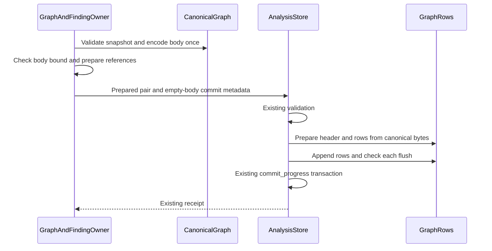

# Araphor Production Data Flow Simplification

The user approves all 17 subsequent performance-audit items. The
[implementation TODO](araphor-performance-simplification-todo.md) records their
scope and current verification. Item 17 replaces the earlier canonical JSON
quota unit with current encoded bytes. Earlier records below remain historical.

Remove intermediate representations and execution stages from production Data
paths. This plan follows the request for structural changes. The existing
test preparation changes are qualified. Their complete-suite timing difference
does not establish a production regression or improvement.

The source contracts below remain current. Verification receipts apply only to
their captured source. Read the implementation TODO for the deletion work and
its required checks. Ordinary suite durations establish no runtime speed gain.

## Intended end state

The graph owner passes typed graph data to the existing store owner. Package
storage retains one descriptor and raw executable bytes. A SQL package operation
uses one private SQL engine for its source bindings and model. Authorization,
attribution, lifecycle, recovery, evidence, and physical effect guarantees remain.

These changes add no service, connection pool, compilation cache, or execution
backend. Native and Wasm selection remains based on the package declaration.
Native execution retains its existing process and ABI boundary.

## Scope and decision

The source basis is commit `e31b033ebf95224e8210c73cec5abed4e8149def`.
Commit `9191ddcc` adds its qualification record without changing that source.
The user requests production architecture simplification. The user approves
package storage and one SQL operation. Implement those changes in parallel.
The user approves the revised typed graph handoff, metadata-only header, and
buffered DuckDB appender choice. The user then removes backward compatibility
from scope. The current-format storage decision defines the implemented
format. DataFusion work is not approved.

| Change | Structure removed | Example |
| --- | --- | --- |
| Typed graph commit | JSON as the internal graph handoff; a full generic JSON tree for header extraction | A graph stays typed from derivation to row preparation. Canonical result bytes are produced once. |
| Raw package storage | A descriptor copy and executable code represented as decimal JSON arrays | A 3 MiB executable remains a 3 MiB binary field instead of approximately 6–12 MiB of array text. Metadata is separate. |
| One SQL operation | Separate source and model engines | Three SQL source bindings and one model use one engine instead of four. One Arrow import per source remains. |

The examples describe work removed. They do not state a measured time saving.

## 1. Typed graph commit

### Implemented production flow

[CanonicalGraph::new](../../crates/araphor-data/src/analysis/graph_rows/mod.rs) The graph owner validates the typed snapshot and prepares its canonical body once
  -> [GraphAndFindingOwner::commit_bounded_window](../../crates/araphor-data/src/graph/commit.rs) the graph owner checks the body bound before context effects
  -> [AnalysisStore::commit_graph_snapshot](../../crates/araphor-data/src/analysis/progress.rs) the graph owner submits the prepared pair and empty-body commit metadata
  -> [AnalysisStore::commit_graph_inner](../../crates/araphor-data/src/analysis/progress.rs) the store applies shared manifest, witness, scope, and progress validation
  -> [GraphRows::encode_canonical](../../crates/araphor-data/src/analysis/graph_rows/mod.rs) row preparation reuses the existing canonical body
  -> [GraphHeader::encode](../../crates/araphor-data/src/analysis/graph_rows/header.rs) header preparation serializes only required metadata
  -> [GraphRows::insert](../../crates/araphor-data/src/analysis/graph_rows/mod.rs) the transaction appends rows and checks each flush
  -> [AnalysisStore::commit_progress](../../crates/araphor-data/src/analysis/progress.rs) the existing transaction commits references, usage, and progress
  -> [AnalysisResultReceiptV1](../../crates/araphor-data/src/analysis/progress.rs) the graph owner receives the existing receipt

Keep the existing byte-input entry for untrusted input. Require exact current
canonical bytes. Both entries use the same validation and transaction owners.
A typed value does not bypass a boundary. The current format has no layout tape.

The diagram describes the approved owner boundary. The implemented pair
keeps private snapshot and body fields together. The store supplies commit
body bytes from that pair and rejects independent body bytes at the typed
entry. Header creation builds a metadata-only JSON value. Recursive key order
preserves current metadata encoding. The current header has six fields and
version 2. Graph results remain in the existing
DuckDB transaction. Raw evidence publication remains a separate responsibility.
Do not add a graph journal or a second durable owner.

Prove exact current canonical body, header, row, receipt, and storage-charge
equality between the typed and byte entries. Preserve foreign scope rejection, context
and package references, witness expiry, checkpoint checks, immutable retry,
replacement, quotas, commit synchronization, and revision notifications.
Use the fresh current format. Add no format migration.

Use [native storage tests](../../crates/araphor-data/src/graph/tests/native_storage.rs),
[row encoding tests](../../crates/araphor-data/src/analysis/graph_rows/tests/encoding.rs),
[package reference tests](../../crates/araphor-data/src/analysis/graph_rows/tests/packages.rs),
[graph crash qualification](../../crates/araphor-data/src/graph/tests.rs), and
[backup and corruption tests](../../crates/araphor-data/src/analysis/graph_rows/tests/recovery.rs).
Retain all notice and notification outcomes.

**Done** for source implementation, focused parity, and the final Rust
procedure. The
[graph commit review guide](../guides/araphor-graph-commit-review.md)
records the implemented route and verification evidence.

### Revised choice after binary and DuckDB review

The user requests a comparison with binary formats, Protobuf, and DuckDB.
The [representation review](araphor-graph-binary-duckdb-review.md) contains the
source basis, official API references, tradeoffs, and required proof.

Keep the existing typed SQL columns and CBOR header. Pass the typed snapshot
directly between Rust owners. Serialize only the required metadata for the
header. Use the installed DuckDB appender instead of SQL execution for each
row. Explicitly flush each appender and propagate its error before commit.
Add no Protobuf schema, private DuckDB file codec, or Arrow batch copy.

For example, a graph with 1,000 subjects uses buffered typed appends in the
same transaction instead of 1,000 prepared statement executions. Current
canonical result bytes and selective graph queries remain available. The
complete graph JSON parse and full graph tree used for metadata extraction
are removed.

**Done** for the format comparison and explicit approval of the revised
choice, source implementation, focused qualification, and the final Rust
procedure. No measured runtime saving is established.

## 2. Raw package storage

Keep one descriptor and raw executable buffers in the existing package revision
row. The current schema is 22. The artifact is a three-field CBOR array: version
2, metadata bytes, and raw buffers. Executable placeholders are empty. The
buffer order follows implementations and their native dependencies.

Charge actual descriptor and artifact lengths. Remove decimal JSON byte
counting, the separate encoded-byte column, and the old frame field. Recovery
validates the current frame and derives the same charge. Runtime leases charge
owned decoded buffers separately. Keep immutable collisions, dependency closure,
tenant isolation, quota checks, current backup and restore, and crash atomicity.
Native artifacts remain opaque bytes; the native loader owns closure and ABI
checks. Add no filesystem blob owner or cross-tenant deduplication.

The [package storage review](../guides/araphor-binary-package-storage-review.md)
owns the source route, exact frame checks, local OCI contract, and test route.

## 3. One SQL operation

Use one private SQL engine for a package operation's source bindings and model.
One operation owns its engine and evaluation reservation. Output-only input
resolution opens no engine. Source and model stages must not acquire nested
evaluation slots; tenant capacity one must work. Keep extraction and evaluation
deadlines, cancellation, current grants, exact input hashes, schemas, evidence,
reason codes, checkpoints, output leases, and the existing commit owner.

Resolve declared Table inputs before Query inputs. Remove source-only views
after each statement. Retain only declared aliases for the model. A private
name does not supply source authority. Check hidden-source access and name
collisions. Charge extraction, imported tables and internal positions, retained
Arrow inputs, intermediate data, and output. An input failure cannot run the
model or commit state. Native and Wasm release the engine before runtime
admission and keep their SDK dataset boundary.

The [SQL operation review](../guides/araphor-sql-operation-review.md) owns the
current flow and tests for exact output, provenance, failure cleanup, capacity,
and replay. The next input section defines the engine-independent declaration.

## Current-format storage decision

The user directs this work to remove legacy support. Backward compatibility is
not required. This instruction replaces the earlier migration and legacy
layout requirements. The implemented flows above apply this instruction.

Use a fresh development store and the current backup manifest. There are no
deployed older stores. Remove old-schema migration code, migration-only
fixtures, and old-version rejection matrices. Keep current-format backup,
restore, corruption, retention, quota, and crash checks.

Store canonical graph results. Remove noncanonical layout recording and replay.
The byte-input boundary still validates its snapshot and requires canonical
bytes. Remove the layout column and redundant source-byte count. Keep the
current canonical result format, native rows, typed pair, references, and
transaction. Do not retain an old header decoder.

Store current binary package records. Remove legacy JSON conversion and the
signed migration adjustment. Validate the current frame and actual encoded
charge. OCI identity, dependency bytes, and the native ABI remain checked.
The explicit cap-removal decision below replaces the earlier package limits.

Keep the existing current-format integrity guards. Add no older-data
conversion, preservation, or rejection-specific bookkeeping.

**Done** for explicit removal of backward compatibility and source cleanup.
**Done** for focused current-format qualification and the final Rust procedure.

## Retained execution and verification through `cffde410`

The complete source, failed attempts, corrections, commands, hashes, and terminal
results remain in `7b7b407adf347d389984553a4d212bfce37b75b5:docs/plans/araphor-production-dataflow-simplification.md`.
The earlier final Rust procedure passes at `cffde410`. Separate native proof
covers Linux x86_64 GNU with glibc 2.39. Neither result qualifies later source.
The earlier correction preserves the independent 16 MiB canonical result and
32 MiB finding read/cache bounds. No workload, assertion, or deadline is reduced.

## Subsequent approved changes through `ab6b5da3`

These changes use the existing Rust owners and ordinary test runner. They add
no performance test, backend selector, network owner, or compatibility reader.
Context batching and further crash-fixture changes are not approved here.

### Local OCI package format

[PackageBundleV1::read](../../crates/araphor-package/src/bundle.rs) The author or client supplies an OCI directory or layout archive
  -> [Content](../../crates/araphor-analysis-sdk/src/oci.rs) the SDK verifies descriptor sizes, SHA-256 hashes, media types, and the canonical Araphor manifest and config
  -> [PackageOci::decode](../../crates/araphor-package/src/oci.rs) Data fills ordered empty metadata slots from typed raw layers and checks reconstructed identity
  -> [PackageRequestV1::encode](../../crates/araphor-data/src/package/model/request.rs) the client encodes request metadata and the OCI archive as separate CBOR byte strings
  -> [ClientGrpcOwner](../../crates/mithril-control/src/client_grpc/packages.rs) Control decodes the binary request from the existing gRPC bytes field
  -> [PackageTrustPinV1](../../crates/mithril-control/src/client_auth/packages.rs) Control requires the selected tenant's exact `sha256:` manifest pin and current grant
  -> [AnalysisPackageOwner::admit_artifact](../../crates/araphor-data/src/package/execution.rs) the package owner admits each shared executable once and retains each export's SQL and binding checks
  -> [AnalysisStore::install_package](../../crates/araphor-data/src/analysis/packages/revisions.rs) the existing store commits the immutable package revision

Use the analysis design's
[OCI Image/Distribution 1.1 and local layout choice](mithril-hugging-face-intrusion-prevention/phase-7-mithril-control-and-detection-packages/extensible-security-packages-design.md).
The [registry and trust owner](daemon-client/phase-10-oci-registry-trust-hub-and-packaging.md)
remains deferred. Local format support does not implement remote pull, push,
credentials, publisher-signature verification, revocation, or shared GC.
Existing tenant grants and exact package trust pins remain authoritative.

Use one OCI image manifest, a typed Araphor config, and ordered typed raw layers.
The config excludes executable bytes, native dependency bytes, and fixture IPC.
The canonical Araphor config and manifest subset permits exact identity
reconstruction after durable loading. OCI itself does not define canonical
JSON. Use `sha256:` plus 64 lowercase hexadecimal characters for the digest of
exact manifest bytes. Remove the former private bundle digest domain and bare
hexadecimal trust-pin format. Native artifact and closure identities remain
separate checks at the native owner.

Read directory components through retained file descriptors without following
links. Read archive members without extraction. Check referenced blob sizes
and hashes, unsafe entries, duplicate paths, trailer bytes, raw-slot order,
and canonical reconstruction. Unreferenced layout files do not gain authority.
Use fresh development packages and stores. Add no external JSON fallback.

The request uses a three-field CBOR array: version 1, operation metadata JSON
bytes without the bundle, and OCI archive bytes. The existing gRPC bytes field
is named `definition`. Operations other than install and update require an
empty archive. The subsequent user approval removes the aggregate archive,
request, and stored revision caps. Exact OCI descriptor sizes and hashes remain
required. Read the [package review guide](../guides/araphor-binary-package-storage-review.md)
for the current representation, owners, source tests, and retained evidence.

### Bounded graph preparation

[GraphAndFindingOwner::derive_candidate](../../crates/araphor-data/src/graph/derive.rs) The graph owner derives a validated typed candidate
  -> [GraphAndFindingOwner::commit_bounded_window](../../crates/araphor-data/src/graph/commit.rs) the owner supplies final positions, notice, witness deadline, and previous result
  -> [CanonicalGraph::bounded](../../crates/araphor-data/src/analysis/graph_rows/mod.rs) the owner serializes once into the existing bounded buffer
  -> [GraphAndFindingOwner::commit_snapshot](../../crates/araphor-data/src/graph/commit.rs) the owner prepares context references only after the body fits
  -> [AnalysisStore::commit_graph_snapshot](../../crates/araphor-data/src/analysis/progress.rs) the existing transaction commits the prepared graph

Keep output-size errors as the window-split signal. Propagate other errors.
Keep public derivation's byte check. Preserve canonical bytes, the 16 MiB
format bound, current transactions, and the authorization and witness checks.

### Shared executable admission

Within one artifact admission, admit an exact shared Wasm or native
implementation only once after its first successful admission. Continue to
resolve every declared export, check cancellation, reject ambiguous execution
types, and validate each SQL model and input binding. Add no persistent
admission cache or saved trust result.

### Typed Discovery profile commit

[PreparedProfile::new](../../crates/araphor-data/src/analysis/progress/profile.rs) Discovery validates a profile and encodes its bounded body once
  -> [DiscoveryOwner](../../crates/araphor-data/src/discovery/live.rs) the owner obtains current package authorization for the prepared commit
  -> [AnalysisStore::commit_working_profile](../../crates/araphor-data/src/analysis/progress/profile.rs) the store consumes the private pair for a working revision
  -> [AnalysisStore::commit_progress](../../crates/araphor-data/src/analysis/progress.rs) the existing transaction checks metadata and commits the profile

Sealed historical profiles use `commit_sealed_profile` and cannot advance
progress. Both typed entries reject independent body bytes. Preserve profile
validation, scope, context references, witnesses, revision retry, retention,
commit synchronization, and recovery. No second profile store is introduced.
Read [profile handoff tests](../../crates/araphor-data/src/analysis/progress/profile/tests.rs)
for typed-versus-byte parity, working replacement, sealed retry, reopen, and
metadata rejection.

### Selected finding-row accounting

[AnalysisStore::preflight_findings](../../crates/araphor-data/src/analysis/graph/findings/preflight.rs) The finding owner selects keys and checks each distinct complete result's stored row charge and header
  -> [FindingKey::batch_end](../../crates/araphor-data/src/analysis/graph/findings/batches.rs) the owner charges selected rows, each copied input manifest, and one shared header per result in the batch
  -> [AnalysisStore::collect_findings](../../crates/araphor-data/src/analysis/graph/findings/batches.rs) the owner reads the batch or uses the existing single-finding fallback
  -> [FindingOutput](../../crates/araphor-data/src/analysis/graph/findings/batches.rs) the owner checks exact serialized output bytes before returning the page

Do not charge the complete graph row set again for every selected finding.
Keep full-result integrity preflight, copied-revision charges, the 32 MiB read
bound, header-cache bound, record bound, exact output limit, ordering, and
fallback. The [graph review guide](../guides/araphor-graph-commit-review.md)
links the implementation and current correctness cases.

### Operation-owned table and query inputs

Replace the package owner's source interpreter with one input operation owned
by `QueryOwner`. The source basis is `bf13d846`. The user approves this change
after review of the DataFusion table and query model. Keep DuckDB for execution.
Keep source declarations and Arrow datasets independent of the engine. Use
Mangroves and GreptimeDB as references for later DataFusion integration. This
change does not add another engine, service, registry, or durable owner.

A package operation requests its declared inputs
  -> the package owner checks its current grant and activation
  -> the query owner opens one operation with the admitted tenant and scope
  -> the query owner binds built-in tables and exact package-output tables
  -> a table input selects a named relation without a user-written SQL query
  -> a query input reads the same admitted relations through the closed SQL binder
  -> each input retains its batches, exact dependencies, evidence, coverage, and memory lease
  -> the execution owner receives the resolved named datasets
  -> the existing package transaction checks source revisions and commits the result

An input fails, authority expires, or cancellation occurs
  -> the operation returns its existing structured error
  -> the operation releases source bindings, connection, and memory leases
  -> the package owner commits no result or checkpoint

Use `InputSource::Table(TableRef)` and `InputSource::Query(sql)`.
`TableRef::Named` selects a built-in or supplied relation. `TableRef::Output`
names the exact package, revision, export, and output. Keep the model-level
host-prepared mode for the existing Discovery and graph callers, including
zero-input models. Remove the repeated per-port `Provided` state.

Remove the separate package dependency reader, duplicate result-reference and
evidence lookups, and optional paths for shared and standalone input
connections.
The query owner must retain dependencies before SQL execution, including when
the result has zero rows. A table for a package output reads a committed
result. It does not execute the package. Multiple table inputs remain separate datasets;
only an explicit query joins or combines them.

Acceptance requires direct table reads, SQL over bound output tables, exact
revision and evidence retention, unchanged host-prepared callers, operation
success with one capacity slot, cleanup after failure, and a net reduction in
production code. Run focused owner cases, final Rust CI, and current native
qualification.
No performance test or new timing workload is approved.

**Done** for source implementation and the full Rust procedure. The separate
245-line package input reader, standalone source API, optional connection
handoff, and synthetic source packages and evaluations are removed. One input
operation serves SQL, native, and Wasm implementations. SQL inputs share one
engine; SQL models reuse imported table bindings. Native and Wasm execution
release that engine before runtime admission. Exact output references and
source evidence stay with the query owner. The package owner keeps commit
authority. The
[input ownership review](../guides/araphor-sql-operation-review.md#current-table-and-query-input-flow)
records the source route and lifetime.

The original qualification is retained in the Git record above. Current-source
verification and nonblank line counts belong to the implementation TODO.
DataFusion execution and window scheduling remain outside this change.

### Explicit input sources and removed package caps

The operation-owned Table and Query declarations above replace the earlier
per-port Provided, Sql, and Output dispatcher. Keep `InputMode::Provided` for
host-prepared callers and zero-input models. Remove parallel dependency lists,
SQL source maps, and missing-key dispatch. Computation ports and evaluation
ABI remain unchanged.

The user explicitly removes the descriptor-only 1 MiB cap, aggregate OCI package
32 MiB cap, and stored package revision 64 MiB cap. Package request framing and
package gRPC client/server configuration impose no separate aggregate message
cap. Remove the cap-only serializers, counters, and tests. Keep exact descriptor
sizes, content hashes, media types, canonical Araphor manifest/config checks,
archive path and entry checks, frame integrity, and store usage charges.
Authorization, SQL admission, model data limits, runtime leases, and commit
checks remain with their existing owners. No replacement cap is added.

The existing large-package test installs a 33 MiB artifact through the owner,
checks immutable retry and reopen, and checks OCI round trips. Its stored
charge exceeds 64 MiB. Original ACK, record, witness-byte, backup, source-revision,
and timeout assertions remain. Historical failures and exact retries remain in
the Git record above. They establish no scheduling-fairness or latency claim.

### Current verification record

Use the [implementation TODO](araphor-performance-simplification-todo.md) for
the current source and verification. The earlier receipts include a full Rust
pass at `ab6b5da3`, twelve passing native Data cases, a failed native E2E attempt,
and its passing exact retry on unchanged source and binaries. The failure cause
is unresolved. Native proof covers Linux x86_64 GNU with glibc 2.39 only.
Ordinary functional durations establish no causal speed improvement. The Data
CI target below ten minutes remains unproven.
