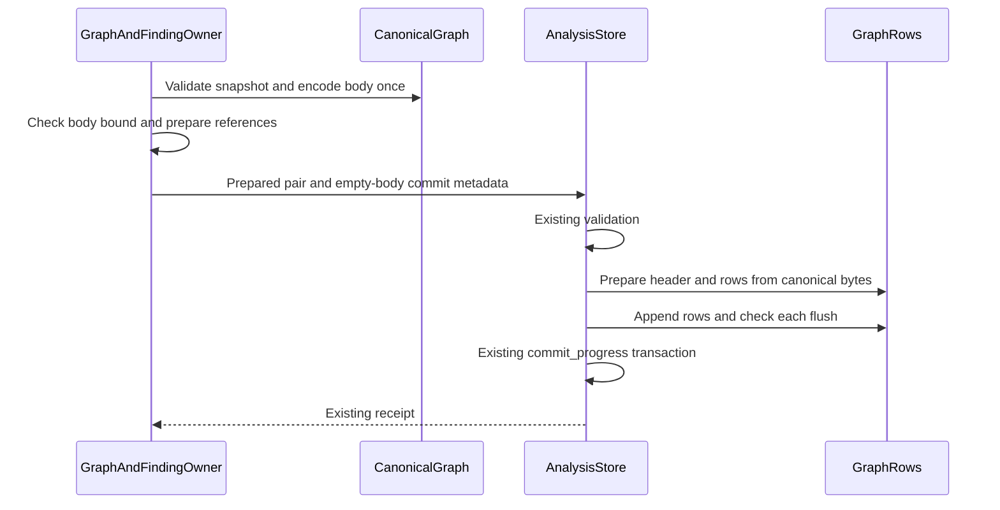

# Araphor Production Data Flow Simplification

The user approves all 17 subsequent performance-audit items. The
[implementation TODO](araphor-performance-simplification-todo.md) records their
scope and current verification. Item 17 replaces the earlier canonical JSON
quota unit with current encoded bytes. Earlier records below remain historical.

Remove intermediate representations and execution stages from production Data
paths. This plan follows the request for structural changes. The existing
test preparation changes are qualified. Their complete-suite timing difference
does not establish a production regression or improvement.

The result through `cffde410` is retained below. The user subsequently approves
local OCI transport, bounded graph serialization, shared executable admission,
typed Discovery profile commits, and selected finding-row accounting. These
changes are committed through `ab6b5da3`. Source, focused tests, and final CI
are **Done**. Native Data and the exact native E2E retry pass. The E2E
reproducibility issue remains **Not done**. The
final sections define their scope and replace the earlier external JSON
transport restriction. This change adds explicit input sources and removes the
user-rejected package caps. The third final Rust procedure and current native
qualification pass. Native qualification covers Linux x86_64 GNU.
The earlier results below remain historical. No speed improvement is established.
The user now approves operation-owned table and query inputs. Implementation
and the full Rust procedure are **Done**. Current native qualification is
**Done** on Linux x86_64 GNU. The next section records the approved source
ownership change.

## Intended end state

The graph owner passes typed graph data to the existing store owner. Package
storage retains one descriptor and raw executable bytes. A SQL package operation
uses one private SQL engine for its source bindings and model. Authorization,
attribution, lifecycle, recovery, evidence, and physical effect guarantees remain.

These changes add no service, connection pool, compilation cache, or execution
backend. Native and Wasm selection remains based on the package declaration.
Native execution retains its existing process and ABI boundary.

## Scope and decision

The source basis is commit `e31b033ebf95224e8210c73cec5abed4e8149def`.
Commit `9191ddcc` adds its qualification record without changing that source.
The user requests production architecture simplification. The user approves
package storage and one SQL operation. Implement those changes in parallel.
The user approves the revised typed graph handoff, metadata-only header, and
buffered DuckDB appender choice. The user then removes backward compatibility
from scope. The current-format storage decision defines the implemented
format. DataFusion work is not approved.

| Change | Structure removed | Example |
| --- | --- | --- |
| Typed graph commit | JSON as the internal graph handoff; a full generic JSON tree for header extraction | A graph stays typed from derivation to row preparation. Canonical result bytes are produced once. |
| Raw package storage | A descriptor copy and executable code represented as decimal JSON arrays | A 3 MiB executable remains a 3 MiB binary field instead of approximately 6–12 MiB of array text. Metadata is separate. |
| One SQL operation | Separate source and model engines | Three SQL source bindings and one model use one engine instead of four. One Arrow import per source remains. |

The examples describe work removed. They do not state a measured time saving.

## 1. Typed graph commit

### Baseline production flow

[GraphAndFindingOwner::commit_bounded_window](../../crates/araphor-data/src/graph/commit.rs) The graph owner holds a typed snapshot
  -> [graph commit preparation](../../crates/araphor-data/src/graph/commit.rs) serialize the complete snapshot as the result body
  -> [AnalysisStore::commit_graph](../../crates/araphor-data/src/analysis/progress.rs) decode that body into another typed snapshot
  -> [GraphRows::encode_body](../../crates/araphor-data/src/analysis/graph_rows/mod.rs) validate the snapshot and serialize complete canonical JSON again
  -> [GraphHeader::encode](../../crates/araphor-data/src/analysis/graph_rows/header.rs) parse complete JSON into a generic value and remove its rows
  -> [AnalysisStore::commit_progress](../../crates/araphor-data/src/analysis/progress.rs) commit rows, references, usage, and progress in the existing transaction

### Implemented production flow

[CanonicalGraph::new](../../crates/araphor-data/src/analysis/graph_rows/mod.rs) The graph owner validates the typed snapshot and prepares its canonical body once
  -> [GraphAndFindingOwner::commit_bounded_window](../../crates/araphor-data/src/graph/commit.rs) the graph owner checks the body bound before context effects
  -> [AnalysisStore::commit_graph_snapshot](../../crates/araphor-data/src/analysis/progress.rs) the graph owner submits the prepared pair and empty-body commit metadata
  -> [AnalysisStore::commit_graph_inner](../../crates/araphor-data/src/analysis/progress.rs) the store applies shared manifest, witness, scope, and progress validation
  -> [GraphRows::encode_canonical](../../crates/araphor-data/src/analysis/graph_rows/mod.rs) row preparation reuses the existing canonical body
  -> [GraphHeader::encode](../../crates/araphor-data/src/analysis/graph_rows/header.rs) header preparation serializes only required metadata
  -> [GraphRows::insert](../../crates/araphor-data/src/analysis/graph_rows/mod.rs) the transaction appends rows and checks each flush
  -> [AnalysisStore::commit_progress](../../crates/araphor-data/src/analysis/progress.rs) the existing transaction commits references, usage, and progress
  -> [AnalysisResultReceiptV1](../../crates/araphor-data/src/analysis/progress.rs) the graph owner receives the existing receipt

Keep the existing byte-input entry for untrusted input. Require exact current
canonical bytes. Both entries use the same validation and transaction owners.
A typed value does not bypass a boundary. The current format has no layout tape.

The diagram describes the approved owner boundary. The implemented pair
keeps private snapshot and body fields together. The store supplies commit
body bytes from that pair and rejects independent body bytes at the typed
entry. Header creation builds a metadata-only JSON value. Recursive key order
preserves current metadata encoding. The current header has six fields and
version 2. Graph results remain in the existing
DuckDB transaction. Raw evidence publication remains a separate responsibility.
Do not add a graph journal or a second durable owner.

Prove exact current canonical body, header, row, receipt, and storage-charge
equality between the typed and byte entries. Preserve foreign scope rejection, context
and package references, witness expiry, checkpoint checks, immutable retry,
replacement, quotas, commit synchronization, and revision notifications.
Use the fresh current format. Add no format migration.

Use [native storage tests](../../crates/araphor-data/src/graph/tests/native_storage.rs),
[row encoding tests](../../crates/araphor-data/src/analysis/graph_rows/tests/encoding.rs),
[package reference tests](../../crates/araphor-data/src/analysis/graph_rows/tests/packages.rs),
[graph crash qualification](../../crates/araphor-data/src/graph/tests.rs), and
[backup and corruption tests](../../crates/araphor-data/src/analysis/graph_rows/tests/recovery.rs).
Retain all notice and notification outcomes.

**Done** for source implementation, focused parity, and the final Rust
procedure. The
[graph commit review guide](../guides/araphor-graph-commit-review.md)
records the implemented route and verification evidence.

### Revised choice after binary and DuckDB review

The user requests a comparison with binary formats, Protobuf, and DuckDB.
The [representation review](araphor-graph-binary-duckdb-review.md) contains the
source basis, official API references, tradeoffs, and required proof.

Keep the existing typed SQL columns and CBOR header. Pass the typed snapshot
directly between Rust owners. Serialize only the required metadata for the
header. Use the installed DuckDB appender instead of SQL execution for each
row. Explicitly flush each appender and propagate its error before commit.
Add no Protobuf schema, private DuckDB file codec, or Arrow batch copy.

For example, a graph with 1,000 subjects uses buffered typed appends in the
same transaction instead of 1,000 prepared statement executions. Current
canonical result bytes and selective graph queries remain available. The
complete graph JSON parse and full graph tree used for metadata extraction
are removed.

**Done** for the format comparison and explicit approval of the revised
choice, source implementation, focused qualification, and the final Rust
procedure. No measured runtime saving is established.

## 2. Raw package storage

### Baseline production flow

[PackageBundleV1::from_bytes](../../crates/araphor-data/src/package/bundle.rs) Admission parses and validates external package JSON
  -> [revision preparation](../../crates/araphor-data/src/package/lifecycle/revisions.rs) serialize the whole artifact, including its descriptor and executable byte arrays
  -> [AnalysisStore::install_package](../../crates/araphor-data/src/analysis/packages/revisions.rs) retain descriptor JSON and artifact JSON as separate fields
  -> [AnalysisStore::package_revision](../../crates/araphor-data/src/analysis/packages/read.rs) read those fields
  -> [AnalysisPackageOwner::load_bundle](../../crates/araphor-data/src/package/lifecycle/revisions.rs) parse executable decimal arrays into binary buffers
  -> [bundle validation](../../crates/araphor-data/src/package/admission.rs) validate the reconstructed bundle

### Implemented production flow

The existing external package admission validates V1 bytes
  -> the package owner separates one descriptor, implementation metadata, and raw executable bytes
  -> the store writes the complete immutable revision in one transaction
  -> loading parses one descriptor and the remaining metadata
  -> loading reads binary fields directly into the owned executable buffers
  -> existing bundle validation, authority, and runtime admission remain

Keep the existing package revision row and transaction. The descriptor column
is the only descriptor copy. The artifact column contains a versioned CBOR
envelope with metadata and raw code buffers. Use the installed `minicbor`
dependency. Add one `encoded_bytes` column for the existing logical charge.
Check that this column and the envelope agree. Add no table or code cache.
Recovery derives the canonical byte count from metadata and raw buffers.
Check this count against the row and envelope. There is no migration adjustment.
This field checks consistency. It does not authenticate database contents.

Use the existing DuckDB owner and binary fields. Keep tenant, package ID,
revision, and implementation identity in durable keys. Store native artifacts
as opaque bytes. Native qualification also contains dependency executable
buffers. Store those buffers as binary fields and retain their names, digests,
and order in metadata. The existing native loader owns closure parsing and ABI
validation. Do not add cross-tenant deduplication or a filesystem blob owner.

Package fixtures retain their existing metadata and Arrow IPC payload encoding
in this scope. Those payloads can contain large JSON byte arrays. The remaining
metadata is not guaranteed to be small. This change removes executable arrays;
it does not claim to remove every binary array from package storage.

The initial storage change preserves external V1 package bytes, canonical
ordering, digest domains, trust pins, current SQL semantics, declared backend
selection, and native closure bytes. Canonical serialization and hashing remain at the current
authority boundaries. A stored digest cannot replace hashing untrusted code.

The development store uses schema 21 and the current binary frame. There is
one descriptor copy. Validate current records without repairing malformed
data. Keep current backup, restore, and crash checks. A failed transaction
does not retain a partial revision. Add no older-format conversion or reader.

The initial storage change retained the external 32 MiB bundle cap and internal
64 MiB revision cap. The subsequent explicit user approval removes both caps.
Content-derived encoded sizes still check frame integrity and supply store usage
charges. Runtime leases still charge owned buffers.

Update [schema and usage](../../crates/araphor-data/src/analysis/packages/schema.rs),
[immutable reads](../../crates/araphor-data/src/analysis/packages/read.rs),
[installation](../../crates/araphor-data/src/analysis/packages/revisions.rs),
[recovery](../../crates/araphor-data/src/analysis/packages/recovery.rs), and
[collection](../../crates/araphor-data/src/analysis/packages/collection.rs) together.
Collection removes binary fields only when existing revision retention permits it.

Prove current backup/restore, crash atomicity, descriptor identity,
immutable collisions, dependency closure, changed or missing code rejection,
tenant isolation, quota parity, memory leases, and native/Wasm execution parity.
Preserve candidate-error precedence on retry. OCI transport and external format
changes were excluded from the initial storage change. The subsequent approved
local OCI change is recorded in the final section.

**Done** for explicit architecture approval, implementation, focused
qualification, the final Rust procedure, and execution with current
source-built native artifacts.

The [package storage review guide](../guides/araphor-binary-package-storage-review.md)
records the current source route and verification state.

## 3. One SQL operation

### Baseline production flow

[Package preparation](../../crates/araphor-data/src/package/evaluation/preparation.rs) Preparation requests each SQL source port
  -> [QueryOwner::model_input](../../crates/araphor-data/src/query/model/source.rs) admit and extract the selected source input
  -> [SourceRows::evaluate](../../crates/araphor-data/src/query/model/source/read.rs) open a private source engine and produce an Arrow dataset
  -> [QueryOwner::evaluate_model](../../crates/araphor-data/src/query/model.rs) open another private engine
  -> [ModelExecution::register](../../crates/araphor-data/src/query/model/input.rs) import the Arrow datasets into model relations
  -> [model execution](../../crates/araphor-data/src/query/model/execute.rs) produce output, checkpoint, evidence, and reasons

### Implemented production flow

The package owner selects the declared SQL implementation
  -> the query owner creates one bounded private operation engine
  -> existing source admission and extraction select each input port
  -> each admitted binding produces the existing Arrow input and provenance
  -> schema, bounds, revisions, coverage, and witnesses are recorded
  -> source-only relations are removed before model execution
  -> original model registration imports Arrow inputs once when the model runs
  -> the model reads only admitted ports, parameters, and checkpoint relations
  -> output validation and the existing package commit complete the operation
  -> the operation closes its engine on success, error, or cancellation

Create the shared operation only when the SQL implementation has source
bindings. With no SQL source bindings, use the existing evaluation path. It
opens an engine only when the model must run. The engine lifetime is one
operation. Add no pool or shared mutable connection.
The composed path owns one evaluation reservation across source and model
stages. Do not acquire another reservation through nested standalone APIs.
That nesting can reject the operation when tenant capacity is one. Preserve
the current per-stage deadline semantics when sharing the engine.
Keep standalone public query APIs for their current callers. Native and Wasm
retain their real SDK dataset boundary. Materialize Arrow where the existing
canonical input hash or schema proof requires it. Import each source dataset
once through original model registration when the model runs. Preparation
creates no model input tables. Automatic operations that need no new result
do not import model inputs.
Do not substitute a table ID for a revision hash. This change removes engine
setup; it does not remove every Arrow conversion or memory copy.

Enforce [model relation admission](../../crates/araphor-data/src/query/model/schema.rs)
and parser guards. A private schema name is not an access boundary. A model
must not read source-only relations, the database catalog, or an unadmitted
port. Test hidden-source access and name collisions before switching callers.

Retain input leases through computation and commit preparation. Charge source
projections, port relations, intermediate results, and output. Preserve row,
scan, input, output, checkpoint, and aggregate bounds. Preserve extraction and
evaluation deadlines, cancellation, source checks, activation, and authority
checks. A failed port must not execute the model or commit partial state.

Prove exact input revisions, output, request, checkpoint, evidence, reasons,
dependency results, retry, rollback, and budget behavior. Use existing SQL
package lifecycle and query model tests. No durable format change is intended.
If retained bytes change, stop and define the result contract before implementation.

**Done** for explicit architecture approval, implementation, focused parity,
source visibility proof, and the final Rust procedure.

The [SQL operation review guide](../guides/araphor-sql-operation-review.md)
records the current source route and verification state.

## Current-format storage decision

The user directs this work to remove legacy support. Backward compatibility is
not required. This instruction replaces the earlier migration and legacy
layout requirements. The implemented flows above apply this instruction.

Use a fresh development store and the current backup manifest. There are no
deployed older stores. Remove old-schema migration code, migration-only
fixtures, and old-version rejection matrices. Keep current-format backup,
restore, corruption, retention, quota, and crash checks.

Store canonical graph results. Remove noncanonical layout recording and replay.
The byte-input boundary still validates its snapshot and requires canonical
bytes. Remove the layout column and redundant source-byte count. Keep the
current canonical result format, native rows, typed pair, references, and
transaction. Do not retain an old header decoder.

Store current binary package records. Remove legacy JSON conversion and the
signed migration adjustment. Validate the current canonical encoding count
against both the frame and the row. The current external package V1 format,
identity, dependency bytes, and native ABI remain supported. The later explicit
cap-removal decision replaces the earlier 32/64 MiB package limits.

Keep the existing current-format integrity guards. Add no older-data
conversion, preservation, or rejection-specific bookkeeping.

**Done** for explicit removal of backward compatibility and source cleanup.
**Done** for focused current-format qualification and the final Rust procedure.

## Retained execution and verification through `cffde410`

Implement and commit each approved structural change separately. Run focused
functional cases before the final repository procedure. Follow
[verification.md](../../.agents/verification.md) after the last covered edit.
Use ordinary Rust tests and existing qualification entry points.

No new performance test is approved by this document. Before adding a runtime
comparison, obtain explicit approval for its workload, runtime, and pass/fail
limits. Record source, binary, profile, host load, stage counts, bytes, and
terminal results. Functional parity is required before timing qualification.

The source changes are committed separately:

| Commit | Change |
| --- | --- |
| `6b6d5ebb` | Raw package executable storage and current-only recovery |
| `efac8911` | One private SQL engine per package operation |
| `78f80579` | Typed graph commit and buffered DuckDB row appends |
| `9b3cbab8` | Preserve the existing finding read budgets |
| `9f1f4ffa` | Derive snapshot test capacity from raw fixture bytes |
| `cffde410` | Qualify canonical graph input through query reads |

Focused qualification covers 71 distinct Data cases and 66 SDK cases. The
first Data run passes 70 cases. Its sole failed SQL parity assertion is
corrected, and that exact case passes on retry. The original source head is
`78f805794f49d22b12e72c3fa8e65f406157bb47`.

The first final Rust procedure on that source passes formatting, workspace
checking, and clippy. Data reports 616 passed, 3 failed, and 19 ignored. The
procedure stops at Data. Read
`/tmp/araphor-production-final-ci-attempt1-source.json` and
`/tmp/araphor-production-final-ci-attempt1.log` for this result.

The large-context graph case also fails in isolation with
`AnalysisReadDeadline`. Its record is
`/tmp/araphor-production-failures-original.json`. The current format bound
had also reduced the finding cache and query batch budgets. Restore their
existing 32 MiB budget independently of the 16 MiB result bound. Add a small
two-header retention check. Correct the snapshot test capacity for tightly
allocated raw executable buffers. Require canonical bytes in the graph query
fixture. These corrections do not add compatibility behavior or change the
read deadline.

The seven targeted correction cases pass. These cases cover the three failed
tests and all four finding-read tests. Formatting and focused clippy pass.
The source hashes remain unchanged during the targeted run. Read
`/tmp/araphor-production-targeted-fixes.json` and
`/tmp/araphor-production-targeted-fixes-tests.log` for this result.

The final source head is `cffde41073aa29380869de83b0ca18b078151d4f`.
The second final Rust procedure passes on that committed source. The final
record is `/tmp/araphor-production-final-ci-source.json`, and the log is
`/tmp/araphor-production-final-ci.log`.

The final command is `bash .github/scripts/verify-rust-ci.sh`, with
`CARGO_BUILD_JOBS=1` and `RUST_TEST_THREADS=4`. All 90 outer harnesses finish.
The result is 2,121 passed, 0 failed, and 568 existing ignored tests. Data has
620 passed, 0 failed, and 19 existing ignored tests. The source hashes remain
unchanged. The result summary is `/tmp/araphor-production-final-ci-report.json`.

| Functional run | Result | Observed time |
| --- | --- | --- |
| Workspace check | Pass | 14.48 s |
| Workspace clippy | Pass | 66 s |
| Data | 620 passed, 19 ignored | 889.53 s |
| Control | 188 passed, 2 ignored | 106.65 s |
| Mithril E2E | 191 passed, 528 ignored | 488.20 s |
| Node library | 282 passed, 1 ignored | 7.46 s |
| Complete final procedure | Exit 0 | 1,666.48 s |

These are ordinary functional-run times. They do not establish a speed
improvement. Source-built native artifact cases are not part of the default
CI result. The additional current-artifact qualification passes on the same
Data binary.

The existing author builder compiles six Rust native libraries from the current
source in 30.79 seconds. The build uses the locked release profile, one Cargo
job, and the existing `target/analysis-native` cache. The output is
`/tmp/araphor-production-native-current`. The retained earlier artifact
directory is unchanged.

With `ARAPHOR_NATIVE_DIR` set to this current output, 12 existing cases pass,
with 0 failed and 0 ignored, in 255.98 seconds. Eight package cases execute
stored native binaries through installation, checkpoint recovery, overflow,
error, capacity, cancellation, grant expiry, backend selection, and host-fault
restart paths. Two Discovery cases and two graph cases prove native/Wasm
algorithm parity and large-input behavior. The platform is Linux x86_64 GNU
with glibc 2.39. The source hashes remain unchanged.

Read `/tmp/araphor-production-native-qualification.json`,
`/tmp/araphor-production-native-qualification-build.log`, and
`/tmp/araphor-production-native-qualification-tests.log` for the command,
artifact hashes, source hashes, and terminal results. Nested restart helper
output does not add to the 12 parent cases. This is functional qualification,
not a controlled speed benchmark.

**Done** for source analysis, explicit approval, implementation, separate
source commits, focused qualification, the final Rust procedure, and
current-artifact native execution qualification. No approved implementation
work remains. Runtime savings remain unmeasured. DataFusion work is not part
of this implementation.

## Subsequent approved changes through `ab6b5da3`

These changes use the existing Rust owners and ordinary test runner. They add
no performance test, backend selector, network owner, or compatibility reader.
Context batching and further crash-fixture changes are not approved here.

### Local OCI package format

[PackageBundleV1::read](../../crates/araphor-data/src/package/bundle.rs) The author or client supplies an OCI directory or layout archive
  -> [Content](../../crates/araphor-analysis-sdk/src/oci.rs) the SDK verifies descriptor sizes, SHA-256 hashes, media types, and the canonical Araphor manifest and config
  -> [PackageOci::decode](../../crates/araphor-data/src/package/oci.rs) Data fills ordered empty metadata slots from typed raw layers and checks reconstructed identity
  -> [PackageRequestV1::encode](../../crates/araphor-data/src/package/model/request.rs) the client encodes request metadata and the OCI archive as separate CBOR byte strings
  -> [ClientGrpcOwner](../../crates/mithril-control/src/client_grpc/packages.rs) Control decodes the binary request from the existing gRPC bytes field
  -> [PackageTrustPinV1](../../crates/mithril-control/src/client_auth/packages.rs) Control requires the selected tenant's exact `sha256:` manifest pin and current grant
  -> [AnalysisPackageOwner::admit_artifact](../../crates/araphor-data/src/package/execution.rs) the package owner admits each shared executable once and retains each export's SQL and binding checks
  -> [AnalysisStore::install_package](../../crates/araphor-data/src/analysis/packages/revisions.rs) the existing store commits the immutable package revision

Use the analysis design's
[OCI Image/Distribution 1.1 and local layout choice](mithril-hugging-face-intrusion-prevention/phase-7-mithril-control-and-detection-packages/extensible-security-packages-design.md).
The [registry and trust owner](daemon-client/phase-10-oci-registry-trust-hub-and-packaging.md)
remains deferred. Local format support does not implement remote pull, push,
credentials, publisher-signature verification, revocation, or shared GC.
Existing tenant grants and exact package trust pins remain authoritative.

Use one OCI image manifest, a typed Araphor config, and ordered typed raw layers.
The config excludes executable bytes, native dependency bytes, and fixture IPC.
The canonical Araphor config and manifest subset permits exact identity
reconstruction after durable loading. OCI itself does not define canonical
JSON. Use `sha256:` plus 64 lowercase hexadecimal characters for the digest of
exact manifest bytes. Remove the former private bundle digest domain and bare
hexadecimal trust-pin format. Native artifact and closure identities remain
separate checks at the native owner.

Read directory components through retained file descriptors without following
links. Read archive members without extraction. Check referenced blob sizes
and hashes, unsafe entries, duplicate paths, trailer bytes, raw-slot order,
and canonical reconstruction. Unreferenced layout files do not gain authority.
Use fresh development packages and stores. Add no external JSON fallback.

The request uses a three-field CBOR array: version 1, operation metadata JSON
bytes without the bundle, and OCI archive bytes. The existing gRPC bytes field
is named `definition`. Operations other than install and update require an
empty archive. The subsequent user approval removes the aggregate archive,
request, and stored revision caps. Exact OCI descriptor sizes and hashes remain
required. Read the [package review guide](../guides/araphor-binary-package-storage-review.md)
for the current representation, owners, source tests, and retained evidence.

### Bounded graph preparation

[GraphAndFindingOwner::derive_candidate](../../crates/araphor-data/src/graph/derive.rs) The graph owner derives a validated typed candidate
  -> [GraphAndFindingOwner::commit_bounded_window](../../crates/araphor-data/src/graph/commit.rs) the owner supplies final positions, notice, witness deadline, and previous result
  -> [CanonicalGraph::bounded](../../crates/araphor-data/src/analysis/graph_rows/mod.rs) the owner serializes once into the existing bounded buffer
  -> [GraphAndFindingOwner::commit_snapshot](../../crates/araphor-data/src/graph/commit.rs) the owner prepares context references only after the body fits
  -> [AnalysisStore::commit_graph_snapshot](../../crates/araphor-data/src/analysis/progress.rs) the existing transaction commits the prepared graph

Keep output-size errors as the window-split signal. Propagate other errors.
Keep public derivation's byte check. Preserve canonical bytes, the 16 MiB
format bound, current transactions, and the authorization and witness checks.

### Shared executable admission

Within one artifact admission, admit an exact shared Wasm or native
implementation only once after its first successful admission. Continue to
resolve every declared export, check cancellation, reject ambiguous execution
types, and validate each SQL model and input binding. Add no persistent
admission cache or saved trust result.

### Typed Discovery profile commit

[PreparedProfile::new](../../crates/araphor-data/src/analysis/progress/profile.rs) Discovery validates a profile and encodes its bounded body once
  -> [DiscoveryOwner](../../crates/araphor-data/src/discovery/live.rs) the owner obtains current package authorization for the prepared commit
  -> [AnalysisStore::commit_working_profile](../../crates/araphor-data/src/analysis/progress/profile.rs) the store consumes the private pair for a working revision
  -> [AnalysisStore::commit_progress](../../crates/araphor-data/src/analysis/progress.rs) the existing transaction checks metadata and commits the profile

Sealed historical profiles use `commit_sealed_profile` and cannot advance
progress. Both typed entries reject independent body bytes. Preserve profile
validation, scope, context references, witnesses, revision retry, retention,
commit synchronization, and recovery. No second profile store is introduced.
Read [profile handoff tests](../../crates/araphor-data/src/analysis/progress/profile/tests.rs)
for typed-versus-byte parity, working replacement, sealed retry, reopen, and
metadata rejection.

### Selected finding-row accounting

[AnalysisStore::preflight_findings](../../crates/araphor-data/src/analysis/graph/findings/preflight.rs) The finding owner selects keys and checks each distinct complete result's stored row charge and header
  -> [FindingKey::batch_end](../../crates/araphor-data/src/analysis/graph/findings/batches.rs) the owner charges selected rows, each copied input manifest, and one shared header per result in the batch
  -> [AnalysisStore::collect_findings](../../crates/araphor-data/src/analysis/graph/findings/batches.rs) the owner reads the batch or uses the existing single-finding fallback
  -> [FindingOutput](../../crates/araphor-data/src/analysis/graph/findings/batches.rs) the owner checks exact serialized output bytes before returning the page

Do not charge the complete graph row set again for every selected finding.
Keep full-result integrity preflight, copied-revision charges, the 32 MiB read
bound, header-cache bound, record bound, exact output limit, ordering, and
fallback. The [graph review guide](../guides/araphor-graph-commit-review.md)
links the implementation and current correctness cases.

### Operation-owned table and query inputs

Replace the package owner's source interpreter with one input operation owned
by `QueryOwner`. The source basis is `bf13d846`. The user approves this change
after review of the DataFusion table and query model. Keep DuckDB for execution.
Keep source declarations and Arrow datasets independent of the engine. Use
Mangroves and GreptimeDB as references for later DataFusion integration. This
change does not add another engine, service, registry, or durable owner.

A package operation requests its declared inputs
  -> the package owner checks its current grant and activation
  -> the query owner opens one operation with the admitted tenant and scope
  -> the query owner binds built-in tables and exact package-output tables
  -> a table input selects a named relation without a user-written SQL query
  -> a query input reads the same admitted relations through the closed SQL binder
  -> each input retains its batches, exact dependencies, evidence, coverage, and memory lease
  -> the execution owner receives the resolved named datasets
  -> the existing package transaction checks source revisions and commits the result

An input fails, authority expires, or cancellation occurs
  -> the operation returns its existing structured error
  -> the operation releases source bindings, connection, and memory leases
  -> the package owner commits no result or checkpoint

Use `InputSource::Table(TableRef)` and `InputSource::Query(sql)`.
`TableRef::Named` selects a built-in or supplied relation. `TableRef::Output`
names the exact package, revision, export, and output. Keep the model-level
host-prepared mode for the existing Discovery and graph callers, including
zero-input models. Remove the repeated per-port `Provided` state.

Remove the separate package dependency reader, duplicate result-reference and
evidence lookups, and optional paths for shared and standalone input
connections.
The query owner must retain dependencies before SQL execution, including when
the result has zero rows. A table for a package output reads a committed
result. It does not execute the package. Multiple table inputs remain separate datasets;
only an explicit query joins or combines them.

Acceptance requires direct table reads, SQL over bound output tables, exact
revision and evidence retention, unchanged host-prepared callers, operation
success with one capacity slot, cleanup after failure, and a net reduction in
production code. Run focused owner cases, final Rust CI, and current native
qualification.
No performance test or new timing workload is approved.

**Done** for source implementation and the full Rust procedure. The separate
245-line package input reader, standalone source API, optional connection
handoff, and synthetic source packages and evaluations are removed. One input
operation serves SQL, native, and Wasm implementations. SQL inputs share one
engine; SQL models reuse imported table bindings. Native and Wasm execution
release that engine before runtime admission. Exact output references and
source evidence stay with the query owner. The package owner keeps commit
authority. The
[input ownership review](../guides/araphor-sql-operation-review.md#current-table-and-query-input-flow)
records the source route and lifetime.

The production Rust code has one fewer line than `bf13d846`. The count excludes
test files and inline test modules and counts all other lines. Rust tests add
847 lines. The complete diff grows because tests and documentation are added.
Evidence: `/tmp/araphor-relations-line-count.json`.

The final procedure `bash .github/scripts/verify-rust-ci.sh` passes with
unchanged source: 90 outer harnesses, 2,146 passes, zero failures, and 568
existing ignored cases. SDK has 74 passes; the builder has six. Data has 637
passes and 19 ignored cases in 915.36 seconds. Control has 188 passes and two
ignored cases in 107.63 seconds. E2E has 191 passes and 528 ignored cases in
489.92 seconds. Node has 282 passes and one ignored case in 7.68 seconds.
The full procedure takes 1,681.14 seconds. These are functional test times;
they do not establish a runtime speed change. The CI target of less than ten
minutes remains **Not done**.

Final Rust evidence: `/tmp/araphor-relations-final-ci-source.json`,
`/tmp/araphor-relations-final-ci.log`, and
`/tmp/araphor-relations-final-ci-report.json`. The record identifies the
working tree source based on `bf13d846`; each covered file has a SHA-256 hash.
Current native qualification is **Done** on Linux x86_64 GNU with glibc 2.39.
Six current Rust libraries build in 54.15 seconds. All 12 selected Data cases
pass in 261.05 seconds. The installed native detector E2E case passes in 254.01
seconds with `PATH` empty. Both test runs have zero failures and zero ignored
cases. The qualification runner takes 520.26 seconds. Source, native build
inputs, library hashes, and test binary hashes remain unchanged.

Native evidence: `/tmp/araphor-relations-native-build2.json`,
`/tmp/araphor-relations-native-build2.log`,
`/tmp/araphor-relations-native-qualification.json`, and
`/tmp/araphor-relations-native-qualification.log`.
**Done** for the approved input ownership change. No runtime speed benchmark
is run. DataFusion execution and window scheduling remain outside this change.

### Explicit input sources and removed package caps

This section records the earlier implementation at `bf13d846`. The approved
operation-owned input change above replaces its source dispatch.

The user approves per-input source declarations and removes parallel routing
metadata. The implementation uses
[InputPort](../../crates/araphor-analysis-sdk/src/model.rs) with a `Port` and an
`InputSource`. Sources are `Provided`, `Sql(query)`, or `Output(OutputRef)`.
`OutputRef` names the package, revision, export, and output. Remove
`Package.dependencies`, backend SQL input maps, and the missing-key fallback.

[Package::validate](../../crates/araphor-analysis-sdk/src/descriptor.rs) The SDK checks each input declaration and the model mode
  -> [PackageBundleV1::validate](../../crates/araphor-data/src/package/admission.rs) Data derives dependency edges from output sources and validates the closure
  -> `AnalysisPackageOwner::inputs_with_sql` the package owner matches each explicit source and retains its provenance
  -> [AnalysisPackageOwner::prepare_run](../../crates/araphor-data/src/package/evaluation/preparation.rs) resolved SQL sources share the existing private operation

`InputMode::Provided` accepts `Provided` and `Output` sources. The caller supplies
the datasets. Output references still retain dependency edges. `Resolved` accepts
`Sql` and `Output` sources. Zero-input models also declare the mode. `Model::new`
accepts existing `Vec<Port>` values and selects `Provided` sources and mode.
Output ports and the computation evaluation ABI remain unchanged. No arbitrary
database table lookup or implicit SQL query is added.

The user explicitly removes the descriptor-only 1 MiB cap, aggregate OCI package
32 MiB cap, and stored package revision 64 MiB cap. Package request framing and
package gRPC client/server configuration impose no separate aggregate message
cap. Remove the cap-only serializers, counters, and tests. Keep exact descriptor
sizes, content hashes, media types, canonical Araphor manifest/config checks,
archive path and entry checks, frame integrity, and store usage charges.
Authorization, SQL admission, model data limits, runtime leases, and commit
checks remain with their existing owners. No replacement cap is added.

The source record covers this change based on `4176a9cb`. Source changes are
implemented with a net reduction of 311 Rust lines. Focused checks pass: 70 SDK
cases, six builder cases, 32 Data cases
across the first run and corrected-case retries, and six Control cases. The
large-package case uses a 33 MiB artifact whose encoded store charge exceeds
64 MiB. It installs through the package owner, checks an immutable retry,
reopens the store, and checks the OCI encoding and decoding.

The first Data run found two fixture errors. A 65 MiB raw artifact exceeded the
existing database memory budget. The Discovery fixture used table outputs, so
it did not select the domain-contract check. The corrected graph fixture passes.
The next package retry found that owner recovery collects a revision without
an installed activation. The test now uses the supported installation path and
checks that the unsupported payload is retained without execution. The final
package retry passes. Read `/tmp/araphor-input-focused.log`,
`/tmp/araphor-input-control-focused.log`, `/tmp/araphor-input-retry.log`, and
`/tmp/araphor-input-retry2.log`. The captured source hashes are unchanged within
each recorded run.

The first final Rust command is `bash .github/scripts/verify-rust-ci.sh`, with
`CARGO_BUILD_JOBS=1` and `RUST_TEST_THREADS=4`. Formatting, workspace checking,
and strict clippy pass. The procedure exits 101 after 1,566.40 seconds and stops
at Mithril E2E. All 75 started outer harnesses finish: 1,829 passed, one failed,
and 565 ignored. Data has 630 passed and 19 ignored in 799.91 seconds. Control
has 188 passed and two ignored in 88.08 seconds. Mithril E2E has 190 passed,
one failed, and 528 ignored in 496.68 seconds. Source hashes remain unchanged
during the run. Read `/tmp/araphor-input-final-ci-source.json`,
`/tmp/araphor-input-final-ci-report.json`, and `/tmp/araphor-input-final-ci.log`.

The failed case is `discovery::packages::tests::analysis_packages_contract`.
Automatic source replacement does not finish within the case's 120-second
wait. The final inspection reports count revision 31 with `stale=false` and
repeated revision 24 with `stale=true`. Both exports are active and report
`Ready`. This result does not establish the failure cause. The earlier native
E2E record below contains the same result revisions and stale flags; its retry
pass does not qualify this source.

A diagnostic run of the exact E2E case passes in 134.45 seconds. The temporary
supervisor trace records a repeated-export attempt rejected for query evaluation
capacity after 49 ms. On the next pass, count is rejected for the same capacity
after 9 ms, and repeated succeeds after 249 ms. Read
`/tmp/araphor-input-supervision-trace.log`. This proves capacity contention in
that run. It does not reproduce the full-CI timeout or establish its cause. The
supervisor source is restored to its exact prior content.

The fixture now subscribes to store revisions before inspection, marks the
observed revision before the read, and waits for a revision change instead of
polling every 20 ms. It keeps the same 120-second deadline and result assertions.
A Busy response still uses a 20 ms retry. The corrected exact E2E case passes:
one passed, zero failed, and zero ignored in 133.55 seconds. Source hashes remain
unchanged during the run. Read `/tmp/araphor-input-recovery.log` and
`/tmp/araphor-input-recovery.json`. This fixture change does not change or prove
production scheduling fairness.

The second final Rust procedure exits 101 after 1,405.74 seconds. The 75 started
harnesses finish with 1,829 passed, one failed, and 565 ignored. Data has 630
passed in 766.40 seconds; Control has 188 passed in 88.09 seconds. Mithril E2E
has 190 passed and one failed in 385.90 seconds. The corrected package case
passes. `data_store_recovery` fails the witness-byte assertion. Source hashes
remain unchanged. Read `/tmp/araphor-input-final-ci-attempt2-report.json`.

The assertion incorrectly requires pinned cursor 3 and unprocessed cursor 4
to share a segment. Retention can seal cursor 3's segment before cursor 4 is
appended. Both operation orders are valid. Witness accounting correctly counts
only pinned segments; the fixture counted all segment files. An unchanged exact
retry passes in 10.98 seconds of runner time. The fixture now waits for automatic
retention, checks the one pinned record and the same exact byte comparisons,
then resends cursor 4 and checks its ACK. The original records `[3,4]` and backup
checks remain. Production behavior and timeouts do not change. The corrected
exact case passes in 10.92 seconds, with 10.94 seconds of runner time and
unchanged source hashes. Read `/tmp/araphor-input-store-fixed.log` and
`/tmp/araphor-input-store-fixed.json`.

The third final Rust procedure exits 0 after 1,364.72 seconds. Formatting,
workspace checking, strict clippy, and all 90 outer harnesses pass: 2,135 passed,
zero failed, and 568 ignored. Data has 630 passed and 19 ignored in 767.26 seconds.
Control has 188 passed and two ignored in 88.22 seconds. Mithril E2E has 191
passed and 528 ignored in 389.55 seconds; both corrected cases pass. Node has
282 passed and one ignored in 7.30 seconds. Source hashes remain unchanged.
Read `/tmp/araphor-input-final-ci-attempt3-source.json`,
`/tmp/araphor-input-final-ci-attempt3-report.json`, and
`/tmp/araphor-input-final-ci-attempt3.log`. **Done** for final Rust CI. The Data
target below ten minutes is **Not met**: 767.26 seconds exceeds 600 seconds.
These functional-run times do not establish a causal performance improvement.

The six current native libraries build successfully. Read
`/tmp/araphor-input-native-build2.json`. All 12 native Data cases pass in 224.05
seconds. The native detector E2E case passes in 224.16 seconds with an empty
`PATH`. Both runs have zero failures and zero ignored cases. Qualification uses
Linux x86_64 GNU with glibc 2.39. The runner exits 0 after 452.75 seconds and
records `qualified=true`. Source, native build inputs, binaries, and all six
library hashes remain unchanged and match the passing CI and build records.
Read `/tmp/araphor-input-native-qualification.json` and
`/tmp/araphor-input-native-qualification.log`. **Done** for the input and cap
changes and their verification on this platform. Production scheduling fairness
remains unproven. No runtime saving is established.

### Current verification record

This record is historical. It covers the source cut below, before the explicit
input declarations and package cap removals.

The qualified source is `ab6b5da3bd4765f9a9fde8fde01d404fc032d6cf`.
Separate source commits are `2f1b4d20` for bounded graph serialization,
`bfc34045` for selected finding-row accounting, `0fbf6f4a` for typed Discovery
profiles, `51f2f197` for shared executable admission, and `ab6b5da3` for OCI
transport. Read `/tmp/araphor-oci-deliverable-commits.json` for paths and full IDs.

Focused qualification passes: 43 Data cases in 264.61 seconds, five SDK OCI
cases, six builder cases, six Control cases in 54.90 seconds, one CLI case,
and the complete existing package E2E case in 183.23 seconds. Evidence:
`/tmp/araphor-oci-data-focused.json`, `/tmp/araphor-oci-data-focused.log`,
`/tmp/araphor-oci-control-focused.json`, `/tmp/araphor-oci-control-focused.log`,
`/tmp/araphor-oci-cli.log`, and `/tmp/araphor-oci-packages-e2e.log`.

The final command is `bash .github/scripts/verify-rust-ci.sh` with
`CARGO_BUILD_JOBS=1` and `RUST_TEST_THREADS=4`. It exits 0 in 1,848.31 seconds.
Formatting, workspace check, strict clippy, and all 90 outer harnesses pass:
2,138 passed, zero failed, and 568 existing ignored cases. Covered source hashes
remain unchanged. The capture names the starting HEAD `cee3ecc9`; this same
tested source was committed as the deliverables above while CI ran.

| Functional run | Result | Observed time |
| --- | --- | --- |
| Workspace check | Pass | 16.65 s |
| Workspace clippy | Pass | 0.53 s |
| Unified test build | Pass | 3 min 58 s |
| Data | 632 passed, 19 ignored | 921.16 s |
| Control | 188 passed, 2 ignored | 98.53 s |
| Mithril E2E | 191 passed, 528 ignored | 468.87 s |
| Node library | 282 passed, 1 ignored | 7.49 s |
| Complete procedure | Exit 0 | 1,848.31 s |

Read `/tmp/araphor-oci-final-ci-source.json`,
`/tmp/araphor-oci-final-ci-report.json`, and `/tmp/araphor-oci-final-ci.log`.
The first CI attempt stopped on a redundant-closure lint, corrected before
the final run. Earlier focused fixture setup and filesystem reserve failures
were corrected before qualification. Disk recovery removed generated compiler
caches and stripped debug information from inactive generated test executables;
the recovery records verify equal loaded ELF sections before and after stripping.
No limit, deadline, case, or workload was reduced.

Six refreshed native libraries build in 29.11 seconds on Linux x86_64 GNU
with glibc 2.39. Their hashes match the first build. Read
`/tmp/araphor-oci-native-build2.json` and `/tmp/araphor-oci-native-build2.log`.
All 12 native Data cases pass with zero failures and zero ignored cases in
254.19 seconds. The native detector E2E case fails in 368.16 seconds with
`automatic source replacement did not finish`: count revision 31 has
`stale=false`, while repeated revision 24 has `stale=true`. The case uses an
empty `PATH` and target `x86_64-unknown-linux-gnu`. Its record and log
are `/tmp/araphor-oci-native-qualification.json` and
`/tmp/araphor-oci-native-qualification.log`. Source, binaries, and artifacts
remain stable. The record has `qualified=false`. The failure cause is not
established by this result. That first attempt does not qualify native E2E.

The exact native E2E retry subsequently passes: one passed, zero failed,
and zero ignored in 281.10 seconds; runner time is 281.12 seconds. It uses
the same `ab6b5da3` source, binary, artifacts, and empty `PATH`. The retry
record confirms unchanged source, and its binary hash matches the failed run.
Read `/tmp/araphor-oci-native-e2e-retry1.json` and
`/tmp/araphor-oci-native-e2e-retry1.log`. The first failure remains retained.
This pass does not establish a cause or a reproducibility fix.
The final check in `/tmp/araphor-oci-final-source-check.json` confirms that
all 1,396 source inputs, six native libraries, and both native test binaries
remain equal to the recorded inputs and artifacts.

**Done** for source implementation, focused qualification, and final Rust CI.
**Done** for refreshed native Data qualification and the exact native detector
E2E retry. **Not done** for the unresolved E2E reproducibility issue. Retained `cffde410`
evidence remains historical. The Data target below ten minutes is **Not met**:
921.16 seconds exceeds 600 seconds. These ordinary functional times establish
no causal speed improvement or regression. No runtime saving is measured.
