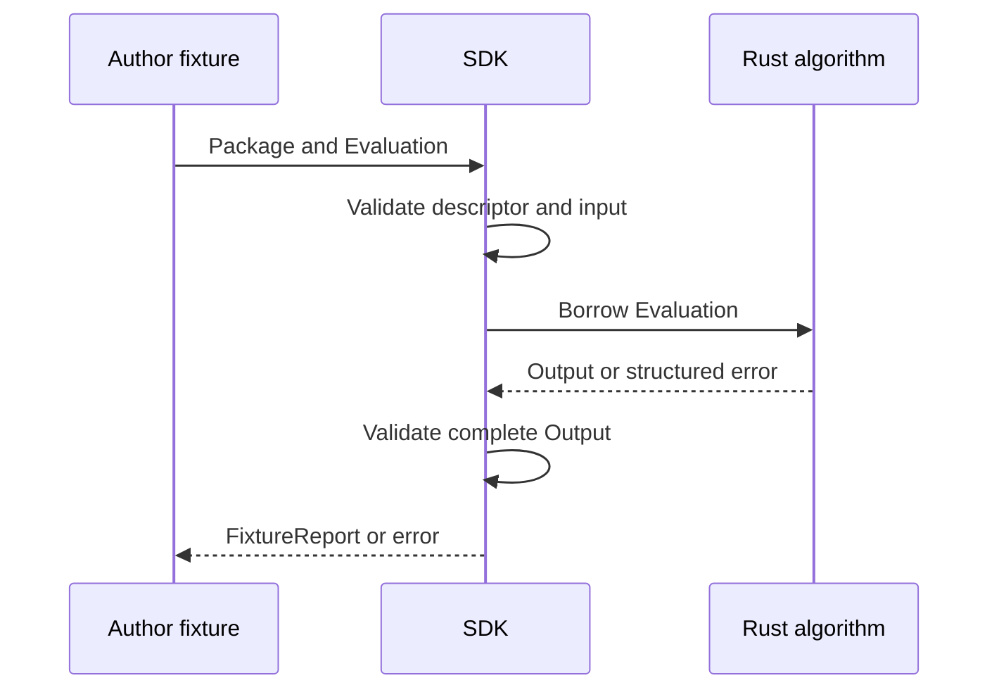

# Analysis Contract Review

The Rust SDK checks a declared analysis interface before and after a computation.
Production discovery and graph owners call shared built-in Rust algorithms.
The host retains identity, proof, result assembly, storage, and notification
authority. Read the [approved plan](phase-7-5-2-analysis-contract-and-sdk.md)
and the [portable SDK guide](../../../../../crates/araphor-analysis-sdk/README.md).

Portable SDK source record: `2b9fe8c`, with validation correction
`cb936bd`, graph fixture correction `d00fd54`, and detector example `fadacd5`.
Test error propagation is recorded in `2b9fe8c`. The original SDK commit is
`c85be1d7`; the host contract commit is `412c001b`.
The plan Result records the final source and verification evidence.
The current source also contains the
[current-algorithm follow-up](phase-7-5-2-analysis-contract-and-sdk.md#current-algorithm-migration).
Commit `2e49839a` captures the original outputs before conversion. Read the plan
Result for the migration source state and executed verification. Shared
computation is committed in `2892f27`; native graph inputs are committed in
`53f7674`. The final gate covers the combined source at `53f7674`.

## Intended end state

An author declares typed inputs, parameters, outputs, evidence, reasons, and
checkpoint state once. Inspection and target declarations use the same package
descriptor. Local fixtures verify computation through the portable interface.
The host retains identity, authorization, proof, storage, and commit authority.
This scope stops before installation or executable target adapters.

## Linked implementation flow

These event blocks follow the approved plan. Links identify the current owners.

[FilesCount::package](../../../../../crates/araphor-analysis-sdk/examples/files_count.rs) Author builds a Rust analysis package. 
-> [Package::validate](../../../../../crates/araphor-analysis-sdk/src/descriptor.rs) The SDK checks declared model interfaces. 
-> [Package::interfaces](../../../../../crates/araphor-analysis-sdk/src/bindings.rs) The SDK generates the descriptor and versioned WIT and native interface declarations. 
-> [Package::build](../../../../../crates/araphor-analysis-sdk/src/descriptor.rs) The SDK writes `descriptor.json`, `analysis.wit`, and `analysis.h`. 
-> [Package::test](../../../../../crates/araphor-analysis-sdk/src/fixture.rs) The local Rust fixture runner checks the portable computation contract.

[Fixture](../../../../../crates/araphor-analysis-sdk/src/fixture.rs) Author tests an export against fixtures. 
-> [Evaluation](../../../../../crates/araphor-analysis-sdk/src/evaluation.rs) The fixture supplies typed inputs, evaluation context, parameters, and prior checkpoint. 
-> [Model::input](../../../../../crates/araphor-analysis-sdk/src/validation.rs) The SDK validates those values before computation. 
-> [FilesCount::evaluate](../../../../../crates/araphor-analysis-sdk/examples/files_count.rs) Ordinary algorithm code returns datasets and evidence references; stateful exports also return the next checkpoint. 
-> [Model::output](../../../../../crates/araphor-analysis-sdk/src/validation.rs) Shared contract validation checks the declared outputs and limits. 
-> [FixtureReport](../../../../../crates/araphor-analysis-sdk/src/fixture.rs) The test result identifies the export, implementation, fixture, package, and input revisions.

[SensitiveAccess::evaluate](../../../../../crates/araphor-analysis-sdk/examples/sensitive_access.rs) Author tests a detector against an exact baseline. 
-> [Evaluation::input](../../../../../crates/araphor-analysis-sdk/src/evaluation.rs) The function obtains named sensitive-read and baseline inputs. 
-> The detector requires complete baseline coverage with no selection limits. 
-> The detector compares each subject/resource pair with the baseline. 
-> A pair outside the baseline produces a finding, a typed reason with the baseline revision, and evidence to the event row. 
-> [Package::test](../../../../../crates/araphor-analysis-sdk/src/fixture.rs) The SDK checks the findings and returns the exact input revisions and coverage. 
-> An incomplete baseline returns `Incomplete`; it produces no report.

[Output](../../../../../crates/araphor-analysis-sdk/src/evaluation.rs) An export returns an invalid schema, reference, or checkpoint. 
-> [CheckedEvaluation::validate_output](../../../../../crates/araphor-analysis-sdk/src/validation.rs) Validation rejects the complete result with a structured error. 
-> [Package::test](../../../../../crates/araphor-analysis-sdk/src/fixture.rs) The fixture runner returns no report. It has no durable commit call. 
-> **Implemented outside this phase:** [AnalysisStore::commit_graph](../../../../../crates/araphor-data/src/analysis/progress.rs) remains the production graph commit owner. The SDK fixture does not call that owner.

[DiscoveryOwner and GraphAndFindingOwner](../../../../../crates/araphor-data/src/lib.rs) An existing discovery or graph owner evaluates accepted input. 
-> [GraphAndFindingOwner::window_context](../../../../../crates/araphor-data/src/graph/input.rs) The owner freezes the exact input revisions and context. 
-> [GraphDerivation::evaluation](../../../../../crates/araphor-data/src/graph/derive/adapter/mod.rs) The shared adapter supplies bounded SDK datasets from the frozen retained window. 
-> [GraphAndFindingOwner::derive](../../../../../crates/araphor-data/src/graph/derive.rs) The owner calls the shared built-in Rust algorithm through the SDK contract. 
-> [GraphDerivation::apply_output](../../../../../crates/araphor-data/src/graph/derive/adapter/output.rs) The owner validates output references and constructs domain results with the existing identity, coverage, and proof owners. 
-> [AnalysisStore::commit_graph](../../../../../crates/araphor-data/src/analysis/progress.rs) AnalysisStore commits through the existing production path. 
-> [NotificationRouter](../../../../../crates/araphor-data/src/notification/mod.rs) NotificationRouter retains required routes and deadlines.

[GraphAndFindingOwner::process](../../../../../crates/araphor-data/src/graph/live.rs) The built-in evaluation fails or its input expires. 
-> [GraphAndFindingOwner::commit_bounded_window](../../../../../crates/araphor-data/src/graph/commit.rs) The owner returns an error before commit and retains the last complete result. 
-> [Graph expiry owner](../../../../../crates/araphor-data/src/graph/expiry.rs) The existing owner records incomplete coverage for expired input. 
-> [AnalysisStore::commit_graph](../../../../../crates/araphor-data/src/analysis/progress.rs) Retry uses the existing replay and commit rules.

**Not implemented:** executable artifact builds, runtime bindings, installation,
admission, scheduling, or detector activation. `build` writes declarations.
Its file writes are sequential; an I/O error can leave partial files.
`inspect` reads the descriptor and does not call algorithm code.

## Reading route and owners

Read the public [crate exports](../../../../../crates/araphor-analysis-sdk/src/lib.rs),
then the following owners in order. The SDK has no host store or Control dependency.

| Owner | Input, state, and output | Mutation and lifetime |
| --- | --- | --- |
| [Package, Model, Port](../../../../../crates/araphor-analysis-sdk/src/model.rs) | Identity, revision, named schemas, dependencies, reasons, limits, and state version. | The author owns these values. Validation does not load dependencies or execute code. |
| [Evaluation](../../../../../crates/araphor-analysis-sdk/src/evaluation.rs) | Named Arrow batches, revisions, coverage, source windows, parameters, context, and prior state. | The fixture owns the input. Computation borrows it for one call. |
| [Package::interfaces](../../../../../crates/araphor-analysis-sdk/src/bindings.rs) | One validated descriptor supplies JSON and both interface declarations. | Generated strings are owned return values. Inspection has no executable loader. |
| [Model](../../../../../crates/araphor-analysis-sdk/src/validation.rs) | Declared schemas and reduced evaluation limits. | A checked evaluation borrows the selected model. Validation counters and reference sets end with each check. |
| [BatchBudget](../../../../../crates/araphor-analysis-sdk/src/validation/batch.rs) | Arrow batches, declared schemas, and data bounds. | Counters reject excess data. Range checks inspect selected non-null values without copying child buffers. |
| [Package::test](../../../../../crates/araphor-analysis-sdk/src/fixture.rs) | One fixture and one Rust function. | The function runs once after input checks. A report owns the checked output and copies revision metadata. |
| [Discovery::evaluate](../../../../../crates/araphor-analysis-builtins/src/discovery/mod.rs) | Normalized records, context, coverage, lifecycle, snapshots, or baseline groups. | One call owns the computation state. The production adapter reconstructs and validates the domain output. |
| [Detector::evaluate](../../../../../crates/araphor-analysis-builtins/src/graph/contract.rs) | Qualified observations, facts, and a bounded-window manifest. | Each call returns selections, candidates, evidence, reasons, and state. No store or authority callback exists. |
| [GraphAndFindingOwner::analysis_package](../../../../../crates/araphor-data/src/graph/contract.rs) | Current HF package ID. | Returns the same descriptor used by the shared detector implementation. |
| [GraphAnalysisInputsV1](../../../../../crates/araphor-data/src/query/analysis.rs) | Selected native subjects, relationships, and version manifest. | Owns Arrow buffers and a query lease. The caller keeps this owner alive through computation. Drop releases the reservation. |
| [GraphDerivation::apply_output](../../../../../crates/araphor-data/src/graph/derive/adapter/output.rs) | Checked SDK output, finding candidates, reasons, and evidence. | Rejects inconsistent references and details before the owner accepts a result. |

The Rust fixture runs trusted code in the test process. An error discards the
report; it does not undo arbitrary effects inside the author function. A panic
uses ordinary Rust behavior. Data limits do not enforce a process memory limit,
deadline, cancellation, or sandbox.

Detector authors use Arrow schemas and ordinary Rust functions. The
[detector example](../../../../../crates/araphor-analysis-sdk/examples/sensitive_access.rs)
uses named input lookup and Arrow column access. It borrows baseline and event
strings until result assembly. Arrow errors convert to the SDK error with `?`
and retain their source. No algorithm trait, rule language, or second schema
model is required. A zero-row finding output means no match in the supplied
events; the report still records input coverage. This example does not prove
malicious activity or preventive action.

## Data and validation route

[Package::validate](../../../../../crates/araphor-analysis-sdk/src/descriptor.rs)
checks contract version `1`, names, duplicate declarations, schema types,
checkpoint version, reason namespace, numeric tolerance, and positive limits.
Encoded descriptors have a 1 MiB bound. Local dependency bindings require the
exact package revision and equal input/output schemas. External resolution and
cycle checks belong to admission.

[Model::input](../../../../../crates/araphor-analysis-sdk/src/validation.rs)
requires every named input exactly once. Schemas include nullability and
metadata. Parameters have one row, or are absent for an empty parameter schema.
Source windows carry exact source bytes and ordered UTC bounds. Prior state can
be absent on the initial call. A supplied checkpoint must match its declaration.

[BatchBudget](../../../../../crates/araphor-analysis-sdk/src/validation/batch.rs)
checks batches, rows, Arrow memory bytes, and envelope text. Input, output, prior
state, and next state have separate budgets. Parameters use the input budget.
Evidence and reason details use the output budget. A limit error rejects the
result. No client SQL display limit truncates the computation input.

Arrow integer widths retain exact values. Timestamps use signed nanoseconds and
`UTC`; boot time can use exact `UInt64` with unit metadata. Lists, fixed-size
lists, structs, and binary fields represent nested or encoded data. Floating
values must be finite when selected and non-null. Range checks apply list
offsets and parent null masks to nested values. Physical Arrow validation and
memory bounds still cover retained backing storage. A `Null` field must be
nullable at every schema depth. A presence field distinguishes
a missing source value from a nullable value. The SDK validates tolerance
bounds; author assertions perform numeric result comparisons.

[Model::output](../../../../../crates/araphor-analysis-sdk/src/validation.rs)
checks every output, each global dataset row reference, duplicate evidence,
required evidence, namespaced reason codes, one-row reason details, and next
state. Named outputs can have different row counts. Input order is batch order,
then row order. Algorithms define output ordering and tie rules. Evidence refers
to named input rows. Retained prior results must be inputs when they supply
evidence; checkpoint rows cannot supply evidence.

## Host contract and graph boundary

[DiscoveryOwner::derive_recorded](../../../../../crates/araphor-data/src/discovery/sdk/atoms.rs)
validates the original manifest and supplies normalized rows to `Discovery`.
The [snapshot adapter](../../../../../crates/araphor-data/src/discovery/sdk/snapshot.rs)
uses the same package for merge and display groups. The
[comparison adapter](../../../../../crates/araphor-data/src/discovery/sdk/compare.rs)
supplies reviewed baseline keys and reconstructs the existing comparison output.
The host restores its typed key order and validates each reconstructed snapshot.

Discovery snapshots can contain several source streams and cursor ranges. The
adapter retains those exact ranges in coverage rows. It does not infer a UTC
window or evaluation clock. The aggregate SDK coverage remains unknown; the
declared coverage rows supply each source state. The invocation revision binds
the full input through [streamed hashing](../../../../../crates/araphor-data/src/digest.rs).

[DiscoveryOwner::context_input](../../../../../crates/araphor-data/src/discovery/sdk/context.rs)
calls the existing authorized context selector. Its bounded packet retains the
selector version, exact access, evidence, context, omissions, and missing facts.
This input has a declared UTC window and cutoff. The reverse conversion checks
the packet against its SDK revision, coverage, and window. Context selection
remains a host trust operation; no package can replace that decision.

[Current host descriptors](../../../../../crates/araphor-data/src/graph/contract.rs)
cover `HF-PROC-001`, `HF-DW-001`, and `HF-XNODE-001`, export `detect`, and revision
`1`. They return the shared detector descriptors. Inputs contain observations,
qualified facts, and a bounded-window manifest. Outputs contain subject
selections, relationship candidates, finding candidates, and checkpoint state.
The host retains complete original records and exact revision keys. The adapter
maps output row references to these records. It constructs the existing
`GraphPackageCheckpointV1`, branches, and findings through the existing owners.

[Rows](../../../../../crates/araphor-analysis-builtins/src/rows.rs) encodes each
typed built-in row in an Arrow binary value. Field metadata contains a stable
type ID, JSON encoding, and generated JSON schema. The decoder checks each row.
The format retains exact integer values and permits multiple batches. It does
not encode the complete input graph in one row. The generic SDK also accepts
ordinary Arrow columns, as its author examples show.

[GraphDerivation::apply_output](../../../../../crates/araphor-data/src/graph/derive/adapter/output.rs)
checks candidate references and requires the formal reason and evidence to match
each finding. [FindingV1::validate](../../../../../crates/araphor-data/src/graph/model.rs)
retains the host identity and evidence checks on the assembled result.
[GraphAndFindingOwner::process](../../../../../crates/araphor-data/src/graph/live.rs)
uses the shared computation through the existing derive and
[commit_bounded_window](../../../../../crates/araphor-data/src/graph/commit.rs).
The SDK descriptors are not an installed-package dispatch path.

**Implemented outside this phase:** the host selects authorized native graph
rows through [traversal version checks](../../../../../crates/araphor-data/src/analysis/extraction/graph/traversal/versions.rs).
The [production adapter](../../../../../crates/araphor-data/src/query/analysis.rs)
returns SDK inputs from those rows. It uses the existing graph row encoder and
whole-version authorization. The adapter preserves sensitivity checks,
cancellation, scan bounds, and simultaneous row and Arrow-buffer charges. It
retains one manifest row for each selected version, including an empty version.
The manifest includes exact source cursors, result and commit IDs, input revision,
selected counts, and traversal boundaries. Cursor windows do not become UTC
windows. The client display row limit does not truncate these inputs.

`graph_inputs` is a trusted-owner API. Its caller supplies the authorized tenant,
sources, bindings, and optional historical result IDs. The method narrows that
selection. A client-facing execution owner must obtain and maintain the caller's
authorization. The returned owner holds the input reservation; a consumer must
keep the owner alive while it uses cloned Arrow references. Durable read handles
close before Arrow conversion and computation.

Current graph detectors consume retained observations and facts. Algorithms
that consume stored graph relations use `graph_inputs`. These are two input
paths; the current detectors do not read their own previous graph as input.

[FindingReasonV1](../../../../../crates/araphor-data/src/graph/model.rs) and its
[analysis mapping](../../../../../crates/araphor-data/src/graph/contract.rs) still
accept only the eleven current reasons and three HF package IDs. The SDK accepts
declared package namespaced reasons. **Not implemented:** general installed
reason storage and mapping. [Wasm execution](phase-7-5-4-wasm-execution.md) must
accept new namespaced reason codes and typed details while preserving historical
findings and their existing codes. A descriptor grants no physical authority.

## Target declarations and lifetimes

[WIT](../../../../../crates/araphor-analysis-sdk/src/bindings/analysis.wit)
declares versioned evaluation/result records and named Arrow IPC bytes. The only
host operation is `cancelled`; the package exports `evaluate`. **Not implemented:**
IPC encoding/decoding, component instantiation, cancellation enforcement, or
target execution. WIT parsing proves declaration syntax, not runtime behavior.

[The C header](../../../../../crates/araphor-analysis-sdk/src/bindings/analysis.h)
declares Arrow streams within one worker process. Request bytes and streams are
borrowed until `evaluate` returns. The callee does not release input streams.
Output must not borrow request storage. Consumers release received Arrow arrays;
the producer releases unread output streams and response buffers. Every call
requires response release, including errors. A second release must be harmless.
The return error code must equal `response.error.code`.
Panics and exceptions must not cross this boundary. **Not implemented:** native
entrypoint loading, pointer checks, transport, release enforcement, or isolation.
The C syntax test checks constants and declarations, not ABI execution or layout
compatibility across targets. This header defines no BPF or durable byte layout.

## Tests and verification limits

| Contract | Source tests |
| --- | --- |
| Example and input gating | [SDK tests](../../../../../crates/araphor-analysis-sdk/src/tests.rs): `count_fixture_builds`, `invalid_input_blocks_execution`, `batches_keep_all_rows`, `multiple_inputs_variable_outputs`. |
| Detector authoring | [Detection tests](../../../../../crates/araphor-analysis-sdk/src/tests/detection.rs): `detector_matches_exact_baseline`, `clean_access_has_none`, `detection_evidence_spans_batches`, `incomplete_baseline_blocks_detection`, `empty_baseline_retains_revision`, `named_inputs_ignore_order`, `missing_input_is_structured`. |
| Rejection and state | [Boundary tests](../../../../../crates/araphor-analysis-sdk/src/tests/boundaries.rs): `output_evidence_is_exact`, `checkpoint_version_and_schema`, `reason_namespace_and_details`, `limits_reject_complete_result`, `failure_returns_no_report`, `rejects_descriptor_duplicates`. |
| Precision and retained evidence | [Semantic tests](../../../../../crates/araphor-analysis-sdk/src/tests/semantics.rs): `nested_vectors_preserve_precision`, `missing_differs_from_null`, `prior_result_retains_evidence`, `rejects_nonfinite_parameters`, `invalid_output_blocks_report`. |
| Selected Arrow values | [Array tests](../../../../../crates/araphor-analysis-sdk/src/tests/arrays.rs): `sliced_lists_skip_hidden`, `struct_masks_nested_list`, `fixed_lists_skip_hidden`, `floats_check_selected_values`, `null_type_requires_nullable`. |
| Selected graph and composition | [Graph tests](../../../../../crates/araphor-analysis-sdk/src/tests/graph.rs): `graph_keeps_version_manifest`, `dependency_has_one_binding`. |
| Declaration consistency | [Binding tests](../../../../../crates/araphor-analysis-sdk/src/bindings/tests.rs): `declarations_share_descriptor`, `descriptor_size_is_bounded`, `wit_declaration_parses`, `native_declaration_compiles`. |
| Host mapping | [Host contract tests](../../../../../crates/araphor-data/src/graph/contract/tests.rs): `descriptor_preserves_owners`, `reason_codes_are_reversible`. [Output adapter tests](../../../../../crates/araphor-data/src/graph/derive/adapter/tests.rs): `candidate_reason_matches_contract`, `candidate_requires_host_validation`, `candidate_reason_is_exact`, `candidate_evidence_is_exact`. |
| Native graph input | [Production adapter tests](../../../../../crates/araphor-data/src/query/analysis/tests.rs): `graph_sdk_native_rows`, `graph_sdk_empty_history`, `graph_sdk_scope_sensitivity`, `graph_sdk_resource_limits`, `graph_sdk_offset_limit`. The computation joins version-qualified subjects and relationships with the manifest. |
| Context input | [Context adapter tests](../../../../../crates/araphor-data/src/discovery/context/tests/sdk.rs): `context_sdk_packet`, `context_sdk_metadata`, `context_sdk_version`. The [production round trip](../../../../../crates/mithril-e2e/src/discovery/roundtrip/context.rs) checks selected context and cutoff behavior. |

The source inventories cover [current algorithms](current-contract-inventory.md),
[Discovery Engine](discovery-contract-inventory.md), and
[Security Analytics](security-contract-inventory.md). They record later exports,
state, delegated operations, target constraints, and source differences. They do
not prove runtime ports, incident prevention, or performance. Read the plan
Result for executed checks. This guide adds no independent test-run claim.
