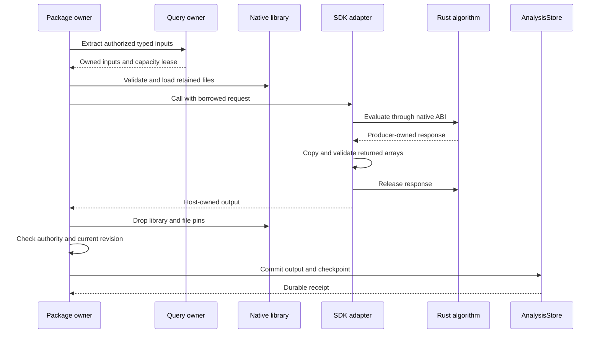

# Native execution implementation review

Current command status, 2026-10-19: The old Analysis owner and its qualification
harness have been removed. The cases `graph-notification`
are no longer accepted by `mithril_discovery_test`. The commands and results
below remain historical proof for their recorded source. They do not qualify
the current replacement. Read the [current plan](../../../araphor-package-jobs.md)
for the supported path and remaining work.

This guide covers installed Rust native plugins in Araphor's process. The
implementation uses the existing analysis contract, authorization owners, and
durable commit path. Read the [native execution plan](phase-7-5-5-native-execution.md)
and [approved design](native-execution-design.md) for scope and decisions.
SDK means Software Development Kit. CPU means central processing unit. ELF
means Executable and Linkable Format. IPC means inter-process communication.

## Intended end state

An installed native plugin executes its declared export with authorized typed
inputs. The same shared computation produces the same datasets, evidence,
reasons, coverage, and checkpoints as its trusted Rust and Wasm forms. A failed
or cancelled evaluation cannot commit a partial result. Restart restores the
last complete durable commit. Native execution does not select Wasm as a
fallback. Qualification is **Done** on the recorded Linux x86-64 GNU host with
glibc 2.39. Read the [final acceptance](phase-7-5-5-native-execution.md#final-eight-deliverable-acceptance)
for exact source cuts, terminal proof, and limits.

## Implementation review flow

[install](https://github.com/Ereborlabs/erebor-runtime/blob/d20ee0fd6f364f9b8d03eddf50a97bc60c9e02a8/crates/araphor-data/src/package/lifecycle.rs) Admission evaluates an installed native plugin
  -> [Qualification](https://github.com/Ereborlabs/erebor-runtime/blob/d20ee0fd6f364f9b8d03eddf50a97bc60c9e02a8/crates/araphor-data/src/package/native/artifact.rs) the package owner checks platform, CPU, system libraries, and ABI requirements
  -> [NativeExecution::admit](https://github.com/Ereborlabs/erebor-runtime/blob/d20ee0fd6f364f9b8d03eddf50a97bc60c9e02a8/crates/araphor-data/src/package/native/mod.rs) the package owner validates the admitted native library and its dependencies
  -> [Bundle::implementation](../../../../../crates/araphor-data/src/package/bundle.rs) the package owner uses the plugin's declared native implementation

[InstalledAnalysis::evaluate](https://github.com/Ereborlabs/erebor-runtime/blob/d20ee0fd6f364f9b8d03eddf50a97bc60c9e02a8/crates/araphor-data/src/package/installed.rs) The scheduler invokes the export
  -> [evaluate_native](https://github.com/Ereborlabs/erebor-runtime/blob/d20ee0fd6f364f9b8d03eddf50a97bc60c9e02a8/crates/araphor-data/src/query/model/component.rs) the package owner supplies authorized typed batches to the Rust native adapter
  -> [Invocation::call](../../../../../crates/araphor-analysis-sdk/src/native/mod.rs) the SDK adapter calls the compiled algorithm through the native interface
  -> [Decoder](../../../../../crates/araphor-analysis-sdk/src/native/decode.rs) the adapter returns bounded outputs and its next checkpoint
  -> [commit authorization](https://github.com/Ereborlabs/erebor-runtime/blob/d20ee0fd6f364f9b8d03eddf50a97bc60c9e02a8/crates/araphor-data/src/package/installed/commit.rs) host validation submits the result through the existing atomic commit path
  -> [commit_package](https://github.com/Ereborlabs/erebor-runtime/blob/4e6b4af668cba0270408ed809275482b83930a23/crates/araphor-data/src/analysis/packages/commit.rs) AnalysisStore commits the result and checkpoint together

[NativeExecution::evaluate](https://github.com/Ereborlabs/erebor-runtime/blob/d20ee0fd6f364f9b8d03eddf50a97bc60c9e02a8/crates/araphor-data/src/package/native/mod.rs) Native computation returns an error or finishes after cancellation
  -> [NativeLibrary](https://github.com/Ereborlabs/erebor-runtime/blob/d20ee0fd6f364f9b8d03eddf50a97bc60c9e02a8/crates/araphor-data/src/package/native/loading.rs) the package owner rejects its output and releases evaluation resources
  -> [evaluation](https://github.com/Ereborlabs/erebor-runtime/blob/d20ee0fd6f364f9b8d03eddf50a97bc60c9e02a8/crates/araphor-data/src/package/evaluation.rs) AnalysisStore retains the prior active revision and committed state
  -> [evaluation](https://github.com/Ereborlabs/erebor-runtime/blob/d20ee0fd6f364f9b8d03eddf50a97bc60c9e02a8/crates/araphor-data/src/package/evaluation.rs) retry uses the same declared implementation and operation identity

[native fault fixture](https://github.com/Ereborlabs/erebor-runtime/blob/d20ee0fd6f364f9b8d03eddf50a97bc60c9e02a8/crates/araphor-data/src/package/tests/native/restart.rs) A native fault terminates Araphor
  -> [in-process call](https://github.com/Ereborlabs/erebor-runtime/blob/d20ee0fd6f364f9b8d03eddf50a97bc60c9e02a8/crates/araphor-data/src/package/native/loading.rs) the process cannot perform worker recovery
  -> [AnalysisStore::open](../../../../../crates/araphor-data/src/analysis/mod.rs) restart restores the prior complete durable commit
  -> [Bundle::implementation](../../../../../crates/araphor-data/src/package/bundle.rs) the package owner does not select Wasm as a fallback

The committed fault fixture passes with the final native libraries. The linked
recovery owner predates native execution. No worker recovery path exists in
this implementation.

## Source build and admission

Start with [workspace_native](../../../../../crates/araphor-component-build/src/workspace.rs).
The author build invokes locked Cargo for the host target. The build emits six
native libraries from the existing discovery, process, credentials, Kubernetes,
detector, and runtime fixture sources. Native and Wasm exports call the same
shared Rust computations. Compilation occurs before installation.

[ComponentBuilder::package_native](../../../../../crates/araphor-component-build/src/lib.rs)
writes a native plugin folder with a descriptor, library, dependency files, and
supplied qualification metadata. The builder checks declared exports and
dependency names. Dependencies occupy the same folder as the root library.
Read the [current package storage guide](../../../../guides/araphor-binary-package-storage-review.md)
for OCI layout, stored bytes, and quota accounting. Installation does not invoke
a compiler or download dependencies.

The [bundle](../../../../../crates/araphor-data/src/package/bundle.rs) contains
one declared implementation for an export. Admission rejects ambiguous target
declarations. Qualified native metadata contains exports, target, CPU features, contract
version, system library requirements, and
embedded dependency bytes with digests. The legacy optional metadata shape
remains readable. Readability does not prove that a legacy native artifact can
execute.

[Qualification::inspect](https://github.com/Ereborlabs/erebor-runtime/blob/d20ee0fd6f364f9b8d03eddf50a97bc60c9e02a8/crates/araphor-data/src/package/native/artifact.rs)
reads object metadata without loading plugin code. Admission checks the exact
runtime build target, dynamic object format, architecture, byte order, and
pointer width. It checks declared CPU features and the ABI contract version.
CPU metadata is a declaration; inspection does not prove which instructions
the algorithm will execute.

The same module checks dependency digests, names, and an available ELF shared
object name (SONAME). Required symbols and symbol versions must have a provider
reachable through the declared dependency graph. System library transitive
requirements use the same check. An unrelated declared library cannot satisfy
an unreachable provider. The ELF runtime search path permits the approved
`$ORIGIN` sibling layout. The loader does not accept arbitrary search paths.

## Owners and retained state

| Owner | State and lifetime | Inputs and effects | Contract tests |
| --- | --- | --- | --- |
| [AnalysisPackageOwner](https://github.com/Ereborlabs/erebor-runtime/blob/d20ee0fd6f364f9b8d03eddf50a97bc60c9e02a8/crates/araphor-data/src/package/owner.rs) | The constructor creates the execution owners, lifecycle lock, and four operation permits. The owner closes local resources on drop. Lifecycle operations change admitted and active revisions. | Install, run, update, rollback, and remove use existing authority and store owners. | [lifecycle](https://github.com/Ereborlabs/erebor-runtime/blob/d20ee0fd6f364f9b8d03eddf50a97bc60c9e02a8/crates/araphor-data/src/package/tests/native/lifecycle.rs), [failures](https://github.com/Ereborlabs/erebor-runtime/blob/d20ee0fd6f364f9b8d03eddf50a97bc60c9e02a8/crates/araphor-data/src/package/tests/native/failures.rs) |
| [NativeExecution](https://github.com/Ereborlabs/erebor-runtime/blob/d20ee0fd6f364f9b8d03eddf50a97bc60c9e02a8/crates/araphor-data/src/package/native/mod.rs) | The package owner creates this owner with native limits. Each evaluation creates a local library lifetime. | Admission validates metadata. Evaluation returns owned SDK output or a typed error. | [native loader tests](https://github.com/Ereborlabs/erebor-runtime/blob/d20ee0fd6f364f9b8d03eddf50a97bc60c9e02a8/crates/araphor-data/src/package/native/loading.rs) |
| [NativeLibrary](https://github.com/Ereborlabs/erebor-runtime/blob/d20ee0fd6f364f9b8d03eddf50a97bc60c9e02a8/crates/araphor-data/src/package/native/loading.rs) | One evaluation owns the root library, system library handles, retained files, and private directory. Drop closes these resources after output copying and producer release. | Load reads exact retained files. Call invokes the ABI table. | [sealed closure, replacement, and ABI tests](https://github.com/Ereborlabs/erebor-runtime/blob/d20ee0fd6f364f9b8d03eddf50a97bc60c9e02a8/crates/araphor-data/src/package/native/loading.rs) |
| [QueryBudget](https://github.com/Ereborlabs/erebor-runtime/blob/d20ee0fd6f364f9b8d03eddf50a97bc60c9e02a8/crates/araphor-data/src/query/model/component.rs) | The query owner reserves input and output capacity. Input and result leases release capacity on drop. | Typed input extraction and bounded output construction consume existing query capacity. | [component tests](https://github.com/Ereborlabs/erebor-runtime/blob/d20ee0fd6f364f9b8d03eddf50a97bc60c9e02a8/crates/araphor-data/src/query/model/component/tests.rs) |
| [InstalledEvaluation](https://github.com/Ereborlabs/erebor-runtime/blob/d20ee0fd6f364f9b8d03eddf50a97bc60c9e02a8/crates/araphor-data/src/package/installed.rs) | Evaluation retains the admitted revision, actual artifact identity, output lease, and operation permit until the result drops. | Current authority and exact revision checks precede execution and commit. | [interruption](https://github.com/Ereborlabs/erebor-runtime/blob/d20ee0fd6f364f9b8d03eddf50a97bc60c9e02a8/crates/araphor-data/src/package/tests/native/interruption.rs), [checkpoint](https://github.com/Ereborlabs/erebor-runtime/blob/d20ee0fd6f364f9b8d03eddf50a97bc60c9e02a8/crates/araphor-data/src/package/tests/native/checkpoint.rs) |
| [AnalysisStore](https://github.com/Ereborlabs/erebor-runtime/blob/4e6b4af668cba0270408ed809275482b83930a23/crates/araphor-data/src/analysis/packages/commit.rs) | Durable state outlives the process. Existing commit and recovery owners change this state. | One commit records results, checkpoints, progress, and retained references. | [checkpoint](https://github.com/Ereborlabs/erebor-runtime/blob/d20ee0fd6f364f9b8d03eddf50a97bc60c9e02a8/crates/araphor-data/src/package/tests/native/checkpoint.rs), [restart](https://github.com/Ereborlabs/erebor-runtime/blob/d20ee0fd6f364f9b8d03eddf50a97bc60c9e02a8/crates/araphor-data/src/package/tests/native/restart.rs) |

Closing a library handle does not remove an installed revision. Package removal
and rollback use the existing lifecycle owner. Retained historical references
preserve the exact target and artifact when those fields are available. Read
[history](https://github.com/Ereborlabs/erebor-runtime/blob/d20ee0fd6f364f9b8d03eddf50a97bc60c9e02a8/crates/araphor-data/src/package/installed/history.rs)
for the legacy reference rules and mismatch rejection.

## Supervisor preparation and cancellation

[The supervisor](https://github.com/Ereborlabs/erebor-runtime/blob/d20ee0fd6f364f9b8d03eddf50a97bc60c9e02a8/crates/araphor-data/src/package/supervision.rs)
loads bundles, checks admission, and skips prepared exports inside its existing
blocking task. These operations do not block the async runtime thread. The
supervisor groups exports by tenant, scope, and root. It creates one group
control, cancellation guard, and authority subscription before dispatch. Each
model uses a 30-second child control. The task retains its operation permit
until it exits. Stop requests and authority changes cancel the control, then join the
dispatched blocking task before `serve` returns. Activation-page reads and
orphan pruning are also awaited. ClientListener already awaits `serve` before
store reopen. Cancellation does not terminate a blocking task; a stalled native
call can delay shutdown. Control checks after bundle loading and admission
reject a late completion.

The same owner passes the operation control to the failure-status transaction.
The transaction checks cancellation before commit. A cancelled failure cannot
change readiness metadata or mark retained results stale. Successful result
commits retain their existing authorization and generation checks.
[The interruption tests](https://github.com/Ereborlabs/erebor-runtime/blob/d20ee0fd6f364f9b8d03eddf50a97bc60c9e02a8/crates/araphor-data/src/package/tests/interruption.rs)
poll after stop and check responsive cancellation before admission release,
a pending shutdown join, three available operation permits while admission is
held, four after task exit, and unchanged activation and complete result records.
The test distinguishes prompt cancellation from completed service shutdown.
A separate test cancels the failure control and checks the exact cancellation
error and unchanged state.

## Evaluation and Arrow ownership

[Graph input extraction](https://github.com/Ereborlabs/erebor-runtime/blob/d20ee0fd6f364f9b8d03eddf50a97bc60c9e02a8/crates/araphor-data/src/query/analysis.rs)
returns frozen subject, relationship, and manifest rows. Database readers remain
local to [extraction](../../../../../crates/araphor-data/src/analysis/extraction.rs).
The extraction call closes these readers before native computation starts.
The input owner and its query lease remain alive while the adapter borrows the
arrays. Graph traversal and input selection retain the existing authorization
and coverage rules.

The [native query path](https://github.com/Ereborlabs/erebor-runtime/blob/d20ee0fd6f364f9b8d03eddf50a97bc60c9e02a8/crates/araphor-data/src/query/model/component.rs)
reserves retained arrays and adapter allocation capacity. The reservation then
shrinks to retained input capacity. This path does not use the Wasm input byte
quota or a Wasm IPC writer. The
[query evaluator](https://github.com/Ereborlabs/erebor-runtime/blob/d20ee0fd6f364f9b8d03eddf50a97bc60c9e02a8/crates/araphor-data/src/query/model.rs)
checks output capacity and the evaluation deadline. A returned result retains
its output lease. Reviewers must release a result before another result needs
the same bounded capacity.

[Streams](../../../../../crates/araphor-analysis-sdk/src/native/streams.rs)
use the Arrow C Data and C Stream interfaces. The receiving side copies array
storage with the existing
[owned allocation code](../../../../../crates/araphor-analysis-sdk/src/wire/codec/allocation.rs).
Returned host output does not retain guest array pointers. The native path does
not encode and decode Arrow IPC for transport.

The [decoder](../../../../../crates/araphor-analysis-sdk/src/native/decode.rs)
accounts for aggregate rows, batches, and bytes. Output limits are independent
of input limits. The adapter validates dataset schemas and checkpoint bounds.
The [graph adapter](https://github.com/Ereborlabs/erebor-runtime/blob/d20ee0fd6f364f9b8d03eddf50a97bc60c9e02a8/crates/araphor-data/src/graph/derive/adapter/mod.rs)
and [discovery adapter](https://github.com/Ereborlabs/erebor-runtime/blob/d20ee0fd6f364f9b8d03eddf50a97bc60c9e02a8/crates/araphor-data/src/discovery/sdk/mod.rs)
retain domain validation for evidence, reasons, coverage, and graph results.
Successful ABI decoding does not grant commit authority.

## Native ABI and release rules

Read the [C header](../../../../../crates/araphor-analysis-sdk/src/bindings/analysis.h),
[Rust ABI types](../../../../../crates/araphor-analysis-sdk/src/native/abi.rs),
and [adapter](../../../../../crates/araphor-analysis-sdk/src/native/mod.rs) together.
The Application Binary Interface (ABI) uses `repr(C)` types and the current
process representation. It is not a persisted or network byte format. Exact
target, byte order, and pointer width checks precede loading.

The exported `araphor_analysis_get_api_v1` accessor returns a static API table.
The loader rejects null or misaligned table pointers. The adapter checks the
version, exact table size, and required function pointers. These checks do not
make arbitrary native pointers memory-safe. Native authors remain responsible
for the ABI memory contract.

| Value | Producer | Consumer and validity rule | Release owner |
| --- | --- | --- | --- |
| Request | Host [Exchange](../../../../../crates/araphor-analysis-sdk/src/native/exchange.rs) | The guest borrows strings, metadata, input streams, parameters, and checkpoint until evaluation returns. Strings use UTF-8. | Host; the guest does not release request streams. |
| Response | Guest adapter | The host starts with a zero response. Status equals the response error code. Output cannot borrow the request. | Producer callback; the host invokes release for success and failure. |
| Output arrays | Guest Arrow stream | The host checks schema and limits, then copies buffers into host-owned storage. | Host closes imported arrays before producer response release. |
| Error | Guest adapter | The host validates the error code and bounded UTF-8 error fields. | Producer response release. |
| API table | Native library | Version and exact size match ABI v1. Required callbacks are present. | Library lifetime; the host retains the library through all callbacks. |

The host bounds an error field to 1,024 bytes and the input context byte limit
before it dereferences or copies the field. The response guard releases output
on malformed responses and decoding errors.
Producer release clears the response and permits a repeated release without an
additional effect. The SDK catches Rust panics in the guest adapter and release
callbacks. Foreign exceptions and invalid native memory accesses cannot cross
the ABI safely. Read the
[ABI tests](../../../../../crates/araphor-analysis-sdk/src/native/tests.rs)
for layout, malformed output, panic, cancellation, repeated release, and
independent output capacity cases.

## Loading limits and platform evidence

On Linux, [FilePin](https://github.com/Ereborlabs/erebor-runtime/blob/d20ee0fd6f364f9b8d03eddf50a97bc60c9e02a8/crates/araphor-data/src/package/native/files.rs)
copies packaged root and dependency bytes into sealed memory files. Private
file-descriptor links retain the sibling `$ORIGIN` layout. Seals prevent writes,
growth, and truncation of these packaged files. System library pins retain the
opened file and validate bytes from that inode. Mapping checks compare device,
inode, and SONAME identity before and after root loading.

System file pins do not prevent writes to the same system-library inode.
Ambient dynamic-loader symbol interposition remains possible. The loader uses
local dynamic loading; it does not create a separate namespace, drop process
privileges, reject the complete process environment, or isolate memory faults.
The author must finish background work before the ABI call returns. A fresh
library handle does not prove that all process-global library state is reset.

Other platforms use retained read-only private files where implemented. The
Linux seal and mapped-file guarantees are not qualified on those platforms.
Current runtime evidence concerns Linux x86-64 GNU only. The source target
checks do not constitute qualification for every target on which Araphor can
compile.

[NativeLimits](https://github.com/Ereborlabs/erebor-runtime/blob/d20ee0fd6f364f9b8d03eddf50a97bc60c9e02a8/crates/araphor-data/src/package/native/mod.rs)
defaults `memory_bytes` and `cpu_seconds` to `None`. Zero is invalid. A positive
hard-cap request returns `Unsupported` for native admission and evaluation.
The same configuration does not disable SQL or Wasm. Query capacity, output
limits, deadlines, and cooperative cancellation remain active. An in-process
call that never returns cannot be forcibly stopped by these checks.

## Authority, retry, and recovery

[Installed execution](https://github.com/Ereborlabs/erebor-runtime/blob/d20ee0fd6f364f9b8d03eddf50a97bc60c9e02a8/crates/araphor-data/src/package/installed.rs)
checks grants, scope, trust, revision, and control before and after computation.
The [commit gate](https://github.com/Ereborlabs/erebor-runtime/blob/d20ee0fd6f364f9b8d03eddf50a97bc60c9e02a8/crates/araphor-data/src/package/installed/commit.rs)
uses the shared lifecycle lock and rejects a stale activation generation,
revision, or authority. Historical evaluations cannot commit. Domain owners
commit graph and discovery results through their existing supported APIs.

The [run owner](https://github.com/Ereborlabs/erebor-runtime/blob/d20ee0fd6f364f9b8d03eddf50a97bc60c9e02a8/crates/araphor-data/src/package/evaluation.rs)
binds retry identity to the declared target and actual native artifact closure.
A changed request conflicts with the existing operation. A returned error
does not commit the proposed output or checkpoint. Failure metadata can record
staleness without replacing the prior complete result.

Update prepares a new immutable revision before activation. Rollback uses the
existing install path for the retained revision. No new rebuild API exists.
Read [activation](https://github.com/Ereborlabs/erebor-runtime/blob/d20ee0fd6f364f9b8d03eddf50a97bc60c9e02a8/crates/araphor-data/src/package/lifecycle/activation.rs)
and [revisions](https://github.com/Ereborlabs/erebor-runtime/blob/d20ee0fd6f364f9b8d03eddf50a97bc60c9e02a8/crates/araphor-data/src/package/lifecycle/revisions.rs)
for parameter, state, and revision rules. A plugin type change requires a
different declared plugin revision; no runtime preference selects the change.

A caught SDK panic returns an error. An abort or memory fault can terminate
Araphor. Process termination cannot release local query permits through Rust
drop. Restart creates new local owners and restores durable state through
`AnalysisStore::open`. The restart test requires the same operation receipt,
checkpoint, and result bytes after a child process fault. No native worker or
Wasm fallback performs recovery.

## Proof route and current status

The following committed tests are review targets. Use the
[phase verification record](phase-7-5-5-native-execution.md) for retained
commands and terminal results.

| Proof | Source and required observations | Retained proof and limit |
| --- | --- | --- |
| Source build and folder | [builder tests](../../../../../crates/araphor-component-build/src/lib.rs): separate native manifest, exact exports, dependency paths and preserved Wasm encoding. | Six final native libraries compile. Compilation does not prove installed execution. |
| ABI | [SDK tests](../../../../../crates/araphor-analysis-sdk/src/native/tests.rs): complete typed output, malformed output release, cancellation, panic, and layout. | 63 SDK tests and strict all-target clippy pass. Final workspace CI session 25541 passes. |
| Loader closure | [artifact](https://github.com/Ereborlabs/erebor-runtime/blob/d20ee0fd6f364f9b8d03eddf50a97bc60c9e02a8/crates/araphor-data/src/package/native/artifact.rs) and [loading tests](https://github.com/Ereborlabs/erebor-runtime/blob/d20ee0fd6f364f9b8d03eddf50a97bc60c9e02a8/crates/araphor-data/src/package/native/loading.rs): platform, symbol versions, reachable providers, sibling loading, sealed files, replacement, SONAME, and typed ABI rejection. | The 18-test gate passes. The later diagnostic fixture correction also passes 18 tests in session 66984. Final source clippy passes in session 25541. Installed runtime proof remains separate. |
| Lifecycle | [native tests](https://github.com/Ereborlabs/erebor-runtime/blob/d20ee0fd6f364f9b8d03eddf50a97bc60c9e02a8/crates/araphor-data/src/package/tests/native/mod.rs): install, update, rollback, removal, checkpoint, denial, cancellation, and restart. | Seven lifecycle tests pass in the final 33-test cut. The separate real panic and SIGABRT restart test also passes with the final artifacts. |
| Four discovery exports | [native discovery tests](https://github.com/Ereborlabs/erebor-runtime/blob/d20ee0fd6f364f9b8d03eddf50a97bc60c9e02a8/crates/araphor-data/src/discovery/sdk/native.rs): populated atoms, merge, groups, compare, reordered inputs, missing context, and coverage. | Both tests pass with the final SDK, loader, and libraries. |
| Three graph exports | [native graph tests](https://github.com/Ereborlabs/erebor-runtime/blob/d20ee0fd6f364f9b8d03eddf50a97bc60c9e02a8/crates/araphor-data/src/graph/derive/adapter/tests/native.rs): complete and gapped inputs, trusted Rust/Wasm/native wire output, evidence, reasons, checkpoints, and derived results. | Complete parity and graph derivation pass after the new test releases its earlier output guards. |
| Large native Arrow input | [large process test](https://github.com/Ereborlabs/erebor-runtime/blob/d20ee0fd6f364f9b8d03eddf50a97bc60c9e02a8/crates/araphor-data/src/graph/derive/adapter/tests/native/large.rs): 185 typed records, retained identities, full output and checkpoint parity through the actual native library. | The final 185-record proof passes. No benchmark or speed claim follows from this case. |
| Installed production APIs | [native qualification](https://github.com/Ereborlabs/erebor-runtime/blob/6a25ba1b34dbaa0a553b1883058938683ce7aaab/crates/mithril-e2e/src/discovery/packages/native.rs) and [case owner](../../../../../crates/mithril-e2e/src/discovery/packages.rs): authored BurstDetector folder, no Python, native graph packages, exact artifact references, and restart. | Native analysis-packages, context-roundtrip, and profile-restart pass with the retained binary. The complete graph-notification case passes in session 64467. Its packages retain their declared Wasm type; actual native plugins pass separately in session 8227. |

The final artifact directory is `/tmp/araphor-native-built-20261013-final`.
The author build log is `/tmp/araphor-native-build-20261013-final.log`. These
paths contain local evidence and are not committed package assets. Ignored
artifact tests require `ARAPHOR_NATIVE_DIR` and the exact native target. A
missing artifact environment fails the requested test instead of skipping it.
The loader owner reports the command `cargo test --locked -p araphor-data
package::native -- --nocapture` for the 18-test gate. Session 76083 records the
terminal result. This document review does not rerun that command.
The combined final owner and parity cut returns 33 passed and 0 failed in
152.73 seconds. The command, source record, and artifact digests are in the
phase verification record. The separate host-fault test returns 1 passed and
0 failed in 169.55 seconds.

### Retained production case evidence

The retained binary is
`/tmp/araphor-native-qualified-bin-20261013/mithril_discovery_test`.
Its verified SHA-256 digest is
`d47ab672fa750273eef03080f054cc9494fee561f44f07f750e93c6821b82c02`.
The source capture contains the installed native owner and qualification case
described above. Later CLI help and builder test changes are outside this binary
capture. Later loader and package test corrections also remain outside this
capture. Those later test edits did not change native production code, SDK
computation, or artifact bytes. The subsequent production owner correction has
its own binary and result below. This earlier binary does not prove that
correction or the later test corrections.

| Case | Retained result | Observed result and limit |
| --- | --- | --- |
| `analysis-packages-native` | `/tmp/araphor-native-qualified-analysis-packages-20261013/result.json`; session 43003, terminal exit 0 | `PASS`. The case retains the original SQL and Wasm assertions. The real client installs the native BurstDetector folder over the existing authenticated transport. Python is unavailable. No host rebuild occurs. The result records native target, artifact, closure, and platform identities. |
| `context-roundtrip` | `/tmp/araphor-native-qualified-context-20261013/result.json`; session 33660 | `PASS`. Exact retained context, restart, installed context computation, identities, revision, coverage, and cutoff omissions pass. The selected input has one record; the excluded input has zero records and one omission. Coverage remains gapped. This unchanged case does not assert a native discovery target. |
| `profile-restart` | `/tmp/araphor-native-qualified-profile-20261013/result.json`; session 2806 | `PASS`. The live profile persists. Restart replay, late-context refresh, immutable sealed revision, frozen replay, and installed context assertions pass. The result records deterministic profile qualification. Physical profile qualification and production authority remain false. |

The native BurstDetector result records four input records, three matching
evidence records, threshold 3, checkpoint `4`, and typed reason
`example-burst.THRESHOLD`. Restart and retry preserve the result. Trust
revocation denies current computation and historical replay while preserving
the retained result. The native artifact digest is
`5339df988e70c185bb253af3bcaa1d20f414643fba2fec8e0aad2f3ef0cae1ca`.
Its closure digest is
`c08c105c33d8fa1b4889f7de3be325e3a7ac33b0f876458e4c67552dea7e50f9`.
The platform is `x86_64-unknown-linux-gnu`.

The same native case executes `HF-PROC-001.detect`, `HF-DW-001.detect`, and
`HF-XNODE-001.detect` through installed production owners. The retained result
records equal same-input findings, relationships, replay, and checkpoint
meaning. Each native reference retains its actual artifact and closure digest.
This proof does not replace the separate four-export discovery parity tests.

All three results use lightweight synthetic inputs. No physical action occurs.
The analysis case records `cross_node_qualified: false`. The context and profile
cases record `physical_profiles_qualified: false` and
`production_authority: false`. These results do not qualify a physical
Kubernetes deployment, a new native platform, process isolation, or performance.
The earlier complete graph case failed at a one-second package-revision read.
The cause remains unconfirmed. The later owner-correction pass does not prove
that cause. Read the [historical records](#historical-records) for the failure.

### Production proof after the owner correction

The production build at source
`b50107eb3551e61c405b6b15f5b5cdb093b1c8f2` returned exit 0 in session 4718,
in 45.89 seconds. Its retained binary is
`/tmp/araphor-native-qualified-bin-20261014-owner-correction/mithril_discovery_test`.
Its SHA-256 is
`2b441e15d843083dd6eb7c7ef25e98aad6634e1e4eb5055bb54bd0da1e0186a8`.
The source record is
`/tmp/araphor-native-production-owner-correction-source-20261014.json`.

Session 8227 returned exit 0 for `analysis-packages-native`. Its result is
`/tmp/araphor-native-qualified-analysis-packages-20261014-owner-correction/result.json`.
Its proof and log are
`/tmp/araphor-native-qualified-analysis-packages-20261014-owner-correction-proof.json`
and `/tmp/araphor-native-qualified-analysis-packages-20261014-owner-correction.log`.
The proof records source, binary, result hashes, command, configuration, and
Linux x86-64 GNU host. It uses the unchanged final source-built native libraries.

The result records `PASS`, Python unavailable, and real client installation of
the native BurstDetector folder without a host rebuild. Artifact and closure
identities match the authored bytes. Four inputs produce three matching evidence
records, threshold 3, checkpoint `4`, and reason `example-burst.THRESHOLD`.
Restart, retry, and trust revocation pass. All three migrated graph exports
record equal findings, relationships, checkpoint meaning, and replay. The
original SQL and Wasm assertions pass, including fresh dependent revision 32
from upstream revision 31. No physical or performance result is claimed.

The complete graph notification case returned exit 0 in session 64467.
The `whole_case` log records 1,754,425 milliseconds. It uses the same source
`b50107eb3551e61c405b6b15f5b5cdb093b1c8f2` and binary SHA-256
`2b441e15d843083dd6eb7c7ef25e98aad6634e1e4eb5055bb54bd0da1e0186a8`.
Its result is
`/tmp/araphor-native-qualified-graph-20261014-owner-correction/result.json`.
Its proof and log are
`/tmp/araphor-native-qualified-graph-20261014-owner-correction-proof.json`
and `/tmp/araphor-native-qualified-graph-20261014-owner-correction.log`.

The command selects `--case graph-notification` and output directory
`/tmp/araphor-native-qualified-graph-20261014-owner-correction`.
It uses `PATH=/tmp/araphor-no-python`, the final native library directory,
`ARAPHOR_NATIVE_TARGET=x86_64-unknown-linux-gnu`, and
`RUST_LOG=info,mithril_e2e::discovery::graph_notification=debug`.
All 12 incident cards, replay contracts, notification density, 64-record and
185-record windows, notification, restart, and notification resume pass.
Workloads, assertions, and deadlines are unchanged. The result records
canonical replay equality and lightweight qualification. It makes no physical,
provider issuance, cross-node, or performance claim.

This graph case uses its existing declared-Wasm plugins. The traversal label
`native` describes native evidence and storage. It does not qualify execution
of native plugins; session 8227 supplies that separate proof. The graph PASS
does not prove that the owner correction resolved the earlier independent
one-second package-read failure. Final CI and acceptance were open at that
production cut; the [final acceptance](phase-7-5-5-native-execution.md#final-eight-deliverable-acceptance)
closes those gates for the recorded source.

## Source state and verification limits

The retained SDK cuts are `d65db26` and `09b354f`. Native owner `a38dec4`,
installed qualification `d88f7280`, and loader correction `26ada6bc` retain
separate evidence. The production receipts above cover `b50107eb`. They do
not qualify the later shutdown correction or the current working tree.

Shutdown correction `5e9364543093e3e18da03e4d51e6dd28cc057982` cancels and joins
blocking supervisor work before store reopen. Its affected upload test, five
owner checks, and original SQL case pass. The source record is
`/tmp/araphor-native-supervisor-shutdown-source-20261014.json`.
The [final CI table](phase-7-5-5-native-execution.md#final-rust-ci-acceptance)
records session 25541, exit 0, and all workspace test counts for that source.
Its proof is `/tmp/araphor-native-final-ci-joined-shutdown-source-20261014.json`.
It verifies all 1,390 captured source and configuration hashes after the run.
Opt-in artifact, parity, and fatal-host tests remain separate executed proof.
Ignored workspace tests do not supply qualification.

Qualification is **Done** within those source and platform limits. Native
remains in-process with cooperative cancellation and a shared failure domain.
Hard per-library caps remain disabled by default and return Unsupported when
enabled. No speed, physical Kubernetes, cross-node, additional platform, or
forced-termination result is claimed. Current working-tree simplification
requires new verification in the
[approved TODO](../../../araphor-performance-simplification-todo.md).

## Historical records

Earlier failures, interrupted gates, diagnostics, intermediate source captures,
and repeated qualification summaries remain at
`7b7b407adf347d389984553a4d212bfce37b75b5:docs/plans/mithril-hugging-face-intrusion-prevention/phase-7-mithril-control-and-detection-packages/phase-7-5-graphs-findings-and-notifications/native-execution-review.md`.
Each receipt applies only to its exact source, binary, libraries, and limits.
A later pass does not change an earlier failure. This documentation edit does
not run a build, test, production case, or benchmark.
