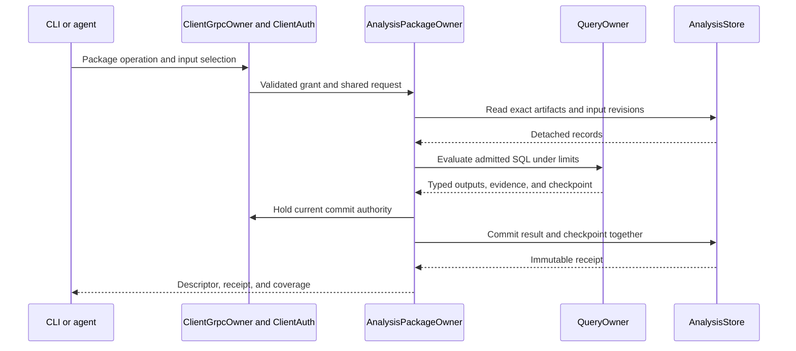

# Package Lifecycle Review

This guide follows the local SQL package implementation for
[Package Lifecycle](phase-7-5-3-package-lifecycle.md). Use the linked source to
review admission, execution, retained results, and removal.

This record retains the SQL qualification state. The current component path
extends the same owners. See the [Wasm review](wasm-execution-review.md) for
installed discovery and detection, host compilation, and current limits.

## Intended end state

An authorized operator or agent installs a built package without a compiler or
network service. The same API exposes its descriptor, dependencies, readiness,
results, and coverage. Committed results and checkpoints agree after restart.
An input correction replaces prior output. Missing input cannot prove a negative.

## Implementation review flow

[ClientGrpcOwner](../../../../../crates/mithril-control/src/client_grpc/packages.rs) Operator installs a package through Control
  -> [ClientAuth](../../../../../crates/mithril-control/src/client_auth/packages.rs) Control validates the current grant and configured bundle trust pin
  -> [PackageBundleV1::validate](../../../../../crates/araphor-data/src/package/admission.rs) AnalysisPackageOwner checks the descriptor, artifacts, and dependency closure
  -> [AnalysisStore](../../../../../crates/araphor-data/src/analysis/packages/revisions.rs) AnalysisStore records one admitted immutable revision
  -> [AnalysisPackageOwner::install](../../../../../crates/araphor-data/src/package/lifecycle.rs) the package owner activates eligible exports within the granted scope

[AnalysisPackageOwner::serve](../../../../../crates/araphor-data/src/package/owner.rs) An input revision or recorded clock tick changes
  -> [PackageBundleV1::order_for](../../../../../crates/araphor-data/src/package/admission.rs) the package owner resolves an acyclic graph of named model dependencies
  -> [ModelOperation::inputs](../../../../../crates/araphor-data/src/query/model/operation.rs) the query owner returns complete bounded authorized inputs and closes readers
  -> [QueryOwner::evaluate_model](../../../../../crates/araphor-data/src/query/model.rs) the selected evaluator computes outside the store transaction
  -> [Package::validate_output](../../../../../crates/araphor-analysis-sdk/src/validation.rs) the host validates typed outputs and evidence references
  -> [AnalysisStore::commit_package](../../../../../crates/araphor-data/src/analysis/packages/commit.rs) AnalysisStore commits each model result, checkpoint, progress, references, and quota together
  -> [QueryOwner::output_table](../../../../../crates/araphor-data/src/query/model/source/table.rs) dependent models select those exact committed result revisions

Implemented outside this phase: current discovery and graph owners retain domain
validation and notification routing through their trusted Rust calls. Installed
SQL exports produce table outputs. Other output kinds remain inactive with an
explicit unsupported status. Installed compiled domain dispatch belongs to
[Wasm Execution](phase-7-5-4-wasm-execution.md).

[AnalysisPackageOwner::refresh_package](../../../../../crates/araphor-data/src/package/freshness.rs) Evidence arrives late or a source window is replaced
  -> [AnalysisStore](../../../../../crates/araphor-data/src/analysis/packages/status.rs) the package owner marks affected dependent results stale
  -> [ModelRun](../../../../../crates/araphor-data/src/package/evaluation/preparation.rs) stateful evaluation replays from a valid checkpoint or rebuilds from retained inputs
  -> [AnalysisStore::package_commit_rows](../../../../../crates/araphor-data/src/analysis/packages/commit.rs) a replacement result removes prior contributions for that window
  -> [ModelOperation::inputs](../../../../../crates/araphor-data/src/query/model/operation.rs) missing retained input produces incomplete coverage

[AnalysisPackageOwner::install](../../../../../crates/araphor-data/src/package/lifecycle.rs) Operator upgrades or rolls back a package
  -> [activation preparation](../../../../../crates/araphor-data/src/package/lifecycle/activation.rs) the package owner checks dependencies, grants, parameters, and scope
  -> [ModelRun](../../../../../crates/araphor-data/src/package/evaluation/preparation.rs) the evaluator prepares a bounded retained-input rebuild
  -> [AnalysisStore::activate_package](../../../../../crates/araphor-data/src/analysis/packages/activation.rs) AnalysisStore switches the active revision only with a valid prepared state
  -> [upgrade regression](../../../../../crates/araphor-data/src/package/lifecycle/tests.rs) failed preparation preserves the previous active revision and its checkpoint

[AnalysisPackageOwner::reconcile](../../../../../crates/araphor-data/src/package/supervision.rs) Grant is revoked or an operator removes the package
  -> [PackageTask](../../../../../crates/araphor-data/src/package/owner.rs) the package owner stops new runs and cancels work under that grant
  -> [AnalysisStore::commit_package](../../../../../crates/araphor-data/src/analysis/packages/commit.rs) AnalysisStore rejects commits under the invalid activation lifetime
  -> [reference retention](../../../../../crates/araphor-data/src/analysis/packages/witnesses.rs) retention keeps historical results and required evidence references
  -> [AnalysisPackageOwner::remove](../../../../../crates/araphor-data/src/package/removal.rs) the package owner releases artifacts after their last installation, history, or dependency reference

## Owners and execution

`ClientGrpcOwner` constructs one package owner with the existing store, query
owner, and authorization owner. The listener starts its reconciliation task.
Shutdown cancels the task and its current evaluation. No collector, interpreter,
compiler, or separate service starts during installation.

Control requires both investigation permission and a separate package mutation
grant for installation and execution. Read operations require investigation
permission. Trust pins bind a tenant to the digest of one complete bundle. The
digest covers descriptors, dependency revisions, SQL, and fixtures. A trust pin
does not verify a publisher signature or detector correctness.

The commit path holds the Control authorization lock through the store commit.
Read callbacks use only `AnalysisReadControl`. They do not acquire Control's
lock while holding a durable reader. An authority change cancels an active API
operation. The final store callback checks cancellation before commit.
The operation deadline also ends at grant expiry. A wait for the store writer
cannot extend the grant.

## Package and SQL contract

`PackageBundleV1` reads the current OCI layout directory or OCI-layout tar
archive. The directory contains `oci-layout`, `index.json`, and content-addressed
files in `blobs/sha256/`. The Araphor config contains the root reference,
descriptors, implementation metadata, fixtures, and dependency locks. Typed raw
layers contain executable code, native dependencies, and fixture Arrow IPC.
All packages, including standalone SQL packages, use the exact OCI manifest's
`sha256:` identity. Trust pins require this prefix and 64 lowercase hexadecimal
characters. There are no installation hooks or dependency downloads. Remote
registry and publisher-verification work remains deferred.

Read the [current package storage and OCI guide](../../../../guides/araphor-binary-package-storage-review.md)
for the canonical Araphor subset, request framing, bounds, and current proof.
The retained lifecycle evidence below keeps its original source and format;
it does not qualify subsequent OCI changes by itself.
Admission rejects model cycles and cycles between package artifacts before
storage. A model can depend on an earlier model in the same package.

The SDK descriptor declares named inputs, parameters, outputs, reasons,
checkpoints, dependencies, and limits. SQL bodies contain all filters, joins, and
aggregates. The manifest does not duplicate computation in another field.

Source SQL selects authorized existing query views. Model SQL selects its named
input tables. For declared parameters, `parameters` contains one typed row.
`prior_<name>` exposes a
declared checkpoint dataset. `output_<name>` lets checkpoint, evidence, and reason
queries use computed output. `__row_index` is the stable unsigned row index used
by evidence references. It is absent from wildcard projection.

The host uses standard Arrow IPC for table payloads. The incremental decoder
does not allocate a buffer from an unchecked message length. The SDK validates
schemas, row counts, reason details, and references. Executable fixtures use the
same SQL evaluator. Fixture comparison preserves row order, ignores batch
boundaries, and applies the descriptor's numeric tolerance.
Each fixture supplies `time_utc_ns` and an optional `seed`. Omitted values use
time zero and no seed. Fixture replay uses those values through the SDK context.

Use the [operator guide](package-operations.md) for the local format, SQL
example, trust configuration, and commands.

## State and recovery rules

New stores use schema 20. The checked conversion from schema 19 separates
immutable graph context from refresh notice metadata. The existing checked
graph migration from schema 17 remains supported. Schema 18 stores are rejected
without writes. Read the
[current recovery checks](wasm-execution-review.md#commit-and-recovery) before
updating a store.

Each model evaluates one bounded snapshot of its selected inputs. The store
uses the `snapshot` window key for the current result. A changed source snapshot
causes a retained-input rebuild without the prior checkpoint. A repeated explicit
run on unchanged inputs can use the prior checkpoint. Automatic evaluation
uses a recorded 500 ms clock tick for source SQL and model SQL. A program that
uses the recorded clock can run on a new tick with no new source events. An
unchanged input and clock selection does not commit a new result. The tick is
a scheduling interval, not a completion-time guarantee.

Source extraction records the snapshot revision as a guard for each source
relation. Commit
rejects the result if one of those relations changed during evaluation. These
checks can reject a run after an unrelated tenant changes the same relation;
retry selects a new snapshot. Exact result retries still return their original
receipt.

Stale-result updates compare the selected activation, result, and checkpoint.
An older reader cannot mark a newer committed result stale.
Inspection returns an error if it cannot check inputs. Query-capacity exhaustion
does not change result freshness or persist a failed evaluation. A later worker
attempt can use the released capacity.

This contract does not accept append-only delta assumptions. A stateful SQL model
must produce a valid result when its prior-state tables are empty. A correction
that removes a source row therefore removes that row's prior contribution.

The store keeps one result head per model and window. Replaced results remain
addressable by exact result ID. Query authorization uses the original committed
activation scope, even after removal or reinstallation. A historical query
reports the selected result's artifact and receipt.

Atomicity applies to one model. A package with multiple exports can complete an
earlier export before a later export fails. The failed export retains its prior
active revision and checkpoint. Inspection reports each export separately.
The host never presents a mixed dependency set as one atomic package revision.

Removal preserves a dependency that another installed root still uses. An
explicit dependency installation also retains that dependency. Historical
results retain their artifact closure. Grant revocation suspends installation;
it does not erase history. Reinstallation under a current grant establishes a
new execution lifetime.

Failed installation releases unused admitted artifacts through the same
[reference check](../../../../../crates/araphor-data/src/analysis/packages/collection.rs)
as removal. Owner startup repeats this check with detached pages of 32 keys.
This releases artifacts left by a crash between admission and activation. The
periodic evaluation task does not scan the full artifact catalogue.

## Limits and review points

- A local OCI archive is at most 32 MiB, including tar headers and padding.
  A package has at most 64 artifacts and 256 models.
- Four package operations can occupy the owner at once. QueryOwner applies its
  existing per-tenant and global evaluation and memory limits.
- Package result and checkpoint serialization has a 16 MiB bound. Decoding and
  input accumulation have independent row, batch, byte, and reference limits.
- An API reply is at most 32 MiB plus 64 KiB. Query a subset of a larger stored
  dataset; the API rejects an oversized reply.
- Whole-version authorization precedes dependent-result decoding. A narrower grant
  cannot select rows from a result produced under a broader scope.
- Expired source evidence produces incomplete coverage. A package retains the
  original witness deadlines; downstream use does not extend those deadlines.
- Native graph input uses the existing bounded native-row extraction. Package
  source SQL does not call the seeded graph traversal API or introduce a second
  graph representation.
- Source extraction returns one complete bounded input. It does not stream an
  input larger than the configured memory limit through package execution.
- SQL uses the existing admitted subset. Mutable discovery inputs, correlated
  subqueries, arbitrary extensions, and direct external I/O are rejected.

## Verification record

Status: **Done** for the local SQL package lifecycle. This guide describes the
source at `83a5e3093ab27f54c33f05a5d2086362bb50418f`. Focused lifecycle checks,
command-line qualification, and the final shared Rust procedure pass. The
[acceptance record](phase-7-5-3-package-lifecycle.md#verification-record) contains
the commands, suite counts, result paths, and artifact hashes.

Review the Rust tests beside
[storage](../../../../../crates/araphor-data/src/analysis/packages/tests.rs),
[package lifecycle](../../../../../crates/araphor-data/src/package/tests.rs),
[SQL evaluation](../../../../../crates/araphor-data/src/query/model/tests.rs),
[Control authority](../../../../../crates/mithril-control/src/client_auth/packages/tests.rs),
and the production
[analysis-packages case](../../../../../crates/mithril-e2e/src/discovery/packages.rs).
The restart case closes and reopens the durable store and production owners.
It keeps the test authorization owner and renews the request grant. It does not
prove recovery of a client session after an identity-provider restart.
Physical prevention and performance are not qualified by these tests.
