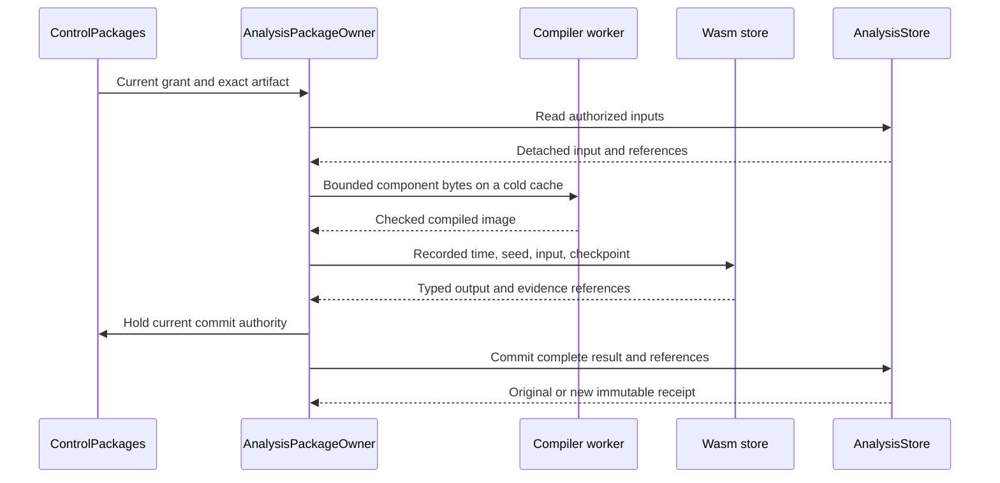

# Wasm Execution Review

This guide follows the installed component path for
[Wasm Execution](phase-7-5-4-wasm-execution.md). The package owner executes
compiled algorithms. Existing host owners retain permission, evidence,
storage, and notification control.

## Intended end state

An operator installs a built detector folder through the package API.
The detector returns validated findings without an Araphor rebuild.
Current discovery and HF detectors use the same installed execution path.
Restart and identical retry preserve the committed result.

## Implementation review flow

[PackageArtifactV1::implementation](../../../../../crates/araphor-data/src/package/bundle.rs) Package admission selects a component artifact
  -> [CompileBudget](../../../../../crates/araphor-data/src/package/wasm/admission.rs) the execution owner checks its contract version, imports, and declared features
  -> [WasmExecution::compiled](../../../../../crates/araphor-data/src/package/wasm/cache.rs) Wasmtime validates and prepares the component under compilation limits
  -> [AnalysisPackageOwner::install](../../../../../crates/araphor-data/src/package/lifecycle.rs) the package owner records target compatibility before activation

[AnalysisPackageOwner::evaluate_artifact](../../../../../crates/araphor-data/src/package/execution.rs) The scheduler invokes an admitted export
  -> [QueryOwner::evaluate_component](../../../../../crates/araphor-data/src/query/model/component.rs) the host reserves input and schema scratch before it encodes the input
  -> [WasmExecution::evaluate_encoded](../../../../../crates/araphor-data/src/package/wasm.rs) the execution owner receives the owned wire input
  -> [WasmExecution::invoke](../../../../../crates/araphor-data/src/package/wasm/execution.rs) the host creates an evaluation instance with explicit limits and authorized inputs
  -> [WasmExecution::invoke](../../../../../crates/araphor-data/src/package/wasm/execution.rs) generated WIT bindings transfer bounded batches and the prior checkpoint
  -> [WasmExecution::invoke](../../../../../crates/araphor-data/src/package/wasm/execution.rs) the component returns declared outputs, evidence references, and next checkpoint
  -> [Package::validate_output](../../../../../crates/araphor-analysis-sdk/src/validation.rs) host validation passes the complete result to the existing commit path
  -> [EvaluationPermit](../../../../../crates/araphor-data/src/package/wasm/execution.rs) the execution owner releases the instance and temporary buffers

[WasmExecution::invoke](../../../../../crates/araphor-data/src/package/wasm/execution.rs) The component traps, exceeds a limit, or receives cancellation
  -> [GuestState](../../../../../crates/araphor-data/src/package/wasm/execution.rs) the host interrupts execution and checks cancellation
  -> [InstalledAnalysis::evaluate](../../../../../crates/araphor-data/src/package/installed.rs) the host discards uncommitted output and releases resources

[AnalysisPackageOwner::reconcile](../../../../../crates/araphor-data/src/package/supervision.rs) The generic package scheduler receives the error
  -> [AnalysisPackageOwner::failed](../../../../../crates/araphor-data/src/package/supervision.rs) the package owner records typed failure and marks retained results stale without replacing output or checkpoint

[InstalledAnalysis::evaluate](../../../../../crates/araphor-data/src/package/installed.rs) A domain adapter receives the error
  -> [DiscoveryOwner::process](../../../../../crates/araphor-data/src/discovery/live.rs) and [GraphAndFindingOwner::process](../../../../../crates/araphor-data/src/graph/live.rs) the adapter returns the error to its existing owner failure and coverage path

The generic package scheduler uses the same evaluator. Its named source inputs
and dependency inputs come from
[AnalysisPackageOwner::inputs](../../../../../crates/araphor-data/src/package/inputs.rs).
The discovery and graph adapters prepare their authorized domain inputs.
These adapters do not run through the generic table scheduler.
[InstalledAnalysis::evaluate](../../../../../crates/araphor-data/src/package/installed.rs)
checks these domain inputs and invokes `evaluate_artifact`.
Host-prepared exports with Table outputs use this path after package admission.
Discovery and graph outputs still require their domain adapter checks.

[InstalledAnalysis::active](../../../../../crates/araphor-data/src/package/installed/read.rs)
selects the requested installed, active export under the shared lifecycle lock
for an unpinned call. Evaluation reads only its complete root dependency bundle
and checks the selected grant and trust before and after computation.
An unrelated package grant is not checked for this exact call. Explicit
snapshots still pin all supported active exports in the scope. Pinned and
historical calls keep their selected exports. An active export that cannot use
host-prepared inputs returns `Unsupported`.
The [exact selection test](../../../../../crates/araphor-data/src/package/installed/read/tests.rs)
checks complete dependency admission and both revocation cases.

## Build and installation

[ComponentBuilder](../../../../../crates/araphor-component-build/src/lib.rs)
packages an author-built core module as a component. The generated
[guest bindings](../../../../../crates/araphor-analysis-sdk/src/guest.rs)
and [host bindings](../../../../../crates/araphor-data/src/package/wasm/bindings.rs)
use the same versioned WebAssembly Interface Types
([WIT contract](../../../../../crates/araphor-analysis-sdk/src/bindings/analysis.wit)).
The [detector example](../../../../../crates/araphor-detector-example/README.md)
contains the author commands and a complete detector.
The runtime keeps Wasmtime and this WIT interface. Extism supplies the approved
resource-policy reference. The runtime adds no Extism dependency.

A built folder contains `package.json` and `detector.wasm`.
`package.json` embeds the component bytes and complete artifact closure.
Operators install this file or folder. Installation has no author compiler,
download, or hook. The host compiles admitted bytes in its bounded worker.
OCI distribution and native execution remain later work.

[PackageBundleV1::encode](../../../../../crates/araphor-data/src/package/bundle.rs)
uses canonical descriptor JSON for every artifact in a component bundle.
[Immutable revision writes](../../../../../crates/araphor-data/src/package/lifecycle/revisions.rs)
use canonical descriptor JSON for component revisions. SQL revisions keep
their checked original bytes.
Standalone SQL bundles retain their previous encoding and trust pins.
An identical SQL dependency retains its original stored bytes after a checked
descriptor, artifact, and dependency comparison.
Arrow metadata map order cannot change a component digest or an identical
installation record after decode or restart.

[ClientGrpcOwner](../../../../../crates/mithril-control/src/client_grpc/packages.rs)
checks the current permission before it decodes the operation.
Mutation requires the package grant and exact bundle trust pin.
The [public client](../../../../../crates/erebor-runtime-client/src/araphor/packages.rs)
uses the package message limit on this API.
The ordinary query API retains its existing limit.

## Execution owners



[ControlPackages](../../../../../crates/mithril-control/src/service/packages.rs)
holds one package owner and query owner for a Control plane.
The listener and domain tasks use this owner.
The internal Control grant accepts only required bundle digests for configured
tenants. External packages use the bound `ClientAuth` owner.
The listener binds this authority before it starts discovery processing.

[WasmExecution](../../../../../crates/araphor-data/src/package/wasm.rs)
owns the engine, generated linker, code cache, compiler permit, and evaluation
count. Each call creates a separate Wasmtime store.
One engine ticker advances interruption epochs. Store cancellation and mutable
state remain separate. The ticker stops when its last owner drops.

Read the [installed guest overlap test](../../../../../crates/araphor-data/src/package/wasm/tests/runtime/concurrency.rs)
before the test-only
[GuestEntry gate](../../../../../crates/araphor-data/src/package/wasm/execution.rs).
The gate signals entry from the actual WIT `cancelled` import.
The test waits for both entry signals before it releases either call.
The release wait uses the remaining guest deadline. The host then applies its
normal call-count and cancellation checks.
The [existing cancellation test](../../../../../crates/araphor-data/src/package/wasm/tests/runtime.rs)
sets `release: None` and keeps its cancellation assertion.

[CompilerChild](../../../../../crates/araphor-data/src/package/wasm/compiler.rs)
starts the current executable in compiler mode with a cleared environment.
The entry point runs before the application runtime.
The [CompilerInput request](../../../../../crates/araphor-data/src/package/wasm/compiler/input.rs)
carries a version, fuel mode, and component bytes through standard input.
The child uses the same fuel mode as the parent engine.
The reply contains a bounded image and its digest.
The parent accepts no installed native image or external precompiled image.
Cancellation or deadline kills and reaps the child.
The compiler permit remains held until the I/O threads finish.

The one unsafe image load is in
[CompilerImage::component](../../../../../crates/araphor-data/src/package/wasm/compiler/image.rs).
Its input comes from the fresh host compiler with the same engine configuration.
The compiler boundary rejects a malformed reply, incorrect digest, or oversized
image before this load.

## Input, output, and host authority

The WIT interface has one computation export and one host import: `cancelled`.
The descriptor selects a named algorithm export inside the computation call.
The host supplies recorded time and optional seed. The guest receives no
WebAssembly System Interface (WASI)
filesystem, network, environment, clock, or random import.

The SDK transfers standard Arrow IPC streams with exact declared schemas.
The [wire decoder](../../../../../crates/araphor-analysis-sdk/src/wire/codec.rs)
checks message sizes, schema structure, projected allocation, batches, and rows.
It rejects compressed IPC before decode.
[Dataset::owned_batch](../../../../../crates/araphor-analysis-sdk/src/wire/codec.rs)
checks all array and child buffer lengths against the remaining copy budget.
The check includes possible temporary child validity buffers for nullable
parents. The decoder validates each array and uses Arrow `MutableArrayData` to
copy the values into owned buffers. A batch with no columns keeps its row count.
The decoder checks the resulting allocated bytes before it retains the batch.
The [owned-buffer tests](../../../../../crates/araphor-analysis-sdk/src/wire/tests/buffers.rs)
check a large binary dataset at a tight byte limit, nested nulls, columnless
rows, and a sparse null child that exceeds the copy budget. A smaller encoded
byte limit returns the SDK `Limit` error.
The [SDK reference](../../../../../crates/araphor-analysis-sdk/README.md)
lists supported Arrow types. Encoding and decoding make bounded copies.
This implementation does not claim zero-copy exchange.

[Package::allocated_bytes](../../../../../crates/araphor-analysis-sdk/src/memory.rs)
counts descriptor capacities, port schemas, reasons, and checkpoints.
`wire::Evaluation::allocated_bytes` counts retained IPC capacities and metadata.
Typed inputs and wire inputs share one revision and coverage calculation.
Schema charges include nested fields, Arc headers, and metadata capacity.
The [allocation tests](../../../../../crates/araphor-analysis-sdk/src/memory/tests.rs)
check unused capacity, nested metadata, all schema positions, and wire growth.
The SDK suite has 51 passes. The build proof records equal bytes from two
independent builds of all six components under `memory_accounting_correction`.
The current production owner qualification remains open.

[Rows](../../../../../crates/araphor-analysis-builtins/src/rows.rs) buffers JSON
with the standard Rust `BufWriter`. The buffer uses at most 8 KiB per row.
The checked row writer sends each complete fragment to the Arrow binary
builder. Each Arrow write checks the remaining byte budget first. The encoder
flushes after serialization, including a serializer error. The encoder checks
the result before Arrow completes a non-null row with an empty append.
No complete-row vector or complete-row copy is created. The
[writer test](../../../../../crates/araphor-analysis-builtins/src/rows/tests.rs)
checks empty writes, complete writes, and rejection without a partial write.
The large escaped-string test compares exact JSON bytes across flush
boundaries. The serializer-error test retains byte-limit error precedence
and checks a successful next call. The v25 shared suite has 14 passes.
The earlier build proof records six equal component pairs under
`direct_builder_correction` and `inline_writer_correction`.
The `buffered_writer_correction` record has 14 native passes and six equal
component pairs from two builds. The original graph split assertion and
production fuel limit remain unchanged. Installed runtime qualification
remains open.

[Computation::authorities](../../../../../crates/araphor-analysis-builtins/src/graph/credential/join.rs)
indexes each qualified fact identity by its position in one vector. The first
fact remains the representative. Duplicate matches update its direct-proof
flag with OR. Stable record sorting keeps equal-record encounter order. Every
channel evidence append remains in its original position. The
[credential test](../../../../../crates/araphor-analysis-builtins/src/graph/tests.rs)
checks repeated identities, direct-proof changes, tied records, contextual
fallback, and the exact raw evidence. The `authority_index_correction` build
record has six equal component pairs and 13 native test passes. The later
`direct_builder_correction` record applies the writer change. These proofs do
not replace installed execution at production limits.

[Computation::credential](../../../../../crates/araphor-analysis-builtins/src/graph/credential/mod.rs)
copies raw join evidence once into a separate edge prefix. The shared
canonicalization helper sorts this prefix and removes duplicates before the
matched-fact loop. Each loop step adds the same fact record to the raw finding
sequence and the edge prefix. Each relationship copies the separate edge
prefix. Raw authority matches and the finding sequence stay unchanged. Final
publication still canonicalizes every edge and finding. The dense case has
66 relationships.

[Computation::output](../../../../../crates/araphor-analysis-builtins/src/graph/contract.rs)
publishes sorted evidence sets for edges and findings. Raw joins finish before
publication. The method sorts and removes duplicate row references before it
encodes candidate rows, matching reason details, and SDK evidence links.
Authority representatives, edge order, fact references, proof, coverage, and
checkpoint state stay unchanged. The
[publication test](../../../../../crates/araphor-analysis-builtins/src/graph/tests.rs)
keeps the raw join assertions and checks canonical rows, exact reason details,
evidence links, and checkpoint state.

[QueryOwner::evaluate_component](../../../../../crates/araphor-data/src/query/model/component.rs)
reserves input, IPC, and schema-message scratch before encoding. It includes
declared schemas when an input has no batches. The owner encodes once, reduces
the charge to retained input and wire capacities, and moves the wire into
`WasmExecution::evaluate_encoded`. After invocation, it retains the input and
output charges until the domain adapter releases the result. SQL keeps its
existing reservation through `QueryOwner::evaluate_analysis`.
The shared evaluator checks its local query deadline after output validation.
An expired output cannot return as a retained result.
Extraction closes durable readers before computation.

[InstalledSnapshot](../../../../../crates/araphor-data/src/package/installed/snapshot.rs)
holds one validated bundle per root in shared Arc ownership. Bundle capacities
and snapshot pins hold retained-input leases. `InstalledEvaluation` also holds
a lease for its copied descriptor and revision. The last owner releases each
charge. Each evaluation checks its grant and current trust before and after
computation. Commit authorization checks current activation metadata,
generation, revision, and grants. Cached bundle bytes do not cache permission.
Native graph extraction and seeded traversal retain their existing byte limits
and whole-version permission checks.

[Adapter](../../../../../crates/araphor-data/src/discovery/sdk/mod.rs)
executes atoms, merge, groups, and compare through installed components.
The host checks exact keys, attribution, accounting, coverage, and prevention
claims against original records.
The shared context selector remains a host operation.

[GraphDerivation](../../../../../crates/araphor-data/src/graph/derive/adapter/mod.rs)
selects installed graph exports by their declared schemas.
It does not restrict package IDs to the current HF detectors.
[Graph validation](../../../../../crates/araphor-data/src/graph/derive/adapter/validation.rs)
checks exact subject identities, parent facts, direct cause, evidence, confirmed
findings, and qualified coverage.
A package cannot increase authority or proof through an output claim.

[GraphDerivation::apply_output](../../../../../crates/araphor-data/src/graph/derive/adapter/output.rs)
adds Arrow dataset and reason bytes across the selected packages.
The aggregate limit is 4 MiB.
[WindowBytes::check](../../../../../crates/araphor-data/src/graph/derive/finish.rs)
counts the serialized graph snapshot after host validation. The checked writer
creates no output buffer. It stops above the existing 4 MiB JSON limit and
returns `GraphInvalid` with field `graph output bytes`. Historical stored reads
do not use this derivation check.
[GraphAndFindingOwner::commit_bounded_window](../../../../../crates/araphor-data/src/graph/commit.rs)
selects the existing
[window split](../../../../../crates/araphor-data/src/graph/chunks.rs)
only for `GraphInvalid` with field `graph output bytes`.
The rejected window commits no output. Every other error returns to the caller.
The commit owner adds position metadata and keeps its final serialized-byte
check before commit.

[FindingReasonV1](../../../../../crates/araphor-data/src/graph/model.rs)
stores declared reason codes with their schema and IPC details.
The host maps the historical eleven reason codes to legacy JSON only when the
declared detail schema also matches. A new detector requires no host enum entry.
Existing notification routes and human deadlines remain host-owned.
Host graph assembly already sorts retained evidence and removes duplicates.
Canonical publication preserves that historical finding JSON.
Generic package `Run` results retain SDK candidate and reason-detail IPC through
[PackageOutputV1::encode](../../../../../crates/araphor-data/src/package/output.rs).
The candidate and reason-detail IPC bytes change when publication removes
duplicate references or changes their order. Generic results do not use the legacy graph
reason mapping. An identical saved
[Run retry](../../../../../crates/araphor-data/src/package/evaluation.rs)
returns its original receipt before it prepares a new computation.

## Commit and recovery

[InstalledAnalysis::authorize](../../../../../crates/araphor-data/src/package/installed/commit.rs)
compares activation generation, revision, and metadata before a domain commit.
`commit_many` holds current authority for the complete selected root set.
Exports with different grants retain separate authority entries even when their
root is the same. Package owners for the same store share the lifecycle lock.
An update, removal, grant renewal, or suspension cannot cross the activation
check and domain commit. Owner construction uses the same lock during admission
collection. A supervisor can change readiness metadata without this lock.
This status change does not change the grant or activation generation.
Permission and trust are checked after computation as well as before it.
An authority change cancels an active call.

Saved discovery and graph context retains exact exports, revisions, roots,
activation generations, and configured parameters.
[Context validation](../../../../../crates/araphor-data/src/analysis/context/provenance.rs)
checks tenant scope and retained dependency closure during writes, reads, reopen,
and restore. The previous discovery format can omit package references.
New graph context requires valid references.
Artifact collection retains these saved roots.

[InstalledAnalysis::pin_at](../../../../../crates/araphor-data/src/package/installed/history.rs)
replays retained code and parameters under current permission and trust.
It reads current activations even when the caller holds an old snapshot.
A historical handle cannot commit.
[GraphAndFindingOwner::installed_refs](../../../../../crates/araphor-data/src/graph/installed.rs)
reads the bounded native header to obtain the source identity.
It does not reconstruct graph rows for this reference read.
The graph commit retains and validates its exact package provenance sidecar.
The visible input manifest excludes only this sidecar key. The sidecar remains
in the atomic context references and artifact collection inputs.

[GraphAndFindingOwner::commit_window](../../../../../crates/araphor-data/src/graph/window.rs)
checks retained-input expiry before it reuses a completed graph check.
The provider notice and coverage revision must match the saved per-result
metadata. [installed_current](../../../../../crates/araphor-data/src/graph/installed.rs)
then compares all compatible installed references and checks current permission.
Update, removal, a new compatible export, or revocation cannot use this shortcut.

When a changed notice produces the same graph,
[commit_bounded_window](../../../../../crates/araphor-data/src/graph/commit.rs)
checks current commit authority and saves the captured notice through
[mark_graph_notice](../../../../../crates/araphor-data/src/analysis/progress/notices.rs).
The guarded update applies only to the same retained window head and immutable
commit revision. It changes no result body, receipt, quota, progress, or deadline.
A provider change during the check remains pending for the next pass.
Discovery uses the same metadata update owner and keeps its monotone notice rule.
The [notice tests](../../../../../crates/araphor-data/src/graph/tests/notices.rs)
use the production graph owner and installed components.
The [authority tests](../../../../../crates/araphor-data/src/graph/tests/installed/current/authority.rs)
check both an unchanged notice and a changed notice without changed facts.
The [activation tests](../../../../../crates/araphor-data/src/graph/tests/installed/current.rs)
check updates, added compatible exports, removal, history, and exact health.
The [metadata tests](../../../../../crates/araphor-data/src/analysis/progress/notices/tests.rs)
check separate windows, old-head rejection, immutable metadata, and retry.

[GraphAndFindingOwner::refresh_source](../../../../../crates/araphor-data/src/graph/live.rs)
reads current window bounds through
[graph_window_bounds](../../../../../crates/araphor-data/src/analysis/graph/windows.rs).
The native query filters the tenant and source before it ranks window heads.
The bounds read validates the selected header without reconstructing its rows.
[window_heads](../../../../../crates/araphor-data/src/graph/window.rs) uses
`graph_window_page` to select possible overlapping ranges. The checked header
decides exact overlap before the owner reconstructs rows. A page retains its
continuation ID when the candidate does not overlap.
The [window read tests](../../../../../crates/araphor-data/src/analysis/graph/windows/tests.rs)
check selection, continuation, history, and corruption. Current-source
qualification remains pending.

[AnalysisReadControl::run and AnalysisStore::read_snapshot](../../../../../crates/araphor-data/src/analysis/read.rs)
carry the native caller location into the existing deadline error. This location
identifies the call to the read runner or snapshot wrapper. The location does
not identify a specific SQL statement inside its read closure. The one-second
default read deadline
and cleanup rules stay unchanged.

[Graph notice migration](../../../../../crates/araphor-data/src/analysis/graph_migration/notices.rs)
converts schema 19 to schema 20 in one transaction. It initializes each retained
graph notice from its checked native header. The schema 17 conversion uses the
same header field. Both paths retain immutable records and validate stored state.
The [schema owner](../../../../../crates/araphor-data/src/analysis/mod.rs)
selects the checked conversion for each supported version.
The [migration tests](../../../../../crates/araphor-data/src/analysis/graph_migration/tests/notices.rs)
check retained versions, package references, reopen, restore, quota, retry, and
unchanged originals after rejection. The focused notice checks and the exact
installed lifecycle check pass. The full current group and final shared Rust
procedure remain required. See the [correction record](phase-7-5-4-wasm-execution.md#completed-graph-check-reuse)
for source hashes and failed attempts.

The generic package commit retains result, checkpoint, input references,
progress, and quota together. Domain adapters use their existing graph or
discovery commit. Identical retries return the original receipt.
Changed retries fail. A current freshness check can mark a retained result
stale. This status does not change its result ID, commit revision, data, or
checkpoint bytes. Missing required coverage remains explicit.
Removal retains its tombstone and does not reinstall a required package on
restart. Expiry reduces retained proof without executing removed code.

The [package lifecycle test](../../../../../crates/araphor-data/src/package/tests/wasm/lifecycle.rs)
uses its test authority to observe the revision 2 receipt after the commit.
The test checks the Wasm target, output value 7, and immutable receipt fields.
The returned response can mark the saved result stale after a clock change.
The test keeps the clock, retry, reopen, rollback, and removal checks.

## Limits and proof

Compilation accepts at most 8 MiB of component source and a 32 MiB image.
The compiler has a 1 GiB address-space limit, 30-second CPU hard limit,
and 45-second wall deadline. Structural scan limits also apply.
Host domain calls have a finite 60-second outer deadline for a cold cache.
[QueryLimits](../../../../../crates/araphor-data/src/query/mod.rs) defaults to a
one-second evaluation timeout. The query owner uses its configured timeout.
This query deadline applies after compilation. A configured Wasm timeout can
shorten the inherited caller deadline.
Epoch interruption stops guest instructions. A synchronous
host call or canonical application binary interface (ABI) operation finishes
before the host checks the
control deadline again. An expired call cannot commit.

[WasmLimits](../../../../../crates/araphor-data/src/query/wasm.rs) contains six
optional quotas. Every field defaults to `None`. An omitted or `null` field
leaves that additional Wasm quota unset.

| Field | Configured quota |
| --- | --- |
| `fuel` | Instruction fuel units per evaluation |
| `memory_bytes` | Guest linear memory bytes, including initial memory |
| `data_bytes` | Additional SDK data-byte ceiling |
| `timeout` | Additional guest timeout, within the caller deadline |
| `allocation_bytes` | Approximate allocation fuel for canonical ABI copies |
| `host_calls` | Calls to the WIT `cancelled` import |

The parent and compiler engines enable instruction metering only when `fuel`
is set. Each call applies its configured fuel budget. The same configuration
path applies in production and tests. Resource-failure tests set the quotas
they check. The earlier 32 MiB data and 100 million fuel settings are historical
configurations. Current-source qualification remains pending.

Mandatory guards remain. Each store permits one memory, four tables,
16,384 elements per table, and 16 instances. The engine uses a 512 KiB Wasm
stack bound. The Wasm owner permits four active evaluations. SDK schema,
reference, batch, row, and byte checks remain. The component path caps batches
at 1,024, rows at one million, and checkpoint data at 16 MiB. Query input defaults
to 64 MiB. Shared query input capacity is 128 MiB; output capacity is 16 MiB.
Caller cancellation, the query deadline, authorization, and atomic commit checks
remain. The `allocation_bytes` quota does not measure total host resident memory.
When this quota is unset, value lifting has no additional Wasm allocation cap.
These settings do not bound total process resident memory.

The local package file has a 32 MiB bound.
Package JSON requests and replies allow an additional 64 KiB.
The package transport permits an additional 128 KiB for protocol framing.
The [code cache](../../../../../crates/araphor-data/src/package/wasm/cache.rs)
has an 80 MiB byte limit and a 16-entry limit.
On the earlier qualified Linux x86-64 build, the four required components charge
61,237,517 bytes in total. The SDK runtime fixture raises this total to
74,374,204 bytes. Each charge includes source bytes and mapped image bytes.
These figures predate the current SDK and graph schema corrections.
Eviction can require a later bounded compilation.
This cache charge excludes engine metadata, allocator overhead, active images
after eviction, and Arrow buffers. Query accounting and evaluation limits bound
input and output separately. The cache limit is not a total process memory limit.

The [native store](../../../../../crates/araphor-data/src/analysis/connection.rs)
has one 128 MiB buffer limit shared by its writer and two cloned readers.
[Backup validation](../../../../../crates/araphor-data/src/analysis/backup.rs)
uses the same constant. The graph window stays at 4 MiB. The separate SQL
evaluator keeps its 64 MiB target. These settings do not limit process RSS.
The [native limit test](../../../../../crates/araphor-data/src/analysis/capacity.rs)
checks the settings, rejects an allocation above the buffer limit, and confirms
that the failed insert stores no row. The
[restore test](../../../../../crates/araphor-data/src/graph/tests/traversal/recovery.rs)
compares all four saved component revisions before an owner can reinstall them.
The [supervisor](../../../../../crates/araphor-data/src/package/supervision.rs)
reuses each admitted bundle for the prepared-export check.

Review the committed Rust cases beside
[runtime isolation](../../../../../crates/araphor-data/src/package/wasm/tests/runtime.rs),
[compiler limits](../../../../../crates/araphor-data/src/package/wasm/compiler/tests.rs),
[package lifecycle](../../../../../crates/araphor-data/src/package/tests/wasm/lifecycle.rs),
[dependency replacement](../../../../../crates/araphor-data/src/package/tests/wasm/flow.rs),
[domain history](../../../../../crates/araphor-data/src/graph/tests/installed.rs),
and [context recovery](../../../../../crates/araphor-data/src/analysis/packages/tests/context/validation.rs).
The production [SDK detector case](../../../../../crates/mithril-e2e/src/discovery/packages/wasm.rs)
installs over TLS, reopens a new owner with an empty cache, replays, retries,
and revokes trust.

### Current algorithm proof route

| Algorithm | Installed execution proof | Host boundary |
| --- | --- | --- |
| AR-01: atoms and accounting | [Discovery captured results](../../../../../crates/araphor-data/src/discovery/derive/tests/baseline.rs) | Exact record identity, attribution, accounting, and coverage checks |
| AR-02: merge and display groups | [Discovery captured results](../../../../../crates/araphor-data/src/discovery/derive/tests/baseline.rs) | Host selection and retained profile identity |
| AR-03: baseline comparison | [Discovery captured results](../../../../../crates/araphor-data/src/discovery/derive/tests/baseline.rs) | Exact baseline and current profile revisions |
| AR-04: context integration | [Context round trip](../../../../../crates/mithril-e2e/src/discovery/roundtrip/context.rs) and [installed context component](../../../../../crates/mithril-e2e/src/discovery/roundtrip/context/component.rs) | Host permission, cutoff, selected records, and omissions |
| AR-05: HF-PROC-001 | [Graph captured results](../../../../../crates/araphor-data/src/graph/tests/baseline.rs) | Exact identities, parent facts, and native evidence |
| AR-06: HF-DW-001 | [Graph captured results](../../../../../crates/araphor-data/src/graph/tests/baseline.rs) | Credential identity, evidence, confirmation, and coverage |
| AR-07: HF-XNODE-001 | [Graph captured results](../../../../../crates/araphor-data/src/graph/tests/baseline.rs) | Cross-node causality remains unqualified; retain current Kubernetes proof limits |

The captured-result tests use installed components from the shared algorithm
source. AR-04 sends the host-selected packet through a real component. The
qualification case checks the returned rows, revision, coverage, cutoff, and
omissions. The component does not select or authorize context.

The [cached discovery fixture](../../../../../crates/araphor-data/src/discovery/derive.rs)
and [cached graph fixture](../../../../../crates/araphor-data/src/graph/tests.rs)
use a mutex. Each test or fixture operation holds one guard through its
component calls. Production query capacity stays unchanged.
The [metadata deadline test](../../../../../crates/araphor-data/src/analysis/read.rs)
includes the native graph snapshot read. It checks typed expiry, released read
slots, unchanged metadata, and a successful fresh read.

Review these boundary tests with the algorithm cases:

- [Installed guest overlap](../../../../../crates/araphor-data/src/package/wasm/tests/runtime/concurrency.rs)
  uses the shipped Discovery `groups` component for two tenants. Both tenant
  snapshots retain the same installed owner. The test checks separate
  evaluation IDs, group keys, and sample identities. It checks member indexes
  `[0, 1]` and aggregate counts 5 and 18. Each output has no checkpoint,
  evidence, or reason. The focused overlap test and the existing cancellation
  test pass on the v12 source. Final qualification remains pending.
- [Multiple input batches](../../../../../crates/araphor-data/src/package/wasm/tests/runtime/batches.rs)
  includes an empty batch and verifies the computed total.
- [Checkpoint recovery](../../../../../crates/araphor-data/src/package/tests/wasm/checkpoint.rs)
  verifies prior state, restart, and an old retry after a later state commit.
- [Native graph component input](../../../../../crates/araphor-data/src/query/analysis/tests/component.rs)
  verifies bounded traversal rows and an empty replacement through a component.
- [Graph package references](../../../../../crates/araphor-data/src/analysis/graph_rows/tests/packages.rs)
  reject a wrong result key or corrupt sidecar before commit. A valid commit
  and retry retain the same visible graph and package references.
- [Graph output splitting](../../../../../crates/araphor-data/src/graph/tests/bounded.rs)
  uses installed components with 256 records and 67 facts. The test requires
  the exact whole-window aggregate byte error, unchanged metadata, and no
  partial finding commit. The test requires split processing to consume all
  256 records and retain 255 native findings and one contextual credential
  finding with exact evidence. Each stored result must stay within 4 MiB.
  The v23 run exhausts guest fuel before the aggregate error. Evidence recovery
  passes. Current production-limit graph splitting remains open.
- [Domain commit fences](../../../../../crates/araphor-data/src/package/installed/commit/tests/changes.rs)
  verify that Run renewal and supervisor suspension cannot change an activation
  during the commit callback.
- [Cache accounting](../../../../../crates/araphor-data/src/package/wasm/fixtures/tests.rs)
  checks each source and mapped image charge and retains all five components.
- [Output deadline](../../../../../crates/araphor-data/src/query/model/tests/clock.rs)
  rejects a result after the local deadline while the caller deadline remains
  valid. The next call can obtain the released memory lease.

## Production qualification

Build the normal qualification binary for the current source. Run all four
cases before the final shared Rust procedure.
Run each case in a separate output directory that does not yet exist. Use the
same binary for all four cases. Keep it unchanged while its compiler children
run.

```sh
CARGO_INCREMENTAL=0 CARGO_BUILD_JOBS=1 cargo build --locked -p mithril-e2e --bin mithril_discovery_test
qualification_root=$(mktemp -d /tmp/araphor-qualification.XXXXXX)
cp target/debug/mithril_discovery_test "$qualification_root/mithril_discovery_test"
"$qualification_root/mithril_discovery_test" --case analysis-packages --output-directory "$qualification_root/analysis-packages"
"$qualification_root/mithril_discovery_test" --case context-roundtrip --output-directory "$qualification_root/context-roundtrip"
"$qualification_root/mithril_discovery_test" --case profile-restart --output-directory "$qualification_root/profile-restart"
"$qualification_root/mithril_discovery_test" --case graph-notification --output-directory "$qualification_root/graph-notification"
```

Require exit code 0 and a `result.json` with schema version 1, the exact case
name, and result `PASS`. Retain the source and binary hashes, logs, and output
files. These cases use the production configuration with optional Wasm quotas
unset. Configured resource-failure tests remain separate required checks.

| Case | Required proof |
| --- | --- |
| `analysis-packages` | Install the SDK detector over TLS from its built folder. Check restart, retry, trust revocation, threshold 3, four input records, three matching evidence records, reason `example-burst.THRESHOLD`, and no host rebuild. Check the package checkpoint counts 2, 2, and 1. |
| `context-roundtrip` | Check signed context, cursor 1, and the installed context component. The returned identity, revision, and coverage must match. Check one selected record, no excluded record, and one omission. |
| `profile-restart` | Check the context fields above, live profile, late context, deterministic profile, immutable sealed revision, and frozen replay without provider calls. Retain `profile.json` and `profile-unresolved.json`. |
| `graph-notification` | Check acknowledgements `[null, null, 2, 2]`, cursors `[0, 0, 2, 2]`, failed transaction, duplicate intake, and equal replay. Check the original notification deadline and human receipt. Check 12 incident cards, 257 findings and obligations, and native windows of 64 and 185 records with equal results after reopen. Retain `graph.json`. |

The commands above are required checks. They do not record a pass.

The [qualification server owner](../../../../../crates/mithril-e2e/src/discovery/graph_notification.rs)
awaits shutdown on success or failure and retains the original error.
Its expired-certificate test requires both stores to reopen after failure.
The [replay fixture](../../../../../crates/mithril-e2e/src/discovery/graph_notification/replay.rs)
closes owners before its temporary root and releases the completed incident
fixture before independent density and window checks. The
[command entry point](../../../../../crates/mithril-e2e/src/bin/mithril_discovery_test.rs)
returns an error after Tokio shutdown. Existing assertions and workloads remain.

## Verification record

**Not done.** This guide describes the implementation under qualification.
The [phase result](phase-7-5-4-wasm-execution.md#result) will record final source
state, commands, counts, and evidence after the required checks pass.
The [build proof](wasm-component-build-proof.json) records independent component
build hashes. This work adds no new BPF program or ABI, physical-prevention
qualification, native target, OCI distribution, or performance result.

The retained v31 verification record follows `d8528992`. Its 1,576-file source
manifest is `/tmp/araphor-wasm-source-manifest-production-v31.json`, with SHA256
`12f6f8e821a5fe2aeb18fe727b3f6d9a65202492a75d7f9bb4a79237841823e7`.
Canonical evidence publication, the derived JSON byte check, and the common
edge prefix are implemented. The v27 graph group has five passes at production
limits. These are historical checks; final current-source CI remains required.

Three fresh production cases pass with the saved normal executable:
`analysis-packages`, `context-roundtrip`, and `profile-restart`.
The executable is `/tmp/araphor-current-v30-bin/mithril_discovery_test`, with
SHA256 `2bce7ffca52037ea28d6b974f38a9d16fad443ed76d63de2968568ba8f96eca2`.
Production source is unchanged between v30 and v31. The v31 normal build
produces the same executable bytes after test-only corrections.
The graph case exits one on the unchanged filesystem reserve and writes no
result. Its same-binary retry uses `/tmp/araphor-current-v31-graph-retry`.
The retry also exits one, with `AnalysisReadDeadline` at the final read cleanup
check. This earlier location does not identify the native read operation.
The proof is `/tmp/araphor-wasm-production-proof-v30.json`. Graph qualification
and the final shared Rust procedure remain required.

Current source also includes optional Wasm quotas, input reservation from
retained allocations, native window selection, and caller-location errors.
The combined source still requires complete algorithm and lifecycle checks,
all four fresh production cases with one unchanged executable, and the final
shared Rust procedure after the last Rust edit. Earlier source records do not
qualify these corrections. The dispatch ordering breach remains recorded.

The retained v23 graph group has one pass and one failure. Evidence recovery
passes. The split test exhausts guest fuel in graph output encoding. The log is
`/tmp/araphor-wasm-graph-recovery-and-split-production-v23.log`.
This run is historical evidence. It does not qualify the current changes.

The retained v26 graph group has one pass and one failure after 251.72
seconds. Evidence recovery passes. The split case exhausts guest fuel in
`quicksort<u64>` from `Computation::output`, before row encoding. The proof is
`/tmp/araphor-wasm-production-bounds-proof-v26.json`.
The later v27 graph checks pass. The current graph production case and final
workspace procedure remain required.

The focused correction run `v10` passed all six tests in 602.21 seconds.
The log is `/tmp/araphor-wasm-fixture-and-graph-tests-v10.log`.
The run includes `graph::tests::bounded::output_bytes_split` and
`package::tests::wasm::lifecycle::wasm_installed_lifecycle`.
The source manifest is `/tmp/araphor-wasm-source-manifest-correction-v10.json`.
Its SHA256 is `a0a0ee9405ef1963bc1e471f097c45df66dae7724074e299b11caa31d1aa5481`.
The run uses the temporary unit test allowances above. The final shared Rust
procedure and production qualification remain incomplete.

Concurrency correction source `v12` adds
`package::wasm::tests::runtime::concurrency::installed_guests_overlap`
and the test-only release gate. Compilation and both focused tests pass.
The proof is `/tmp/araphor-wasm-concurrency-proof-v12.json`. The overlap and
cancellation logs have SHA256 values
`533d27f5c2c5a0fb8915195be8ae0b7f8691c1f5d6c0c4680c9f5d31a820c3a1`
and `813c5b0a6c375e4849aa883310bb4565e587e174da3f6407fc4c6950cfe6a59c`.
The source manifest is
`/tmp/araphor-wasm-source-manifest-concurrency-v12.json`.
Its SHA256 is `47d73bbfec0059251f6c8851a410d232f83bf2440c4edef7d10720064b33eb8b`.
The shared Rust run `v11` uses earlier source and cannot qualify this correction.
The final current-source run `v12` ended with exit code 101.
Formatting, workspace checking, and strict Clippy passed.
Linking the `mithril-control` test `contract` failed with a linker Bus error.
The filesystem had 342 MiB free at the final observation.
The cause of the linker error remains unconfirmed. Full workspace tests did
not start. The log is `/tmp/araphor-wasm-rust-ci-final-v12.log`.
Its SHA256 is `033debd8c043ebce29898229ebc7db73ca80801170b0ad3a8ca63730f774cbfc`.
The result is `/tmp/araphor-wasm-rust-ci-final-v12-result.json`.
The source SHA256 remains the `v12` value above.

Cleanup removed debug sections from 13 inactive generated executables.
The cleanup saved 17,862,496,480 bytes. Every loaded section stayed equal.
The cleanup proof and log paths are
`/tmp/araphor-strip-proof-20261011-ci-v12.json` and
`/tmp/araphor-strip-ci-v12.log`.
The retry uses the same v12 source. Its log and result paths are
`/tmp/araphor-wasm-rust-ci-final-v12-retry.log` and
`/tmp/araphor-wasm-rust-ci-final-v12-retry-result.json`.
The run receives a controlled SIGINT and exits 130 before the required
production-bound discovery correction starts. It is live when interrupted.
No timeout or terminal test failure causes the stop. No CI descendant remains
after the stop. The log SHA256 is
`5a870fce9d077ac6fe0c9f6ad04bbf4545720d2dc2ae5e7b688d3d1bfb1c15c4`.
Formatting, workspace checking, and strict Clippy pass on v12. Workspace tests
remain incomplete. The bounded-input correction is implemented and committed.
Current source still requires all four fresh production cases and a new final
shared Rust procedure.

## Bounded discovery input correction

Read `discovery/sdk/pages.rs`, then `discovery/sdk/atoms.rs` and
`discovery/sdk/snapshot.rs`. `RecordedPages` keeps all deliveries of a full
record identity together. It rejects orphan context and exclusion rows before
projection. Coverage pieces have adjacent cursor bounds. Their expected
counts stay within each piece width and sum to the original count. Empty
ranges, explicit gaps, lifecycle references, and evidence samples remain.

`derive_recorded` uses 128 complete identities per internal page. The
129-identity fixture crosses this boundary and compares whole and paged output.
`derive_recorded` pins installed execution once and uses the original input
revision and one finite control. Each page and its rolling merge use installed
components. Page evaluation leases drop before the next call. The method
validates the final result against the complete input and commits no page.
The opaque record-comparison string uses the existing full-record digest.
Host validation still compares complete records for duplicate conflicts.

The v20 discovery group passes all 28 tests at production limits. It includes
all 21 normal and duplicate replay cases. The
[rare-case helper](../../../../../crates/araphor-data/src/discovery/derive/tests/corpus.rs)
checks exact groups and all eleven comparison fields against a 64-record
baseline. Its proof is `/tmp/araphor-wasm-production-bounds-proof-v20.json`.
Later component rebuilds require new qualification.

The earlier v13 production and tests use 32 MiB of data and 100 million fuel
units.
Source `v13` has SHA256
`8c34f38f69015fb184c8d8660e81e7882340ac0f9dbea0109ff58a15e389f42a`.
The ten planner tests and both real-component correction tests pass. Their
proof is `/tmp/araphor-wasm-production-bounds-proof-v13.json`. The complete
corpus fails at the shared 60-second deadline on `rare-forbidden normal`.
The graph evidence-recovery test fails with `PackageWasm::Limit` in
`/tmp/araphor-wasm-graph-recovery-production-v13.log`. Fresh production
qualification and final Rust CI remain required.

The graph correction changes `Computation::output` in
`araphor-analysis-builtins/src/graph/contract.rs`. It constructs one
reason-details port before the finding loop and reuses it. Finding values,
reason codes, evidence links, schemas, and checkpoint state stay equal.
The graph schema correction passed 13 shared tests. Two independent builds
produce equal bytes for all four required components. See `graph_schema_correction`
in [the build proof](wasm-component-build-proof.json). These checks do not
replace current production-limit graph recovery and output-byte qualification.
