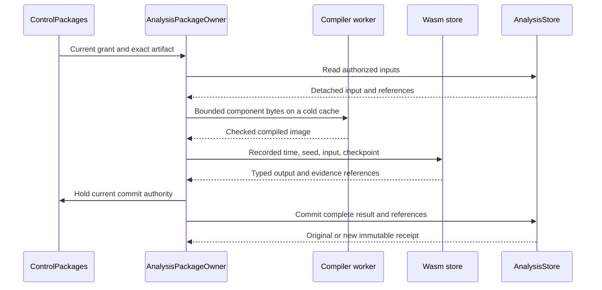

# Wasm Execution Review

Current command status, 2026-10-19: The old Analysis owner and its qualification
harness have been removed. The cases `analysis-packages`, `context-roundtrip`, `profile-restart`, `graph-notification`
are no longer accepted by `mithril_discovery_test`. The commands and results
below remain historical proof for their recorded source. They do not qualify
the current replacement. Read the [current plan](../../../araphor-package-jobs.md)
for the supported path and remaining work.

This guide follows the installed component path for
[Wasm Execution](phase-7-5-4-wasm-execution.md). The package owner executes
compiled algorithms. Existing host owners retain permission, evidence,
storage, and notification control.

## Intended end state

An operator installs a built detector folder through the package API.
The detector returns validated findings without an Araphor rebuild.
Current discovery and HF detectors use the same installed execution path.
Restart and identical retry preserve the committed result.

## Implementation review flow

[PackageArtifactV1::implementation](../../../../../crates/araphor-data/src/package/bundle.rs) Package admission selects a component artifact
  -> [CompileBudget](https://github.com/Ereborlabs/erebor-runtime/blob/d20ee0fd6f364f9b8d03eddf50a97bc60c9e02a8/crates/araphor-data/src/package/wasm/admission.rs) the execution owner checks its contract version, imports, and declared features
  -> [WasmExecution::compiled](https://github.com/Ereborlabs/erebor-runtime/blob/d20ee0fd6f364f9b8d03eddf50a97bc60c9e02a8/crates/araphor-data/src/package/wasm/cache.rs) Wasmtime validates and prepares the component under compilation limits
  -> [AnalysisPackageOwner::install](https://github.com/Ereborlabs/erebor-runtime/blob/d20ee0fd6f364f9b8d03eddf50a97bc60c9e02a8/crates/araphor-data/src/package/lifecycle.rs) the package owner records target compatibility before activation

[AnalysisPackageOwner::evaluate_artifact](https://github.com/Ereborlabs/erebor-runtime/blob/d20ee0fd6f364f9b8d03eddf50a97bc60c9e02a8/crates/araphor-data/src/package/execution.rs) The scheduler invokes an admitted export
  -> [QueryOwner::evaluate_component](https://github.com/Ereborlabs/erebor-runtime/blob/d20ee0fd6f364f9b8d03eddf50a97bc60c9e02a8/crates/araphor-data/src/query/model/component.rs) the host reserves input and schema scratch before it encodes the input
  -> [WasmExecution::evaluate_prepared](https://github.com/Ereborlabs/erebor-runtime/blob/d20ee0fd6f364f9b8d03eddf50a97bc60c9e02a8/crates/araphor-data/src/package/wasm.rs) the execution owner receives the owned wire input
  -> [WasmExecution::invoke](https://github.com/Ereborlabs/erebor-runtime/blob/d20ee0fd6f364f9b8d03eddf50a97bc60c9e02a8/crates/araphor-data/src/package/wasm/execution.rs) the host creates an evaluation instance with explicit limits and authorized inputs
  -> [WasmExecution::invoke](https://github.com/Ereborlabs/erebor-runtime/blob/d20ee0fd6f364f9b8d03eddf50a97bc60c9e02a8/crates/araphor-data/src/package/wasm/execution.rs) generated WIT bindings transfer bounded batches and the prior checkpoint
  -> [WasmExecution::invoke](https://github.com/Ereborlabs/erebor-runtime/blob/d20ee0fd6f364f9b8d03eddf50a97bc60c9e02a8/crates/araphor-data/src/package/wasm/execution.rs) the component returns declared outputs, evidence references, and next checkpoint
  -> [Package::validate_output](../../../../../crates/araphor-analysis-sdk/src/validation.rs) host validation passes the complete result to the existing commit path
  -> [EvaluationPermit](https://github.com/Ereborlabs/erebor-runtime/blob/d20ee0fd6f364f9b8d03eddf50a97bc60c9e02a8/crates/araphor-data/src/package/wasm/execution.rs) the execution owner releases the instance and temporary buffers

[WasmExecution::invoke](https://github.com/Ereborlabs/erebor-runtime/blob/d20ee0fd6f364f9b8d03eddf50a97bc60c9e02a8/crates/araphor-data/src/package/wasm/execution.rs) The component traps, exceeds a limit, or receives cancellation
  -> [GuestState](https://github.com/Ereborlabs/erebor-runtime/blob/d20ee0fd6f364f9b8d03eddf50a97bc60c9e02a8/crates/araphor-data/src/package/wasm/execution.rs) the host interrupts execution and checks cancellation
  -> [InstalledAnalysis::evaluate](https://github.com/Ereborlabs/erebor-runtime/blob/d20ee0fd6f364f9b8d03eddf50a97bc60c9e02a8/crates/araphor-data/src/package/installed.rs) the host discards uncommitted output and releases resources

[AnalysisPackageOwner::reconcile_group](https://github.com/Ereborlabs/erebor-runtime/blob/d20ee0fd6f364f9b8d03eddf50a97bc60c9e02a8/crates/araphor-data/src/package/supervision.rs) The generic package scheduler receives the error
  -> [AnalysisPackageOwner::failed](https://github.com/Ereborlabs/erebor-runtime/blob/d20ee0fd6f364f9b8d03eddf50a97bc60c9e02a8/crates/araphor-data/src/package/supervision.rs) the package owner records typed failure and marks retained results stale without replacing output or checkpoint

[InstalledAnalysis::evaluate](https://github.com/Ereborlabs/erebor-runtime/blob/d20ee0fd6f364f9b8d03eddf50a97bc60c9e02a8/crates/araphor-data/src/package/installed.rs) A domain adapter receives the error
  -> [DiscoveryOwner::process](https://github.com/Ereborlabs/erebor-runtime/blob/d20ee0fd6f364f9b8d03eddf50a97bc60c9e02a8/crates/araphor-data/src/discovery/live.rs) and [GraphAndFindingOwner::process](https://github.com/Ereborlabs/erebor-runtime/blob/d20ee0fd6f364f9b8d03eddf50a97bc60c9e02a8/crates/araphor-data/src/graph/live.rs) the adapter returns the error to its existing owner failure and coverage path

The generic package scheduler uses the same evaluator. Its named source inputs
and dependency inputs come from
[ModelOperation::inputs](https://github.com/Ereborlabs/erebor-runtime/blob/d20ee0fd6f364f9b8d03eddf50a97bc60c9e02a8/crates/araphor-data/src/query/model/operation.rs).
The discovery and graph adapters prepare their authorized domain inputs.
These adapters do not run through the generic table scheduler.
[InstalledAnalysis::evaluate](https://github.com/Ereborlabs/erebor-runtime/blob/d20ee0fd6f364f9b8d03eddf50a97bc60c9e02a8/crates/araphor-data/src/package/installed.rs)
checks these domain inputs and invokes `evaluate_artifact`.
Host-prepared exports with Table outputs use this path after package admission.
Discovery and graph outputs still require their domain adapter checks.

[InstalledAnalysis::active](https://github.com/Ereborlabs/erebor-runtime/blob/d20ee0fd6f364f9b8d03eddf50a97bc60c9e02a8/crates/araphor-data/src/package/installed/read.rs)
selects the requested installed, active export under the shared lifecycle lock
for an unpinned call. Evaluation reads only its complete root dependency bundle
and checks the selected grant and trust before and after computation.
An unrelated package grant is not checked for this exact call. Explicit
snapshots still pin all supported active exports in the scope. Pinned and
historical calls keep their selected exports. An active export that cannot use
host-prepared inputs returns `Unsupported`.
The [exact selection test](https://github.com/Ereborlabs/erebor-runtime/blob/d20ee0fd6f364f9b8d03eddf50a97bc60c9e02a8/crates/araphor-data/src/package/installed/read/tests.rs)
checks complete dependency admission and both revocation cases.

## Build and installation

[ComponentBuilder](../../../../../crates/araphor-component-build/src/lib.rs)
packages an author-built core module as a component. The generated
[guest bindings](../../../../../crates/araphor-analysis-sdk/src/guest.rs)
and [host bindings](https://github.com/Ereborlabs/erebor-runtime/blob/d20ee0fd6f364f9b8d03eddf50a97bc60c9e02a8/crates/araphor-data/src/package/wasm/bindings.rs)
use the same versioned WebAssembly Interface Types
([WIT contract](../../../../../crates/araphor-analysis-sdk/src/bindings/analysis.wit)).
The [detector example](../../../../../crates/araphor-detector-example/README.md)
contains the author commands and a complete detector.
The runtime keeps Wasmtime and this WIT interface. Extism supplies the approved
resource-policy reference. The runtime adds no Extism dependency.

The [built-in build script](../../../../../crates/araphor-analysis-builtins/build.rs)
runs during a native Cargo build. It calls
[ComponentBuilder::workspace](../../../../../crates/araphor-component-build/src/workspace.rs)
to compile and pack all six repository components. The build uses the locked
source, release profile, and fixed seed. The guest Cargo cache defaults to
`target/analysis-guest`. `ARAPHOR_COMPONENT_TARGET` selects another build cache.
The script rejects a cache that contains the native Cargo output directory.
The Wasm target branch skips this step to prevent recursive builds.

The packed bytes remain in Cargo `OUT_DIR`.
[Generated component constants](../../../../../crates/araphor-analysis-builtins/src/components.rs)
supply the required packages and the Data and E2E component tests.
[CI](../../../../../.github/workflows/ci.yml) installs the
`wasm32-unknown-unknown` Rust target before the ordinary Cargo checks.
The [builder input inventory](../../../../../crates/araphor-component-build/src/workspace.rs)
supplies the source-change watches. Generated component files are not source
inputs. The [source-build proof](wasm-component-build-proof.json) records two
equal builds and matching ordinary Cargo outputs under `source_build_correction`.
The [final completion review](phase-7-5-4-wasm-execution.md#final-eight-deliverable-review)
records final installed execution and workspace qualification.

A built folder is an OCI layout with `oci-layout`, `index.json`, and
content-addressed files in `blobs/sha256/`. The Araphor config contains metadata.
Typed raw layers contain component bytes, native dependency bytes when present,
and fixture Arrow IPC. Operators install the directory or an OCI-layout tar
archive. Installation has no author compiler, download, or hook. The host
compiles admitted Wasm bytes in its bounded worker. Remote registry and
publisher-verification work remains deferred.

[PackageBundleV1::encode](../../../../../crates/araphor-data/src/package/bundle.rs)
produces the current OCI-layout archive for SQL and component packages.
All packages use the exact OCI manifest's `sha256:` identity for trust pins.
The canonical Araphor config and manifest subset permits identity reconstruction
after loading the immutable package closure. There is no previous JSON bundle
or bare hexadecimal trust-pin fallback.
[Immutable revision writes](https://github.com/Ereborlabs/erebor-runtime/blob/d20ee0fd6f364f9b8d03eddf50a97bc60c9e02a8/crates/araphor-data/src/package/lifecycle/revisions.rs)
retain one descriptor and raw executable buffers. An identical dependency uses
the saved bytes after checked descriptor, artifact, and dependency comparison.
Arrow metadata map order cannot change a digest or identical install record.

Read the [current package storage and OCI guide](../../../../guides/araphor-binary-package-storage-review.md)
for format, bounds, request framing, trust, and current verification status.
The proof records below retain their original source and format. They do not
qualify subsequent OCI changes unless a current record states that result.

The [installation response correction](https://github.com/Ereborlabs/erebor-runtime/blob/d20ee0fd6f364f9b8d03eddf50a97bc60c9e02a8/crates/araphor-data/src/package/lifecycle.rs)
passes its admitted bundle to
[inspection](https://github.com/Ereborlabs/erebor-runtime/blob/d20ee0fd6f364f9b8d03eddf50a97bc60c9e02a8/crates/araphor-data/src/package/inspect.rs) and
[freshness checks](https://github.com/Ereborlabs/erebor-runtime/blob/d20ee0fd6f364f9b8d03eddf50a97bc60c9e02a8/crates/araphor-data/src/package/freshness.rs)
while the lifecycle lock remains held. The root, package, and revision select
the borrowed artifact. Other roots and standalone operations read storage.
Activations, results, grants, and dependency inputs remain current. Successful
transactional storage and immutable revision checks replace immediate artifact
readback for this response only. Later reads retain corruption detection.
The [metadata retry tests](https://github.com/Ereborlabs/erebor-runtime/blob/d20ee0fd6f364f9b8d03eddf50a97bc60c9e02a8/crates/araphor-data/src/package/tests/wasm/metadata.rs)
compare complete Install and Inspect responses after installation, retry, and
reopen. Read the [final installed lifecycle record](phase-7-5-4-wasm-execution.md#final-installed-lifecycle-qualification)
for the source-bound proof of this response path.

[ClientGrpcOwner](../../../../../crates/mithril-control/src/client_grpc/packages.rs)
checks the current permission before it decodes the operation.
Mutation requires the package grant and exact bundle trust pin.
The [public client](../../../../../crates/erebor-runtime-client/src/araphor/packages.rs)
uses the package message limit on this API.
The ordinary query API retains its existing limit.

[Required package startup](https://github.com/Ereborlabs/erebor-runtime/blob/d20ee0fd6f364f9b8d03eddf50a97bc60c9e02a8/crates/araphor-data/src/package/required.rs)
keeps existing activations. It does not replace their code after a host rebuild.
The [Control authority](../../../../../crates/mithril-control/src/service/packages.rs)
admits internal packages against the current executable's bundle pins. Changed
component bytes need an explicit package transition; different bytes cannot
replace the same immutable revision. An authorized client can use the existing
install or update operation to assign its grant to an activation. The client
must trust each required bundle digest. Historical replay uses the current
activation grant and still requires trust in the historical bundle. Same-artifact
restart and explicit package upgrades do not prove automatic host-build migration.

## Execution owners



[ControlPackages](../../../../../crates/mithril-control/src/service/packages.rs)
holds one package owner and query owner for a Control plane.
The listener and domain tasks use this owner.
The internal Control grant accepts only required bundle digests for configured
tenants. External packages use the bound `ClientAuth` owner.
The listener binds this authority before it starts discovery processing.

[WasmExecution](https://github.com/Ereborlabs/erebor-runtime/blob/d20ee0fd6f364f9b8d03eddf50a97bc60c9e02a8/crates/araphor-data/src/package/wasm.rs)
owns the engine, generated linker, code cache, compiler permit, and evaluation
count. Each call creates a separate Wasmtime store.
One engine ticker advances interruption epochs. Store cancellation and mutable
state remain separate. The ticker stops when its last owner drops.

Read the [installed guest overlap test](https://github.com/Ereborlabs/erebor-runtime/blob/d20ee0fd6f364f9b8d03eddf50a97bc60c9e02a8/crates/araphor-data/src/package/wasm/tests/runtime/concurrency.rs)
before the test-only
[GuestEntry gate](https://github.com/Ereborlabs/erebor-runtime/blob/d20ee0fd6f364f9b8d03eddf50a97bc60c9e02a8/crates/araphor-data/src/package/wasm/execution.rs).
The gate signals entry from the actual WIT `cancelled` import.
The test waits for both entry signals before it releases either call.
The release wait uses the remaining guest deadline. The host then applies its
normal call-count and cancellation checks.
The [existing cancellation test](https://github.com/Ereborlabs/erebor-runtime/blob/d20ee0fd6f364f9b8d03eddf50a97bc60c9e02a8/crates/araphor-data/src/package/wasm/tests/runtime.rs)
sets `release: None` and keeps its cancellation assertion.

[CompilerChild](https://github.com/Ereborlabs/erebor-runtime/blob/d20ee0fd6f364f9b8d03eddf50a97bc60c9e02a8/crates/araphor-data/src/package/wasm/compiler.rs)
starts the current executable in compiler mode with a cleared environment.
The entry point runs before the application runtime.
The [CompilerInput request](https://github.com/Ereborlabs/erebor-runtime/blob/d20ee0fd6f364f9b8d03eddf50a97bc60c9e02a8/crates/araphor-data/src/package/wasm/compiler/input.rs)
carries a version, fuel mode, and component bytes through standard input.
The child uses the same fuel mode as the parent engine.
The reply contains a bounded image and its digest.
The parent accepts no installed native image or external precompiled image.
Cancellation or deadline kills and reaps the child.
The compiler permit remains held until the I/O threads finish.

The one unsafe image load is in
[CompilerImage::component_reserved](https://github.com/Ereborlabs/erebor-runtime/blob/d20ee0fd6f364f9b8d03eddf50a97bc60c9e02a8/crates/araphor-data/src/package/wasm/compiler/image.rs).
Its input comes from the fresh host compiler with the same engine configuration.
The compiler boundary rejects a malformed reply, incorrect digest, or oversized
image before this load. The cache reserves the exact source and image byte charge
before host deserialization. A failed load releases the reservation.

[WasmExecution::prepare](https://github.com/Ereborlabs/erebor-runtime/blob/d20ee0fd6f364f9b8d03eddf50a97bc60c9e02a8/crates/araphor-data/src/package/wasm.rs)
returns one handle that retains the charged code entry. The package execution
owner prepares this handle before the query evaluation deadline starts. The
owner passes the same handle to guest invocation. Invocation does not repeat
the source digest, cache lookup, or component resource check. The handle stays
live until output decoding ends. Invocation rejects a handle from another
engine and releases the evaluation permit.

## Input, output, and host authority

The WIT interface has one computation export and one host import: `cancelled`.
The descriptor selects a named algorithm export inside the computation call.
The host supplies recorded time and optional seed. The guest receives no
WebAssembly System Interface (WASI)
filesystem, network, environment, clock, or random import.

The SDK transfers standard Arrow IPC streams with exact declared schemas.
The [wire decoder](../../../../../crates/araphor-analysis-sdk/src/wire/codec.rs)
checks message sizes, schema structure, projected allocation, batches, and rows.
It rejects compressed IPC before decode.
[Dataset::owned_batch](../../../../../crates/araphor-analysis-sdk/src/wire/codec.rs)
checks all array and child buffer lengths against the remaining copy budget.
The check includes possible temporary child validity buffers for nullable
parents. The decoder validates each array and uses Arrow `MutableArrayData` to
copy the values into owned buffers. A batch with no columns keeps its row count.
The decoder checks the resulting allocated bytes before it retains the batch.
The [owned-buffer tests](../../../../../crates/araphor-analysis-sdk/src/wire/tests/buffers.rs)
check a large binary dataset at a tight byte limit, nested nulls, columnless
rows, and a sparse null child that exceeds the copy budget. A smaller encoded
byte limit returns the SDK `Limit` error.
The [SDK reference](../../../../../crates/araphor-analysis-sdk/README.md)
lists supported Arrow types. Encoding and decoding make bounded copies.
This implementation does not claim zero-copy exchange.

Each [wire evaluation](../../../../../crates/araphor-analysis-sdk/src/wire/evaluation.rs)
and [wire output](../../../../../crates/araphor-analysis-sdk/src/wire/output.rs)
operation uses one private
[contract validator](../../../../../crates/araphor-analysis-sdk/src/validation.rs).
The operation validates the immutable descriptor and selects its model once.
Encoding checks typed input and output before IPC serialization. Decoding checks
the descriptor and limits before IPC, then checks the decoded input and output.
The two entry paths preserve the original export and limit error order.
Host and guest boundaries validate imported data separately. The guest wrapper
passes immutable [CheckedEvaluation](../../../../../crates/araphor-analysis-sdk/src/validation.rs)
references to `Guest::compute`. Standalone `Guest::evaluate` validates input
and output through the same checked contract.
The [codec boundary tests](../../../../../crates/araphor-analysis-sdk/src/tests/codec.rs)
check exact error codes, changed descriptors, malformed IPC, missing inputs,
and required output evidence. The
[detector descriptor](../../../../../crates/araphor-analysis-builtins/src/graph/contract.rs)
also reuses its Finding schema for reason details within one construction.
It does not regenerate the same schema for each reason.

[Package::allocated_bytes](../../../../../crates/araphor-analysis-sdk/src/memory.rs)
counts descriptor capacities, port schemas, reasons, and checkpoints.
`wire::Evaluation::allocated_bytes` counts retained IPC capacities and metadata.
Typed inputs and wire inputs share one revision and coverage calculation.
Schema charges include nested fields, Arc headers, and metadata capacity.
The [allocation tests](../../../../../crates/araphor-analysis-sdk/src/memory/tests.rs)
check unused capacity, nested metadata, all schema positions, and wire growth.

[Rows](../../../../../crates/araphor-analysis-builtins/src/rows.rs) buffers JSON
with the standard Rust `BufWriter`. The buffer uses at most 8 KiB per row.
The checked row writer sends each complete fragment to the Arrow binary
builder. Each Arrow write checks the remaining byte budget first. The encoder
flushes after serialization, including a serializer error. The encoder checks
the result before Arrow completes a non-null row with an empty append.
No complete-row vector or complete-row copy is created. The
[writer test](../../../../../crates/araphor-analysis-builtins/src/rows/tests.rs)
checks empty writes, complete writes, and rejection without a partial write.
The large escaped-string test compares exact JSON bytes across flush
boundaries. The serializer-error test retains byte-limit error precedence
and checks a successful next call.

[Computation::authorities](../../../../../crates/araphor-analysis-builtins/src/graph/credential/join.rs)
indexes each qualified fact identity by its position in one vector. The first
fact remains the representative. Duplicate matches update its direct-proof
flag with OR. Stable record sorting keeps equal-record encounter order. Every
channel evidence append remains in its original position. The
[credential test](../../../../../crates/araphor-analysis-builtins/src/graph/tests.rs)
checks repeated identities, direct-proof changes, tied records, contextual
fallback, and the exact raw evidence.

[Computation::credential](../../../../../crates/araphor-analysis-builtins/src/graph/credential/mod.rs)
copies raw join evidence once into a separate edge prefix. The shared
canonicalization helper sorts this prefix and removes duplicates before the
matched-fact loop. Each loop step adds the same fact record to the raw finding
sequence and the edge prefix. Each relationship copies the separate edge
prefix. Raw authority matches and the finding sequence stay unchanged. Final
publication still canonicalizes every edge and finding. The dense case has
66 relationships.

[Computation::output](../../../../../crates/araphor-analysis-builtins/src/graph/contract.rs)
publishes sorted evidence sets for edges and findings. Raw joins finish before
publication. The method sorts and removes duplicate row references before it
encodes candidate rows, matching reason details, and SDK evidence links.
Authority representatives, edge order, fact references, proof, coverage, and
checkpoint state stay unchanged. The
[publication test](../../../../../crates/araphor-analysis-builtins/src/graph/tests.rs)
keeps the raw join assertions and checks canonical rows, exact reason details,
evidence links, and checkpoint state.

[QueryOwner::evaluate_component](https://github.com/Ereborlabs/erebor-runtime/blob/d20ee0fd6f364f9b8d03eddf50a97bc60c9e02a8/crates/araphor-data/src/query/model/component.rs)
reserves input, IPC, and schema-message scratch before encoding. It includes
declared schemas when an input has no batches. The owner encodes once, reduces
the charge to retained input and wire capacities, and moves the wire into
`WasmExecution::evaluate_prepared`. After invocation, it retains the input and
output charges until the domain adapter releases the result. SQL keeps its
existing reservation through `QueryOwner::evaluate_analysis`.
The shared evaluator checks its local query deadline after output validation.
An expired output cannot return as a retained result.
Extraction closes durable readers before computation.

[InstalledSnapshot](https://github.com/Ereborlabs/erebor-runtime/blob/d20ee0fd6f364f9b8d03eddf50a97bc60c9e02a8/crates/araphor-data/src/package/installed/snapshot.rs)
holds one validated bundle per root in shared Arc ownership. Bundle capacities
and snapshot pins hold retained-input leases. `InstalledEvaluation` also holds
a lease for its copied descriptor and revision. The last owner releases each
charge. Each evaluation checks its grant and current trust before and after
computation. Commit authorization checks current activation metadata,
generation, revision, and grants. Cached bundle bytes do not cache permission.
Native graph extraction and seeded traversal retain their existing byte limits
and whole-version permission checks.

[GraphAndFindingOwner::process](https://github.com/Ereborlabs/erebor-runtime/blob/d20ee0fd6f364f9b8d03eddf50a97bc60c9e02a8/crates/araphor-data/src/graph/live.rs)
retains one installed snapshot in the existing operation state.
[InstalledAnalysis::snapshot_reusing](https://github.com/Ereborlabs/erebor-runtime/blob/d20ee0fd6f364f9b8d03eddf50a97bc60c9e02a8/crates/araphor-data/src/package/installed/read.rs)
reads fresh activations under the shared lifecycle lock for each live window.
Bundle reuse requires the same owner, scope, and tenant. A retained root must
have a current activation with the same key, generation, revision, and metadata.
The owner checks each current prepared-export grant and bundle trust.
Each reused Arc keeps the same immutable root and complete dependency closure.
The previous snapshot drops before new roots load. Unused bundle leases release
when their last owner drops. Explicit pinned and historical handles keep their
existing selection rules. The
[bundle reuse tests](https://github.com/Ereborlabs/erebor-runtime/blob/d20ee0fd6f364f9b8d03eddf50a97bc60c9e02a8/crates/araphor-data/src/package/installed/read/tests/retained/reusing.rs)
check current grants, active roots, scope, tenant, generation, and capacity
release before a new root loads.

[InstalledAnalysis::descriptors and prepared_models](https://github.com/Ereborlabs/erebor-runtime/blob/d20ee0fd6f364f9b8d03eddf50a97bc60c9e02a8/crates/araphor-data/src/package/installed/read.rs)
keep the complete immutable package descriptor. Dependency declarations can
refer to SQL exports. Snapshot pins select prepared models by package, revision,
and export. Graph derivation and retained-reference selection share this
iterator. The graph adapter keeps exact descriptor equality and SDK output
validation. The
[package regression](https://github.com/Ereborlabs/erebor-runtime/blob/d20ee0fd6f364f9b8d03eddf50a97bc60c9e02a8/crates/araphor-data/src/package/installed/read/tests/descriptors.rs)
checks the complete contract and direct and snapshot evaluation. The
[graph regression](https://github.com/Ereborlabs/erebor-runtime/blob/d20ee0fd6f364f9b8d03eddf50a97bc60c9e02a8/crates/araphor-data/src/graph/tests/installed/current/descriptors.rs)
checks mixed exports and complete graph equality.

[Adapter](https://github.com/Ereborlabs/erebor-runtime/blob/d20ee0fd6f364f9b8d03eddf50a97bc60c9e02a8/crates/araphor-data/src/discovery/sdk/mod.rs)
executes atoms, merge, groups, and compare through installed components.
The host checks exact keys, attribution, accounting, coverage, and prevention
claims against original records.
The shared context selector remains a host operation.

[GraphDerivation](https://github.com/Ereborlabs/erebor-runtime/blob/d20ee0fd6f364f9b8d03eddf50a97bc60c9e02a8/crates/araphor-data/src/graph/derive/adapter/mod.rs)
selects installed graph exports by their declared schemas.
It does not restrict package IDs to the current HF detectors.
[GraphReplayInputV1::normalized and manifest](../../../../../crates/araphor-data/src/graph/input.rs)
share input preparation between derivation and refresh. Normalization keeps the
existing full record and context conflict checks. It orders and removes duplicate
coverage ranges, keys, and gaps. It excludes the reserved package sidecar from
fact input. `manifest` constructs the same exact retained references.
[GraphAndFindingOwner::derive](https://github.com/Ereborlabs/erebor-runtime/blob/d20ee0fd6f364f9b8d03eddf50a97bc60c9e02a8/crates/araphor-data/src/graph/derive.rs)
pins and authorizes the tenant before normalization. `derive_selected` then
validates the input, checks required packages, and runs the selected installed
exports. The normal refresh path uses this same preparation.
[Graph validation](https://github.com/Ereborlabs/erebor-runtime/blob/d20ee0fd6f364f9b8d03eddf50a97bc60c9e02a8/crates/araphor-data/src/graph/derive/adapter/validation.rs)
checks exact subject identities, parent facts, direct cause, evidence, confirmed
findings, and qualified coverage.
A package cannot increase authority or proof through an output claim.

[GraphDerivation::apply_output](https://github.com/Ereborlabs/erebor-runtime/blob/d20ee0fd6f364f9b8d03eddf50a97bc60c9e02a8/crates/araphor-data/src/graph/derive/adapter/output.rs)
adds Arrow dataset and reason bytes across the selected packages.
The aggregate limit is 4 MiB.
[WindowBytes::check](https://github.com/Ereborlabs/erebor-runtime/blob/d20ee0fd6f364f9b8d03eddf50a97bc60c9e02a8/crates/araphor-data/src/graph/derive/finish.rs)
counts the serialized graph snapshot after host validation. The checked writer
creates no output buffer. It stops above the existing 4 MiB JSON limit and
returns `GraphInvalid` with field `graph output bytes`. Historical stored reads
do not use this derivation check.
[GraphAndFindingOwner::commit_bounded_window](https://github.com/Ereborlabs/erebor-runtime/blob/d20ee0fd6f364f9b8d03eddf50a97bc60c9e02a8/crates/araphor-data/src/graph/commit.rs)
selects the existing
[window split](https://github.com/Ereborlabs/erebor-runtime/blob/d20ee0fd6f364f9b8d03eddf50a97bc60c9e02a8/crates/araphor-data/src/graph/chunks.rs)
only for `GraphInvalid` with field `graph output bytes`.
The rejected window commits no output. Every other error returns to the caller.
The commit owner adds position metadata and keeps its final serialized-byte
check before commit.

[FindingReasonV1](../../../../../crates/araphor-data/src/graph/model.rs)
stores declared reason codes with their schema and IPC details.
The host maps the historical eleven reason codes to legacy JSON only when the
declared detail schema also matches. A new detector requires no host enum entry.
Existing notification routes and human deadlines remain host-owned.
Host graph assembly already sorts retained evidence and removes duplicates.
Canonical publication preserves that historical finding JSON.
Generic package `Run` results retain SDK candidate and reason-detail IPC through
[AnalysisPackageOwner::encode_output](https://github.com/Ereborlabs/erebor-runtime/blob/d20ee0fd6f364f9b8d03eddf50a97bc60c9e02a8/crates/araphor-data/src/package/output.rs).
The candidate and reason-detail IPC bytes change when publication removes
duplicate references or changes their order. Generic results do not use the legacy graph
reason mapping. An identical saved
[Run retry](https://github.com/Ereborlabs/erebor-runtime/blob/d20ee0fd6f364f9b8d03eddf50a97bc60c9e02a8/crates/araphor-data/src/package/evaluation.rs)
returns its original receipt before it prepares a new computation.

## Commit and recovery

[InstalledAnalysis::authorize](https://github.com/Ereborlabs/erebor-runtime/blob/d20ee0fd6f364f9b8d03eddf50a97bc60c9e02a8/crates/araphor-data/src/package/installed/commit.rs)
compares activation generation, revision, and metadata before a domain commit.
`commit_many` holds current authority for the complete selected root set.
Exports with different grants retain separate authority entries even when their
root is the same. Package owners for the same store share the lifecycle lock.
An update, removal, grant renewal, or suspension cannot cross the activation
check and domain commit. Owner construction uses the same lock during admission
collection. A supervisor can change readiness metadata without this lock.
This status change does not change the grant or activation generation.
Permission and trust are checked after computation as well as before it.
An authority change cancels an active call.

Saved discovery and graph context retains exact exports, revisions, roots,
activation generations, and configured parameters.
[Context validation](../../../../../crates/araphor-data/src/analysis/context/provenance.rs)
checks tenant scope and retained dependency closure during writes, reads, reopen,
and restore. The previous discovery format can omit package references.
New graph context requires valid references.
Artifact collection retains these saved roots.

[InstalledAnalysis::pin_at](https://github.com/Ereborlabs/erebor-runtime/blob/d20ee0fd6f364f9b8d03eddf50a97bc60c9e02a8/crates/araphor-data/src/package/installed/history.rs)
replays retained code and parameters under current permission and trust.
It reads current activations even when the caller holds an old snapshot.
A historical handle cannot commit.
[GraphAndFindingOwner::installed_refs](https://github.com/Ereborlabs/erebor-runtime/blob/d20ee0fd6f364f9b8d03eddf50a97bc60c9e02a8/crates/araphor-data/src/graph/installed.rs)
reads the bounded native header to obtain the source identity.
It does not reconstruct graph rows for this reference read.
The graph commit retains and validates its exact package provenance sidecar.
The visible input manifest excludes only this sidecar key. The sidecar remains
in the atomic context references and artifact collection inputs.

[GraphAndFindingOwner::commit_window](https://github.com/Ereborlabs/erebor-runtime/blob/d20ee0fd6f364f9b8d03eddf50a97bc60c9e02a8/crates/araphor-data/src/graph/window.rs)
checks retained-input expiry before it reuses a completed graph check.
The provider notice and coverage revision must match the saved per-result
metadata. [installed_current](https://github.com/Ereborlabs/erebor-runtime/blob/d20ee0fd6f364f9b8d03eddf50a97bc60c9e02a8/crates/araphor-data/src/graph/installed.rs)
then compares all compatible installed references and checks current permission.
Update, removal, a new compatible export, or revocation cannot use this shortcut.

[commit_bounded_window](https://github.com/Ereborlabs/erebor-runtime/blob/d20ee0fd6f364f9b8d03eddf50a97bc60c9e02a8/crates/araphor-data/src/graph/commit.rs)
can also skip guest execution after a provider notice changes. This path applies
only to a normal refresh. The selected input must validate, and its normalized
manifest must match the retained result. The saved coverage revision must equal
the current source coverage revision. All compatible installed references must
match, including exports, roots, revisions, generations, and parameters.
[window_context](../../../../../crates/araphor-data/src/graph/input.rs)
checks complete immutable context values before this decision. A change to raw
body bytes, validity times, or sensitivity under the same key fails this check.
[acknowledge_window](https://github.com/Ereborlabs/erebor-runtime/blob/d20ee0fd6f364f9b8d03eddf50a97bc60c9e02a8/crates/araphor-data/src/graph/commit.rs)
holds current activation and commit authority through `authorize`, then calls
`mark_graph_notice` for the same immutable window head.

[WindowRun](https://github.com/Ereborlabs/erebor-runtime/blob/d20ee0fd6f364f9b8d03eddf50a97bc60c9e02a8/crates/araphor-data/src/graph/window.rs)
keeps advance and force flags through chunk processing. Both flags bypass the
pre-guest reuse check. Failed-source recovery uses force.
[Expiry](https://github.com/Ereborlabs/erebor-runtime/blob/d20ee0fd6f364f9b8d03eddf50a97bc60c9e02a8/crates/araphor-data/src/graph/expiry.rs) runs before reuse
and keeps its existing proof downgrade and original package references.
The [notice reuse tests](https://github.com/Ereborlabs/erebor-runtime/blob/d20ee0fd6f364f9b8d03eddf50a97bc60c9e02a8/crates/araphor-data/src/graph/tests/notices/reuse.rs)
observe the real guest import. They check a notice-only skip, a later fact
replacement, forced execution, raw-context rejection, and recovery. A newer
report for an unrelated interval runs the guest even when manifest coverage
keys stay empty.

When a changed notice produces the same graph,
[commit_bounded_window](https://github.com/Ereborlabs/erebor-runtime/blob/d20ee0fd6f364f9b8d03eddf50a97bc60c9e02a8/crates/araphor-data/src/graph/commit.rs)
checks current commit authority and saves the captured notice through
[mark_graph_notice](../../../../../crates/araphor-data/src/analysis/progress/notices.rs).
The guarded update applies only to the same retained window head and immutable
commit revision. It changes no result body, receipt, quota, progress, or deadline.
A provider change during the check remains pending for the next pass.
Discovery uses the same metadata update owner and keeps its monotone notice rule.
The [notice tests](https://github.com/Ereborlabs/erebor-runtime/blob/d20ee0fd6f364f9b8d03eddf50a97bc60c9e02a8/crates/araphor-data/src/graph/tests/notices.rs)
use the production graph owner and installed components.
The [authority tests](https://github.com/Ereborlabs/erebor-runtime/blob/d20ee0fd6f364f9b8d03eddf50a97bc60c9e02a8/crates/araphor-data/src/graph/tests/installed/current/authority.rs)
check both an unchanged notice and a changed notice without changed facts.
The [activation tests](https://github.com/Ereborlabs/erebor-runtime/blob/d20ee0fd6f364f9b8d03eddf50a97bc60c9e02a8/crates/araphor-data/src/graph/tests/installed/current.rs)
check updates, added compatible exports, removal, history, and exact health.
The [metadata tests](https://github.com/Ereborlabs/erebor-runtime/blob/d20ee0fd6f364f9b8d03eddf50a97bc60c9e02a8/crates/araphor-data/src/analysis/progress/notices/tests.rs)
check separate windows, old-head rejection, immutable metadata, and retry.

[GraphAndFindingOwner::refresh_source](https://github.com/Ereborlabs/erebor-runtime/blob/d20ee0fd6f364f9b8d03eddf50a97bc60c9e02a8/crates/araphor-data/src/graph/live.rs)
reads current window bounds through
[graph_window_bounds](../../../../../crates/araphor-data/src/analysis/graph/windows.rs).
The native query filters the tenant and source before it ranks window heads.
The bounds read validates the selected header without reconstructing its rows.
[window_heads](https://github.com/Ereborlabs/erebor-runtime/blob/d20ee0fd6f364f9b8d03eddf50a97bc60c9e02a8/crates/araphor-data/src/graph/window.rs) uses
`graph_window_page` to select possible overlapping ranges. The checked header
decides exact overlap before the owner reconstructs rows. A page retains its
continuation ID when the candidate does not overlap.
The [window read tests](https://github.com/Ereborlabs/erebor-runtime/blob/d20ee0fd6f364f9b8d03eddf50a97bc60c9e02a8/crates/araphor-data/src/analysis/graph/windows/tests.rs)
check selection, continuation, history, and corruption. The
[final completion review](phase-7-5-4-wasm-execution.md#final-eight-deliverable-review) records final qualification.

[AnalysisReadControl::run and AnalysisStore::read_snapshot](../../../../../crates/araphor-data/src/analysis/read.rs)
carry the native caller location into the existing deadline error. This location
identifies the call to the read runner or snapshot wrapper. The location does
not identify a specific SQL statement inside its read closure. The one-second
default read deadline
and cleanup rules stay unchanged.

The generic package commit retains result, checkpoint, input references,
progress, and quota together. Domain adapters use their existing graph or
discovery commit. Identical retries return the original receipt.
Changed retries fail. A current freshness check can mark a retained result
stale. This status does not change its result ID, commit revision, data, or
checkpoint bytes. Missing required coverage remains explicit.
Removal retains its tombstone and does not reinstall a required package on
restart. Expiry reduces retained proof without executing removed code.

The [package lifecycle test](https://github.com/Ereborlabs/erebor-runtime/blob/d20ee0fd6f364f9b8d03eddf50a97bc60c9e02a8/crates/araphor-data/src/package/tests/wasm/lifecycle.rs)
uses its test authority to observe the revision 2 receipt after the commit.
The test checks the Wasm target, output value 7, and immutable receipt fields.
The returned response can mark the saved result stale after a clock change.
The test keeps the clock, retry, reopen, rollback, and removal checks.

## Limits and proof

Compilation accepts at most 8 MiB of component source and a 32 MiB image.
The compiler has a 1 GiB address-space limit, 30-second CPU hard limit,
and 45-second wall deadline. Structural scan limits also apply.
Host domain calls have a finite 60-second outer deadline for a cold cache.
[QueryLimits](https://github.com/Ereborlabs/erebor-runtime/blob/d20ee0fd6f364f9b8d03eddf50a97bc60c9e02a8/crates/araphor-data/src/query/mod.rs) defaults to a
one-second evaluation timeout. The query owner uses its configured timeout.
This query deadline applies after compilation. A configured Wasm timeout can
shorten the inherited caller deadline.
Epoch interruption stops guest instructions. A synchronous
host call or canonical application binary interface (ABI) operation finishes
before the host checks the
control deadline again. An expired call cannot commit.

[WasmLimits](https://github.com/Ereborlabs/erebor-runtime/blob/d20ee0fd6f364f9b8d03eddf50a97bc60c9e02a8/crates/araphor-data/src/query/wasm.rs) contains six
optional quotas. Every field defaults to `None`. An omitted or `null` field
leaves that additional Wasm quota unset.

| Field | Configured quota |
| --- | --- |
| `fuel` | Instruction fuel units per evaluation |
| `memory_bytes` | Guest linear memory bytes, including initial memory |
| `data_bytes` | Additional SDK data-byte ceiling |
| `timeout` | Additional guest timeout, within the caller deadline |
| `allocation_bytes` | Approximate allocation fuel for canonical ABI copies |
| `host_calls` | Calls to the WIT `cancelled` import |

The parent and compiler engines enable instruction metering only when `fuel`
is set. Each call applies its configured fuel budget. The same configuration
path applies in production and tests. Resource-failure tests set the quotas
they check. The earlier 32 MiB data and 100 million fuel settings are historical
configurations. The [final completion review](phase-7-5-4-wasm-execution.md#final-eight-deliverable-review)
records qualification for its captured source.

Mandatory guards remain. Each store permits one memory, four tables,
16,384 elements per table, and 16 instances. The engine uses a 512 KiB Wasm
stack bound. The Wasm owner permits four active evaluations. SDK schema,
reference, batch, row, and byte checks remain. The component path caps batches
at 1,024, rows at one million, and checkpoint data at 16 MiB. Query input defaults
to 64 MiB. Shared query input capacity is 128 MiB; output capacity is 16 MiB.
Caller cancellation, the query deadline, authorization, and atomic commit checks
remain. The `allocation_bytes` quota does not measure total host resident memory.
When this quota is unset, value lifting has no additional Wasm allocation cap.
These settings do not bound total process resident memory.

Local OCI packages and package transport have no separate aggregate size cap.
Read the [current storage guide](../../../../guides/araphor-binary-package-storage-review.md#local-oci-transport-and-admission)
for exact byte identity, format checks, runtime limits, and store charges.

The [code cache](https://github.com/Ereborlabs/erebor-runtime/blob/d20ee0fd6f364f9b8d03eddf50a97bc60c9e02a8/crates/araphor-data/src/package/wasm/cache.rs)
has an 80 MiB byte limit and a 16-entry limit.
The cache index and prepared handles share each code entry. The byte and entry
charges stay live until the last reference drops. Cache eviction or clearing
cannot release the charge for retained code. Admission removes only entries
that have no other reference. Admission returns `AnalysisBusy` when live code
prevents a new reservation. The byte and entry limits do not change.
The [cache lifetime test](https://github.com/Ereborlabs/erebor-runtime/blob/d20ee0fd6f364f9b8d03eddf50a97bc60c9e02a8/crates/araphor-data/src/package/wasm/cache.rs)
checks both limits, cloned cache indexes, retained handles, and final release.
The [prepared execution test](https://github.com/Ereborlabs/erebor-runtime/blob/d20ee0fd6f364f9b8d03eddf50a97bc60c9e02a8/crates/araphor-data/src/package/wasm/tests/runtime/prepared.rs)
clears the index and holds the compiler permit. The saved handle still executes
the real component and returns value 42. A foreign engine rejects the handle.
The [execution error](https://github.com/Ereborlabs/erebor-runtime/blob/d20ee0fd6f364f9b8d03eddf50a97bc60c9e02a8/crates/araphor-data/src/package/wasm/execution.rs)
also retains a charged handle. Wasmtime backtrace frames retain compiled modules.
The original error source drops before the handle. The host classifies the
original trap before it adds the handle. Display, the source chain, and the
exact root trap remain available. The retained-trap regression fails on the
original error path and passes after the correction. Cache clearing cannot
release the charge while the error is retained. Dropping the error releases
the last charge. The code charge excludes engine metadata, allocator overhead,
and Arrow buffers.
Query accounting and evaluation limits bound input and output separately. The
code limit is not a total process memory limit.

The [native store](../../../../../crates/araphor-data/src/analysis/connection.rs)
has one 128 MiB buffer limit shared by its writer and two cloned readers.
[Backup validation](../../../../../crates/araphor-data/src/analysis/backup.rs)
uses the same constant. The graph window stays at 4 MiB. The separate SQL
evaluator keeps its 64 MiB target. These settings do not limit process RSS.
The [native limit test](../../../../../crates/araphor-data/src/analysis/capacity.rs)
checks the settings, rejects an allocation above the buffer limit, and confirms
that the failed insert stores no row. The
[restore test](https://github.com/Ereborlabs/erebor-runtime/blob/d20ee0fd6f364f9b8d03eddf50a97bc60c9e02a8/crates/araphor-data/src/graph/tests/traversal/recovery.rs)
compares all four saved component revisions before an owner can reinstall them.
The [supervisor](https://github.com/Ereborlabs/erebor-runtime/blob/d20ee0fd6f364f9b8d03eddf50a97bc60c9e02a8/crates/araphor-data/src/package/supervision.rs)
reuses each admitted bundle for the prepared-export check.

Review the committed Rust cases beside
[runtime isolation](https://github.com/Ereborlabs/erebor-runtime/blob/d20ee0fd6f364f9b8d03eddf50a97bc60c9e02a8/crates/araphor-data/src/package/wasm/tests/runtime.rs),
[compiler limits](https://github.com/Ereborlabs/erebor-runtime/blob/d20ee0fd6f364f9b8d03eddf50a97bc60c9e02a8/crates/araphor-data/src/package/wasm/compiler/tests.rs),
[package lifecycle](https://github.com/Ereborlabs/erebor-runtime/blob/d20ee0fd6f364f9b8d03eddf50a97bc60c9e02a8/crates/araphor-data/src/package/tests/wasm/lifecycle.rs),
[dependency replacement](https://github.com/Ereborlabs/erebor-runtime/blob/d20ee0fd6f364f9b8d03eddf50a97bc60c9e02a8/crates/araphor-data/src/package/tests/wasm/flow.rs),
[domain history](https://github.com/Ereborlabs/erebor-runtime/blob/d20ee0fd6f364f9b8d03eddf50a97bc60c9e02a8/crates/araphor-data/src/graph/tests/installed.rs),
and [context recovery](../../../../../crates/araphor-data/src/analysis/packages/tests/context/validation.rs).
The production [SDK detector case](../../../../../crates/mithril-e2e/src/discovery/packages/wasm.rs)
installs over TLS, reopens a new owner with an empty cache, replays, retries,
and revokes trust.

### Current algorithm proof route

| Algorithm | Installed execution proof | Host boundary |
| --- | --- | --- |
| AR-01: atoms and accounting | [Discovery captured results](https://github.com/Ereborlabs/erebor-runtime/blob/d20ee0fd6f364f9b8d03eddf50a97bc60c9e02a8/crates/araphor-data/src/discovery/derive/tests/baseline.rs) | Exact record identity, attribution, accounting, and coverage checks |
| AR-02: merge and display groups | [Discovery captured results](https://github.com/Ereborlabs/erebor-runtime/blob/d20ee0fd6f364f9b8d03eddf50a97bc60c9e02a8/crates/araphor-data/src/discovery/derive/tests/baseline.rs) | Host selection and retained profile identity |
| AR-03: baseline comparison | [Discovery captured results](https://github.com/Ereborlabs/erebor-runtime/blob/d20ee0fd6f364f9b8d03eddf50a97bc60c9e02a8/crates/araphor-data/src/discovery/derive/tests/baseline.rs) | Exact baseline and current profile revisions |
| AR-04: context integration | [Context round trip](https://github.com/Ereborlabs/erebor-runtime/blob/6a25ba1b34dbaa0a553b1883058938683ce7aaab/crates/mithril-e2e/src/discovery/roundtrip/context.rs) and [installed context component](https://github.com/Ereborlabs/erebor-runtime/blob/6a25ba1b34dbaa0a553b1883058938683ce7aaab/crates/mithril-e2e/src/discovery/roundtrip/context/component.rs) | Host permission, cutoff, selected records, and omissions |
| AR-05: HF-PROC-001 | [Graph captured results](https://github.com/Ereborlabs/erebor-runtime/blob/d20ee0fd6f364f9b8d03eddf50a97bc60c9e02a8/crates/araphor-data/src/graph/tests/baseline.rs) | Exact identities, parent facts, and native evidence |
| AR-06: HF-DW-001 | [Graph captured results](https://github.com/Ereborlabs/erebor-runtime/blob/d20ee0fd6f364f9b8d03eddf50a97bc60c9e02a8/crates/araphor-data/src/graph/tests/baseline.rs) | Credential identity, evidence, confirmation, and coverage |
| AR-07: HF-XNODE-001 | [Graph captured results](https://github.com/Ereborlabs/erebor-runtime/blob/d20ee0fd6f364f9b8d03eddf50a97bc60c9e02a8/crates/araphor-data/src/graph/tests/baseline.rs) | Cross-node causality remains unqualified; retain current Kubernetes proof limits |

The captured-result tests use installed components from the shared algorithm
source. AR-04 sends the host-selected packet through a real component. The
qualification case checks the returned rows, revision, coverage, cutoff, and
omissions. The component does not select or authorize context.

The [cached discovery fixture](../../../../../crates/araphor-data/src/discovery/derive.rs)
and [cached graph fixture](https://github.com/Ereborlabs/erebor-runtime/blob/d20ee0fd6f364f9b8d03eddf50a97bc60c9e02a8/crates/araphor-data/src/graph/tests.rs)
use a mutex. Each test or fixture operation holds one guard through its
component calls. Production query capacity stays unchanged.
The [metadata deadline test](../../../../../crates/araphor-data/src/analysis/read.rs)
includes the native graph snapshot read. It checks typed expiry, released read
slots, unchanged metadata, and a successful fresh read.

The [graph replay fixture](https://github.com/Ereborlabs/erebor-runtime/blob/6a25ba1b34dbaa0a553b1883058938683ce7aaab/crates/mithril-e2e/src/discovery/graph_notification/replay.rs)
retains one graph owner before intake accepts sources. The same owner processes
sources, reads snapshots, and refreshes context. Reopen paths drop the owner
before they close stores. The directory drops last. The
[owner lifetime tests](https://github.com/Ereborlabs/erebor-runtime/blob/6a25ba1b34dbaa0a553b1883058938683ce7aaab/crates/mithril-e2e/src/discovery/graph_notification/replay/lifetime.rs)
check required registration, cursor wrap, context replacement, historical
findings, and source isolation. The registration test fails on the original
fixture. The complete CLI case has DEBUG step timings and an INFO whole-case
duration.
These diagnostics add no timing threshold.

Review these boundary tests with the algorithm cases:

- [Focused graph boundary tests](https://github.com/Ereborlabs/erebor-runtime/blob/6a25ba1b34dbaa0a553b1883058938683ce7aaab/crates/mithril-e2e/src/discovery/graph_notification/replay/tests/transport.rs)
  check transport, output rejection, rollback, replay, routing, delivery, restart,
  agent limits, and human acknowledgement in eight ordinary Rust tests.
  The commit and notification modules are siblings of the transport module.
  Each test shows its production calls and assertions. Helpers prepare inputs
  and initial resources only.
- [Focused host boundary tests](https://github.com/Ereborlabs/erebor-runtime/blob/6a25ba1b34dbaa0a553b1883058938683ce7aaab/crates/mithril-e2e/src/discovery/graph_notification/replay/tests/context.rs)
  retain all 12 cards, device denial, policy history, local input proof, node
  isolation, provider facts, and read scope in nine more ordinary Rust tests.
  The other modules are siblings of the context module.
  Reuse these owner tests for read-result, contradiction, provenance, baseline,
  authorization, sensitivity, follow, and subject-join checks. The complete CLI
  retains combined-source checks, all read and send records, and large inputs.
  The focused tests keep visible production calls and assertions.

- [Installed guest overlap](https://github.com/Ereborlabs/erebor-runtime/blob/d20ee0fd6f364f9b8d03eddf50a97bc60c9e02a8/crates/araphor-data/src/package/wasm/tests/runtime/concurrency.rs)
  uses the shipped Discovery `groups` component for two tenants. Both tenant
  snapshots retain the same installed owner. The test checks separate
  evaluation IDs, group keys, and sample identities. It checks member indexes
  `[0, 1]` and aggregate counts 5 and 18. Each output has no checkpoint,
  evidence, or reason.
- [Multiple input batches](https://github.com/Ereborlabs/erebor-runtime/blob/d20ee0fd6f364f9b8d03eddf50a97bc60c9e02a8/crates/araphor-data/src/package/wasm/tests/runtime/batches.rs)
  includes an empty batch and verifies the computed total.
- [Checkpoint recovery](https://github.com/Ereborlabs/erebor-runtime/blob/d20ee0fd6f364f9b8d03eddf50a97bc60c9e02a8/crates/araphor-data/src/package/tests/wasm/checkpoint.rs)
  verifies prior state, restart, and an old retry after a later state commit.
- [Native graph component input](https://github.com/Ereborlabs/erebor-runtime/blob/d20ee0fd6f364f9b8d03eddf50a97bc60c9e02a8/crates/araphor-data/src/query/analysis/tests/component.rs)
  verifies bounded traversal rows and an empty replacement through a component.
- [Graph package references](../../../../../crates/araphor-data/src/analysis/graph_rows/tests/packages.rs)
  reject a wrong result key or corrupt sidecar before commit. A valid commit
  and retry retain the same visible graph and package references.
- [Graph output splitting](https://github.com/Ereborlabs/erebor-runtime/blob/d20ee0fd6f364f9b8d03eddf50a97bc60c9e02a8/crates/araphor-data/src/graph/tests/bounded.rs)
  uses installed components with 256 records and 67 facts. The test requires
  the exact whole-window aggregate byte error, unchanged metadata, and no
  partial finding commit. The test requires split processing to consume all
  256 records and retain 255 native findings and one contextual credential
  finding with exact evidence. Each stored result must stay within 4 MiB.
  The retained final proof is
  `/tmp/araphor-wasm-rust-ci-ordered-v59.json`.
- [Domain commit fences](https://github.com/Ereborlabs/erebor-runtime/blob/d20ee0fd6f364f9b8d03eddf50a97bc60c9e02a8/crates/araphor-data/src/package/installed/commit/tests/changes.rs)
  verify that Run renewal and supervisor suspension cannot change an activation
  during the commit callback.
- [Cache accounting](https://github.com/Ereborlabs/erebor-runtime/blob/d20ee0fd6f364f9b8d03eddf50a97bc60c9e02a8/crates/araphor-data/src/package/wasm/fixtures/tests.rs)
  checks each source and mapped image charge and retains all five components.
- [Output deadline](https://github.com/Ereborlabs/erebor-runtime/blob/d20ee0fd6f364f9b8d03eddf50a97bc60c9e02a8/crates/araphor-data/src/query/model/tests/clock.rs)
  rejects a result after the local deadline while the caller deadline remains
  valid. The next call can obtain the released memory lease.

## Production qualification

Build the normal qualification binary for the current source. Run all four
cases and the final shared Rust procedure after the last Rust edit.
Run all four cases before the final shared Rust procedure, as the phase
implementation checklist requires. Keep the source unchanged until both checks
finish. Run the graph case and CI separately to reduce simultaneous disk use.
Run each case in a separate output directory that does not yet exist. Use the
same binary for all four cases. Keep it unchanged while its compiler children
run.

```sh
CARGO_INCREMENTAL=0 CARGO_BUILD_JOBS=1 cargo build --locked -p mithril-e2e --bin mithril_discovery_test
qualification_root=$(mktemp -d /tmp/araphor-qualification.XXXXXX)
cp target/debug/mithril_discovery_test "$qualification_root/mithril_discovery_test"
"$qualification_root/mithril_discovery_test" --case analysis-packages --output-directory "$qualification_root/analysis-packages"
"$qualification_root/mithril_discovery_test" --case context-roundtrip --output-directory "$qualification_root/context-roundtrip"
"$qualification_root/mithril_discovery_test" --case profile-restart --output-directory "$qualification_root/profile-restart"
"$qualification_root/mithril_discovery_test" --case graph-notification --output-directory "$qualification_root/graph-notification"
```

Require exit code 0 and a `result.json` with schema version 1, the exact case
name, and result `PASS`. Retain the source and binary hashes, logs, and output
files. These cases use the production configuration with optional Wasm quotas
unset. Configured resource-failure tests remain separate required checks.

| Case | Required proof |
| --- | --- |
| `analysis-packages` | Install the SDK detector over TLS from its built folder. Check restart, retry, trust revocation, threshold 3, four input records, three matching evidence records, reason `example-burst.THRESHOLD`, and no host rebuild. Check the package checkpoint counts 2, 2, and 1. |
| `context-roundtrip` | Check signed context, cursor 1, and the installed context component. The returned identity, revision, and coverage must match. Check one selected record, no excluded record, and one omission. |
| `profile-restart` | Check the context fields above, live profile, late context, deterministic profile, immutable sealed revision, and frozen replay without provider calls. Retain `profile.json` and `profile-unresolved.json`. |
| `graph-notification` | Check acknowledgements `[null, null, 2, 2]`, cursors `[0, 0, 2, 2]`, failed transaction, duplicate intake, and equal replay. Check the original notification deadline and human receipt. Check 12 incident cards, 257 findings and obligations, and native windows of 64 and 185 records with equal results after reopen. Retain `graph.json`. |

The commands above are required checks. They do not record a pass.

The [qualification server owner](https://github.com/Ereborlabs/erebor-runtime/blob/6a25ba1b34dbaa0a553b1883058938683ce7aaab/crates/mithril-e2e/src/discovery/graph_notification.rs)
awaits shutdown on success or failure and retains the original error.
Its expired-certificate test requires both stores to reopen after failure.
The [replay fixture](https://github.com/Ereborlabs/erebor-runtime/blob/6a25ba1b34dbaa0a553b1883058938683ce7aaab/crates/mithril-e2e/src/discovery/graph_notification/replay.rs)
closes owners before its temporary root and releases the completed incident
fixture before independent density and window checks. The
[command entry point](../../../../../crates/mithril-e2e/src/bin/mithril_discovery_test.rs)
returns an error after Tokio shutdown. Existing assertions and workloads remain.

## Verification record

**Done** for source `c145e7b8`. The four final production cases pass on that
source. The final shared Rust procedure passes in 9,147.416 seconds: 2,080 tests pass, zero fail,
and 555 remain ignored. Ignored tests do not supply qualification evidence.
The final proof is `/tmp/araphor-wasm-rust-ci-proof-v59.json`.
Its terminal record is `/tmp/araphor-wasm-rust-ci-ordered-v59.json`;
its log is `/tmp/araphor-wasm-rust-ci-ordered-v59.log`. The
[final completion review](phase-7-5-4-wasm-execution.md#final-eight-deliverable-review) records the eight deliverables and remaining scope limits.
The dispatch change preceded complete equivalence proof. This historical error
remains. Final qualification proves installed-component equivalence at that
source. The current working tree requires new verification.

## Bounded discovery input correction

Read `discovery/sdk/pages.rs`, then `discovery/sdk/atoms.rs` and
`discovery/sdk/snapshot.rs`. `RecordedPages` keeps all deliveries of a full
record identity together. It rejects orphan context and exclusion rows before
projection. Coverage pieces have adjacent cursor bounds. Their expected
counts stay within each piece width and sum to the original count. Empty
ranges, explicit gaps, lifecycle references, and evidence samples remain.

`derive_recorded` uses 128 complete identities per internal page. The
129-identity fixture crosses this boundary and compares whole and paged output.
`derive_recorded` pins installed execution once and uses the original input
revision and one finite control. Each page and its rolling merge use installed
components. Page evaluation leases drop before the next call. The method
validates the final result against the complete input and commits no page.
The opaque record-comparison string uses the existing full-record digest.
Host validation still compares complete records for duplicate conflicts.

The [rare-case helper](https://github.com/Ereborlabs/erebor-runtime/blob/d20ee0fd6f364f9b8d03eddf50a97bc60c9e02a8/crates/araphor-data/src/discovery/derive/tests/corpus.rs)
checks exact groups and all eleven comparison fields against a 64-record
baseline. The full corpus retains all 21 normal and duplicate replay cases.

The graph correction changes `Computation::output` in
`araphor-analysis-builtins/src/graph/contract.rs`. It constructs one
reason-details port before the finding loop and reuses it. Finding values,
reason codes, evidence links, schemas, and checkpoint state stay equal.
The independent component-build record is
`graph_schema_correction` in the [build proof](wasm-component-build-proof.json).
It does not replace source-bound production graph and output-byte qualification.

## Historical records

Intermediate builds, focused receipts, failed and interrupted checks, cost
investigations, and superseded format and quota records remain at
`7b7b407adf347d389984553a4d212bfce37b75b5:docs/plans/mithril-hugging-face-intrusion-prevention/phase-7-mithril-control-and-detection-packages/phase-7-5-graphs-findings-and-notifications/wasm-execution-review.md`.
The [phase history](phase-7-5-4-wasm-execution.md#historical-records) retains the
matching implementation record. Each receipt applies only to its captured
source, executable, component bytes, configuration, and limits. A later pass
does not change an earlier failed or interrupted result.

The dispatch-order requirement was not met. The approved completion goal
replaced that requirement. Historical CPU-cost variation remains unexplained.
No physical-prevention, cross-node-causality, or performance result follows
from the current working-tree simplification. New verification is required in
the [approved TODO](../../../araphor-performance-simplification-todo.md).
